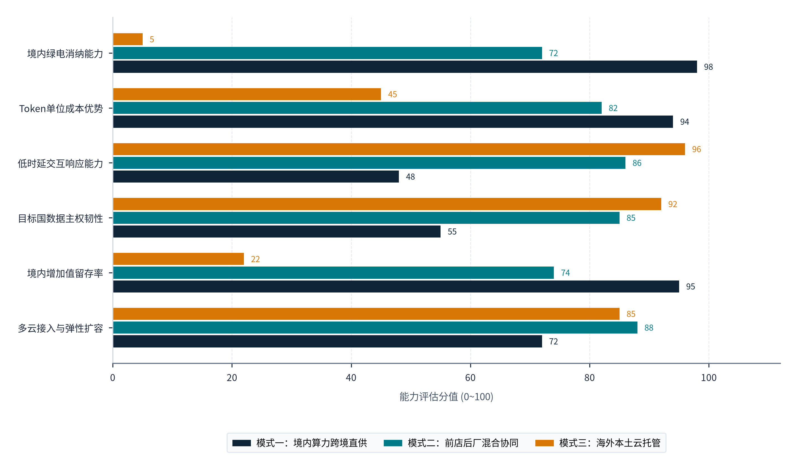
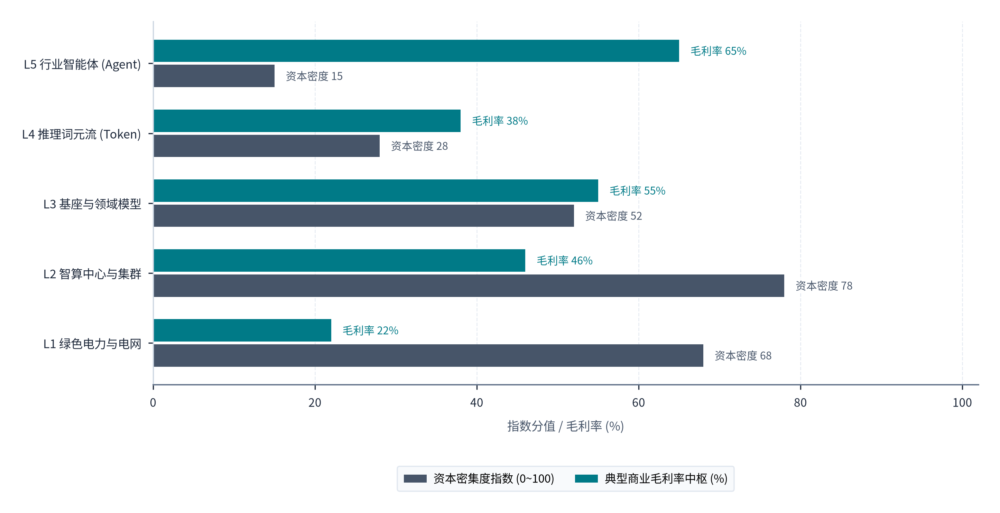
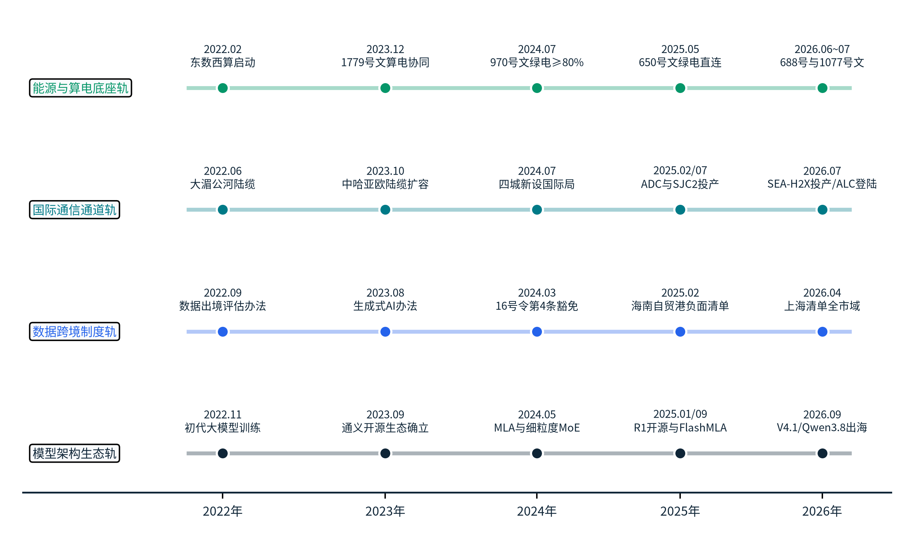
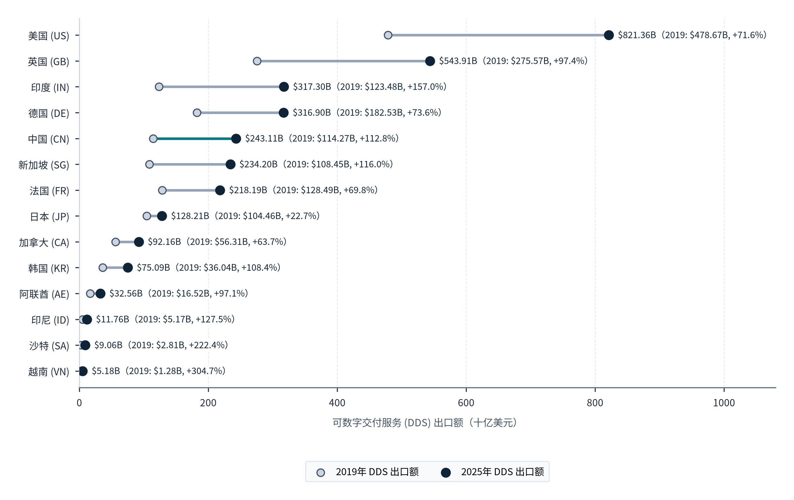
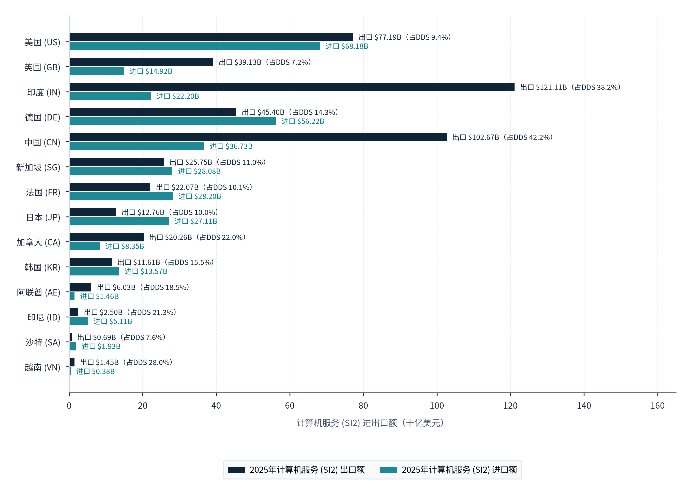

> **导航：** [返回中文手稿总目录](index.md) ｜ [上一篇：执行摘要](executive-summary.md) ｜ [下一章：第2章](chapter-02.md) ｜ [尾注](notes.md) ｜ [参考文献](references.md)

---
> **第一篇 · PART I · 研究对象与全球需求：界定跨洋推理经济的边界与真实版图**
> 本篇（第1至2章）旨在完成两项基础性研究工作：第一，在物理工程、商业交付与国民经济核算三重维度上，严密界定“Token 出海”的内涵与外延，剥离概念炒作与统计噪音；第二，穿透全球 AI 负载的底层任务结构与 11 个重点国家/地区的官方统计调查，识别出真正能够跨越主权云藩篱与海缆物理时延、由中国绿色算力体系承接的海外有效需求空间。
---

# Token出海的概念、发展现状与统计口径

> **本章导读：** “Token（词元）”原本只是自然语言处理（NLP）中文本切分与向量编码的最小算法计量单元。然而，当大语言模型（LLM）与多模态基础模型全面采用“按每百万输入/输出 Token 计价（Pay-per-Million-Tokens）”作为标准化商业结算尺度时，Token 便超越了单纯的计算机科学概念，演变为衡量数字时代生产力交付的标准等价物。所谓“Token 出海”，本质上是一场将境内富集的<strong>能源禀赋（绿色电力）</strong>、<strong>重资产算力设施（GPU/NPU 智算集群）</strong>与<strong>算法工程溢价（模型架构与推理优化）</strong>耦合封装为高标准化比特流，通过跨境通信网络向全球需求方实时交付的新型服务贸易。本章首先从物理转化链条与五层数字服务架构出发，厘清狭义与广义 Token 出海及六类易混淆业态的严格边界；进而复盘 2023至2026 年中国模型与推理服务出海的三阶段演进；最后深入联合国《2025年国民经济核算体系》（SNA 2025）与国际货币基金组织《国际收支手册第七版》（BPM7）的最新制度框架，剖析当前全球数字贸易统计在捕捉跨境推理经济时的结构性盲区[1](references.md#ref-1), [2](references.md#ref-2), [3](references.md#ref-3)。

## 1.1 业务形态与研究对象分类

### 1.1.1 从物理瓦特到商业比特：Token 作为标准化生产与结算单元的经济学本质

在传统能源与大宗商品贸易中，一国若想将其丰沛的清洁能源禀赋转化为国际贸易顺差，通常只有两条物理路径：其一是通过超高压跨国输电网直接出口电力（如北欧电力市场互联或中国南方电网向澜湄周边国家送电），其受制于地缘接壤、跨国电网同步安全与走廊损耗，辐射半径通常不超过 1,500～2,500 公里；其二是通过高耗能制造业（如电解铝、多晶硅、绿氢合成氨或锂电池制造）将电力物化为实体工业品，再经由远洋海运出口全球，但这不可避免地要承担高昂的国际物流费用、碳边境调节机制（如欧盟 CBAM）核查以及目标国的关税壁垒。

大模型推理时代的到来，历史性地开辟了<strong>第三条路径：“瓦特向比特的原地转化与跨洋光速交付”</strong>。在一次典型的大模型推理调用中，海外客户通过互联网或跨境专线发送一段提示词（Prompt），数据中心内部的 AI 加速卡集群在毫秒至数秒时间内消耗电能，完成数十亿至数千亿次矩阵乘加运算（GEMM）与高带宽显存（HBM）读写，生成一串语义连贯的输出 Token 并实时回传。在这一过程中，**每生成一百万个输出 Token，都对应着特定数量级的千瓦时（kWh）电力消耗、散热循环水耗、芯片资本折旧以及算法工程师的架构优化投入**。若从基础设施底层向上逐级穿透，Token 的跨洋交付是一条由五个物理与制度环节串联而成的价值链条：

- <strong>环节一（电力输入与园区配电）：</strong>发电侧的风、光、水、火、核电能经高压输电网进入算力中心变电站，其单位成本不仅取决于发电侧上网电价，更直接受制于省级电网两部制输配电价（容需量电费与电量电费）、政府性基金及附加，以及 2025至2026 年电力市场化改革后显性化的煤电/气电容量电费与系统运行费[33](references.md#ref-33), [37](references.md#ref-37), [38](references.md#ref-38)。
- <strong>环节二（机房微环境与算力集群承载）：</strong>电能进入数据中心后，一部分用于驱动冷水机组、精密空调、冷却塔及不间断电源转换（体现为电源使用效率 PUE，全国大型及超大型算力中心 2025 年均值约为 1.34，先进液冷集群可降至 1.12～1.20）[40](references.md#ref-40)；核心负载部分则输入搭载高带宽显存的 GPU 或国产 NPU 服务器集群。
- <strong>环节三（推理引擎与算子级调度）：</strong>大模型推理分为两个物理瓶颈截然不同的阶段：<strong>预填充阶段（Prefill Phase）</strong>将用户输入的上下文并行转化为键值缓存（KV Cache），属于<strong>计算密集型（Compute-bound）</strong>过程，主要受制于加速卡的稠密/稀疏浮点峰值（TFLOPS）；而<strong>解码阶段（Decode Phase）</strong>则逐个生成输出 Token，每生成一个 Token 都需要将数百吉字节（GB）的模型权重与动态增长的 KV Cache 从显存搬运至计算单元，属于<strong>显存带宽与互联密集型（Memory & Interconnect-bound）</strong>过程[41](references.md#ref-41), [45](references.md#ref-45)。
- <strong>环节四（跨境网络路由与边缘交付）：</strong>生成的 Token 流以 JSON/SSE（Server-Sent Events）或 gRPC 数据包形式封装，经由国内运营商骨干网、三大国际通信出入口局（北京、上海、广州）及新增国际数据专用通道，穿越太平洋、亚欧或东南亚海底光缆系统，在海外互联网交换中心（IXP）或云厂商边缘节点（Edge PoP）完成加密握手卸载与路由转发，最终呈现在海外终端屏幕上。
- <strong>环节五（计费网关、合规实体与外汇结算）：</strong>境外调用方按照 API 计费清单（每百万输入/输出 Token 单价，并区分缓存命中 Cache Hit 与未命中 Cache Miss）或专属实例包月费用，通过跨国支付渠道或银行电汇向服务商设在新加坡、香港、美国或欧洲的离岸商业主体支付外币；离岸主体再依据集团内部服务采购协议或算力调度合同，向境内基础设施与研发主体进行跨境结算[1](references.md#ref-1), [2](references.md#ref-2)。

在实际跨国经营中，企业围绕上述五个环节形成了三种不同的交付架构：<strong>“模式一：境内算力跨境直供”</strong>（物理算力完全部署于中国境内）、<strong>“模式二：前店后厂混合协同”</strong>（海外边缘轻节点负责接入与脱敏、境内集群负责核心推理）以及<strong>“模式三：海外本土云托管”</strong>（直接租用海外本地机房运行模型）。为直观对比这三种模式在资源消纳、成本、时延、合规与国内经济贡献上的差异，**图表 1.1** 从六个核心维度进行了量化评估（满分 100 分）：

#### 图表 1.1：三类跨境交付模式（境内集群直供、前店后厂协同、海外本地托管）六维能力对比

> **图像文件：** [`figures/chart_1_1.png`](../../figures/chart_1_1.png)（高清位图）｜ [`figures/chart_1_1.svg`](../../figures/chart_1_1.svg)（矢量图）
> **图注与来源：** 来源：IMF《国际收支手册第七版》（BPM7，2025）、国家网信办《促进和规范数据跨境流动规定》；介子九维（JIEZIJIUWEI）研究绘制[2](references.md#ref-2), [3](references.md#ref-3), [8](references.md#ref-8)。

对照**图表 1.1** 中的六维评分数据可以清楚看出三类交付模式各自的优劣边界：第一，<strong>“模式一：境内算力跨境直供”</strong>在<strong>境内绿电消纳能力（98分）</strong>、<strong>境内增加值留存率（95分）</strong>和<strong>Token单位成本优势（94分）</strong>三个维度上高居榜首，但在<strong>低时延交互响应能力（48分）</strong>和<strong>目标国数据主权韧性（55分）</strong>上存在短板，适合对时延容忍度高、不含海外个人敏感隐私的大宗批处理与代码生成任务；第二，<strong>“模式三：海外本土云托管”</strong>虽然在<strong>低时延交互响应能力（96分）</strong>和<strong>目标国数据主权韧性（92分）</strong>上表现突出，但其**境内绿电消纳能力仅为 5 分**、**境内增加值留存率仅为 22 分**、**Token单位成本优势仅为 45 分**，意味着单纯在海外租用云机房无法消化国内西部绿电与机架产能，大部分收入转化为对海外云厂商与海外电网的支出；第三，<strong>“模式二：前店后厂混合协同”</strong>在<strong>多云接入与弹性扩容（88分）</strong>、<strong>低时延交互响应能力（86分）</strong>、<strong>目标国数据主权韧性（85分）</strong>、<strong>Token单位成本优势（82分）</strong>、<strong>境内增加值留存率（74分）</strong>和<strong>境内绿电消纳能力（72分）</strong>六个维度上实现了均衡兼顾。这一对比表明，以“模式一（境内直供）”承接成本敏感型异步负载、以“模式二（前店后厂）”突破海外企业级合规与交互门槛，是中国绿色算力全球化交付最务实的组合路径。

### 1.1.2 核心研究对象的三层界定：狭义 Token 出海、广义 Token 出海与对照边界

正因为上述链条在空间布局与产权归属上可以发生多种组合，当前产业界与现有研究报告在探讨“算力出海”或“Token 出海”时，往往立足于各自所在的单一专业领域：或仅从电力与机房投资视角探讨绿电消纳，或仅从大模型调用视角将海外租云建站、开源模型下载乃至通用 SaaS 应用营收一并纳入统计。为弥补单一维度研究的不足、确保全篇在经济测算、政策评估与竞争对标上的统一性，笔者将分析对象严格划分为<strong>核心层（狭义 Token 出海）</strong>、<strong>扩展层（广义 Token 出海）</strong>与<strong>外围对照层（六类相关业态）</strong>：

1. <strong>核心研究对象：狭义 Token 出海（境内算力跨境直供）：</strong>
      指<strong>物理算力集群部署在中国关境内（含西部国家算力枢纽、沿海枢纽或跨境陆缆直连的边境算力节点）</strong>，直接消耗中国境内电力并依托境内机房设施运行大模型推理任务，通过跨境通信网络向境外企业、开发者或终端应用交付 API Token 流、托管推理端点或批量推理结果，并形成跨境服务收入的商业活动。唯有在这一形态下，“中国绿色电力低成本 + 本土智算集群规模效应 → 跨洋比特高附加值出口”的完整逻辑链条才真正闭环。
2. <strong>扩展研究对象：广义 Token 出海（前店后厂与混合路由）：</strong>
      指由中国大模型研发企业、AI 基础设施平台或云厂商主导技术栈与商业计费，但在<strong>交付架构上采用“境内+境外混合路由”或“离岸算力节点协同”</strong>的跨境推理服务。例如，中国模型厂商通过海外 API 网关直接向全球开发者提供服务，其中对时延不敏感的批量与长思维链任务路由回境内集群执行，而对低时延或数据主权有严格要求的交互式请求则调度至其在新加坡、法兰克福或北美租用/自建的海外节点；又如中国自研模型通过海外聚合平台（如 OpenRouter）对外提供按 Token 计费的 API 服务。广义范畴反映了中国模型工程与推理服务组织在全球市场的综合渗透力，在核算其对中国本土电力与数据中心的拉动作用时，按实际境内执行比例折算[i](notes.md#note-i)。
3. <strong>外围对照层：六类“泛算力/泛 AI 出海”关联业态的边界区分：</strong>
      在实际产业实践中，中资云海外建站、外资境内服务器托管、纯开源权重发布、AI 应用出海与算力硬件出口等业态常与 Token 出海一并被提及。在厘清各类业态的统计边界之前，有必要先审视从底层清洁电力（瓦特）到顶层行业智能体（比特）五个产业层级在资产属性与盈利能力上的差异。**图表 1.2** 对比了“L1 绿色电力与电网”至“L5 行业智能体 (Agent)”五个层级的<strong>资本密集度指数（0~100）</strong>与<strong>典型商业毛利率中枢（%）</strong>：

#### 图表 1.2：从瓦特到比特五层架构的资本密集度与经营毛利率分布

> **图像文件：** [`figures/chart_1_2_v.png`](../../figures/chart_1_2_v.png)（高清位图）｜ [`figures/chart_1_2_v.svg`](../../figures/chart_1_2_v.svg)（矢量图）
> **图注与来源：** 来源：联合国《2025年国民经济核算体系》（SNA 2025）、万国数据与润泽科技财务报告、OpenRouter 定价规则；介子九维（JIEZIJIUWEI）整理绘制[1](references.md#ref-1), [63](references.md#ref-63), [105](references.md#ref-105)。

对照**图表 1.2** 中两组柱状数据（“资本密集度指数 (0~100)”与“典型商业毛利率中枢 (%)”）可以看出：底层基础设施**L1 绿色电力与电网**（资本密集度指数 **68**、典型商业毛利率中枢 <strong>22%</strong>）与**L2 智算中心与集群**（资本密集度指数高达 **78**、典型商业毛利率中枢 <strong>46%</strong>）属于典型的重资产环节，前期固定资产投入巨大，其投资回报高度依赖长期高负荷运行与折旧摊薄；中间层**L3 基座与领域模型**的资本密集度指数降至 **52**，典型商业毛利率中枢提升至 <strong>55%</strong>；而向上的<strong>L4 推理词元流 (Token)</strong>（资本密集度指数仅 **28**、典型商业毛利率中枢 <strong>38%</strong>）与<strong>L5 行业智能体 (Agent)</strong>（资本密集度指数低至 **15**、典型商业毛利率中枢高达 <strong>65%</strong>）则呈现鲜明的轻资产服务特征。这一结构说明，如果西部算力园区仅停留在单纯出租机架或电力的 L1/L2 层级，将承受沉重的资本折旧压力；唯有向上打通 L3 基座模型、L4 推理词元流与 L5 行业智能体交付，把重资产的绿电算力底座转化为高周转、高毛利的跨境推理服务，才能显著改善全链条的盈利水平[1](references.md#ref-1), [105](references.md#ref-105)。

为进一步从国民经济核算与国际收支统计角度厘清上述各层级及六类关联业态的制度边界，根据联合国《2025年国民经济核算体系》（SNA 2025）第 22 章与国际货币基金组织《国际收支手册第七版》（BPM7）第 16 章的核算准则[1](references.md#ref-1), [2](references.md#ref-2)，**图表 1.3** 对狭义/广义 Token 出海及五类关联对照业态的对应数字服务层级、物理算力与电力消耗地、商业计费标的及国际收支（BOP）归属科目进行了逐项对照：

#### 图表 1.3：数字服务五层架构（IaaS至BPaaS）与六类“泛算力/泛AI出海”业态的物理执行地及国际收支（BOP）归属边界表

| 业务形态分类 | 对应数字服务层级 | 物理算力与电力消耗地 | 商业计费与交付标的 | SNA 2025 / BPM7 国际收支（BOP）核算归属 | 在本报告中的分析定位与核算处理 |
| --- | --- | --- | --- | --- | --- |
| <strong>① 狭义 Token 出海 （境内算力跨境推理）</strong> | **PaaS / FaaS** 模型即服务 (MaaS) / 函数级推理 | **中国境内** 直接消纳境内绿电与境内机架 | 按百万输入/输出 Token 计费，或按预留吞吐（PTU/TPM）计费 | 计入中国<strong>计算机服务出口（SI2）</strong>及数字交付服务（DDS，模式一跨境交付），全额创造境内增加值[1](references.md#ref-1), [3](references.md#ref-3)。 | <strong>核心研究对象：</strong>完整对应“瓦特→比特跨洋跃迁”主线，重点测算其成本、时延、碳足迹与可承接空间。 |
| <strong>② 广义 Token 出海 （前店后厂/混合路由）</strong> | **PaaS / FaaS** 跨境协同 MaaS 网关 | **境内 + 境外混合** 海外边缘接入+境内外动态路由 | 统一 API 密钥按 Token 计费，或分级 SLA 推理套餐 | 境内执行部分计入模式一服务出口；境外租用节点部分体现为对海外 IaaS 的服务进口或离岸子公司商业存在（模式三）收入[2](references.md#ref-2), [3](references.md#ref-3)。 | <strong>重点扩展对象：</strong>第 6 章、第 9 章与第 10 章核心商业架构，按境内实际算力承载比例拆解其对国内产业的拉动效应。 |
| **③ 中资云海外建站与海外裸金属租赁** | **IaaS** 基础设施即服务 | **中国境外** 消耗新加坡/中东/欧美当地电力 | 按 GPU 卡时（GPU-hour）、整机机柜或云主机月租计费 | 若由境外分支机构运营，属<strong>模式三（外国附属机构服务贸易 FATS）</strong>及对外直接投资（FDI）收益[2](references.md#ref-2)。 | <strong>竞争与协同对照项：</strong>作为第 4 章海外枢纽对比基准与第 6 章“前店后厂”混合部署的海外接入节点。 |
| **④ 外资/境外客户境内服务器托管** | **Colocation / Hosting** 机柜与电力托管 | **中国境内** 外方自备硬件或专属租用机房 | 按机柜千瓦（kW/月）、机位费与代维服务费结算 | 依据 **BPM7 §16.19**，为外国拥有的信息技术资产提供托管服务，计入**计算机服务（SI2）中的托管分项**[2](references.md#ref-2)。 | <strong>基础设施底层对照：</strong>属于物理机房与电力服务出口，单位电力附加值低于 MaaS 推理服务。 |
| **⑤ 纯开源模型权重发布与离岸自部署** | **无偿数字公共品 / 软件许可** | **中国境外** 由海外开发者在 AWS/本地运行 | Apache 2.0 / MIT 免费下载；或商业授权费（License Fee） | 免费开源权重属非货币交易（SNA 2025 §22.84至22.86建议在补充表中按成本或市场法评估）；收费长期许可依 **SNA §22.16** 计作软件资产或知识产权服务[1](references.md#ref-1)。 | <strong>生态先导变量：</strong>构建全球开发者技术生态与品牌认知，第 8 章与第 9 章重点分析其权利安排与商业 API 转化机制。 |
| <strong>⑥ AI 应用出海（AIGC 工具/伴侣/短剧/跨境电商 SaaS）</strong> | **SaaS / BPaaS** 软件与业务流程即服务 | **主要在境外** 常调用海外或国内 API 底座 | 按 C 端月度订阅（$9.9～$29.9/月）、内购充值或广告变现 | 计入软件应用服务、视听服务或广告服务；其总营收包含产品交互、营销获客与版权溢价，底层 Token 采购约占营收 5%～25%[3](references.md#ref-3)。 | <strong>下游核心需求方：</strong>按其底层推理 API 采购支出归入 Token 需求侧，是中国绿色算力出海最直接的先锋客群。 |
| <strong>⑦ 算力硬件与电力设备出口（服务器/光模块/变压器）</strong> | <strong>货物贸易（Goods）</strong> ICT 资本品出口 | **中国境外** 设备运抵海外机房后通电运行 | 按硬件台套、FOB/CIF 货物离岸价格一次性结算 | 归入海关<strong>货物贸易（HS 编码 8471、8517、8504 等）</strong>，与服务贸易分列核算[2](references.md#ref-2), [3](references.md#ref-3)。 | <strong>产业链外围参照：</strong>反映中国在智算中心上游供应链的制造优势，与持续性算力服务出口形成产业互补。 |

> **表格结构化数据文件：** [`data/exhibits/exhibit-1-3.csv`](../../data/exhibits/exhibit-1-3.csv)
> **表注与来源：** 来源：联合国《2025年国民经济核算体系》（SNA 2025）第22章、国际货币基金组织《国际收支手册第七版》（BPM7）第16章、OECD/WTO/IMF/UNCTAD《数字贸易测度手册（第二版）》；介子九维（JIEZIJIUWEI）研究与模型测算[1](references.md#ref-1), [2](references.md#ref-2), [3](references.md#ref-3)。

通过**图表 1.3** 对七类业务形态的逐行比对可以解释一个核心行业现象：为什么在 2025至2026 年的产业讨论中会出现“中国模型在全球 API 平台上调用量名列前茅，但西部算力中心却依然面临部分机架空置或降价竞争”的反差？根本原因在于，表中<strong>“⑤ 纯开源模型权重发布与离岸自部署”</strong>（物理算力消耗在中国境外，属非货币交易）与<strong>“⑥ AI 应用出海”</strong>（许多团队租用海外云算力面向海外用户收取订阅费）在过去两年间占据了大部分市场声量；而真正以<strong>“中国境内”</strong>或<strong>“境内+境外混合”</strong>为物理算力与电力消耗地、在国际收支中计入中国<strong>计算机服务出口（SI2）</strong>的<strong>“① 狭义 Token 出海”</strong>与<strong>“② 广义 Token 出海”</strong>，正处于从技术验证迈向规模化商业落地的关键爬坡期。

## 1.2 发展过程与实际进展

### 1.2.1 2022至2026年中国绿色算力与推理服务出海的四轨演进脉络

如果将视野拉回 2022 至 2023 年全球生成式 AI 浪潮兴起的起点，彼时业界普遍认为，由于美国在高端训练芯片、底层软件生态以及英文语料上的先发优势，全球大模型产业将延续由硅谷巨头包揽底层训练与全球 API 推理分发的格局。然而，从 2022 年至 2026 年 10 月的实际演进来看，中国在**能源与算电底座轨**、**国际通信通道轨**、**数据跨境制度轨**和**模型架构生态轨**四条轨道上同步推进，走出了一条由基础设施先行、算法降本破局到制度通道打通的演进路径（见**图表 1.4**）：

#### 图表 1.4：2022至2026年中国绿色算力出海“能源、通道、制度与模型”四轨演进时间轴

> **图像文件：** [`figures/chart_1_3.png`](../../figures/chart_1_3.png)（高清位图）｜ [`figures/chart_1_3.svg`](../../figures/chart_1_3.svg)（矢量图）
> **图注与来源：** 来源：国家发展改革委、国家能源局、工业和信息化部、国家网信办政策文件及 DeepSeek、阿里云官方技术公告；介子九维（JIEZIJIUWEI）整理[6](references.md#ref-6)–[10](references.md#ref-10), [33](references.md#ref-33)–[38](references.md#ref-38), [45](references.md#ref-45)。

对照**图表 1.4** 中 2022 至 2026 年四条轨道的年度关键节点，可以清晰梳理出中国 Token 出海条件走向成熟的演进脉络：第一，在**能源与算电底座轨**上，从 2022 年“东数西算八大枢纽启动”、2023 年“风光大基地特高压并网”、2024 年“算电协同写入国家文件”，推进至 2025 年“绿电直连650号与1192号文出台”与 2026 年“34电网1077号文与单一部制试点”，逐步打通了西部清洁电力向智算中心低成本直供的制度通道；第二，在**国际通信通道轨**上，从 2022 年“粤港澳海缆规划”、2023 年“昆明国际局获批筹建”、2024 年“南宁/青岛/昆明/海口四局获批”，到 2025 年“SJC2与ADC海缆投产”及 2026 年“SEA-H2X投产与四城新出入口局”落地，大幅拓宽了连接东南亚、亚太与欧亚大陆的低时延物理光缆走廊；第三，在**数据跨境制度轨**上，从 2022 年“数据出境评估办法”与 2023 年“标准合同备案制”，演进为 2024 年“网信办16号令豁免规则”、2025 年“京沪琼粤负面清单”和 2026 年“来数加工与17区域节点”试点，为“境外数据入境计算、结果实时回传且原始数据不留存”提供了明确的合规豁免依据；第四，在**模型架构生态轨**上，经历了 2022 年“千亿稠密模型探索”、2023 年“Qwen/百川开源破局”、2024 年“MoE与MLA架构突破”、2025 年“DeepSeek-R1与Qwen3破局”，直至 2026 年进入“百万上下文与多步Agent推理出海”阶段。正是这四条轨道在 2025 至 2026 年的同步交汇，使中国首次具备了规模化承接海外推理负载的综合基础：

1. **第一阶段：能力追赶与权重开源破局期（2022年至2024年上半年），呈现“有代码出海，无算力出海”特征**  

      在这一阶段，以阿里云通义千问（Qwen 系列）、百川智能、零一万物及智谱 AI 为代表的中国研发团队，率先在中等参数规模的开源基座模型上取得突破，并在全球开源榜单上频繁登顶。与此同时，大量中国背景的应用创业团队在海外设立主体，推出面向欧美及东南亚用户的 AI 应用工具。然而，从基础设施视角审视，这一阶段的实质是<strong>“智力成果无偿开源 + 海外云厂商收获算力红利”</strong>：全球开发者将开源模型权重下载后，部署在 AWS、CoreWeave、Together AI 或本地工作站上运行；而中国出海应用团队为了规避跨境延迟与合规不确定性，普遍直接调用海外官方 API 或租用海外云机房，中国境内的电力与数据中心并未直接参与全球推理交付。
2. <strong>第二阶段：MoE 架构突破与高性价比引爆期（2024年下半年至2025年第三季度），实现“跨洋 API 调用首次突破价格门槛”</strong>  

      关键转折出现在 2024 年底至 2025 年上半年。随着 2025 年 1 月 20 日 DeepSeek-R1 正式发布（同步开放 MIT 许可开源权重与商业 API 服务）以及 Qwen2.5/Qwen3 等旗舰模型相继推出，中国团队通过<strong>细粒度混合专家架构（MoE）</strong>、<strong>多头潜在注意力机制（MLA）</strong>以及**原生 FP8 混合精度训练与推理框架**，在将模型推理综合性能推升至国际第一梯队水平的同时，将官方 API 的每百万输入/输出 Token 定价压低至 0.14～2.19 美元区间（仅为同期国际闭源旗舰模型标价的 1/10 至 1/30），并在 API 返回的 `usage` 计费字段中首创区分输入缓存命中（`prompt_cache_hit_tokens`）与未命中（`prompt_cache_miss_tokens`）的精细化自动计费机制[45](references.md#ref-45), [53](references.md#ref-53), [54](references.md#ref-54)。  

      显著的单位成本优势，吸引了大批海外中长尾开发者与初创企业跨越“跨洋网络时延”顾虑。在 2025 年第一至第三季度，众多欧美、日韩、东南亚与拉美开发者主动将代码辅助工具（如 Cursor、Cline、Roo Code）、长文档翻译、结构化数据清洗与后台智能体工作流的 API 接口指向中国模型厂商的官方跨境端点，或通过 OpenRouter 等全球聚合平台调用中国模型。在部分高峰时段，旺盛的海外并发请求甚至促使境内推理集群推出夜间错峰半价计费机制。<strong>这是数字贸易发展史上，首次出现全球开发者规模化调用由中国境内智算集群实时生成的 AI 推理流。</strong>
3. <strong>第三阶段：生产级架构分化与绿色算力底座升级期（2025年第四季度至2026年10月），迈向“基础设施化与合规化运营”</strong>  

      进入 2025 年第四季度至 2026 年，随着百万上下文与多步智能体推理成为企业标配，单次任务消耗的 Token 数量大幅增长，全球推理需求迅速分化为两条轨道：
      
在**海外托管侧**，AWS Bedrock、Microsoft Azure AI Foundry、Google Cloud Vertex AI 以及 Fireworks、Together AI 等海外推理平台上线了 DeepSeek 与 Qwen3 系列模型的托管服务，主要承接对数据本地存储与超低时延有严格要求的欧美政企客户；
在**中国供给与跨境交付侧**，一方面，头部云与模型厂商加速推进全球化算力与模型服务布局：例如阿里巴巴集团财报披露，其云智能集团（Cloud Intelligence Group）抵销前分部年度收入由 FY2025（截至 2025 年 3 月 31 日）的 **1,180.28 亿元人民币**增至 FY2026（截至 2026 年 3 月 31 日）的 **1,581.32 亿元人民币**（按收入类型表列示的云服务收入为 **1,120.77 亿元人民币**）；自 2026 年 6 月季度起，阿里巴巴进一步将原云智能集团与平头哥（T-Head）合并重列为<strong>“AI 云与计算服务（AI Cloud and Compute Services）”</strong>分部，单季度实现收入 **484.37 亿元人民币**，其中企业定义的<strong>“AI 相关产品（AI-related products）”单季收入达 123.76 亿元人民币</strong>（注：集团财报分部收入涵盖国内外全栈云与硬件业务，未单独拆分境内集群支撑的跨境 Token 出口收入）；阿里云国际站（Model Studio International）则在技术文档中明确区分了访问端点区域、静态数据存储区域与推理执行地理范围，而 DeepSeek 亦于 2026 年 9 月 10 日发布新一代高吞吐 **DeepSeek-V4.1-Flash** 并延续 **DeepSeek-V4-Pro** 商业 API 服务[1](references.md#ref-1), [53](references.md#ref-53)。另一方面，国内政策层在 2025至2026 年相继落地绿电直连、34 个省级电网第四监管周期输配电价及自贸区数据跨境负面清单制度[33](references.md#ref-33), [36](references.md#ref-36), [39](references.md#ref-39)，推动西部富集的风光水绿电与智算集群向<strong>“全球大宗异步与准实时推理生产基地”</strong>升级。

### 1.2.2 现实进展与当前短板的客观审视：哪些已经跑通，哪些仍待突破？

站在 2026 年 10 月的基准时点审视，<strong>中国 Token 出海已经跨越了“从 0 到 1”的技术可行性与开发者认知验证，正在进入“从 1 到 100”的企业级规模化生产验证阶段。</strong>

从已验证的积极进展来看：第一，**中国开源与商用大模型已成为全球推理生态的重要一极**，在代码生成、数学逻辑推理、多语言翻译及长文本提取等核心生产任务上获得国际开发者广泛认可；第二，**跨洋异步与流式推理的工程链路已被证实稳定可用**：对于首字时间（TTFT）容忍度在 1.0～2.5 秒、解码吐字速度（TPOT）在 25～50 Tokens/秒以上的编程辅助、文档分析、内容生成与后台数据处理场景，跨境海底光缆带来的 120～220 毫秒物理往返时延（RTT）仅占总响应耗时的 5%～12%，完全满足业务要求；第三，<strong>“东数西算”西部枢纽的高负荷率电力成本优势已具备政策落地支撑</strong>，随着 2026 年 8 月第四监管周期输配电价与绿电直连机制的执行，蒙西、宁夏、甘肃、青海、云南等地的合规高密智算中心已能获得折算后约 0.042～0.054 美元/千瓦时（0.30～0.38 元/千瓦时）的稳定绿电供应[33](references.md#ref-33), [39](references.md#ref-39)，明显低于北美弗吉尼亚/得克萨斯（0.075～0.11 美元/千瓦时）、西欧法兰克福/都柏林（0.16～0.24 美元/千瓦时）及新加坡（0.18～0.25 美元/千瓦时）的同类园区用电成本。

与此同时，从早期开发者尝鲜迈向规模化企业级替代，当前产业仍面临四项现实制约：

- <strong>收入体量与调用量存在结构温差：</strong>由于中国模型厂商与平台主要依靠高性价比切入海外市场，且相当比例的海外调用集中于免费试用额度、低毛利路由分发或开源权重海外自建，当前由境内算力集群直接承载并实现外汇回流的狭义 Token 出海年化收入规模，相较于中国超千亿美元的计算机服务出口总额而言仍处于起步阶段；
- <strong>客户结构呈“重开发者、轻大型企业”特征：</strong>现有海外付费用户以独立开发者、AI 原生初创公司、中小型软件工作室及中资出海企业为主；而贡献全球企业级 IT 支出大头的跨国金融机构、医疗健康企业、政府公共部门与大型工业集团，受内部信息安全与数据本地化合规审计要求约束，对生产数据跨境流向境外机房仍持审慎态度；
- <strong>境内算力硬件结构存在代际差异：</strong>受美国商务部工业与安全局（BIS）2022至2026 年连续升级的先进芯片出口管制影响，中国境内机房难以规模化采购最新一代 NVIDIA B200/GB200 集群；存量高端推理主力仍依赖前期储备的 H800/H20 及快速扩产的华为昇腾（Ascend 910B / 950）等国产加速卡[41](references.md#ref-41), [44](references.md#ref-44)。虽然算法优化弥补了部分差距，但在超高并发、超长上下文的极限吞吐能效比上，硬件折旧与卡间通信开销仍对低电价带来的成本优势形成一定抵消；
- <strong>微观商业结算需通过工程与财务模型交叉核验：</strong>由于头部模型企业与云厂商尚未在公开财报中单独披露境内算力集群支撑的境外 API 净收入、跨境专线结算单价及实际算力利用率分布，后续章节将结合全生命周期成本底稿与敏感性分析，定量测算不同情景下的盈亏平衡区间。

## 1.3 市场统计与经济核算口径

### 1.3.1 现行国际宏观统计体系（SNA 2025 / BPM7 / WTO DDS）如何定义跨境推理？

要回答“全球及中国 Token 出海的市场底座究竟有多大、在国民经济与国际收支核算体系中如何体现”，需要对齐全球最新修订的三大宏观核算准则，即联合国统计委员会于 2025 年正式通过的<strong>《2025年国民经济核算体系》（SNA 2025）</strong>[1](references.md#ref-1)、国际货币基金组织（IMF）于 2025 年 3 月发布的<strong>《国际收支和国际投资头寸手册第七版》（BPM7）</strong>[2](references.md#ref-2)，以及 IMF、OECD、UNCTAD 与 WTO 联合编制的<strong>《数字贸易测度手册（第二版）》</strong>[3](references.md#ref-3)。

本研究通过对上述三大制度准则的系统梳理，归纳出与大模型及跨境推理直接相关的四项核心核算规则：

1. <strong>人工智能系统的资产与服务双重属性（SNA 2025 §22.33至22.35 及表 11.1）：</strong>
      SNA 2025 首次在国民经济核算历史上设立了专门针对人工智能的资产细类，将人工智能系统明确归入固定资产项下的<strong>“计算机软件和数据库 → 计算机软件 → 其中：人工智能专项资产”</strong>[1](references.md#ref-1)。这一固定资产分类适用于模型研发方自用、或买方取得长期使用许可（通常超过一年）的软件资产。当海外用户通过 API 按 Token 用量实时调用中国境内的模型推理服务时，买方并未获得模型底层的知识产权或软件资产所有权，而是在消费一种**由软件资产与计算设施共同生成的非金融数字服务产出**。
2. <strong>云计算五层模型与跨境计算服务归属（SNA 2025 §22.14至22.19 & BPM7 §16.14至16.19）：</strong>
      SNA 2025 第 22 章将云计算服务正式划分为基础设施即服务（IaaS）、平台即服务（PaaS）、函数即服务（FaaS）、软件即服务（SaaS）和业务流程即服务（BPaaS）五层[1](references.md#ref-1)。在国际收支平衡表（BOP）的扩展国际收支服务分类（EBOPS）中，无论是按 Token 计费的 API 调用（PaaS/FaaS），还是由境内算力中心为外国所有的信息技术资产提供远程计算与托管（BPM7 §16.19 明确规定的“为外国实体拥有的信息技术资产提供托管服务”）[2](references.md#ref-2)，只要是通过通信网络跨越国境远程交付（对应 GATS 服务贸易**模式一：跨境交付**），均统一归入<strong>“电信、计算机和信息服务（SI）”项下的二级子目“计算机服务（编码 SI2）”</strong>，同时全额计入 WTO 与 OECD 统计的<strong>“可数字交付服务（DDS）”</strong>[3](references.md#ref-3), [4](references.md#ref-4)。
3. <strong>长期软件许可、专属服务器合同与训练数据的制度切分（SNA 2025 §22.15至22.16 & §22.36至22.37）：</strong>
      SNA 2025 第 22.16 段明确了资本化与服务消费的核算边界：如果云计算或模型用户购买了某项软件或模型的长期使用许可（超过一年许可，或实务上自动续期的一年期许可），并将其部署在云基础设施上运行，则该长期许可应作为用户的软件固定资产处理，而不足一年的许可通常作为软件服务中间消耗，并在国际收支中与底层的云计算处理服务费分开记录[1](references.md#ref-1)。同理，对于长期专属服务器合同（Dedicated Server Contracts），当用户实质承担服务器运营风险并成为经济所有者时，应按融资租赁处理；在训练数据与 AI 软件价值拆分上（§22.36），可跨项目复用的数据资产价值须单独列示，专为生产特定程序且不可复用的数据则计入成本法下的软件生产成本；对于 AI 模型在使用中的持续学习（Learning-in-use，§22.37），实务上不因使用中学习单独记录固定资本形成，而是通过调整 AI 软件折旧率以反映其经济寿命变化[1](references.md#ref-1)。
4. <strong>数字中介平台（API 聚合路由平台）的“净额核算原则”与数字贸易去重公式（SNA 2025 §22.45至22.51 & 数字贸易测度手册表 2.1）：</strong>
      在当前 Token 出海生态中，诸如 OpenRouter 等第三方 API 聚合与路由平台扮演了重要渠道角色。根据 SNA 2025 第 22.45至22.51 段关于“数字中介平台（Digital Intermediation Platforms, DIPs）”的界定，满足纯中介条件的平台，其<strong>平台产出按其收取的中介服务费（Intermediation Fees）净额核算，不包括其协助外部模型或算力商销售的标的服务总流水（Gross Transaction Value）</strong>[1](references.md#ref-1), [ii](notes.md#note-ii)。同时，依据 IMF/OECD/UNCTAD/WTO《数字贸易测度手册（第二版）》表 2.1 的总量去重准则，一国数字贸易总额遵循去重公式：**数字贸易总额 ＝ 数字订购贸易 ＋ 数字交付贸易 － 两者重叠部分**[3](references.md#ref-3)。

> ### 【专栏 1.1 · 统计与商业口径解析】海外聚合平台（如 OpenRouter）上的中国模型调用量与本土算力服务出口额的核算关系
>
> 2025至2026 年间，行业讨论在评估中国模型全球影响力时，常引用全球模型路由平台 OpenRouter 的周度或月度调用排行榜数据，例如 DeepSeek 或 Qwen 系列模型在单周消耗数千亿乃至数万亿 Token。从路由机制与国际收支核算规则来看，将“中国模型全球调用量”转化为“中国境内算力服务出口额”需经过**三层结构折算**：
>
> 1. <strong>算力物理执行地分流（Provider Routing Split）：</strong>在 OpenRouter 等聚合平台上，同一个中国开源模型（如 DeepSeek-R1 或 Qwen3-235B）背后通常挂载着十余家不同的推理基础设施提供商（Providers），既包括模型官方跨境端点或硅基流动、阿里云等中资渠道，也包括 Fireworks、Together AI、DeepInfra、Parasail、Nebius、AWS Bedrock 等物理机房位于北美或欧洲的海外算力商。当海外用户未显式指定中国官方端点时，平台默认负载均衡算法往往按就近低延迟原则将 60%～85% 的请求路由至北美或欧洲本土 GPU 集群。这部分调用反映的是中国模型架构的全球渗透率，而物理电力与算力消耗发生在海外本地。
> 2. <strong>国际收支资金流向划分（BOP Value Capture）：</strong>根据 SNA 2025 §22.45至22.51，当美国开发者向美国注册的聚合平台充值 100 美元，并调用由美国算力商 DeepInfra 托管的中国开源模型时，资金流转发生在美国境内（平台收取约 5%～5.5% 充值/路由服务费，其余归属美国算力商）[1](references.md#ref-1)。唯有当请求被路由至中国境内（或中资海外节点回源境内）的官方端点，且平台与中国服务商完成跨境清算后，扣除平台通道费的净额部分才构成中国的计算机服务出口。
> 3. <strong>促销额度与有效货币化率折算：</strong>聚合平台上包含一定比例的免费开发者实验端点与促销赠金（Credits），其实际结算净价低于公开标牌价。因此，第三方路由榜单是衡量<strong>“中国模型全球生态认知与架构渗透率”</strong>的核心先行指标，而核算<strong>“境内绿色算力跨境出口实绩”</strong>则需进一步结合实际回源中国境内集群的路由比例与跨境结算净额。

### 1.3.2 2019至2025年全球及主要经济体可数字交付服务（DDS）与计算机服务（SI2）实证底盘

尽管现行宏观统计尚未在“计算机服务（SI2）”之下单列“人工智能推理服务”四级子目，但世界贸易组织（WTO）于 2026 年 7 月发布的**全球可数字交付服务（Digitally Delivered Services, DDS，GATS 模式一跨境远程交付口径）数据库**，以及世界银行（World Bank WDI，2026 年 10 月更新版）2025 年国际收支（BOP）服务贸易统计，为锁定 Token 出海所处的宏观贸易母体提供了权威基准[4](references.md#ref-4), [5](references.md#ref-5), [6](references.md#ref-6)。在对比之前须明确两套国际统计的口径差异：按世界银行 WDI / IMF BOP 全口径现价服务贸易统计，2025 年中国服务贸易总出口为 **3,846.79 亿美元**、总进口为 **6,227.91 亿美元**（其中 WDI 定义的 ICT 服务出口为 **736.09 亿美元**，按其元数据说明包含电信、计算机、信息及邮政快递服务）；同期美国 BOP 服务总出口为 **12,378.94 亿美元**、总进口为 **9,102.36 亿美元**（WDI ICT 服务出口为 **1,017.34 亿美元**），印度 BOP 服务总出口为 **4,122.53 亿美元**、总进口为 **2,026.80 亿美元**（WDI ICT 服务出口为 **2,003.44 亿美元**）[6](references.md#ref-6)。而在专门剥离线下物理交付、聚焦通过通信网络跨境远程交付的 WTO DDS（模式一）与 EBOPS“SI2 计算机服务”口径下，各国在远程数字服务贸易上的体量与增速结构更为清晰。**图表 1.5** 对比了 14 个重点经济体在 <strong>2019年 DDS 出口（十亿美元）</strong>与 <strong>2025年 DDS 出口（十亿美元）</strong>上的规模演进及六年累计增幅：

#### 图表 1.5：主要经济体可数字交付服务（DDS）出口规模演进（2019至2025年）

> **图像文件：** [`figures/chart_1_4.png`](../../figures/chart_1_4.png)（高清位图）｜ [`figures/chart_1_4.svg`](../../figures/chart_1_4.svg)（矢量图）
> **图注与来源：** 来源：世界贸易组织（WTO）《Global Trade in Digitally Delivered Services Dataset》（2026年7月版）；介子九维（JIEZIJIUWEI）整理绘制[4](references.md#ref-4)。

对照**图表 1.5** 中 14 个重点经济体的“2019年 DDS 出口（十亿美元）”与“2025年 DDS 出口（十亿美元）”两组柱体及增幅标签可见：第一，在绝对规模上，<strong>美国 (US)</strong> 由 2019 年的 478.7 十亿美元增至 2025 年的 <strong>821.4 十亿美元（+71.6%）</strong>，<strong>英国 (GB)</strong> 由 275.6 十亿美元增至 <strong>543.9 十亿美元（+97.4%）</strong>，<strong>印度 (IN)</strong> 由 123.5 十亿美元跃升至 <strong>317.3 十亿美元（+157.0%）</strong>，<strong>德国 (DE)</strong> 由 182.5 十亿美元增至 <strong>316.9 十亿美元（+73.6%）</strong>，<strong>中国 (CN)</strong> 由 114.3 十亿美元增长至 <strong>243.1 十亿美元（+112.8%）</strong>，<strong>新加坡 (SG)</strong> 由 108.4 十亿美元增至 <strong>234.2 十亿美元（+116.0%）</strong>，<strong>法国 (FR)</strong> 由 128.5 十亿美元增至 <strong>218.2 十亿美元（+69.8%）</strong>，<strong>日本 (JP)</strong> 由 104.5 十亿美元增至 <strong>128.2 十亿美元（+22.7%）</strong>，<strong>加拿大 (CA)</strong> 与 <strong>韩国 (KR)</strong> 2025 年分别达 <strong>92.2 十亿美元（+63.7%）</strong>与 <strong>75.1 十亿美元（+108.3%）</strong>；第二，在新兴市场增速上，<strong>越南 (VN)</strong>（由 1.28 增至 <strong>5.18 十亿美元，+305.1%</strong>）、<strong>沙特阿拉伯 (SA)</strong>（由 2.81 增至 <strong>9.06 十亿美元，+222.4%</strong>）、<strong>印度尼西亚 (ID)</strong>（由 5.17 增至 <strong>11.76 十亿美元，+127.6%</strong>）和<strong>阿联酋 (AE)</strong>（由 16.52 增至 <strong>32.56 十亿美元，+97.1%</strong>）均展现出强劲的数字化跃升势头，而中国 112.8% 的六年累计增幅显著高于全球平均增速（86.7%）以及美、德、法、日、加等发达经济体。

在对比可数字交付服务（DDS）总量演进的基础上，为进一步聚焦其中直接承载云计算、远程数据处理与大模型 API 推理的<strong>“SI2 计算机服务”</strong>科目，**图表 1.6** 展示了 2025 年上述 14 个重点经济体的<strong>“2025年 SI2 计算机服务出口（十亿美元）”</strong>、<strong>“2025年 SI2 计算机服务进口（十亿美元）”</strong>以及<strong>“[占DDS X%]”</strong>结构比重：

#### 图表 1.6：2025年主要经济体计算机服务（SI2）进出口规模与占可数字交付服务（DDS）出口比重

> **图像文件：** [`figures/chart_1_5.png`](../../figures/chart_1_5.png)（高清位图）｜ [`figures/chart_1_5.svg`](../../figures/chart_1_5.svg)（矢量图）
> **图注与来源：** 来源：世界贸易组织（WTO）全球服务贸易与数字交付服务数据库（2026年7月版）；介子九维（JIEZIJIUWEI）计算绘制[4](references.md#ref-4)。

逐项对照**图表 1.6** 中的双向柱体与“占DDS”标签，可以提炼出三项核心结论：

- <strong>结论一：中国计算机服务出口高居 14 个重点经济体第二位，且占本国数字交付服务出口比重最高（42.2%）。</strong>如**图表 1.6** 所示，在“2025年 SI2 计算机服务出口（十亿美元）”指标上，<strong>印度 (IN)</strong> 以 <strong>$121.11B [占DDS 38.2%]</strong> 位居第一，<strong>中国 (CN)</strong> 以 <strong>$102.67B [占DDS 42.2%]</strong> 紧随其后位居第二，全面超过<strong>美国 (US)</strong>（<strong>$77.19B [占DDS 9.4%]</strong>，美国 DDS 出口更多集中于知识产权许可与金融咨询）、<strong>德国 (DE)</strong>（<strong>$45.40B [占DDS 14.3%]</strong>）、<strong>英国 (GB)</strong>（<strong>$39.13B [占DDS 7.2%]</strong>）、<strong>新加坡 (SG)</strong>（<strong>$25.75B [占DDS 11.0%]</strong>）、<strong>法国 (FR)</strong>（<strong>$22.07B [占DDS 10.1%]</strong>）、<strong>加拿大 (CA)</strong>（<strong>$20.26B [占DDS 22.0%]</strong>）、<strong>日本 (JP)</strong>（<strong>$12.76B [占DDS 10.0%]</strong>）和<strong>韩国 (KR)</strong>（<strong>$11.61B [占DDS 15.5%]</strong>）。同时，中国 2025 年 SI2 计算机服务进口为 <strong>$36.73B</strong>，实现计算机服务贸易顺差 <strong>+659.44 亿美元</strong>，表明中国在远程计算与技术服务领域已形成扎实的净出口能力[4](references.md#ref-4), [5](references.md#ref-5)。
- <strong>结论二：美、德、法、新、日、韩及印尼、沙特构成显著的计算机服务进口买方市场。</strong>观察**图表 1.6** 中的“2025年 SI2 计算机服务进口（十亿美元）”浅蓝色柱体可见，<strong>美国 (US)</strong>（进口 <strong>$68.18B</strong>）与<strong>德国 (DE)</strong>（进口 <strong>$56.22B</strong>，高于其出口 $45.40B）是全球最大的两个计算机服务买方市场；同时，<strong>法国 (FR)</strong>（进口 <strong>$28.20B</strong> vs 出口 $22.07B）、<strong>新加坡 (SG)</strong>（进口 <strong>$28.08B</strong> vs 出口 $25.75B）、<strong>日本 (JP)</strong>（进口 <strong>$27.11B</strong> vs 出口 $12.76B）、<strong>韩国 (KR)</strong>（进口 <strong>$13.57B</strong> vs 出口 $11.61B）、<strong>印度尼西亚 (ID)</strong>（进口 <strong>$5.11B</strong> vs 出口 $2.50B）以及<strong>沙特阿拉伯 (SA)</strong>（进口 <strong>$1.93B</strong> vs 出口 $0.69B）均呈现“进口大于出口”的计算机服务净逆差格局，反映出这些经济体对外部云算力与技术服务的持续采购需求[4](references.md#ref-4)。
- <strong>结论三：打通宏观 SI2 统计与微观 Token 流水需结合贸易增加值（TiVA）核算。</strong>根据 OECD《增加值贸易（TiVA）指标指南》（2025 年版覆盖 80 个经济体、50 项经济活动的 1995至2022 年完整序列，2026 年初实验性快报进一步将 41 个经济体更新至 2024 年），一国总出口可拆解为<strong>本国增加值（DVA，Domestic Value Added）</strong>与<strong>国外增加值（FVA，Foreign Value Added）</strong>：当中国算力出海从租用海外机房转向依托西部本土绿电、国产推理芯片与自研模型架构时，每百美元计算机服务出口留在国内的增加值比例将显著提升[7](references.md#ref-7)。

为完整留存全球总计及上述 14 个重点经济体在 2019 年与 2025 年的进出口基数、增长率及差额数据，**图表 1.7** 汇总了世界贸易组织（WTO）DDS 数据库与国际收支（BPM7）口径下的完整样本数据（单位统一为亿美元，按 WTO 原始百万美元数据精确除以 100 折算保留两位小数）：

#### 图表 1.7：全球与14个重点经济体可数字化交付服务（DDS）及计算机服务（SI2）进出口完整样本数据表（2019至2025年）

| 经济体（WTO 口径） | 2019年 DDS 出口 / 进口（亿美元） | 2025年 DDS 出口 / 进口（出口增幅） | 2019年 SI2 出口 / 进口（亿美元） | 2025年 SI2 出口 / 进口（SI2净差额） | SI2 比重、显性比较优势 (RCA) 与 LMDI 结构效应 [D1] |
| --- | --- | --- | --- | --- | --- |
| <strong>全球总计 (World)</strong> | 28,255.23 / 25,919.32 | **52,742.68** / 44,568.35（+86.7%） | 4,466.19 / 2,485.36 | **11,519.46** / 5,764.52（+5,754.93） | <strong>21.8%</strong>（RCA＝1.00；结构效应 +$1,458.4亿） |
| <strong>美国 (US)</strong> | 4,786.70 / 2,694.32 | **8,213.55** / 5,382.44（+71.6%） | 338.22 / 331.40 | **771.89** / 681.76（+90.14） | 9.4%（RCA＝0.43；LMDI结构 +$155.1亿） |
| <strong>英国 (GB)</strong> | 2,755.70 / 1,357.39 | **5,439.09** / 2,625.28（+97.4%） | 139.56 / 50.58 | **391.31** / 149.24（+242.07） | 7.2%（RCA＝0.33；LMDI结构 +$81.5亿） |
| <strong>印度 (IN)</strong> | 1,234.75 / 638.94 | **3,173.03** / 1,242.23（+157.0%） | 516.61 / 63.75 | **1,211.07** / 221.95（+989.11） | 38.2%（RCA＝1.75；LMDI结构 <strong>-$74.9亿</strong>） |
| <strong>德国 (DE)</strong> | 1,825.26 / 1,571.52 | **3,168.98** / 3,042.14（+73.6%） | 197.92 / 279.08 | **453.97** / 562.18（-108.21） | 14.3%（RCA＝0.66；LMDI结构 +$90.5亿） |
| <strong>中国 (CN)</strong> | 1,142.70 / 1,088.08 | **2,431.13** / 1,679.55（+112.8%） | 386.23 / 188.37 | **1,026.74** / 367.30（+659.44） | <strong>42.2%</strong>（**RCA＝1.93居首**；LMDI结构 <strong>+$145.9亿</strong>） |
| <strong>新加坡 (SG)</strong> | 1,084.48 / 913.60 | **2,342.05** / 2,062.07（+116.0%） | 93.54 / 105.84 | **257.48** / 280.82（-23.35） | 11.0%（RCA＝0.50；LMDI结构 +$37.2亿） |
| <strong>法国 (FR)</strong> | 1,284.90 / 1,137.92 | **2,181.92** / 1,965.66（+69.8%） | 101.95 / 131.12 | **220.71** / 281.99（-61.28） | 10.1%（RCA＝0.46；LMDI结构 +$33.5亿） |
| <strong>日本 (JP)</strong> | 1,044.57 / 1,214.27 | **1,282.08** / 1,805.76（+22.7%） | 41.04 / 142.26 | **127.60** / 271.06（-143.46） | 10.0%（RCA＝0.46；LMDI结构 +$69.5亿） |
| <strong>加拿大 (CA)</strong> | 563.09 / 555.18 | **921.61** / 905.10（+63.7%） | 80.91 / 41.72 | **202.60** / 83.48（+119.12） | 22.0%（RCA＝1.01；LMDI结构 +$53.7亿） |
| <strong>韩国 (KR)</strong> | 360.43 / 444.10 | **750.87** / 888.32（+108.3%） | 32.96 / 28.64 | **116.10** / 135.65（-19.55） | 15.5%（RCA＝0.71；LMDI结构 +$35.4亿） |
| <strong>阿联酋 (AE)</strong> | 165.18 / 136.81 | **325.62** / 220.75（+97.1%） | 37.78 / 5.31 | **60.33** / 14.58（+45.75） | 18.5%（RCA＝0.85；LMDI结构 -$10.1亿） |
| <strong>印度尼西亚 (ID)</strong> | 51.67 / 133.53 | **117.57** / 308.47（+127.6%） | 2.88 / 18.58 | **24.99** / 51.13（-26.15） | 21.3%（RCA＝0.97；LMDI结构 +$12.9亿） |
| <strong>沙特阿拉伯 (SA)</strong> | 28.10 / 174.13 | **90.61** / 324.16（+222.4%） | 8.93 / 17.93 | **6.93** / 19.29（-12.36） | 7.7%（RCA＝0.35；LMDI结构 -$11.2亿） |
| <strong>越南 (VN)</strong> | 12.79 / 23.73 | **51.80** / 50.40（+305.1%） | 3.51 / 1.57 | **14.53** / 3.83（+10.70） | 28.0%（RCA＝1.28；LMDI结构 +$0.2亿） |

> **表格结构化数据文件：** [`data/exhibits/exhibit-1-7.csv`](../../data/exhibits/exhibit-1-7.csv)
> **表注与来源：** 注：末列显性比较优势指数按 Balassa 公式 RCAi,SI2 ＝ (Ei,SI2/Ei,DDS) ÷ (EW,SI2/EW,DDS) 计算，2019至2025年 SI2 出口增量的 Kaya-LMDI 对数平均迪氏指数完全无残差分解（ΔE ＝ ΔEscale ＋ ΔEstruct）完整计算序列见《O01_WTO数字服务与计算机服务RCA及LMDI分解表.csv》。来源：UN SNA 2025、IMF BPM7 (2025)、WTO Digitally Delivered Services Dataset (2026.07)、OECD TiVA Guide；介子九维（JIEZIJIUWEI）研究与模型测算[1](references.md#ref-1), [2](references.md#ref-2), [4](references.md#ref-4), [7](references.md#ref-7)。

综合研读**图表 1.7** 中的完整数据及末列衍生指标<strong>“SI2 比重、显性比较优势 (RCA) 与 LMDI 结构效应 [D1]”</strong>可以发现两项非直观规律：第一，全球总计 2025 年 DDS 出口已达 **52,742.68 亿美元**、SI2 计算机服务出口达 **11,519.46 亿美元**（占 DDS 出口比重的 <strong>21.8%</strong>）；在 14 个重点经济体中，<strong>中国 2025 年 SI2 计算机服务出口在数字交付服务中的显性比较优势指数（RCA）高达 1.93，位居全球主要数字贸易大国之首（高于印度的 1.75、加拿大的 1.01、美国的 0.43 与英国的 0.33）</strong>；第二，应用 Kaya-LMDI 对数平均迪氏指数对 2019 至 2025 年 SI2 出口净增量进行完全无残差分解显示，<strong>中国 SI2 出口六年净增的 640.51 亿美元中，有 +494.59 亿美元（占 77.2%）来自数字贸易总盘扩张的规模效应（ΔEscale），更有 +145.92 亿美元（占 +22.8%）来自向高附加值算力与软件服务跃迁的正向结构升级效应（ΔEstruct > 0，SI2 占比从 33.8% 跃升至 42.2%）；反观印度同期 SI2 出口净增 694.46 亿美元中，其结构升级效应实为负值（ΔEstruct ＝ -74.87 亿美元，占 -10.8%，SI2 占比从 41.8% 下滑至 38.2%）</strong>，证明中国计算机服务出口具备显著更强的技术结构升级动能。与此同时，日本（SI2 净差额 <strong>-143.46 亿美元</strong>）、德国（<strong>-108.21 亿美元</strong>）、法国（<strong>-61.28 亿美元</strong>）、印度尼西亚（<strong>-26.15 亿美元</strong>）、新加坡（<strong>-23.35 亿美元</strong>）、韩国（<strong>-19.55 亿美元</strong>）及沙特阿拉伯（<strong>-12.36 亿美元</strong>，DDS 总逆差达 233.55 亿美元）均存在显著的跨境计算服务输入需求，构成了第 2 章开展全球 30 个参考市场空间测算的数据基石。

将上述跨国对数平均迪氏指数（Kaya-LMDI）无残差分解与显性比较优势（RCA）实算结果转化为战略决策工具，可提炼出从认知重构到落地执行的三层递进指示：

- 思考启示（穿透出口规模假象，锚定结构升级动能）：传统数字贸易评估常以出口绝对额论英雄，容易将印度等传统人力外包大国视为不可逾越的标杆。然而 Kaya-LMDI 分解揭示，印度近六年计算机服务出口增长完全依赖外包总盘膨胀（规模效应占比高达 110.8%），其内部结构效应已转为负值（-74.87 亿美元），反映出生成式 AI 自动化编程正在剧烈冲击传统人力代码外包；相反，中国凭借 +145.92 亿美元的正向结构升级效应与 1.93 的全球最高 RCA 指数，证明决定新一代数字服务贸易竞争力的核心变量已从“低成本英语程序员数量”切换为“低成本清洁电力 × 高密度智算集群 × 自主开源模型架构”。
- 具体应用场景（数字贸易统计制度改革、国家数字服务出口基地考核与海外主攻市场筛选）：该模型直接应用于商务部与国家外汇管理局的服务贸易统计监测体系设计、自贸试验区与数字服务出口基地的年度绩效评估，以及出海算力企业在全球 30 个经济体中优选净进口逆差市场。
- 具体行为动作指示（单列推理贸易统计子目，集中火力攻坚亚太与中东高逆差买方市场）：第一，在宏观政策端，商务部与国家外汇管理局应在国际收支计算机服务（SI2）统计项下增设“人工智能模型推理与算力调用服务（Token 级结算）”专项统计子目，将地方数字贸易考核指标从粗放的总流水切换为“LMDI 正向结构效应贡献率（目标保持 ≥ 25%）”；第二，在企业市场拓展端，国内模型 API 与算力服务商应避开在爱尔兰（RCA 2.66）等跨国巨头税务总部所在地开展同质化竞争，优先锁定模型识别出的七大计算机服务净逆差国（日本 -143.46 亿美元、德国 -108.21 亿美元、印尼 -26.15 亿美元、新加坡 -23.35 亿美元、韩国 -19.55 亿美元及沙特 -12.36 亿美元），以高附加值模型 API 与自动化代码/多语种智能体替代当地高昂的传统 IT 外包采购。

## 1.4 全报告的分析框架

### 1.4.1 核心分析范式：“双侧供需漏斗 + 五维约束筛选 + 动态情景推演”

基于前三节对物理链条、演进阶段与统计口径的界定，本报告沿着“有效需求筛选、供给能力测算、通道交付工程、制度合规治理、商业经济性与产业策略”递进逻辑，构建了一套可计算、可交叉验证的**系统分析框架**：

1. <strong>需求侧漏斗（第2章）：从“全球 AI 总需求”层层筛选至“可跨洋承接的有效需求盘”。</strong>
      并非所有海外 AI 需求都能由中国境内算力承接。笔者在第 2 章设置四道筛选门槛：第一道门槛是**负载物理属性与时延容忍度**（剥离往返时延敏感型实时语音与本地控制，锁定异步、批处理与流式文本/代码任务）；第二道门槛是**各国真实付费深度**（区分泛泛采用率与实际发生 AI 采购支出的企业比例）；第三道门槛是**数据主权与行业准入红线**（剥离政务、国防、受监管医疗金融核心隐私数据）；第四道门槛是**海外云厂商生态锁定与迁移成本**（量化英国 CMA 调查揭示的数据迁出费与预付折扣壁垒）。经过四道筛选留存下来的，才是中国 Token 出海真实可争取的海外净可获市场空间（SOM）。
2. <strong>供给侧底座与国际竞合对标（第3至4章）：穿透“名义总量”检验“可调度、低成本、高可靠交付力”。</strong>
      在第 3 章，笔者深入发改价格〔2026〕1077号全部 34 个省级及区域电网第四监管周期输配电价表、容量电价与系统运行费改革细则，测算西部五大枢纽在不同负荷率下的**真实到户绿电成本**；同时利用全国一体化算力网监测数据，剖析“1590 EFLOPS 智算总量与 10.8% 可跨网调度算力”背后的体制与技术瓶颈，并客观评估国产推理加速卡（Ascend 910B/950）配合底层算子同 NVIDIA H100/H200/B200 集群的实测工程效率比值。在第 4 章，笔者将这一供给底座放入全球坐标系，同北美超大规模云巨头、专业算力云（Neoclouds）以及中东、东南亚、欧洲等区域节点展开全面对标。
3. <strong>国际通信物理通道与跨境服务交付工程（第5至6章）：海陆光缆拓扑、时延分解与算电网联合调度。</strong>
      即使度电成本与算法价格极具吸引力，Token 出海仍需依托高可靠物理通道。第 5 章全面梳理连接中国的国际海缆、跨境陆缆、新增四座国际通信业务出入口局及境外接续节点（HKIX/SGIX），识别通道容量与路由约束；第 6 章比较五类跨境计算部署形态，将端到端时延（RTT/TTFT/TPOT）与任务特征精确匹配，剖析传输协议协同、跨区域容灾与算电网 24 小时联合调度方式。
4. <strong>双向制度环境与跨法域合规红线（第7至8章）：国内政策试点、海外市场准入与数据全周期治理。</strong>
      第 7 章系统梳理中国数字贸易、算电协同、电信与计算经营许可、“来数加工”数据入境处理规则、自贸试验区负面清单及财税外汇配套；第 8 章深入目标市场数据本地化与 AI 治理法规（如欧盟 GDPR 与欧盟 AI 法案）、美国 BIS 先进芯片与 DOJ 数据安全跨法域管制、数据全生命周期治理（零数据留存与加密计算）以及模型、数据与输出成果的权利安排。

### 1.4.2 商业经济性闭环、区域协同与分阶段政策推进逻辑

在完成供需匹配、物理通道与跨法域合规论证的基础上，本报告后半部分聚焦于微观商业经济性核算、国内跨区域分工协作以及国家与企业层面的行动方案：

1. <strong>商业模式、综合经济性与国内区域协同（第9至10章）：百万 Token 全周期成本（LCoT）、价值分配与“前店后厂”协作。</strong>
      当供需两侧对接时，决定业务能否持续盈利的核心是**单位经济成本与跨区域组织效率**。第 9 章比较六类商业模式，建立涵盖设备折旧、全口径电费、PUE、跨境网络、运维合规与利用率的百万 Token 完整成本模型，测算产业链价值分配与投资成立条件；第 10 章叠加评估西部能源算力基地、沿海海缆门户、西南陆缆节点与东部研发中心的区域条件，厘清收入、税收与增加值归属，提炼典型正反面案例与跨区分润机制。
2. <strong>综合经济影响、中期情景与分主体行动建议（第11至12章）：</strong>
      在完成前十章全部实证分析后，第 11 章综合评估 Token 出海对中国数字服务贸易、西部绿电消纳、电网调节及碳水环境的影响，识别关键先行变量并推演 2026至2030 年三类中期发展情景；第 12 章分别面向国家部委、地方政府与各类产业主体，提出基础制度建设、区域功能定位、企业进入路径与分阶段可量化的实施评价体系。

> **【核心核算公式】** **跨国绿色算力价差传导与跨境通道瓶颈溢价方程（Cross-Border Compute Cost Transmission Equation）**
>
> `ΔPspatial ＝ Poverseas − Pdomestic ＝ Ctrans ＋ Cconv ＋ Closs ＋ Cinst ＋ μcap`
>
> <strong>模型参数与现实政策含义：</strong>为准确衡量境内外算力成本差距能否转化为真实的出口竞争力，本报告将海外目标市场百万 Token 本地推理单价（<strong>Poverseas</strong>）与中国境内绿色算力集群百万 Token 推理出厂单价（<strong>Pdomestic</strong>）之间的总价差（<strong>ΔPspatial</strong>），拆解为五项现实成本与约束之和：一是<strong>跨境专线与交换端口直接传输成本（Ctrans）</strong>，即租用国际通信专线（IPLC/IEPL）与海外互联网交换中心（IXP）端口的月租分摊；二是<strong>软硬件代际工程折算差额（Cconv）</strong>，反映不同芯片平台在电力转化为词元吞吐时的效率差异；三是<strong>跨洋往返时延与重传引致的排队损耗（Closs）</strong>；四是<strong>境内外数据跨境备案、安全审计与合规治理成本（Cinst）</strong>；五是<strong>跨境物理光缆与出入口局的通道瓶颈溢价（μcap ≥ 0）</strong>。当跨境海陆光缆与出入口局带宽充裕时，**μcap = 0**，境内外价差完全由前四项日常运营成本决定；一旦某一方向海缆发生故障或高峰期出入口局拥塞，达到物理或制度容量上限，**μcap > 0** 就会显现，此时即便西部绿电与机架供给再充裕，受阻于通道瓶颈也无法扩大出口。因此，国家推进亚太新海缆建设与增设南宁、青岛、昆明、海口四座国际通信业务出入口局的核心作用，正是消除这一通道瓶颈溢价 <strong>μcap</strong>，让西部低电价优势顺畅传导至全球市场。

上述价差传导与通道瓶颈方程串联起全报告十二章的量化分析：第 2 章与第 6 章定量测算时延损耗项 Closs 与串行交互轮次上限，第 3 章与第 4 章核算境内外能源及软硬件转换差额 Cconv，第 5 章测算海陆光缆传输项 Ctrans 与通道瓶颈 μcap，第 7 章与第 8 章评估双向制度合规成本 Cinst，第 9 章至第 12 章则在此基础上求解 30 组跨国场景下的盈亏平衡利用率、敏感性排序与政策落地抓手。

---

> **章节导航：** [上一篇：执行摘要](executive-summary.md) ｜ [返回中文手稿总目录](index.md) ｜ [下一章：第2章](chapter-02.md)
