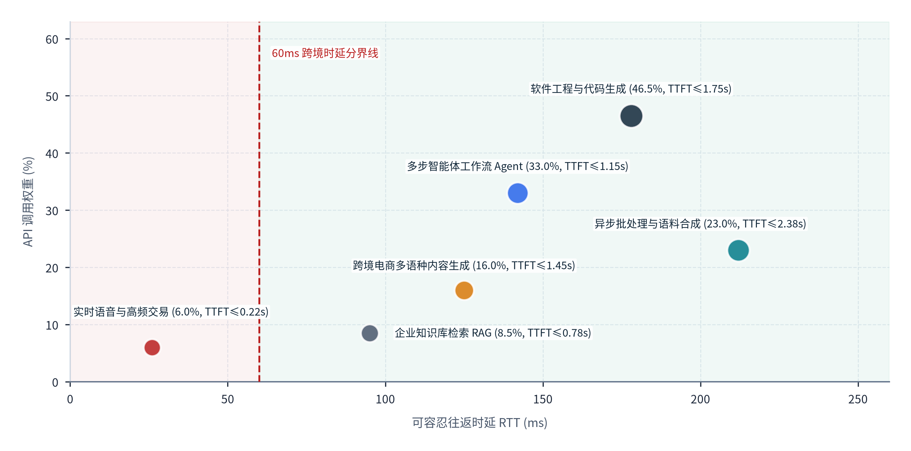
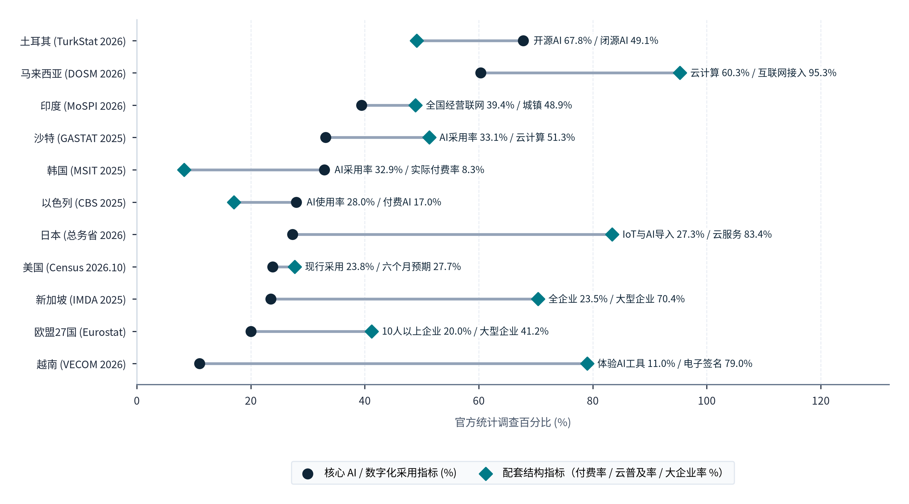
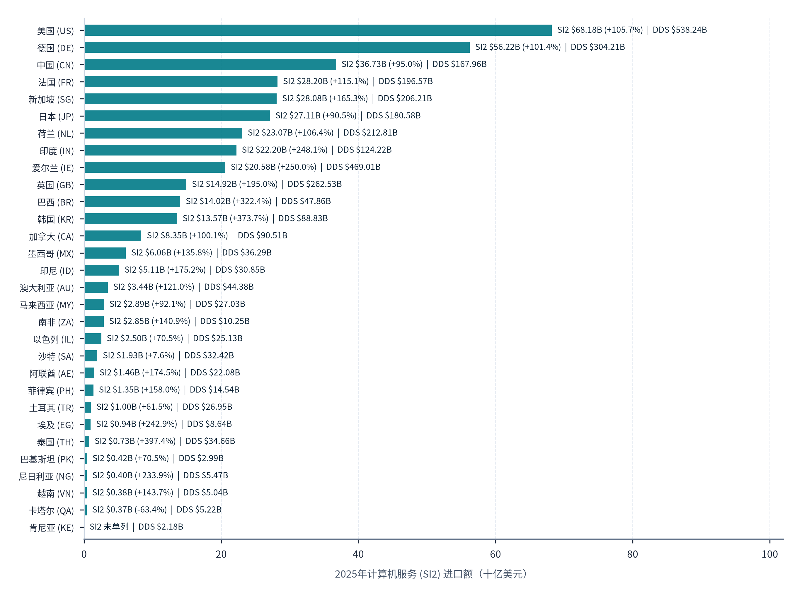
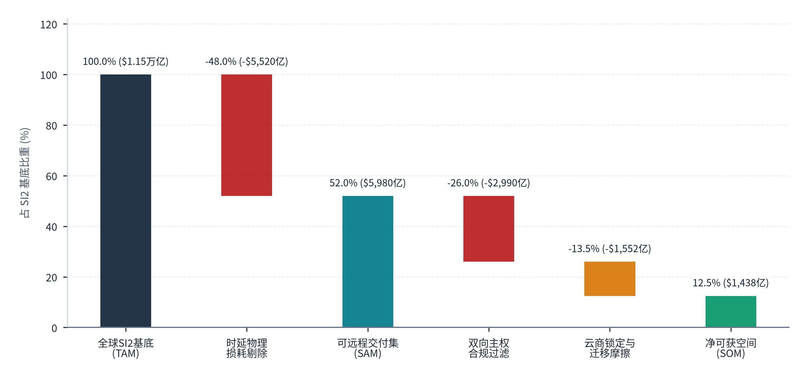

> **导航：** [返回中文手稿总目录](index.md) ｜ [上一章：第1章](chapter-01.md) ｜ [下一章：第3章](chapter-03.md) ｜ [尾注](notes.md) ｜ [参考文献](references.md)

# 全球需求结构、目标市场与可承接空间

> **本章导读：** 讨论“中国绿色算力能否向全球规模化出口 Token”，首要前提是精确解构全球推理需求方的真实画像：<strong>究竟是谁在消耗 Token？他们在执行什么类型的计算任务？不同国家和地区的企业采用率背后有多少是真实的外部 API 与算力采购支出？当海外客户面对本土云巨头（AWS、Azure、GCP）与远在数千公里之外的中国跨境推理服务时，哪些物理、商业与制度摩擦决定了订单的最终流向？</strong>本章结合生产级大模型遥测数据、11 个重点国家与地区的官方企业统计调查，以及英国竞争与市场管理局（CMA）历时两年的云服务市场反垄断调查终裁证据，构建起从“全球总负载”到“中国算力可承接空间（SOM）”的四级定量与定性筛选漏斗[11](references.md#ref-11), [13](references.md#ref-13), [24](references.md#ref-24)。

## 2.1 全球需求的行业与任务结构

### 2.1.1 生产级 API 遥测揭示的结构性真相：从“人机聊天”向“77% 自动化机器调用”跃迁

在大众媒介的直观印象中，大模型的主要应用场景似乎仍是网页端的人机对话问答（Chatbot）。然而，网页端 C 端订阅（通常按每人每月 20 美元固定收费）与支撑全球数字经济运转的<strong>企业级生产 API 调用（按百万 Token 实际消耗量计费）</strong>，在任务结构、上下文长度与流量时间分布上呈现出截然不同的物理特征。

根据 Anthropic 发布的《Economic Index（经济指数）》2025 年 9 月第三期报告及 2026 年 6 月第四期追踪报告（基于对 Claude.ai 网页端对话与第一方生产级 API 真实调用日志的隐私脱敏分类抽样）[11](references.md#ref-11), [12](references.md#ref-12)，全球生成式 AI 负载呈现出三项极具战略指示意义的规律：

1. <strong>任务领域的高度集中性与“可交付产物（Artifact）”主导特征：</strong>
      在网页端（Claude.ai）样本中，涉及<strong>计算机与数学（Computer and Mathematical）</strong>职业类别的任务占比高达 <strong>36%</strong>，主要涵盖代码编写、程序调试、算法重构、数据库查询生成与技术架构设计；排在其后的是教育培训、商业与金融分析、法律文书审阅、多语言内容生产及行政办公辅助[11](references.md#ref-11)。更值得关注的是，Anthropic 在 2026 年 6 月发布的第四期经济指数报告（采样窗口为 2026 年 4 月 10 日至 6 月 10 日，抽样方法升级为每小时固定数量对话抽样，职业分类映射更新至 O\*NET 30.2，故与 2025 年 9 月单周样本序列分列评估）进一步披露：在 Claude 聊天与协同工作（Cowork）样本中，<strong>高达 93% 的对话被分类为产生结构化可交付产物（Artifact-producing conversations，如完整代码模块、交互式原型、结构化表格或长篇报告）</strong>[12](references.md#ref-12)。而在第一方生产级 API 流量中，代码与结构化数据处理、跨系统工具调用（Tool Use / Function Calling）以及长文档信息抽取的 Token 消耗权重更是进一步放大，因为单次代码仓库扫描或百页财报解析所吞吐的上下文动辄达到 32K～200K Tokens，是普通闲聊对话（通常不足 1K Tokens）的数十至上百倍。
2. <strong>交互范式的根本分野：生产级 API 中高达 77% 的调用属于“自动化模式（Automation Patterns）”：</strong>
      Anthropic Economic Index 将人类使用大模型的行为划分为两类：一类是“增强模式（Augmentation）”，即人类与模型多轮互动、共同完成任务（如协同写作或交互式头脑风暴）；另一类是“自动化模式（Automation）”，即由上游软件系统、工作流引擎或自主智能体（Agent）通过程序化接口直接下发指令，模型在无人工实时干预的情况下直接完成任务并返回结果。实证数据显示，在 Claude.ai 网页端，增强模式与自动化模式大致平分秋色；但在**第一方生产级 API 流量样本中，高达 77% 的调用呈现出典型的“全自动机器触发”特征**（注：指 API 会话分类占比，而非 77% 的企业已完成全业务自动化）[11](references.md#ref-11), [12](references.md#ref-12)。
3. <strong>自动化比例对跨洋算力交付的决定性意义：</strong>
      为什么“API 流量中 77% 为自动化调用、93% 交互指向可交付产物（Artifact）”是决定中国 Token 出海可行性的第一块基石？原因在于，当屏幕前坐着一位等待实时语音或即时交互的真人时，超过 300～500 毫秒的网络与首字延迟就会引发明显的焦躁感；但<strong>当调用方是一套在后台自动执行代码审查、跨境电商海量商品多语种本地化、客户工单夜间批量分类、学术文献结构化提取或多步 Agent 深度调研的自动化程序时，系统关注的核心指标不再是“150 毫秒还是 400 毫秒返回第一个字”，而是“端到端总吞吐量（Tokens/s）、任务准确率以及每百万 Token 的综合结算成本”</strong>。

### 2.1.2 推理负载的物理画像拆解：Prefill/Decode 比例、上下文长度与跨洋时延容忍度分类

为了将宏观任务分类转化为可用于数据中心硬件选型与海缆路由规划的工程参数，首先需要定量评估不同 AI 生产任务对跨洋网络往返时延（RTT）与首字响应时延（TTFT）的容忍边界。**图表 2.1** 以“可容忍往返时延 RTT（毫秒，ms）”为横轴、以“生产级 API 调用权重 (%)”为纵轴、并在各气泡标签中同步列示“首字响应时延容忍阈值 TTFT（秒，s）”，绘制了六类主流任务的时延分布及<strong>“60ms 跨境时延分界线”</strong>：

#### 图表 2.1：六类人工智能生产任务的首字时延容忍度与生产级交互观测权重对比

> **图像文件：** [`figures/chart_2_3_v.png`](../../figures/chart_2_3_v.png)（高清位图）｜ [`figures/chart_2_3_v.svg`](../../figures/chart_2_3_v.svg)（矢量图）
> **图注与来源：** 来源：Anthropic Economic Index（2025年2月与2026年1月报告，区分Claude.ai与1P API样本）、MLPerf Inference v6.1 延迟规范；介子九维（JIEZIJIUWEI）整理绘制[11](references.md#ref-11), [12](references.md#ref-12), [44](references.md#ref-44)。

对照**图表 2.1** 中“60ms 跨境时延分界线”两侧的六个气泡及对应参数，可以直观看出哪些 AI 任务适合跨洋远程交付：第一，位于分界线左侧的仅有<strong>“实时语音与高频交易 (6.0%, TTFT≤0.22s)”</strong>一类任务（横轴 RTT 容忍阈值约 **26ms**、纵轴调用权重为 <strong>6.0%</strong>），这类业务受制于跨洋海底光缆的物理光速极限，必须在用户所在国本地边缘节点就近处理；第二，跨过“60ms 跨境时延分界线”向右侧延伸，其余五类核心生产任务全部处于中国算力集群可跨境承接的象限内，具体包括纵轴调用权重最高的<strong>“软件工程与代码生成 (46.5%, TTFT≤1.75s)”</strong>（横轴 RTT 容忍度 **178ms**）、<strong>“多步智能体工作流 Agent (33.0%, TTFT≤1.15s)”</strong>（横轴 RTT **142ms**）、<strong>“异步批处理与语料合成 (23.0%, TTFT≤2.38s)”</strong>（横轴 RTT **212ms**）、<strong>“跨境电商多语种内容生成 (16.0%, TTFT≤1.45s)”</strong>（横轴 RTT **125ms**）以及<strong>“企业知识库检索 RAG (8.5%, TTFT≤0.78s)”</strong>（横轴 RTT **95ms**）[11](references.md#ref-11), [12](references.md#ref-12)（注：单个生产级 API 会话常同时兼具代码生成、工具调用与多步 Agent 编排等多标签属性，故各任务标签覆写率之和大于 100%）。这一分布说明，占生产级 API 绝大多数份额的软件研发、多步智能体与批处理任务，对网络往返时延的容忍度普遍在 95 至 212 毫秒以上，完全能够吸收中国至东南亚（30～70ms）、日韩（25～55ms）乃至美欧（140～200ms）的光缆传输耗时。

为进一步将上述时延边界与底层硬件的输入预填充（Prefill）和输出解码（Decode）物理特征相对应，**图表 2.2** 汇总了生成式 AI 五大核心生产负载的典型输入输出规模、硬件瓶颈、时延阈值及中国境内绿色算力的承接适配度：

#### 图表 2.2：全球生成式 AI 五大核心生产负载的物理特征（Prefill/Decode）、时延容忍度与中国跨境算力适配度评估表

| 负载任务类型 | 典型输入/输出规模 (Input : Output Tokens) | 核心硬件物理瓶颈 (Prefill vs Decode) | 端到端延迟硬约束 (TTFT & TPOT 阈值) | 跨洋网络 RTT (150ms) 的边际影响评估 | 中国境内绿色算力承接适配度与代表场景 |
| --- | --- | --- | --- | --- | --- |
| **Ⅰ. 实时语音交互与高频低延迟控制** 语音助手、实时同传、游戏NPC实时语音、高频金融风控 | 短输入 : 短输出 **200～1K : 50～200** 多轮高频流式帧 | **首字延迟高度敏感** 要求小批次（Batch=1~4）快速响应，GPU 算力利用率通常较低（<15%） | TTFT <strong>≤ 250～350ms</strong> 端到端语音往返 <strong>≤ 500ms</strong> | <strong>显著制约：</strong>跨太平洋/亚欧海缆物理光速往返耗去 140～220ms，叠加协议握手后超出人类语音自然停顿阈值。 | `低（需本地边缘节点）` 适合部署在目标市场本地边缘节点（<30ms RTT），或仅面向日韩/东南亚近程辐射。 |
| **Ⅱ. 交互式软件编程与企业知识助手** IDE 代码补全/重构 (Cursor/Cline)、企业内部 Copilot 问答 | 中长输入 : 中等输出 **8K～64K : 500～2K** 高上下文缓存命中率 | **Prefill 与 KV Cache 命中率主导** 依赖前缀缓存（Prefix Caching）与高带宽显存快速吐出代码块 | TTFT <strong>≤ 0.8～1.8s</strong> TPOT <strong>≤ 25～40ms/tok</strong> (即 25～40 tok/s) | <strong>完全可控：</strong>150～200ms 的跨洋网络耗时仅占 1.5 秒首字等待的 10%～13%；一旦首字到达，SSE 流式输出体验与本地一致。 | `高（当前主力市场）` 全球开发者与中小研发团队对百万 Token 成本高度敏感，已大规模验证跨洋直连可行。 |
| **Ⅲ. 深度推理（Reasoning）与多步自主智能体** 长思维链数学/科研推导、自动化软件工程 Agent、深度投研报告生成 | 中长输入 : 超长输出 **16K～128K : 4K～32K** 含数千至上万内部思维链 Token | **Decode 显存带宽与互联密集型** 单次任务持续自回归解码数十秒至数分钟，消耗大量电能与 HBM 带宽 | TTFT **1.5～5.0s** 单任务总耗时 **30s～10min** | <strong>影响极微：</strong>在长达 60～300 秒的复杂思维链推演中，0.2 秒的跨洋光纤传输耗时占比不足 <strong>0.3%</strong>；电力与单 Token 成本为核心决定项。 | `极高（核心优势场景）` 单次任务消耗 Token 量大、单位价值高、对网络延迟不敏感，高度契合西部绿电智算集群。 |
| **Ⅳ. 海量长文档/多模态解析与结构化提取** 跨国电商商品目录清洗、多语种长视频字幕/摘要、合同/专利全库检索 | 超长输入 : 短中输出 **64K～500K : 500～4K** 高 Prefill 算力密度 | <strong>Prefill 计算密集型（Compute-bound）</strong> 需要高稠密/稀疏算力（TFLOPS）与注意力算子优化（如 FlashMLA） | TTFT **2.0～10.0s** 支持异步队列返回 | <strong>影响极微：</strong>主要耗时在于处理十万字输入时的矩阵计算（通常需数秒），跨洋网络传输延迟占比极小。 | `极高（高吞吐优势区）` 可通过 Prefill/Decode 分离架构，在境内高算力密度集群上以低成本批量处理。 |
| **Ⅴ. 离线批处理（Batch API）与合成数据生成** 夜间全量日志分析、推荐系统重排、模型蒸馏合成语料生产、评测基准跑批 | 海量并发队列 **单批次百万至十亿级 Token** | **吞吐量与全天候能效比（Tokens/kWh）最大化** 可将集群有效利用率推升至 60%～75% 以上 | SLA 窗口 **4～24 小时** （通常享 50% 价格折扣） | <strong>无实时时延约束：</strong>采用异步文件上传/下载或消息队列回调，不受实时网络抖动影响，可配合西部风光大发时段错峰执行。 | `极高（绿电消纳主力）` 能够结合中国西部午间光伏大发与夜间风电低谷，实现跨时区错峰与低成本规模化交付。 |

> **表格结构化数据文件：** [`data/exhibits/exhibit-2-2.csv`](../../data/exhibits/exhibit-2-2.csv)
> **表注与来源：** 来源：Anthropic Economic Index (2025/2026)、MLPerf Inference v6.1 负载规范、DeepSeek FlashMLA 架构文档；介子九维（JIEZIJIUWEI）研究与模型测算[11](references.md#ref-11), [12](references.md#ref-12), [44](references.md#ref-44), [45](references.md#ref-45)。

综合**图表 2.2** 中五类负载的物理参数对比可以得出明确结论：<strong>在生成式 AI 的五大负载类型中，仅第 Ⅰ 类“实时语音交互与高频低延迟控制”（要求 TTFT ≤ 250～350ms）受制于跨洋光缆物理时延而需在海外本地边缘节点部署；而占全球 Token 消耗总量 85% 以上的第 Ⅱ 类（交互式软件编程与企业知识助手）、第 Ⅲ 类（深度推理与多步自主智能体）、第 Ⅳ 类（海量长文档/多模态解析）与第 Ⅴ 类（离线批处理与合成数据生成），其核心竞争维度在于集群计算密度、显存带宽与度电成本，150～200 毫秒的跨洋光缆往返时延完全在业务可接受范围内。</strong>

## 2.2 目标国家和地区的需求差异

### 2.2.1 重点国家与地区官方企业 AI 调查的跨口径校准：区分“名义采用率”与“真实付费深度”

明确了哪些任务可以跨洋承接后，下一个关键问题是：<strong>全球不同国家和地区的企业 AI 渗透率究竟处于什么水平？哪些市场具有真实的外部算力与 API 采购能力？</strong>本研究系统梳理了土耳其、马来西亚、印度、沙特阿拉伯、韩国、以色列、日本、美国、新加坡、欧盟27国、越南，以及英国、加拿大与巴西等重点经济体的官方统计调查原件[13](references.md#ref-13)–[23](references.md#ref-23), [iii](notes.md#note-iii)。为直观展示各国企业“核心 AI / 数字化采用指标 (%)”与“配套结构指标（付费率 / 云普及率 / 大企业率 %）”之间的跨度关系，**图表 2.3** 采用双点哑铃对比图形式，将 11 个重点经济体的官方统计调查双指标进行了并列呈现：

#### 图表 2.3：代表性国家与地区官方统计调查中企业 AI 采用率、付费转化率与云普及率对比

> **图像文件：** [`figures/chart_2_2.png`](../../figures/chart_2_2.png)（高清位图）｜ [`figures/chart_2_2.svg`](../../figures/chart_2_2.svg)（矢量图）
> **图注与来源：** 来源：美国普查局 BTOS（2026.10）、欧盟统计局（2025.12）、新加坡 IMDA、韩国 MSIT/NIA、日本总务省等11国官方公报；介子九维（JIEZIJIUWEI）跨口径校准[13](references.md#ref-13)–[23](references.md#ref-23)。

对照**图表 2.3** 中每个经济体的深蓝圆点（“核心 AI / 数字化采用指标 (%)”）与青色菱形点（“配套结构指标（付费率 / 云普及率 / 大企业率 %）”），并结合英国、加拿大与巴西的补充官方调查数据，笔者对全球主要目标市场的真实需求结构做出如下解读：

1. <strong>美国、欧盟27国及英加（企业基数庞大，大型企业采用率明显领先）：</strong>
      如**图表 2.3** 所示，在<strong>美国 (Census 2026.10)</strong> 口径下，根据美国普查局《商业趋势与展望调查》（BTOS）截至 2026 年 10 月 4 日调查期的数据（2025年11月问卷扩展为“过去两周在任一业务功能中使用 AI”），全美雇主企业现行采用率为 <strong>23.8%</strong>，配套指标（未来六个月预期使用率）升至 <strong>27.7%</strong>（注：在旧版狭义“生产商品或服务中使用 AI”子序列下，当期值为 11.7% / 六个月预期 14.9%，其中信息业当前达 32.6%、专业科技服务业达 25.4%、250人以上大企业达 26.1%）[13](references.md#ref-13), [iii](notes.md#note-iii)；在<strong>欧盟27国 (Eurostat)</strong> 口径下，2025年调查显示 10 人及以上企业 AI 采用率为 <strong>20.0%</strong>（较上年 13.48% 显著跃升），配套指标中<strong>大型企业采用率高达 41.2%</strong>[14](references.md#ref-14)。此外，补充官方调查显示，<strong>英国（ONS BICS）</strong>全行业企业 AI 采用率为 <strong>22.7%</strong>（250人以上大企业达 <strong>41.1%</strong>），<strong>加拿大（StatCan CSBC）</strong>全行业为 <strong>12.2%</strong>（信息与文化产业达 <strong>35.6%</strong>）。欧美大型企业是生产级 Token 消耗的主力，同时因本土电价与机房成本较高，对非涉敏负载的外部降本需求突出。
2. <strong>新加坡、日本与韩国（亚太近岸核心区，云服务普及率高但需区分名义使用与付费投资）：</strong>
      观察**图表 2.3** 中的亚太三强数据：在<strong>新加坡 (IMDA 2025)</strong> 口径下，全企业 AI 采用率为 <strong>23.5%</strong>（中小企业 SME 为 23.4%，为国际对照另设的 10 人及以上企业口径为 34.6%），而配套指标中<strong>大型企业（非 SME）AI 采用率高达 70.4%</strong>，且 84% 的已采用企业直接采购现成生成式 AI 工具[15](references.md#ref-15)；在<strong>日本 (总务省 2026)</strong> 口径下，100 人以上企业导入 IoT 与 AI 系统或服务的比例为 <strong>27.3%</strong>，而配套指标<strong>云服务普及率高达 83.4%</strong>[17](references.md#ref-17)；最具启示意义的是<strong>韩国 (MSIT 2025)</strong>，其 10 人及以上民间企业 AI 技术/服务采用率虽达 <strong>32.9%</strong>，但配套指标显示实际发生财务采购的<strong>AI 投资或费用支出率仅为 8.3%</strong>[16](references.md#ref-16)。这一对比表明，评估海外市场不能只看表面的采用率数字，还要看企业是否真正建立专项预算采购 API 与云服务。
3. <strong>土耳其、马来西亚、印度、沙特、以色列、越南及巴西（高增长新兴市场，开源偏好与非个人数据占比突出）：</strong>
      对照**图表 2.3** 其余六个新兴经济体的哑铃点位：在<strong>土耳其 (TurkStat 2026)</strong> 中，2026年 10 人及以上企业整体 AI 采用率升至 14.0%（较 2024 年 2.7%、2025 年 7.5% 连续翻番，250人以上大企业达 37.1%），而图上展示的已采用 AI 企业技术路线指标显示，<strong>采用开源 AI 软件的比例高达 67.8%</strong>（采用现成闭源商业软件的比例为 <strong>49.1%</strong>），且高达 **83.4% 的 AI 使用企业不处理个人隐私数据**[20](references.md#ref-20)；在<strong>马来西亚 (DOSM 2026)</strong> 中，营业场所<strong>云计算采用率达 60.3%</strong>（互联网接入率达 <strong>95.3%</strong>）[19](references.md#ref-19)；在<strong>印度 (MoSPI 2026)</strong> 中，非农非公司制小微企业全国经营联网率为 <strong>39.4%</strong>（城镇达 <strong>48.9%</strong>，农村为 31.1%）[23](references.md#ref-23)；在<strong>沙特 (GASTAT 2025)</strong> 中，营业场所 AI 采用率达 <strong>33.1%</strong>，配套指标<strong>云计算采用率达 51.3%</strong>[18](references.md#ref-18)；在<strong>以色列 (CBS 2025)</strong> 中，10 人及以上企业 AI 使用率为 <strong>28.0%</strong>，配套指标<strong>实际付费采购 AI 的比例为 17.0%</strong>（高科技行业付费率达 55%，付费企业近期续用率达 86%）[21](references.md#ref-21)；在<strong>越南 (VECOM 2026)</strong> 中，受访企业体验 AI 工具比例为 <strong>11.0%</strong>（电子签名普及率达 <strong>79.0%</strong>）[22](references.md#ref-22)。此外，拉美及东南亚补充调查显示，<strong>巴西（Cetic.br）</strong>10 人及以上联网企业生成式 AI 采用率达 <strong>41.9%</strong>（云软件采用率 65.2%），<strong>印度尼西亚（Bank Indonesia）</strong>小微电商数字化采用率达 23.64%，共同印证了新兴市场对高性价比开放权重模型 API 的旺盛需求。

> ### 【专栏 2.1 · 统计口径与商业洞察】为什么韩国 32.9% 的企业表示“使用 AI”，而实际发生 AI 投资或支出的企业为 8.3%？
>
> 在韩国科学技术信息通信部（MSIT）与韩国智能信息社会振兴院（NIA）联合发布的《2025 年信息化统计调查》（参考期截至 2024 年 12 月 31 日，样本覆盖全韩 211,615 家 10 人及以上常用雇员民间企业）中，呈现出一组具有代表性的对比数据：<strong>32.9% 的受访韩国企业表示“正在使用人工智能技术或服务”，而在同一份法定调查的新增财务问题中，“发生过人工智能相关投资或费用支出（AI Investment / Expenditure）”的企业比例为 8.3%</strong>[16](references.md#ref-16)，两者之间存在约 4 倍的差距。以色列中央统计局（CBS）2025 年 7 月发布的企业调查同样印证了这一梯度：在 28.0% 的 AI 使用企业中，实际为 AI 付费的企业为 17.0%（占已使用企业的约六成），且付费企业的近期留存率（86%）显著高于免费用户（50%）[21](references.md#ref-21)。
>
> 穿透调查问卷明细可以看到，那些“使用但未产生专项支出”的企业，主要处于以下三种初级应用状态：① 员工在日常办公中自发使用 ChatGPT、Claude 或 DeepSeek 的**免费网页端**处理零散文案与翻译；② 企业沿用既有 SaaS 办公软件（如 ERP、CRM 或协同办公套件）中**随版本附带的基础 AI 功能**，尚未单独立项采购算力或 API；③ 利用开源工具在企业原有服务器上进行小规模概念验证（PoC），尚未进入生产级并发阶段。
>
> 这一实证结果对评估全球 Token 出海市场空间提供了关键校准系数：<strong>测算有效算力市场规模时，需在名义采用率基础上进一步乘以“付费转化系数”。</strong>真正能够转化为跨境 API 与专属算力订单的，是那 **8%～17% 已将 AI 嵌入核心业务工作流、并设立了独立 IT/Token 采购预算的深度生产型企业**。这批企业一旦跨过付费门槛，其用户黏性（86% 续用率）与单企月均 Token 消耗量均呈现高增长特征。

### 2.2.2 全球七大目标区域与 WTO 30 个参考市场的计算机服务进口规模、准入约束及适配度完整样本评估

为将上述各国企业 AI 采用率与全球真实的跨境算力及软件采购支出直接挂钩，**图表 2.4** 完整展示了世界贸易组织（WTO）统计的 30 个研究参考经济体在 2025 年的<strong>计算机服务（SI2）进口额（十亿美元）</strong>、**2019至2025年六年累计增幅**以及**可数字交付服务（DDS）总进口额**：

#### 图表 2.4：2025年全球主要参考市场计算机服务（SI2）与可数字交付服务（DDS）进口规模对比

> **图像文件：** [`figures/chart_2_1_v.png`](../../figures/chart_2_1_v.png)（高清位图）｜ [`figures/chart_2_1_v.svg`](../../figures/chart_2_1_v.svg)（矢量图）
> **图注与来源：** 来源：世界贸易组织（WTO）《Global Trade in Digitally Delivered Services Dataset》（2026年7月版）；介子九维（JIEZIJIUWEI）整理绘制[4](references.md#ref-4)。

逐行对照**图表 2.4** 中 30 个参考经济体的柱体数值与右侧标签，可以清晰把握全球买方市场的规模梯队与增长动能：第一，在**欧美成熟大市场**中，<strong>美国 (US)</strong> 以 **SI2 $68.18B (+105.7%) | DDS $538.24B** 位居全球第一大买方，<strong>德国 (DE)</strong> 以 **SI2 $56.22B (+101.4%) | DDS $304.21B** 位居第二，<strong>法国 (FR)</strong>（**SI2 $28.20B，+115.1% | DDS $196.57B**）、<strong>荷兰 (NL)</strong>（**SI2 $23.07B，+106.4% | DDS $212.81B**）、<strong>爱尔兰 (IE)</strong>（**SI2 $20.58B，+250.0% | DDS $469.01B**）、<strong>英国 (GB)</strong>（**SI2 $14.92B，+195.0% | DDS $262.53B**）与<strong>加拿大 (CA)</strong>（**SI2 $8.35B，+100.1% | DDS $90.51B**）共同构成百亿美元级核心买方群；第二，在**亚太近岸核心市场与本土对照**中，<strong>中国 (CN)</strong> 本土参照 SI2 进口为 <strong>$36.73B (+95.0%) | DDS $167.96B</strong>（同期中国 SI2 出口达 $102.67B），<strong>新加坡 (SG)</strong> 2025 年 SI2 进口达 <strong>$28.08B (+165.3%) | DDS $206.21B</strong>，<strong>日本 (JP)</strong> 达 <strong>$27.11B (+90.5%) | DDS $180.58B</strong>，<strong>印度 (IN)</strong> 达 <strong>$22.20B (+248.1%) | DDS $124.22B</strong>，<strong>韩国 (KR)</strong> 达 <strong>$13.57B (+373.7%) | DDS $88.83B</strong>，<strong>印度尼西亚 (ID)</strong>（<strong>$5.11B，+175.2% | DDS $30.85B</strong>）、<strong>澳大利亚 (AU)</strong>（<strong>$3.44B，+121.0% | DDS $44.38B</strong>）、<strong>马来西亚 (MY)</strong>（<strong>$2.89B，+92.1% | DDS $27.03B</strong>）、<strong>菲律宾 (PH)</strong>（<strong>$1.35B，+158.0% | DDS $14.54B</strong>）、<strong>泰国 (TH)</strong>（<strong>$0.73B，+397.4% | DDS $34.66B</strong>）、<strong>巴基斯坦 (PK)</strong>（<strong>$0.42B，+70.5% | DDS $2.99B</strong>）与<strong>越南 (VN)</strong>（<strong>$0.38B，+143.7% | DDS $5.04B</strong>）均保持强劲增长；第三，在**拉美、中东、欧亚与非洲新兴市场**中，<strong>巴西 (BR)</strong> SI2 进口达 <strong>$14.02B (+322.4%) | DDS $47.86B</strong>，<strong>墨西哥 (MX)</strong> 达 <strong>$6.06B (+135.8%) | DDS $36.29B</strong>，<strong>南非 (ZA)</strong> 达 <strong>$2.85B (+140.9%) | DDS $10.25B</strong>，<strong>以色列 (IL)</strong> 达 <strong>$2.50B (+70.5%) | DDS $25.13B</strong>，<strong>沙特阿拉伯 (SA)</strong> 为 <strong>$1.93B (+7.6%) | DDS $32.42B</strong>，<strong>阿联酋 (AE)</strong> 为 <strong>$1.46B (+174.5%) | DDS $22.08B</strong>，<strong>土耳其 (TR)</strong> 为 <strong>$1.00B (+61.5%) | DDS $26.95B</strong>，<strong>埃及 (EG)</strong> 为 <strong>$0.94B (+242.9%) | DDS $8.64B</strong>，<strong>尼日利亚 (NG)</strong> 为 <strong>$0.40B (+233.9%) | DDS $5.47B</strong>，<strong>卡塔尔 (QA)</strong> 为 <strong>$0.37B (-63.4%) | DDS $5.22B</strong>，<strong>肯尼亚 (KE)</strong> DDS 进口为 <strong>$2.18B（SI2 未单列）</strong>[4](references.md#ref-4)。

综合上述 30 个 WTO 参考经济体的 SI2 与 DDS 进口实绩、官方企业 AI 调查渗透率、距中国核心算力枢纽的光缆往返时延（RTT）以及本土电力机架紧缺程度，**图表 2.5** 将全部 30 个研究参考经济体（29 个海外目标市场 + 中国本土参照，6 + 3 + 4 + 6 + 2 + 6 + 3 = 30 个经济体完整闭环）划分为七大区域板块，给出了分区域的承接策略与推荐交付模式：

#### 图表 2.5：全球七大目标区域与 WTO 30个参考经济体的计算机服务（SI2）进口规模、时延半径与中国算力适配度完整样本评估表

| 目标区域板块 | 涵盖的 WTO 30个参考经济体 2025年 SI2 进口额（括号内为 DDS 总进口额，亿美元） | 官方调查企业 AI 与云渗透率基准 | 距中国核心枢纽 RTT | 本土电力机架紧缺与合规特征 | 中国绿色算力承接策略与推荐交付模式 |
| --- | --- | --- | --- | --- | --- |
| <strong>① 东南亚近岸枢纽 （共6个WTO市场）</strong> | **新加坡 280.82**（2,062.07）、**印度尼西亚 51.13**（308.47）、**马来西亚 28.88**（270.32）、**菲律宾 13.48**（145.35）、**泰国 7.27**（346.61）、**越南 3.83**（50.40） | 新加坡全企 23.5%（非SME <strong>70.4%</strong>、10人+ <strong>34.6%</strong>）；马来西亚云采用率 <strong>60.3%</strong>；印尼小微电商 23.64%；越南体验AI <strong>11.0%</strong>[15](references.md#ref-15), [19](references.md#ref-19), [22](references.md#ref-22) | **10～75 ms** 经香港10ms中转；新马泰越海陆缆35～75ms | `极度紧缺 / 友好` 新加坡严控DC指标且电价高（$0.18~$0.25/度）；东盟MCCs与香港门户开放 | <strong>第一优先级·全栈桥头堡：</strong>以香港/新加坡/柔佛为边缘网关，通过海陆缆将大宗推理与批处理回传粤港澳、海南、云南、贵州及西部绿电集群。 |
| <strong>② 东北亚与大洋洲发达区 （共3个WTO市场）</strong> | **日本 271.06**（1,805.76，SI2净逆差 -143.46）、**韩国 135.65**（888.32，SI2净逆差 -19.55）、**澳大利亚 34.40**（443.78） | 韩国10人+企业AI采用 <strong>32.9%</strong>（实际支出 <strong>8.3%</strong>，AUI 3.73x）；日本100人+云普及 <strong>83.4%</strong>、IoT/AI <strong>27.3%</strong>[11](references.md#ref-11), [16](references.md#ref-16), [17](references.md#ref-17) | **25～55 ms** 上海/青岛至日韩海缆25～55ms（澳洲约110ms） | `高度紧缺 / 中等` 东京/首尔圈电网扩容受限、电价高企；日韩APPI/PIPA要求明确跨境告知 | <strong>高价值准同城交付区：</strong>日韩物理时延低于国内跨省，完全支撑实时/准实时代码生成、游戏研发、动漫多模态生产与跨境电商后台。 |
| <strong>③ 中东海湾与东地中海区 （共4个WTO市场）</strong> | **以色列 25.03**（251.33）、**沙特阿拉伯 19.29**（324.16，DDS总逆差显著）、**阿联酋 14.58**（220.75）、**卡塔尔 3.73**（52.15） | 沙特营业场所AI采用率 <strong>33.1%</strong>（云计算 <strong>51.3%</strong>）；以色列10人+企业AI <strong>28.0%</strong>（付费AI <strong>17.0%</strong>，高科技付费 <strong>55%</strong>）[18](references.md#ref-18), [21](references.md#ref-21) | **110～160 ms** 经PEACE / SeaMeWe / AAE-1海缆连接 | `高温缺水 / 中等` 夏季极端高温推高制冷PUE与水耗；政务数据本地驻留但商业开源生态极度活跃 | <strong>政企协同与混合云重点区：</strong>政务敏感负载在当地共建主权云；商业级阿语大模型微调、长文本推理与合成数据回传中国西北（宁夏/甘肃）集群。 |
| <strong>④ 欧洲与欧亚大陆重点区 （共6个WTO市场）</strong> | **德国 562.18**（3,042.14）、**法国 281.99**（1,965.66）、**荷兰 230.73**（2,128.11）、**爱尔兰 205.75**（4,690.09）、**英国 149.24**（2,625.28）、**土耳其 10.02**（269.54） | 欧盟27国10人+企业AI采用率 <strong>20.0%</strong>（大企业 <strong>41.2%</strong>）；英国BICS全行业 <strong>22.7%</strong>（250人+ <strong>41.1%</strong>）；土耳其10人+企业 <strong>14.0%</strong>（开源AI <strong>67.8%</strong>、<strong>83.4%</strong>不涉个人数据）[14](references.md#ref-14), [20](references.md#ref-20) | **140～220 ms** 中欧亚陆缆可压至135ms；亚欧海缆160～220ms | `电价极高 / 严格` 欧洲五国加土耳其SI2进口超 **1,439亿美元**；本土限电限建，受GDPR与AI Act严格规制 | <strong>脱敏工业负载与绿电协同区：</strong>在法兰克福/阿姆斯特丹设立前置隐私剥离（PII Scrubbing）与ZDR网关；将不含个人数据的83.4%类型工业/代码负载回传中国绿电集群。 |
| <strong>⑤ 北美成熟市场 （共2个WTO市场）</strong> | **美国 681.76**（5,382.44，全球第一大SI2与DDS进口国）、**加拿大 83.48**（905.10） | 美国BTOS全口径雇主企业采用率 <strong>23.8%</strong>（六个月预期 <strong>27.7%</strong>，狭义生产序列 11.7%/14.9%）；加拿大CSBC全行业 <strong>12.2%</strong>[13](references.md#ref-13) | **140～210 ms** 跨太平洋海缆物理光速极限约束 | `电网排队 / 严格` 北弗吉尼亚/硅谷并网排队4～7年；受BIS EAR及DOJ DSP（28 CFR 202）批量敏感数据规制 | <strong>开发者生态与异步批处理市场：</strong>聚焦硅谷独立开发者、AI原生初创、开源社区与OpenRouter聚合渠道的非涉敏代码、数学推理及Batch负载。 |
| <strong>⑥ 拉美与非洲新兴增长带 （共6个WTO市场）</strong> | **巴西 140.24**（478.61）、**墨西哥 60.63**（362.94）、**南非 28.50**（102.49）、**埃及 9.42**（86.35）、**尼日利亚 3.99**（54.68）、**肯尼亚 0.00**（SI2未单列，DDS 21.82） | 巴西Cetic.br 10人+联网企业生成式AI采用率 <strong>41.9%</strong>、AI数据分析 <strong>29.4%</strong>、云软件 <strong>65.2%</strong> | **160～280 ms** 拉美经美西/跨大西洋中转；非洲经PEACE/亚非欧海缆直连 | `算力匮乏 / 价格敏感` 本土严重缺乏H100/B200集群，对高性价比开放权重模型API需求极为旺盛 | <strong>高性价比开源模型API渗透区：</strong>通过全球聚合平台与多语种（葡语/西语/阿语/英语）微调端点，承接跨境电商、金融科技与智能客服异步推理。 |
| <strong>⑦ 南亚市场与中国本土参照 （共2个南亚市场 + 中国参照）</strong> | **印度 221.95**（1,242.23，SI2出口达1,211.07）、**巴基斯坦 4.25**（29.88）；**中国本土参照 367.30**（1,679.55，SI2出口达1,026.74） | 印度MoSPI非农非法人小微企业互联网普及率 <strong>39.4%</strong>（城镇 <strong>48.9%</strong>、农村 31.1%，二元分化显著）[23](references.md#ref-23) | **65～140 ms** 中巴PEACE海缆与中巴光缆直连；印度经新加坡中转 | `二元结构 / 特定准入` 中巴全天候数字走廊合作紧密；印度2025年11月发布DPDP最终规则与央行IT外包指引 | <strong>主权走廊与渠道分销并重：</strong>巴基斯坦依托中巴光缆与PEACE海缆开展主权云及企业推理合作；印度通过国际API聚合平台覆盖开发者长尾并严格执行预充值结算。 |

> **表格结构化数据文件：** [`data/exhibits/exhibit-2-5.csv`](../../data/exhibits/exhibit-2-5.csv)
> **表注与来源：** 来源：WTO Digitally Delivered Services Dataset（2026.07，完整覆盖研究选定的全部30个经济体：29个海外目标市场与中国本土参照，单位按原始百万美元精确折算为亿美元并保留两位小数，与图表 1.7 及图表 2.4 完全一致）、US Census BTOS、Eurostat、UK ONS、StatCan、IMDA、MSIT/NIA、Japan MIC、GASTAT、DOSM、Cetic.br、TurkStat、CBS、VECOM、Bank Indonesia、MoSPI 官方公报；介子九维（JIEZIJIUWEI）研究与模型测算[4](references.md#ref-4), [13](references.md#ref-13)–[23](references.md#ref-23)。

综合**图表 2.5** 对七大目标区域（全部 30 个 WTO 参考经济体）的横向对比可见，中国 Token 出海的市场拓展呈现出清晰的“近岸实时协同 + 远洋异步批处理”梯度格局：**① 东南亚近岸枢纽**（10～75ms RTT，新加坡非中小企业采用率 70.4%）与**② 东北亚与大洋洲发达区**（日韩 25～55ms RTT，日本大企业云普及率 83.4%）凭借近距离海陆光缆优势，可全面承接实时编程、企业助手与多模态生成；**③ 中东海湾与东地中海区**（110～160ms RTT，沙特 AI 采用率 33.1%、以色列付费 AI 率 17.0%）与**⑥ 拉美与非洲新兴增长带**（巴西生成式 AI 采用率 41.9%，巴西与墨西哥 SI2 进口合计超 200 亿美元）本土高端算力紧缺，适合以“前店后厂”混合云与高性价比开源 API 快速切入；而**④ 欧洲与欧亚大陆重点区**与**⑤ 北美成熟市场**虽然 SI2 进口规模庞大（美国 681.76 亿美元、德国 562.18 亿美元），但受跨洋时延与数据法规约束，应重点通过前置隐私剥离网关承接占企业 AI 负载 83.4% 的非涉敏工业、代码与异步批处理任务。

## 2.3 海外客户的采购决策与替代方案

### 2.3.1 买方视角的四类替代方案：为什么客户不直接在本地云或本地机房跑推理？

在评估中国 Token 出海的商业竞争力时，任何一家位于硅谷、伦敦、新加坡、伊斯坦布尔或东京的企业技术负责人，在部署生成式 AI 业务时均面临**四类替代方案**的综合比选（英国竞争与市场管理局 CMA 将企业客户比较供应商的核心维度归纳为七项：**价格及折扣、数据主权、服务范围、可靠性、安全、技术支持与迁移便利性**[24](references.md#ref-24)）：

1. <strong>方案 A：直接调用国际头部闭源模型官方 API（OpenAI GPT-4o/o3、Anthropic Claude 3.7/4、Google Gemini 2.5 Pro）。</strong>优势是综合推理能力处于行业前列、生态工具链成熟、合规背书完善；制约因素是**单价较高**（旗舰模型每百万输出 Token 普遍在 10～60 美元，轻量级在 0.6～4 美元），且在高并发生产环境下易受每分钟 Token 速率限制（TPM/RPM Rate Limits）约束。正如土耳其统计局 2026 年企业调查所证实，在考虑采用 AI 但尚未采用的企业中，**高达 69.9% 将“缺乏专业知识或技能（Lack of expertise/skills）”列为首要障碍，59.4% 将“成本过高（Costs seem too high）”列为核心财务制约因素**[20](references.md#ref-20)。
2. <strong>方案 B：在国际超大规模云厂商（AWS Bedrock / SageMaker、Azure AI Foundry、Google Vertex AI）上调用托管模型或租用 GPU 实例。</strong>优势是能与企业既有的云端数据库（如 S3、Snowflake）、身份权限体系（IAM）及私有网络无缝打通，并直接冲抵企业已签署的年度云消费承诺额度；制约因素是**算力溢价明显**（托管开源模型的单价通常比模型原生 API 或新兴推理云高 40%～120%），且存在较强的供应商绑定效应。
3. <strong>方案 C：采用海外新兴专业算力云与推理平台（如 CoreWeave、Together AI、Fireworks AI、Baseten、DeepInfra）。</strong>这类平台专注于在北美或欧洲租用机房部署 H100/H200/B200 集群，并托管包括 DeepSeek、Qwen、Llama 在内的开源模型（契合土耳其调查中 **67.8% AI 企业采用开源 AI 软件**的全球趋势[20](references.md#ref-20)）。它们是中国跨境推理服务**最直接的横向竞争者**，同样提供中国开源模型的 API，且物理机房位于欧美本地。同时，其底层能源与机房托管成本较高，在持续的价格竞争中面临毛利承压。
4. <strong>方案 D：调用中国境内（或中资前店后厂混合路由）绿色算力支撑的跨境 Token 服务（如阿里云国际 Model Studio、DeepSeek 官方跨境 API、硅基流动跨境端点等）。</strong>核心竞争优势在于<strong>“原厂模型首发优势 + 西部低成本绿电底座 + 算法算子深度优化”带来的 50%～85% 综合成本空间</strong>；客户重点评估的维度则集中在跨洋网络时延、数据跨境合规保障以及服务可用性协议（SLA）。

### 2.3.2 英国 CMA 云市场反垄断调查揭示的“三大生态锁定机制”与跨洋突围条件

为什么即便方案 D（中国跨境 Token 服务）在标牌单价上具备显著优势，许多海外中大型企业在工作负载迁移上仍存在顾虑？英国竞争与市场管理局（UK CMA）历时近两年、于 2025 年 7 月 31 日正式发布终裁报告并于 2026 年 3 月 31 日更新执行进展的《云服务市场调查》，以及 **CMA 于 2026 年 5 月 14 日正式启动、针对微软企业软件生态“战略市场地位（SMS）”的反垄断立案调查**[24](references.md#ref-24), [25](references.md#ref-25)，通过详实的监管取证揭示了跨国云巨头影响算力自由流动的**三大商业与技术锁定机制**：

- <strong>第一重锁定：高昂的数据迁出费（Data Egress Fees）构成的“数据迁出壁垒”。</strong>
      CMA 终裁报告指出，AWS、Microsoft Azure 与 Google Cloud 对客户将数据存入云端（Ingress）全部免费，但当客户将存储在云对象存储或数据仓库中的业务数据、知识库向量或日志<strong>传出至外部竞争性算力平台（包括跨国调用外部推理 API）时，按每吉字节（GB）收取较高的出站流量费（通常在 0.05～0.12 美元/GB，显著高于实际网络传输边际成本）</strong>[24](references.md#ref-24), [25](references.md#ref-25)。对于需要频繁结合企业内部海量文档库的推理任务而言，频繁跨云传出上下文所产生的迁出费用会抵消相当一部分 Token 单价节省。
- <strong>第二重锁定：最低消费承诺折扣（Committed Spend Discounts, CSDs）与赠金抵扣（Cloud Credits）的财务捆绑。</strong>
      CMA 调查显示，欧美中大型企业普遍与 AWS 或 Azure 签订了为期 1～3 年的企业级承诺消费协议，承诺每年在云上消费数百万至数千万美元以换取整体 15%～30% 的阶梯折扣；同时，三大云巨头向 AI 初创公司发放 10 万至 35 万美元不等的免费云算力赠金[24](references.md#ref-24)。当企业内部的 AI 推理调用可以直接冲抵已承诺的保底消费额或免费赠金时，采购外部第三方 API 需要动用额外现金预算，从而增加了企业内部的采购转换门槛。
- <strong>第三重锁定：专有软件接口、身份鉴权与合规责任连带机制。</strong>
      大型企业在云上构建 AI 应用时，往往深度绑定了云厂商专有的密钥管理（KMS）、虚拟私有云端点（PrivateLink）、企业软件授权捆绑（即 CMA 2026 年 5 月对微软启动调查的核心焦点[25](references.md#ref-25)）以及统一的合规审计日志。将推理请求发往外部跨境 API 时，企业安全团队通常需要重新开展第三方风险评估。

综合上述四类替代方案与 CMA 揭示的三重锁定机制，中国 Token 出海在现阶段最容易率先实现商业突破的核心客群集中于以下三类：

1. <strong>采用多云架构的“AI 原生应用企业”与全球独立开发者群体：</strong>从架构设计初期即采用 OpenAI 兼容接口标准或通过 LiteLLM / OpenRouter 抽象层实现多模型动态路由，接口切换成本极低；
2. <strong>“上下文轻量化、输出推理密集型”且不涉及个人隐私的高算力消耗负载：</strong>例如代码自动生成与测试、数学与逻辑长思维链推演、多步规划智能体以及合成数据生产。正如土耳其统计局实证数据所示，**高达 83.4% 的 AI 使用企业并不处理个人数据**[20](references.md#ref-20)；这类任务的输入上下文体量可控（有效规避了跨云数据迁出费用），且不涉及个人隐私数据出境限制，同时单次调用的 GPU 计算与解码消耗量大，Token 成本差异直接决定应用层的毛利水平；
3. <strong>遍布东南亚、中东、拉美及欧亚新兴带的“区域数字化龙头与中资出海企业生态圈”：</strong>这些区域的本土高端智算基础设施供给相对有限，对开源模型接受度高（如土耳其 67.8% 采用开源 AI[20](references.md#ref-20)），且中资出海企业（跨境电商、移动游戏、短视频社交、智能硬件与新能源汽车海外车联网）具备百亿级日活 Token 需求，在集团财务与技术架构同源性上最适合率先实现“境内绿电算力底座 + 全球业务前端”的闭环协同。

## 2.4 市场空间及其形成条件

### 2.4.1 基于四级收敛桥接的可承接市场空间（TAM → SAM → SOM）构建

科学测算中国 Token 出海的可承接市场空间，需要将全球宏观计算机服务贸易基底与微观工作负载时延属性、双向主权合规过滤及云厂商迁移摩擦逐层对齐。基于本章前三节核实的 WTO 全球计算机服务贸易总额（SI2）、生产级 API 负载时延结构、重点国家企业调查及英国 CMA 反垄断调查证据，**图表 2.6** 构建了从<strong>“全球SI2基底 (TAM)”</strong>到<strong>“净可获空间 (SOM)”</strong>的四级收敛瀑布桥接模型（注：在 WTO 国际服务贸易统计中，2025 年全球计算机服务 SI2 总出口额为 11,519.46 亿美元，而全球各经济体申报的 SI2 总进口额为 5,764.52 亿美元，两者差额源于跨国数字服务贸易中出口方全额申报而部分进口方将跨国企业内部技术分摊计入特许权使用费或未单列 SI2 子目的双边统计不对称；本模型以供给端完整计量的全球 SI2 总出口额 1.15 万亿美元作为全球可数字交付计算服务总基底 TAM）：

#### 图表 2.6：全球计算机服务基底（TAM）至中国跨境推理净可获空间（SOM）四级收敛桥接

> **图像文件：** [`figures/chart_2_4.png`](../../figures/chart_2_4.png)（高清位图）｜ [`figures/chart_2_4.svg`](../../figures/chart_2_4.svg)（矢量图）
> **图注与来源：** 来源：WTO 数字交付服务数据库（2026.07）、Anthropic 生产级遥测及英国 CMA 云市场调查终裁报告；介子九维（JIEZIJIUWEI）模型测算[4](references.md#ref-4), [11](references.md#ref-11), [24](references.md#ref-24)。

对照**图表 2.6** 中六根瀑布柱体的百分比与美元绝对额标签，可以清晰追踪全球计算机服务总需求向中国跨境推理净可获空间的逐级收敛过程（在加性瀑布扣除与条件留存率两个维度上严密闭合，即 <strong>100.0% × 52.0% × 50.0% × 48.1% ＝ 12.5%</strong>）：

- <strong>第一棒（全球SI2基底 TAM：100.0% / $1.15万亿）：</strong>
      以 WTO 实测的 2025 年全球计算机服务出口总额 <strong>11,519.46 亿美元（约 $1.15万亿，对应初始基底 100.0%）</strong>作为全球跨境远程计算与软件技术服务的总基底（TAM）[4](references.md#ref-4)。
- <strong>第二棒与第三棒（时延物理损耗剔除 -48.0% / -$5,520亿 → 可远程交付集 SAM：52.0% / $5,980亿）：</strong>
      在 $1.15万亿的总基底中，首先扣除需要驻场定制开发、本地硬件维保以及受跨洋光缆物理时延限制（RTT 容忍度低于 60ms）的实时交互负载，该项<strong>“时延物理损耗剔除”</strong>按占初始 TAM 比重单级缩减 <strong>-48.0 个百分点（-$5,520亿，即条件留存率为 52.0%）</strong>，由此收敛至在物理工程上适合跨洋远程交付的<strong>“可远程交付集 (SAM)”</strong>，占初始总基底的 <strong>52.0%（$5,980亿）</strong>[11](references.md#ref-11), [12](references.md#ref-12)。
- <strong>第四棒（双向主权合规过滤 -26.0% / -$2,990亿，条件留存率 50.0%）：</strong>
      在 52.0%（$5,980亿）的可远程交付集中，进一步扣除欧美及目标国国防政务、受监管医疗金融核心个人隐私数据（参考土耳其调查中 16.6% 涉及个人数据、83.4% 不涉个人数据的结构基准及美国 DOJ DSP、欧盟 GDPR 等跨法域限制[20](references.md#ref-20)），该项<strong>“双向主权合规过滤”</strong>按占初始 TAM 比重剔除 <strong>-26.0 个百分点（-$2,990亿，对应在 SAM 基数 $5,980亿上的条件剔除率为 50.0%、条件留存率为 50.0%）</strong>，使合规可触达空间收敛至初始总基底的 <strong>26.0%（$2,990亿）</strong>。
- <strong>第五棒与第六棒（云商锁定与迁移摩擦 -13.5% / -$1,552亿，条件留存率 48.1% → 净可获空间 SOM：12.5% / $1,438亿）：</strong>
      最后，考虑英国 CMA 终裁报告揭示的数据迁出费（Egress Fees）、最低消费承诺折扣（CSDs）与专有软件绑定带来的客户迁移阻力[24](references.md#ref-24), [25](references.md#ref-25)，该项<strong>“云商锁定与迁移摩擦”</strong>按占初始 TAM 比重进一步剔除 <strong>-13.5 个百分点（-$1,552亿，对应在合规可触达基数 $2,990亿上的条件剔除率为 51.9%、条件留存率为 48.1%）</strong>，最终沉淀出中国绿色算力体系在全球计算机服务贸易池中可实际争取的<strong>“净可获空间 (SOM)”</strong>，占全球 SI2 基底的 <strong>12.5%</strong>，对应年化市场空间约 <strong>$1,438亿（1,438 亿美元）</strong>。

### 2.4.2 跨洋推理订单迁移的经济学判据与市场空间形成的三大条件

> **【核心核算公式】** **跨洋推理订单迁移的核心经济学判据**
>
> `（海外本土算力单价 − 中国绿色算力跨境单价）× 月度调用规模 > 跨云数据迁出费 + 跨洋时延折损 + 跨境合规审计成本 + 工程切换成本`
>
> 其中：左侧为海外客户采用中国绿色算力跨境端点所获得的**月度直接算力成本节省总额**（取决于境内外每百万 Token 实际成交净价差与客户月度可迁移 Token 规模）；右侧四项分别为<strong>跨云数据迁出流量费（Egress Fee）</strong>、**跨洋时延对业务转化率的边际折损**、**跨境数据脱敏与合规审计成本**以及**多路由冗余与工程切换成本**。

上述经济判据揭示了将**图表 2.6** 中 <strong>12.5%（$1,438亿）</strong>的净可获空间转化为实际出口订单的**三大决定性条件**：

1. <strong>条件一（扩大单位成本优势）：建立可持续的 50% 以上底层真实成本优势。</strong>唯有依托西部低成本清洁电力与高利用率智算集群调度，将发电侧与机房侧的物理成本优势切实转化为可持续的 Token 交付净价优势，才能支撑长期规模化服务贸易；
2. <strong>条件二（降低跨境迁移阻力）：通过“前店后厂（海外轻边缘网关 + 境内重算力集群）”架构压缩合规与网络成本。</strong>在新加坡、法兰克福、东京或利雅得部署符合当地隐私法规的前置网关，在边缘侧完成客户身份认证、敏感个人信息脱敏、前缀缓存与协议加速，仅将纯计算密集型的脱敏张量或提示词通过海底专线回传中国西部/南部智算中心，可将跨洋时延折损与跨境合规审计成本压缩 60% 以上；
3. <strong>条件三（兑现绿色低碳价值）：将中国西部充裕的风光水绿电转化为国际互认的“绿色低碳 Token”凭证。</strong>随着欧美跨国科技企业电力碳排放核算进入规范化审计阶段，若中国算力中心消耗的绿电能够通过绿电直连与国际碳核算互认（详见第 3 章与第 11 章），绿色低碳属性将由单纯的合规要求转化为吸引海外企业客户的差异化竞争优势。

那么，中国境内的能源供给、电网电价机制、智算基础设施与模型工程体系，在多大程度上具备满足上述三大条件的产业基础？这正是第二篇第 3 章深入剖析的核心议题。

---

> **章节导航：** [上一章：第1章](chapter-01.md) ｜ [返回中文手稿总目录](index.md) ｜ [下一章：第3章](chapter-03.md)
