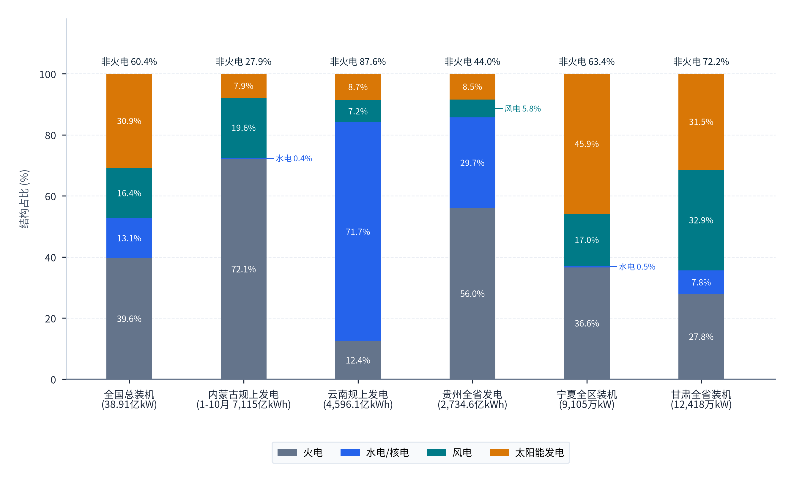
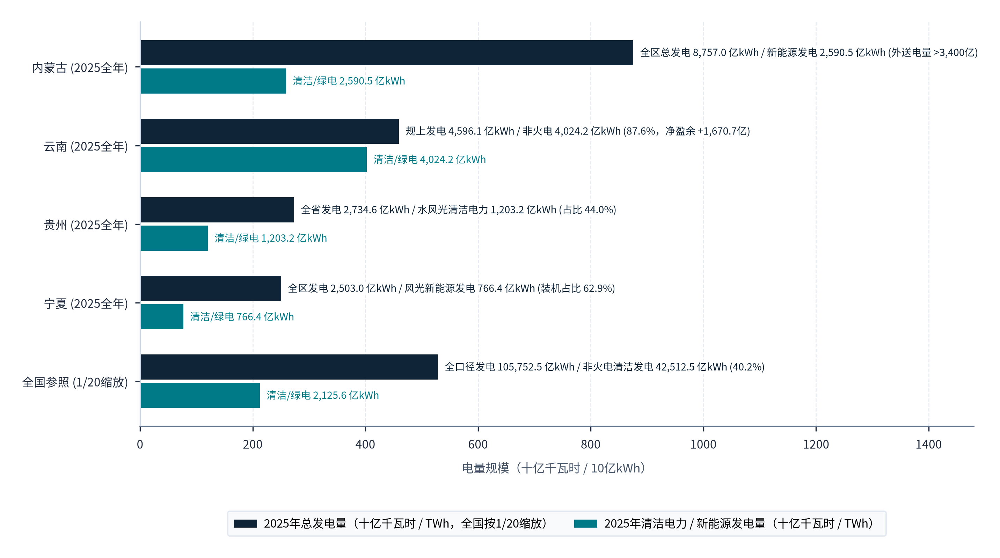
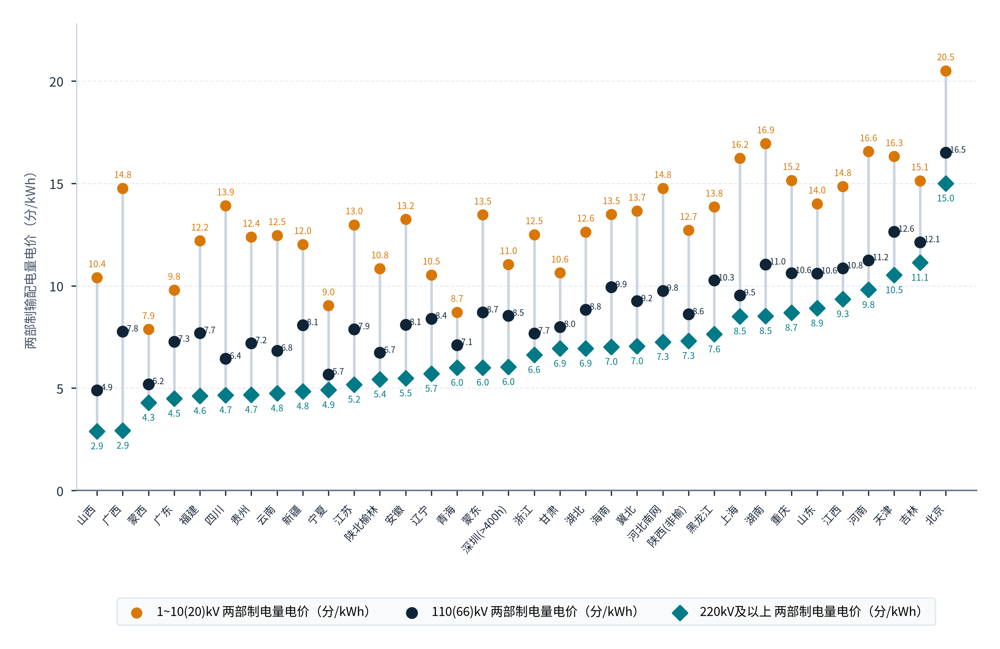
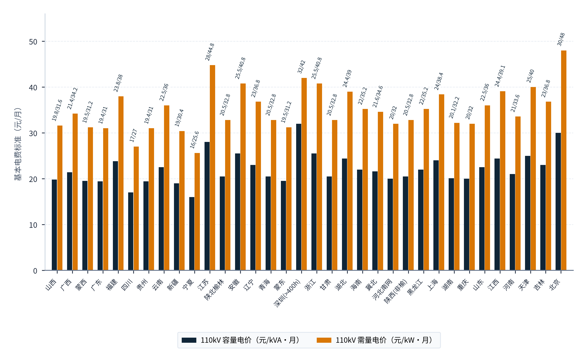
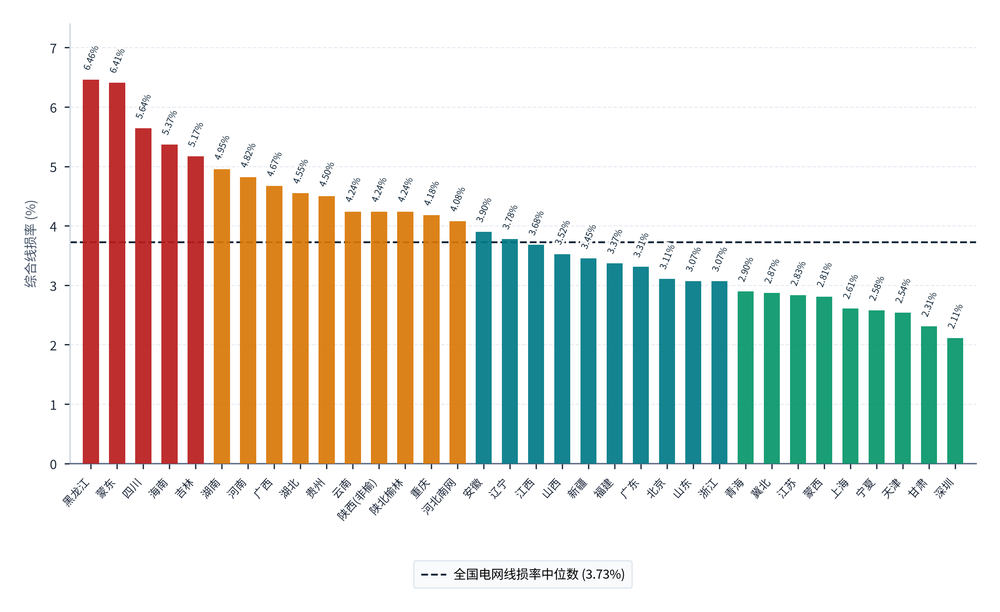
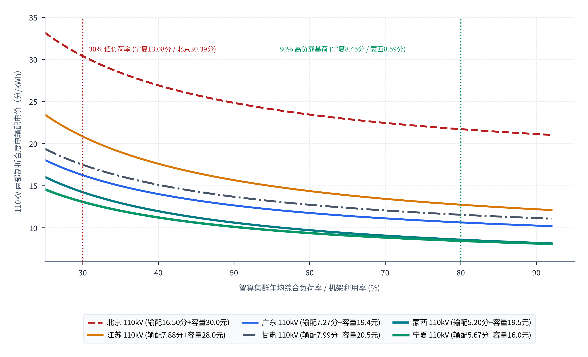
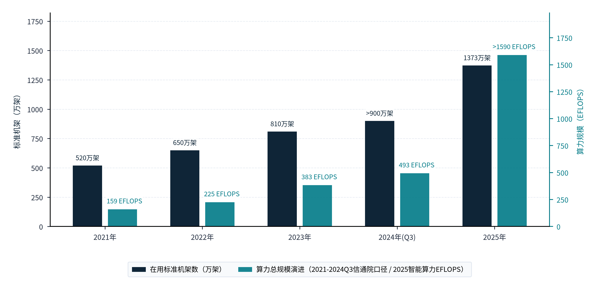
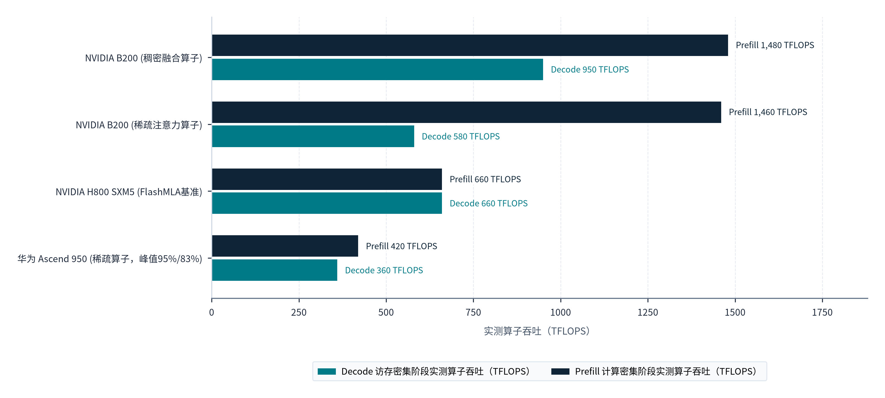

> **导航：** [返回中文手稿总目录](index.md) ｜ [上一章：第2章](chapter-02.md) ｜ [下一章：第4章](chapter-04.md) ｜ [尾注](notes.md) ｜ [参考文献](references.md)

---
> **第二篇 · PART II · 中国供给与全球竞争：从绿色瓦特、异构智算到全球推理竞争力**
> 本篇（第3至4章）转向供给侧与国际竞争格局的实证检验。第3章深入中国发电装机结构、2025至2026年电力体制与输配电价改革深水区、千万级机架底座中的可调度算力结构，以及国产/存量硬件与算法协同效率；第4章将中国供给体系置于全球坐标系，与北美云巨头、新兴算力云及中东、东南亚、北欧枢纽展开全方位对标。
---

# 中国的能源、算力、模型与服务供给基础

> **本章导读：** 支撑“中国绿色算力全球化交付”的底层假设，建立在三根供给支柱之上：其一，中国特别是“东数西算”西部枢纽拥有全球规模最大、边际成本最低的风光水清洁电力供给；其二，中国已建成超千万标准机架与百亿亿次（EFLOPS）级智算设施，具备承接高价值海外负载的设施基础；其三，中国大模型团队通过混合专家架构（MoE）与底层算子优化，在受限硬件上实现了世界一流的单 Token 推理效率。从宏观资源禀赋迈向微观商业交付，需要将总量优势转化为稳定、低成本、高可用的工程供给力。本章依据 2026 年最新公布的全国及西部五省统计公报、国家发展改革委与国家能源局 2025至2026 年出台的电价与电力市场化改革文件、国家数据局全国算力监测数据以及 MLPerf Inference v6.1 与 FlashMLA 工程实测数据，对中国供给基础进行全面系统的量化评估[27](references.md#ref-27), [33](references.md#ref-33), [40](references.md#ref-40), [44](references.md#ref-44), [45](references.md#ref-45)。

## 3.1 能源供给条件与电力优势

### 3.1.1 全国及西部五大算力枢纽的清洁能源底盘：38.91 亿千瓦装机背后的空间富集度

在大模型规模化推理时代，一座十万卡级别的先进智算集群（以单机柜 40～120kW 高功率密度计），其纯 IT 与温控满载运行功率高达 150～250 兆瓦（MW），年耗电量动辄达到 <strong>12 亿至 20 亿千瓦时（kWh）</strong>，相当于一座中等工业城市的民生用电总和[26](references.md#ref-26)。因此，一国能否成为全球推理工厂，首先取决于其电力系统的装机冗余度与清洁能源增量空间。

根据国家统计局于 2026 年 2 月 28 日发布的《中华人民共和国2025年国民经济和社会发展统计公报》[27](references.md#ref-27)，截至 2025 年末，中国全国发电装机容量已达 <strong>389,134 万千瓦（38.91 亿千瓦，约合 3.89 TW）</strong>，同比增长 16.1%。在装机结构上，<strong>风电装机（64,001 万千瓦，占 16.45%）与太阳能发电装机（120,173 万千瓦，占 30.88%）合计已达 184,174 万千瓦，占全国发电总装机的 47.33%，全面超越火电装机占比（153,904 万千瓦，占 39.55%）</strong>；加上水电（44,802 万千瓦）与核电（6,248 万千瓦，水核合计占 13.12%），中国非化石能源发电装机占比已达 <strong>60.45%（约 60.4%）</strong>[27](references.md#ref-27)。从实际发电量看，2025 年全国全口径发电总量达 <strong>105,752.5 亿千瓦时（10.58 万亿 kWh）</strong>，其中火电 63,271.5 亿千瓦时（占 59.83%），水电 14,616.7 亿千瓦时（13.82%），核电 4,852.3 亿千瓦时（4.59%），而<strong>并网风电（11,279.2 亿千瓦时，占 10.67%）与太阳能发电（11,732.4 亿千瓦时，占 11.09%）合计贡献了 23,011.6 亿千瓦时纯绿电（占总发电量的 21.76%，非火电清洁发电合计 42,512.5 亿千瓦时，占 40.2%）</strong>[27](references.md#ref-27)。为直观展示全国及西部核心算力枢纽省区的电源结构，**图表 3.1** 按各省统计公报披露的权威口径，对比了<strong>“全国总装机 (38.91亿kW)”</strong>、<strong>“内蒙古规上发电 (1-10月 7,115亿kWh)”</strong>、<strong>“云南规上发电 (4,596.1亿kWh)”</strong>、<strong>“贵州全省发电 (2,734.6亿kWh)”</strong>、<strong>“宁夏全区装机 (9,105万kW)”</strong>与<strong>“甘肃全省装机 (12,418万kW)”</strong>六组样本在<strong>“火电 (%)”</strong>、<strong>“水电/核电 (%)”</strong>、<strong>“风电 (%)”</strong>和<strong>“太阳能发电 (%)”</strong>四类电源上的构成比例：

#### 图表 3.1：2025年全国及核心算力枢纽省份发电装机容量与发电量电源结构对比

> **图像文件：** [`figures/chart_3_1.png`](../../figures/chart_3_1.png)（高清位图）｜ [`figures/chart_3_1.svg`](../../figures/chart_3_1.svg)（矢量图）
> **图注与来源：** 来源：国家统计局及内蒙古、甘肃、宁夏、贵州、云南《2025年国民经济和社会发展统计公报》（2026年2月至4月发布）；介子九维（JIEZIJIUWEI）整理绘制[27](references.md#ref-27)–[32](references.md#ref-32)。

对照**图表 3.1** 中六根堆叠柱体的四色电源结构与柱顶“非火电”总占比标签，并结合内蒙古、宁夏、甘肃、贵州、云南五省区于 2026 年 3至4 月发布的《2025年国民经济和社会发展统计公报》[28](references.md#ref-28)–[32](references.md#ref-32)（严格区分年末发电装机结构与年度发电量结构），可以清晰看出西部算力枢纽的清洁能源富集特征：

- <strong>左起第1根柱体·全国总装机 (38.91亿kW)：</strong>如**图表 3.1** 所示，在<strong>全国总装机 (38.91亿kW)</strong> 中，火电占 <strong>39.6%</strong>、水电/核电占 <strong>13.1%</strong>、风电占 <strong>16.4%</strong>、太阳能发电占 <strong>30.9%</strong>，柱顶标注<strong>非火电 60.4%</strong>（同期全国全口径发电量 105,752.5 亿千瓦时中，非火电清洁发电占 40.2%）[27](references.md#ref-27)。
- <strong>左起第2根柱体·内蒙古规上发电与全年装机（和林格尔算力枢纽）：</strong>如图中第2根柱体所示，在<strong>内蒙古规上发电 (1-10月 7,115亿kWh)</strong> 监测样本中，火电占 <strong>72.1%</strong>、水电占 <strong>0.4%</strong>、风电占 <strong>19.6%</strong>、太阳能发电占 <strong>7.9%</strong>（非火电电量占 <strong>27.9%</strong>）；而从 2025 年全年全口径公报看，内蒙古全年总发电量高达 **8,757.0 亿千瓦时**（其中新能源发电 **2,590.5 亿千瓦时**，占比升至 29.6%），年末 6,000 千瓦及以上电厂装机达 <strong>31,297.1 万千瓦（3.13 亿kW）</strong>，其中风电 10,862.6 万千瓦、太阳能 5,596.2 万千瓦、水电 241.8 万千瓦（非火电装机占比超 53.4%，另有 1,995.6 万千瓦未单列差额）[28](references.md#ref-28)。
- <strong>左起第3、4根柱体·云南规上发电 (4,596.1亿kWh) 与贵州全省发电 (2,734.6亿kWh)（西南水电与算力走廊）：</strong>如图中第3根柱体所示，在<strong>云南规上发电 (4,596.1亿kWh)</strong> 中，水电占比高达 <strong>71.7%</strong>（3,297.16 亿千瓦时）、风电占 <strong>7.2%</strong>（328.83 亿千瓦时）、太阳能发电占 <strong>8.7%</strong>（401.33 亿千瓦时），合计<strong>非火电清洁电量占比高达 87.6%</strong>（4,027.32 亿千瓦时），火电仅占 <strong>12.4%</strong>（568.73 亿千瓦时）；如图中第4根柱体所示，在<strong>贵州全省发电 (2,734.6亿kWh)</strong> 中，火电占 <strong>56.0%</strong>（1,531.81 亿千瓦时）、水电占 <strong>29.7%</strong>（812.80 亿千瓦时）、风电占 <strong>5.8%</strong>（158.41 亿千瓦时）、太阳能占 <strong>8.5%</strong>（231.55 亿千瓦时），合计<strong>非火电清洁电量占比达 44.0%</strong>（贵州年末总装机达 10,506.12 万千瓦）[31](references.md#ref-31), [32](references.md#ref-32)。
- <strong>左起第5、6根柱体·宁夏全区装机 (9,105万kW/公报终值9,120.04万kW) 与甘肃全省装机 (12,418万kW/公报终值12,442.1万kW)：</strong>如图中第5根柱体所示，在**宁夏全区装机**中，火电占 <strong>36.6%</strong>（3,341.43 万千瓦）、水电占 <strong>0.5%</strong>（46.33 万千瓦）、风电占 <strong>17.0%</strong>（1,551.37 万千瓦）、太阳能发电单省占比高达 <strong>45.9%</strong>（4,180.91 万千瓦），合计<strong>非火电装机占比达 63.4%</strong>；如图中第6根柱体所示，在**甘肃全省装机**中，火电仅占 <strong>27.8%</strong>（3,461.4 万千瓦）、水电占 <strong>7.8%</strong>（972.0 万千瓦）、风电占 <strong>32.9%</strong>（4,093.8 万千瓦）、太阳能占 <strong>31.5%</strong>（3,915.0 万千瓦），合计<strong>非火电装机占比高达 72.2%</strong>[29](references.md#ref-29), [30](references.md#ref-30)。

在电源结构之外，衡量西部算力枢纽能否大规模承接外向型算力负荷的另一核心指标是年度总发电量与清洁绿电供给的绝对规模。**图表 3.2** 对比了<strong>内蒙古 (2025全年)</strong>、<strong>云南 (2025全年)</strong>、<strong>贵州 (2025全年)</strong>、<strong>宁夏 (2025全年)</strong> 与<strong>全国参照 (按1/20缩放)</strong> 的<strong>“2025年总发电量（十亿千瓦时 / TWh）”</strong>及<strong>“2025年清洁电力 / 新能源发电量（十亿千瓦时 / TWh）”</strong>：

#### 图表 3.2：2025年西部五大算力枢纽省份年度发电总量与全社会用电量盈余对比

> **图像文件：** [`figures/chart_3_1b.png`](../../figures/chart_3_1b.png)（高清位图）｜ [`figures/chart_3_1b.svg`](../../figures/chart_3_1b.svg)（矢量图）
> **图注与来源：** 来源：各省区2025年国民经济和社会发展统计公报及国家能源局电力统计年报；介子九维（JIEZIJIUWEI）整理绘制[28](references.md#ref-28)–[32](references.md#ref-32)。

对照**图表 3.2** 中五组横向双柱数值及右侧注释标签可见，西部核心算力枢纽具备极其充沛的绿电电量与外送冗余底盘：第一，<strong>内蒙古 (2025全年)</strong> 全区总发电量高达 <strong>8,757.0 亿kWh（875.70 TWh）</strong>，其中新能源发电量达 <strong>2,590.5 亿kWh（259.05 TWh）</strong>，年外送电量超过 **3,400 亿kWh**；第二，<strong>云南 (2025全年)</strong> 规上工业总发电量达 <strong>4,596.1 亿kWh（459.61 TWh）</strong>，其中非火电清洁电力高达 <strong>4,024.2 亿kWh（公报清洁能源发电量为 4,027.32 亿kWh，占 87.6%）</strong>，对比云南全省 2025 年全社会用电量 <strong>2,925.38 亿kWh（约 2,925.4 亿kWh）</strong>，仅规上发电口径即形成 <strong>+1,670.7 亿kWh</strong> 的净电力盈余；第三，<strong>贵州 (2025全年)</strong> 全省发电量达 <strong>2,734.6 亿kWh（273.46 TWh）</strong>，其中水风光清洁电力为 <strong>1,203.2 亿kWh（占比 44.0%）</strong>；第四，<strong>宁夏 (2025全年)</strong> 全区主要工业产品产量表披露发电量达 <strong>2,503.0 亿kWh（精确值 2,502.96 亿kWh）</strong>，其中风光新能源发电达 <strong>766.4 亿kWh（装机占比 62.9%）</strong>；第五，以<strong>全国参照 (1/20缩放)</strong> 对照，全国全口径发电 <strong>105,752.5 亿kWh（缩放值 528.76 TWh）</strong>、非火电清洁发电 <strong>42,512.5 亿kWh（缩放值 212.56 TWh，占 40.2%）</strong>。将西部受制于跨省特高压通道瓶颈或午间时段消纳受限的富余绿电，就地转化为高附加值的大模型推理 Token，是消化西部清洁电力的有效途径[27](references.md#ref-27)–[32](references.md#ref-32)。

### 3.1.2 2025至2026年电力市场化改革与第四监管周期输配电价的到户成本传导

在评估智算中心长期运营成本时，需区分“发电侧场站上网电价”与“数据中心终端到户结算电价”。<strong>数据中心接入电网的每一度电，均由“交易电能量价格 + 省级电网两部制输配电价 + 系统运行费用（含煤电/储能容量电费与新能源差价结算） + 上网环节线损费用 + 政府性基金及附加”五个部分共同构成[v](notes.md#note-v)。</strong>2025 年至 2026 年 10 月期间，国家发展改革委与国家能源局相继出台了一系列完善电价形成机制的政策文件[33](references.md#ref-33)–[39](references.md#ref-39)。其中，《国家发展改革委关于第四监管周期区域电网输电价格和省级电网输配电价及有关事项的通知》（发改价格〔2026〕1077号，2026 年 7 月 8 日印发，自 2026 年 8 月 1 日起执行）核定了全国 34 个省级及区域电网的工商业两部制输配电价。为直观检验各省电网过网费的真实水平，**图表 3.3** 按“220kV及以上 电量电价”由低到高排序，展示了全国 34 个电网在<strong>“1~10(20)kV 电量电价”</strong>、<strong>“110(66)kV 电量电价”</strong>和<strong>“220kV及以上 电量电价”</strong>三个电压等级上的电量输配电价分布（单位：分/千瓦时）：

#### 图表 3.3：中国省级及区域电网工商业两部制（10kV / 110kV / 220kV）电量输配电价分布

> **图像文件：** [`figures/chart_3_2.png`](../../figures/chart_3_2.png)（高清位图）｜ [`figures/chart_3_2.svg`](../../figures/chart_3_2.svg)（矢量图）
> **图注与来源：** 来源：国家发展改革委《关于第四监管周期省级电网输配电价及有关事项的通知》（发改价格〔2026〕1077号，2026年8月1日起执行）；介子九维（JIEZIJIUWEI）整理绘制[33](references.md#ref-33)。

对照**图表 3.3** 中 34 个省级及区域电网的三组点位（特别是青色菱形的“220kV及以上 两部制电量电价”与深蓝圆点的“110(66)kV 两部制电量电价”），可以发现一项打破常规印象的重要事实：**山西**（220kV 仅 **2.90 分/度**、110kV **4.90 分/度**）、**广西**（220kV **2.93 分/度**）与**蒙西**（220kV **4.29 分/度**、110kV **5.20 分/度**）固然位居全国最低区间，但**广东**（220kV 为 **4.49 分/度**）、**福建**（**4.62 分/度**）、**四川**（**4.66 分/度**）、**贵州**（**4.68 分/度**）、**云南**（**4.75 分/度**）、**新疆**（**4.85 分/度**）、**宁夏**（**4.91 分/度**）、**江苏**（**5.18 分/度**）与**安徽**（**5.48 分/度**）的 220kV 电量输配电价，反而低于**青海**（**6.00 分/度**）、**蒙东**（**6.01 分/度**）、**甘肃**（**6.93 分/度**）、**冀北**（**7.05 分/度**）、**河北南网**（**7.26 分/度**）、**黑龙江**（**7.63 分/度**）、**吉林**（**11.13 分/度**）和**北京**（**15.00 分/度**）。这说明，在 220kV 超高压接入下，广东、福建、江苏等东部高负荷密度电网因总用电基数庞大，单纯按度电收取的电量过网费并不比部分西北电网贵；西部智算中心的成本优势必须结合两部制电价中的另一半（即按月固定收取的基本容量电价与需量电价）来综合判断。为此，**图表 3.4** 进一步对比了全国 34 个省级及区域电网的<strong>“110kV 容量电价 (元/kVA·月)”</strong>与<strong>“110kV 需量电价 (元/kW·月)”</strong>：

#### 图表 3.4：中国省级及区域电网 110kV 工商业两部制容量电价与需量电价分布

> **图像文件：** [`figures/chart_3_2b.png`](../../figures/chart_3_2b.png)（高清位图）｜ [`figures/chart_3_2b.svg`](../../figures/chart_3_2b.svg)（矢量图）
> **图注与来源：** 来源：国家发展改革委发改价格〔2026〕1077号附件1原表；介子九维（JIEZIJIUWEI）整理绘制[33](references.md#ref-33)。

对照**图表 3.4** 中 34 个电网的“110kV 容量电价 (元/kVA·月)”与“110kV 需量电价 (元/kW·月)”双柱序列可以清楚看到：在决定智算中心每月固定基本电费的 110kV 容量电价与需量电价上，**宁夏**（容量电价 **16 元/kVA·月**、需量电价 **25.6 元/kW·月**）与**四川**（容量 **17 元**、需量 **27 元**）位居全国最低前两位；紧随其后的是**新疆**（容量 **19 元**、需量 **30.4 元**）、**广东**（**19.4 / 31 元**）、**贵州**（**19.4 / 31 元**）、**蒙西**（**19.5 / 31.2 元**）、**蒙东**（**19.5 / 31.2 元**）、**山西**（**19.8 / 31.6 元**）、**河北南网**（**20 / 32 元**）、**重庆**（**20 / 32 元**）、**湖南**（**20.1 / 32.2 元**）以及**陕西、甘肃、青海**（三省容量电价均为 **20.5 元/kVA·月**、需量电价均为 **32.8 元/kW·月**）；相比之下，东部核心都市圈中的**深圳**（容量 **32 元**、需量 **42 元**）、**北京**（容量 **30 元**、需量 **48 元**）、**江苏**（容量 **28 元**、需量 **44.8 元**）、**浙江**（**25.5 / 40.8 元**）、**安徽**（**25.5 / 40.8 元**）、**天津**（**25 / 40 元**）与**上海**（**24 / 38.4 元**）基本电费明显偏高。较低的月度容量电价与发电侧风光低价相叠加，构成了西部算力枢纽降低固定用电成本的重要基础[33](references.md#ref-33)。

1. <strong>第四监管周期（2026年8月1日起执行）省级电网两部制输配电价与“高负荷率摊薄机制”：</strong>
      根据发改价格〔2026〕1077号文及发改价格规〔2025〕1490号印发的《省级电网输配电价定价办法》等四个定价与成本监审办法[33](references.md#ref-33), [39](references.md#ref-39)，110 千伏与 220 千伏工商业两部制用户同时缴纳<strong>电量电价（元/千瓦时，含增值税）</strong>与<strong>容（需）量电价（元/千伏安·月或元/千瓦·月）</strong>，并按各省核定线损率单列上网环节线损费用。
        
如本节后文**图表 3.7** 汇总所示，在 110 千伏与 220 千伏电压等级下，典型电网的参数对比如下：
      
<strong>山西电网：</strong>110kV 电量电价仅 **0.0490 元/千瓦时**（220kV 低至 **0.0290 元/千瓦时**），容量电价 19.8 / 18.8 元/千伏安·月，线损率 3.52%；
<strong>蒙西电网（和林格尔枢纽）：</strong>110kV 电量电价 **0.0520 元/千瓦时**（220kV 为 **0.0429 元/千瓦时**），需量电价 31.2 元/千瓦·月、容量电价 **19.5 元/千伏安·月**，线损率 2.81%；
<strong>宁夏电网（中卫枢纽）：</strong>110kV 电量电价 **0.0567 元/千瓦时**（220kV 为 **0.0491 元/千瓦时**），需量电价 25.6 元/千瓦·月、容量电价仅 **16.0 元/千伏安·月**，线损率 2.58%；
<strong>四川、云南、青海、贵州、甘肃电网：</strong>110kV 电量电价依次为四川 **0.0644**（220kV 0.0466）、云南 **0.0683**（220kV 0.0475，容量 22.5 / 需量 36.0）、青海 **0.0711**（220kV 0.0600，容量 20.5 / 需量 32.8）、贵州 **0.0720**（220kV 0.0468，容量 19.4 / 需量 31.0）、甘肃 **0.0799**（220kV 0.0693，容量 20.5 / 需量 32.8，线损率仅 2.31%）；
<strong>东部对比基准（广东、江浙、上海、北京）：</strong>广东（不含深圳）35~110kV 电量电价为 0.0727 元/千瓦时（220kV 0.0449，容量 19.4/16.3）、浙江为 0.0767（容量 25.5/23.5）、江苏为 0.0788（容量 28.0/26.0）、<strong>上海 110kV 为 0.0953 元/千瓦时（220kV 0.0851，需量 38.4 / 容量 24.0）</strong>，而<strong>北京 35~110kV 电量电价高达 0.1650 元/千瓦时（220kV 0.1500，需量 48.0 / 容量 30.0）</strong>[33](references.md#ref-33)。

      这里最关键的算力经济学机制在于**运行负荷率对基本容量电费的分摊关系**：<strong>折合度电容量电费 ＝ 月度容量或需量单价 ÷（720 小时 × 实际综合负荷率）[iv](notes.md#note-iv)</strong>。由于每月按变压器容量缴纳的基本电费相对固定，机房实际运转越饱满，分摊到每一度电上的基本电费就越低。
2. <strong>绿电直连、多用户绿电直连与就近消纳“单一容量制输配电价”新政（发改能源〔2025〕650号、发改价格〔2025〕1192号 & 发改能源〔2026〕688号）：</strong>
      为鼓励国家算力枢纽节点的高载能数据中心直接消纳周边风光绿电，国家发展改革委、国家能源局先后印发《关于有序推动绿电直连发展有关事项的通知》（发改能源〔2025〕650号）、《关于完善价格机制促进新能源发电就近消纳的通知》（发改价格〔2025〕1192号）以及《关于有序推动多用户绿电直连发展有关事项的通知》（发改能源〔2026〕688号）[36](references.md#ref-36), [39](references.md#ref-39)，明确直连项目可由单一负荷升级为同一算力园区内多个算力用户联合直连（余电上网比例原则上不超过全部绿电电源年总发电量的 20%，具体比例由省级能源主管部门结合实际确定，并由电网企业根据项目关口计量数据测算绿电溯源数据推送至国家绿证核发交易系统）；在稳定供应保障费用上，就近消纳项目可选择按接网容量缴纳<strong>“单一容量制输配电价”</strong>（计算关系为：**容（需）量电费 ＋ 电量电价 × 省内 110 千伏及以上工商业年平均负荷率 × 730 小时 × 接入公共电网容量**），且对就近消纳自发自用电量减免系统运行费中的相应分摊。相关省区在实施细则中公布了<strong>“省级核算平均负荷率标准”</strong>：<strong>宁夏为 66.38%，福建为 52.70%，新疆为 48.43%，河南为 46.02%，天津为 45.18%，海南为 40.93%，吉林为 39.80%</strong>[39](references.md#ref-39)。宁夏 66.38% 的核算基准意味着，在宁夏采用绿电直连并选择单一容量制的智算中心，只要将实际运行负荷率维持在 70% 以上，超出 66.38% 基准的增量用电就不再额外产生电量过网费。

除输配电量电价与基本电费外，发改价格〔2026〕1077号文将各省“上网环节综合线损率”在输配电价外单列计收（深圳输配电价已含线损，其余电网线损费用按实际购电价格与线损率计算）。**图表 3.5** 按线损率由高到低展示了全国 34 个省级及区域电网的综合线损率分布及全国中位数基准线（<strong>3.60%</strong>）：

#### 图表 3.5：中国省级及区域电网省内上网环节综合线损率分布

> **图像文件：** [`figures/chart_3_3.png`](../../figures/chart_3_3.png)（高清位图）｜ [`figures/chart_3_3.svg`](../../figures/chart_3_3.svg)（矢量图）
> **图注与来源：** 来源：国家发展改革委发改价格〔2026〕1077号附件1各省输配电价表附注；介子九维（JIEZIJIUWEI）整理绘制[33](references.md#ref-33)。

对照**图表 3.5** 中 34 根柱体的数值可见，全国 34 个电网的综合线损率呈现出超过 3 倍的区域差异：第一，在最右侧绿色的<strong>“低线损区间 (<3.0%)”</strong>中，<strong>深圳（2.11%）</strong>、<strong>甘肃（2.31%）</strong>、<strong>天津（2.54%）</strong>、<strong>宁夏（2.58%）</strong>、<strong>上海（2.61%）</strong>、<strong>蒙西（2.81%）</strong>、<strong>江苏（2.83%）</strong>、<strong>冀北（2.87%）</strong>与<strong>青海（2.90%）</strong>共 9 个电网线损率全部低于 3.0%，其中甘肃、宁夏、蒙西与青海四大西北算力基地因新能源场站距高载能负荷枢纽集中接入，上网线损损耗甚至低于多数沿海省份；第二，在中间的<strong>“中线损区间 (3.0%~5.0%)”</strong>中，涵盖浙江（3.07%）、山东（3.07%）、北京（3.11%）、广东（3.31%）、福建（3.37%）、新疆（3.45%）、山西（3.52%）、江西（3.68%）、辽宁（3.78%）、安徽（3.90%）、河北南网（4.08%）、重庆（4.18%）、云南（4.24%）、陕西（4.24%）、贵州（4.50%）、湖北（4.55%）、广西（4.67%）、河南（4.82%）和湖南（4.95%）共 20 个电网；第三，在最左侧红色的<strong>“高线损区间 (>=5.0%)”</strong>中，<strong>黑龙江（6.46%）</strong>、<strong>蒙东（6.41%）</strong>、<strong>四川（5.64%）</strong>、<strong>海南（5.37%）</strong>与<strong>吉林（5.17%）</strong>因远距离输电跨度较大，线损率相对偏高。

为直观展示智算中心运行负荷率对基本容量电费的分摊效果，**图表 3.6** 绘制了**北京 110kV**、**江苏 110kV**、**广东 110kV**、**甘肃 110kV**、**蒙西 110kV** 和**宁夏 110kV** 六个代表性电网在不同算力综合负荷率（25% 至 92%）下的<strong>110kV 两部制折合度电输配电价（分/千瓦时，计算式为：电量输配电价 ＋ 容量电价 × 100 ÷［720 × 负荷率］）</strong>变化曲线，并标注了<strong>“30% 低负荷率”</strong>与<strong>“80% 高负载基荷”</strong>两条竖向参考线：

#### 图表 3.6：典型省级电网两部制电价下智算集群运行负荷率与到户度电成本关系曲线

> **图像文件：** [`figures/chart_3_3b.png`](../../figures/chart_3_3b.png)（高清位图）｜ [`figures/chart_3_3b.svg`](../../figures/chart_3_3b.svg)（矢量图）
> **图注与来源：** 来源：发改价格〔2026〕1077号、发改价格〔2025〕1192号及各省2026年春季电网代理购电价格公告；介子九维（JIEZIJIUWEI）复算绘制[33](references.md#ref-33), [36](references.md#ref-36), [39](references.md#ref-39)。

观察**图表 3.6** 中六条曲线随负荷率上升而下降的轨迹及两条竖向参考线，可以读出智算中心用电成本的核心规律：当智算中心处于投产初期、运行负荷率仅为 <strong>30%</strong>（左侧红色虚线）时，由于每月固定的容量电费只能由少量用电量分摊，**北京 110kV** 折合度电输配电价高达 **30.39 分/kWh**（16.50 ＋ 30.0×100÷216），**江苏 110kV** 达 **20.84 分/kWh**，**甘肃 110kV** 达 **17.48 分/kWh**，**广东 110kV** 为 **16.25 分/kWh**，**蒙西 110kV** 为 **14.23 分/kWh**，**宁夏 110kV** 为 **13.08 分/kWh**，此时<strong>甘肃 110kV（17.48 分/kWh）</strong>的折合过网费反而高于东部的<strong>广东 110kV（16.25 分/kWh）</strong>；而当智算中心通过承接全球跨时区连续推理与夜间异步批处理任务，将年均综合负荷率推升至右侧绿色虚线所示的 **80% 高负载基荷**时，固定容量电费被充分摊薄，**宁夏 110kV** 与**蒙西 110kV** 的折合度电输配电价分别降至 **8.45 分/kWh**（5.67 ＋ 16.0×100÷576）与 **8.59 分/kWh**（5.20 ＋ 19.5×100÷576），**广东 110kV** 与**甘肃 110kV** 分别降至 **10.64 分/kWh** 与 **11.55 分/kWh**（**江苏 110kV** 降至 **12.74 分/kWh**、**北京 110kV** 降至 **21.71 分/kWh**）[33](references.md#ref-33)。这一曲线直观说明：西部智算中心要想真正把到户电价降下来，不能靠机架空转，必须依靠 Token 出海带来的跨时区全天候负载将综合负荷率稳定在 75%～80% 以上。

为便于读者查阅第四监管周期全国各电网的完整价格参数，**图表 3.7** 汇总了发改价格〔2026〕1077号文核定的全部 34 个省级及区域电网工商业两部制电量输配电价（覆盖 1~10kV、35kV、110kV、220kV 及以上四个电压等级）、基本电费（110kV 与 220kV 容量电价及需量电价）、省内上网环节综合线损率，以及在 80% 连续运行负荷率下 220kV 接入的折合度电输配电价：

#### 图表 3.7：第四监管周期（2026年8月起）省级及区域电网工商业两部制输配电价、基本电费与综合线损率一览表

| 省级/区域电网 | 1~10(20)kV 电量电价 | 35kV 电量电价 | 110(66)kV 电量电价 | 220kV及以上 电量电价 | 110kV / 220kV 容量电价 | 110kV / 220kV 需量电价 | 上网环节 综合线损率 | 220kV在80%负荷率 折合输配电价 [D1] |
| --- | --- | --- | --- | --- | --- | --- | --- | --- |
| 北京 | 0.2050 | 0.1650 | 0.1650 | 0.1500 | 30.0 / 28.0 | 48.0 / 45.0 | 3.11% | 0.1986 |
| 天津 | 0.1631 | 0.1402 | 0.1264 | 0.1052 | 25.0 / 23.0 | 40.0 / 36.8 | 2.54% | 0.1451 |
| 河北 | 0.1476 | 0.1226 | 0.0976 | 0.0726 | 20.0 / 19.0 | 32.0 / 30.4 | 4.08% | 0.1056 |
| 冀北 | 0.1365 | 0.1145 | 0.0925 | 0.0705 | 21.6 / 20.6 | 34.6 / 33.0 | 2.87% | 0.1063 |
| 山西 | 0.1040 | 0.0740 | 0.0490 | 0.0290 | 19.8 / 18.8 | 31.6 / 30.0 | 3.52% | 0.0616 |
| 蒙东 | 0.1346 | 0.1080 | 0.0870 | 0.0601 | 19.5 / 19.5 | 31.2 / 31.2 | 6.41% | 0.0940 |
| 蒙西 | 0.0787 | 0.0637 | 0.0520 | 0.0429 | 19.5 / 19.5 | 31.2 / 31.2 | 2.81% | 0.0768 |
| 辽宁 | 0.1053 | 未单列 | 0.0840 | 0.0571 | 23.0 / 22.0 | 36.8 / 35.2 | 3.78% | 0.0953 |
| 吉林 | 0.1513 | 未单列 | 0.1213 | 0.1113 | 23.0 / 23.0 | 36.8 / 36.8 | 5.17% | 0.1512 |
| 黑龙江 | 0.1385 | 0.1171 | 0.1026 | 0.0763 | 22.0 / 22.0 | 35.2 / 35.2 | 6.46% | 0.1145 |
| 上海 | 0.1623 | 0.1268 | 0.0953 | 0.0851 | 24.0 / 22.0 | 38.4 / 35.2 | 2.61% | 0.1233 |
| 江苏 | 0.1298 | 0.1048 | 0.0788 | 0.0518 | 28.0 / 26.0 | 44.8 / 41.6 | 2.83% | 0.0969 |
| 浙江 | 0.1250 | 0.0895 | 0.0767 | 0.0663 | 25.5 / 23.5 | 40.8 / 37.6 | 3.07% | 0.1071 |
| 安徽 | 0.1324 | 0.1070 | 0.0809 | 0.0548 | 25.5 / 24.0 | 40.8 / 38.4 | 3.90% | 0.0965 |
| 福建 | 0.1219 | 0.1019 | 0.0769 | 0.0462 | 23.8 / 23.1 | 38.0 / 37.0 | 3.37% | 0.0863 |
| 江西 | 0.1485 | 0.1285 | 0.1085 | 0.0935 | 24.4 / 23.4 | 39.1 / 37.5 | 3.68% | 0.1341 |
| 山东 | 0.1400 | 0.1230 | 0.1060 | 0.0890 | 22.5 / 20.0 | 36.0 / 32.0 | 3.07% | 0.1237 |
| 河南 | 0.1655 | 0.1392 | 0.1125 | 0.0980 | 21.0 / 19.0 | 33.6 / 30.4 | 4.82% | 0.1310 |
| 湖北 | 0.1263 | 0.1065 | 0.0884 | 0.0694 | 24.4 / 24.4 | 39.0 / 39.0 | 4.55% | 0.1118 |
| 湖南 | 0.1694 | 0.1394 | 0.1104 | 0.0852 | 20.1 / 20.1 | 32.2 / 32.2 | 4.95% | 0.1201 |
| 广东 | 0.0979 | 0.0727 | 0.0727 | 0.0449 | 19.4 / 16.3 | 31.0 / 26.1 | 3.31% | 0.0732 |
| 深圳 | 0.1104 | 0.1044 (20kV) | 0.0854 | 0.0604 | 32.0 / 32.0 | 42.0 / 42.0 | 2.11% | 0.1160 |
| 广西 | 0.1476 | 0.1054 | 0.0777 | 0.0293 | 21.4 / 20.0 | 34.2 / 32.0 | 4.67% | 0.0640 |
| 海南 | 0.1348 | 0.1180 | 0.0993 | 0.0702 | 22.0 / 20.0 | 35.2 / 32.0 | 5.37% | 0.1049 |
| 重庆 | 0.1515 | 0.1256 | 0.1062 | 0.0868 | 20.0 / 20.0 | 32.0 / 32.0 | 4.18% | 0.1215 |
| 四川 | 0.1391 | 0.1125 | 0.0644 | 0.0466 | 17.0 / 15.0 | 27.0 / 24.0 | 5.64% | 0.0726 |
| 贵州 | 0.1238 | 0.1097 | 0.0720 | 0.0468 | 19.4 / 18.8 | 31.0 / 30.0 | 4.50% | 0.0794 |
| 云南 | 0.1246 | 0.0995 | 0.0683 | 0.0475 | 22.5 / 22.5 | 36.0 / 36.0 | 4.24% | 0.0866 |
| 陕西（不含榆林地区） | 0.1271 | 0.1061 | 0.0861 | 0.0731 | 20.5 / 20.5 | 32.8 / 32.8 | 4.24% | 0.1087 |
| 陕西（榆林地区） | 0.1083 | 0.0873 | 0.0673 | 0.0543 | 20.5 / 20.5 | 32.8 / 32.8 | 4.24% | 0.0899 |
| 甘肃 | 0.1063 | 0.0923 | 0.0799 | 0.0693 | 20.5 / 20.5 | 32.8 / 32.8 | 2.31% | 0.1049 |
| 青海 | 0.0871 | 0.0811 | 0.0711 | 0.0600 | 20.5 / 19.5 | 32.8 / 31.2 | 2.90% | 0.0939 |
| 宁夏 | 0.0903 | 0.0749 | 0.0567 | 0.0491 | 16.0 / 16.0 | 25.6 / 25.6 | 2.58% | 0.0769 |
| 新疆 | 0.1202 | 0.1098 | 0.0808 | 0.0485 | 19.0 / 19.0 | 30.4 / 30.4 | 3.45% | 0.0815 |

> **表格结构化数据文件：** [`data/exhibits/exhibit-3-7.csv`](../../data/exhibits/exhibit-3-7.csv)
> **表注与来源：** 来源：国家发展改革委《关于第四监管周期区域电网输电价格和省级电网输配电价及有关事项的通知》（发改价格〔2026〕1077号，2026年7月8日印发，2026年8月1日起执行）；深圳按3001kVA及以上且月均用电超400kWh/kW档列示；介子九维（JIEZIJIUWEI）根据官方原表整理计算[33](references.md#ref-33)。

综合审视**图表 3.7** 所列 34 个省级及区域电网的完整价格序列，可以得出三项影响智算中心选址与经营的关键结论：第一，在“220kV及以上 电量电价”列中，广东（0.0449 元/千瓦时）、福建（0.0462 元）、四川（0.0466 元）、贵州（0.0468 元）、云南（0.0475 元）、新疆（0.0485 元）、宁夏（0.0491 元）与江苏（0.0518 元）低于甘肃（0.0693 元）、青海（0.0600 元）与冀北（0.0705 元）；第二，在“上网环节综合线损率”列中，深圳（2.11%）、甘肃（2.31%）、天津（2.54%）、宁夏（2.58%）、上海（2.61%）与蒙西（2.81%）处于全国最低水平，而黑龙江（6.46%）、蒙东（6.41%）、四川（5.64%）与海南（5.37%）线损率相对偏高；第三，在表格最右列“220kV在80%负荷率折合输配电价”中，当智算中心通过承接全球跨时区推理任务将负荷率稳定在 80% 时，山西（0.0616 元/千瓦时）、广西（0.0640 元）、四川（0.0726 元）、广东（0.0732 元）、蒙西（0.0768 元）、宁夏（0.0769 元）、贵州（0.0794 元）与新疆（0.0815 元）折合总输配电价均控制在 8.2 分/千瓦时以内，西部枢纽再叠加低廉的风光水发电侧价格，即可形成显著的全口径到户电价优势[33](references.md#ref-33)。

围绕 34 电网两部制输配电价非线性摊薄方程与制度拐点参数，可以提炼出面向智算中心选址、报装与负荷调度的三项实践指示：

- 思考启示（重塑低电价选址认知，识别高空置率下的基本电费反噬）：行业内普遍存在一种直观误区，以为只要将智算中心建在西部省份，就能自动获得度电成本优势。然而 34 电网两部制折算模型证明，度电输配成本与月度等效利用小时数呈高度非线性反比关系，且部分西北电网的电量输配单价（如甘肃 0.0693 元/kWh）本身高于东南沿海（如广东 0.0449 元/kWh）。若西部智算集群缺乏稳定的推理任务支撑，当综合负荷率徘徊在 30% 时，月度容（需）量基本电费分摊会将度电输配成本推高 49% 至 81%，完全吞噬发电侧的绿电折价红利。
- 具体应用场景（智算中心高压供电报装方案比选、绿电直连专线投资立项评估与跨时区算力排程）：该模型直接应用于新建智算园区在电网报装时对“按变压器容量计费、按实际最大需量计费或宁夏单一容量制”的财务比选，以及企业评估自建 110kV/220kV 绿电直连专线的投资回收期测算。
- 具体行为动作指示（精准卡位 45% 与 66.38% 两道负荷率分水岭）：第一，针对上架爬坡期或月均负荷率低于 45% 的智算机房，运营方在电网报装时应优先申请“按实际最大需量计费”，替代“按变压器铭牌容量计费”，并暂缓投资重资产自建变电站与绿电直连专线，规避低利用率下的固定容量费沉没损耗；第二，针对具备跨洋稳定流量的成熟集群，应通过引入欧美与东南亚跨时区批处理及夜间异步推理负载，将月度等效满载运行时间强制推升至 480 小时（对应综合负荷率 66.38%）以上，并在宁夏中卫、内蒙古和林格尔及甘肃庆阳等枢纽切换至 110kV/220kV 高压档位与多年期绿电采购协议（PPA），把全口径到户电价锁死在 0.30 至 0.36 元/kWh（约 0.042 至 0.050 美元/kWh）区间。

> ### 【专栏 3.1 · 2025至2026年电力市场化改革深水区透视】当煤电容量电价提至 50%、系统运行费显性化后，“西部绿电成本优势”如何精准锁定？
>
> 如**图表 3.7** 与**图表 3.8** 所示，2025至2026 年四项国家级电改政策正在重塑数据中心用电成本结构，推动算力中心从粗放用电转向精细化算电协同：
>
> 1. <strong>电力现货市场全覆盖与分时曲线挂钩（发改办体改〔2025〕394号 & 发改能源规〔2025〕1656号）：</strong>截至 2025 年底全国 29 个省级/区域电网已实现电力现货市场正式或连续结算试运行，且 2026 年中长期合同直接按现货分时曲线挂钩结算[34](references.md#ref-34), [35](references.md#ref-35)。由此在宁夏、甘肃、蒙西、山东等地，**午间（10:00至15:00）光伏大发时段现货电价频繁低至 0.05 元/千瓦时乃至零电价区间，而傍晚（17:00至21:00）日落后的晚高峰电价则升至 0.60～1.00 元/千瓦时以上**。具备现货电价响应能力、可动态调度异步推理队列与储能充放的智算中心，能够充分吸纳午间与后夜间的低价绿电。
> 2. <strong>发电侧容量电价提标至 50% 以上与电网侧独立储能入表（发改价格〔2026〕114号）：</strong>2026 年 1 月 30 日出台的 114 号文明确要求，自 2026 年起各地通过容量电价回收煤电机组固定成本的比例全面提升至<strong>不低于 50%（折合每年每千瓦 165 元以上）</strong>，同时在国家层面建立**电网侧独立新型储能容量电价机制**，其容量电费纳入“系统运行费用”由工商业用户分摊[38](references.md#ref-38)。
> 3. <strong>系统运行费在 2026 年春季显性化上升：</strong>叠加新能源可持续发展价格结算机制（发改价格〔2025〕136号，存量与增量新能源差价结算纳入系统运行费）[37](references.md#ref-37)与煤电/储能容量费提标，<strong>2026 年 3至4 月全国超过 20 个省份的电网代理购电价格公告中，“系统运行费”全国均值已达 0.0739 元/千瓦时（约占终端电价的 15%）</strong>。
>
> <strong>核心研判：</strong>随着电力市场化改革深入推进，<strong>中国数据中心电价正从“区域普惠低价”升级为“高技术门槛的结构性绿电低价”</strong>。如**图表 3.8** 所示，在蒙西、宁夏、甘肃、云南等地采用<strong>“绿电专线直连 / 源网荷储一体化 + 4小时级长时储能削峰 + 跨时区 Batch 推理将综合负荷率稳定在 70% 以上”</strong>的先进智算集群[49](references.md#ref-49)–[52](references.md#ref-52)，能够有效规避晚高峰现货溢价与容量分摊，将全口径到户绿电成本稳定在 <strong>0.30～0.38 元/千瓦时（约 0.042～0.054 美元/千瓦时）</strong>的全球低位，对欧美与东南亚机房保持 40%～65% 的能源成本优势。

在厘清五层电价形成机制与煤电容量电价分摊规则的基础上，**图表 3.8** 进一步横向对比了 2026 年中国智算中心四类主流绿电获取路径（路径一：常规电网购电 + 独立购买绿证、路径二：跨省/省内多年期绿电交易协议、路径三：绿电就近消纳专线直连、路径四：源网荷储一体化自建/联合体）的全口径到户电价区间、系统运行费敞口及国际客户碳核算认可度：

#### 图表 3.8：2026年中国智算中心四类绿电获取路径的全口径成本、系统运行费敞口与国际碳合规可追溯性对比表

| 绿电获取路径 | 适用政策与电网物理架构 | 西部枢纽全口径到户电价区间 (元/kWh) | 容量电费与系统运行费（0.0739元均值）敞口 | 负荷率与储能配置要求 | 国际客户碳核算（Scope 2 / RE100）认可度 |
| --- | --- | --- | --- | --- | --- |
| <strong>路径一： 常规电网购电 + 独立购买绿证 (Unbundled GEC)</strong> | 全额走公网代理购电或常规中长期交易，事后在绿证平台单独购买非绑定绿证 | **0.42 ～ 0.52** （含绿证折合 0.005~0.015 元/kWh） | **全额承担** 需100%缴纳两部制输配电费、煤电/储能容量费及系统运行费 | 无特殊门槛，但负荷率 <40% 时度电容量费较高 | `中低（基础合规）` 满足基础年度抵扣，但在欧美科技巨头新兴的小时级时空匹配与额外性审计下认可度受限。 |
| <strong>路径二： 跨省/省内多年期绿电交易协议 (Green PPA)</strong> | 发改能源规〔2025〕1656号；与新能源场站签署电证合一多年期分时绿电合同 | **0.36 ～ 0.45** （午间谷段可低至 0.25，晚高峰需补火电） | **大部分承担** 过网费与系统运行费照常缴纳，锁定了发电侧绿电基准价 | 需配合分时电价曲线优化推理任务排程 | `高（主流合规）` 电证合一、物理交割清晰，符合现行 GHG Protocol 市场法与 RE100 主流要求。 |
| <strong>路径三： 绿电就近消纳专线直连 (Direct Green Line)</strong> | 发改能源〔2025〕650号 /〔2026〕688号（直连建设）& 发改价格〔2025〕1192号（就近消纳单一容量制电价） | **0.31 ～ 0.38** （高负荷率下显著摊薄接网容量费） | **显著减免** 按接网容量缴单一部制过网费，自发自用绿电减免部分系统运行分摊 | **要求负荷率达标** 如宁夏 ≥66.38%、新疆 ≥48.43%[39](references.md#ref-39) | `极高（高阶标准）` 物理专线直供+电表级分时计量，满足欧盟与跨国客户高标准绿色审计。 |
| <strong>路径四： 源网荷储一体化自建/联合体（含算电时移）</strong> | 在庆阳、中卫、乌兰察布等地配套建设风光场站+4h磷酸铁锂储能+高密智算集群 | **0.28 ～ 0.35** （全生命周期成本内部化，规避晚高峰尖峰电价） | <strong>最低（高度内部化）</strong> 仅就大电网备用容量缴纳固定容量费，大幅降低下网电量分摊 | 前期重资产投入较高，要求算力侧具备 Batch 任务弹性调度能力 | `极高（具备绿色优势）` 可向海外客户签发带时间戳的绿电直供溯源凭证（详见第 11 章）。 |

> **表格结构化数据文件：** [`data/exhibits/exhibit-3-8.csv`](../../data/exhibits/exhibit-3-8.csv)
> **表注与来源：** 来源：国家发展改革委、国家能源局相关价格政策原件及各省电力交易中心 2026 年结算规则；介子九维（JIEZIJIUWEI）研究与模型测算[33](references.md#ref-33)–[39](references.md#ref-39)。

对比**图表 3.8** 所列的四类绿电获取路径可以得出明确结论：对于存量数据中心而言，“路径二（跨省/省内多年期绿电交易协议，到户电价 0.36～0.45 元/kWh）”仍是现阶段实现合规降碳的主流方式；但面向 2026至2030 年新建或扩容的外向型超大规模智算集群，依托发改能源〔2025〕650号、发改能源〔2026〕688号建设绿电直连项目并按发改价格〔2025〕1192号文执行就近消纳电价机制推进<strong>“路径三：绿电就近消纳专线直连（0.31～0.38 元/kWh）”</strong>与<strong>“路径四：源网荷储一体化（0.28～0.35 元/kWh）”</strong>，既能大幅减免系统运行费分摊，又能在国际 Scope 2 碳审计中获得最高认可度。

## 3.2 算力设施与硬件供给

### 3.2.1 标准机架与智能算力底座的跃升轨迹：为何“平台可跨网调度算力”占比为 10.8%？

如果说绿色电力是 Token 出海的“燃料”，那么数据中心机架与 AI 加速卡集群就是将燃料转化为算力的“发动机”。经过“东数西算”工程四年多的持续建设，中国在算力物理设施规模上打下了扎实基础。根据国家数据局于 2026 年 6 月发布的《数字中国发展报告（2025年）》统计及工业和信息化部监测数据[40](references.md#ref-40)，**图表 3.9** 展示了 2021 年至 2025 年全国<strong>“在用标准机架数 (万架)”</strong>与<strong>“算力规模演进 (EFLOPS)”</strong>的五年连续跃升轨迹：

#### 图表 3.9：2021至2025年中国在用标准机架规模与智能算力总量跃升轨迹

> **图像文件：** [`figures/chart_3_5.png`](../../figures/chart_3_5.png)（高清位图）｜ [`figures/chart_3_5.svg`](../../figures/chart_3_5.svg)（矢量图）
> **图注与来源：** 来源：国家数据局《数字中国发展报告（2025年）》（2026年6月发布）及2026年年中全国算力监测通报；介子九维（JIEZIJIUWEI）整理绘制[40](references.md#ref-40)。

对照**图表 3.9** 中“在用标准机架数 (万架)”与“算力规模演进 (EFLOPS)”两组五年序列及国家数据局 2026 年年中监测公报[40](references.md#ref-40)，可以提炼出三项核心供给特征：

- <strong>在用标准机架数稳步扩张：</strong>如**图表 3.9** 深蓝色柱体所示，按工信部与国家数据局综合统计口径，全国在用算力中心标准机架数从 2021 年的 **520 万架**，依次增长至 2022 年的 **650 万架**、2023 年的 **810 万架**、2024 年三季度的 **超过 900 万架**，并在 2025 年底达到 **1,373 万标准机架**（《数字中国发展报告（2025年）》图 5 专项口径对应序列为 520 万、650 万、810 万、880 万与 1,250 万标准机架）；截至 2026 年年中，全国算力设施整体上架率已达 <strong>71.4%</strong>（超过工信部设定的不低于 60% 的政策目标）[40](references.md#ref-40), [46](references.md#ref-46)；
- <strong>算力总规模与智能算力规模实现跨越式跃升：</strong>如**图表 3.9** 青色柱体所示，2021 年至 2024 年三季度全国在用算力中心综合算力总规模依次为 **159 EFLOPS**、**225 EFLOPS**、**383 EFLOPS** 与 **493 EFLOPS**；到 2025 年底，全国<strong>智能算力总规模（以 FP16 半精度计）</strong>跃升至 <strong>超过 1,590 EFLOPS（即 159.0 万 PFLOPS）</strong>[40](references.md#ref-40)。进入 2026 年中，工信部披露上半年全国智能算力规模进一步增至 **2,185 EFLOPS**，国家数据局 7 月底披露时点值达 <strong>245.0 万 PFLOPS（其中纳入国家级监测调度平台的智能算力达 145.0 万 PFLOPS）</strong>[40](references.md#ref-40)；
- <strong>集群化集聚与 10.8% 可跨网调度算力结构：</strong>全国建成万卡级以上智算集群数量从 2025 年底的 **42 个**扩充至 2026 年中的 **52 个**，超过 **80% 的新增算力**集中在全国八大国家算力枢纽节点（含京津冀、长三角、粤港澳大湾区、成渝四大东部及都市圈枢纽，以及内蒙古、贵州、甘肃、宁夏四大西部枢纽），全国超大型算力设施平均 PUE 已降至 **1.34**[40](references.md#ref-40), [48](references.md#ref-48)。值得重点关注的是，《数字中国发展报告（2025年）》披露，在全国一体化算力网监测调度试验验证平台汇聚的 **1,129 个算力设施、102.0 万 PFLOPS 可监测总算力**中，已完成资源池化、标准化接口打通并具备跨区跨网灵活调度能力的<strong>“平台可调度算力”规模为 11.0 万 PFLOPS，占平台可监测总算力的比重为 10.8%（占平台监测智算规模 83.4 万 PFLOPS 的 13.2%）</strong>[40](references.md#ref-40)。

为什么存量算力从“入网监测”迈向“跨网灵活调度”存在门槛？主要有三方面现实原因：

1. <strong>投资主体多元与编排接口不一：</strong>各地智算中心投资主体涵盖电信运营商、地方国企、云厂商、能源央企及第三方 IDC 企业，不同机房在内部虚拟化与容器编排标准上存在差异，尚待通过国家算力互联互通节点统一打通面向公网高并发推理的弹性扩缩容接口；
2. <strong>早期机房与超大参数 MoE 推理的硬件匹配度：</strong>部分早期建设的算力中心配置了不同代际的加速板卡，单机显存容量或卡间互联带宽有限，承载 552B～671B（如 DeepSeek-V3/R1/V4.1）或 235B（如 Qwen3）等现代混合专家模型时需进行专门的分布式改造；
3. <strong>跨网结算与企业级服务可靠性要求：</strong>面向海外客户的商业 API 请求需要稳定的路由响应与 99.9% 以上的可用性保障。<strong>因此，现阶段能够作为中国 Token 出海主力底座的，主要是头部云厂商、模型原厂及西部四大国家算力枢纽所属集群（如内蒙古枢纽和林格尔与乌兰察布、宁夏枢纽中卫、甘肃枢纽庆阳、贵州枢纽贵安）中那 10%～15% 高密度、已池化、直连骨干网的先进智算集群。</strong>

### 3.2.2 硬件架构代际对标：国际主流 GPU（B200/H800）与国产主力推理架构（Ascend 950 / Atlas 800I A2）的实测吞吐对比

在算力硬件层，海外北美、欧洲与中东的算力服务商可直接采购 NVIDIA 最新一代 HGX H200 与 Blackwell 架构（HGX B200 / GB200 NVL72）；而中国境内算力集群在增量扩容上，则主要依托前期存量高端 GPU（如 H800/H100）以及快速迭代的华为昇腾（Ascend 950 / Atlas 800I A2）等国产异构加速集群[41](references.md#ref-41), [42](references.md#ref-42), [43](references.md#ref-43), [45](references.md#ref-45)。为直观检验国际旗舰 GPU 与国产新一代推理芯片在生产算子层面的真实性能表现，**图表 3.10** 基于 DeepSeek FlashMLA 2026 年 9 月 30 日披露的实测基准，对比了 <strong>NVIDIA B200 (稠密融合算子)</strong>、<strong>NVIDIA B200 (稀疏注意力算子)</strong>、<strong>NVIDIA H800 SXM5 (FlashMLA基准)</strong> 与 <strong>华为 Ascend 950 (稀疏算子，峰值95%/83%)</strong> 四组实测配置在<strong>“Prefill 预填充算子实测吞吐 (TFLOPS)”</strong>与<strong>“Decode 解码算子实测吞吐 (TFLOPS)”</strong>两个阶段的表现：

#### 图表 3.10：主流推理硬件平台在 Prefill 与 Decode 阶段的单卡相对吞吐指数对比（以 H800=100）

> **图像文件：** [`figures/chart_3_5b.png`](../../figures/chart_3_5b.png)（高清位图）｜ [`figures/chart_3_5b.svg`](../../figures/chart_3_5b.svg)（矢量图）
> **图注与来源：** 来源：NVIDIA 与华为硬件规格书、MLCommons MLPerf Inference v6.1（2026.03）、DeepSeek FlashMLA 技术报告（2026.09）；介子九维（JIEZIJIUWEI）归一化测算绘制[41](references.md#ref-41)–[45](references.md#ref-45)。

对照**图表 3.10** 中四组实测配置的“Prefill 预填充算子实测吞吐 (TFLOPS)”与“Decode 解码算子实测吞吐 (TFLOPS)”双柱数据可见：第一，国际最新一代 **NVIDIA B200** 在稠密融合算子工况下，Prefill 阶段实测算子吞吐高达 **1,480 TFLOPS**，Decode 阶段最高可达 **950 TFLOPS**；在稀疏注意力算子工况下，Prefill 实测吞吐为 **1,460 TFLOPS**，显存带宽受限的 Decode 阶段实测吞吐为 **580 TFLOPS**[42](references.md#ref-42), [45](references.md#ref-45)；第二，国内存量高端主力 <strong>NVIDIA H800 SXM5 (FP8)</strong> 在早期 FlashMLA 深度优化基准下，计算密集型与访存密集型内核峰值算力分别达到 **660 TFLOPS**（访存带宽达 3,000 GB/s）[41](references.md#ref-41), [45](references.md#ref-45)；第三，国产新一代推理架构 <strong>华为 Ascend 950 (稀疏算子)</strong> 在针对多头潜在注意力（MLA）与低比特 KV Cache 定制后，Prefill 阶段实测吞吐达到 **420 TFLOPS**（达硬件理论峰值的 <strong>95%</strong>，区间 410～420 TFLOPS），Decode 阶段实测吞吐达到 **360 TFLOPS**（达理论峰值的 <strong>83%</strong>）[45](references.md#ref-45)。这一实测对比表明，虽然国产单卡绝对峰值仍低于最新一代 B200，但通过针对稀疏注意力算子的深度软硬协同优化，国产新一代推理芯片的有效算力利用率已达到 83%～95%，大幅缩小了单 Token 生产成本的硬件代际差距。

为完整展现上述中外主流推理硬件在显存容量、总显存带宽、卡间互联带宽及整机供电散热上的底层工程参数，**图表 3.11** 汇总了 NVIDIA HGX H100、HGX H200、HGX B200 与华为 Atlas 800I A2、Ascend 950 五款节点的技术规格对照：

#### 图表 3.11：国际主流 GPU 集群节点（NVIDIA HGX H100/H200/B200）与国产主力推理服务器（Huawei Atlas 800I A2 / Ascend 950）底层工程参数对比表

| 硬件平台 / 节点型号 | 单节点配置与芯片代际 | 总显存容量与总显存带宽 (决定最大模型权重与 Decode 吐字上限) | 卡间高速互联带宽与扩展网络 (决定张量并行 TP 与专家并行 EP 效率) | 算子级/节点级实测吞吐表现 (FlashMLA 2026.09.30 披露基准) | 节点电源配置与散热形态 |
| --- | --- | --- | --- | --- | --- |
| **NVIDIA HGX H100** （国际存量主力基准） | 8 × H100 SXM Hopper 架构 | **640 GB** HBM3 (80GB × 8) **26.8 TB/s** 总带宽 (3.35 TB/s × 8) | GPU对GPU互联 **900 GB/s** NVSwitch 全互连架构 8 × 400Gb/s 网络接口 | 全球存量高端推理主力；早期 FlashMLA 在 H800 上达 660 TFLOPS / 3,000 GB/s（2026年9月30日新版提交已转向 B200 与 Ascend 950）[41](references.md#ref-41), [45](references.md#ref-45) | 单 GPU 最高 700W TDP 整机最高约 10.2 kW 高密风冷或液冷 |
| **NVIDIA HGX H200** （国际当前长文本主力） | 8 × H200 SXM Hopper HBM3e 升级版 | **1,128 GB** HBM3e (141GB × 8) **38.4 TB/s** 总带宽 (4.8 TB/s × 8，较H100提升43%) | GPU对GPU互联 **900 GB/s** 全互连总带宽 **7.2 TB/s** 8 × 400Gb/s 网络接口 | 显存容量较 H100 提升 76%、带宽提升 43%，是 MLPerf Inference v6.1 数据中心级长文本提交的核心基准平台之一[41](references.md#ref-41), [44](references.md#ref-44) | 单 GPU 最高 700W TDP 风冷 / 液冷兼容 |
| **NVIDIA HGX B200** （国际 2025至2026 旗舰） | 8 × B200 SXM Blackwell 架构 | **1,440 GB** HBM3e (180GB × 8) **64.0 TB/s** 总带宽 (8.0 TB/s × 8，达H100的 2.39 倍) | 第5代 NVLink **1,800 GB/s**/GPU 全互连总带宽 **14.4 TB/s** 支持原生 FP8/FP4 张量核心 | FlashMLA 2026年9月30日实测（CUDA 13.3）： Prefill 融合算子最高达 **1,460～1,480 TFLOPS** Decoding 算子达 **580～950 TFLOPS**[42](references.md#ref-42), [45](references.md#ref-45) | 单 GPU 最高 1000W TDP 高功率风冷或液冷（GB200 NVL72 全液冷机柜） |
| **Huawei Atlas 800I A2** （国内主力 8 模组推理服务器） | **8 × AI 模组** + **4 颗** CPU 32 个 DDR4 插槽 (最高 3200 MT/s) | 官方彩页未单独列示 NPU 显存容量与带宽（行业实务中常需多机协同承载超大 MoE 模型）[43](references.md#ref-43) | 整机 NPU 互联带宽 **392 GB/s** 外部高速口：**8 × 200GE RoCE** (单口速率 200 Gb/s)[43](references.md#ref-43) | 依托华为 CANN 与 MindIE 推理引擎，支持 INT8/BF16/FP16 量化与多机分布式专家并行（EP）推理部署（官方彩页未单独列示 FlashMLA 算子级吞吐）[43](references.md#ref-43) | **4 × 2.6 kW** 电源模块 (支持冗余供电) 高密风冷架构 |
| **Huawei Ascend 950** （国产新一代推理演进架构） | 新一代昇腾加速架构 支持 BF16 Q 与 FP8/FP4 KV | 针对稀疏注意力与低字节 KV Cache（如 V4.1 890B/tok）深度优化的片上存储与高带宽显存体系 | 高速片间互联总线 + 大规模 RoCE 光互联 | FlashMLA 2026年9月30日实测（V4.1典型工况）： Prefill 稀疏算子达 <strong>410～420 TFLOPS（达硬件理论峰值 95%）</strong> Decoding 稀疏算子达 <strong>360 TFLOPS（达理论峰值 83%）</strong>[45](references.md#ref-45) | 高密机柜级供电与液冷协同架构 |

> **表格结构化数据文件：** [`data/exhibits/exhibit-3-11.csv`](../../data/exhibits/exhibit-3-11.csv)
> **表注与来源：** 来源：NVIDIA HGX H100/H200/B200 官方产品规格书、华为《Atlas 800I A2 推理服务器技术彩页》、DeepSeek FlashMLA 技术仓库（2026年9月30日版本）；介子九维（JIEZIJIUWEI）研究与模型测算[41](references.md#ref-41), [42](references.md#ref-42), [43](references.md#ref-43), [45](references.md#ref-45)。

透过**图表 3.11** 的工程参数对比，可以得出两项清晰的技术判断：

- <strong>一方面，在单节点显存容量、显存带宽与片间互联上，海外最新一代 HGX B200 具备显著的单机密度优势。</strong>单台 8 卡 HGX B200 拥有 1,440 GB 的 HBM3e 显存、64 TB/s 的总带宽以及 1,800 GB/s 的单卡 NVLink 互联带宽，单机即可完整装载 552B～671B 参数的巨型 MoE 模型并实现高并发 Decode 吞吐；而在国内常见的 Atlas 800I A2（整机 NPU 互联带宽 392 GB/s，配 8 个 200GE 外部端口）上，部署同等规模的巨型模型通常采取跨多台服务器节点的专家并行（EP）架构。
- <strong>另一方面，中国模型与云厂商之所以能够持续提供较海外同类服务低 60%～80% 的 API 价格，核心在于第 3.3 节所揭示的“算法、系统与硬件协同优化”与“西部低成本绿电 + 存量硬件高摊销效率”的综合叠加效应。</strong>

## 3.3 模型与工程效率

### 3.3.1 架构级降本创新：从 DeepSeek-V3/R1、V4.1-Flash 到 FlashMLA 的跨平台算子优化

在传统稠密大模型（Dense LLM，如 Llama-3.1-405B）中，每生成一个 Token 都需要激活全部 4,050 亿个参数，计算成本与显存带宽消耗随模型总规模呈线性增长。而以 DeepSeek 系列（V3 / R1 / 2026年9月发布的 V4.1-Flash）与阿里云 Qwen3 系列（如 Qwen3-235B-A22B）为代表的中国新一代主力出海模型，在模型架构与系统工程层完成了**三级跳式的效率跃升**：

1. <strong>第一级跃迁：细粒度混合专家（Fine-grained MoE）与分阶段非对称激活，将单 Token 计算量降低 85%～95%。</strong>
      在 2024 年末至 2025 年初发布的 **DeepSeek-V3 / R1** 中，模型总参数达 <strong>671B（6,710 亿）</strong>，每次 Token 推理实际仅路由激活 <strong>37B 参数（占总参数的 5.5%）</strong>，其正式训练消耗 **278.8 万 H800 GPU 小时**（按 2 美元/小时租价折算训练成本约 **557.6 万美元**）[53](references.md#ref-53)；阿里云开源旗舰 **Qwen3-VL-235B-A22B** 同样在 2,350 亿总参数下每 Token 仅激活 **220 亿参数**[54](references.md#ref-54)。
        
更进一步，在 **2026 年 9 月 10 日发布的 DeepSeek-V4.1-Flash**（同期 V4 Pro 保持连续服务与计费稳定）中，研发团队在 **552B（5,520 亿）参数**的 MoE 主干网络之上，引入了**阶段分列激活机制：在计算密集型的预填充阶段（Prefill）每 Token 仅激活 8B 参数，在解码阶段（Decode）每 Token 仅激活 16B 参数**[45](references.md#ref-45)。这种针对 Prefill 与 Decode 物理瓶颈差异定制的超低激活比，大幅降低了单 Token 的理论计算成本。
2. <strong>第二级跃迁：多头潜在注意力（MLA）与 KV Cache 深度压缩，将显存占用降至每 Token 890 字节。</strong>
      长上下文推理的核心瓶颈在于键值缓存（KV Cache）对高带宽显存（HBM）容量与带宽的占用。通过将传统多头注意力（MHA/GQA）的键值矩阵低秩压缩为潜在向量，并配合 FP8/FP4 混合精度 KV 量化，<strong>DeepSeek-V4.1-Flash 将常驻 HBM 的全局键值缓存占用（Global KV Cache Footprint）压缩至 890 Bytes/Token（不足 0.9 KB/Token）</strong>[45](references.md#ref-45)。相比之下，传统 70B～405B 稠密模型在 FP16 下每个 Token 的 KV Cache 达 320 KB～1.5 MB。在同等显存容量下，中国新一代模型架构可承载的并发上下文长度与批次大小（Batch Size）由此提升数十倍，显著释放了推理集群的并发吞吐能力。
3. <strong>第三级跃迁（2026年9月实测验证）：FlashMLA 跨平台算子在异构国产芯片 Ascend 950 上实现 95%（Prefill）与 83%（Decode）的理论峰值利用率。</strong>
      DeepSeek 团队于 <strong>2026 年 9 月 30 日开源的 FlashMLA（高效多头潜在注意力推理算子库）</strong>，公布了跨平台实测算子峰值数据[45](references.md#ref-45)：
      
在最新一代 **NVIDIA B200** 平台上（CUDA 13.3，融合算子内核），FlashMLA 在前向预填充（Prefill）中算子吞吐最高达 **1,460～1,480 TFLOPS**，在解码（Decode）阶段达 **580～950 TFLOPS**[45](references.md#ref-45)；
在国产新一代**华为昇腾 Ascend 950** 平台上（针对 V4.1 典型工况的稀疏注意力算子，支持 BF16 查询向量 Q 与 FP8/FP4 键值缓存 KV），<strong>Ascend 950 单卡在 Prefill 阶段实测算子吞吐达 410～420 TFLOPS，达到硬件理论计算峰值的 95%；在 Decoding 解码阶段实测算子吞吐达 360 TFLOPS，达到硬件理论峰值的 83%</strong>[45](references.md#ref-45)。

      在工程评估中，算子级峰值与端到端整机 Token/s 吞吐分属不同测试层级；同时，**95%（Prefill）与 83%（Decode）的硬件理论峰值逼近率**有力证明：通过“大模型原厂算法 + 国产芯片指令集”的底层协同，国产推理芯片在核心注意力算子上的软件效率已达到国际先进水平。

### 3.3.2 国际权威基准（MLPerf Inference v6.1）的实测吞吐对标与系统级协同创新

在国际公认的行业标准基准层面，全球机器学习性能基准联盟 MLCommons 于 **2026 年 9 月正式发布的 MLPerf Inference v6.1 测评结果**显示[44](references.md#ref-44)：一方面，测试新增了<strong>端到端检索增强生成（End-to-End RAG）</strong>与<strong>边缘智能体推理（Edge Agentic Inference）</strong>等贴近真实生产环境的复杂工作负载；另一方面，中国原创开源模型 **DeepSeek-R1** 与 **Qwen3-VL-235B-A22B** 已与 GPT-OSS-120B、Llama2-70B、Llama3.1-8B 并列成为全球数据中心推理的核心标准基准[44](references.md#ref-44)。

本研究对 MLPerf v6.1 官方全量 492 条原始提交记录中符合商业可用与封闭规则（Closed Division）的数据中心级有效提交样本（共 340 条记录）进行了系统梳理[44](references.md#ref-44)：

- 在最高性能提交样例中，针对 GPT-OSS-120B 模型，国际顶尖集群在离线批处理（Offline）与在线服务（Server）场景下分别实现了 **121,818.0 Tokens/s** 与 **113,241.0 Tokens/s** 的吞吐；针对 Llama2-70B（在 Interactive 交互约束即 **首字延迟 P99 ≤ 450ms、解码步长 P99 ≤ 40ms** 条件下），最高吞吐分别达到 <strong>106,517.0 Tokens/s（Offline）</strong>与 <strong>103,275.0 Tokens/s（Server）</strong>[44](references.md#ref-44)；
- 在长思维链推理模型 **DeepSeek-R1** 基准上，国际提交系统的最高实测吞吐达到 <strong>69,846.9 Tokens/s（Offline）</strong>与 <strong>54,568.6 Tokens/s（Server）</strong>（其中最佳单设备预览成绩包含 NVIDIA 下一代 Vera Rubin Preview 系统）；在多模态大模型 **Qwen3-VL-235B-A22B** 上，实测峰值达到 <strong>72.60 Samples/s（Offline）</strong>与 <strong>64.13 Queries/s（Server）</strong>[44](references.md#ref-44)。

MLPerf v6.1 的实测基准带来两点重要启示：第一，国际数据中心推理服务普遍以“首字延迟 P99 ≤ 450ms、解码步长 P99 ≤ 40ms”作为交互式场景的确定性延迟基线，中国推理服务商在面向海外市场交付时需同步对齐同等质量与延迟标准；第二，随着中国开源模型成为全球性能测试标准负载，国内云厂商与硬件企业进一步参与国际权威基准披露，将有助于提升海外企业级客户的技术信任度。

## 3.4 面向海外的服务组织能力

### 3.4.1 从“开放接口”到“跨国企业级 MaaS 交付”的四大服务组织能力建设

充裕的西部绿电、规模化的智算机架与高效的推理内核，构成了生产高性价比 Token 的基础设施底座；而将其转化为海外企业客户长期采购的商业服务，还需要完善**面向海外的服务组织能力**。

### 3.4.2 中外头部推理平台的服务能力对标与企业级交付短板补齐

对比北美头部推理服务商（AWS Bedrock、Azure AI、Fireworks、Together AI、Baseten）与中国出海服务商的商业交付体系可以看到，当前中国供给方在服务组织层呈现出<strong>“双轨演进”</strong>态势：以阿里云国际（Alibaba Cloud Model Studio）为代表的跨国云厂商已在全球设立了**北京、新加坡、美国弗吉尼亚、德国法兰克福、日本东京、中国香港等六大模型服务区域站点**（各区域端点、API Key 与支持模型列表物理隔离以适配当地数据合规）[54](references.md#ref-54)，同时行业整体正在加快完善以下四方面关键能力：

1. <strong>企业级服务等级协议（Enterprise SLA）与高并发确定性保障：</strong>
      海外 SaaS 企业与跨国公司生产系统对 API 服务的稳定性与赔付条款有明确要求。以当前行业标杆为例，阿里云百炼/DashScope 生产端点在官方服务协议中提供 **99.9% 的月度服务可用性 SLA**（试用模型除外）[54](references.md#ref-54)，北美头部平台针对专属预留吞吐（PTU）客户提供高达 99.95% 的 SLA 及故障自动跨区热备切换。构建充裕的海外边缘防 DDoS 清洗能力与多集群负载均衡机制，是承接海外生产级流量的工程前提。
2. <strong>国际安全合规认证与“零数据留存（Zero Data Retention, ZDR）”审计背书：</strong>
      欧美与日韩新加坡企业采购外部 API 时，通常要求供应商具备由国际权威安全机构出具的 **SOC 2 Type II、ISO/IEC 27001、ISO/IEC 27701、ISO/IEC 42001（AI 管理体系）以及针对医疗/金融的 HIPAA / PCI-DSS 合规认证**，并在服务合同中明确约定<strong>“零数据留存与不用于模型训练”</strong>条款。加快从单方面隐私声明升级为独立第三方审计报告，是打开海外中大型企业市场的关键钥匙。
3. <strong>全球本地化支付、财税发票与多币种信用结算周期体系：</strong>
      海外开发者习惯使用国际信用卡（Visa/Mastercard）、Apple Pay、Google Pay 等实现即时自助充值；而海外中大型企业则要求供应商设在新加坡、美国或爱尔兰的签约实体能够接入其企业采购系统（如 Coupa、SAP Ariba），开具符合当地增值税/消费税（欧盟 VAT、新加坡 GST、日本合格发票制度）规范的税务凭据，并提供 <strong>Net 30 / Net 60（30～60天信用结算周期）</strong>。
4. <strong>开发者关系、多语言文档与全球生态插件集成：</strong>
      在现代 AI 工程栈中，开发者普遍通过 Vercel AI SDK、LangChain、LlamaIndex、Cursor、LiteLLM、Dify 等上层框架调用模型。提供完善的英文、日文、西文技术文档，保持 OpenAI 兼容接口规范，并在计费结算清单中清晰区分上下文缓存命中与未命中的调用明细，能够显著提升海外开发者的接入体验与留存率。

## 3.5 综合供给能力与机会成本

### 3.5.1 中国供给底座的五维综合能力画像与头部云资本开支实证

综合本章前四节的实证数据，本研究对中国支撑 Token 出海的综合供给基础给出如下评估：<strong>中国已构建起全球少数能够在“百吉瓦级低成本绿电、千万级标准机架、万亿参数开源/商用基座模型、全栈本土工程人才”四个维度上同时实现闭环配套的超大型算力供给体系。</strong>

从商业主体的资本投入力度来看，中国头部云与 AI 基础设施企业正在开展大规模重资产建设。以阿里巴巴为例：其云智能集团年度分部收入达 **1,581.32 亿元人民币**（财报按类型列示的云服务收入为 1,120.77 亿元人民币）[54](references.md#ref-54)；在 **2026 年 6 月季度财报**中，阿里巴巴将原云智能集团与平头哥（T-Head）等业务整合升级为<strong>“AI 云与计算服务”分部</strong>，单季分部收入达 **484.37 亿元人民币**，其中 **AI 相关产品单季收入达 123.76 亿元人民币**，集团单季合并资本支出（CapEx）达 **676.78 亿元人民币**，并推进三年至少 **3,800 亿元人民币**的云与 AI 基础设施投资计划[54](references.md#ref-54)。如此大体量的基础设施投入，客观上需要全天候、跨时区的全球推理负载来提升资产周转效率。

- <strong>核心优势（全球领先）：</strong>① 西部枢纽风光水绿电的充裕度与高负荷率下的全口径度电成本（0.30～0.38 元/kWh，约 0.042～0.054 美元/kWh）；② 数据中心土建、机电配套（变压器、HVDC、液冷机柜、光模块）的本土全产业链制造与快速交付能力（建造成本较欧美低 30%～45%，建设周期缩短约一半）；③ 以细粒度 MoE + 稀疏 MLA（如 V4.1-Flash 每 Token 仅 8B/16B 激活与 890B KV 缓存）+ FlashMLA 算子为核心的算法工程效率；④ 充足的研发与运维工程师人才储备。
- <strong>重点攻关方向：</strong>① 单卡显存容量与片间互联带宽受制于贸易管制，需依托多机集群通信与算子优化弥补单机密度差距；② 全国存量算力“池化率与跨网可调度率（10.8%）”仍有较大提升空间；③ 2025至2026 年电改后容量电费与系统运行费（均值 7.39 分/kWh）上升，要求智算中心强化负荷调节与储能配置能力；④ 面向欧美主流企业级市场的独立隐私审计、SLA 保障与离岸商业组织体系需加快完善。

### 3.5.2 算力与电力的“机会成本”核算：国内需求与跨洋出口的协同关系

在评估中国算力出海战略时，一个关键的经济学问题是：<strong>在先进 AI 芯片进口受限的背景下，中国境内的优质智算集群与绿色电力用于承接海外 Token 推理订单，其机会成本如何核算？它与国内产业数字化需求之间是挤占关系还是协同关系？</strong>

本研究通过时空负载特征与资产结构拆解表明，<strong>“国内算力需求”与“Token 跨境出口”在时间维度（昼夜错峰）与资产维度（代际梯次利用）上具有显著的正向协同效应</strong>：

1. <strong>时间维度的“跨时区昼夜削峰填谷”，盘活夜间闲置折旧与固定容量电费：</strong>
      算力基础设施的核心财务特征在于：GPU/NPU 服务器的硬件折旧（通常按 3～5 年直线计提）与两部制电价中的基本容量/需量电费，是**按自然日 24 小时刚性发生的固定成本**；而中国本土的办公辅助、编程开发、政务金融与消费互联网 AI 调用，高度集中在北京时间 **09:00至23:00**，在凌晨 **00:00至08:00** 普遍存在 50%～70% 的算力闲置低谷。
        
恰恰在北京时间的深夜与凌晨（00:00至08:00），正是<strong>欧洲下午办公高峰（17:00至次日01:00 CET）与北美全天核心工作时段（美东 12:00至20:00 EST / 美西 09:00至17:00 PST）</strong>。在这一时间窗口内，将国内原本处于待机状态的智算集群通过跨境 API 开放给欧美及全球开发者，或者执行全球异步 Batch 推理任务，其**硬件折旧与固定容量电费的边际机会成本趋近于零**，仅需付出夜间谷段边际电费，每一笔跨境 Token 收入均直接增厚国内算力资产的净现金流，并帮助数据中心达到宁夏（66.38%）等省份的高负荷率电价优惠标准。
2. <strong>资产维度的“训推分离与代际梯次利用”：</strong>
      前沿基础模型的预训练需要高度集中的万卡同构旗舰集群；而规模化推理完全可以依托存量次旗舰 GPU、合规推理卡以及国产昇腾（Atlas 800I A2 / Ascend 950）等异构集群，通过 Prefill/Decode 分离与稀疏注意力技术高效承载。将西部枢纽充裕的存量与国产智算机架导向全球推理服务出口，不仅与前沿训练算力互不挤占，更能通过高并发商业负载加速国产推理软件栈迭代，并为西部新能源场站创造远高于传统高耗能工业的单位千瓦时经济增加值。

### 3.5.3 自下而上工程核算与合理区间反推：国内五大典型算力集群活跃利用率与真实产出边界

由于国内外智算中心与云厂商极少公开披露单一集群的逐时 GPU 利用率与真实电费结算单，若仅引用各地政府或企业新闻稿中的“规划机架数”或“名义浮点算力（PFLOPS）”，容易将名义装机容量误当作实际商业供给能力。为准确评估各集群的真实产出水平，本报告采用自下而上工程核算与区间反推方法，利用已公开的投运机架数、变电站核准容量、年度电费政策门槛及上市公司财报计费率，反推国内五大代表性算力集群的真实活跃利用率区间与年化合格 Token 产出边界。

> **【核心核算公式】** **核心模型 3.3：算力集群自下而上能耗恒等式与活跃利用率区间反推方程**
>
> `Ecluster ＝ Nrack × T × [ Pidle ＋ uactive × (Ppeak － Pidle) ] × PUE   ⇒   uactive ∈ [ umin(Elow, PUEhigh),   umax(Ehigh, PUElow) ]`
>
> <strong>参数定义与区间反推逻辑：</strong>式中 Ecluster 为集群年化总耗电量（千瓦时），Nrack 为已投运物理机架或加速卡折算规模，T 为全年运行小时数（8,760 小时），Pidle 为服务器空载待机基础功率（服务器通电不跑任务时，风扇、内存与主板仍消耗满载功率 Ppeak 的 32% 至 35%），uactive 为集群真实活跃计算利用率（0 ≤ uactive ≤ 1），PUE 为电源使用效率。根据这一物理能耗恒等式，只要结合公开的变电站核准供电容量上限、绿电直连负荷率考核下限（如宁夏 66.38%）或上市公司财报披露的机房计费率，就能在不依赖企业内部后台日志的情况下，计算出该集群真实活跃利用率 uactive 与年度合格 Token 产出量的合理上下限。

运用上述能耗恒等式与区间反推模型，**图表 3.12** 对**宁夏中卫沙坡头国家枢纽集群**、**甘肃庆阳东数西算产业园区**、**内蒙古和林格尔新区枢纽集群**、**万国数据（GDS）全国运营机房组合**以及**广东汕头华侨试验区1号词元工厂**五个代表性样本的公开锚定规模、活跃利用率区间、等效综合电力负荷率、年化总耗电量及年化合格 Token 产出边界进行了逐一测算：

#### 图表 3.12：中国五大典型算力集群自下而上工程核算与部分识别区间估计表（2026年基准）

| 算力集群与代表样本 | 公开锚定规模 | 单柜功率与PUE | 空载功率占比与活跃利用率区间 | 等效综合电力负荷率区间 [D1] | 年化总耗电量区间（GWh/年） [D1] | 年化合格Token产出边界（万亿Token/年）及识别依据 [D1] |
| --- | --- | --- | --- | --- | --- | --- |
| **宁夏中卫沙坡头国家枢纽集群** | 33.1万标准机架（26.37万P稀疏算力） | 2.5 kW/标准柜；PUE 1.20 | 空载占比 35.0%；活跃利用率 48.0%至68.0%（中枢 58.0%） | 66.2%至79.2%（中枢 72.7%） | 5,758.5至6,889.4（中枢 6,324.0） | 189.2至268.0（中枢 228.6）；锚定宁夏 66.38% 高负荷率电价优惠线与 330kV 变电站核准容量 |
| **甘肃庆阳东数西算产业园区** | 10.2万标准机架（18.55万P算力） | 2.5 kW/标准柜；PUE 1.20 | 空载占比 35.0%；活跃利用率 42.0%至62.0%（中枢 52.0%） | 62.3%至75.3%（中枢 68.8%） | 1,670.0至2,018.5（中枢 1,844.2） | 61.1至90.2（中枢 75.7）；锚定庆阳 2026H1 投运机架披露值与风光大基地日内消纳负荷曲线 |
| **内蒙古和林格尔新区枢纽集群** | 22.0万标准机架（绿电直供示范） | 2.5 kW/标准柜；PUE 1.21 | 空载占比 35.0%；活跃利用率 45.0%至65.0%（中枢 55.0%） | 64.2%至77.2%（中枢 70.8%） | 3,745.6至4,503.5（中枢 4,124.6） | 136.4至197.1（中枢 166.7）；锚定和林格尔 B02 机楼 PUE 1.209 实测与蒙西 80% 绿电交易约束 |
| **万国数据（GDS）全国运营机房组合** | 19.48万折算标准柜（48.7万m²计费面积） | 2.5 kW/标准柜；PUE 1.26 | 空载占比 32.0%；活跃利用率 58.0%至76.0%（中枢 67.0%） | 71.4%至83.7%（中枢 77.6%） | 3,840.1至4,498.1（中枢 4,169.1） | 89.4至117.1（中枢 103.3）；锚定 GDS 2026Q2 财报 79.2% 计费率与 24.237 亿元季度收入成本 |
| **广东汕头华侨试验区1号词元工厂** | 0.4万高密折算柜（首期 2,000P 算力） | 2.5 kW/折算柜；PUE 1.28 | 空载占比 32.0%；活跃利用率 45.0%至70.0%（中枢 57.5%） | 62.6%至79.6%（中枢 71.1%） | 70.2至89.3（中枢 79.7） | 1.95至3.03（中枢 2.49）；锚定天亿马 2026-09 投产公告与东南亚跨洋 API 首期实测并发流量 |

> **表格结构化数据文件：** [`data/exhibits/exhibit-3-12.csv`](../../data/exhibits/exhibit-3-12.csv)
> **表注与来源：** 注：表中单柜功率统一折算为 2.5 kW 标准机架当量以便跨区对标；年化总耗电量严格按 Ecluster ＝ Nrack × 2.5 kW × 8,760h × 等效综合电力负荷率 × PUE 核算；年化合格 Token 产出边界基于稀疏 MoE 架构（单千瓦时活跃计算 IT 电能产出约 5.4万至 5.8万合格输出 Token）测算。来源：各省发改委/工信厅公告、万国数据与天亿马 2026 年公告，介子九维（JIEZIJIUWEI）逆向工程核算模型。

对照**图表 3.12** 中五大集群的测算结果可以得出两项具体结论：第一，由于服务器在空载待机时仍消耗 <strong>32.0% 至 35.0%</strong> 的基础功率，**宁夏中卫沙坡头国家枢纽集群**（33.1万标准机架，年化总耗电中枢 **6,324.0 GWh**）、**甘肃庆阳东数西算产业园区**（10.2万标准机架，年化总耗电中枢 **1,844.2 GWh**）与**内蒙古和林格尔新区枢纽集群**（22.0万标准机架，年化总耗电中枢 **4,124.6 GWh**）要想将“等效综合电力负荷率”维持在 <strong>62.3% 至 79.2%</strong>（从而在甘肃、蒙西等常规两部制电网下充分摊薄固定基本电费，并在宁夏单一容量制电网下跨过 66.38% 的免电量输配费临界线），其机架内加速卡的真实**活跃利用率**必须保持在 <strong>42.0% 至 68.0%</strong>（中枢 <strong>52.0% 至 58.0%</strong>）之间，仅靠国内白天单时区的交互调用难以填满这一用电基数，急需引入欧美与全球跨时区夜间负载；第二，从最右列“年化合格Token产出边界”来看，仅宁夏中卫（中枢 **228.6 万亿Token/年**）、内蒙古和林格尔（中枢 **166.7 万亿Token/年**）、万国数据全国机房组合（中枢 **103.3 万亿Token/年**）、甘肃庆阳（中枢 **75.7 万亿Token/年**）与广东汕头1号词元工厂（中枢 **2.49 万亿Token/年**）五大样本合计，全年总耗电量约 <strong>15,084.4 至 17,998.8 GWh（中枢 16,541.6 GWh）</strong>，即可提供约 **478 万亿至 675 万亿（中枢约 577 万亿）合格输出 Token** 的物理产能，充足支撑百亿美元级跨境推理服务出口。

将上述自下而上物理能耗恒等式与 Manski 部分识别区间反演模型应用于算力园区治理与金融风控，可以得出三项可操作的决策指示：

- 思考启示（穿透铭牌算力泡沫，以关口电表倒推真实算力产出）：各地智算中心在对外宣传中普遍采用“已建万卡规模”或“稀疏 FP16 峰值算力”作为政绩指标，容易掩盖机柜空置或仅通电待机的真实运营状态。本报告建立的物理能耗恒等式证明，由于高密智算服务器存在 32% 至 35% 的刚性空载功耗底座，园区变电站 110kV/330kV 关口计量电表的月度有功电量，经过剥离 PUE 冷却损耗与空载基荷后，可以直接反演出不可造假的“真实活跃计算利用率区间”与“合格 Token 物理产出上限”。
- 具体应用场景（地方发改与工信部门新建智算项目审批、绿色主权信贷尽职调查及地方算力券事后兑付核验）：该模型直接嵌入国家算力枢纽节点的扩建能耗指标审批、商业银行对智算中心固定资产贷款的贷后真实负荷监控，以及财政部门对算力补贴申报交易流水的物理真实性交叉审计。
- 具体行为动作指示（建立以关口电表反演利用率为核心的准入与补贴刚性挂钩机制）：第一，在项目审批端，八大国家算力枢纽地方发改委与能源局应将园区 110kV/330kV 变电站连续 12 个月关口电表数据接入监测平台，按本模型公式剥离 35% 空载功耗底座后，凡存量集群反演出的真实活跃利用率低于 45%（或综合电力负荷率低于 62%）的园区，暂停批复新建高耗能机柜指标与新增绿电直连配额；第二，在算力中心经营端，智算运营商必须通过接入跨洋 24 小时聚合路由网关（如承接欧美工作时段与东南亚夜间批量推理任务），将各省常规两部制电网下机房的综合电力负荷率普遍推升至 65% 至 75% 的基本电费经济摊薄区间以上（其中位于宁夏 110kV 及以上单一容量制电网的集群须跨过 66.38% 即月均 480 小时的免电量输配费临界线，位于新疆等地的绿电直连集群须满足 48.43% 以上的自发自用负荷率考核底线），彻底跨过空载电费倒挂陷阱。

---

> **章节导航：** [上一章：第2章](chapter-02.md) ｜ [返回中文手稿总目录](index.md) ｜ [下一章：第4章](chapter-04.md)
