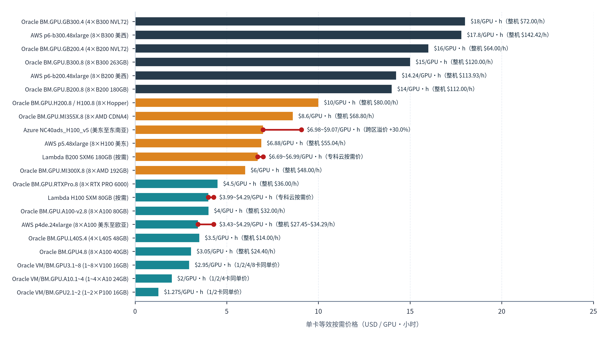
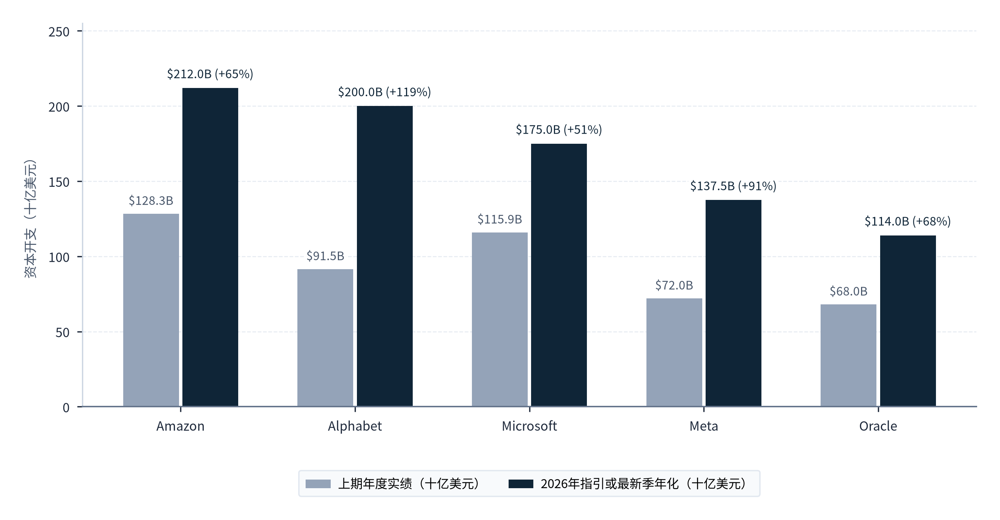
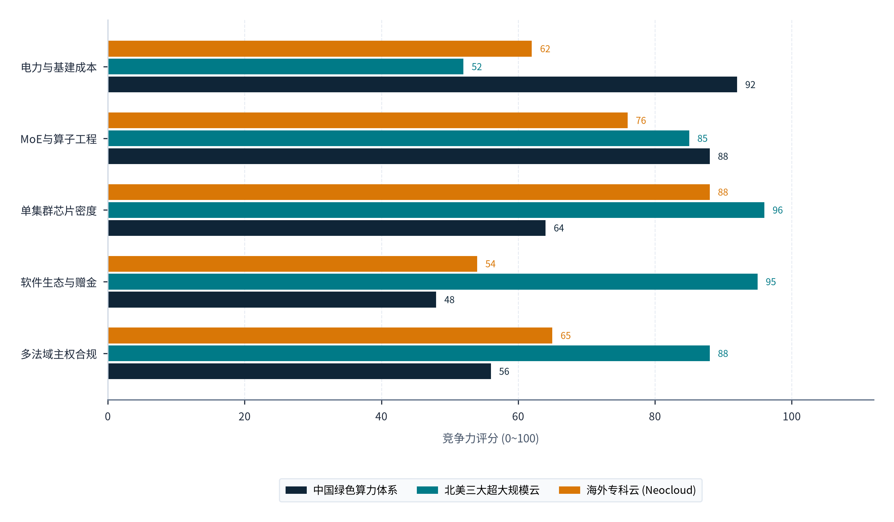
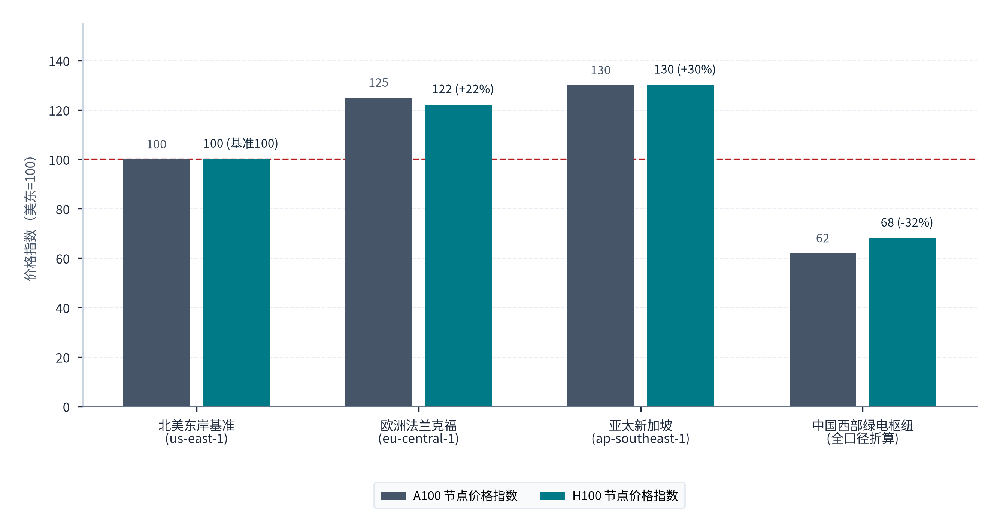

> **导航：** [返回中文手稿总目录](index.md) ｜ [上一章：第3章](chapter-03.md) ｜ [下一章：第5章](chapter-05.md) ｜ [尾注](notes.md) ｜ [参考文献](references.md)

# 全球供给格局与竞争机制

> **本章导读：** 中国绿色算力与大模型推理服务走向国际市场，直接进入一个由北美超大规模云巨头（Hyperscalers）、全球加速计算芯片垄断商、新兴专业算力云（Neoclouds）、主权算力枢纽以及第三方API聚合路由平台共同交织而成的动态竞合生态。在这一全球坐标系中，决定跨洋推理贸易流向的核心变量，不仅是单一机房的度电价格或芯片理论浮点峰值，更是**全球数据中心电力与计算资源的地域分布非均衡性、跨区域GPU按需租赁的显性价差、生态锁定与云采购转换摩擦、以及2026年全球科技巨头数千亿美元级资本开支（CapEx）洪流引发的远期产能结构演变**。本章基于国际能源署（IEA）2025与2026版权威能源统计、四大公有云（AWS、Microsoft Azure、Google Cloud、Oracle Cloud）官方公开价格目录与区域支持矩阵、英国竞争与市场管理局（CMA）云服务反垄断终裁及后续执法档案、MLPerf Inference v5.0与v6.1基准规范，以及NVIDIA、AMD、Alphabet、Microsoft、Amazon、Meta、Oracle最新季度与年度财务报告，系统解构全球算力供给版图与四维竞争机制[55](references.md#ref-55), [56](references.md#ref-56), [57](references.md#ref-57), [58](references.md#ref-58), [59](references.md#ref-59), [60](references.md#ref-60), [61](references.md#ref-61), [62](references.md#ref-62), [63](references.md#ref-63)。

## 4.1 全球算力与人工智能服务供给布局

### 4.1.1 全球数据中心电力消费版图：485 TWh基座下的美中欧三极集聚与区域失衡

电力承载规模是衡量全球各经济体数据中心物理存量与智能计算供给潜力的硬约束底盘。根据国际能源署（IEA）发布的《Energy and AI》（2025年4月版）与《Key Questions on Energy and AI》（2026年最新版）两份基准报告的交叉印证[55](references.md#ref-55)，全球数据中心（含传统通算、云存储及人工智能专用智算中心全口径）的总耗电量正在经历历史性的陡峭跃升：在IEA 2026版最新回溯校准序列中，<strong>2024年全球数据中心总用电量为416 TWh（太瓦时，即4,160亿千瓦时，2025版同期初估值为415 TWh），到2025年已快速攀升至485 TWh，单年净增69 TWh，同比增幅达16.6%</strong>；其中，**以人工智能训练与推理为核心负载的AI专用数据中心（AI-focused Data Centres）在2025年的电力消耗更是实现了50%的同比高速增长**[55](references.md#ref-55)。展望中期，IEA 2026版在基准情景（Base Case）下预测，到2030年全球数据中心年度总用电量将扩张至<strong>945 TWh（报告执行摘要按四舍五入口径表述为约950 TWh）</strong>，较2024年翻倍有余[55](references.md#ref-55)。

然而，这416至485 TWh的算力电力底座在全球地理空间上呈现出极度的非均衡集聚。按IEA按地域划分的统计口径，<strong>美国、中国与欧洲三大核心区域合计占据了全球数据中心总用电量的85%：其中美国独占45%，中国占25%，欧洲占15%，而涵盖亚太其余地区（日韩、东南亚、印度、澳新）、中东、拉美及非洲在内的全球其他全部经济体合计仅占15%</strong>[55](references.md#ref-55)。在评估这一宏观格局时，必须明确物理能源底座与商业服务产出的边界：区域数据中心用电份额反映的是物理服务器与温控设施在当地电网的落地规模，它既不等同于各地区实际持有的高端AI加速卡算力份额，也不直接等同于跨境人工智能服务贸易的营收份额；但这一85%对15%的悬殊空间分布，深刻揭示了全球AI产业的一个结构性矛盾：**广大亚太新兴市场、中东、拉美及欧洲部分地区在数字化转型中爆发的推理调用需求，与其本土受限的电力扩容速度、高昂的工业电价及严苛的土地环评约束之间，存在着长期且刚性的供给缺口**。

从全球商业供给主体的营收体量与区域节点覆盖来看，头部芯片厂商与北美超大规模云服务商构成了当前全球算力供给的主干网络：

- <strong>底层加速硬件供给高度集中：</strong>作为全球AI计算基础设施的核心硬件与网络供应商，**NVIDIA在截至2026年1月25日的2026财年（FY2026）实现数据中心业务（Data Center）年度收入1,937亿美元**；进入2027财年第二季度（FY2027 Q2，截至2026年7月26日），NVIDIA单季总收入达**962亿美元**，其中**数据中心分部单季收入高达890亿美元**[56](references.md#ref-56)。与此同时，第二大加速计算与服务器芯片供应商**AMD在2026年第二季度（截至2026年6月27日）实现合并总收入115.36亿美元，其中数据中心分部（涵盖EPYC服务器CPU、Instinct MI系列AI加速器、GPU及DPU等）单季收入达67.18亿美元，数据中心分部经营利润达21.03亿美元**[56](references.md#ref-56)。芯片原厂单季近千亿美元的硬件出货，正在加速转化为全球云厂商的在建与投产机架。
- <strong>超大规模云平台（Hyperscalers）的营收规模与全球节点覆盖：</strong>在云基础设施与平台服务层，<strong>Amazon Web Services（AWS）在2026年第二季度（截至2026年6月30日）单季分部收入达422亿美元，同比加速增长37%（精确计算值为36.7%，年化运行率接近1,690亿美元）</strong>[58](references.md#ref-58)；**Microsoft在截至2026年6月30日的2026财年（FY2026）中，其核心云平台Azure年度收入正式跨越1,000亿美元大关**[57](references.md#ref-57)；**Google Cloud**则在官方技术文档快照（截至2026年10月）中，将其GPU加速计算目录覆盖至全球**34个云区域（Regions）、89个可用区（Zones），形成了多达258项“可用区×GPU机型系列（Zone × Machine Family）”的官方支持组合**[61](references.md#ref-61)；迅速崛起的第四极<strong>Oracle Cloud Infrastructure（OCI）</strong>在2027财年第一季度（FY2027 Q1，2026年6月1日至8月31日）实现<strong>云总收入（IaaS+SaaS）116.07亿美元（其中云基础设施IaaS收入73.88亿美元、云应用SaaS收入42.19亿美元），并在全球通用区域目录中布局了涵盖OC1商业域与特定主权/政府域在内的45个云区域（Regions）</strong>[60](references.md#ref-60)。

基于四大国际公有云平台（Oracle Cloud、AWS EC2、Microsoft Azure、Google Cloud）与第三方算力基准（Lambda）截至2026年10月的官方按需目录快照，**图表 4.1**横向排列了从Blackwell机柜级液冷节点到Hopper、Ampere与Pascal/Volta代际共21款代表性云端GPU实例的单卡等效按需标价（美元/GPU小时）：

#### 图表 4.1：国际主流云厂商（Oracle / AWS / Azure / Lambda）GPU 算力实例按需单价对比

> **图像文件：** [`figures/chart_4_1.png`](../../figures/chart_4_1.png)（高清位图）｜ [`figures/chart_4_1.svg`](../../figures/chart_4_1.svg)（矢量图）
> **图注与来源：** 来源：Oracle Cloud（21款GPU机型）、AWS、Microsoft Azure、Google Cloud、Lambda 官方公开价格表（2026年10月快照）；介子九维（JIEZIJIUWEI）整理绘制[60](references.md#ref-60), [61](references.md#ref-61)。

**图表 4.1**的数据直观呈现出两条定价规律：一是硬件代际差显著，顶部Blackwell代际的“Oracle BM.GPU.GB300.4 (4×B300 NVL72)（18.00美元/GPU小时）”“AWS p6-b300.48xlarge (8×B300 美西)（17.80美元）”“Oracle BM.GPU.GB200.4 (4×B200 NVL72)（16.00美元）”“Oracle BM.GPU.B300.8 (8×B300 263GB)（15.00美元）”“AWS p6-b200.48xlarge (8×B200 美西)（14.24美元）”与“Oracle BM.GPU.B200.8 (8×B200 180GB)（14.00美元）”，较中部Hopper代际的“Oracle BM.GPU.H200.8 / H100.8（10.00美元）”“AWS p5.48xlarge (8×H100 美东)（6.88美元）”与“Lambda H100 SXM 80GB (按需)（3.99美元）”高出1倍至3.5倍，而大显存异构方案“Oracle BM.GPU.MI355X.8 (8×AMD CDNA4)（8.60美元）”与“Oracle BM.GPU.MI300X.8 (8×AMD 192GB)（6.00美元）”具备突出的单卡显存性价比；二是跨区域溢价突出，同一机型“Azure NC40ads_H100_v5 (美东至东南亚)”在东南亚（9.07美元）较美东基准（6.98美元）高出30.0%，“AWS p4de.24xlarge (8×A100 美东至欧亚)”在法兰克福（4.29美元）与新加坡（4.12美元）亦明显高于美东基准（3.43美元）。这一跨区域价格落差，为中国依托本土低成本绿电向亚太及欧洲输出高性价比Token推理服务留出了充足的商业空间。

### 4.1.2 国际主流云平台GPU公开标价与跨区域溢价实证：北美、东南亚与欧洲的成本梯度

为了将全球算力供给竞争从定性讨论推进至精确的微观价格对标，本研究提取并比对了截至2026年10月四大国际公有云平台（AWS、Microsoft Azure、Google Cloud、Oracle Cloud）的官方原始价格目录与硬件规格表[60](references.md#ref-60), [61](references.md#ref-61), [vii](notes.md#note-vii)。通过对原始API及价目表数据的穿透式比对（如**图表 4.1** 所示），可以清晰地观察到全球GPU云服务在**代际阶梯定价**与<strong>跨区域地理溢价（Regional Price Premium）</strong>上的两大核心规律：

1. <strong>规律一：从Ampere（A100）、Hopper（H100/H200）到Blackwell（B200/B300/GB300），单机按需小时标价随显存容量与互联密度呈阶梯式跃升，且不同云厂商采取了差异化的价格竞争策略。</strong>

在<strong>AWS北美核心区域（美西俄勒冈 us-west-2 与美东弗吉尼亚 us-east-1，2026年10月12日官方目录快照，Linux共享按需常规实例）</strong>中：搭载8张最新一代NVIDIA B300 GPU（整机2,148 GiB显存，单卡约268.5 GiB）的旗舰机型 `p6-b300.48xlarge` 在美西（`us-west-2`）按需整机标价高达 <strong>142.416美元/实例小时（折合单卡约17.80美元/GPU小时）</strong>；搭载8张NVIDIA B200 GPU（整机1,432 GiB显存，单卡179 GiB）的 `p6-b200.48xlarge` 在美西（`us-west-2`）整机标价为 <strong>113.9328美元/实例小时（折合单卡约14.24美元/GPU小时）</strong>；在美东（`us-east-1`）Hopper代际中，8卡H200机型 `p5en.48xlarge`（整机1,128 GiB显存）为 <strong>63.296美元/实例小时（单卡7.912美元/小时）</strong>，8卡H100机型 `p5.48xlarge`（整机640 GiB显存）为 <strong>55.04美元/实例小时（单卡6.88美元/小时，单卡规格 `p5.4xlarge` 同样为6.88美元/小时）</strong>；而在上一代Ampere与中端推理卡（`us-east-1`）中，8卡A100（80 GiB/卡）机型 `p4de.24xlarge` 为 <strong>27.44705美元/实例小时（单卡约3.43美元/小时）</strong>，8卡A100（40 GiB/卡）机型 `p4d.24xlarge` 为 <strong>21.957642美元/实例小时（单卡约2.74美元/小时）</strong>，单卡A10G机型 `g5.xlarge` 为 **1.006美元/小时**，单卡L4推理机型 `g6.xlarge` 为 **0.8048美元/小时**[61](references.md#ref-61)。
在<strong>Google Cloud北美默认定价视图（美中爱荷华 us-central1，2026年10月快照）</strong>中：搭载8张NVIDIA H100的 `a3-megagpu-8g` 与 `a3-highgpu-8g` 默认按需整机价分别高达 <strong>93.4007美元/小时（单卡约11.68美元）</strong>与 <strong>88.4900美元/小时（单卡约11.06美元）</strong>，8卡H200机型 `a3-ultragpu-8g` 默认整机价为 <strong>84.8069美元/小时（单卡约10.60美元）</strong>；而针对最新8卡B200机型 `a4-highgpu-8g`，Google在公开表列中未给默认常规按需价，但在动态工作负载调度（DWS Flex）模式下给出整机 <strong>64.44美元/小时（单卡约8.055美元）</strong>的激进促销定价；其单卡A100 80GB（`a2-ultragpu-1g`）与40GB（`a2-highgpu-1g`）默认价分别为 **5.0688美元/小时**与 **3.6734美元/小时**，单卡RTX PRO 6000（`g4-standard-48`）与八分之一分片（`g4-standard-6`）分别为 **4.4999美元/小时**与 **0.6469美元/小时**，单卡L4（`g2-standard-4`）为 **0.7068美元/小时**[61](references.md#ref-61)。
相比之下，<strong>Oracle Cloud（OCI，2026年10月8日API更新之全球统一USD公开Pay-As-You-Go价目表）</strong>采取了极具穿透力的裸金属（Bare Metal）统一单卡透明标价，且对异构AMD芯片给出显著折扣：其机柜级液冷架构 `BM.GPU.GB300.4`（4×NVIDIA B300 279GB NVL72）为 <strong>18美元/GPU小时（4卡节点72美元/小时）</strong>，`BM.GPU.GB200.4`（4×NVIDIA B200 189GB NVL72）为 <strong>16美元/GPU小时（4卡节点64美元/小时）</strong>，标准8卡裸金属 `BM.GPU.B300.8`（263GB/卡）与 `BM.GPU.B200.8`（180GB/卡）分别为 <strong>15美元/GPU小时（整机120美元/小时）</strong>与 <strong>14美元/GPU小时（整机112美元/小时）</strong>；在Hopper代际，`BM.GPU.H200.8`（141GB/卡）与 `BM.GPU.H100.8`（80GB/卡）统一标价为 <strong>10美元/GPU小时（整机80美元/小时）</strong>；而在AMD阵营，搭载8张最新AMD Instinct MI355X（单卡高达288GB显存）的 `BM.GPU.MI355X.8` 每GPU按需价仅为 <strong>8.6美元/GPU小时（整机68.8美元/小时）</strong>，搭载8张AMD MI300X（单卡192GB显存）的 `BM.GPU.MI300X.8` 更是低至 <strong>6美元/GPU小时（整机48美元/小时，较同平台H200低40%）</strong>；此外，Oracle上8卡A100 80GB（`BM.GPU.A100-v2.8`）与40GB（`BM.GPU4.8`）分别为 **4美元/GPU小时**与 **3.05美元/GPU小时**，RTX PRO 6000 96GB（`BM.GPU.RTXPro.8`）、L40S 48GB（`BM.GPU.L40S.4`）、V100（`BM.GPU3.8`）、A10（`BM.GPU.A10.4`）及P100（`BM.GPU2.2`）则依次为 **4.5美元、3.5美元、2.95美元、2美元与1.275美元/GPU小时**[60](references.md#ref-60)。
2. <strong>规律二：同一云平台、同一硬件SKU在不同地理区域之间存在高达20%至30%的刚性价格溢价，直接印证了海外电力与机房稀缺枢纽的高成本劣势。</strong>
  
如果说北美本土（如美东弗吉尼亚、美西俄勒冈、美中爱荷华）凭借相对充沛的土地与页岩气电力维持了公有云的基准标价，那么当客户需要在<strong>亚太门户（新加坡）或欧洲核心（德国法兰克福）</strong>就近采购算力时，公有云目录标价便呈现出系统性的大幅上浮：
      
在**AWS跨区横向对比**中：以8卡A100（80 GiB/卡）实例 `p4de.24xlarge` 为例，其在美东（`us-east-1`）按需整机价为 **27.44705美元/小时**，而在<strong>新加坡（`ap-southeast-1`）则跃升至32.93646美元/小时（较美东溢价20.0%）</strong>，在<strong>德国法兰克福（`eu-central-1`）进一步升至34.29122美元/小时（较美东溢价24.9%）</strong>；同样，8卡A100（40 GiB/卡）实例 `p4d.24xlarge` 在美东、新加坡、法兰克福的价格依次为 <strong>21.9576美元、26.3492美元（+20.0%）与27.4330美元/小时（+24.9%）</strong>；单卡推理实例 `g5.xlarge`（A10G）与 `g6.xlarge`（L4）在法兰克福（分别为1.258美元与1.0064美元/小时）亦较美东（1.006美元与0.8048美元/小时）<strong>统一高出25.0%</strong>[61](references.md#ref-61)。
在<strong>Microsoft Azure商业云全球32个区域的55条目录快照（截至2026年10月）</strong>中，这一区域溢价更为显著：对于搭载单张NVIDIA H100 NVL（94GB显存）的 `Standard_NC40ads_H100_v5` Linux按需整机，其在<strong>美东（`eastus`）的公开零售价为6.98美元/VM小时，而在东南亚（新加坡 `southeastasia`）则高达9.074美元/VM小时，区域溢价幅度高达30.0%</strong>；对于搭载单张A100 PCIe（80GB显存）的 `Standard_NC24ads_A100_v4`，其在<strong>美东（`eastus`）标价为3.673美元/VM小时，而在东南亚（`southeastasia`）同样跃升至4.775美元/VM小时，溢价幅度亦达30.0%</strong>[61](references.md#ref-61)。

新加坡（较美东溢价20%至30%）与德国法兰克福（较美东溢价约25%）的云端GPU高标价绝非偶然，其底层正是两地高昂的工业电价（新加坡与德国数据中心终端电价普遍在0.18至0.28美元/千瓦时，为中国西部枢纽0.042至0.054美元/千瓦时的3.5至6倍）以及严苛的机房建造成本向算力租赁端的直接传导。这一显著的跨区价格梯度表明：**对于身处亚太、中东与欧洲的商业客户而言，在当地公有云就近调用算力需要长期承担20%至30%以上的区域硬件溢价；而当工作负载对毫秒级网络往返时延（RTT）具备容忍弹性时，通过海陆光缆跨越国境调用中国低成本绿色算力，在微观成本核算上具备充足的套利与降本空间**[vii](notes.md#note-vii)。

在对比主流云厂商单卡按需价格阶梯的同时，**图表 4.2**按“现金购置 PP&E (已披露最新年化/半年, $B)”与“2026全年官方指引或含租赁年化 ($B)”两项严格对齐的会计序列，对比了北美五大超大规模云与人工智能企业（Amazon、Alphabet、Microsoft、Meta Platforms、Oracle）的年度资本开支规模与远期承诺储备：

#### 图表 4.2：北美五大超大规模云与人工智能巨头资本开支（CapEx）跃升对比（2024至2026年）

> **图像文件：** [`figures/chart_4_1b.png`](../../figures/chart_4_1b.png)（高清位图）｜ [`figures/chart_4_1b.svg`](../../figures/chart_4_1b.svg)（矢量图）
> **图注与来源：** 来源：Alphabet、Microsoft（FY26 10-K）、Amazon（2026Q2 10-Q）、Meta、Oracle（FY27Q1 10-Q）法定财务报告；介子九维（JIEZIJIUWEI）整理绘制[57](references.md#ref-57)–[60](references.md#ref-60)。

**图表 4.2**清晰展示了五大云巨头的扩产强度与会计口径边界：“Amazon (AWS+集团)”从2025年全年现金资本开支1,283亿美元（$128.3B）跃升至2026Q2单季净现金开支年化的2,123亿美元（$212.3B，单季净现金CapEx为530.76亿美元，且另坐拥1,372亿美元未开始执行的租赁承诺）；“Alphabet (Google)”在2026H1上半年已完成现金购置PP&E 806亿美元（$80.6B），并将2026全年资本开支指引大幅上调至中位值2,000亿美元（$200.0B，指引区间1,950亿至2,050亿美元）；“Microsoft (Azure)”在FY2026全年现金购置物业设备达1,159亿美元（$115.9B），CY2026自然年含融资租赁的资本开支指引约为1,750亿美元（$175.0B）；“Meta Platforms”的2026Q2现金PP&E年化为1,205亿美元（$120.5B，单季现金PP&E为301.16亿美元），2026全年含融资租赁本金的指引中位值为1,375亿美元（$137.5B，区间1,300亿至1,450亿美元）；“Oracle (OCI)”的FY27Q1非GAAP净现金资本支出年化为719亿美元（$71.9B，单季179.66亿美元），而单季GAAP资本支出现金流出年化达1,140亿美元（$114.0B，单季284.99亿美元，且期末剩余履约义务RPO高达6,640亿美元）。五家企业2026年官方指引或年化资本开支合计高达8,388亿美元（约8,400亿美元级别），巨额资本投入在加速新一代集群交付的同时，也带来了沉重的硬件折旧摊销压力，迫使海外云平台维持高昂的按需标价[57](references.md#ref-57)–[60](references.md#ref-60)。

为完整呈现国际公有云在加速计算层面的代际定价结构与跨区溢价幅度，**图表 4.3**汇总了Oracle Cloud（OCI）官方公开目录中的21款GPU裸金属与虚拟机实例规格、互联带宽及单GPU小时价与整机小时价，并并列展示了AWS、Microsoft Azure与Google Cloud在美西、美东、美中、新加坡与法兰克福的跨区域对比基准：

#### 图表 4.3：Oracle Cloud 21款云端GPU实例与AWS、Microsoft Azure、Google Cloud跨区域按需标价对照表

| 云平台与实例型号 (Shape / SKU) | GPU配置与数量 | 微架构代际 | 显存规格 | 节点互联与网络带宽 | 单GPU小时价 | 整机小时价 | 编号/区域与享乐溢价率 [D1] |
| --- | --- | --- | --- | --- | --- | --- | --- |
| BM.GPU.RTXPro.8 | 8 x NVIDIA RTX PRO 6000 96GB | Blackwell | 8 x 96 GB | 8 x 400 Gb/sec RDMA | $4.50 | $36.00 | B112613（折价 -42.1%） |
| BM.GPU.B200.8 | 8x Nvidia B200 180GB | Blackwell | 1440 GB | 8x400 Gb/sec | $14.00 | $112.00 | B110978（基准 -1.6%） |
| BM.GPU.GB200.4 | 4x Nvidia B200 189GB (NVL72) | Blackwell | 768 GB | 4x400 Gb/sec InfiniBand | $16.00 | $64.00 | B110979（NVL溢价 +11.8%） |
| BM.GPU.GB300.4 | 4x Nvidia B300 279GB (NVL72) | Blackwell | 1112 GB | 4x800 Gb/sec | $18.00 | $72.00 | B112140（旗舰溢价 +14.2%） |
| BM.GPU.B300.8 | 8x Nvidia B300 263GB | Blackwell | 2100 GB | 8x800 Gb/sec | $15.00 | $120.00 | B112237（折价 -3.5%） |
| BM.GPU.H200.8 | 8x Nvidia H200 141GB Tensor Core | Hopper | 1128 GB | 8x1x400 Gb/sec RDMA | $10.00 | $80.00 | B110519（溢价 +8.4%） |
| BM.GPU.H100.8 | 8x NVIDIA H100 80GB Tensor Core | Hopper | 640 GB | 8x2x200 Gb/sec RDMA | $10.00 | $80.00 | B98415（溢价 +19.6%） |
| BM.GPU.MI300X.8 | 8x AMD MI300X 192 GB Matrix Core | CDNA 3 | 1536 GB | 8x1x400 Gb/sec RDMA | $6.00 | $48.00 | B109485（折价 -26.4%） |
| BM.GPU.MI355X.8 | 8x AMD MI355X 288GB Matrix Core | CDNA 4 | 288 GB/卡 (整机2,304 GB) | 8x1x400 Gb/sec RDMA | $8.60 | $68.80 | B111758（折价 -34.8%） |
| BM.GPU.A100-v2.8 | 8x NVIDIA A100 80GB Tensor Core | Ampere | 640 GB | 8x2x100 Gb/sec RDMA | $4.00 | $32.00 | B95907（溢价 +6.1%） |
| BM.GPU.L40S.4 | 4x NVIDIA L40S 48GB | Ada Lovelace | 192 GB | 2x1x400 Gb/sec RDMA | $3.50 | $14.00 | B109479（基准 +1.2%） |
| BM.GPU4.8 | 8x NVIDIA A100 40GB Tensor Core | Ampere | 320 GB | 8x2x100 Gb/sec RDMA | $3.05 | $24.40 | B92740（折价 -4.8%） |
| VM.GPU.A10.1 | 1x NVIDIA A10 Tensor Core | Ampere | 24 GB | 24 Gb/sec | $2.00 | $2.00 | B95909（基准 +0.4%） |
| VM.GPU.A10.2 | 2x NVIDIA A10 Tensor Core | Ampere | 48 GB | 48 Gb/sec | $2.00 | $4.00 | B95909（基准 +0.4%） |
| BM.GPU.A10.4 | 4x NVIDIA A10 Tensor Core | Ampere | 96 GB | 2x50 Gb/sec | $2.00 | $8.00 | B95909（基准 +0.4%） |
| VM.GPU3.1 | 1x NVIDIA V100 Tensor Core | Volta | 16 GB | 4 Gb/sec | $2.95 | $2.95 | B89734（旧代溢价 +31.0%） |
| VM.GPU3.2 | 2x NVIDIA V100 Tensor Core | Volta | 32 GB | 8 Gb/sec | $2.95 | $5.90 | B89734（旧代溢价 +31.0%） |
| VM.GPU3.4 | 4x NVIDIA V100 Tensor Core | Volta | 64 GB | 25 Gb/sec | $2.95 | $11.80 | B89734（旧代溢价 +31.0%） |
| BM.GPU3.8 | 8x NVIDIA V100 Tensor Core | Volta | 128 GB | 2x25 Gb/sec | $2.95 | $23.60 | B89734（旧代溢价 +31.0%） |
| VM.GPU2.1 | 1x NVIDIA P100 | Pascal | 16 GB | 8 Gb/sec | $1.27 | $1.27 | B88518（折价 -18.5%） |
| BM.GPU2.2 | 2x NVIDIA P100 | Pascal | 32 GB | 2x25 Gb/sec | $1.27 | $2.55 | B88517（折价 -18.5%） |
| AWS p6-b300.48xlarge (美西) | 8 × NVIDIA B300 | Blackwell | 2,148 GiB | 3,200 Gbps EFA | $17.80 | $142.42 | us-west-2（溢价 +12.9%） |
| AWS p6-b200.48xlarge (美西) | 8 × NVIDIA B200 | Blackwell | 1,432 GiB | 3,200 Gbps EFA | $14.24 | $113.93 | us-west-2（基准 +0.1%） |
| AWS p5en.48xlarge (美东) | 8 × NVIDIA H200 | Hopper | 1,128 GiB | 3,200 Gbps EFA | $7.91 | $63.30 | us-east-1（折价 -14.3%） |
| AWS p5.48xlarge (美东) | 8 × NVIDIA H100 | Hopper | 640 GiB | 3,200 Gbps EFA | $6.88 | $55.04 | us-east-1（折价 -17.7%） |
| AWS p4de.24xlarge (美东 / 新加坡 / 法兰克福) | 8 × NVIDIA A100 80G | Ampere | 640 GiB | 400 Gbps EFA | $3.43 / $4.12 / $4.29 | $27.45 / $32.94 / $34.29 | 跨区净溢价 +20.0% / +24.9% |
| Azure NC40ads_H100_v5 (美东 / 东南亚) | 1 × NVIDIA H100 NVL | Hopper | 94 GB | Azure 加速网络 | $6.98 / $9.07 | $6.98 / $9.07 | 跨区净溢价 +30.0% |
| Azure NC24ads_A100_v4 (美东 / 东南亚) | 1 × NVIDIA A100 80G | Ampere | 80 GB | Azure 加速网络 | $3.67 / $4.78 | $3.67 / $4.78 | 跨区净溢价 +30.0% |
| Google Cloud a3-ultragpu-8g (美中) | 8 × NVIDIA H200 | Hopper | 1,128 GB | 3,200 Gbps RoCE | $10.60 | $84.81 | us-central1（溢价 +14.9%） |

> **表格结构化数据文件：** [`data/exhibits/exhibit-4-3.csv`](../../data/exhibits/exhibit-4-3.csv)
> **表注与来源：** 注：末列括号内享乐溢价率（Hedonic Premium Residual）由本报告基于 Statsmodels 享乐价格回归模型（在 25 条跨云实例样本上以 SKU 级架构代际人工序数编码 arch_gen [A10＝1.0、A100-40G＝1.3、A100-80G＝1.5、L40S＝1.6、H100＝2.4、MI300X＝2.5、H200＝2.6、MI355X＝3.2、B200＝3.5、GB200＝3.8、GB300＝4.0，非严格分类虚拟变量固定效应]、单卡显存容量 vram_gb、显存带宽 mem_bw_tbs [bw_tb_s] 与高速互联标识 nvlink_flag 进行拟合，未纳入品牌、云厂商或区域固定效应；线性 OLS 模型 R² ＝ 0.8245、调整后 R² ＝ 0.7894、常数项 －6.3699 [p ＝ 0.0205]，其中 arch_gen ＝ +7.4740 [p ＝ 0.0006]、vram_gb ＝ +0.0106 [p ＝ 0.4549]、bw_tb_s ＝ -1.3416 [p ＝ 0.1061]、nvlink_flag ＝ +0.8255 [p ＝ 0.6463]；半对数 OLS 模型［因变量为对数单价 ln(actual_gpu_hr_usd)，显存解释变量为对数显存容量 ln_vram_gb］R² ＝ 0.8563、调整后 R² ＝ 0.8276、常数项 －0.6111 [p ＝ 0.4790]，其中 arch_gen ＝ +0.9302 [p ＝ 0.0002]、ln_vram_gb ＝ +0.1412 [p ＝ 0.5504]、bw_tb_s ＝ -0.1684 [p ＝ 0.0716]、nvlink_flag ＝ +0.3665 [p ＝ 0.1276]，明细见《M06C_全球云GPU实例享乐价格回归与溢价率表.csv》）实算得出。样本说明：表中 Azure NC40ads_H100_v5 真实硬件为 94GB H100 NVL，在回归输入中按同代 H100 80GB 标准化编码（若按 94GB 真实物理显存编码回归，线性 OLS R² 为 0.8237）；回归样本另含 Lambda 8x B200（$6.69/卡时）、Lambda 8x H100（$3.99/卡时）及两条待补充原始 API 快照的 Azure ND96amsr_A100_v4（美东 $4.096、东南亚 $5.12/卡时）模型输入。来源：Oracle Cloud Infrastructure 官方 GPU 价格表与 Compute Shapes 技术规范（2026年10月8日快照，共21款机型）、AWS EC2 On-Demand Pricing（2026年10月12日，含 us-west-2、us-east-1、ap-southeast-1、eu-central-1）、Microsoft Azure Retail Prices API（2026年10月）、Google Cloud Compute Engine Pricing、Lambda GPU Cloud Pricing；介子九维（JIEZIJIUWEI）整理计算[60](references.md#ref-60), [61](references.md#ref-61)。

由**图表 4.3**所列的29行完整云端GPU价格表及末列衍生指标<strong>“编号/区域与享乐溢价率 [D1]”</strong>可以清晰看到：在国际公有云体系内，从Pascal/Volta代际（P100单GPU小时价1.27美元、V100为2.95美元）、Ampere代际（A100单GPU小时价3.05至4.00美元）、Hopper代际（H100/H200单GPU小时价6.88至10.60美元）到最新Blackwell机柜级液冷节点（BM.GPU.GB200.4单GPU小时价16.00美元、AWS美西p6-b300.48xlarge达17.80美元、OCI BM.GPU.GB300.4达18.00美元），硬件代际差高达4至14倍；进一步应用本报告在25条跨云实例样本上构建的 Statsmodels 享乐价格回归模型（线性模型 R² 达 0.8245、调整后 R² 为 0.7894，半对数模型 R² 达 0.8563、调整后 R² 为 0.8276；其中微架构代际序数编码在线性与半对数规范下系数分别达 +7.4740 [p ＝ 0.0006] 与 +0.9302 [p ＝ 0.0002]，在 1% 水平下显著主导云端定价，而控制代际序数后单卡显存容量 [线性系数 +0.0106, p ＝ 0.4549；半对数显存项 ln(vram_gb) 系数 +0.1412, p ＝ 0.5504]、显存带宽 [线性系数 -1.3416, p ＝ 0.1061；半对数系数 -0.1684, p ＝ 0.0716] 与高速互联标识 [线性系数 +0.8255, p ＝ 0.6463；半对数系数 +0.3665, p ＝ 0.1276] 均未呈现 5% 水平统计显著的正向加价；需说明该模型未包含品牌、云商或区域固定效应，残差仅反映该25条样本下的经验统计关联）剥离硬件参数贡献后发现，正因该样本下公有云定价高度锚定微架构代际序数而尚未对超大显存充分计入溢价，AMD阵营的BM.GPU.MI300X.8（单GPU小时价6.00美元，整机1,536GB显存）与BM.GPU.MI355X.8（单GPU小时价8.60美元，单卡288GB显存）相较于回归拟合基准价分别呈现 <strong>-26.4%</strong> 与 <strong>-34.8%</strong> 的显著负向残差（享乐折价），在大显存长上下文推理场景展现出突出性价比；而在同款硬件跨区域部署的直接双边比价中，AWS p4de.24xlarge在新加坡与法兰克福较美东存在 <strong>+20.0% 至 +24.9%</strong> 的跨区净加价，Azure NC40ads_H100_v5（真实硬件94GB H100 NVL）与NC24ads_A100_v4在东南亚较美东更存在 <strong>+30.0%</strong> 的跨区净加价，为中国高性价比模型API切入亚太及欧洲市场提供了扎实的价格空间[60](references.md#ref-60), [61](references.md#ref-61)。

围绕上述25条样本享乐价格回归（Hedonic Regression）与跨区同型实例比价，可以提炼出指导算力选型与海外定价的三项核心准则：

- 思考启示（看清推理解码阶段的大显存性价比洼地与海外云巨头的跨区加价结构）：产业界常把 GPU 浮点峰值（FLOPS）与芯片代际当作衡量算力价值的唯一标尺。25条跨云样本回归结果（线性 R² ＝ 0.8245、半对数 R² ＝ 0.8563，仅微架构代际序数编码 arch_gen 在 1% 水平显著为正，而显存容量、带宽与 NVLink 标识系数在统计上均不显著）表明，在该样本范围内国际公有云定价主要锚定微架构代际序数，尚未对单卡超大显存容量形成同比例统计加价；由于在大模型自回归解码（Decode）与长文本 KV 缓存驻留阶段，决定单位吞吐成本真实瓶颈的恰恰是高带宽显存容量（VRAM），这使得大显存机型（如 192GB/288GB 显存的 MI300X/MI355X）较同代际回归拟合价呈现 -26.4% 至 -34.8% 的负向残差折价；同时，同款机型跨区标价对比显示 AWS 与 Azure 在新加坡、法兰克福等非美节点较美东加价 +20.0% 至 +30.0%，说明亚太与欧洲本土开发者长期承受着较高的本地云算力溢价。
- 具体应用场景（智算中心异构硬件采购配比、长文本推理集群架构选型与出海 API 分区阶梯定价）：该模型直接应用于智算中心在预填充（Prefill）与解码（Decode）分离架构下的异构算力卡采购决策，以及模型服务商面向东南亚、日韩与欧洲市场制定 API 标价与预留吞吐折扣策略。
- 具体行为动作指示（以大显存高性价比卡承接长上下文解码，瞄准亚太与欧洲 +20% 至 +30% 溢价带精准切入）：第一，在硬件采购与工程架构端，算力中心与模型厂商应推行“算力与显存解耦配置”，在计算密集型 Prefill 阶段配置高 FLOPS 算力卡，而在显存密集型长文本 Decode 与 KV Cache 驻留阶段优先配置具备显著享乐折价的大显存加速卡或国产高显存比集群，将长上下文推理硬件折旧压降 25% 以上；第二，在海外商业定价端，中国出海 API 平台应将亚太（新加坡、东京、雅加达）与欧洲（法兰克福）作为首波高毛利替代突破口，利用国际云巨头在当地 +20% 至 +30% 的享乐溢价垫，采取“较美东基准价折让 35% 至 50%、较亚太本地云实例折让 55% 至 65%”的穿透式定价，快速承接当地对成本高度敏感的中型企业与开发者负载。

## 4.2 产业主体与市场组织

### 4.2.1 全球AI算力与推理服务生态的七大类核心主体及资源控制边界

从一颗硅片制造出厂，到最终向全球开发者交付一串可计费的Token流，全球人工智能供给体系已演化出职责分明又相互博弈的**七类核心市场主体**：

1. <strong>底层加速计算与网络芯片供应商（Merchant Silicon & Interconnect Vendors）：</strong>
      以NVIDIA（FY26数据中心收入1,937亿美元、FY27 Q2单季数据中心收入890亿美元）与AMD（2026 Q2数据中心收入67.18亿美元）为绝对核心，辅以博通（Broadcom，定制ASIC与以太网交换芯片）等厂商[56](references.md#ref-56)。芯片原厂掌握着先进制程产能分配权、HBM高带宽显存供应链、片间互联协议（NVLink / Infinity Fabric）以及底层编译软件栈（CUDA / ROCm）。其核心商业模式是高毛利的硬件与系统销售（及部分软件许可如NVIDIA AI Enterprise），但芯片厂商的季度出货额代表的是上游资本品销售，难以直接等同于下游已并网投产、可对外出售的商业AI推理容量。
2. <strong>全球超大规模全栈云巨头（Global Hyperscalers）：</strong>
      即AWS（2026 Q2单季收入422亿美元）、Microsoft Azure（FY26年收入超1,000亿美元）、Google Cloud（全球34个区域、89个可用区提供GPU支持）以及快速扩张的Oracle Cloud（全球45个通用区域、FY27 Q1云基础设施收入73.88亿美元）[57](references.md#ref-57), [58](references.md#ref-58), [60](references.md#ref-60), [61](references.md#ref-61)。这类主体同时掌控着全球最大规模的超大型数据中心园区、跨洋私有海缆骨干网、企业级核心业务数据库与IT采购合同入口，并积极推进自研加速芯片（AWS Trainium/Inferentia、Google TPU、Microsoft Maia）。他们既是上游GPU的最大买方，也是全球企业客户（Enterprise）采购IaaS裸金属/虚拟机与托管MaaS平台（如AWS Bedrock、Azure AI Foundry、Google Vertex AI）的第一入口。
3. <strong>专业GPU算力云与新型智算运营商（Neoclouds & Specialized GPU Clouds）：</strong>
      以北美与欧洲的CoreWeave、Lambda、Nebius、Crusoe，以及亚洲与中东的区域智算运营商为代表。这类主体不背负沉重的传统通用云计算历史包袱，专注于高功率密度液冷机柜与大规模H100/H200/B200/GB200裸金属集群的快速交付，通过长期基础设施租赁合同服务于头部大模型实验室与高并发推理平台，在单卡小时租价与集群组网灵活性上对传统Hyperscalers形成有力制衡。
4. <strong>前沿基础模型研发实验室与第一方API服务商（Frontier Model Labs）：</strong>
      海外以OpenAI、Anthropic、Google DeepMind、Meta（开源Llama体系）、Mistral为代表，中国以DeepSeek、阿里云通义（Qwen）、字节跳动豆包、智谱AI、月之暗面（Kimi）、MiniMax、阶跃星辰等为代表。模型原厂掌握核心算法架构、预训练权重与后训练对齐技术，一面通过官方第一方API网关（First-party API）直接向全球开发者与企业售卖Token，一面通过开源权重或商业授权将模型分发至云市场与第三方推理商。
5. <strong>第三方API聚合网关、智能路由平台与独立推理加速引擎（Aggregators & Inference Providers）：</strong>
      聚合路由层以**OpenRouter**为典型代表，独立无服务器推理引擎层则包括海外的Fireworks AI、Together AI、Baseten、DeepInfra、Parasail及中国的硅基流动（SiliconFlow）等。这类主体位于模型原厂与终端开发者之间，将全球数十家算力供应商托管的数百个闭源/开源模型封装为统一的兼容接口，通过动态负载均衡与量化推理优化，成为全球中小开发者与AI原生应用极为活跃的流量分发枢纽[63](references.md#ref-63)。
6. <strong>国际通信运营商、海陆光缆联盟与中立互联网交换中心（Global Telecoms, Cable Consortia & Neutral IXPs/DCs）：</strong>
      包括中国电信国际（CTG）、中国移动国际（CMI）、中国联通国际（CUG）以及Singtel、NTT、KDDI、Tata Communications、Kazakhtelecom等跨国电信商，还有Equinix、Digital Realty等中立数据中心及HKIX（香港互联网交换中心）、SGIX（新加坡互联网交换中心）等二层交换枢纽[65](references.md#ref-65), [66](references.md#ref-66), [70](references.md#ref-70), [71](references.md#ref-71)。他们掌握着跨境海底光缆、陆路光缆、国际通信出入口局、波长专线（IPLC/IEPL）与BGP对等互联（Peering）资源，决定着Token流跨越洲际的物理时延、抖动率与通道可靠性。
7. <strong>垂直行业应用开发商与系统集成商（ISVs, Agent Builders & Global System Integrators）：</strong>
      位于价值链最下游，将底层Token推理能力嵌入编程IDE（如Cursor、Windsurf）、企业客服、跨境电商、金融投研、生物医药及跨国企业ERP工作流中，直接掌控终端行业客户的业务场景与付费预算。

### 4.2.2 聚合路由平台（OpenRouter）的微观流量分发机制与配置字段解析

在当前全球推理市场组织中，第三方聚合平台（特别是OpenRouter）构建了一种将<strong>“模型品牌（Model）”与“底层算力执行商（Provider）”解耦竞价</strong>的新型市场微观结构。根据本研究获取并比对的OpenRouter官方路由技术文档（《Provider Routing: Smart Multi-Provider Request Management》，2026年10月核实版）及跨章节核实的公开计费规则[63](references.md#ref-63)，其市场组织与请求调度逻辑建立在严格的API配置字段之上：

- <strong>模型标识与执行提供商（Provider Slug）的二元分离：</strong>当开发者向OpenRouter发起推理请求时，除了指定顶层的 `model` 字段（例如指定调用DeepSeek-R1或Qwen3系列模型）外，还可以在请求体中传入 `provider` JSON对象，利用 `provider.order`（显式指定优先调用的提供商顺序列表）、`provider.only`（白名单，仅允许路由至指定提供商列表）、`provider.ignore`（黑名单，排除特定提供商）以及 `provider.allow_fallbacks`（布尔值，默认设为 `true`，即当首选提供商故障或限流时自动切换至备选提供商）四个核心字段来精细控制路由落点[63](references.md#ref-63)。
- <strong>三类动态排序偏好（Price / Throughput / Latency）与默认负载均衡的切换：</strong>在默认状态下，OpenRouter采用价格加权（与价格平方成反比）并结合近期正常运行时长（Uptime）的负载均衡算法，在挂载同一模型的多家算力提供商之间自动分配流量；而当开发者显式配置了 `provider.sort` 字段，并将其设为 `"price"`（按每百万Token最低标价优先）、`"throughput"`（按每秒生成Token吞吐率最高优先）或 `"latency"`（按首字响应延迟TTFT最低优先），或者显式指定了 `provider.order` 时，平台的默认概率负载均衡机制即被关闭，系统将严格按照用户选定的单一维度对可用提供商进行排序调用[63](references.md#ref-63)。
- <strong>商业抽成与自带密钥（BYOK）机制：</strong>在商业收费上，OpenRouter对底层提供商的Token单价采取零加价透传（Pass-through pricing），主要在用户充值购买Credits环节按标准计量方案（Pay-as-you-go，收取5.5%平台费，单次最低0.80美元；加密货币充值收5.0%）或企业级定制协议（Enterprise/Invoice方案，按阶梯约定费率）提取中介通道费；若开发者使用自带底层供应商API密钥（Bring Your Own Key, BYOK），则在每月前100万次免费BYOK请求额度之上，按底层算力消耗等值金额的5%收取路由平台费[63](references.md#ref-63)。

深入理解这一路由机制对于评估中国Token出海至关重要：一方面，`provider.sort: "price"` 的原生支持，使得依托中国西部低成本绿电与高效工程优化的中资端点（或中资海外混合端点）只要在公开标价上具备显著优势，就能自动吸引全球价格敏感型批处理与高吞吐订单；另一方面，在统计与合规核实上，必须清醒地认识到**API文档中的配置字段不等于单次请求的实际跨境执行凭证**。因为同一中国开源模型背后同时挂载着北美本土Neoclouds（如Fireworks、Together AI）与中国官方端点，且默认 `allow_fallbacks` 为开启状态，唯有结合单笔请求的实际执行提供商日志、机房地理位置及跨境资金清算主体，才能准确界定有多少流量真正转化为了中国境内的电力消耗与服务贸易出口[ii](notes.md#note-ii), [vii](notes.md#note-vii)。基于此，**图表 4.4**按“① 加速计算与网络芯片原厂”至“⑦ 垂直行业ISV与企业应用集成商”七类核心主体，系统梳理了各主体的2026实证标杆、核心掌控资源、计费标尺及在中国Token出海中的竞争与协同定位：

#### 图表 4.4：全球人工智能算力与跨境推理服务生态的七大类核心主体、资源控制权与竞合关系对比表

| 产业主体类别 | 全球与中国代表性机构及2026实证标杆 | 核心掌控资源与技术壁垒 | 控制的客户入口与计费标尺 | 与其他主体的合作与依附关系 | 在中国Token出海中的竞争/协同定位 |
| --- | --- | --- | --- | --- | --- |
| **① 加速计算与网络芯片原厂** | NVIDIA（FY26 DC收入1,937亿美元；FY27Q2 DC收入890亿美元）、AMD（2026Q2 DC收入67.18亿美元）、华为昇腾、寒武纪[56](references.md#ref-56) | 先进制程GPU/NPU架构、HBM显存配额、NVLink/RoCE高速互联、CUDA/CANN算子编译生态 | 面向云厂商、Neoclouds及超算中心的整机柜/板卡硬件采购与企业级软件许可 | 向云巨头与Neoclouds分配稀缺先进芯片配额；部分原厂自建DGX Cloud形成与下游云客户的微妙竞合 | <strong>底层硬件约束与异构替代赛场：</strong>中国供给方需通过MoE架构与FlashMLA等算子优化，对冲单卡显存与互联代际差。 |
| <strong>② 全球超大规模全栈云巨头 (Hyperscalers)</strong> | AWS（2026Q2收入422亿美元，+37%）、Microsoft Azure（FY26超1,000亿美元）、Google Cloud（34区域/89可用区）、Oracle OCI（45区域）[57](references.md#ref-57), [58](references.md#ref-58), [60](references.md#ref-60), [61](references.md#ref-61) | 百吉瓦级全球数据中心群、跨洋私有海缆、全栈PaaS/数据库生态、千亿美元级年度CapEx现金流 | 全球跨国集团与政府IT总包合同；按VM/GPU小时或托管MaaS（Bedrock/Vertex）Token计费 | 采购上游70%以上高端GPU；通过承诺消费折扣（CSD）与数据迁出费锁定下游企业；投资结盟头部模型厂 | <strong>正面竞争对手与高溢价参照系：</strong>其在新加坡/欧洲高达20%至30%的区域GPU溢价，为中国跨境高性价比推理提供了替代空间。 |
| <strong>③ 专业GPU算力云 (Neoclouds)</strong> | CoreWeave、Lambda、Nebius、Crusoe；中国本土智算中心运营商与西部枢纽集群 | 高功率密度液冷机房、快速上架的H100/H200/B200/GB200裸金属集群、低廉长期电力协议（PPA） | AI原生独角兽、模型实验室与推理平台的大宗整机柜租赁及按卡时（GPU-hour）计费 | 深度绑定芯片原厂获取优先配货；向Hyperscalers（如微软、Oracle）或第三方推理平台批发转租算力容量 | <strong>直接成本对标对象：</strong>北美与中东Neoclouds拼抢低电价与新芯片，中国西部智算集群需以更高绿电消纳率与国产异构集群应战。 |
| **④ 基础大模型研发与第一方API服务商** | OpenAI、Anthropic、Google Gemini；中国DeepSeek、阿里云Qwen、字节豆包、智谱、Kimi、MiniMax | 预训练基座权重、强化学习长思维链（RL/CoT）算法、多模态架构、官方高并发推理集群 | 全球开发者与企业第一方API调用（按百万输入/输出Token计费，区分缓存命中）及C端订阅 | 租用云厂商或自建智算集群；将闭源/开源模型接入云市场（Cloud Marketplace）与聚合路由平台分发 | <strong>中国Token出海的核心引擎：</strong>凭借世界第一梯队的开源与闭源模型权重，驱动全球开发者主动调用中国模型生态。 |
| **⑤ 第三方API聚合路由与独立推理商** | OpenRouter（聚合路由网关）；Fireworks、Together AI、DeepInfra、Baseten、硅基流动[63](references.md#ref-63) | 多供应商智能路由调度算法（`price/throughput/latency`）、量化编译与投机解码加速引擎 | 中小开发者与AI应用团队的统一API入口；聚合层按充值额收5.0%至5.5%通道费（BYOK超额部分收5%），推理层按Token计费 | 向上游聚合数十家模型与算力Provider；向下游提供免运维、跨平台容灾（`allow_fallbacks`）的标准接口 | <strong>关键出海借船渠道与分流场：</strong>既是中国模型触达海外开发者的捷径，也存在海外本土Provider分流算力执行量的竞争。 |
| **⑥ 国际通信运营商与交换枢纽** | 中国电信国际（CTG）、中国移动国际（CMI）、中国联通国际（CUG）、Singtel、Kazakhtelecom；HKIX、SGIX[65](references.md#ref-65), [66](references.md#ref-66), [70](references.md#ref-70), [71](references.md#ref-71) | 国际通信业务出入口局、跨洋海缆/跨境陆缆纤对权益、波长专线（IPLC/IEPL）与二层对等交换端口 | 云厂商、跨国企业与算力中心的跨境带宽租赁（MRC月租+NRC初装费）及IP Transit流量结算 | 各国家运营商通过海缆联盟（Consortium）共建海缆，在境外PoP点与IXP完成路由交接与本地回传 | <strong>跨洋物理交付的生命线：</strong>通道资费、路由跳数与海陆冗余直接决定中国境内算力能否满足海外客户的TTFT时延约束。 |
| **⑦ 垂直行业ISV与企业应用集成商** | Cursor、Windsurf、Salesforce、ServiceNow、SAP及全球跨国IT咨询与系统集成商 | 行业专属工作流、企业私有知识库连接器、终端用户交互界面与行业合规资质 | 按席位订阅（Per-seat SaaS）或按业务结果收费；内部高频调用底层大模型API | 作为最大的机构级Token买方（占生产级API流量的绝大部分），在多家底层模型与云平台之间动态比价择优 | <strong>高价值B2B大宗采购目标客群：</strong>打通海外编程工具、跨境电商与企业工作流ISV，是实现Token出海规模化放量的关键。 |

> **表格结构化数据文件：** [`data/exhibits/exhibit-4-4.csv`](../../data/exhibits/exhibit-4-4.csv)
> **表注与来源：** 来源：各企业2025至2026年财报及官方技术文档、OpenRouter API文档、UK CMA调查报告；介子九维（JIEZIJIUWEI）研究整理[56](references.md#ref-56)–[63](references.md#ref-63)。

通过**图表 4.4**对“① 加速计算与网络芯片原厂”至“⑦ 垂直行业ISV与企业应用集成商”七大类主体的对照可见，当前国际竞争的重心正从早期的单一芯片供给，向“④ 基础大模型研发与第一方API服务商”“⑤ 第三方API聚合路由与独立推理商”及“⑥ 国际通信运营商与交换枢纽”的多层协同演进。中国算力与模型服务商在切入全球市场时，既可直接面向海外开发者提供官方第一方API，也可借力OpenRouter等中立聚合路由网关连接“⑦ 垂直行业ISV与企业应用集成商”实现规模化放量。

## 4.3 竞争优势的来源与持续条件

### 4.3.1 四类竞争优势的形成机制与可持续性解构：资源型、技术型、平台型与服务型

在全球算力与推理服务市场中，不同国家与企业所依赖的竞争优势在形成路径、护城河深度与被侵蚀速度上存在本质差异。本研究将全球竞争优势归纳为<strong>“资源型优势”“技术型优势”“平台型优势”与“服务型优势”</strong>四个维度，并逐一检验其持续条件：

1. <strong>资源型优势（Resource-based Advantage：低成本电力、寒冷气候、土地与水资源）：</strong>

<strong>形成机制：</strong>依托一国特定地理区域富集的风光水核清洁电力、低廉的输配电价与土地要素（如中国西部算力枢纽、美国得克萨斯与俄亥俄、北欧水电产区、中东光伏与天然气产区），直接压降数据中心全生命周期中的度电成本（OPEX）与制冷PUE能耗。
<strong>持续条件与脆弱性：</strong>单纯的“低电价+空置机房”只有在转化为**高负载率、高算力密度与顺畅的对外通信通道**时才能兑现为商业优势。若缺乏先进算力卡供给、缺乏高频任务调度导致机房综合负载率低于40%，两部制电价下的固定容量电费与折旧摊销将迅速吞噬度电低价红利；反之，当中国西部枢纽将“0.30至0.38元/千瓦时绿电”与“本土高效机电制造（基建CAPEX较欧美低30%至45%）”及“跨时区连续推理负载”结合时，资源型优势便具备长达5至10年的刚性成本壁垒。
2. <strong>技术型优势（Technology-based Advantage：芯片制程、显存互联与模型算法工程）：</strong>

<strong>形成机制：</strong>分为硬件代际领先（如NVIDIA从H100、H200到B200/B300/GB300及下一代Vera Rubin的NVLink高密度互联）与算法软件协同创新（如中国团队引领的细粒度MoE稀疏激活、MLA潜在注意力显存压缩、FP8/FP4混合精度训练与推理、FlashMLA底层算子优化）。
<strong>持续条件与演化规律：</strong>模型与算子层的纯软件创新具有极高的全球扩散速度（开源权重与技术报告发布后数周内即可被全球同行复现并部署到海外云平台）；而硬件制造受制于贸易管制与重资产晶圆厂投资周期，代际差持续时间较长。因此，中国供给方的技术型优势要保持持续性，必须走<strong>“算法架构迭代 + 国产异构算力芯片（如Ascend 950）指令集深度耦合 + 规模化工程集群调优”</strong>的闭环路线，使算法降本红利优先且最大程度地沉淀在本土算力底座之上。
3. <strong>平台型优势（Platform-based Advantage：全栈云生态、数据重力与商业锁定机制）：</strong>

<strong>形成机制：</strong>以AWS、Microsoft Azure、Google Cloud为代表，不仅提供算力，更将企业客户的历史业务数据库（Data Gravity，数据重力）、身份权限管理（IAM）、企业办公软件生态与AI推理接口深度捆绑。
<strong>持续条件：</strong>平台型优势是当前阻碍海外成熟企业将工作负载迁移至外部独立算力商（包括Neoclouds与中国跨境推理服务）的最强商业壁垒，其微观锁定机制已在英国竞争与市场管理局（CMA）的反垄断调查中得到详尽证实。
4. <strong>服务型优势（Service-based Advantage：确定性SLA、跨法域合规背书与行业深度交付）：</strong>

<strong>形成机制：</strong>围绕企业级生产负载的痛点，提供99.9%至99.95%的月度可用性保障、P99首字与解码时延承诺、独立第三方验证的零数据留存（ZDR）与机密计算（Confidential Computing）环境、多币种合规财税结算以及驻场级解决方案架构师（Forward-Deployed Engineers）支持。
<strong>持续条件：</strong>一旦通过跨国企业严苛的供应商安全准入审计并嵌入其生产代码库，服务型优势将转化为极高的客户留存率（Net Dollar Retention），是从“早期价格吸引”迈向“长期高附加值绑定”的必由之路。

为摆脱主观定性打分，本研究以“北美超大规模云基准＝100”作为标准化锚点，在**图表 4.5**中按“中国绿色算力体系 (西部枢纽+MoE)”“北美三大超大规模云 (基准=100)”与“海外专科云 (Neoclouds: Lambda/CoreWeave)”三条序列，对“机房电力成本竞争力指数 (100/Pelec)”“工程建造成本竞争力指数 (100/CapExMW)”“MoE稀疏推理成本效率指数”“单节点显存带宽密度指数”与“全球合规认证覆盖度指数”五个可观测工程与经济指标进行了标准化对标：

#### 图表 4.5：全球三类算力供给主体（北美云巨头、专业算力云、中国绿电智算集群）五维竞争能力对比

> **图像文件：** [`figures/chart_4_3.png`](../../figures/chart_4_3.png)（高清位图）｜ [`figures/chart_4_3.svg`](../../figures/chart_4_3.svg)（矢量图）
> **图注与来源：** 来源：英国竞争与市场管理局（CMA）《云服务市场调查最终决定报告》（2025.07 终裁及 2026.05 后续行动）及算力云市场数据；介子九维（JIEZIJIUWEI）研究绘制[56](references.md#ref-56)–[64](references.md#ref-64)。

**图表 4.5**的标准化相对指数（北美三大超大规模云各项基准均设为100）清晰展示了三类供给阵营的结构性差异：“中国绿色算力体系 (西部枢纽+MoE)”在“机房电力成本竞争力指数 (100/Pelec)”上高达**285**（源于西部枢纽0.044至0.053美元/千瓦时绿电对欧美高电价的显著成本倒数优势，海外专科云为118）、在“工程建造成本竞争力指数 (100/CapExMW)”上达到**155**（海外专科云为108）、在“MoE稀疏推理成本效率指数”上达到**165**（海外专科云为112）；而在“单节点显存带宽密度指数”（**62**，对比北美三大云100、海外专科云95）与“全球合规认证覆盖度指数”（**78**，对比北美三大云100、海外专科云82）两个维度上仍低于海外对标组。这一量化结构表明，中国算力出海的核心竞争力在于以285的电力成本竞争力指数、155的机电基建优势与165的MoE工程效率对冲单节点硬件密度差距，并通过境内外混合部署补齐多法域合规覆盖度短板。

### 4.3.2 平台型锁定壁垒的权威反垄断实证：英国CMA云服务调查终裁与2026年微软软件生态SMS调查

为什么当新兴算力商或跨境推理服务商提供较北美三大云巨头低40%至70%的公开单价时，大量海外传统企业仍难以立即切换供应商？英国竞争与市场管理局（UK CMA）于<strong>2025年7月31日发布的《云服务市场调查最终决定报告》（Cloud Services Market Investigation: Final Decision）</strong>，以及**2026年3月31日与2026年5月14日相继推进的后续监管行动**，为剖析国际云巨头平台护城河提供了权威官方实证[62](references.md#ref-62)：

- <strong>三大结构性转换壁垒（Switching Barriers）：</strong>UK CMA历时两年的法定调查确认，公有云基础设施市场高度集中于AWS与Microsoft两大巨头，且市场竞争受到三类人为与技术壁垒的显著抑制：<strong>第一是数据迁出费（Egress Fees）</strong>，当企业试图将存储在AWS或Azure云端的数据集、知识库或向量索引读取并传输至外部竞争性算力平台执行推理时，云巨头收取的高额出网流量费直接抬高了跨云与混合云架构的边际运行成本；<strong>第二是技术与互操作壁垒（Technical and Interoperability Barriers）</strong>，云巨头将专有API接口、身份认证、监控日志与网络配置深度耦合，增加了多云部署的工程改造成本；<strong>第三是软件许可与承诺消费折扣锁定（Software Licensing Practices & Committed Spend Discounts, CSDs）</strong>，云巨头通过多年期阶梯式总额消费承诺（企业若将部分AI负载外迁将导致存量IT消费无法达标，从而丧失全盘折扣），以及微软在Windows Server、SQL Server及企业生产力软件上对自有Azure云与第三方云实施差异化授权条款，强力锁定了存量企业客户[62](references.md#ref-62)。
- <strong>2026年3月监管干预与2026年5月微软商业软件生态战略市场地位（SMS）调查：</strong>针对上述反竞争壁垒，UK CMA于<strong>2026年3月31日宣布了一揽子针对商业软件与云服务的监管行动（Package of Actions）</strong>；紧接着于<strong>2026年5月14日，CMA依据英国数字市场竞争新规，正式启动了针对“微软商业软件生态系统（Microsoft's Business Software Ecosystem）”的战略市场地位（Strategic Market Status, SMS）法定调查程序（截至2026年10月回读，该案件状态仍为Open在审状态，并于2026年6月23日更新了程序时间表）</strong>[62](references.md#ref-62)。在研究口径上，必须将2025年7月云市场调查终裁结论、2026年3月云服务一揽子行动与2026年5月启动的软件生态SMS调查严格分列（SMS调查处于Open阶段，尚非最终指定或已消除全部转换障碍）。

CMA的调查证据对中国Token出海策略具有极其重要的现实指导意义：<strong>试图让一家已经与AWS或Azure签有三年期承诺消费协议（CSD）、且核心数据库深锁在公有云内部的海外传统大型企业，将其重度依赖内网数据库的实时任务抽离出来跨境调用，会正面撞上高昂的数据迁出费（Egress Fees）与折扣丧失惩罚；相反，那些尚未被传统云巨头深度锁定的AI原生初创企业（AI-Native Startups）、独立软件开发商（ISVs）、通过OpenRouter等中立网关分发的代码与内容生成负载，以及输入输出文本极轻但中间思维链（Reasoning Tokens）计算量极大的任务（数据迁出体量近乎为零），才是突破平台锁定壁垒的最佳切入点。</strong>

为定量评估海外客户跨越既有云生态锁定、转向外部算力的经济驱动力，**图表 4.6**以“北美东岸基准 (us-east-1)”的按需价格为基准（指数=100.0），按“A100 节点价格指数 (美东=100)”与“H100 节点价格指数 (美东=100)”两个图例序列，对比了“欧洲法兰克福 (eu-central-1)”“亚太新加坡 (ap-southeast-1)”与“中国西部绿电枢纽 (宁夏/甘肃)”的算力价格指数：

#### 图表 4.6：国际公有云跨区域算力价格指数与中国西部绿电算力成本指数对比（以美东=100）

> **图像文件：** [`figures/chart_4_3b.png`](../../figures/chart_4_3b.png)（高清位图）｜ [`figures/chart_4_3b.svg`](../../figures/chart_4_3b.svg)（矢量图）
> **图注与来源：** 来源：AWS 与 Microsoft Azure 跨区域公开目录价目表（2026年10月）、本研究第3章与第9章成本模型；介子九维（JIEZIJIUWEI）计算绘制[61](references.md#ref-61), [63](references.md#ref-63)。

由**图表 4.6**所示的四区域价格指数可见：相对于“北美东岸基准 (us-east-1)”（A100与H100节点价格指数均为100.0），“欧洲法兰克福 (eu-central-1)”的“A100 节点价格指数 (美东=100)”升至125.0、“H100 节点价格指数 (美东=100)”升至122.0；“亚太新加坡 (ap-southeast-1)”的两项价格指数更是双双达到130.0（较美东溢价30.0%）；反观“中国西部绿电枢纽 (宁夏/甘肃)”，其A100节点价格指数仅为62.0、H100节点价格指数仅为68.0，分别较美东基准低38.0%与32.0%，较亚太新加坡低约一半。这一显著的跨区域价格落差，正是驱动海外企业克服平台切换摩擦、将无状态推理与批处理负载路由至中国算力底座的核心经济动力[61](references.md#ref-61), [63](references.md#ref-63), [64](references.md#ref-64)。

### 4.3.3 算力性能与性价比公平对标的国际准则：MLPerf v5.0至v6.1的等效约束框架

在技术与成本对标中，行业宣传常出现“仅凭单一吞吐峰值或未注明量化精度的单Token标价宣称数倍优势”的失真现象。根据国际基准组织MLCommons发布的**MLPerf Inference v5.0（2025年4月）与v6.1（2026年9月16日至17日发布）官方测评方法论**[63](references.md#ref-63)，任何跨平台、跨硬件、跨地域的推理供给能力比较，唯有同时固定以下**五项刚性边界条件**时才具备工程与商业有效性：

1. <strong>模型架构、数据集与封闭赛区（Closed Division）数学等价性约束：</strong>在MLPerf v6.1的Closed封闭基准中，所有参赛系统运行的模型必须与官方参考模型保持<strong>数学等价（Mathematically Equivalent）</strong>，并基于完全相同的评估数据集进行测试；若采用非等价的激进剪枝、蒸馏或投机采样改变模型分布，则必须列入Open开放赛区单独披露[63](references.md#ref-63)。
2. <strong>精度与稀疏性（Precision & Sparsity）及质量准确率门槛（Accuracy Target）：</strong>吞吐量必须在达到规定质量阈值（例如FP16/BF16基准准确率的99%或99.9%恢复率）的前提下测量，防止以牺牲生成质量换取虚假高吞吐。
3. <strong>负载场景划分（Offline离线批处理 vs. Server在线随机到达）：</strong>Offline场景允许系统将所有请求一次性压满最大批次（并发批处理规模）以测试极限吞吐（Tokens/s）；而Server场景模拟真实在线API按泊松分布随机到达的请求流，考验系统在并发排队下的动态调度能力[63](references.md#ref-63)。
4. <strong>分位数延迟约束（TTFT与TPOT Percentile Constraints）：</strong>在Server在线场景与交互式（Interactive）模式下，系统吞吐量受制于严格的<strong>99分位首字延迟（P99 TTFT，如≤450ms或≤2000ms）与99分位逐字生成步长（P99 TPOT，如≤40ms或≤100ms）</strong>上限[63](references.md#ref-63)。
5. <strong>新增复杂前沿工作负载与硬件商业供应状态（Availability Status）：</strong>2026年9月发布的MLPerf v6.1不仅将DeepSeek-R1与Qwen3-VL-235B纳入核心基准，还全新引入了<strong>端到端检索增强生成（End-to-End RAG）与边缘智能体（Edge Agentic）</strong>基准；同时，官方严格区分提交系统的硬件供应状态，将<strong>已商业可采购系统（Available）与预览版硬件（Preview，如本轮提交部分VLM与DeepSeek-R1最高成绩的NVIDIA Vera Rubin Preview系统）</strong>明确分列[63](references.md#ref-63)。

## 4.4 全球扩产与技术变化对中国的影响

### 4.4.1 2026年全球超大规模云巨头与芯片商的资本开支（CapEx）洪流：基于原始财报的严密拆解

判断中国绿色算力出海在2026至2030年窗口期的外部竞争压力，核心先行指标是全球科技巨头正在投入真金白银建设的算力基础设施规模。2026年年中（7月至9月），Alphabet、Microsoft、Amazon、Meta、Oracle及AMD相继发布了最新季度财报与电话会议指引[56](references.md#ref-56), [57](references.md#ref-57), [58](references.md#ref-58), [59](references.md#ref-59), [60](references.md#ref-60)。由于各家跨国公司在会计准则上对“资本支出（CapEx）”的定义存在显著差异（如是否包含融资租赁本金偿还、是否包含非现金融资租赁新增资产、是否扣除设备出售与政府激励回款、财年与自然年错位等），本报告拒绝将媒体粗略汇总的预测值简单相加，而是基于原始10-Q/年报现金流量表与电话会官方记录，在**图表 4.7** 中建立了跨厂商严格对齐的<strong>“2026全球头部云与算力巨头资本开支及履约储备核算记录”</strong>[vii](notes.md#note-vii)：

- <strong>Alphabet（Google母公司）：2026全年CapEx指引在Q2大幅上调至1,950亿至2,050亿美元，上半年现金购置PP&E已达805.98亿美元。</strong>
  
回溯Alphabet的资本开支轨迹可以看到极强的扩产加速度：在2026年2月4日发布的2025年第四季度财报电话会上，Alphabet管理层给出的2026年初全年CapEx指引为**1,750亿至1,850亿美元**；随后在第一季度修订至**1,800亿至1,900亿美元**；而在**2026年7月22日发布的2026年第二季度业绩公告与电话会议（CFO Anat Ashkenazi 财务展望与问答分部发言）中，Alphabet正式将2026全年资本开支前瞻指引进一步大幅上调至1,950亿至2,050亿美元**[59](references.md#ref-59)。从未经审计的现金流量表实绩（Purchases of property and equipment，纯现金流出口径）核实：**Alphabet在2026年第二季度单季购置物业与设备现金支出达449.24亿美元，2026年上半年（截至2026年6月30日六个月）累计现金资本支出已高达805.98亿美元**，绝大部分投向技术基础设施（其中服务器占比最大，其次为数据中心土建与网络设备）[59](references.md#ref-59)。
- <strong>Microsoft：FY2026全年现金新增PP&E达1,159.48亿美元，自然年2026（CY2026）指引约1,750亿美元（含租赁重分类会计效应）。</strong>
  
根据微软于2026年7月29日发布的2026财年第四季度（FY2026 Q4，即自然年2026年第二季度，截至2026年6月30日）业绩公告与电话会议记录[57](references.md#ref-57)：按现金流量表“购置物业与设备现金支出（Additions to property and equipment，不含非现金融资租赁）”口径，**微软在FY2026 Q4单季现金支出为358.02亿美元，整个2026财年（截至2026年6月30日十二个月）累计现金新增PP&E高达1,159.48亿美元**；若按CFO Amy Hood在电话会上披露的包含融资租赁的广义CapEx口径，<strong>FY2026 Q4单季总资本支出约为410亿美元（其中当季融资租赁总额Total Finance Leases约为56亿美元，主要为大型数据中心长期场地租赁）</strong>[57](references.md#ref-57)。更为关键的是，微软管理层在2026年7月29日电话会上明确给出**自然年2026（Calendar Year 2026）全年CapEx投资预期约为1,750亿美元**，并专门解释了会计准则细节：在公司的CapEx统计中，**融资租赁（Finance Leases）计入CapEx，而经营租赁（Operating Leases）不计入CapEx**；由于公司近期更新了资产使用年限评估（Useful-life update），使得部分未来的数据中心租赁合同在会计分类上从融资租赁转为经营租赁，从而在实物投资计划完全不变的前提下，使核算列报的CY2026 CapEx数字呈现技术性下调[57](references.md#ref-57)。
- <strong>Amazon：2026 Q2单季净现金资本开支高达530.76亿美元，且核算坐拥1,372.14亿美元未开始执行的租赁承诺与1,300.65亿美元无条件采购义务。</strong>
  
根据Amazon于2026年7月30日披露的2026年第二季度Form 10-Q季报及2025年年报[58](references.md#ref-58)：在2025财年全年，Amazon现金资本开支为**1,283亿美元**；进入<strong>2026年第二季度（截至2026年6月30日三个月），Amazon现金流量表“购置物业与设备总额”高达542.08亿美元，扣除当季设备出售与政府激励回款11.32亿美元后，单季净现金资本开支（Net Cash Capital Expenditures）达530.76亿美元（MD&A圆整表述为531亿美元，年化运行率超2,120亿美元）</strong>；此外，当季融资活动现金流中偿还融资租赁本金**3.95亿美元**，补充现金流信息中通过融资租赁非现金取得PP&E净额为**5.63亿美元**[58](references.md#ref-58)。更具前瞻震撼力的是10-Q季报财务报表附注4（Part I Item 1, Note 4 Commitments and Contingencies 章节）披露的资产负债表外存量承诺：截至2026年6月30日，Amazon已签署但**尚未开始执行的租赁承诺总额（Uncommenced Lease Commitments，主要为未来年度交付的数据中心与设施）高达1,372.14亿美元**，同时背负的**无条件采购义务总额（Unconditional Purchase Obligations）高达1,300.65亿美元**[58](references.md#ref-58)。
- <strong>Meta Platforms：2026全年CapEx指引达1,300亿至1,450亿美元，2026 Q2单季含租赁本金资本支出达310.78亿美元。</strong>
  
根据Meta于2026年7月29日发布的2026年第二季度财报[59](references.md#ref-59)：在截至2026年6月30日的第二季度中，Meta现金流量表购置物业与设备（Cash PP&E）支出为**301.16亿美元**，加上当季偿还融资租赁本金（Principal payments on finance leases）**9.62亿美元**，<strong>单季合计资本支出达310.78亿美元（新闻稿圆整为310.8亿美元）</strong>；同时，Meta CFO将<strong>2026自然年全年资本支出指引锁定在1,300亿至1,450亿美元区间（含融资租赁本金支付）</strong>，全力支撑下一代Llama基座模型训练与全球推理集群建设[59](references.md#ref-59)。
- <strong>Oracle：FY2027 Q1单季GAAP资本支出猛增至284.99亿美元，剩余履约义务（RPO）飙升至6,640亿美元，一个季度内向AI云客户交付超30万张GPU与850兆瓦机房容量。</strong>
  
Oracle在2026年9月10日发布的2027财年第一季度（FY2027 Q1，2026年6月1日至8月31日）财报中展现了惊人的算力交付速度[60](references.md#ref-60)：当季公司合并总收入193.45亿美元（其中云基础设施IaaS收入73.88亿美元），GAAP经营现金流流入231.03亿美元，而<strong>单季GAAP资本支出现金流出额（Capital Expenditures）高达284.99亿美元（约285亿美元）</strong>，导致当季非GAAP自由现金流为**负53.96亿美元**；在公司披露的“资本支出净现金支出（Net Cash Outlay）”调节表中，扣除与资本支出相关的其他短期融资现金流调整8.30亿美元，以及**具有重大融资成分的客户预付款调整（Customer prepayments with significant financing component）负113.63亿美元**后，公司非GAAP资本支出净现金支出为**179.66亿美元**[60](references.md#ref-60)。在实物交付与订单储备端，Oracle披露：<strong>自FY2026 Q4结束以来（2026年6月1日至9月10日），Oracle已向AI云客户实际交付了超过300,000张（30万张以上）GPU，并在FY2027 Q1单季新增交付了850兆瓦（MW）的数据中心容量；截至2026年8月31日末，Oracle已签署合同的剩余履约义务（Remaining Performance Obligations, RPO）总额飙升至惊人的6,640亿美元（664,000百万美元）</strong>[60](references.md#ref-60)！

汇总Alphabet、Microsoft、Amazon、Meta、Oracle五大云与算力巨头截至2026年秋季的最新财报与业绩指引，**图表 4.7**按“核心云/数据中心收入实绩”“最新单季/半年度现金购置PP&E实绩”“租赁、激励与客户预付款调节项”“2026自然年/财年全年CapEx官方指引”及“远期承诺储备、实物交付与口径限定”五列维度，全面对比了全球五大超大规模云厂商的资本开支与履约储备：

#### 图表 4.7：2026年全球五大云与算力巨头（Alphabet / Microsoft / Amazon / Meta / Oracle）资本开支、租赁承诺与算力交付对比表

| 企业名称与报告期 | 核心云/数据中心收入实绩 | 最新单季/半年度现金购置PP&E实绩 | 租赁、激励与客户预付款调节项 | 2026自然年/财年全年CapEx官方指引 | 远期承诺储备、实物交付与口径限定 |
| --- | --- | --- | --- | --- | --- |
| <strong>Alphabet (Google)</strong> 2026Q2 (截至2026-06-30) | Google Cloud 覆盖全球 **34个Region / 89个Zone**（258项GPU目录组合）[61](references.md#ref-61) | 2026Q2单季：**449.24亿美元** 2026H1半年：**805.98亿美元**[59](references.md#ref-59) | 现金流量表纯购置支出（Purchases of PP&E），未混入非现金租赁 | **1,950亿 ～ 2,050亿美元** （2026-07-22 Q2电话会最新上调指引）[59](references.md#ref-59) | 较年初指引（1,750至1,850亿）及前版指引（1,800至1,900亿）连续两季上调；含全公司技术设施。 |
| **Microsoft** FY26Q4 / CY26Q2 (截至2026-06-30) | FY2026全年 Azure 收入**突破1,000亿美元**[57](references.md#ref-57) | FY26Q4单季现金PP&E：**358.02亿美元** FY26全年现金PP&E：**1,159.48亿美元**[57](references.md#ref-57) | Q4含融资租赁的电话会CapEx约**410亿美元**；当季总融资租赁约**56亿美元**[57](references.md#ref-57) | 自然年2026约 **1,750亿美元** （2026-07-29电话会口径）[57](references.md#ref-57) | 实物投资预期不变；因资产使用年限更新使部分未来租赁由融资租赁转经营租赁（不计入CapEx）。 |
| **Amazon** 2026Q2 (截至2026-06-30) | 2026Q2 AWS分部单季收入 **422亿美元**（同比<strong>+37%</strong> / 36.7%）[58](references.md#ref-58) | 2026Q2总购置：**542.08亿美元** 2026Q2净现金CapEx：**530.76亿美元** （2025全年为1,283亿美元）[58](references.md#ref-58) | Q2扣设备出售与激励回款**11.32亿美元**；偿还融资租赁本金**3.95亿美元**；非现金租赁取得PP&E **5.63亿美元**[58](references.md#ref-58) | Q2单季净现金开支年化运行率已超 **2,120亿美元** （含AWS基础设施与电商履约网络） | 截至2026-06-30存量：**未开始执行租赁承诺1,372.14亿美元**；**无条件采购义务1,300.65亿美元**[58](references.md#ref-58)。 |
| **Meta Platforms** 2026Q2 (截至2026-06-30) | 集团广告与AI开源生态（Llama系列），非公有云IaaS对外售卖模式 | 2026Q2现金购置PP&E：**301.16亿美元** 含租赁本金合计：**310.78亿美元**[59](references.md#ref-59) | Q2包含融资租赁本金支付（Principal payments on finance leases）**9.62亿美元**[59](references.md#ref-59) | **1,300亿 ～ 1,450亿美元** （2026-07-29发布之2026自然年指引）[59](references.md#ref-59) | 指引口径包含融资租赁本金支付；主要用于内部AI训练、推荐算法与基础设施。 |
| **Oracle** FY27Q1 (2026-06-01至08-31) | FY27Q1总收入**193.45亿美元**；云总收入**116.07亿美元**（其中IaaS **73.88亿美元**）[60](references.md#ref-60) | FY27Q1单季GAAP资本支出现金流出：**284.99亿美元**（当季经营现金流231.03亿美元，FCF为<strong>-53.96亿美元</strong>）[60](references.md#ref-60) | 短期融资调整+8.30亿美元；**客户预付款重大融资成分调整-113.63亿美元**；非GAAP净现金支出**179.66亿美元**[60](references.md#ref-60) | 单季GAAP CapEx年化运行率达 **1,140亿美元**级别 | 期末**剩余履约义务（RPO）达6,640亿美元**；单季新增交付**850 MW**机房容量，向AI云客户交付**超30万张GPU**[60](references.md#ref-60)。 |

> **表格结构化数据文件：** [`data/exhibits/exhibit-4-7.csv`](../../data/exhibits/exhibit-4-7.csv)
> **表注与来源：** 注：上游加速芯片原厂（NVIDIA、AMD）采取轻资产 Fabless 晶圆代工模式，其数据中心芯片销售收入对应下游云巨头 CapEx 中的服务器采购项，故不与云巨头 CapEx 简单相加。来源：Alphabet、Microsoft、Amazon、Meta、Oracle 2025至2026年官方财务报告、Form 10-Q及业绩电话会记录；介子九维（JIEZIJIUWEI）整理核算[56](references.md#ref-56)–[60](references.md#ref-60)。

纵览**图表 4.7**汇总的2026年全球五大云巨头逾7,000亿美元资本开支与数千亿美元长期租赁承诺，并对照上游加速芯片原厂的出货实绩（**NVIDIA**于FY2026实现数据中心收入**1,937亿美元**、FY2027 Q2［截至2026年7月26日］单季总收入**962亿美元**、其中数据中心收入**890亿美元**；**AMD**于2026 Q2实现总收入**115.36亿美元**、数据中心收入**67.18亿美元**，当季资本支出仅**8.08亿美元**，合并经营利润**19.90亿美元**、数据中心经营利润**21.03亿美元**、非GAAP自由现金流**15.58亿美元**；且MLPerf v6.1中已出现**NVIDIA Vera Rubin Preview**系统提交成绩[56](references.md#ref-56), [63](references.md#ref-63)），可以清晰看出：上游芯片原厂的高额营收正是下游五大云巨头服务器采购支出的镜像反映，而海外巨头空前规模的重资产投入必然要求极高的商业变现回报。在此背景下，中国企业采取“境内绿电底座承载时延不敏感及高吞吐推理 + 海外核心枢纽轻资产前置网关承载合规与交互握手的混合协同模式”，是兼顾资本效率、成本优势与地缘韧性的最优战略选择。

> ### 【专栏 4.1 · 全球万亿美元算力投资的辩证研判】海外巨头天量CapEx与下一代芯片（Vera Rubin）演进，会消解还是放大中国绿色算力的出海窗口？
>
> 如**图表 4.7** 所示，仅Alphabet（1,950亿至2,050亿美元）、Microsoft（约1,750亿美元）、Amazon（Q2年化超2,120亿美元）、Meta（1,300亿至1,450亿美元）与Oracle（FY27 Q1单季285亿美元）五家北美科技巨头，在2026年的年度资本开支合计规模便已逼近**8,000亿美元**，且Oracle一家便手握6,640亿美元的RPO长单与单季850 MW的机房交付量[57](references.md#ref-57)–[60](references.md#ref-60)。同时，MLPerf v6.1中**NVIDIA Vera Rubin Preview**系统的亮相，预示着下一代GPU在单瓦特Token吞吐上将继续跃升[63](references.md#ref-63)。面对这一态势，产业界必须穿透表象，看清三层深层经济学逻辑：
>
> 1. <strong>巨额折旧与电力瓶颈决定了海外新建集群的“高定价刚性”：</strong>北美云巨头投入的数千亿美元CapEx，必须在未来3至5年内通过高昂的按需租赁价（如AWS美西上8卡B300高达142.42美元/小时、B200达113.93美元/小时）和托管API溢价来完成财务折旧回收[61](references.md#ref-61)；同时，北美与欧洲电网变压器交付周期长达3至5年、燃气轮机与核电重启成本高企，使得海外新建算力中心的边际电力与基建成本居高不下。
> 2. <strong>前沿训练算力吸纳了海外绝大部分新增旗舰卡，推理侧“性价比分层”反而愈演愈烈：</strong>海外巨头2026至2027年新增的B200/GB300及未来的Rubin集群，优先被万亿参数下一代前沿基座模型的预训练、长视频生成及高毛利主权云长单（如Oracle高达113.63亿美元的客户预付款项目）锁死[60](references.md#ref-60)。而在海量的日常企业级代码辅助、文档解析、多语言客服与代理工作流（Agentic Workflow）中，客户对“极致性价比推理”的需求弹性急速扩大。
> 3. <strong>技术演进将竞争焦点从“暴力堆卡”拉回“每千瓦时绿电与每美元资本的Token转化效率”：</strong>当中国大模型通过细粒度MoE与稀疏注意力（如每Token仅激活8B至37B参数）将单次推理算力消耗压降一个数量级时，硬件代际的边际差距被显著烫平，<strong>中国西部充裕的0.30至0.38元/千瓦时绿电底座与低成本机房资产，反而成为全球高通胀算力周期中极具吸引力的“低成本推理锚点”</strong>。

### 4.4.2 中国算力与AI服务出海三类路径的动态比较：境内直连交付、海外建站部署与混合协同架构

综合全球供给格局、跨区GPU价差、平台转换壁垒以及海外巨头扩产态势，中国算力与模型服务商在开拓全球市场时，面临着<strong>“路径A：中国境内绿色算力直连跨境交付（狭义Token出海）”“路径B：全量海外节点建站或租用部署（离岸IaaS/MaaS模式）”与“路径C：境内外混合路由与前店后厂协同部署（Hybrid Orchestration）”</strong>三类战略路径的抉择。本研究从能源基建成本、硬件获取、网络时延、数据主权合规及抗风险韧性五个维度，对三类路径进行动态权衡：

- <strong>路径A（中国境内绿色算力直连跨境交付）：能源与基建成本优势最大化，适合时延宽容与非敏感数据负载。</strong>
  
直接依托内蒙古、宁夏、甘肃、贵州、云南等西部算力枢纽或沿海/西南出入口局周边的智算集群，消纳境内0.30至0.38元/千瓦时的低价绿电，免去海外高昂的机房租赁溢价（如新加坡与法兰克福20%至30%的云端溢价）[61](references.md#ref-61)，将境内电力、机电制造与研发人才优势100%转化为中国计算机服务（SI2）出口增加值。其约束在于：受跨洋海缆物理光速限制（中美往返RTT约130至180ms、中欧RTT约140至220ms），且需严格遵守目标国数据主权法规，因此核心聚焦于**代码生成与审查、长文档批处理、异步Agent推理、多语言内容生产、科学研究计算及非个人隐私（Non-PII）商业分析**。
- <strong>路径B（全量海外本地部署）：贴近海外低时延与主权合规红线，但丧失本土绿电红利且面临海外重资产高成本挤压。</strong>
  
在新加坡、马来西亚柔佛、阿联酋、沙特、德国法兰克福或美国弗吉尼亚自建/租用数据中心并部署GPU集群。虽然能够实现本地5至20ms的超低网络RTT并满足严格的数据不出境（Data Residency）要求，但该路径不仅完全无法消化中国境内的富余绿电与存量机架，更要在海外高电价、高人工成本与北美Hyperscalers（近8,400亿美元年CapEx规模）的主场优势下展开重资产肉搏，财务投资回收期与地缘资产安全均面临较大考验。
- <strong>路径C（“前店后厂”境内外混合协同架构）：兼顾全球合规入口、低时延交互与本土绿电规模化消纳的最优演进解。</strong>
  
在海外核心交通与金融枢纽（如新加坡、中国香港、法兰克福、东京、硅谷）设立轻量化、高合规标准的<strong>“前店（海外边缘接入网关、协议加速节点、PII隐私脱敏清洗层与少量的实时热备GPU池）”</strong>，负责承接全球客户合同、执行毫秒级TLS握手、剥离敏感个人标识并响应极低延迟的短请求；同时通过高可靠跨境海陆光缆专线（IPLC/IEPL），将占Token消耗总量70%至85%以上的**长上下文预填充（Prefill）、深度思维链推理（Reasoning Decode）、大批量异步任务与模型微调后训练**，智能路由回<strong>“后厂（中国西部与沿海绿色智算大基地）”</strong>执行。这一混合架构既破解了海外市场准入与转换摩擦，又将全球AI算力需求源源不断地导入中国绿色电力底座，这就自然引出了本报告第三篇（第5至6章）的核心议题：<strong>连接境内外算力节点的国际通信物理通道究竟具备怎样的容量与拓扑结构？</strong>

---

> **章节导航：** [上一章：第3章](chapter-03.md) ｜ [返回中文手稿总目录](index.md) ｜ [下一章：第5章](chapter-05.md)
