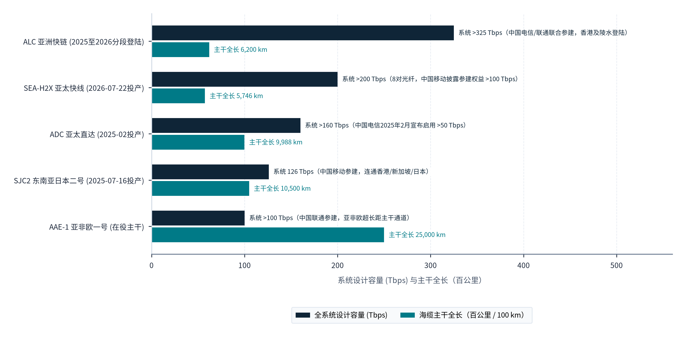
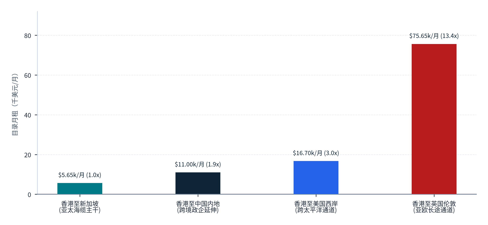
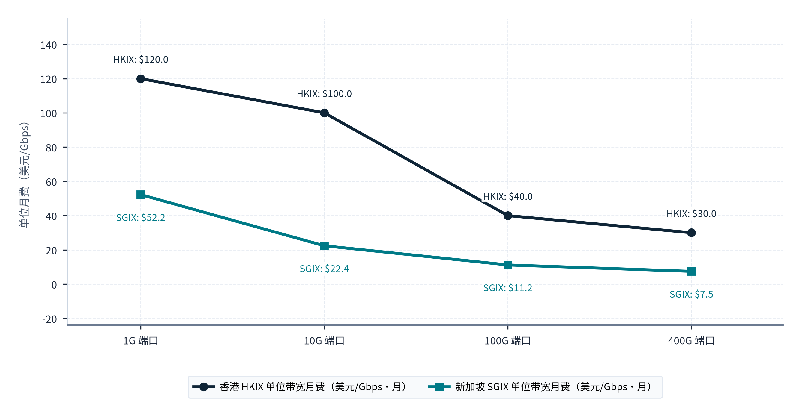
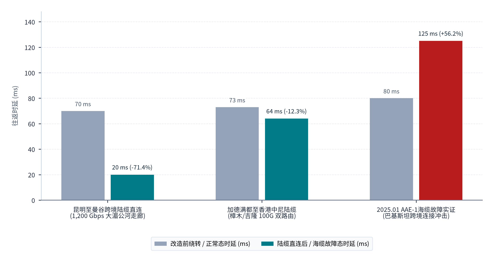

> **导航：** [返回中文手稿总目录](index.md) ｜ [上一章：第4章](chapter-04.md) ｜ [下一章：第6章](chapter-06.md) ｜ [尾注](notes.md) ｜ [参考文献](references.md)

---
> **第三篇 · PART III · 国际通信与跨境交付：从海陆光缆拓扑、出入口局枢纽到毫秒级确定性路由**
> 本篇（第5至6章）聚焦于连接中国绿色算力基地与全球需求市场的物理通信网络与工程交付体系。第5章依据国家通信监管规章、国际海缆联盟与运营商投产公告、跨境陆缆年报及境外交换中心（HKIX/SGIX）一手价目表，全面测绘从境内算力集群、国内骨干网、国际通信出入口局、跨洋海缆与欧亚陆缆，直至境外对等交换节点的六层物理通道全景；第6章进而将物理通道参数转化为端到端工程交付架构，剖析五类部署形态、时延分解模型（RTT/TTFT/TPOT）与算电网联合调度机制。
---

# 国际通信基础设施与物理通道全景

> **本章导读：** 无论中国西部算力枢纽的绿电度电成本多么低廉、大模型架构的算子效率多么卓越，生成的每一串Token比特流要抵达海外终端用户并完成商业闭环，都必须穿越由**境内汇聚骨干网、国家国际通信出入口局、海底光缆（或跨境陆地光缆）、境外登陆站回传链路、海外互联网交换中心（IXP）或中立接入点（PoP），以及目标国本地接入网**共同构成的物理通道体系。在跨境大模型推理服务中，通信网络不再只是被动的基础管道，而是直接决定首字延迟（TTFT）、流式生成平滑度（TPOT）、高并发丢包重传率以及跨国容灾可用性的核心生产要素。本章基于工业和信息化部现行有效规章与新增出入口局许可档案、2025至2026年亚太新投产旗舰海缆（SJC2、SEA-H2X、ADC、ALC）及跨洲主干海缆（AAE-1、NCP）的一手工程与美国联邦通信委员会（FCC）监管记录、大湄公河与中亚中欧陆路光缆年报、香港HKIX与新加坡SGIX官方技术及资费规程，以及国际海缆保护委员会（ICPC）与香港通讯事务管理局办公室（OFCA）的故障维修制度文件，建立起中国Token出海的全球物理通道数字地图[64](references.md#ref-64)–[72](references.md#ref-72), [viii](notes.md#note-viii)。

## 5.1 跨境通道的完整结构

### 5.1.1 跨境通信链路的六层拓扑架构与《国际通信出入口局管理办法》的法定制度边界

在工程与电信监管的双重维度下，一笔从海外客户端发起、经由中国境内智算集群完成推理并回传的Token调用，其物理传输路径严格由**六个首尾咬合的设施层级**串联而成（见**图表 5.1**）：第一层是**境内算力集群与城域接入层**（西部或沿海数据中心园区路由器通过100GE/400GE专线接入运营商省干节点）；第二层是<strong>国内长途骨干传输网（Domestic Backbone）</strong>（跨越数千公里的OTN全光底座与公众互联网骨干网）；第三层是受国家法定许可严格管制的<strong>国际通信出入口局（International Communications Gateways）</strong>；第四层是跨越领海或陆地国境线的<strong>国际传输信道（海底光缆湿段与跨境陆地光缆）</strong>；第五层是<strong>境外登陆站延伸段、中立数据中心接入点（PoP）与互联网交换中心（IXP）</strong>；第六层则是**境外国际IP转接（IP Transit）与目标客户所在的云VPC或终端接入网**。

理解这一完整结构的核心制度起点，是我国对第三层与第四层实施严格分类管理的部门规章：<strong>《国际通信出入口局管理办法》（原信息产业部令第22号，2002年6月26日公布、2002年10月1日起施行）</strong>[64](references.md#ref-64)。经本研究对工业和信息化部截至2026年10月现行有效的《部门规章目录》（列表第3项）以及2025年8月发布的《工业和信息化部行政执法事项清单》（行政处罚类事项第117项与行政检查类事项第122项）进行交叉核实，**2002年22号令在2026年基准日依然是工信部现行有效的核心部门规章与行政执法依据**[64](references.md#ref-64)。该办法确立了我国跨境通信通道的三项刚性制度规则：

1. <strong>三大类国际通信出入口的法定功能切分（第3条）：</strong>
      规章第3条将“国际通信出入口”明确划分为**国际通信信道出入口、国际通信业务出入口和边境地区国际通信出入口**三大法定类别[64](references.md#ref-64)：
      
<strong>国际通信信道出入口（第3条第2款）：</strong>是指**国内通信传输信道与国际通信传输信道的转接点**，具体包括海底光缆登陆站、陆地光缆入境站、国际卫星地球站、国际微波站等，以及从上述站点延伸至国际通信业务出入口或边境地区国际通信出入口的国内端站（终端站）[64](references.md#ref-64)。它在OSI网络模型中处于<strong>第1层（物理光纤、波分复用DWDM/OTN传输层）</strong>，解决的是跨国光信号与波长的物理落地。
<strong>国际通信业务出入口（第3条第3款）：</strong>是指**国内通信业务网络与国际通信业务网络的转接点**（在互联网业务中，直接对应国际出入口核心路由器集群与BGP自治系统边界网关）[64](references.md#ref-64)。它在网络模型中处于<strong>第3层及应用业务层（IP路由交换、国际专线业务封装、安全审查与信令互通）</strong>。唯有经过获准设立的国际通信业务出入口，境内外IP数据包与专线流量才能合法完成业务层面的路由交接。
<strong>边境地区国际通信出入口：</strong>指利用边境地区传输信道，在规定区域范围内与毗邻国家或地区进行特定通信业务转接的节点。
2. <strong>国际信道的非歧视开放义务与准入专属性（第18条）：</strong>
      规章第18条明确规定，获准设置国际通信信道出入口的电信业务经营者，**必须向获准设立国际通信业务出入口的电信业务经营者提供国际通信信道，且不得采取歧视性措施；同时，不得向未获准设立国际通信业务出入口的单位或个人提供国际通信信道**[64](references.md#ref-64)。这一条款从法律上界定了算力企业与基础电信运营商的合作边界：任何智算中心或大模型企业均不能私自租用暗光纤直接连接海缆登陆站出境，而必须采购持有国际通信业务出入口许可的基础电信运营商（中国电信、中国移动、中国联通）提供的合规跨境电路或国际互联网出口带宽。
3. <strong>信息安全配套设施的“三同时”与前置验收红线（第20条）：</strong>
      规章第20条规定，建设国际通信出入口应当**同步建设信息安全配套设施，并经审查验收合格后方可正式开通运行**[64](references.md#ref-64)。因此在工程评估中，不能将“某条海缆完成滩涂登陆”或“某城市出入口局完成土建封顶”直接等同于“已具备全业务商业跨境传输能力”。

### 5.1.2 境内算力枢纽向国际通信出入口局的骨干汇聚实证：以昆明25T国内带宽网络为例

为了缩短内陆算力基地到国际通信出入口局的国内传输跳数，基础电信运营商正在围绕国家级算力枢纽与新增国际出入口局构建超大容量全光底座。以中国电信在2025年9月昆明跨境产业合作大会及后续工程通报中披露的国内汇聚架构为例[69](references.md#ref-69)：围绕昆明国际通信业务出入口局，中国电信已建成**直接连接全国14个省（自治区、直辖市）、22个重点城市的国内高速汇聚网络，国内侧汇聚总带宽规模达25 Tbps（25T），并在国家骨干网层面实现了昆明与北京、上海、广州、海口四大国际通信出入口局的高速互联互通**[69](references.md#ref-69)。这种“内陆枢纽大带宽汇聚 + 多出入口局网格化互联”的拓扑结构，使得部署在贵州贵安、云南昆明、四川成都乃至西北节点的智算集群，既能向南经由昆明陆缆直下东南亚，又能向东经由广州、海口、上海海缆群辐射亚太与欧美（在严谨口径上，25T为国内侧汇聚网络带宽总容量，不等同于国际侧已加载的可售出口带宽余量）。为完整呈现这一从境内园区到海外终端的物理传输脉络，**图表 5.1**按“第一层：境内算力园区接入层”至“第六层：境外Transit与客户终端网”六个通道拓扑层级，列出了各层核心物理设施、技术功能、商业计费标尺及法定监管主体：

#### 图表 5.1：中国Token出海跨境物理通道的六层完整拓扑结构、资源属性与法定管理主体一览表

| 通道拓扑层级 | 核心物理设施与节点形态 | 承载网络层级与核心技术功能 | 资源属性与商业计费标尺 | 建设运营与法定监管主体 | 对Token出海交付的工程影响 |
| --- | --- | --- | --- | --- | --- |
| **第一层： 境内算力园区接入层** | 智算中心核心交换机、园区光传输终端（OTN CPE）、双路由出局光缆 | L1至L3：将GPU/NPU集群生成的SSE/gRPC推理流封装并送入运营商城域核心 | 园区端口费、本地环路（Local Loop）月租费（按10G/100G/400G计） | 智算中心业主、云厂商及三大基础电信运营商省级分公司 | 决定推理集群出园区的第一跳微秒级延迟与双路由防挖断能力。 |
| **第二层： 国内长途骨干传输网** | 国家算力枢纽直联光缆、400G QPSK全光交叉（OXC）省际干线（如昆明连14省22市25T网络）[69](references.md#ref-69) | L1光波分复用与L3骨干IP承载：实现内陆算力枢纽向沿海/沿边门户城市的跨省调运 | 国内长途电路或骨干网间结算成本；受物理光纤距离（约5ms/1000km）刚性约束 | 中国电信、中国移动、中国联通集团干线网管理部门；工信部与各省通管局监管 | 西部枢纽（蒙宁甘贵滇）至沿海/西南出入口局往返时延约15至38ms，需减少中间路由跳数。 |
| **第三层： 国际通信业务出入口局** | 京沪穗三大核心局 + 南宁、青岛、昆明、海口四个2024年获批新增全业务局[64](references.md#ref-64) | <strong>L3及业务层转接点（22号令第3条第3款）：</strong>国际BGP边界路由、专线业务调度与信息安全配套审查（第20条）[64](references.md#ref-64) | 国家特许稀缺牌照资源；决定国际互联网出口带宽与跨境专线（IPLC/IEPL）的合法开通 | 仅限获工信部颁发国际通信业务出入口许可的三大基础电信运营商建设运营[64](references.md#ref-64) | <strong>核心制度与路由枢纽：</strong>新增四城出入口局投用后，可免除西南/华南/山东算力绕行京沪穗的迂回时延。 |
| **第四层： 国际通信信道出入口与海陆干线** | 海缆登陆站（崇明/南汇/汕头/陵水/文昌/青岛等）、陆缆边境站（磨憨/瑞丽/河口/樟木/吉隆/阿拉山口/霍尔果斯）及跨洋海缆/陆缆 | <strong>L1物理传输转接点（22号令第3条第2款）：</strong>海底中继光放大器、纤对（Fiber Pairs）与波长级跨国光传输[64](references.md#ref-64) | 按海缆联盟不可撤销使用权（IRU，通常15至25年）或按年/月容量租赁（100M至100G波长）计费 | 国际海缆联盟（Consortium）、三大运营商国际公司及毗邻国电信商；依第18条非歧视向业务出入口供道[64](references.md#ref-64) | <strong>跨洋时延与高昂成本主体：</strong>占跨境通信总成本与物理传播时延的60%至80%，受锚害与地缘监管影响。 |
| <strong>第五层： 境外接续节点 (PoP / IXP)</strong> | 境外海缆登陆站（香港舂坎角/将军澳、新加坡樟宜/大成、法国马赛等）、中立机房（Equinix）及交换中心（HKIX / SGIX）[71](references.md#ref-71) | L1交叉连接（Cross-connect）、L2以太网对等交换（Peering）及边缘API网关卸载 | IXP端口月费（MRC）与初装费（NRC）、机房机柜租费及光纤跳线（Cross-connect）费[71](references.md#ref-71) | 中立IXP运营方（香港中文大学基金会HKIX、新加坡SGIX）、海外中立IDC商及当地监管机构（如OFCA）[71](references.md#ref-71) | 实现中国海陆光缆与全球云厂商（AWS/Azure/Google/Cloudflare）及区域ISP的二层低时延直联。 |
| **第六层： 境外Transit与客户终端网** | Tier-1国际IP Transit骨干网、海外企业分支专网（SD-WAN）及终端开发者本地ISP网络 | L3全球BGP路由可达性分发（Internet Transit）与最后一公里（Last-mile）应用交付 | 按95分位峰值带宽（USD/Mbps/月）计收的IP Transit流量费或云端VPC对等连接费[68](references.md#ref-68) | 中国电信国际（CTG）、中移国际（CMI）及NTT、Telia、Cogent、Singtel等全球运营商 | 决定没有直接接入IXP的长尾海外开发者能否无丢包、低抖动地接收流式Token输出。 |

> **表格结构化数据文件：** [`data/exhibits/exhibit-5-1.csv`](../../data/exhibits/exhibit-5-1.csv)
> **表注与来源：** 来源：《国际通信出入口局管理办法》（信息产业部令第22号）、工信部2024至2026年公告、中国电信/中国移动公开资料、HKIX与SGIX官方规程；介子九维（JIEZIJIUWEI）研究构建[64](references.md#ref-64), [65](references.md#ref-65), [66](references.md#ref-66), [68](references.md#ref-68), [69](references.md#ref-69), [71](references.md#ref-71)。

**图表 5.1**清晰界定了从“第一层：境内算力园区接入层”到“第六层：境外Transit与客户终端网”的六层物理拓扑与法定管理边界：境内干线传输与“第三层：国际通信业务出入口局”严格遵循国家电信专营与非歧视接入原则，而在“第五层：境外接续节点 (PoP / IXP)”与“第六层：境外Transit与客户终端网”层面，则遵循商业化二层对等互联与多运营商BGP动态路由规则。把握这一“境内合规汇聚、境外中立分发”的双层属性，是设计高可用跨洋交付架构的前提。

## 5.2 国际海缆系统

### 5.2.1 2025至2026年连接中国及亚太枢纽的六大核心海缆系统：投产进度、容量层级与参建权益

海底光缆承载着全球95%以上的跨洋数据流量，更是中国Token出海通往东南亚、日韩、中东、欧洲与北美的物理大动脉。根据香港通讯事务管理局办公室（OFCA）截至2026年7月的官方辖区统计，仅中国香港作为亚太最重要的国际海缆门户，便已接入**13条海底光缆系统并设有10个海缆登陆站**[71](references.md#ref-71)。尤为关键的是，**2025年初至2026年底是中国周边海域新一代超大容量海缆（采用空分复用SDM与先进相干波分技术，单系统设计容量达126至325 Tbps以上）集中建成投产的历史性高峰期**。

为避免行业研究中常见的“将海缆规划容量当作已点亮容量、将全系统设计容量当作单一运营商可售余量”的口径混淆，本研究基于海缆设备承建商（NEC、Infinera、亨通光电/华海通信）、参建运营商（中移国际CMI、中国电信国际CTG）官方公告以及美国联邦通信委员会（FCC）海底光缆牌照与容量统计档案，在**图表 5.2**中按“全系统设计容量 (Tbps)”与“海缆干线长度 (千公里)”两项已核实工程序列，对比了连接中国及亚太核心节点的六大标志性海缆系统（ALC、SEA-H2X、ADC、SJC2、AAE-1、NCP），并在标签中单列了官方已披露的运营商专属投产容量[65](references.md#ref-65), [66](references.md#ref-66), [67](references.md#ref-67), [viii](notes.md#note-viii)：

#### 图表 5.2：2024至2026年连接中国及亚太枢纽的主要国际海底光缆系统设计容量与中方参建权益

> **图像文件：** [`figures/chart_5_2.png`](../../figures/chart_5_2.png)（高清位图）｜ [`figures/chart_5_2.svg`](../../figures/chart_5_2.svg)（矢量图）
> **图注与来源：** 来源：中国移动、中国电信、SubCom、华海通信（HMN Tech）海缆投产与登陆公告（2025至2026年）；介子九维（JIEZIJIUWEI）整理绘制[67](references.md#ref-67)–[69](references.md#ref-69)。

从**图表 5.2**呈现的六大海缆容量与干线长度对比可以看出：“ALC 亚洲快链 (2026末拟商用)”全系统设计容量高达**325 Tbps**、干线长<strong>6.2千公里（6,200 km）</strong>；“SEA-H2X (2026.07已商用)”全系统设计容量**超200 Tbps**、干线长<strong>5.7千公里（5,746 km）</strong>，且中国移动官方明确披露其投产专属容量**超100 Tbps**；“ADC 亚洲直达 (2025.02投运)”设计容量**超160 Tbps**、干线长<strong>10.0千公里（9,988 km）</strong>，中国电信官方披露其启用新增容量**超50 Tbps**；“SJC2 东南亚日本2号 (2025.07商用)”设计容量达**126 Tbps**、干线长<strong>10.5千公里（10,500 km）</strong>；跨洲主干“AAE-1 亚非欧1号 (ICE6升级)”目标设计容量**超100 Tbps**、干线长<strong>25.0千公里（25,000 km）</strong>；中美直达主干“NCP 新跨太平洋 (2018投运)”在2015年FCC申请档案中的初始设计基线为**70 Tbps**、干线长<strong>13.0千公里（13,000 km）</strong>（2024至2026年FCC报告容量依法商业保密）。新一代百T级海缆的集中投运，使中国连接新加坡、东京及东南亚主要节点的物理带宽瓶颈被大幅打开。

1. <strong>SJC2（东南亚至日本2号海缆，Southeast Asia-Japan 2 Cable）：2025年7月16日正式投产（RFS），全长10,500公里，设计传输容量达126 Tbps。</strong>
  
根据中移国际（CMI）与系统承建商NEC于2025年7月18日同步发布的正式投产公告[65](references.md#ref-65)：SJC2海缆系统已于<strong>2025年7月16日正式投入商业运营（Ready for Service, RFS）</strong>。该海缆全长约**10,500公里**，主干贯穿**中国香港、日本与新加坡**，并延伸连接中国台湾、韩国、菲律宾、泰国、越南等亚太核心数字经济节点，全系统设计传输容量高达<strong>126 Tbps（NEC公告表述为超过126 Tbps）</strong>[65](references.md#ref-65)。SJC2由强大的跨国运营商联盟（SJC2 Consortium）共同投资建设，联盟成员包括<strong>中国移动（China Mobile）、中华电信（Chunghwa Telecom）、东华电信（Donghwa Telecom）、日本KDDI、印尼Telin、新加坡电信（Singtel）、韩国SK Broadband、泰国True以及越南邮政通信集团（VNPT）</strong>[65](references.md#ref-65)。中移国际在SJC2投产的同时，配套将其自建的香港、日本、新加坡PoP点与当地核心数据中心直接互连，构筑了闭环的本地光环网[65](references.md#ref-65)。
2. <strong>SEA-H2X（东南亚至海南至香港海缆）：2026年7月22日正式商业投产，全长5,746公里，主干8对纤芯，全系统设计总容量超200 Tbps，其中中国移动投产专属容量超100 Tbps。</strong>
  
根据中移国际于**2026年7月22日**发布的官方商业投产公告[65](references.md#ref-65)：由中国移动牵头投资并主导建设的SEA-H2X国际海缆项目正式宣布商用（Commercially Launched）。按最新投产公告的精确工程参数（不混用早期规划阶段约6,000公里的概数），SEA-H2X全长**5,746公里**，直接连接**中国海南、中国香港、菲律宾、泰国与新加坡**，主干段配置<strong>8对光纤（8 Fiber Pairs）</strong>，全系统设计总容量（Total Design Capacity）**超过200 Tbps**[65](references.md#ref-65)。在极其关键的运营商权益与资源控制权维度上，官方公告明确披露：**中国移动在SEA-H2X系统中直接持有香港至新加坡主干段的4对纤芯（占主干纤对的一半）以及连接中国海南、菲律宾、泰国的分支段权益，海缆投产时归属中国移动的专属容量（Dedicated Capacity upon Commissioning）高达100 Tbps以上，并由中移国际承担网络运营中心（NOC）管理职责**[65](references.md#ref-65)。SEA-H2X在2026年7月的正式商用，使海南自贸港与粤港澳大湾区通往新加坡及东南亚腹地的直达海缆带宽实现了跨越式倍增。
3. <strong>ADC（亚洲直达海缆，Asia Direct Cable）：全长9,988公里，全系统设计容量超160 Tbps，2024年11月湿段完工（Wet Segment RFS），2025年2月中国电信超50 Tbps容量正式投入服务。</strong>
  
根据中国电信国际（CTG）于2024年11月8日、2025年2月14日发布的官方公告以及承建商NEC于2024年12月19日发布的完工通报[66](references.md#ref-66)：ADC海缆全长**9,988公里**（NEC概称为约10,000公里），连接**中国广东（汕头）、中国香港、日本、菲律宾、新加坡、泰国与越南**，全系统设计传输容量**超过160 Tbps**[66](references.md#ref-66)。ADC联盟（ADC Consortium）由**中国电信（China Telecom）、中国联通（China Unicom）、泰国国家电信（NT）、菲律宾PLDT、新加坡Singtel、日本软银（SoftBank）、印度塔塔通信（Tata Communications）及越南Viettel**八家跨国巨头共建[66](references.md#ref-66)。在项目里程碑与权益拆分上，本研究严格区分两个时间节点：2024年11月实现的是海缆湿段完工（Wet Segment RFS），而**2025年2月14日中国电信国际正式宣布其在ADC海缆上的容量提前进入商业服务（Capacity Enters Service）；中国电信不仅在ADC系统中拥有超过50 Tbps的新增容量资源，而且直接承担整个ADC海缆系统的网络运营中心（NOC）工作**[66](references.md#ref-66)。
4. <strong>ALC（亚洲快链海缆，Asia Link Cable）：全长6,200公里，设计容量超325 Tbps，已完成海南（2025）、香港舂坎角（2026年5月）与马来西亚（2026年7月）登陆，预计2026年末全线商用贯通。</strong>
  
根据中国电信国际于2026年5月14日发布的香港登陆公告，以及核心参建与海缆施工企业江苏亨通光电于2026年8月27日披露的《2026年半年度报告》（第三节“管理层讨论与分析”之海洋通信与光网络业务分部）[66](references.md#ref-66)：由中国电信牵头、联合境内外13家运营商共同投资建设的ALC国际海缆全长约**6,200公里**，连接**中国香港、中国海南、新加坡、菲律宾、越南、文莱与马来西亚**，全系统设计容量高达**325 Tbps以上**[66](references.md#ref-66)。在工程进度核实上，ALC于**2025年完成中国海南登陆，2026年5月顺利在中国香港舂坎角登陆，2026年7月完成马来西亚登陆，亨通光电2026年半年报披露预计于2026年末实现全线业务商用贯通**[66](references.md#ref-66)。按照本报告严密的证据规范，截至2026年10月基准日，ALC归类为“主干登陆完成、冲刺2026年末全线RFS”的准投产增量系统，不提前计入基准日已开通存量。
5. <strong>AAE-1（亚非欧1号海缆，Asia-Africa-Europe-1）：全长25,000公里连接亚非欧三大洲，2017年6月首次投运（历史最低设计容量40 Tbps），2022年启动Infinera ICE6升级（目标容量超100 Tbps）。</strong>
  
作为中国香港与东南亚绕开跨太平洋路径、向西直达中东（阿曼、卡塔尔、阿联酋、沙特）、东非（吉布提）、埃及与欧洲门户（希腊、意大利、法国马赛）的核心跨洲大动脉，AAE-1联盟官网与参建方吉布提电信（Djibouti Telecom）、设备商Infinera公告显示[67](references.md#ref-67)：AAE-1全长**25,000公里**，于**2017年6月首次投入商业运行**，初始最低设计容量基线为**40 Tbps**；继2020年引入ICE4技术后，AAE-1联盟于**2022年5月宣布选用Infinera的ICE6相干光传输解决方案实施全系统最大规模升级，旨在将全系统设计容量翻倍提升至100 Tbps以上**[67](references.md#ref-67)。
6. <strong>NCP（新跨太平洋海缆，New Cross Pacific）：中美跨洋直达主干，FCC牌照号SCL-LIC-20151104-00029，2018年2月22日首次商业投运，2024至2026年监管容量保密与FCC新规演进。</strong>
  
在连接中国大陆（上海崇明与南汇）至北美西海岸（美国俄勒冈州Pacific City，并接续日本、韩国与中国台湾）的跨太平洋直达通道上，NCP海缆具有极高的代表性。本研究调阅了美国联邦通信委员会（FCC）自2015年至2026年关于NCP海缆（牌照档案号 `SCL-LIC-20151104-00029`）的全部一手监管文件与微软官方全球网络文档[67](references.md#ref-67)，还原出完整的证据链条：
      
<strong>申请、批准与首次商用：</strong>NCP于2015年11月4日向FCC提交申请（2015年12月3日受理公告 `SCL-00170S` 记载其历史申请参数为全长13,000公里、设计容量70 Tbps、初装容量1.2 Tbps，申请方包括Microsoft、中国移动、中国电信、中国联通、中华电信与韩国KT）；<strong>2017年1月12日，FCC正式签发《授权批准书》（Grant of Authority，公报号 `DA 17-55 / SCL-00193`）</strong>，明确NCP以非公用承运人（Non-common carrier）模式运营，按单独协商的不可撤销使用权（IRU）和容量租赁出售大宗带宽，同时规定美国侧持牌主体微软基础设施集团（MIGL）必须严格遵守与美国国土安全部（DHS）及司法部（DOJ）于2017年1月12日签署的《国家安全协议》（National Security Agreement, NSA）[67](references.md#ref-67)；<strong>2018年8月23日FCC发布的公报（`DA 18-873 / SCL-00222`）正式记录，微软已于2018年7月31日向FCC提交法定通知，确认NCP海缆系统于2018年2月22日正式进入商业服务（Entered Commercial Service）</strong>[67](references.md#ref-67)。
<strong>最新监管统计、骨干网角色与2025至2026年FCC海缆新规：</strong>在FCC于<strong>2025年12月17日最新发布的《截至2024年12月31日美国国际海底光缆电路容量数据报告》（`DA 25-1072`）</strong>中，NCP继续被列入连接中国、日本、韩国与中国台湾的现役美际海缆统计名录（Attachment A/B），但其**2024年末实际可用容量与2026年末计划容量在官方统计表（正文 Table 3 太平洋区域海缆容量明细表）中均以星号“\*”标注，脚注明确说明系申报方依法申请商业保密（Confidential treatment requested），故研究上保留保密状态，不填零亦不由太平洋总容量强行反推**[67](references.md#ref-67)。同时，微软在2026年8月26日更新的《Microsoft Global Network》官方架构文档中，明确将NCP列为其连接日本东京与美国俄勒冈州Portland的核心跨太平洋骨干海缆组成[67](references.md#ref-67)。在监管制度层面，FCC于<strong>2025年8月13日发布《海底光缆登陆许可规则审查最终规则与进一步征求意见通知》（`FCC 25-49`，部分条款于2025年11月26日生效，见 `DA 25-934`）</strong>，在第183段及脚注613中将NCP列入原Category 1系统作为判断新增年度报告义务的分类线索（属于报告合规分类线索，而非撤销牌照）；随后于<strong>2026年2月27日，FCC发布提交通知（`DA 26-197`）</strong>，确认取消独立的海缆运营商报告（Cable Operator Report），自申报2025期末数据起统一合并为单一的《容量持有人年度报告》（Capacity Holder Report，截止日为2026年3月31日）[67](references.md#ref-67)。

### 5.2.2 国际专线（IPLC / IEPL）公开资费基线与四大跨洋方向的成本梯度

海缆系统的物理容量最终通过国际私用租用电路（IPLC，基于物理层/SDH/OTN专线）或国际以太网专线（IEPL，基于MPLS/以太网二层专线）转化为算力企业采购的商业带宽。中国电信国际有限公司（CTG）在其2026年10月依然挂载有效的官方网站资费专栏（Tariff Index）中，公开披露了IPLC与IEPL的完整标准资费表（文件号 `U0017-001-May2020-N`，2020年5月1日生效基线，产品速率覆盖2Mbps、45Mbps、155Mbps、622Mbps、2.5Gbps、10Gbps及以上）[68](references.md#ref-68)。

尽管大型云厂商与智算中心在大宗批发采购10Gbps/100Gbps波长时会通过单独商务谈判获得较大幅度的量价折扣，但CTG这份官方公开资费表为精确刻画**不同跨洋地理方向的相对成本倍率与费用结构**提供了权威基线（1年期合同、无保护On-net网内标价、不含税费、本地环路Local Loop与机房交叉连接Cross-connect）：

- <strong>路由方向一（中国香港至新加坡）：单价最低的亚太黄金走廊。</strong>在100Mbps带宽档位下，香港至新加坡的IPLC或IEPL公开标准月租费（MRC）均为 **5,650美元/月**（≤2Mbps为700美元/月，10Mbps为1,250美元/月，50Mbps为4,400美元/月）[68](references.md#ref-68)。得益于SJC2、SEA-H2X、ADC、ALC等多条超大海缆在香港与新加坡之间的密集平行铺设，该走廊单位带宽成本在四大国际方向中最低。
- <strong>路由方向二（中国香港至中国内地）：跨境半电路计费机制。</strong>在100Mbps档位下，香港至中国内地的IPLC或IEPL公开标准月租费为 **11,000美元/月**（≤2Mbps为750美元/月，10Mbps为2,250美元/月，50Mbps为8,000美元/月）；且官方资费表特别注明，**香港至中国内地航线的标价仅包含香港侧半电路（Half-circuit in HK only），客户需另行向内地基础运营商采购并拼接中国内地侧半电路及两端本地环路**[68](references.md#ref-68)。
- <strong>路由方向三（中国香港至美国）：跨太平洋干线溢价。</strong>在100Mbps档位下，香港至美国的IPLC或IEPL公开标准月租费为 **16,700美元/月**（≤2Mbps为2,000美元/月，10Mbps为3,650美元/月，50Mbps为13,000美元/月），约为香港至新加坡同规格电路标价的 **2.96倍**[68](references.md#ref-68)。这一接近3倍的价格倍率，真实反映了跨太平洋超长海缆距离（超过10,000至13,000公里）及中美直达海缆新增审批受限下的稀缺性溢价。
- <strong>路由方向四（中国香港至英国伦敦）：跨亚非欧超长路由的高昂成本。</strong>在100Mbps档位下，香港至伦敦的IPLC或IEPL公开标准月租费高达 **75,650美元/月**（≤2Mbps为8,850美元/月，10Mbps为16,500美元/月，50Mbps为59,000美元/月），是香港至新加坡同规格标价的 **13.39倍**，是香港至美国标价的 **4.53倍**[68](references.md#ref-68)！在一次性开通初装费（NRC）方面，上述四个方向的IPLC统一为 **12,000美元/次**，IEPL统一为 **22,500美元/次**[68](references.md#ref-68)。

香港至伦敦高达75,650美元/月（100Mbps公开基线）的海缆专线标价，直观暴露出传统亚欧海缆（需绕行南海、马六甲海峡、印度洋、红海、苏伊士运河与地中海，全长25,000公里）在距离成本与红海地缘故障风险上的双重约束。这也从根本上解释了为什么中国在拓展面向欧洲、中亚、南亚与中南半岛的Token出海时，必须大力开辟<strong>第5.3节所剖析的“跨境陆缆与欧亚陆路通信走廊”</strong>。

为直观展示跨洋专线带宽在地理方向上的成本梯度，**图表 5.3**对比了中国电信国际（CTG）公开资费目录中“香港至新加坡 (100M IPLC)”“香港至中国内地 (香港半电路)”“香港至美国西岸 (跨太主干)”及“香港至英国伦敦 (亚欧长距)”四大方向的100Mbps专线标准月租（千美元/月）及其相对于香港至新加坡基准的成本倍数：

#### 图表 5.3：100Mbps 国际专线（IPLC / IEPL）不同跨境路由方向公开目录月租对比

> **图像文件：** [`figures/chart_5_2b.png`](../../figures/chart_5_2b.png)（高清位图）｜ [`figures/chart_5_2b.svg`](../../figures/chart_5_2b.svg)（矢量图）
> **图注与来源：** 来源：中国电信国际有限公司（CTG）公开国际专线资费目录（2026年现行版）；介子九维（JIEZIJIUWEI）整理绘制[70](references.md#ref-70)。

由**图表 5.3**的公开资费阶梯可见：“香港至新加坡 (100M IPLC)”月租最低，仅为5.65千美元/月（1.0x基准）；“香港至中国内地 (香港半电路)”月租为11.00千美元/月（1.9x）；“香港至美国西岸 (跨太主干)”月租升至16.70千美元/月（3.0x）；而“香港至英国伦敦 (亚欧长距)”的100M专线月租高达75.65千美元/月，达到香港至新加坡基准的13.4倍（13.4x）。这一1.0倍至13.4倍的悬殊资费落差表明，在面向欧洲市场交付推理服务时，结合大宗波长批发协议与中亚及欧亚陆缆走廊进行多元路由分流，是压降跨洲际通信固定成本的关键举措[68](references.md#ref-68), [70](references.md#ref-70)。

## 5.3 跨境陆缆与陆路通信走廊

### 5.3.1 西南与南亚陆路通信走廊：大湄公河次区域8条陆缆（1,200G）、中尼双路由100G与中巴跨境光缆

与绕行海岸线和狭窄海峡的海底光缆相比，跨境陆地光缆（Terrestrial Optical Fiber Cables）在面向毗邻大陆国家及欧亚内陆方向时，具有**地理走线更短（几何直线距离更近）且不经过海盗、锚害高发海区**的天然物理优势。本研究系统核查了我国面向东南亚、南亚与中亚欧洲方向的三大陆路通信走廊实证进展（见**图表 5.4**）：

1. <strong>西南面向中南半岛（大湄公河次区域GMS）陆路走廊：依托云南建成8条跨境陆缆，已开通1,200 Gbps多方向国际链路，政策锚定2027年9 Tbps目标。</strong>

<strong>存量建设与带宽实绩：</strong>根据中国电信在2025年9月及2026年4月关于昆明国际通信业务出入口局的工程通报[69](references.md#ref-69)，我国以云南昆明为核心集结枢纽，已在西南陆路边境方向建成**8条跨境陆地光缆，直接连通老挝、缅甸与越南三国**，并由此向南延伸接续泰国、柬埔寨、马来西亚与新加坡等东南亚国家骨干网。截至2026年4月，中国电信披露在昆明多方向<strong>已开通国际通信链路带宽达1,200 Gbps（原文表述为1200G，即1.2 Tbps）</strong>[69](references.md#ref-69)。
<strong>时延优化宣称与口径界定：</strong>在2026年4月的工程通报中，企业披露通过昆明国际通信业务出入口局与跨境陆缆直连，<strong>昆明至泰国曼谷的通信时延由原来的70毫秒（ms）大幅压降至20毫秒（70ms → 20ms）</strong>[69](references.md#ref-69)。在严谨的工程评估中，这一“70ms降至20ms”直观体现了免除绕行广州/香港海缆、改为西南陆路直出所消除的近3,000公里迂回光程；同时本报告亦注明，由于企业公开通报未附单向/往返（One-way/RTT）定义、起止测试IP端点及P95/P99分位数统计分布，该数值作为企业披露的物理路由优化标杆引用，不直接替代客户级商业SLA合同承诺[viii](notes.md#note-viii)。
<strong>2027年省级法定扩容目标：</strong>根据云南省人民政府办公厅于<strong>2026年5月20日正式印发的《加强数字信息大通道建设 推动数字产业高质量发展实施方案》（云政办发〔2026〕27号，2026年5月15日签发）</strong>，云南省明确设定的总体政策目标为：**到2027年，云南跨境陆缆开通容量达到9 Tbps**，加快将昆明打造成为面向南亚东南亚的国际通信枢纽与算力出海门户[69](references.md#ref-69)。
2. <strong>南亚喜马拉雅方向（中国至尼泊尔双路由100G系统）：樟木主用+吉隆备用双通道，买通南亚次大陆陆路入口。</strong>
  
根据中国电信国际（CTG）于2022年1月14日发布的正式开通公告[69](references.md#ref-69)：早在2021年12月末，中国电信携手尼泊尔头部通信运营商Mercantile Communications，成功开通了**中尼光缆双路由100Gb/s传输系统**。该系统由<strong>“中国樟木口岸至尼泊尔首都加德满都（主用路由，100Gb/s）”与“中国吉隆口岸至加德满都（备用路由，100Gb/s）”</strong>两条跨境陆地光缆组成，并在中国境内与加德满都至中国香港的100Gb/s国际中继电路无缝衔接（注：主备双路由旨在提供高可靠容灾保护，故在容量核算上不简单相加为200Gb/s可售带宽）[69](references.md#ref-69)。企业通报显示，经由樟木陆缆路由，加德满都至中国香港的电路传输时延由<strong>73毫秒压降至64毫秒（73ms → 64ms）</strong>[69](references.md#ref-69)。
3. <strong>中巴经济走廊方向（中巴跨境光缆 Pak-China OFC）：4,400万美元投资建成的喀喇昆仑数字通道与巴基斯坦陆路登陆站（T-CLS）。</strong>
  
根据中国驻巴基斯坦大使馆汇编的CPEC（中巴经济走廊）第40号官方项目档案、巴基斯坦特殊通信组织（SCO）官方机构资料以及巴基斯坦长途与国际电信持牌商（LDI）Zeta Technologies截至2026年10月的企业披露[69](references.md#ref-69)：中巴跨境光缆项目（Pak-China Optical Fiber Cable）估计总投资为<strong>4,400万美元（44 Million USD）</strong>，于**2018年6月完工并于2018年7月13日正式举行启用仪式**，自中巴红其拉甫口岸入境巴基斯坦后，纵贯吉尔吉特-巴尔蒂斯坦（Gilgit-Baltistan）、开伯尔-普什图省（Khyber Pakhtunkhwa）与旁遮普省（Punjab）[69](references.md#ref-69)。在运营组织上，巴基斯坦官方机构SCO负责阿扎德克什米尔与吉尔吉特-巴尔蒂斯坦（AJ&K/GB）区域的电信建设运维并提供数字专线（DPLC）与主机托管服务（注：SCO全区域4,800公里本地网不混同于中巴跨境专线长度）；同时，巴基斯坦LDI运营商Zeta Technologies在官网披露其已建设并运营利用Pak-China OFC的<strong>陆路光缆登陆站（Terrestrial Cable Landing Station, T-CLS）</strong>，为中国算力经由巴基斯坦向阿拉伯海方向延伸提供了陆路支点[69](references.md#ref-69)。

### 5.3.2 亚欧大陆桥与中亚过境走廊：哈萨克斯坦电信（Kazakhtelecom）2024至2025年报揭示的百G级通道网络与跨里海AKSCS海陆联运

针对前文揭示的“香港至伦敦海缆专线月租高达75,650美元/100Mbps且绕行红海距离漫长”的痛点，横贯中国新疆、哈萨克斯坦、俄罗斯或里海直达欧洲的**亚欧大陆桥陆路光缆走廊**，是实现中欧超低时延通信（新疆霍尔果斯/阿拉山口出境经哈萨克斯坦、俄罗斯至德国法兰克福的物理光缆距离仅约7,500至8,500公里，理论光速往返时延较25,000公里海缆缩短一半以上）的战略替代通道。

本研究从哈萨克斯坦国家电信运营商**Kazakhtelecom JSC**正式披露的《2024年综合年报》（Integrated Annual Report 2024）与最新发布的<strong>《2025年综合年报》（Integrated Annual Report 2025，内附2026年7月10日审阅报告）</strong>以及亨通光电2026年半年报中，提取到了中国三大运营商在亚欧陆路走廊上极其珍贵的真实签约、边境互联与过境建设数据[66](references.md#ref-66), [70](references.md#ref-70)：

- <strong>中国至欧洲（经哈萨克斯坦过境）6×100 Gbps商业通道合同与7×100 Gbps扩容备忘录：</strong>
      Kazakhtelecom 2024年报（国际业务与过境传输分部）与2025年报（第3.3.2节国际连接与过境走廊章节）连续披露，公司已与<strong>中移国际英国公司（CMI UK）、中国联通国际（China Unicom Global）及中国电信（China Telecom）签署了“中国至欧洲（China-Europe）”经哈萨克斯坦过境的国际传输通道组织合同，2024年度与2025年度披露的已签约组织通道规模均为 6×100 Gbps（即600 Gbps）</strong>（注：两份年报反映的是跨年度合同履约序列，在统计上不简单相加为1,200 Gbps）；同时，Kazakhtelecom与中国电信签署了在2025至2027年间进一步合作建设并组织<strong>7×100 Gbps（700 Gbps）中欧过境通道的谅解备忘录（MoU）</strong>[70](references.md#ref-70)。
- <strong>中哈边境两大物理互联口岸实绩（Zharkent 6×100G 与 Dostyk-阿拉山口 1×100G）：</strong>
      在Kazakhtelecom 2025年报（Network and infrastructure development 网络与基础设施建设章节）中，首次详细披露了2025年度在中哈边境落地的两项具体物理互联工程：其一，在**扎尔肯特（Zharkent，毗邻中国新疆霍尔果斯口岸）与中国电信的边境互联节点上，已在现有DWDM OSN6800密集波分系统上成功组织并开通了 6×100 Gbit/s 传输通道**；其二，在**多斯特克至中国阿拉山口（Dostyk-Alashankou）与中国移动的边境互联节点上，已成功组织并连接了 1×100 Gbit/s 传输通道**[70](references.md#ref-70)。
- <strong>中国至俄罗斯（经哈萨克斯坦过境）12×100 Gbps大容量通道与中亚区域辐射：</strong>
      在中俄与中亚方向，Kazakhtelecom在2024年报（基础设施建设分部）中披露已建成具备**1+1主备冗余保护的 6×100 Gbps 中俄过境通道**；而在<strong>2025年报（网络基础设施建设与国际合作分部）中，公司披露2025年度已成功组织“中国至哈萨克斯坦至俄罗斯（China-Kazakhstan-Russia）”过境通道达 12×100 Gbit/s（即1.2 Tbps）</strong>（注：该口径可能与边境互联或中欧北线存在底层路由复用，故在总量核算时分列展示、不机械加总）[70](references.md#ref-70)。此外，2025年Kazakhtelecom还分别在**哈萨克斯坦至乌兹别克斯坦方向签约组织了 3×100 Gbit/s 通道**，在**哈萨克斯坦至土库曼斯坦方向签约组织了 6×10 Gbit/s 通道**[70](references.md#ref-70)。
- <strong>2025年末中哈高层密集签约与跨里海光缆（AKSCS，32对纤芯）2026Q4商用冲刺：</strong>
      Kazakhtelecom 2025年报开篇“年度重大事件（Key Events）”专栏记载：<strong>2025年11月26日，公司与中国电信国际（CTG）正式签署了关于长期不可撤销使用权（General IRU Agreement）的总协议；紧接着于2025年12月4日，与中国联通签署了跨境通信系统建设谅解备忘录（MoU）</strong>[70](references.md#ref-70)。与此同时，为了开辟不经过俄罗斯领土、从哈萨克斯坦跨越里海直通阿塞拜疆、高加索与欧洲的“中间走廊（Middle Corridor）”南线，亨通光电2026年半年报（第三节“管理层讨论与分析”之海洋通信业务分部）披露：由旗下华海通信承建的**跨里海海底光缆系统（AKSCS，连接哈萨克斯坦与阿塞拜疆，配置多达32对纤芯的海陆组合大通道）已完成全部海缆与设备生产、工厂验收测试（FAT）及海上施工，计划于2026年第四季度（2026Q4）实现全线商用贯通**[66](references.md#ref-66)。

结合大湄公河次区域（GMS）跨境陆缆建设进展、中尼与中巴光缆工程及哈萨克斯坦电信（Kazakhtelecom）2024至2025年报披露的亚欧过境容量数据，**图表 5.4**系统梳理了中国面向东南亚、南亚、中亚及欧洲的七大跨境陆缆与海陆联运走廊的技术参数与演进阶段：

#### 图表 5.4：中国面向东南亚、南亚、中亚及欧洲的七大跨境陆缆与海陆联运走廊技术参数与演进阶段一览表

| 陆路/联运走廊方向 | 境内核心枢纽与边境口岸节点 | 境外接续国家与合作运营商 | 已核实容量、通道数与政策目标 | 时延宣称、保护机制与最新事件节点 | 在Token出海中的定位与待补工程边界 |
| --- | --- | --- | --- | --- | --- |
| <strong>① 云南至东南亚（大湄公河GMS走廊）</strong> | 昆明国际通信业务出入口局；连接老、缅、越边境口岸[69](references.md#ref-69) | 老挝、缅甸、越南三国入境，延伸至泰国曼谷、新加坡等 | 建成**8条跨境陆缆**；2026年4月已开通多方向国际链路 <strong>1,200 Gbps (1.2T)</strong>；省政府目标**2027年达 9 Tbps**[69](references.md#ref-69) | 企业披露昆明至曼谷时延由**70ms压降至20ms**（2026年4月通报）；云政办发〔2026〕27号于2026年5月印发[69](references.md#ref-69) | <strong>东南亚低时延陆路主通道：</strong>与海南/香港海缆形成海陆双路由；待补逐口岸防共沟挖断与P99 RTT实测。 |
| <strong>② 中国至尼泊尔（喜马拉雅双路由）</strong> | 西藏樟木口岸（主用路由）；西藏吉隆口岸（备用路由）[69](references.md#ref-69) | 尼泊尔加德满都（合作商 Mercantile）；后接中国香港[69](references.md#ref-69) | 主备双路由各 **100 Gb/s**（主备容灾不简单相加为200G）；同步配加德满都至香港100Gb/s中继[69](references.md#ref-69) | 2021年12月末升级开通；企业披露加德满都至香港经樟木时延由**73ms降至64ms**[69](references.md#ref-69) | <strong>南亚次大陆陆路桥头堡：</strong>实现南亚流量经中国陆缆与香港海缆转接；待补2026年最新利用率。 |
| <strong>③ 中国至巴基斯坦（中巴经济走廊OFC）</strong> | 新疆红其拉甫口岸（连接喀什与西部骨干网）[69](references.md#ref-69) | 巴基斯坦吉尔吉特-巴尔蒂斯坦、开普省、旁遮普省（SCO与Zeta）[69](references.md#ref-69) | CPEC第40号项目，估计投资**4,400万美元**；SCO提供DPLC/托管，Zeta自述建成<strong>陆路登陆站（T-CLS）</strong>[69](references.md#ref-69) | 2018年6月完工、2018年7月13日启用；2026年SCO与Zeta官网持续展示LDI/T-CLS承运能力[69](references.md#ref-69) | <strong>阿拉伯海方向战略备份：</strong>可衔接巴基斯坦卡拉奇海缆群；待补逐段商用点亮容量与报价。 |
| <strong>④ 中国至欧洲（经哈萨克斯坦过境干线）</strong> | 新疆边境口岸（接续国内西北算力枢纽与长途干线）[70](references.md#ref-70) | 哈萨克斯坦国家电信（Kazakhtelecom）过境网，接续欧洲[70](references.md#ref-70) | 2024与2025年报均确认已签组织合同 <strong>6×100 Gbps (600G)</strong>；另与中电信签2025至2027年 **7×100 Gbps MoU**[70](references.md#ref-70) | 合作方涵盖<strong>中移国际英国（CMI UK）、中联通国际（CUG）、中国电信（CT）</strong>；2025-11-26签CTG IRU总协议[70](references.md#ref-70) | <strong>规避红海风险与高昂海缆费的亚欧陆桥：</strong>物理距离较海缆缩短过半，适合中欧低时延与批处理传输。 |
| **⑤ 中哈边境直接互联与中亚区域分发** | 霍尔果斯方向（接Zharkent）；阿拉山口方向（接Dostyk）[70](references.md#ref-70) | 哈萨克斯坦（Kazakhtelecom），并辐射乌兹别克斯坦、土库曼斯坦[70](references.md#ref-70) | 2025年已组织：**Zharkent至中电信 6×100 Gbps**（基于DWDM OSN6800）；**Dostyk至中移动 1×100 Gbps**；哈乌 **3×100G**、哈土 **6×10G**[70](references.md#ref-70) | 2025年报（2026年7月审阅）实绩确认；2025-12-04另与中国联通签署跨境系统建设MoU[70](references.md#ref-70) | <strong>中亚五国算力出口直达通道：</strong>新疆、甘肃、宁夏智算中心可通过百G级波分通道直接服务中亚数字经济。 |
| <strong>⑥ 中国至俄罗斯（经哈萨克斯坦过境）</strong> | 中哈边境互联口岸转接北上[70](references.md#ref-70) | 哈萨克斯坦（Kazakhtelecom）转接俄罗斯骨干网[70](references.md#ref-70) | 2024年报披露建成 <strong>6×100 Gbps（1+1冗余保护）</strong>；2025年报披露已组织中哈俄过境通道达 <strong>12×100 Gbps (1.2T)</strong>[70](references.md#ref-70) | 具备1+1主备保护机制；与中欧北线及边境互联存在底层物理承载协同[70](references.md#ref-70) | <strong>欧亚北线大容量通道：</strong>支撑面向俄语区及东欧市场的高吞吐模型API与数据交互。 |
| <strong>⑦ 跨里海海陆组合通道（AKSCS中间走廊）</strong> | 经中哈陆缆西延至里海东岸（哈萨克斯坦阿克套方向）[66](references.md#ref-66) | 跨越里海连接哈萨克斯坦与阿塞拜疆，西接土耳其与欧洲[66](references.md#ref-66) | 系统配置高达 <strong>32对纤芯（32 Fiber Pairs）</strong>；华海通信承建，属跨里海海缆与亚欧陆网接续组合[66](references.md#ref-66) | 截至2026年8月半年报已完成设备生产、验收测试与海上施工，**计划2026Q4全线商用贯通**[66](references.md#ref-66) | <strong>不经俄罗斯与红海的亚欧第三走廊：</strong>2026年底贯通后将大幅增强中国算力向高加索、土耳其及南欧交付的路由多样性。 |

> **表格结构化数据文件：** [`data/exhibits/exhibit-5-4.csv`](../../data/exhibits/exhibit-5-4.csv)
> **表注与来源：** 来源：中国电信公告、云南省政府云政办发〔2026〕27号、Kazakhtelecom 2024与2025年报、CPEC项目汇编、SCO与Zeta官网、亨通光电2026年半年度报告；介子九维（JIEZIJIUWEI）整理[66](references.md#ref-66), [69](references.md#ref-69), [70](references.md#ref-70)。

审视**图表 5.4**梳理的“① 云南至东南亚（大湄公河GMS走廊）”至“⑦ 跨里海海陆组合通道（AKSCS中间走廊）”七条陆路与海陆联运走廊可见，以昆明至曼谷1,200 Gbps低时延通道（时延由70ms压降至20ms）、中尼双路由100Gb/s光缆以及哈萨克斯坦电信中欧过境6×100 Gbps通道（叠加计划2026Q4贯通的32对纤芯跨里海AKSCS通道）为代表的陆路走廊，不仅大幅缩短了中国内陆枢纽通达中南半岛、南亚与欧洲的物理光路距离，更成为绕开马六甲与红海海缆单点故障瓶颈的战略冗余生命线。

## 5.4 国际通信业务出入口与国内连接

### 5.4.1 从“京沪穗三极”到“3+4七大枢纽”的历史性扩容：2024年7月四城获批与2025至2026年建设验收实证

在长达二十余年的时间里，中国公用电信网的国际通信业务出入口局高度集中于<strong>北京、上海、广州（广东）</strong>三个核心都市圈。这种“三极集聚”格局虽然便于集中路由管理，但也意味着部署在西南（云南、贵州、广西）、西北（宁夏、甘肃、新疆）、华南海南岛或山东半岛的算力中心，在开展国际通信业务时往往需要先将流量长途调运至北京、上海或广州完成业务层出境转接，产生了不必要的“国内路由折返与时延损耗”。

**2024年7月10日，工业和信息化部在北京举行颁证仪式，正式向中国电信、中国移动、中国联通三家基础电信运营商颁发许可，批准在广西（南宁）、山东（青岛）、云南（昆明）、海南（海口）四座城市新设立国际通信业务出入口局**[64](references.md#ref-64)。这是我国自1994年接入国际互联网30年来，首次在大规模地域范围内新增全业务国际通信业务出入口局。

### 5.4.2 新增四城出入口局（南宁 / 青岛 / 昆明 / 海口）的工程进度与国内算力骨干接续

由于依据《国际通信出入口局管理办法》第20条，国际通信业务出入口局必须经历“行政许可获批 → 土建与机电工程建设 → 信息安全配套设施同步建设与初步验收 → 国家主管部门最终审查验收合格 → 全业务国际路由加载与商业服务开通”的完整法定链条[64](references.md#ref-64)，本研究对四座城市截至2026年8月的官方通报进行了逐一核查，严格区分各阶段工程状态（见**图表 5.5**）：

- <strong>广西南宁国际通信业务出入口局（面向东盟海陆门户）：2025年度主体工程及配套设施已完成初步验收。</strong>
  
根据广西壮族自治区通信管理局于**2026年4月13日**发布的官方通报（《广西通信管理局荣获2025年度自治区综合绩效考评一等等次》）[71](references.md#ref-71)，在2025年度建设周期内，<strong>南宁国际通信业务出入口局的主体工程及配套设施已顺利完成初步验收（Initial Acceptance）</strong>，正在推进后续的国家级最终审查验收与全业务路由加载准备。
- <strong>山东青岛国际通信业务出入口局（中国联通独家承建，面向日韩与跨太平洋北线门户）：主体完成验收并启动机电配套新建，2026年8月处于从建设向运营高效衔接阶段。</strong>
  
根据青岛市政府网站于2026年3月28日、2026年8月22日转载的《青岛日报》现场报道以及山东省通信管理局于2026年4月7日发布的工作会议通报[71](references.md#ref-71)：青岛国际通信业务出入口局**由中国联通独家承建运营**；截至**2026年3月27日，该项目主体工程已完成验收，机电配套新建工程正式启动，进入“建设运营并重”阶段**；2026年4月2日山东省通信管理局在全省信息通信业现代化发展推进会上将其列为2026年第二项重点工作，要求“高标准开通和运营青岛国际通信业务出入口局”；截至<strong>2026年8月21日最新公开报道，青岛国际通信业务出入口局“正从建设向运营高效衔接”</strong>[71](references.md#ref-71)。
- <strong>云南昆明国际通信业务出入口局（面向南亚东南亚陆路核心门户）：2026年4月企业宣布全面竣工并进入全面验收阶段，2026年5月省政府方案要求加快建成投用并实现业务流量开通。</strong>
  
昆明局呈现出典型的“工程建设竣工”向“行政终验与全量流量加载”过渡的双来源印证特征：一方面，中国电信在**2026年4月**的工程通报中宣布，**昆明国际通信业务出入口局已全面竣工，正式进入全面验收阶段**，且已在前期连通国内14省22市25T带宽及跨境8条陆缆1,200G链路[69](references.md#ref-69)；另一方面，云南省人民政府办公厅在**2026年5月20日**印发的《加强数字信息大通道建设 推动数字产业高质量发展实施方案》（云政办发〔2026〕27号）重点任务（一）第1条中，明确要求<strong>“加快推动昆明国际通信业务出入口局建成投用，尽快实现业务流量开通”</strong>[69](references.md#ref-69)。将企业4月竣工验收通报与省政府5月文件对照可知：工程硬件已全面就绪并处于全面验收程序中，而全业务国际流量的正式商业加载正随终验批复同步推进。
- <strong>海南海口国际通信业务出入口局（中国电信、中国移动、中国联通三家同城获批，面向东南亚与亚非欧海缆门户）：设立建设工作专班，2026年省政府工作报告明确继续加快三大运营商出入口局及2条在建海缆建设。</strong>
  
海口是2024年7月获批城市中极具特殊性的枢纽，**中国电信、中国移动、中国联通三家基础运营商同时获批在海口设立全业务国际通信业务出入口局**[64](references.md#ref-64), [71](references.md#ref-71)。根据海南省通信管理局于2025年7月31日发布的通报以及海南省人民政府于<strong>2026年2月2日发布的《2026年海南省政府工作报告》（2026年1月27日省人大会议报告）</strong>[71](references.md#ref-71)：海南省于2025年专门成立了全业务出入口局建设工作专班；2026年省政府工作报告在回顾2025年工作时指出“三大运营商国际通信业务出入口局加快建设”，并在部署<strong>2026年重大基础设施任务时明确要求“继续加快国际通信业务出入口局及2条在建海底光缆建设”</strong>[71](references.md#ref-71)。在严谨口径上，必须将海口已投产的海缆信道（如2026年7月商用的SEA-H2X）、园区国际互联网数据专用通道，与正在加快建设和验收中的“三大运营商全业务国际通信业务出入口局”严格区分，不将海缆登陆投产直接混同为出入口局已完成终验。

针对2024年7月工业和信息化部批准增设的广西南宁、山东青岛、云南昆明、海南海口四座国际通信业务出入口局，**图表 5.5**逐一汇总了截至2026年10月各枢纽的获批日期与承建主体、国内骨干接续进展、最新验收状态以及对国内算力枢纽出海的支撑作用：

#### 图表 5.5：2024年7月获批新增四座国际通信业务出入口局（南宁 / 青岛 / 昆明 / 海口）的承建主体、工程进度与算力接续一览表

| 出入口局城市 | 获批日期与承建运营主体 | 土建、机电与国内骨干接续进展 | 2025至2026年最新验收与运营衔接状态 | 主要辐射国际方向与配套海陆信道 | 对国内算力枢纽出海的支撑作用与核实说明 |
| --- | --- | --- | --- | --- | --- |
| **广西南宁** | 2024-07-10获批 基础电信运营商承建[64](references.md#ref-64) | 主体工程及配套系统在2025年度内完成建设，对接广西及华南骨干网 | **主体及配套设施已完成初步验收**（广西通信管理局2026-04-13通报）[71](references.md#ref-71) | 面向东盟十国（越南等中南半岛陆缆及北部湾方向） | 为广西、贵州、广东算力面向东盟提供低时延直出节点；待取最终全业务开通公告与商业目录。 |
| **山东青岛** | 2024-07-10获批 **中国联通**独家承建运营[64](references.md#ref-64), [71](references.md#ref-71) | 2026年3月项目主体完成验收并启动机电配套新建工程[71](references.md#ref-71) | 2026年4月山东管局部署高标准开通运营；**2026年8月报道正从建设向运营高效衔接**[71](references.md#ref-71) | 面向日本、韩国及跨太平洋北线海缆群（青岛海缆登陆站） | 成为北方继北京之后第二个国际业务局，大幅缩短山东、京津冀、内蒙古和林格尔算力向日韩出口的路由跳数。 |
| **云南昆明** | 2024-07-10获批 **中国电信**等承建运营[64](references.md#ref-64), [69](references.md#ref-69) | 国内已连接<strong>14省22市（25T汇聚带宽）</strong>，并直连北京、上海、广州、海口四局[69](references.md#ref-69) | **2026年4月企业宣布全面竣工、进入全面验收阶段**；2026年5月云政办发〔2026〕27号要求加快建成投用、实现业务流量开通[69](references.md#ref-69) | 直接汇接连接老挝、缅甸、越南的<strong>8条跨境陆缆（已开通1,200G，2027目标9T）</strong>[69](references.md#ref-69) | 将云南清洁水电算力与贵州贵安、四川天府集群直接推向南亚东南亚前线，消除绕行广州的折返时延。 |
| **海南海口** | 2024-07-10获批 **中国电信、中国移动、中国联通**三家同城获批[64](references.md#ref-64), [71](references.md#ref-71) | 2025年设全业务出入口局建设专班；2026年海南省政府工作报告明确继续加快三大运营商出入口局建设[71](references.md#ref-71) | 处于**三大运营商出入口局加快建设与配套推进阶段**（与已投产海缆物理信道分列核实）[71](references.md#ref-71) | 直接衔接海南登陆的<strong>SEA-H2X（2026-07已商用，>200T）与ALC（>325T，预计2026末商用）</strong>[65](references.md#ref-65), [66](references.md#ref-66) | 结合海南自贸港跨境数据流动政策，形成“海缆登陆站+全业务出入口局+自贸港离岸服务”三位一体门户。 |

> **表格结构化数据文件：** [`data/exhibits/exhibit-5-5.csv`](../../data/exhibits/exhibit-5-5.csv)
> **表注与来源：** 来源：工业和信息化部（2024-07-10）、广西通信管理局（2026-04-13）、山东省通信管理局（2026-04-07）、青岛市政府网/青岛日报（2026-03-28 / 2026-08-22）、中国电信（2025-09 / 2026-04）、云南省政府（2026-05-20）、海南省通信管理局（2025-07-31）、海南省政府工作报告（2026-02-02）；介子九维（JIEZIJIUWEI）整理[64](references.md#ref-64), [69](references.md#ref-69), [71](references.md#ref-71)。

如**图表 5.5**所示，广西南宁、山东青岛、云南昆明、海南海口四座新增国际通信业务出入口局在2025至2026年间的陆续建成与验收衔接，正在改写中国持续二十余年的“北上广三极集聚”国际通信版图。西部与西南绿色算力集群得以就近经由昆明、南宁、海口、青岛出境，显著减少了国内长途迂回跳数与尾纤传输损耗。

## 5.5 境外接续节点与客户网络

### 5.5.1 海缆登陆后的境外三层分流架构：本地回传（Backhaul）、中立PoP与互联网交换中心（IXP）

当承载着Token流的光信号通过SJC2、SEA-H2X、ADC或中欧陆缆抵达中国香港、新加坡或欧洲马赛的海缆登陆站（Cable Landing Station, CLS）后，跨境交付并未结束。海缆登陆站通常位于远离城市中心的海岸地带（如香港舂坎角、塘福、将军澳，或新加坡樟宜、大士），要将流量真正送达海外AI应用开发者、跨国企业内网或公有云VPC，必须在境外完成**关键的三步接续**：

1. <strong>第一步（海缆登陆站至中立数据中心的本地回传 Local Backhaul）：</strong>
      根据香港通讯事务管理局办公室（OFCA）关于香港海底电缆制度的官方说明[71](references.md#ref-71)，香港对海缆登陆与本地连接实行清晰的分层牌照管理：对外电信持牌人（External Telecommunications Services/Facilities Licensees）可租用海缆容量或安排海缆登陆；而**从海缆登陆站延伸至香港市区中立数据中心的本地连接链路（Local Backhaul / Local Loop），则可向香港对内固定服务持牌人（Internal Fixed Telecommunications Network Services Licensees）购买或由持牌运营商自建光环网完成**[71](references.md#ref-71)。例如，中移国际在2025年7月SJC2投产公告中披露，其已通过自建的香港、日本、新加坡PoP节点与当地核心数据中心互连，形成了无缝衔接的本地光环网[65](references.md#ref-65)；AAE-1海缆联盟同样在新加坡设有两处核心PoP、在泰国提供跨陆路接续，并在<strong>中国香港、新加坡与法国马赛的中立PoP节点（Neutral PoPs）</strong>向成员提供灵活的回传选择[67](references.md#ref-67)。
2. <strong>第二步（接入境外互联网交换中心 IXP 实现二层免费/低成本对等互联 Peering）：</strong>
      在中立数据中心内部，算力服务商或电信运营商通过一根光纤跳线（Cross-connect）接入当地的核心互联网交换中心，如亚太最大的两个交换枢纽：<strong>香港互联网交换中心（HKIX）</strong>与<strong>新加坡互联网交换中心（SGIX）</strong>[71](references.md#ref-71)。通过IXP的二层以太网交换矩阵，中国出海算力网关可以直接与全球主流云厂商（AWS、Microsoft、Google、Cloudflare、Akamai、Fastly）及东南亚、日韩本地ISP建立<strong>BGP直接对等互联（Settlement-free Peering）</strong>，不仅免去了昂贵的第三方长途转接费，还能将境外路由跳数压缩至1跳。
3. <strong>第三步（采购国际IP转接 Internet Transit 覆盖全球长尾自治系统 ASN）：</strong>
      必须高度重视的一个技术边界是：<strong>无论是HKIX还是SGIX，其官方规程均明确规定交换中心仅提供二层对等交换（Layer-2 Peering），不提供全球互联网转接服务（Does NOT provide Internet Transit）</strong>[71](references.md#ref-71)！也就是说，接入HKIX或SGIX只能把流量送达同样接入该交换中心且同意建立BGP会话的成员网络；对于未在该IXP设点的欧美、拉美、中东长尾企业网络与移动运营商，出海算力平台仍必须向Tier-1国际运营商采购<strong>全路由IP Transit（国际互联网转接服务）</strong>作为兜底通道[68](references.md#ref-68), [71](references.md#ref-71)。

为精确对比中国算力在亚太两大中立交换枢纽的网络接续成本，**图表 5.6**按“香港 HKIX 折算月租 ($/Gbps)”与“新加坡 SGIX 折算月租 ($/Gbps)”两条图例序列，对比了“1G 端口”“10G 端口”“100G 端口”与“400G 端口”四个速率档位的单位Gbps折算月租（美元/Gbps/月）：

#### 图表 5.6：香港（HKIX）与新加坡（SGIX）互联网交换中心 1G 至 400G 端口单位带宽月费递减曲线

> **图像文件：** [`figures/chart_5_5.png`](../../figures/chart_5_5.png)（高清位图）｜ [`figures/chart_5_5.svg`](../../figures/chart_5_5.svg)（矢量图）
> **图注与来源：** 来源：香港互联网交换中心（HKIX）与新加坡互联网交换中心（SGIX）官方现行端口收费标准（2026年）；介子九维（JIEZIJIUWEI）折算绘制[71](references.md#ref-71)。

**图表 5.6**展示的四档端口单价对比表明，随着接入端口从“1G 端口”升级至“400G 端口”，单位Gbps月租呈现显著的规模递减效应：“香港 HKIX 折算月租 ($/Gbps)”从“1G 端口”的120.0美元/Gbps、“10G 端口”的100.0美元/Gbps，大幅下降至“100G 端口”的40.0美元/Gbps与“400G 端口”的30.0美元/Gbps；而“新加坡 SGIX 折算月租 ($/Gbps)”在四个速率档位下更分别低至52.2美元/Gbps、22.4美元/Gbps、11.2美元/Gbps与7.5美元/Gbps，仅为香港HKIX同规格端口月租的四分之一左右。通过在HKIX与SGIX部署100G或400G二层对等交换端口，中国模型与算力平台能够以每Gbps每月7.5至40.0美元的低廉固定成本直联全球云厂商与区域ISP网络。

### 5.5.2 香港HKIX与新加坡SGIX的接入条件、公开端口资费（1G至400G）与冗余边界对标

为了给中国算力与模型出海企业在境外建设边缘接入网关（Edge PoP）提供精确的财务与工程预算依据，本研究调取并核实了<strong>香港HKIX（《HKIX Main Policies》与《HKIX Charge Table v1.6》，2025年1月2日更新、2026年10月现行展示）</strong>、<strong>新加坡SGIX（《Acceptable Use & Technical Requirements Policies v3.2》《Port Price》《Service Level Agreement Rev 1.2》与《To Apply》境外公司申请规程）</strong>以及<strong>中国电信国际（CTG）香港IP Transit历史公开资费表（`U0017-003-May2020-N`）</strong>[68](references.md#ref-68), [71](references.md#ref-71)。如**图表 5.6** 所示，两大亚太核心交换枢纽在商业收费、技术准入与冗余边界上呈现出鲜明的制度特征：

- <strong>香港互联网交换中心（HKIX）：全亚太连接密度最高，100G端口月租31,200港元、400G月租93,600港元，且需注意链路聚合（LAG）的机框级冗余边界。</strong>

<strong>技术准入与服务边界：</strong>根据HKIX官方政策，申请接入HKIX的机构必须持有<strong>独立的全球唯一自治系统号（ASN）和全球可路由IP地址块，运行BGP4协议，最低接入端口速率为1 Gbps，且接入方必须自行负责从自身网络到HKIX交换机端口的本地物理链路（Local Loop）</strong>；HKIX严格限定为二层交换，不提供Internet Transit[71](references.md#ref-71)。
<strong>1G至400G标准端口公开标价（v1.6版，港币HKD，位于大埔香港中文大学核心站HKIX1b/HKIX1c，卫星站按可用性另加收附加费）：</strong>
  
① <strong>1GE标准端口（LX/LH光模块）：</strong>月租费（MRC）为 <strong>936港元/月（约合120美元/月）</strong>，一次性初装费（NRC）<strong>全额豁免（Waived）</strong>；
            
② <strong>10GE标准端口（LR光模块）：</strong>月租费（MRC）为 <strong>7,800港元/月（约合1,000美元/月）</strong>，一次性初装费（NRC）为 **17,940港元**；
            
③ <strong>100GE标准端口（LR4光模块）：</strong>月租费（MRC）为 <strong>31,200港元/月（约合4,000美元/月）</strong>，一次性初装费（NRC）为 **35,880港元**；
            
④ <strong>400GE超高速端口（FR4/LR4光模块，仅在核心站及部分指定卫星站提供）：</strong>月租费（MRC）为 <strong>93,600港元/月（约合12,000美元/月）</strong>，一次性初装费（NRC）为 **62,400港元**[71](references.md#ref-71)。
<strong>极其关键的工程冗余边界（Save-IP折扣脚注）：</strong>HKIX在资费表脚注中明确警告：当参与者采购多个端口并配置链路聚合（Link Aggregation, LAG）且享受Save-IP折扣时，<strong>该配置仅提供板卡级冗余（Card Resilience，即插在同一台交换机不同线卡上），而不提供机框级冗余（Chassis Resilience）或跨站点级冗余（Site Resilience）</strong>[71](references.md#ref-71)！因此，对可用性要求极高的出海推理网关，必须分别在HKIX1b与HKIX1c（或不同卫星站）独立申请使用不同IP子网的端口，才能实现真正的跨机房容灾。
- <strong>新加坡互联网交换中心（SGIX）：端口月租极具竞争力（100G仅1,500新元/月、400G为4,000新元/月），允许外国公司直接以Participant身份快速申请，但SLA不含金钱赔偿。</strong>

<strong>技术规则与外国企业准入便利性：</strong>根据SGIX技术政策（v3.2），所有成员必须运行**BGP4+协议，禁止使用私有ASN，且SGIX路由服务器（Route Servers）自动过滤所有私网IP地址与默认路由（Default Routes），成员须对自身网络实施24×7监控以防广播风暴或拒绝服务攻击波及交换矩阵**[71](references.md#ref-71)。在主体准入上，SGIX《To Apply》官方规程对出海企业极为友好：<strong>非新加坡本地注册的外国公司（Foreign Company）只需以普通参与者（Participant）身份提交一份端口申请表（Port Application Form）即可申请接入，无需强制注册成为协会会员（Membership为可选项）</strong>[71](references.md#ref-71)。
<strong>1G至400G单端口公开月费（新加坡元SGD，不含GST消费税与机房Cross-connect跳线费）：</strong>
  
① <strong>1×1GE端口（1G-LX）：</strong>月租费（MRC）仅 <strong>70新元/月（约合52美元/月）</strong>；
            
② <strong>1×10GE端口（10G-LR）：</strong>月租费（MRC）仅 <strong>300新元/月（约合225美元/月）</strong>；
            
③ <strong>1×100GE端口（100G-LR4）：</strong>月租费（MRC）仅 <strong>1,500新元/月（约合1,120美元/月，仅为香港HKIX 100G端口费的约28%）</strong>；
            
④ <strong>1×400GE端口（400G-LR4，物理站点严格限定于Global Switch Tai Seng以及Equinix SG1/SG3三大核心机房）：</strong>月租费（MRC）为 <strong>4,000新元/月（约合3,000美元/月，仅为HKIX 400G端口费的四分之一）</strong>[71](references.md#ref-71)。
<strong>SLA服务水平目标与免责边界（Rev 1.2）：</strong>根据SGIX《服务水平协议》（SLA Rev 1.2，第1.1至4.3条），SGIX对对等交换端口设定的月度可用性目标（Service Level Target, SLT）为 <strong>99.9%</strong>，并在工单创建或收到故障通知后**努力在4小时内（Endeavours to restore within 4 hours）恢复故障端口**；但条款同时明确规定，**该99.9%仅为服务目标而非带财务赔付的保证，SGIX不提供任何服务抵扣券（Service Credits）或金钱赔偿，且端口交付日期（RFS）受数据中心运营商交付机房交叉连接（Cross-connect）进度的直接制约**[71](references.md#ref-71)。
- <strong>境外全路由IP Transit（国际互联网转接）资费参照：</strong>
      对于无法通过HKIX或SGIX二层Peering直接触达的海外流量，采购全路由IP Transit的单位带宽成本显著高于IXP交换端口。以中国电信国际（CTG）官网挂载的香港IP Transit历史公开标准资费表（`U0017-003-May2020-N`，包含香港端口及国际带宽，最短合同期12个月，一次性初装费NRC均为10,000美元）为例：**2Mbps月租为1,500美元/月，10Mbps为8,000美元/月，20Mbps为15,000美元/月，50Mbps为38,000美元/月**[68](references.md#ref-68)。尽管理论目录标价极高（当前国际Tier-1批发市场在大带宽承诺下的实际成交单价已大幅低于2020年公开目录基线），但“IXP二层对等端口每Gbps月租仅数美元至数十美元”与“国际IP Transit及跨洋IPLC专线每Mbps月租数十至数百美元”之间的巨大剪刀差，清晰指明了Token出海境外组网的核心降本法则：**必须在香港（Equinix HK / MEGA-i）与新加坡（Equinix SG1/SG3 / Global Switch Tai Seng）直接部署100G/400G级别的IXP对等交换端口，将80%以上的海外云端与开发者回程流量通过HKIX与SGIX免费/低成本卸载，仅将长尾流量交由IP Transit与专线承载**。

在对比香港HKIX与新加坡SGIX二层交换端口资费的基础上，**图表 5.7**按“改造前或海缆正常基准时延 (ms)”与“陆缆直连或海缆中断实测时延 (ms)”两条图例序列，对比了“昆明至曼谷GMS陆缆升级 (1,200G)”“加德满都至香港中尼陆缆 (2×100G)”与“2025.01 AAE-1海缆故障实证 (巴基斯坦)”三项典型通道事件的时延变化：

#### 图表 5.7：跨境陆缆直连降时延实效与红海/亚太海缆断面故障时延冲击对比

> **图像文件：** [`figures/chart_5_5b.png`](../../figures/chart_5_5b.png)（高清位图）｜ [`figures/chart_5_5b.svg`](../../figures/chart_5_5b.svg)（矢量图）
> **图注与来源：** 来源：工业和信息化部跨境陆缆工程通报、哈萨克斯坦电信年报及2025年1月AAE-1海缆中断实测报告；介子九维（JIEZIJIUWEI）整理绘制[71](references.md#ref-71), [72](references.md#ref-72)。

由**图表 5.7**的三组实证数据对比可见：一方面，新建跨境陆缆显著压缩了传输时延，其中“昆明至曼谷GMS陆缆升级 (1,200G)”使通信时延从“改造前或海缆正常基准时延 (ms)”的70ms大幅压降至“陆缆直连或海缆中断实测时延 (ms)”的20ms（降幅-71.4%），“加德满都至香港中尼陆缆 (2×100G)”使时延从73ms压降至64ms（降幅-12.3%）；另一方面，“2025.01 AAE-1海缆故障实证 (巴基斯坦)”则展示了单点海缆中断的负面冲击，巴基斯坦全国聚合时延中位数从正常基准80ms飙升至故障实测125ms（增幅+56.2%）。正反两方面的实证共同印证了构建“海陆双路由异构备份”对于保障跨境推理服务质量的必要性[69](references.md#ref-69), [72](references.md#ref-72)。

## 5.6 通道资源控制与关键约束

### 5.6.1 国际海缆故障规律、香港水域7个工作日紧急维修签证机制与2025年AAE-1断缆实证冲击

在将中国境内算力作为全球企业的生产级推理底座时，海外首席信息官（CIO）与架构师最常提出的质疑之一便是：<strong>“如果连接中国的海底光缆被船锚钩断或发生海底地震中断，我的在线AI应用是否会陷入瘫痪？修复一条海缆究竟需要多久？”</strong>本研究结合国际海缆保护委员会（ICPC）、香港通讯事务管理局办公室（OFCA 2025年10月第四版维修指南）、海缆维护巨头Global Marine以及Cloudflare Radar在2025年1月记录的真实断缆观测数据，对海缆故障与修复约束进行了量化还原[72](references.md#ref-72)：

1. <strong>全球海缆年度故障频率（150至200次/年）与成因分布（70%至80%源于人类活动）：</strong>
      根据国际海缆保护委员会（ICPC，2026年5月与8月更新之公开FAQ及维修开工时间比较说明）的权威行业统计[72](references.md#ref-72)，<strong>全球每年发生的海底光缆故障总数平均高达150至200次（即全球平均每周发生3至4起海缆中断事件）</strong>；在所有海缆故障成因中，自然灾害（如海底地震、台风引起的海底滑坡与浊流）占比不到两成，而<strong>高达70%至80%的海缆故障源于意外的人类海上活动，主要是商业捕鱼（底拖网渔船作业）与商船抛锚钩拽（Anchoring）</strong>[72](references.md#ref-72)。在海缆日常维护组织上，全球海缆通常加入区域性多边海缆维护协议区（如大西洋ACMA、北美NAZ、东南亚与印度洋SEAIOCMA维护区，共享常年待命的专业海缆维修船与海缆备件库）或签署私人维护协议（Private Maintenance Agreements）[72](references.md#ref-72)。
2. <strong>海缆修复周期的制度瓶颈与香港OFCA“4周压降至7个工作日”的紧急维修许可突破：</strong>
      当一条海缆在近海大陆架发生锚害中断时，海上打捞与光纤熔接作业本身在海缆船到位后通常仅需数天，真正拉长平均修复时间（MTTR，通常为数周至数月）的关键症结，在于**非本地专业维修船及外国籍技术船员进入主权国家领海作业所需的行政审批、海事许可与工作签证等待时间**。
        
针对这一痛点，香港通讯事务管理局办公室（OFCA）于<strong>2025年10月发布了最新版《在香港水域内进行与海底电缆系统相关工程所需政府许可证/批准/签证申请资料便览》（Information Note I0011(25), Issue 04）</strong>[72](references.md#ref-72)，确立了极具标杆意义的快速审批通道：
      
<strong>非本地船员签证从约4周缩短至7个工作日：</strong>指南附件2（Annex 2 工作签证申请规程第3至5段）明确规定，一般海外专业人士申请赴港工作签证在递交完整材料后通常需时<strong>约4周（4 weeks）</strong>；但**凡符合海缆紧急维修（Emergency Submarine Cable Repair）条件、材料齐全且获得OFCA官方背书支持（Supported by OFCA）的个案，香港入境事务处可在7个工作日（7 working days）内完成签证处理**[72](references.md#ref-72)！
<strong>使用本地代理、本地工程船与本地船员的豁免激励：</strong>OFCA在指南正文第II节（许可证申请总则）与第IV节（海事处审批规程）特别指出，为最大限度压缩海缆紧急抢修的启动等待时间，政府积极鼓励海缆业主在紧急维修中聘用香港本地代理/承包商及本地船只；<strong>若使用本地船员则一般无需申请就业签证，若使用本地注册工程船只则无需额外向海事处申请临时营运许可证（Temporary Operating Licence, TOL）</strong>[72](references.md#ref-72)。这一制度安排显著提升了经由香港登陆的13条国际海缆在突发锚害下的抢修响应速度。
3. <strong>单条洲际海缆中断的真实网络冲击实证：2025年1月AAE-1海缆故障期间巴基斯坦全国时延上升56%、吞吐下降33%。</strong>
  
如果缺乏充分的多路由热备，单条核心海缆故障会对跨境AI推理造成怎样的实质伤害？Cloudflare在2025年4月22日发布的《2025年第一季度互联网中断总结报告》（Q1 2025 Internet Disruption Summary）中，披露了**2025年1月2日至3日亚非欧主干海缆AAE-1发生物理故障受损期间**，对高度依赖该海缆的巴基斯坦全国互联网造成的实测性能退化[72](references.md#ref-72)：
      
<strong>“可用性（未完全断网）”与“服务质量（QoS严重劣化）”的本质背离：</strong>Cloudflare Radar监测显示，由于巴基斯坦尚有其他海缆分担流量，AAE-1中断期间并未观察到全国级别的彻底断网（No nationwide outage）；然而，由于存量备份通道瞬间拥塞并被迫绕行次优长途路由，<strong>巴基斯坦全国用户至Cloudflare测量端点的聚合往返时延（Latency）中位数从故障前的约80毫秒瞬间飙升至约125毫秒（80ms → 125ms，恶化幅度达56.3%），同时全国聚合下载速率中位数从约9 Mbps跌落至约6 Mbps（9 Mbps → 6 Mbps，吞吐能力缩水33.3%）</strong>[72](references.md#ref-72)！

      这一第三方实测案例对Token出海具有深刻的工程警示意义：**在实时流式交互（Server/Interactive）场景下，即便海缆中断没有造成BGP路由彻底断开（即表面连通性仍在），但80ms至125ms的时延跳变与伴随的排队丢包，足以使大模型API的首字延迟（P99 TTFT）突破450ms红线、解码步长（TPOT）发生肉眼可见的卡顿停滞，甚至触发客户端超时重试风暴**。

### 5.6.2 把“通道约束”精确落实到具体环节、具体资源与具体市场方向的五维定位框架

综合全章对规章制度、六大海缆、七大陆路走廊、四城新增出入口局以及境外IXP/维修机制的实证梳理，本报告拒绝使用笼统模糊的“国际带宽受限”表述，而是在**图表 5.8** 中将中国Token出海面临的通道约束精确拆解落实到<strong>“哪一个拓扑环节、哪一类物理/制度资源、哪一个目标市场方向、在什么业务条件下构成刚性约束，以及采取何种工程与商业替代路径予以化解”</strong>：

#### 图表 5.8：中国Token出海国际通信通道的“环节 × 资源 × 市场方向 × 业务触发条件”约束定位与高可靠冗余方案表

| 受限拓扑环节与资源类别 | 重点受影响的目标市场方向 | 底层工程、商业或监管约束机制 | 触发约束的业务负载条件 | 量化实证基准（本章核实数据） | 拓扑中心性变化与替代冗余方案 [D1] |
| --- | --- | --- | --- | --- | --- |
| **① 跨太平洋直达海缆新批与容量披露受限** | **北美市场** （美国西海岸硅谷/俄勒冈及美东弗吉尼亚） | 美国FCC通过Team Telecom国家安全协议（NSA）及2025年新规（FCC 25-49）严格审查涉华直达海缆；现有系统容量保密且新增直连海缆审批周期极长[67](references.md#ref-67) | 对中美往返延迟有严苛要求（RTT < 150ms）且单客户并发带宽达数十Gbps的北美实时交互负载 | NCP（`SCL-LIC-20151104-00029`）2024实际与2026计划容量均保密（\*）；香港至美国100M专线历史标价16,700美元/月（为港新线的2.96倍）[67](references.md#ref-67), [68](references.md#ref-68) | <strong>亚太双跳接力 + 青岛北线分流：</strong>利用SJC2/ADC（超低成本）先抵日本东京或新加坡，再无缝转接美日/美新跨太平洋海缆群；启用青岛联通出入口局直连日韩转北美[65](references.md#ref-65), [66](references.md#ref-66), [71](references.md#ref-71)。 |
| **② 亚欧传统海缆距离漫长、资费高昂且红海单点脆弱** | **欧洲、北非与中东市场** （英国伦敦、德国法兰克福、法国马赛、巴基斯坦） | 亚欧海缆（如AAE-1）长达25,000公里且必经曼德海峡/红海与苏伊士运河浅水窄道，锚害与地缘冲突频发，专线月租极高[67](references.md#ref-67), [68](references.md#ref-68), [72](references.md#ref-72) | 面向欧洲企业的交互式API调用，以及对网络抖动敏感的长连接流式输出（SSE/gRPC） | 香港至伦敦100M专线公开基线达**75,650美元/月**（港新线的13.4倍）；2025年1月AAE-1故障致巴基斯坦时延由80ms升至125ms、速率降33%[68](references.md#ref-68), [72](references.md#ref-72) | <strong>“海陆异构双活”（中欧RTT由238ms压降至104ms）：</strong>启用霍尔果斯/乌鲁木齐陆桥（介数中心性升至0.1930），主路由经哈萨克斯坦（6×100G已签+7×100G MoU）及跨里海AKSCS直达欧洲[66](references.md#ref-66), [70](references.md#ref-70)。 |
| **③ 新增四城业务出入口局的最终审查验收与路由加载时滞** | **西南、华南与北方算力基地直出方向** （昆明、南宁、海口、青岛） | 依22号令第20条，信息安全配套设施须同步建设并经审查验收合格方可开通；从工程竣工到全量国际BGP路由与商业专线加载存在合规周期[64](references.md#ref-64) | 云南、贵州、广西、海南、山东算力中心急需在2026年内直接向海外客户开通低时延专线 | 截至2026年春夏，南宁完成初验、青岛主体完成验收并向运营衔接、昆明进入全面验收、海口加快建设[69](references.md#ref-69), [71](references.md#ref-71) | <strong>四城分流（香港HKIX介数中心性由0.4476降至0.3099，单点依赖降-30.8%）：</strong>终验前利用昆明25T国内骨干借道广州/香港出海，终验后一键切回本地直出[69](references.md#ref-69)。 |
| **④ 跨境陆缆的边境/第三国共沟风险与运维透明度** | **中南半岛（老缅越泰）及南亚（尼泊尔/巴基斯坦）方向** | 跨境陆缆途经多国复杂山地、公路桥梁与施工频繁区，存在同沟同杆架设（Shared Risk Link Group, SRLG）及第三国电网断电隐患[69](references.md#ref-69) | 单一依赖某一条边境陆缆承载高SLA要求（99.9%以上可用率）的企业级推理专属端点 | 昆明已通8条跨境陆缆（1,200G）、中尼具备樟木/吉隆双100G路由，但逐段第三国物理共沟图谱与P99抖动未公开[69](references.md#ref-69) | <strong>“西南陆缆 + 华南海缆”异构环网（昆明中心性升至0.1380，至曼谷时延85ms→20ms）：</strong>将昆明陆缆与海口/香港SEA-H2X/ADC海缆配为SD-WAN毫秒级切换环网[65](references.md#ref-65), [66](references.md#ref-66), [69](references.md#ref-69)。 |
| **⑤ 境外IXP二层边界与多端口同机框故障域约束** | **中国香港（HKIX）与新加坡（SGIX）海外边缘汇聚点** | IXP仅提供L2对等交换、不提供全球Transit；HKIX同站点LAG仅具线卡级冗余；SGIX 99.9%目标无财务赔偿且受机房跳线交付制约[71](references.md#ref-71) | 日均百亿Token规模的海外聚合网关，面临单台IXP交换机维护或长尾客户ASN不可达风险 | HKIX 100G月租31,200港元、SGIX 100G月租1,500新元；SGIX故障恢复目标为4小时内努力恢复（无赔付）[71](references.md#ref-71) | <strong>“双IXP异地站点 + 双Tier-1 Transit”标准境外PoP架构：</strong>同时接入HKIX（分设不同核心站点）与SGIX（Equinix SG1/SG3），并旁路采购2家国际运营商IP Transit作BGP自动逃生兜底[68](references.md#ref-68), [71](references.md#ref-71)。 |

> **表格结构化数据文件：** [`data/exhibits/exhibit-5-8.csv`](../../data/exhibits/exhibit-5-8.csv)
> **表注与来源：** 注：末列拓扑介数中心性（Betweenness Centrality CB）与最短时延路由变化由本报告基于 NetworkX 16节点跨境海陆光缆加权图模型（见《M07B_NetworkX跨境海陆光缆拓扑中心性与咽喉识别表.csv》）实算得出。来源：工信部令第22号、FCC档案、ICPC/OFCA指南、Cloudflare实测报告、Kazakhtelecom年报、CTG/HKIX/SGIX官方文件；介子九维（JIEZIJIUWEI）研究构建[64](references.md#ref-64)–[72](references.md#ref-72)。

结合**图表 5.8**对五项受限环节的拆解及本报告构建的 `NetworkX` 16 节点跨境海陆光缆复杂网络拓扑模型可知：在传统纯海缆单轨格局下，中国香港（HKIX）与新加坡（SGIX）的时延加权介数中心性（Betweenness Centrality CB）分别高达 **0.4476** 与 **0.3238**，而红海/马赛咽喉走廊介数达 **0.2095**，导致内陆算力出海面临显著的单点故障暴露；而当 2025 至 2026 年<strong>“昆明/南宁/海口/青岛新增四城国际业务出入口局 ＋ 中哈/跨里海欧亚陆桥 ＋ 大湄公河陆缆”</strong>全面并网后，<strong>香港单点咽喉的介数中心性从 0.4476 显著下降至 0.3099（单点集中度削减达 -30.76%），昆明国际局与乌鲁木齐/霍尔果斯陆桥节点的介数中心性则从 0 跃升至 0.1380 与 0.1930；与此同时，宁夏中卫集群至德国法兰克福的最短路径往返时延从绕行广州/香港/红海海缆的 238 ms 直接压缩至经霍尔果斯陆桥的 104 ms（缩减 134 ms，降幅 -56.3%），昆明至泰国曼谷从绕行海缆的 85 ms 压降至陆缆直达的 20 ms（降幅 -76.5%）</strong>。通过实施“亚太双跳接力 + 海陆异构双活 + 双IXP异地站点配双Tier-1 Transit兜底”的组合冗余方案，完全可以将物理通道中断风险控制在生产级SLA容忍阈值之内。

基于复杂网络拓扑介数中心性（Betweenness Centrality）与最短时延路径重构的定量计算，可以提炼出面向跨国路由架构与政企专线采购的三项行动指示：

- 思考启示（破除纯海缆单轨路径依赖，发现内陆算力枢纽向西向南的陆缆捷径）：传统跨境通信方案习惯于将西部算力先向东牵引至北上广出入口局，再经香港或新加坡转海缆出海，导致西部枢纽在物理距离与时延上处于天然劣势，且受制于香港（介数 0.4476）与红海走廊的单点中断风险。NetworkX 拓扑重构证明，随着昆明、南宁、海口、青岛四座新增全业务出入口局与中哈/跨里海陆桥贯通，中国内陆算力向西直达欧洲、向南直达东盟的几何最短路径已被彻底激活，香港单点咽喉暴露度下降 30.76%，内陆枢纽首次在欧亚与中南半岛方向夺回物理时延主动权。
- 具体应用场景（跨境推理平台 BGP 多宿主路由表编排、国际通信专线 IPLC/IEPL 招投标选型与高可用容灾演练）：该模型直接应用于出海算力调度平台配置跨洲际主备光缆路由、电信运营商规划跨境 OTN 政企精品网，以及金融与企业级 AI 客户评估跨洋链路可用性（SLA）。
- 具体行为动作指示（对欧业务主路由切换至霍尔果斯陆桥，对东盟业务切换至昆明与南宁陆缆）：第一，在跨境链路采购端，面向欧洲（法兰克福、阿姆斯特丹）交付推理服务的西北智算集群（中卫、庆阳、和林格尔），应将主用跨境路由从“绕行广州/香港/红海海缆（RTT 238 ms）”切换为“经乌鲁木齐/霍尔果斯中哈陆桥（RTT 104 ms）”，将海缆作为异构备份，一举削减 134 ms 往返时延并规避红海地缘断缆风险；第二，面向东南亚（曼谷、吉隆坡、雅加达）交付服务的西南与华南集群，应直接接入新建昆明与南宁国际通信业务出入口局及大湄公河陆缆（昆明至曼谷 RTT 压至 20 ms），并在香港（HKIX）与新加坡（SGIX）实施“双 IXP 异地机房交换 ＋ 双 Tier-1 国际运营商 Transit 旁路逃生”配置，彻底消除单机框故障域隐患。

> ### 【专栏 5.1 · 基础设施工程核心结论】为什么说“2025至2026年亚太新海缆投产潮 + 新增四城出入口局 + 亚欧陆桥”正在重构中国算力的全球可达半径？
>
> 如果用2020至2023年的旧眼光审视中国的国际通信通道，容易得出“海缆容量紧张、内陆绕行京沪穗时延偏高”的静态印象。然而，本章基于2025至2026年一手工程档案的实证盘点表明，**中国面向全球的物理通信底座正在发生三场决定性的结构跃迁**：
>
> 1. <strong>亚太海缆进入“单系统百T至三百T”的带宽充裕时代：</strong>随着<strong>ADC（>160 Tbps，中国电信超50 Tbps容量于2025年2月入网）</strong>、<strong>SJC2（126 Tbps，2025年7月投产）</strong>、<strong>SEA-H2X（>200 Tbps，中国移动超100 Tbps专属容量于2026年7月商用）</strong>相继投产，以及<strong>ALC（>325 Tbps，预计2026年末全线商用）</strong>即将贯通，仅在2025至2026两年间，连接中国广东、海南、香港至新加坡与日韩的亚太新增海缆设计总容量便高达**810 Tbps以上**[65](references.md#ref-65), [66](references.md#ref-66)。对于单流仅需数十至数百Kbps的纯文本/代码Token流而言，亚太方向的物理带宽瓶颈已全面打开。
> 2. <strong>“海陆双通道 + 3+4出入口局”打破单一地理咽喉：</strong>昆明（8条陆缆1,200G已通，2027年目标9 Tbps）、南宁、海口、青岛四大新增国际通信业务出入口局在2025至2026年的陆续验收衔接，叠加新疆方向经哈萨克斯坦直通欧洲与俄罗斯的百G级波分陆缆群（以及2026Q4商用在即的32纤对跨里海AKSCS通道）[66](references.md#ref-66), [69](references.md#ref-69), [70](references.md#ref-70), [71](references.md#ref-71)，使中国算力出海首次具备了<strong>“向东走太平洋海缆、向南走南海海缆与湄公河陆缆双环网、向西走亚欧大陆桥陆缆与印度洋海缆双备份”</strong>的全方位立体抗毁架构。
> 3. <strong>物理通道的充裕，将竞争焦点正式移交至第6章的“跨境交付工程与协议调度”：</strong>既然物理光纤与波长已经铺通，那么在不同的物理距离与端到端往返时延（RTT）约束下，究竟应当如何设计跨境计算部署架构、如何分解优化TTFT与TPOT、如何通过传输协议演进与算电网协同将物理带宽转化为高可靠的企业级服务？这正是第6章即将展开的核心工程命题。

---

> **章节导航：** [上一章：第4章](chapter-04.md) ｜ [返回中文手稿总目录](index.md) ｜ [下一章：第6章](chapter-06.md)
