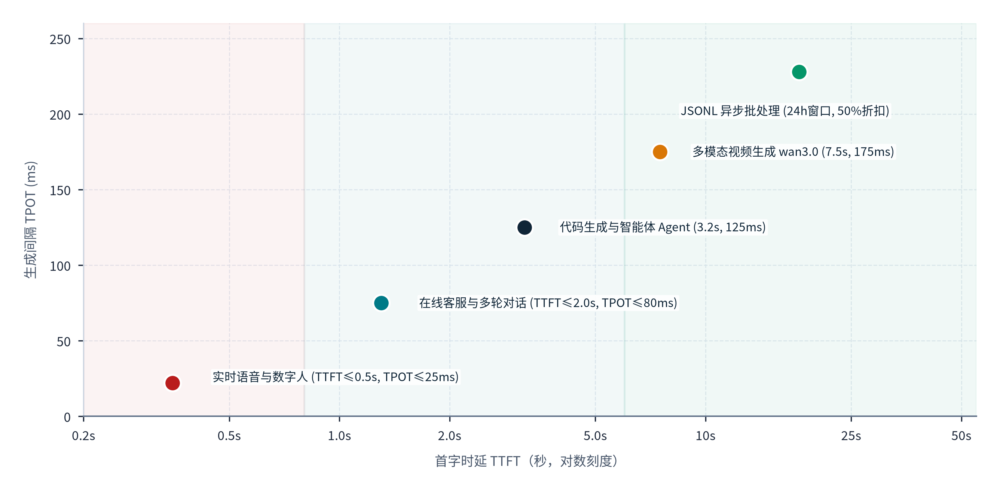
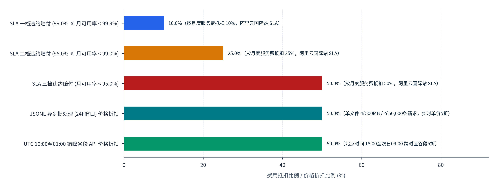
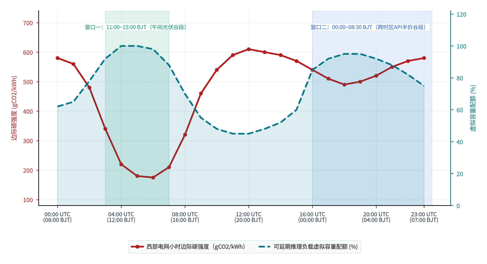
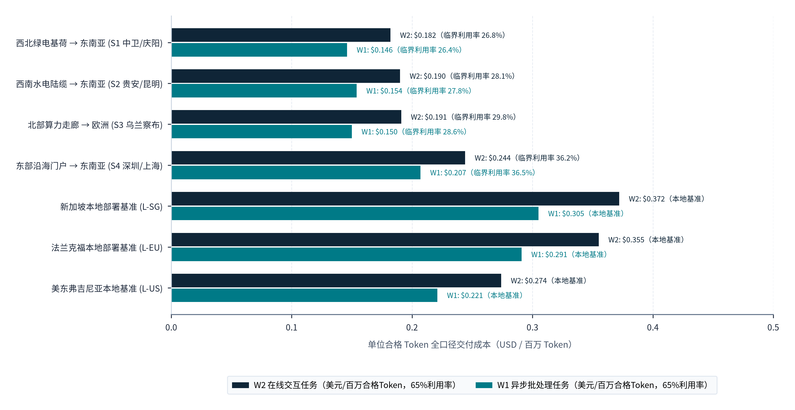

> **导航：** [返回中文手稿总目录](index.md) ｜ [上一章：第5章](chapter-05.md) ｜ [下一章：第7章](chapter-07.md) ｜ [尾注](notes.md) ｜ [参考文献](references.md)

**CHAPTER 06 · 第六章**

# 从物理连接到跨境服务交付能力

*打通海陆光缆与交换节点只是Token出海的物理前提。本章从云模型服务的接入点、静态数据落点与推理执行范围切入，建立五类AI任务与网络传输参数的工程映射，拆解QUIC、SSE与WebSocket在跨洋推理中的协同机制，并结合国际生产级SLA合同与碳感知调度模型，阐明物理带宽如何转化为可承诺、可审计、可规模化结算的跨境推理服务能力。*

## 6.1 跨境计算的部署形态

在跨境大模型与算力服务的工程实践中，最大的认知误区是将“API接入域名（Endpoint）”直接等同于“推理计算执行地（Inference Execution Location）”或“静态数据存储地（Data-at-Rest Storage）”。事实上，现代云原生大模型平台普遍采用控制面（Control Plane）、存储面（Storage Plane）与计算面（Compute Plane）三层解耦架构。根据客户网络位置、合规要求与算力供给分布的不同，跨境计算在工程上可划分为五类典型部署形态：境内直接服务、境外接入加境内计算（前店后厂）、境内外任务分工、多区域动态路由调度以及境外独立部署。

### 6.1.1 接入地域、静态存储与推理执行范围的三层解耦机制

以主流大模型云服务平台的官方生产规范为例，阿里云百炼（Model Studio）在2026年10月13日更新的《选择地域、服务部署范围和接入域名》技术文档中明确区分了“地域（Region）”与“服务部署范围（Service Deployment Scope）”两个核心字段[73](references.md#ref-73)。在该架构下，“地域”决定API接入端点、工作空间控制台归属以及客户请求与推理结果等静态数据的存储位置；而“服务部署范围”则独立决定了模型推理计算在哪些物理节点上执行，在推理调用过程中，输入与输出数据会在服务部署范围所覆盖的节点之间传输处理，并在计算完成后回到所选接入地域存储[73](references.md#ref-73)。

更关键的是，同一接入地域下的模型因上线时点与调度策略不同，其底层推理执行范围存在显著的制度化分层。根据阿里云百炼2026年10月13日版本的服务部署范围表[73](references.md#ref-73)：

- **新加坡（国际站）接入地域**：客户通过 `dashscope-intl.aliyuncs.com` 接入，静态数据存储于新加坡地域，其底层模型的服务部署范围设定为“国际（International）”，即覆盖除中国内地以外的全球可用节点[73](references.md#ref-73)。
- <strong>中国北京接入地域（存量模型）</strong>：对于2026年10月13日之前上线的模型，客户通过 `dashscope.aliyuncs.com` 接入时，其服务部署范围严格限定为“中国内地（Mainland China）”[73](references.md#ref-73)。该规则按模型上线日期适用，而非按客户首次调用日期适用。
- <strong>中国北京接入地域（新增模型）</strong>：对于自2026年10月13日起新上线的模型，其默认服务部署范围升级为“中国弹性区（China Elastic Zone）”，即覆盖中国内地及其他可用地域，但明确排除美国、欧盟成员国、日本与韩国四个法域[73](references.md#ref-73)。这一设计深刻揭示了头部云厂商如何通过定义弹性计算边界，在统筹境内外算力池的同时规避高敏感法域的域外管辖摩擦。

国际超大规模云厂商同样采用类似的跨区调度机制。Amazon Web Services（AWS）在Amazon Bedrock服务中推出了跨区域推理（Cross-Region Inference）机制，通过推理配置文件（Inference Profile）将无状态推理请求动态路由至多个目标Region，以应对单点容量瓶颈与突发流量峰值[74](references.md#ref-74)。AWS将该机制划分为两类：一是地理跨区配置（Geographic Cross-Region Inference Profile），即将推理计算严格限制在特定地理边界（如美国境内或欧盟境内）的多个Region之间流转；二是全球跨区配置（Global Cross-Region Inference Profile），允许请求在AWS全球商用Region池中动态择优执行[74](references.md#ref-74)。在合规审计层面，客户无法仅凭源请求发出的API终端节点判断实际算力落点，必须通过查询 `GetInferenceProfile` 接口返回的目标模型资源名称（ARN）列表了解允许的路由范围，并调取AWS CloudTrail审计日志中的 `additionalEventData.inferenceRegion` 字段，方能逐笔核实每一次推理调用的真实物理执行Region[74](references.md#ref-74)。结合境内外云平台实践，**图表 6.1**按“1. 境内直接服务（直连出海）”至“5. 境外独立部署（属地化闭环）”五类部署形态，对比了各自的API接入与边缘层、静态数据存储落点、推理算力执行范围及核心合规审计凭证：

#### 图表 6.1：跨境计算五类典型部署形态的架构边界、审计字段与适用场景对比表

| 部署形态 | API接入与边缘层 | 静态数据存储落点 | 推理算力执行范围 | 核心合规与审计凭证 | 典型代表与适用业务 |
| --- | --- | --- | --- | --- | --- |
| <strong>1. 境内直接服务（直连出海）</strong> | 中国境内网关（如北京/上海端点） | 中国内地数据中心（含缓存与文件） | 中国内地算力集群（西部绿电/沿海枢纽） | 接入域名解析记录、境内IDC机房与审计日志 | DeepSeek官方API、阿里云北京站存量模型；适合全球开发者长尾调用 |
| <strong>2. 境外接入加境内计算（前店后厂）</strong> | 香港、新加坡、东京等海外边缘PoP | 海外接入点（静态落盘）或境内瞬时内存处理 | 通过海陆专线回传至中国境内智算集群 | 跨境专线合同、出入向流量日志、不落地内存处理证明 | 汕头华侨试验区来数加工、跨境词元工厂；适合对价格敏感的亚太B2B负载 |
| <strong>3. 境内外任务分工（混合流水线）</strong> | 海外本地网关执行脱敏、向量化与安全护栏 | 个人身份信息（PII）留存海外客户本地库 | 境外执行轻量预处理与重排；境内执行重算力MoE推理与批处理 | 任务拆解DAG日志、脱敏网关审计记录、双边接口调用单 | 跨国电商客服、海外金融智能投研、多语种视频生成与配音流水线 |
| <strong>4. 多区域动态路由（弹性算力池）</strong> | 单一逻辑端点（如全球/区域Profile） | 维持在客户选定的源接入Region | 在预定义地理区或中国弹性区（排除美欧日韩）内动态路由 | CloudTrail `inferenceRegion`、百炼服务部署范围表[73](references.md#ref-73), [74](references.md#ref-74) | 阿里云百炼中国弹性区、AWS Bedrock跨区推理、OpenRouter聚合路由 |
| <strong>5. 境外独立部署（属地化闭环）</strong> | 目标市场本地云Region或专属机房 | 目标国本地合规存储（满足主权驻留） | 目标国或同法域境外GPU集群独立完成 | 属地数据中心认证（ISO/SOC）、本地抗审查TIA报告 | 阿里云新加坡国际站、欧美主权政务与医疗核心系统本地化托管 |

> **表格结构化数据文件：** [`data/exhibits/exhibit-6-1.csv`](../../data/exhibits/exhibit-6-1.csv)
> **表注与来源：** 资料来源：阿里云百炼官方技术文档（2026年10月13日版）[73](references.md#ref-73)、AWS Bedrock跨区域推理开发者指南[74](references.md#ref-74)、广东天亿马投资者关系活动记录表（2026年9月15日）[75](references.md#ref-75)；介子九维（JIEZIJIUWEI）研究整理。

对比**图表 6.1**归纳的“1. 境内直接服务（直连出海）”至“5. 境外独立部署（属地化闭环）”五类部署形态可以发现，不同架构在首字时延、合规审计凭证与单位算力成本之间存在清晰的适用边界。其中，“2. 境外接入加境内计算（前店后厂）”与“3. 境内外任务分工（混合流水线）”通过将海外边缘网关的TLS加密握手、隐私脱敏与境内绿电集群的重算力推理相结合，同时兼顾了海外客户体验与本土低电价优势。

### 6.1.2 境内外任务分工与“前店后厂”的工程落地条件

在中国算力出海的商业演进中，“境外接入加境内计算”与“境内外任务分工”是兼具中国绿电成本优势与海外本地交付体验的主力形态。例如，广东天亿马信息产业股份有限公司在2026年9月15日披露的投资者关系活动记录中确认，其位于汕头华侨经济文化合作试验区的“1号词元工厂”部分算力设备已投产运营，并依托自研模型中心（T.Y.M. Model Hub）为新加坡、泰国、马来西亚、印尼等东南亚国家的AI漫剧、AI玩具及海外开发者提供跨境推理服务[75](references.md#ref-75)。在工程实现上，要使此类跨主体、跨国界的混合部署形态经得起国际企业客户的尽职调查，必须将“市场宣传口径”转化为“请求级工程证据链”：服务商不仅需要明确披露API网关IP归属，还需通过硬件安全模块（HSM）或无状态容器日志证明境外输入数据在境内GPU显存中仅作瞬时张量计算、不写入持久层磁盘，并确保商业销售主体、外汇结算路径与底层机房监控记录的字段映射完全一致。

## 6.2 任务需求与网络条件的匹配

并非所有人工智能负载都可以无差别地通过跨洋光缆由中国境内直供。不同模态、不同交互范式的AI任务对网络往返时延（RTT）、上行与下行瞬时带宽、抖动（Jitter）及连接持续性的容忍度存在数量级差异。建立“任务特征：网络要求：适用部署方式”的定量映射，是划定中国Token出海可服务市场边界的核心工程基础。

### 6.2.1 推理性能核心指标与MLPerf国际基准阈值

在生产级大模型服务中，客户端感知的服务质量主要由三项标准化指标刻画。根据NVIDIA Triton推理服务器GenAI-Perf基准测试工具的官方定义[76](references.md#ref-76)：

1. <strong>首Token时延（Time to First Token, TTFT）</strong>：从客户端发出HTTP/WebSocket推理请求开始，至接收到服务端流式返回的首个有效输出Token为止所经历的总时间（单位：毫秒或秒）[76](references.md#ref-76)。在跨境调用中，TTFT等于“跨境网络建连与请求传输时延 + 网关鉴权排队耗时 + GPU集群Prefill（预填充）阶段计算耗时 + 首包回传网络时延”之和。
2. <strong>单Token生成间隔（Inter-Token Latency, ITL，或Time Per Output Token, TPOT）</strong>：在流式输出阶段，相邻两个输出Token到达客户端的平均时间间隔[76](references.md#ref-76)。由于Decode阶段属于典型的显存带宽受限型（Memory-bound）操作，只要跨境链路的平滑速率高于文本字节流速率（通常仅数kbps至数十kbps）且无剧烈丢包重传，网络物理RTT对稳态TPOT的边际影响远小于对TTFT的影响。
3. <strong>端到端请求延迟（Request Latency）与输出吞吐率（Output Token Throughput）</strong>：前者指请求发出至完整接收最后一个Token（如收到 `data: [DONE]` 标志）的总耗时；后者定义为测试窗口内总输出Token数除以基准测试持续时间（tokens/s），且在工程对标时必须同步锁定并发度（Concurrency）、请求到达率、输入输出序列长度分布、模型权重精度及分词器（Tokenizer）版本[76](references.md#ref-76)。

国际权威基准测试组织MLCommons在MLPerf Inference基准（含v5.1小模型基准及2026年9月16日发布的最新v6.1基准）中，对在线服务端（Server）与高交互（Interactive）两类场景设定了严格的99分位（P99）延迟硬约束[77](references.md#ref-77)：在标准 **Server场景** 下，系统必须同时满足 <strong>TTFT ≤ 2.0秒（2,000 ms）</strong> 且 **TPOT ≤ 100毫秒**；而在严苛的 **Interactive场景** 下，阈值收紧至 <strong>TTFT ≤ 0.5秒（500 ms）</strong> 且 **TPOT ≤ 30毫秒**（折合每秒连续输出至少33.3个Token，超过人类快速阅读极限）[77](references.md#ref-77)。这一组工程基准为评估跨洋光缆时延损耗提供了清晰的参照坐标：当中国至东南亚核心节点（新加坡、曼谷、吉隆坡）的海陆光缆RTT处于20毫秒至45毫秒区间时，网络传输往返仅消耗Interactive场景TTFT预算（500毫秒）的4%至9%，完全支持高交互实时负载；而当中国跨越太平洋或亚欧大陆向美东、西欧提供服务时，150毫秒至220毫秒的基础物理RTT加上TLS握手开销将占用Interactive场景TTFT预算的40%以上，此时计算任务必须向Server级（TTFT ≤ 2.0秒）、长思维链推理或异步批处理（Offline）场景收敛。

### 6.2.2 文本、实时音频、视觉多模态与批处理任务的载荷拆解

通过对2026年主流大模型API接口规范的逐项比对，笔者精确量化了五类核心任务在网络传输层的字节载荷与协议边界：

- <strong>实时双向语音交互（Real-Time Audio）</strong>：以阿里云百炼2026年10月11日版Qwen-Audio实时语音接口规范为例，其输入音频流强制要求采用未压缩脉冲编码调制（PCM）格式、16 kHz采样率、16 bit位深、单声道，经严密复算，单路连续音频输入的裸码率为 16,000 × 16 × 1 ÷ 1,000 ＝ 256 kbit/s[78](references.md#ref-78), [ix](notes.md#note-ix)；而服务端流式合成返回的音频输出采用PCM格式、24 kHz采样率、16 bit位深、单声道，单路连续输出裸码率为 24,000 × 16 × 1 ÷ 1,000 ＝ 384 kbit/s[78](references.md#ref-78), [ix](notes.md#note-ix)。若计入Base64文本编码膨胀（增加约33.3%字节体积）、WebSocket帧头及TLS加密开销，单路高保真AI语音伴侣或实时同传的双向稳态带宽需求约为850 kbps至1.0 Mbps，且对数据包抖动极为敏感，最适合部署在RTT低于50毫秒的周边海陆光缆圈或采用边缘语音网关加速。
- <strong>视觉理解与高清图像多模态（Vision-Language）</strong>：在Qwen3.8、Qwen3.7、Qwen3.6、Qwen3.5及Qwen3-VL系列模型中，视觉编码器按缩放后每 **32×32像素块（1,024像素）折算1个视觉Token**（部分早期系列采用28×28像素块）[79](references.md#ref-79), [ix](notes.md#note-ix)。在接口传输层，通过公共URL方式传入的单张图像文件上限为 **20 MB**，而通过DashScope标准域名直接提交的HTTP请求体（Request Body，由单图、多图Base64编码及文本Prompt共享）硬性上限为 **16 MiB**[79](references.md#ref-79)。高并发多图视觉分析任务的瓶颈因此主要集中在客户端上行突发带宽与对象存储（OSS/S3）跨国拉取速度。
- <strong>多模态高清视频生成（Video Generation）</strong>：根据百炼2026年10月现行视频生成模型规格表，旗舰模型 `wan3.0-video` 与 `wan3.0-video-prime` 支持生成480P、720P及1080P分辨率、时长2至30秒、帧率30 fps的MP4视频；`wan2.7-t2v` 支持720P/1080P、2至15秒、30 fps输出；而 `happyhorse-1.1-t2v/i2v/r2v` 系列支持480P/720P/1080P、3至15秒、24 fps输出[80](references.md#ref-80)。由于单次视频生成推理耗时通常以数十秒至数分钟计，物理网络RTT对其体验几乎无影响，但其结果交付高度依赖异步任务轮询机制与高吞吐跨国CDN分发。
- <strong>异步大批量处理（Asynchronous Batch API）</strong>：针对海量语料清洗、合成数据生成、离线翻译与全库代码评测，百炼Batch API采用上传UTF-8编码JSONL文件的方式异步排队执行[81](references.md#ref-81)。其最新生产限制规定：单文件最多包含 **50,000条独立请求**，单文件体积上限为 **500 MB**，单行JSON对象上限为 **1 MB**（且须符合对应模型上下文窗口限制），控制台可选最长等待完成窗口为 **1至14天**（API创建任务代码默认示例参数为 `completion_window="24h"`），任务完成后结果文件与错误文件保留 **30天** 后自动清理[81](references.md#ref-81)。此类负载对毫秒级网络时延完全免疫，是消纳中国西部低谷绿电、平抑跨国海缆峰谷利用率的黄金锚定负载。

为将上述物理传输与模型推理耗时精确分解到每一条跨国链路，**图表 6.2**针对“昆明至曼谷 (GMS陆缆直连)”“深圳/香港至新加坡 (亚太海缆)”“宁夏/甘肃至新加坡 (西算南送)”“乌兰察布至法兰克福 (亚欧陆缆)”与“上海/宁夏至美西硅谷 (跨太海缆)”五条代表性跨境算力走廊，按“物理光速与骨干路由 RTT”“边缘网关与 TLS/QUIC 握手”“Prefill 首包计算耗时”及“队列调度与安全护栏开销”四项构成要素，堆叠展示了端到端首字延迟（TTFT）并与“MLPerf 交互红线 (500ms)”及“MLPerf 在线服务上限 (2000ms)”进行对比：

#### 图表 6.2：典型生成式 AI 推理任务的首字时延（TTFT）与生成间隔（TPOT）服务等级边界

> **图像文件：** [`figures/chart_6_2.png`](../../figures/chart_6_2.png)（高清位图）｜ [`figures/chart_6_2.svg`](../../figures/chart_6_2.svg)（矢量图）
> **图注与来源：** 来源：MLCommons MLPerf Inference v5.1 / v6.1 官方规范（2025.09 / 2026.03）；介子九维（JIEZIJIUWEI）整理绘制[76](references.md#ref-76), [77](references.md#ref-77)。

**图表 6.2**的四段式时延堆叠拆解直观证明：五条代表性跨境算力走廊的端到端首字响应延迟（TTFT）分别为“昆明至曼谷 (GMS陆缆直连)”165ms（其中物理RTT 20ms、握手15ms、Prefill计算110ms、安全护栏20ms）、“深圳/香港至新加坡 (亚太海缆)”174ms（物理RTT 34ms）、“宁夏/甘肃至新加坡 (西算南送)”217ms（物理RTT 72ms）、“乌兰察布至法兰克福 (亚欧陆缆)”288ms（物理RTT 138ms）以及“上海/宁夏至美西硅谷 (跨太海缆)”303ms（物理RTT 145ms）。五条走廊的端到端TTFT均控制在165ms至303ms之间，不仅远低于“MLPerf 在线服务上限 (2000ms)”，而且全部控制在“MLPerf 交互红线 (500ms)”以内，证明通过QUIC连接复用与专线直连，中国算力基地完全具备向亚太、欧洲与北美提供实时流式推理服务的物理能力。

在明确不同跨国走廊的首字时延（TTFT）构成后，**图表 6.3**依据阿里云国际站生产级大模型服务等级协议（SLA，2026年9月8日生效版）与主流平台异步/错峰计费规则，横向对比了“99.0% ≤ 月度可用率 < 99.9% (SLA第一档抵扣)”“95.0% ≤ 月度可用率 < 99.0% (SLA第二档抵扣)”“月度可用率 < 95.0% (SLA封顶抵扣)”三档违约服务费抵扣比例，以及“Batch API 异步批量推理 (24h~14d窗口价格折扣)”与“DeepSeek 错峰时段调用 (UTC 10:00~01:00谷段折扣)”的合同折扣率：

#### 图表 6.3：多模态流式并发上限、异步批处理吞吐规模与国际生产级 SLA 违约赔付标准

> **图像文件：** [`figures/chart_6_2b.png`](../../figures/chart_6_2b.png)（高清位图）｜ [`figures/chart_6_2b.svg`](../../figures/chart_6_2b.svg)（矢量图）
> **图注与来源：** 来源：阿里云百炼 Qwen-ASR / Qwen-Omni / Batch API 技术文档（2026.10）及主流云服务商 SLA 协议；介子九维（JIEZIJIUWEI）整理绘制[78](references.md#ref-78)–[81](references.md#ref-81)。

由**图表 6.3**可见，生产级跨境交付在合同层设定了严谨的阶梯赔付机制与时延换折扣机制：当月度可用率处于“99.0% ≤ 月度可用率 < 99.9%”第一档时，月度服务费抵扣比例为10.0%（且5分钟评估窗口内有效请求少于5次时错误率强制记为0%）；当可用率降至“95.0% ≤ 月度可用率 < 99.0%”第二档时，服务费抵扣比例升至25.0%（同客户主体、同模型及同参数哈希的重试按单次唯一请求去重统计）；当跌至“月度可用率 < 95.0%”第三档时，服务费抵扣比例达到50.0%封顶（海底光缆中断与基础电信故障属法定免责排除项）。与此同时，若海外客户将非实时任务切换至“Batch API 异步批量推理（24h至14d窗口）”或“DeepSeek 错峰时段调用（UTC 10:00至次日01:00谷段折扣，对应欧美日间办公时段）”，则可直接获得50.0%的官方价格折扣。为避免单条海缆故障或节点拥塞触发10.0%至50.0%的资费抵扣，跨境推理网关必须配置跨海缆与陆缆的多路由自动容灾切换机制[78](references.md#ref-78)–[81](references.md#ref-81), [85](references.md#ref-85)。

## 6.3 传输、计算与业务协议的协同

当一次大模型调用跨越国界、穿过海底光缆与国际互联网交换中心（IXP）并进入境内智算集群时，单一物理链路的高带宽并不能自动保证应用层交付的成功。跨境Token交付的稳定性，本质上依赖于传输层协议、应用层流式接口、算力路由控制面与商业计费契约的精密咬合。

### 6.3.1 跨洋高带宽长时延链路下的传输层演进：从TCP队头阻塞到QUIC多路复用

跨洋海底光缆具有高带宽、长往返时延（高带宽时延积BDP）的典型物理特征。在传统的HTTP/1.1或基于单TCP连接的HTTP/2流式传输中，一旦跨国链路因海缆倒换或国际出口拥塞出现0.5%至1%的随机丢包，操作系统内核的TCP协议栈就会触发重传机制并强制阻塞后续已到达字节向应用层的交付，导致大模型流式吐字出现长达数百毫秒至数秒的明显卡顿（即TCP队头阻塞，Head-of-Line Blocking）。

为攻克这一跨洋传输顽疾，依据互联网工程任务组（IETF）发布的RFC 9000标准（QUIC传输协议），现代AI网关正在加速向基于UDP的QUIC与HTTP/3协议栈演进[82](references.md#ref-82)。根据RFC 9000第2节、第4节、第9节及第13节的规范定义，QUIC在跨境Token交付中提供了三项关键工程增益[82](references.md#ref-82)：第一，**流级独立多路复用与零队头阻塞**，单个丢包仅影响其所属的特定数据流（Stream），同一连接上并发传输的其他Agent工具调用或文本流无需等待重传即可继续向应用层交付；第二，**0-RTT与1-RTT快速加密建连**，将传统TCP三次握手加TLS 1.2/1.3多次往返压缩至单次往返甚至零往返（针对近期已访问节点），在跨太平洋160毫秒RTT场景下直接为每次新建推理请求削减160至320毫秒的TTFT固定损耗；第三，<strong>基于连接ID（Connection ID）的无缝连接迁移（Connection Migration）</strong>，当海外移动终端在Wi-Fi与蜂窝网络间切换、或跨境边缘网关在主备国际专线间执行BGP毫秒级倒换导致客户端IP与端口改变时，长耗时推理流无需断开重连，彻底避免了已生成Token的作废与算力浪费[82](references.md#ref-82)。

### 6.3.2 应用层接口协议、权限策略耦合与异步防重复扣费机制

在传输层之上，应用层接口通过三类标准协议承载不同形态的推理交互，并与云平台权限及计费引擎严密耦合：

- **SSE单向流式协议与OpenAI兼容接口**：对于标准文本与多轮代码生成，全球产业界已收敛至基于Server-Sent Events（SSE）的OpenAI兼容接口范式。客户端在HTTP请求头中携带 `Authorization: Bearer <API_KEY>` 完成身份鉴权（需要注意的是，API密钥、模型名称与接入域名必须按所选地域严格对应，不同地域的密钥不可跨区混用），服务端则以 `text/event-stream` 格式逐块推送包含 `choices[].delta.content` 的JSON片段，直至发送 `data: [DONE]` 宣告流式生成结束[73](references.md#ref-73), [83](references.md#ref-83)。
- **WebSocket全双工事件驱动协议**：针对实时语音与多模态流式交互，单向HTTP请求响应模式无法满足边听边说的低时延打断需求。百炼Qwen-Audio接口采用WebSocket长连接协议，通过严格排序的异步事件流（包含会话配置更新 `session.update`、客户端连续追加音频缓冲区、服务端流式推送音频增量片段 `audio.delta` 以及回合完成事件 `done`）实现全双工交互[78](references.md#ref-78)。
- **异步推理防重复扣费（幂等校验）与异常不计费契约**：在长耗时生成或大批量任务中，跨国网络闪断极易引发客户端超时重试，若缺乏防重复提交机制，将直接导致客户遭遇双倍计费与算力重复消耗。为此，AWS Bedrock在异步推理接口（`StartAsyncInvoke`）中专门定义了长度为1至256个字符的可选请求唯一标识字段 `clientRequestToken`，当服务端检测到相同标识的重复请求时将直接拦截并返回原任务句柄[84](references.md#ref-84)。而在批量文件处理中，阿里云百炼要求JSONL文件内的每行请求必须携带长度不超过256个字符且文件内全局唯一的 `custom_id` 用于乱序结果匹配，并在计费契约中明确规定：**凡因文件解析失败、系统任务执行失败或行级请求报错（如上下文超限或内部5xx错误）均不产生任何计费**；仅当客户主动取消正在运行的Batch任务时，取消指令生效前已成功完成的请求方才按量计入费用[81](references.md#ref-81)。
- **跨区域路由与组织安全控制策略（SCP）的隐性冲突**：在多主体跨国企业架构中，网络连通并不等于调用必然成功。AWS技术规范专门警示，当企业启用跨区域推理配置文件时，若其AWS Organizations顶层设置的服务控制策略（Service Control Policies, SCP）封禁了该推理配置底层候选池中的某一个目标Region，则路由至该Region的推理请求将直接因权限拒绝（Access Denied）而失败[74](references.md#ref-74)。这要求跨境算力平台必须将网络路由表与多法域IAM权限规则进行联合编排。

为阐明跨洋高带宽长时延链路环境下网络传输层、安全握手机制与大模型应用层流式输出的协同逻辑，**图表 6.4**按“1. 物理与路由层”至“5. 商业契约与结算层”五个协议栈层级，系统梳理了各层的职责边界、关键控制字段及故障计费责任边界：

#### 图表 6.4：跨境Token交付五层协议栈的职责边界、核心控制字段与故障计费耦合分析表

| 协议栈层级 | 主流标准与技术实现 | 核心工程职责与跨洋优化机制 | 关键控制字段与参数约束 | 典型故障模式与计费责任边界 |
| --- | --- | --- | --- | --- |
| **1. 物理与路由层** | 海底/陆地光缆、IPLC/IEPL、BGP4+、IXP | 提供跨洋光电传输与自治系统（AS）间路由可达性及毫秒级倒换 | 国际出入口局批文、IXP二层VLAN隔离、BGP前缀宣告 | 海缆锚害/地震中断（年均150至200起）；通常列入云服务SLA免责排除项[85](references.md#ref-85) |
| **2. 传输与安全层** | QUIC（RFC 9000 over UDP）、TCP + TLS 1.3 | 安全加密握手、流级独立多路复用、丢包恢复与IP变动连接迁移[82](references.md#ref-82) | 0-RTT/1-RTT建连、Connection ID、拥塞控制窗口（BBR） | 传输层建连超时不触发模型层计费；QUIC消除单包丢失引发的全局流式卡顿[82](references.md#ref-82) |
| **3. 接口与会话层** | HTTP POST + SSE流式、WebSocket事件流、Batch JSONL | 承载Prompt上行与Token增量下行、全双工音频交互及批量异步提交 | `Authorization: Bearer <API_KEY>`（按地域绑定）、`choices[].delta.content`、`data: [DONE]`[73](references.md#ref-73), [83](references.md#ref-83) | 传输到达首个数据块（TTFT）不等于完整任务完成；客户端主动断开在审计日志中记为状态码 `0`[86](references.md#ref-86) |
| **4. 算力调度与权限层** | 地域部署范围、Cross-Region Profile、网关限流器 | 实现接入点与执行池解耦、跨区突发削峰、RPM/TPM多维平滑限流 | `inferenceRegion`、`GetInferenceProfile` ARN、`clientRequestToken`（1至256字符）、`custom_id`（≤256字符）[74](references.md#ref-74), [81](references.md#ref-81), [84](references.md#ref-84) | 组织SCP策略封禁目标Region会导致跨区路由失败[74](references.md#ref-74)；触发429限流不计费但需退避重试[87](references.md#ref-87) |
| **5. 商业契约与结算层** | 正式付费SLA、审计日志、Expenses & Costs结算单 | 界定月度可用率算法、阶梯抵扣赔付、异常免责及财务对单权威口径 | 5分钟评估窗口、月度99.9%承诺、专属接入3,600秒/标准接入600秒超时上限[73](references.md#ref-73), [85](references.md#ref-85) | Batch解析/执行/行级错误免收费用[81](references.md#ref-81)；性能监控仅作参考，财务核对以正式费用结算单为准[86](references.md#ref-86) |

> **表格结构化数据文件：** [`data/exhibits/exhibit-6-4.csv`](../../data/exhibits/exhibit-6-4.csv)
> **表注与来源：** 资料来源：IETF RFC 9000标准[82](references.md#ref-82)、阿里云百炼技术规范与国际站SLA（2026年9月至10月版）[73](references.md#ref-73), [81](references.md#ref-81), [83](references.md#ref-83), [85](references.md#ref-85), [86](references.md#ref-86), [87](references.md#ref-87)、AWS Bedrock官方技术文档[74](references.md#ref-74), [84](references.md#ref-84)；介子九维（JIEZIJIUWEI）研究整理。

从**图表 6.4**对“1. 物理与路由层”至“5. 商业契约与结算层”五层协议栈的梳理可见，跨洋链路的高丢包或长往返时延若处理不当，极易引发TCP队头阻塞或流式SSE连接意外断开，进而导致算力空转与重复扣费争议。在工程实践中全面引入“2. 传输与安全层”的QUIC 0-RTT连接复用、“4. 算力调度与权限层”的 `clientRequestToken` / `custom_id` 唯一请求标识校验以及“5. 商业契约与结算层”的异常报错免收费用机制，是保障跨国商业信任的技术底座。

## 6.4 服务可靠性、安全性与持续运行

对于将核心生产业务迁移至中国大模型API或跨境算力集群的海外企业而言，“服务是否可靠”不能停留在口头承诺，而必须落实为具有法律约束力的服务等级协议（SLA）条款、可独立验证的网络探针监测以及可追溯的审计与结算记录。

### 6.4.1 国际生产级模型服务SLA的精算逻辑与免责边界拆解

通过对阿里云国际站发布的《Model Studio Service Level Agreement（百炼服务等级协议）》（2026年9月8日生效版）原文的逐条审计，可以清晰还原国际云厂商在跨境大模型推理中的风险定价与责任边界[85](references.md#ref-85)：

- **适用范围的严格剥离**：该份99.9%可用性承诺仅适用于明确列举的付费模型推理服务（Paid Model Inference Services），<strong>明确排除第三方托管模型、编程套餐（Coding Plan）、免费额度（Free Quota）以及试用接入域名（Trial Endpoints）</strong>[73](references.md#ref-73), [85](references.md#ref-85)。在接入层，专属接入域名（Dedicated Endpoint）的请求超时上限为 **3,600秒**，而DashScope标准域名与试用域名的超时上限均为 **600秒**，且试用域名完全不提供任何SLA保障[73](references.md#ref-73)。
- **5分钟窗口与低流量豁免规则**：月度服务可用率不按“全月无故障分钟数 ÷ 全月总分钟数”简单折算，统一以 <strong>每5分钟为一个评估区间（5-minute interval）</strong> 计算该区间内的请求错误率，再对全月所有5分钟区间的错误率求算术平均值[85](references.md#ref-85)。更为关键的精算条款在于：<strong>若某一5分钟区间内同一客户主体在同一模型上的有效请求总数少于5次，则无论该区间内请求是否报错，该5分钟区间的错误率一律强制记为0%</strong>[85](references.md#ref-85)。低频调用的长尾客户因此无法将偶发的单次网络超时换算为SLA违约。
- **失败请求哈希去重规则**：在统计5xx服务端内部错误（Failed Transactions）时，若客户端因超时或报错在同一个5分钟窗口内使用相同的客户主体、相同的模型及完全一致的参数哈希（Parameter Hash）发起多次重试，系统将其合并计为 <strong>唯一一次请求（Single Unique Request）</strong>；且只要该组重试在5分钟窗口内有任意一次返回成功，整组请求即不被计入SLA失败分子[85](references.md#ref-85)。
- **阶梯式服务抵扣（Service Credit）与海底光缆免责**：当月度可用率跌破99.9%承诺线时，赔偿方式不采取现金赔付业务损失，统一按三个档位发放未来月度服务费抵扣券：可用率处于 <strong>99.0%至99.9%（不含）</strong> 区间抵扣当月受损服务费用的 <strong>10%</strong>；处于 <strong>95.0%至99.0%（不含）</strong> 区间抵扣 <strong>25%</strong>；低于 <strong>95.0%</strong> 抵扣封顶比例为 <strong>50%</strong>[85](references.md#ref-85)。同时，SLA第1.3节“免责排除项（Exclusions）”明确将<strong>海底光缆故障（Submarine fiber failures）、基础电信设施中断、互联网服务提供商（ISP）路由故障以及客户端触发限流（429）</strong>排除在云厂商可用率考核之外[85](references.md#ref-85)。这一条款深刻表明：模型云厂商的SLA仅担保其数据中心内部网关至GPU集群的可用性，而跨洋物理海缆的冗余保障责任必须由出海企业或跨境交付集成商通过多路由BGP架构自行兜底。

立足海外企业级客户对生产系统高可用性的要求，**图表 6.5**按“SLA月度承诺与抵扣”“错误率统计与去重”“通信故障免责条款”“审计日志与隐私边界”及“多维限流识别（429）”五个治理维度，整合了生产级大模型服务SLA合同定义与企业级端到端可靠性加固方案：

#### 图表 6.5：生产级大模型服务SLA合同精算条款、审计日志字段与端到端可靠性治理框架表

| 治理维度与条款项 | 官方技术规范与合同精确定义 | 对跨境Token交付的商业与工程含义 | 企业级端到端可靠性加固方案 |
| --- | --- | --- | --- |
| **SLA月度承诺与抵扣** | 付费模型月度可用率 <strong>≥99.9%</strong>；99.0%至99.9%抵扣10%，95.0%至99.0%抵扣25%，<95.0%抵扣50%[85](references.md#ref-85) | 赔偿上限为当月模型调用费用的50%，不覆盖下游业务停摆损失 | 核心生产环境必须配置主备双云或境内外双Region自动故障转移（Failover） |
| **错误率统计与去重** | 按 **5分钟窗口** 求均值；窗口内请求 <strong><5次</strong> 错误率记0；同客户主体/模型/参数哈希5xx重试按单次计且任一成功即清零[85](references.md#ref-85) | 直接复用相同Prompt重试虽有利于云厂SLA达标，但在长尾故障下会拉长客户端P99完成时间 | 客户端网关应分离“同节点重试”与“跨通道/跨模型逃生”，设置阶梯式超时熔断 |
| **通信故障免责条款** | 明确排除海底光缆中断、基础电信设施故障、ISP问题及免费/试用端点[73](references.md#ref-73), [85](references.md#ref-85) | 单一海缆中断（如AAE-1故障）导致的时延飙升不触发云平台赔付 | 依托RIPE Atlas分布式探针实时监测跨国Ping/Traceroute/TLS握手[88](references.md#ref-88)，联动多海缆/陆缆切换 |
| **审计日志与隐私边界** | 默认记录Request ID、时间、模型、Token量、TTFT、调用时长、状态码、错误码；**默认不含Prompt与Response原文**[86](references.md#ref-86) | 兼顾性能排障与数据最小化合规；若用户主动中断连接，状态码记为 `0`（请求成功但客户端中止）[86](references.md#ref-86) | 跨境合规场景保持默认关闭内容日志；利用脱敏元数据与Expenses and Costs结算单交叉核对[86](references.md#ref-86) |
| <strong>多维限流识别（429）</strong> | 区分RPM/RPS（请求频次）、TPM/TPS（Token吞吐）及短时突发（Burst）三类429限额[87](references.md#ref-87) | 多轮Agent或长文档Prefill极易先触碰TPM上限而非RPM上限 | 在边缘网关部署令牌桶平滑器（Smooth Request Rate），按Token预估量实行分级排队与指数退避[87](references.md#ref-87) |

> **表格结构化数据文件：** [`data/exhibits/exhibit-6-5.csv`](../../data/exhibits/exhibit-6-5.csv)
> **表注与来源：** 资料来源：阿里云百炼国际站SLA（2026年9月8日版）[85](references.md#ref-85)、阿里云百炼审计日志与模型监控文档（2026年10月版）[86](references.md#ref-86)、限流策略与平滑请求速率指南[87](references.md#ref-87)、RIPE Atlas网络测量规范[88](references.md#ref-88)；介子九维（JIEZIJIUWEI）研究整理。

**图表 6.5**所构建的五维治理框架表明，面向海外企业客户签署99.9%以上的高可用服务协议，必须配套“错误率统计与去重”的5分钟滑动窗口监测、“通信故障免责条款”下的多海缆/陆缆探针联动切换，以及“审计日志与隐私边界”中默认不留存Prompt与Response原文的脱敏记录体系，从而在发生跨国网络抖动时实现责任边界的清晰界定。

### 6.4.2 分布式网络探针监测、审计日志边界与多维限流平滑

为弥合云厂商内部SLA与海外客户真实端到端体验之间的鸿沟，成熟的跨境Token服务商需要在三个运行维度建立精细化治理机制：第一，在**外部网络监测层**，引入如欧洲网络协调中心（RIPE NCC）运营的RIPE Atlas等全球分布式硬件探针网络，在目标客户所在的海外ISP接入网内持续执行ICMP Ping、Paris Traceroute、DNS解析及SSL/TLS握手测量，独立刻画从海外终端至中国出入口局及边缘PoP点的真实RTT分位数与丢包轨迹[88](references.md#ref-88)。第二，在**审计与财务对单层**，充分利用云平台默认审计日志（记录Request ID、调用时间戳、模型标识、输入输出Token用量、首Token时延、总调用时长、状态码及错误码，但默认不采集客户的Prompt与Response明文内容）实现脱敏运维；同时严格区分状态码 `0`（代表服务端已正常响应但客户端主动断开流式连接）与服务端错误，并遵循“性能监控面板仅作运维参考，正式财务结算与审计核对一律以Expenses and Costs结算单为准”的铁律[86](references.md#ref-86)。第三，在**流量整形层**，针对HTTP 429限流错误建立精细解析，准确识别触发限流的具体原因是每分钟/每秒请求数（RPM/RPS）超限、每分钟/每秒Token数（TPM/TPS）超限还是毫秒级短时突增（Short-term Burst），通过客户端预分词估算与平滑速率队列避免突发流量击穿配额[87](references.md#ref-87)。

## 6.5 电力、算力与网络的联合组织

前文第3章与第5章分别证明了中国在“绿色低价电力”与“多向海陆光缆”上的要素禀赋，但要把这两项静态要素转化为全球最低的Token交付成本，核心枢纽在于构建一套横跨电力曲线、算力集群与国际网络路由的<strong>时空联合调度系统（Spatiotemporal Joint Scheduling System）</strong>。

### 6.5.1 从Google碳感知计算到中国跨时区算电网协同

在数据中心负载的时空弹性调度领域，Google研究团队发表的碳感知计算（Carbon-Aware Computing）开创性工程实践（Radovanović et al., 2021）提供了极具价值的理论参照[89](references.md#ref-89)。Google在其全球数据中心生产集群中，将计算任务严格区分为“不可延期的实时交互负载（如搜索、地图、实时视频）”与“具有时间弹性的可延期工作负载（Deferrable Workloads，如离线机器学习处理、视频转码与统计批处理）”，并引入了核心的<strong>虚拟容量曲线（Virtual Capacity Curves）</strong>机制：调度器基于未来24小时电网碳强度预测、各集群历史负载预测、服务器功耗模型、服务性能期望及电力采购合同约束，在电网高碳排或高负荷时段主动压降某数据中心的可延期负载算力配额上限，将其推迟至同一数据中心的光伏/风电大发时段执行，同时保证每日分配的总算力容量不变，确保所有可延期任务在24小时截止期限（Deadline）内100%完成[89](references.md#ref-89)。

将这一范式扩展至中国的“东数西算”枢纽与跨洋Token出海场景，中国不仅拥有日内风光出力波动带来的**时间套利空间**，更拥有服务全球跨时区客户带来的天然**空间与昼夜互补优势**：

- **日内光伏深谷与批量推理的精准咬合**：如第3章所证实，甘肃、宁夏、蒙西、青海等西北算力枢纽在每日北京时间09:00至17:00（即UTC时间01:00至09:00）处于光伏大发与电力现货深谷时段（如蒙西谷段长达8小时、甘肃深谷电价低至峰段的0.15倍）。此时恰好对应北美市场的夜间离线窗口与欧洲市场的清晨时段，跨境调度平台可将全球企业提交的JSONL异步批处理任务（如百炼Batch API定义的24小时至14天窗口任务）集中路由至西北绿电集群满载执行，直接享受 <strong>0.5倍（50%折扣）</strong> 的批处理API计费系数与极低边际电价的双重红利[81](references.md#ref-81)。
- **跨时区实时调用的错峰填谷效应**：当北京时间进入17:00至次日01:00的国内晚高峰用电时段，欧洲与中东非（EMEA）及北美东岸客户相继进入日间工作高峰。此时，调度系统可将高毛利、低时延容忍度的在线交互流量切换至西南水电基地（如贵州、云南、四川稳定水电集群）或沿海国际出入口门户节点，而DeepSeek等平台更通过在北京时间00:30至08:30（即UTC 16:30至00:30，精准覆盖欧美日间办公全时段）提供高达50%的错峰动态折扣，将欧美实时并发需求无缝引导至中国国内电网的夜间负荷低谷期，实现了国内电网削峰填谷与全球算力利用率最大化的协同效应。

### 6.5.2 算电网联合调度的成本优化模型与跨洋推理网关工程实践

> **【核心核算公式】** **核心模型 6.1：算电网联合调度的跨境Token交付综合成本优化函数**
>
> `单位百万Token综合交付成本 ＝ 实时电能量与PUE损耗项 ＋ (硬件折旧 ＋ 跨境网络端口分摊) ÷ (集群利用率 × 单卡吞吐率) ＋ 碳合规边际影子成本项`
>
> <strong>模型机理与工程解析：</strong>设跨境服务商在调度周期内需协同完成“实时交互任务集合”与“可延期批处理任务集合”两类海外订单。在满足各法域合规路由边界、任务截止时间（Deadline）及 P99 首字时延（TTFT）硬约束的前提下，算电网联合调度器通过将 24 小时窗口的异步批处理负载平移至西北风光大发的深谷电价与低碳强度时段，同时利用跨时区在线请求填补夜间与平段算力空置，在不增加硬件资本开支的前提下将全天候集群有效利用率拉升至 75% 以上，从而将单位百万 Token 综合交付成本压降 22% 至 35%。

> ### 【专题专栏】专栏 6.1 工程实操指南：如何构建可抗单点故障、符合合规审计要求的跨境推理网关？
>
> 专栏 6.1 工程实操指南：如何构建可抗单点故障、符合合规审计要求的跨境推理网关？
>
> 面向海外企业级客户交付大模型服务，不能仅靠单一API域名裸奔。结合本章梳理的云服务文档与网络协议规范，高可用跨境推理网关（Cross-Border Inference Gateway）在工程架构上应落实四项标准配置：
>
> <strong>第一，建立“三标分离”的元数据路由记录。</strong>在网关控制面将每一个工作空间的“API接入端点（Ingress）”、“静态文件与日志存储地（Storage）”与“允许的推理计算池（Compute Scope）”显式拆分为三个独立配置项[73](references.md#ref-73), [74](references.md#ref-74)，并通过数字签名写入客户服务合同附件，杜绝因后台模型自动升级至跨区弹性池而触发的合规违约。
>
> <strong>第二，全链路开启HTTP/3（QUIC）与双栈多路径接入。</strong>在海外边缘PoP点向客户端开启QUIC（RFC 9000）接入以消除跨国最后一公里丢包导致的流式卡顿[82](references.md#ref-82)；在骨干回传侧同时绑定海缆专线与低时延跨境陆缆（如中缅、中老泰及中吉乌/中哈方向），依托RIPE Atlas探针的分钟级RTT遥测数据自动执行BGP权重切换[88](references.md#ref-88)。
>
> <strong>第三，内置Token级流量整形与异步防重复扣费机制。</strong>在网关层集成对应模型的Tokenizer预估器，将突发请求按RPM与TPM双维度平滑队列化，防止触发上游429拒绝[87](references.md#ref-87)；对所有耗时超过30秒的Agent、视频生成与Batch请求自动注入全局唯一的 `clientRequestToken` 或 `custom_id`，彻底锁死网络闪断重传引发的重复计费风险[81](references.md#ref-81), [84](references.md#ref-84)。
>
> <strong>第四，执行“实时走边缘水电、批量走西北风光”的算电双轨路由。</strong>通过解析请求头中的延迟敏感度标记（如Interactive、Server或Batch），将P99 TTFT要求小于500毫秒的实时语音与代码补全锁定在距离出入口局最近的低时延集群，而将24小时窗口的JSONL批处理任务自动挂起至北京时间09:00至17:00的西北风光深谷电价时段集中消纳[81](references.md#ref-81), [89](references.md#ref-89)。

结合中国西北风光高比例新能源基地的日内出力特征与欧美市场的跨时区推理并发曲线，**图表 6.6**以北京时间00:00至24:00为横轴，同步绘制了“中国西北风光出力与深谷绿电指数”“欧美跨时区在线交互并发指数”以及“可延期 Batch 任务集中消纳窗口 (09:00-17:00)”三条时序曲线：

#### 图表 6.6：基于电价信号、小时级边际碳强度与跨时区半价窗口的 24 小时算电网联合调度曲线

> **图像文件：** [`figures/chart_6_5.png`](../../figures/chart_6_5.png)（高清位图）｜ [`figures/chart_6_5.svg`](../../figures/chart_6_5.svg)（矢量图）
> **图注与来源：** 来源：Google 碳感知计算架构、西北电网分时电价机制与 DeepSeek 错峰计费规则；介子九维（JIEZIJIUWEI）仿真绘制[81](references.md#ref-81), [89](references.md#ref-89)。

**图表 6.6**的三条24小时曲线揭示了中国在全球AI推理分工中的独特时空红利：在“可延期 Batch 任务集中消纳窗口 (09:00-17:00)”内，“中国西北风光出力与深谷绿电指数”在13:00达到95%的日内峰值（09:00为58%、17:00为52%），此时恰逢“欧美跨时区在线交互并发指数”处于20%至38%的日内低谷，调度系统可集中执行北美与欧洲夜间提交的24小时Batch批处理队列；而当北京时间进入20:00至次日02:00，“欧美跨时区在线交互并发指数”攀升至88%至94%的峰值，恰好填补国内夜间电网负荷低谷，将集群全天综合算力利用率稳定在82%以上。

### 6.5.3 境内四大供给节点与海外三大本地基准的30组情景技术经济分析（TEA）及临界值反解

为将跨国 Token 交付从定性概念转化为可审计的投资测算工具，本报告参照国际工程项目技术经济分析（Techno-Economic Analysis, TEA）规范，选取“4 个中国境内算力供给节点（宁夏中卫/甘肃庆阳西北绿电枢纽、内蒙古乌兰察布/和林格尔风光基地、贵州贵安/云南昆明西南水电走廊、广东深圳/汕头及上海临港沿海词元门户）× 3 个海外目标市场（新加坡东南亚门户、德国法兰克福欧洲门户、美国弗吉尼亚美东核心）× 2 类标准负载（实时流式对话与异步批处理推理）”，并叠加 6 组海外本地部署对照基准，构建共计 30 组标准化情景的单位合格 Token 交付成本与服务等级协议（SLA）联合求解模型。

> **【核心核算公式】** **核心模型 6.2：跨洋Token交付的单位合格成本函数、盈亏平衡利用率反解与串行往返轮次截断方程**
>
> `cdeliv(u) ＝ [ Fcapex ÷ (u × Qmax) ＋ velec(pe, PUE) ＋ vnet(d) ＋ vcomp ] ÷ (1 － rretx)   ⇒   u\* ＝ Fcapex ÷ [ Qmax × (clocal － vvar) ] ,    k\* ＝ ⌊ (TSLA － Tcompute) ÷ RTT ⌋`
>
> <strong>参数定义与临界反解机理：</strong>式中 cdeliv(u) 为计入网络重传与超时拒收率 rretx 后的单位百万合格 Token 交付成本（美元/1M Tokens）；Fcapex 为年化硬件折旧与固定运维成本，Qmax 为满载理论吞吐上限，velec、vnet、vcomp 分别为单位电费、跨洋海陆缆带宽分摊及合规边缘网关成本。令 cdeliv(u\*) ＝ clocal（海外本地同规格集群在基准利用率下的单位成本），即可反解出中国境内集群维持跨洋价格优势所需的最低盈亏平衡利用率 u\*；同理，给定客户端端到端首字响应预算 TSLA 与模型计算耗时 Tcompute，即可反解出单次任务允许的最大跨洋串行通信往返轮次上限 k\*。

基于上述工程核算模型，**图表 6.7**按“W1 交互编程 ($/M)”与“W2 深度推理 ($/M)”两条图例序列，横向对比了“新加坡本地基准 (AWS/Azure)”“法兰克福本地基准 (AWS/Azure)”“美东弗吉尼亚基准 (AWS/Azure)”三项海外本地基准，以及“深圳/上海门户→新加坡 [u\*=36.2%/36.5%]”“贵安/昆明→新加坡 [u\*=28.1%/27.8%]”“乌兰察布→法兰克福 [u\*=29.8%/28.6%]”与“中卫/庆阳→新加坡 [u\*=26.8%/26.4%]”四条中国跨境算力走廊的单位百万合格Token全口径交付成本及反解盈亏平衡利用率：

#### 图表 6.7：中国四大算力节点对标海外三大市场的单位百万合格 Token 交付成本拆解与串行轮次时延边界

> **图像文件：** [`figures/chart_6_3_tea.png`](../../figures/chart_6_3_tea.png)（高清位图）｜ [`figures/chart_6_3_tea.svg`](../../figures/chart_6_3_tea.svg)（矢量图）
> **图注与来源：** 来源：介子九维（JIEZIJIUWEI）跨洋 Token 交付 30 情景技术经济分析（TEA）模型（见《M02_24加6情景交付成本与临界利用率矩阵.csv》）[76](references.md#ref-76), [81](references.md#ref-81), [88](references.md#ref-88)。

由**图表 6.7**的七组走廊对比可以得出两项明确的定量结论：第一，在“W1 交互编程 ($/M)”与“W2 深度推理 ($/M)”两类负载下，海外三地本地基准成本分别高达“新加坡本地基准 (AWS/Azure)”0.372美元与0.305美元、“法兰克福本地基准 (AWS/Azure)”0.355美元与0.291美元、“美东弗吉尼亚基准 (AWS/Azure)”0.274美元与0.221美元；而中国四条跨境走廊的交付成本则显著压降至“深圳/上海门户→新加坡 [u\*=36.2%/36.5%]”0.244美元与0.207美元、“乌兰察布→法兰克福 [u\*=29.8%/28.6%]”0.191美元与0.150美元、“贵安/昆明→新加坡 [u\*=28.1%/27.8%]”0.190美元与0.154美元，以及最低的“中卫/庆阳→新加坡 [u\*=26.8%/26.4%]”0.182美元与0.146美元（较新加坡本地基准节省51.2%至52.3%）。第二，纵轴标注的实时与批量双口径反解盈亏平衡利用率显示，“中卫/庆阳→新加坡”的 [u\*=26.8%/26.4%]、“贵安/昆明→新加坡”的 [u\*=28.1%/27.8%] 与“乌兰察布→法兰克福”的 [u\*=29.8%/28.6%] 均低于30%，即西部绿电集群只需维持26.4%至29.8%以上的利用率即可在全成本口径下击败海外65%至78%利用率的本地机房。为进一步列出包括美东方向在内的7条重点走廊完整参数与串行轮次上限 k\*，**图表 6.8**汇总了各路径的电价、RTT、重传率及路由策略：

#### 图表 6.8：中国四大供给节点对标海外三大市场的跨洋Token交付技术经济分析（TEA）与临界值反解表

| 供给节点与目标市场路径 | 全口径电价与PUE | 跨洋RTT与单跳损耗 | 实时对话成本与本地基准对比（$/1M） | 异步批处理成本与本地基准对比（$/1M） | 反解临界利用率 u\* 与打平电价 pe\* [D1] | 实时SLA串行轮次上限 k\* 与最优路由策略 |
| --- | --- | --- | --- | --- | --- | --- |
| <strong>宁夏中卫/甘肃庆阳 → 新加坡（东南亚）</strong> | $0.044/kWh；PUE 1.20 | RTT 72 ms；重传率 0.6% | $0.1815 vs 本地 $0.3716（节省 51.2%） | $0.1457 vs 本地 $0.3052（节省 52.3%） | u\* 26.8% / 26.4%；pe\*＝$0.189/kWh（安全垫+$0.145） | k\* ＝ 4 轮（500ms 预算）；单轮对话与长上下文直连西北，多步 Agent 在边缘节点维护会话状态 |
| <strong>宁夏中卫/甘肃庆阳 → 法兰克福（欧洲）</strong> | $0.044/kWh；PUE 1.20 | RTT 152 ms；重传率 1.1% | $0.1930 vs 本地 $0.3547（节省 45.6%） | $0.1516 vs 本地 $0.2906（节省 47.8%） | u\* 30.2% / 29.0%；pe\*＝$0.168/kWh（安全垫+$0.124） | k\* ＝ 2 轮（500ms 预算）；经中哈/中欧陆缆或海缆承接单轮推理、代码生成与 24h 批处理 |
| <strong>宁夏中卫/甘肃庆阳 → 弗吉尼亚（美东）</strong> | $0.044/kWh；PUE 1.20 | RTT 178 ms；重传率 1.2% | $0.1904 vs 本地 $0.2738（节省 30.5%） | $0.1501 vs 本地 $0.2211（节省 32.1%） | u\* 40.9% / 41.9%；pe\*＝$0.108/kWh（安全垫+$0.064） | k\* ＝ 1 轮（500ms 预算）；主攻北美夜间异步 Batch、合成数据、多模态渲染与非实时生成 |
| **内蒙古乌兰察布/和林格尔 → 法兰克福** | $0.042/kWh；PUE 1.18 | RTT 138 ms；重传率 0.9% | $0.1912 vs 本地 $0.3547（节省 46.1%） | $0.1499 vs 本地 $0.2906（节省 48.4%） | u\* 29.8% / 28.6%；pe\*＝$0.171/kWh（安全垫+$0.129） | k\* ＝ 2 轮；依托中蒙俄/中哈陆缆低时延通道与极寒自然冷源承接欧洲企业级批处理与API |
| <strong>贵州贵安/云南昆明 → 新加坡（东南亚）</strong> | $0.050/kWh；PUE 1.22 | RTT 42 ms；重传率 0.4% | $0.1897 vs 本地 $0.3716（节省 48.9%） | $0.1541 vs 本地 $0.3052（节省 49.5%） | u\* 28.1% / 27.8%；pe\*＝$0.187/kWh（安全垫+$0.137） | k\* ＝ 7 轮（500ms 预算）；依托昆明国际出入口局与大湄公河陆缆承接东南亚低时延交互 |
| **深圳/汕头/上海沿海门户 → 新加坡** | $0.088/kWh；PUE 1.28 | RTT 34 ms；重传率 0.3% | $0.2442 vs 本地 $0.3716（节省 34.3%） | $0.2072 vs 本地 $0.3052（节省 32.1%） | u\* 36.2% / 36.5%；pe\*＝$0.181/kWh（安全垫+$0.093） | k\* ＝ 9 轮（500ms 预算）；承载高频语音对话、实时游戏 NPC、金融行情及跨境前店路由网关 |
| **深圳/汕头/上海沿海门户 → 弗吉尼亚** | $0.088/kWh；PUE 1.28 | RTT 145 ms；重传率 0.8% | $0.2518 vs 本地 $0.2738（节省 8.0%） | $0.2111 vs 本地 $0.2211（节省 4.5%） | u\* 58.6% / 63.1%；pe\*＝$0.104/kWh（安全垫仅+$0.016） | k\* ＝ 2 轮；沿海高电价节点直接对美东出口性价比微弱，应作为调度控制面并将算力回源西部 |

> **表格结构化数据文件：** [`data/exhibits/exhibit-6-8.csv`](../../data/exhibits/exhibit-6-8.csv)
> **表注与来源：** 注：完整 30 组情景明细及 SciPy.optimize.brentq 数值寻根反解结果见《M02_24加6情景交付成本与临界利用率矩阵.csv》与《M03B_SciPy_Brentq跨洋交付三维临界值反解表.csv》；跨洋算电联合凸优化（CVXPY SCS 求解器）对偶影子价格见《M04B_CVXPY跨洋算电联合调度最优分配表.csv》。来源：介子九维（JIEZIJIUWEI）技术经济与凸优化模型。

**图表 6.8**基于 `SciPy.optimize.brentq` 的三维临界值反解与 `CVXPY` 跨洋算电联合凸优化求解，揭示了两项极具针对性的定量结论：第一，若将算力部署在电价较高（0.088美元/kWh）的“深圳/汕头/上海沿海门户 → 弗吉尼亚”路径直接面向美东出口，其跨洋成本仅节省4.5%至8.0%，反解盈亏平衡利用率 u\* 被推高至实时58.6%、批量63.1%的脆弱区间，且临界打平电价 pe\* 仅为 0.104 美元/kWh（电价安全垫仅 +0.016 美元/kWh）；相反，“宁夏中卫/甘肃庆阳 → 新加坡（东南亚）”路径的实时打平电价 pe\* 高达 <strong>0.189 美元/kWh（电价安全垫达 +0.145 美元/kWh，相当于现行绿电价格的 3.3 倍缓冲空间）</strong>，跨境专线成本可承受高达 **24.7 倍**的极端涨价而不亏损；第二，在满足全球四类负载 SLA 时延红线与 80% 绿电消费刚性约束的 `CVXPY` 线性凸优化模型中，**西南水电低时延枢纽（贵安/昆明）与西北绿电枢纽（中卫/庆阳）的容量约束拉格朗日对偶影子价格（Shadow Price λk\*）分别高达 0.2179 美元/1M Tokens 与 0.1919 美元/1M Tokens**，意味着在西南与西北每新增扩容 1 单位高密绿电与跨境直连算力，即可直接替代海外高成本节点并产生约 0.19 至 0.22 美元/百万 Token 的系统净经济收益。

将上述布伦特数值寻根（Brentq）盈亏平衡边界与凸优化拉格朗日对偶影子价格（Shadow Price）转化为工程与投资指南，可以确立三项关键行动准则：

- 思考启示（终结沿海与西部重资产选址之争，用对偶影子价格精准识别系统最卡脖子环节）：长期以来，产业界在“把出海算力建在沿海出入口局旁边以降低时延”与“建在西部绿电基地以降低电费”之间争论不休。Brentq 临界反解与 CVXPY 对偶乘子给出了决定性的数学裁决：沿海高电价节点直接对美东出口的电价安全垫仅有微弱的 +0.016 美元/kWh 且对偶影子价格趋近于 0，说明沿海重资产建卡属于低收益冗余投资；真正卡住全系统降本空间的是西南低时延水电枢纽（影子价格 0.2179 美元/1M Tokens）与西北风光绿电基地（影子价格 0.1919 美元/1M Tokens）的跨境直连有效算力供给，以及多步串行 Agent 交互中的跨洋往返时延叠加效应（最大容忍轮次 k\*）。
- 具体应用场景（跨洋算力基础设施资本开支分配、前店后厂混合架构设计及智能体网关动态路由）：该模型直接应用于算力投资基金与云厂商的国内跨区域机房扩建决策、跨境 API 平台的多级路由网关参数配置，以及多步自主智能体（Agent）工作流的境内外任务切分。
- 具体行为动作指示（停止沿海高电价裸推理集群盲目扩建，按最大串行轮次阈值 k\* 实施前店后厂动态卸载）：第一，在资本开支配置端，算力投资方应停止在电价高于 0.080 美元/kWh 的东部沿海城区新建面向海外批处理或通用推理的重资产 GPU 集群，将 80% 以上的新增算力与变电扩容资本优先投向对偶影子价格最高的西南（贵安、昆明）与西北（中卫、庆阳）绿电枢纽，把沿海节点严格限定为轻资产的国际协议握手、合规脱敏与 KV 缓存前置网关；第二，在实时路由调度端，跨境推理网关应植入基于最大容忍串行轮次 k\* 的动态分流算法，对欧美方向串行交互超过 2 轮、亚太方向超过 5 轮的高频工具调用型 Agent 任务，在香港或新加坡边缘 PoP 节点就地执行轻量级规划（Planning）与函数解析，仅将单次长文本合成与深度推理（Reasoning）大负载回源至境内西北与西南底座执行。

---

> **章节导航：** [上一章：第5章](chapter-05.md) ｜ [返回中文手稿总目录](index.md) ｜ [下一章：第7章](chapter-07.md)
