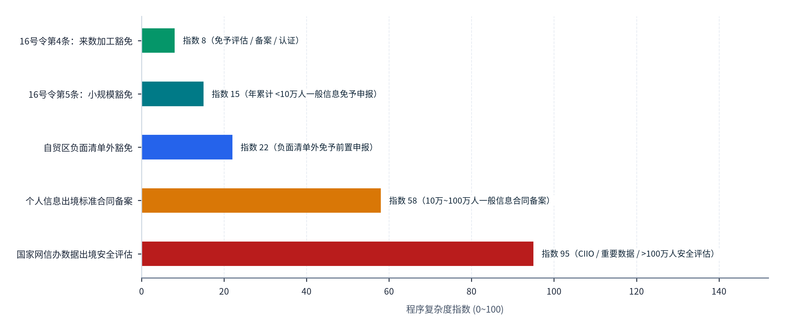
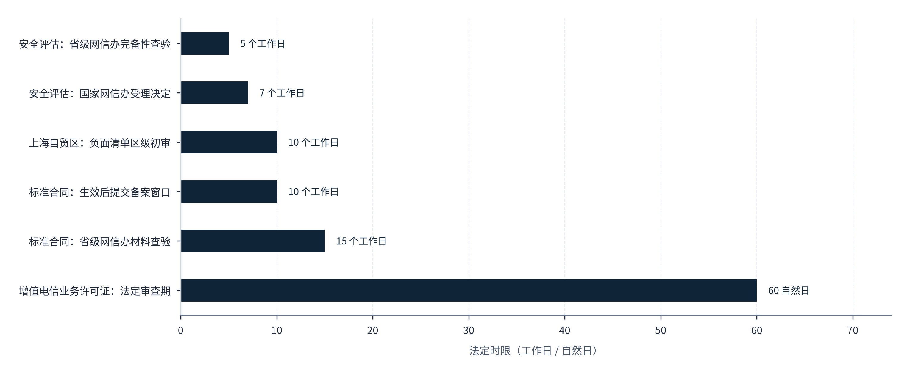
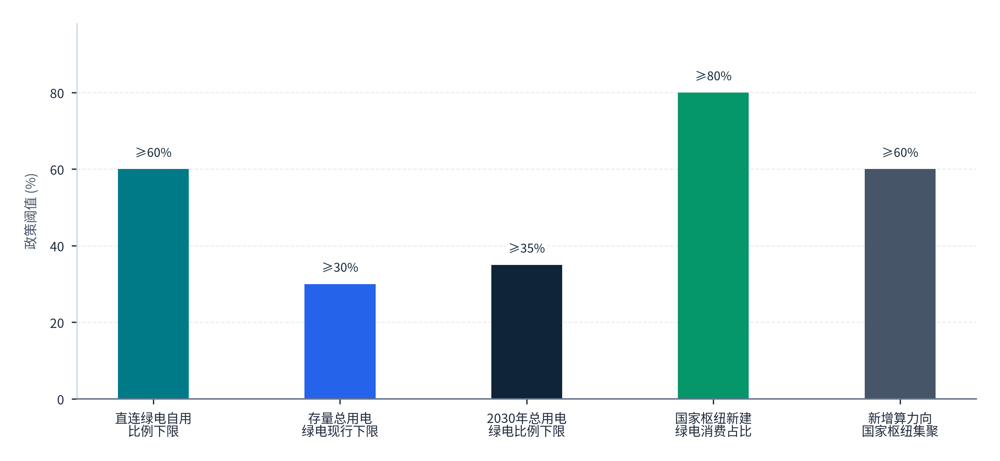
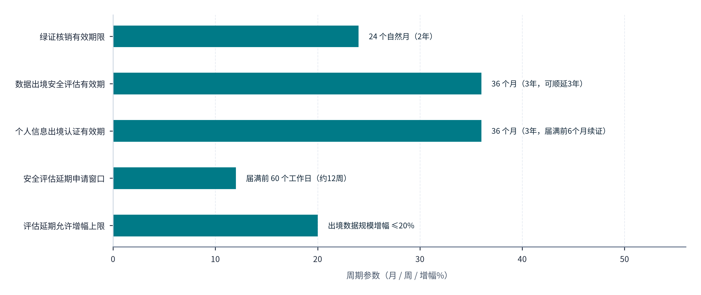

> **导航：** [返回中文手稿总目录](index.md) ｜ [上一章：第6章](chapter-06.md) ｜ [下一章：第8章](chapter-08.md) ｜ [尾注](notes.md) ｜ [参考文献](references.md)

---
> ### 制度环境与合规治理
> 算力与Token的跨国流动不仅是一场光电与工程效率的竞赛，更是一场横跨电信监管、数据跨境、自贸区负面清单、绿电溯源与跨境税汇结算的制度协同检验。本篇（第7章至第8章）系统拆解中国境内准入与试点制度以及全球十二大目标法域的数据安全与知识产权规则，为企业划定清晰、可操作的合规航道。
---

**CHAPTER 07 · 第七章**

# 中国的政策方向、准入制度与试点安排

*中国已围绕数字贸易改革、全国一体化算力网、算电双向协同及数据跨境流动构建起多层次制度框架。本章穿透中央顶层文件与部委现行规章，厘清国际通信出入口局、增值电信许可（B11/B13）、境外数据入境加工豁免（网信办16号令第4条）、自贸区负面清单、来数加工试点以及2026年跨境服务增值税零税率与多用户绿电直连的精确适用条件。*

## 7.1 国家战略与政策体系

理解中国Token出海的制度环境，首先需要将分散在商务、发改、能源、工信、网信及数据管理部门的政策文件还原为一个有机咬合的国家战略体系。尽管截至2026年10月，中央宏观统计尚未专门为“大模型Token跨境调用”单列独立的海关或外汇统计代码，但围绕**数字贸易改革创新、全国一体化算力网建设以及人工智能与能源双向协同**的三大顶层设计，已经为“境内绿色电力转化为跨境数字服务出口”确立了明确的战略合法性与量化考核牵引。

### 7.1.1 数字贸易顶层设计与可数字化交付服务比重硬约束

中共中央办公厅、国务院办公厅印发的《关于数字贸易改革创新发展的意见》（落款日期2024年8月17日，新华社于2024年11月28日公开发布）是统领中国数字技术与算力服务出海的纲领性文件[90](references.md#ref-90)。该意见在第二部分“促进数字贸易改革创新发展”及第四部分“完善数字贸易治理体系”中，明确将**云外包、平台分包、数字技术贸易、数字基础设施互联互通、数字信任体系及知识产权保护**纳入国家鼓励发展的核心交付模式[90](references.md#ref-90)。在总体量化目标上，该意见设定了清晰的国家级时间表：到 **2029年**，中国可数字化交付的服务贸易规模占我国服务贸易总额的比重需提升至 **45%以上**；到 **2035年**，该比重需进一步达到 **50%以上**[90](references.md#ref-90)。由于大模型API调用、跨境模型微调与云端推理在统计属性上完全归属于可数字化交付的电信、计算机和信息服务贸易，这一硬性比重目标直接构成了各沿海门户省市与自贸试验区积极争取“来数加工”与“词元工厂”试点的顶层政绩驱动力。

### 7.1.2 全国一体化算力网与2026年“人工智能+能源”算电协同新政

在供给侧基础设施与能源协同维度，两份国家级部委联合文件界定了算力底座的空间布局与绿色调度准则：

- **全国一体化算力网的枢纽集聚与绿电红线**：国家发展改革委、国家数据局等五部门联合印发的《关于深入实施“东数西算”工程加快构建全国一体化算力网的实施意见》（发改数据〔2023〕1779号）确立了国家算力资源的空间配置原则，明确提出到2025年底，**全国新增算力在国家枢纽节点集聚的占比需达到60%以上**，且<strong>国家枢纽节点新建数据中心的绿电占比需超过80%</strong>[90](references.md#ref-90)。同时，文件要求国家枢纽节点以外地区原则上不再新建大型及超大型数据中心，从源头上引导高能耗智算集群向西部风光水富集区集中[90](references.md#ref-90)。
- **2026年人工智能与能源算电协同行动方案**：2026年4月8日落款、5月8日由国家能源局公开发布的《国家发展改革委 国家能源局 工业和信息化部 国家数据局关于促进人工智能与能源双向赋能的行动方案》（国能发科技〔2026〕34号），首次在国家部委层面将“电价信号驱动的计算任务弹性调度”制度化[90](references.md#ref-90)。该方案第一部分及第二部分第（六）至（九）条明确要求：算力基础设施布局必须严密结合区域资源环境与水资源承载能力；按照计算负荷的可调节能力（实时刚性负载与可延期弹性负载）实行分类建设与分级管理；**引导算力中心根据分时与现货电价信号跨时段、跨区域弹性调度计算任务**，并支持智算中心与新能源发电企业探索签订<strong>多年期绿色电力购买协议（PPA）</strong>以及开展绿电直连直供试点[90](references.md#ref-90)。

综合中共中央办公厅、国务院办公厅及国家发展改革委、国家能源局、国家数据局、工业和信息化部于2024至2026年间出台的纲领性文件，**图表 7.1**按“政策支柱与核心文件”“发文机关与文号/时点”“核心制度安排与量化目标”“对Token出海的直接支撑作用”与“合规适用边界与取证要求”五个维度，梳理了四大国家政策支柱的量化考核指标与适用条件：

#### 图表 7.1：中国支撑Token出海的四大国家政策支柱、主管机关、核心量化目标与适用边界一览表

| 政策支柱与核心文件 | 发文机关与文号/时点 | 核心制度安排与量化目标 | 对Token出海的直接支撑作用 | 合规适用边界与取证要求 |
| --- | --- | --- | --- | --- |
| **1. 数字贸易改革创新顶层设计** | 中办、国办（2024年8月落款，11月发布）[90](references.md#ref-90) | 可数字化交付服务贸易占比：<strong>2029年≥45%</strong>，<strong>2035年≥50%</strong>；发展云外包与平台分包 | 确立跨境云推理、API服务外包作为数字贸易新业态的战略地位 | 宏观占比目标不等于自动减免个案通信或数据审批；需按具体合同核定 |
| **2. 全国一体化算力网工程** | 国家发改委等五部门（发改数据〔2023〕1779号）[90](references.md#ref-90) | 新增算力在国家枢纽集聚 <strong>≥60%</strong>；枢纽新建数据中心绿电占比 <strong>>80%</strong> | 锁定国家算力枢纽（重点为西部枢纽）的低成本绿电供给，限制非枢纽地区盲目新建大型中心 | 国内枢纽间时延与绿电目标属于境内建设考核，跨国链路SLA与国际碳足迹需另行核证 |
| **3. 人工智能与能源双向协同** | 发改委、能源局、工信部、数据局（国能发科技〔2026〕34号，2026.04）[90](references.md#ref-90) | 按负荷可调节能力分类建设；**按电价信号弹性调度计算任务**；探索多年期绿电协议 | 为“光伏谷段批量推理+绿电直连降本”提供国家级能源政策背书 | 具体项目接电容量、专线过网费与绿电结算仍需取得省级能源部门批复 |
| **4. 数据跨境流动与海陆出入口扩容** | 国家网信办（令第16号，2024.03）及工信部四城出入口局批复（2024.07）[90](references.md#ref-90) | 境外个人信息入境加工后复出境免予三项前置程序；南宁/青岛/昆明/海口增设全业务出入口 | 打通“来数加工”制度豁免通道与面向东盟、日韩及自贸港的低时延物理直连 | 必须严守“不混入境内个人信息或重要数据”红线，并经批准出入口局承载 |

> **表格结构化数据文件：** [`data/exhibits/exhibit-7-1.csv`](../../data/exhibits/exhibit-7-1.csv)
> **表注与来源：** 资料来源：中办国办《关于数字贸易改革创新发展的意见》、国家发改委（发改数据〔2023〕1779号）、国家能源局等四部门（国能发科技〔2026〕34号）、国家网信办令第16号[90](references.md#ref-90)；介子九维（JIEZIJIUWEI）研究整理。

对照**图表 7.1**所列的四大国家政策支柱可见，“1. 数字贸易改革创新顶层设计”设定了可数字化交付服务贸易占比2029年达到45%以上、2035年达到50%以上的硬指标；“2. 全国一体化算力网工程”要求新增算力在国家枢纽集聚不低于60%且新建数据中心绿电占比超过80%；“3. 人工智能与能源双向协同”支持按电价信号弹性调度计算任务与多年期绿电协议；“4. 数据跨境流动与海陆出入口扩容”则打通了境外数据入境加工复出境免予三项前置程序与四城全业务出入口。这四项制度共同确立了将境内绿电就地转化为跨境数字服务出口的政策框架，但表中“合规适用边界与取证要求”一栏也明确提醒，宏观战略目标不能替代个案的通信出入口承载与数据隔离核查。

## 7.2 通信与计算服务的经营安排

在中国境内组织算力集群并向境外客户提供Token推理服务，一条完整的商业交付链条往往横跨“国际通信物理承载”、“数据中心机架与云资源协作”以及“上层大模型算法服务”三个不同层级的法律关系。企业若混淆了“租用国际专线办公自用”与“利用国际专线向第三方转售电信业务”的界限，或错配了电信增值许可证类别，将面临严厉的行政合规风险。

### 7.2.1 国际通信出入口局专营原则与跨境专线自用边界

在底层跨国物理网络承载上，现行有效的《国际通信出入口局管理办法》（信息产业部令第22号，2002年10月1日施行，截至2026年10月仍为工信部现行规章）与工信部2017年专线监管答疑确立了三条刚性红线[90](references.md#ref-90)：

1. **出入口局设置主体的国有独资专营性**：管理办法第五条及第六条明确规定，申请设置并经营国际通信出入口局的主体**限于国有独资的电信业务经营者**（即中国电信、中国移动、中国联通三大基础电信运营商）；任何组织或个人在中国境内开展国际通信业务（含港澳台通信业务参照管理），必须通过经主管部门批准设置的国际通信出入口局进行转接，不得私自架设跨境信道或绕开出入口局直连境外网络[90](references.md#ref-90)。
2. **国际专用传输通道的“点对点内部自用”边界**：管理办法第十九条规定，用户租用国际通信传输信道专线的，仅限于在批准的业务范围内进行**点对点通信和内部使用，不得用于经营电信业务**[90](references.md#ref-90)。工业和信息化部在《关于清理规范互联网网络接入服务市场的通知》答记者问中进一步厘清了执法边界：监管清理的对象是“无国际通信业务经营资质的企业或个人，租用国际专线或VPN违规开展跨境电信业务经营（如向第三方转售跨境带宽或违规搭建公共翻墙通道）”；而**外贸企业、跨国企业因内部办公自用需要，向依法设置国际通信出入口局的基础电信运营商租用国际专线或合规跨境SD-WAN，其合法经营活动不受影响**[90](references.md#ref-90)。因此，Token出海企业在采用“海外边缘网关 + 境内计算集群”架构时，必须以合法备案的自用业务传输协议向三大运营商租用IPLC/IEPL或MPLS-VPN电路，避免将底层跨境传输带宽作为独立通信产品向第三方客户拆分转售。

### 7.2.2 增值电信业务分类（B11/B13）、外资开放试点与生成式AI地域适用豁免

在中层算力底座与上层模型服务环节，中国现行监管制度呈现出“基础设施持牌规范、外资试点实质放宽、纯出海模型应用精准豁免”的清晰结构：

- **A11-4、B11、B13与B21许可证的法定门槛与审批时序**：根据《电信业务分类目录（2015年版）》（及2019年6月6日修订公告），国际海陆光缆及出入口局设施服务归入第一类基础电信业务中的 <strong>A11-4类“国际通信设施服务业务”</strong>；提供数据中心机架托管、裸金属租赁及公有云IaaS/PaaS弹性算力服务的，归入第一类增值电信业务中的 <strong>B11类“互联网数据中心业务（IDC，含互联网资源协作服务IRCS）”</strong>；构建境内跨地域虚拟专网连接的，归入 <strong>B13类“国内互联网虚拟专用网业务（IP-VPN）”</strong>；提供批量数据加工与交易撮合的，归入第二类增值电信业务中的 <strong>B21类“在线数据处理与交易处理业务”</strong>[90](references.md#ref-90)。依据《电信业务经营许可管理办法》（工业和信息化部令第42号，2017年9月1日起施行）第六条至第十四条，申请省内增值电信许可证的注册资本最低限额为 **100万元人民币**（由省级通信管理局审批），申请全国或跨省许可证的注册资本最低限额为 **1,000万元人民币**（由工业和信息化部审批）；法定形式审查与决定期限为自收到全部完备申请材料之日起 **60日**（专家评审时间不计入60日内），许可证有效期为 **5年**[90](references.md#ref-90)。
- **四地外商投资增值电信业务取消股比限制试点与全国负面清单的差异**：在全国版外商投资准入特别管理措施（负面清单）下，增值电信业务的外资股比原则上不超过50%（仅电子商务、国内多方通信、存储转发类、呼叫中心除外，故非试点区的B21类业务需严格区分已放开股比的经营类电子商务子项与仍受股比约束的非电子商务在线数据处理子项）。而2024年工业和信息化部发布的《关于开展增值电信业务扩大对外开放试点工作的通告》及配套方案，在**北京市服务业扩大开放综合示范区、上海自由贸易试验区临港新片区及社会主义现代化建设引领区、海南自由贸易港、深圳中国特色社会主义先行示范区**四个区域，正式取消了外商投资企业在互联网数据中心（B11 IDC）、内容分发网络（B12 CDN）、互联网接入服务（B14 ISP）、在线数据处理与交易处理（B21全口径）以及部分信息服务业务（B25）上的<strong>外资股比限制（允许100%外资独资）</strong>[90](references.md#ref-90)。但试点方案同时设定了精准的属地约束：外资试点企业的**注册地与服务设施（机房、服务器）放置地必须位于同一试点区域内**，不得购买或租用试点区外的CDN设施开展加速服务，ISP业务仅限本试点区内并通过基础电信企业设备接入互联网，而IDC与在线数据处理等其他开放业务则可面向全国提供服务[90](references.md#ref-90)。这为跨国云厂商及海外美元基金在京、沪、琼、深投资建设面向全球的“外资词元工厂”打开了制度大门。
- <strong>《生成式人工智能服务管理暂行办法》第二条的“非境内公众”适用边界</strong>：国家网信办等七部门联合发布的《生成式人工智能服务管理暂行办法》（2023年8月15日起施行）第二条明确规定：“利用生成式人工智能技术**向中华人民共和国境内公众提供生成文本、图片、音频、视频等内容的服务**，适用本办法”；同时规定，行业组织、企业、教育和科研机构等研发、应用生成式人工智能技术，**未向境内公众提供服务的，不适用本办法的规定**[90](references.md#ref-90)。这一条款是Token出海业务极具价值的制度支点：当境内智算中心或模型企业仅通过受控B2B通道向境外企业客户或纯海外终端提供推理服务（且在网络路由与客户注册认证上严格屏蔽中国境内公众访问）时，无需按境内面向公众上线App的标准重复履行境内公众舆论属性评估与双备案程序，但仍须全面遵守数据安全法、个人信息保护法、电信管理及技术出口管制等底线义务[90](references.md#ref-90)。

围绕从跨国物理光缆到生成式AI模型API服务的五个业务环节，**图表 7.2**按“业务活动环节”“对应法定许可/制度类别”“审批机关与法定门槛”“外资准入与四地试点规则”及“Token出海项目的合规操作要点”五列，梳理了各项资质的审批权限与外资开放条件：

#### 图表 7.2：Token出海全业务链条的电信与AI监管许可证映射、审批机关及外资试点条件表

| 业务活动环节 | 对应法定许可/制度类别 | 审批机关与法定门槛 | 外资准入与四地试点规则 | Token出海项目的合规操作要点 |
| --- | --- | --- | --- | --- |
| **1. 跨国物理光缆与出入口局转接** | 第一类基础电信业务 <strong>A11-4（国际通信设施服务业务）</strong>与国际通信出入口局设置（信息产业部令第22号）[90](references.md#ref-90) | 工业和信息化部审批；出入口局设置**限国有独资基础电信企业**申请 | 外资及民营企业不得私设国际信道出入口，须租用三大运营商合规电路 | 必须由三大运营商出入口局承载；租用IPLC/IEPL限于企业点对点内部自用，禁作带宽转售[90](references.md#ref-90) |
| **2. 智算机房托管与弹性云资源协作** | 第一类增值电信业务 <strong>B11（IDC及互联网资源协作IRCS）</strong>[90](references.md#ref-90) | 跨省由工信部审批（注册资本≥1,000万）；省内由通管局审批（≥100万）；审查期60日，有效期5年[90](references.md#ref-90) | 北京、上海临港/浦东、海南、深圳四地试点<strong>取消外资股比限制（可100%独资）</strong>；注册地与设施须同区[90](references.md#ref-90) | 自建机房或提供容器/GPU云平台须持有含IRCS子项的B11牌照；纯购买算力自用研发无需持牌 |
| **3. 境内跨枢纽专网互联与组网** | 第一类增值电信业务 <strong>B13（国内互联网虚拟专用网IP-VPN）</strong>[90](references.md#ref-90) | 同上（跨省≥1,000万人民币，工信部审批） | 按CEPA及外商投资电信企业规定或试点目录执行 | “东数西算”跨省拉通沿海PoP与西部智算中心时，应确认承载方的跨省B13与骨干网资质 |
| **4. 在线数据处理与批量Token工厂** | 第二类增值电信业务 <strong>B21（在线数据处理与交易处理）</strong> | 省级通管局或工信部备案/许可（省内≥100万，跨省≥1,000万） | 北京、上海临港/浦东、海南、深圳四地试点<strong>取消全口径B21外资股比限制（可100%独资）</strong>；非试点区按全国负面清单区分电子商务与非电子商务子项[90](references.md#ref-90) | 适合作为跨境“来数加工”与Batch批量数据处理平台的经营范围基础资质 |
| **5. 生成式AI模型API与推理服务** | 《生成式人工智能服务管理暂行办法》（2023年8月施行）[90](references.md#ref-90) | 向**境内公众**提供服务需履行安全评估与大模型备案（网信部门主管） | 外资模型在境内向公众服务同等适用；纯海外服务按第二条界定 | 依据第二条，**未向中国境内公众提供服务的研发与应用不适用该办法**；须做好境内外网络与主体隔离[90](references.md#ref-90) |

> **表格结构化数据文件：** [`data/exhibits/exhibit-7-2.csv`](../../data/exhibits/exhibit-7-2.csv)
> **表注与来源：** 资料来源：《国际通信出入口局管理办法》（部令第22号）、《电信业务分类目录（2015年版/2019年修订）》、《电信业务经营许可管理办法》（工信部令第42号）、工信部2024增值电信扩大开放试点方案、《生成式人工智能服务管理暂行办法》[90](references.md#ref-90)；介子九维（JIEZIJIUWEI）研究整理。

对照**图表 7.2**所列的五个业务活动环节可见，“1. 跨国物理光缆与出入口局转接（A11-4）”严格限国有独资基础电信企业设置出入口局，民营与外资企业租用IPLC/IEPL限于点对点内部自用；“2. 智算机房托管与弹性云资源协作（B11）”与“4. 在线数据处理与批量Token工厂（B21）”在北京、上海临港/浦东、海南、深圳四地试点均已允许100%外资独资（跨省注册资本门槛1,000万元、省内100万元，审查期60日）；而“5. 生成式AI模型API与推理服务”依据暂行办法第二条，未向中国境内公众提供服务的不适用境内上线双备案规定。企业在设计出海架构时，只要将底层运营商合规专线与顶层纯境外API服务清晰分层，即可避免无证经营电信业务或违规跨境传输的合规风险。

## 7.3 数据进入、境内处理与结果交付

在“前店后厂”与“来数加工”模式中，海外客户的Prompt指令、业务文档、音视频流从境外流入中国境内智算中心完成推理计算，生成的Token流与结果文件再回传至境外。如果每一次推理返回都被机械地视为“中国境内数据出境”并触发漫长的安全评估，跨境实时推理将根本无法开展。国家互联网信息办公室于2024年3月22日公布并同日施行的《促进和规范数据跨境流动规定》（国家网信办令第16号），以极具针对性的制度创新彻底解开了这一核心死结[90](references.md#ref-90)。

### 7.3.1 网信办16号令第四条：“两头在外、不混境内数据”的适用豁免法则

《促进和规范数据跨境流动规定》第四条明确规定：“<strong>数据处理者在境外收集和产生的个人信息传输至境内处理后向境外提供，处理过程中没有引入境内个人信息或者重要数据的，免予申报数据出境安全评估、订立个人信息出境标准合同、通过个人信息保护认证。</strong>”同时，第三条规定，国际贸易、跨境运输、学术合作、跨国生产制造和市场营销等活动中收集和产生的数据向境外提供，不包含个人信息或者重要数据的，同样免予上述三项前置出境程序[90](references.md#ref-90)。

这一条款构成了中国Token出海与“来数加工”最重要的上位法基石。但企业在工程落地时，必须严密把控第四条豁免得以成立的**三项刚性前提与伴随义务**：

- <strong>数据血缘的纯洁性（不混入境内数据）</strong>：豁免的绝对前提是“处理过程中没有引入境内个人信息或者重要数据”[90](references.md#ref-90)。因此，当境内GPU集群为海外客户执行RAG检索增强生成、模型微调（Fine-tuning）或Agent工具调用时，其挂载的向量知识库、外部搜索源及基础训练语料池必须与包含中国境内公民个人信息或境内测绘、基因、政务等重要数据的存储库实行**物理隔离或强逻辑隔离**。一旦推理输出中混入了境内个人信息或重要数据，第四条豁免即告失效，必须按常规出境程序申报。
- **非关键信息基础设施运营者（非CIIO）的阶梯数量门槛**：对于不满足第四条纯境外数据条件、确实涉及境内个人信息出境的业务，网信办16号令第七条与第八条确立了按自然年（自当年1月1日起累计）核算的阶梯管理机制[90](references.md#ref-90), [x](notes.md#note-x)：累计向境外提供**不满10万人**非敏感个人信息（且不含重要数据）的，免予三项程序；累计提供**10万人以上、不满100万人**非敏感个人信息或者**不满1万人**敏感个人信息的，依法订立个人信息出境标准合同或通过个人信息保护认证；累计提供**100万人以上**非敏感个人信息、**1万人以上**敏感个人信息或向境外提供**重要数据**的，必须向国家网信办申报数据出境安全评估[90](references.md#ref-90), [x](notes.md#note-x)。
- **程序豁免不等于实体保护义务豁免**：根据网信办16号令第十条、第十一条及国家网信办2026年7月24日发布的《数据出境安全管理政策问答》，即便适用免予安全评估、标准合同或认证的豁免情形，数据处理者仍须依法履行**告知义务、取得个人单独同意（符合《个人信息保护法》第十三条第一款第二至七项法定免同意情形的如履行合同所必需，可不取得同意，但仍须履行告知义务）、开展事前个人信息保护影响评估（PIA），并将影响评估报告和处理情况记录至少保存3年**[90](references.md#ref-90)。此外，依据2025年1月1日起施行的《网络数据安全管理条例》第十二条，通过合同约定委托处理个人信息及重要数据的记录同样须至少保存3年（该3年留存要求针对“处理情况合规记录”，而非强制要求企业将海外客户的原始Prompt明文存储3年）[90](references.md#ref-90)。

### 7.3.2 2025至2026年安全评估、标准合同与出境认证的办理时限与衔接

针对确需履行数据出境程序的混合型业务，国家网信办在2025年至2026年期间通过修订申报指南与发布认证办法，大幅提升了审批透明度与可预期性[90](references.md#ref-90)：

- <strong>数据出境安全评估（2025第三版指南）</strong>：原则上通过线上申报系统提交；省级网信办在收到材料之日起 **5个工作日内** 完成完备性查验，国家网信办在收到省级转交材料之日起 **7个工作日内** 作出是否受理决定[90](references.md#ref-90)。评估结果有效期为 **3年**；有效期届满需继续开展活动的，可在届满前 **60个工作日内** 申请延长3年。第三版指南首次明确了延期申请的量化红线：若目的、范围、接收方等未变且过去三年未发生重大数据安全事件，且<strong>预计未来三年向境外提供个人信息的人数增幅或重要数据规模增幅不超过原准予出境数量的20%</strong>，即可走简化延期通道（省级查验5个工作日 + 国家审核20个工作日）[90](references.md#ref-90)。
- <strong>个人信息出境标准合同备案（第二版指南）</strong>：处理者应当在标准合同生效之日起 **10个工作日内** 向所在地省级网信办备案，所附个人信息保护影响评估报告必须是在备案之日前 **3个月内** 完成且未发生重大变化；省级网信办在 **15个工作日内** 完成材料查验（需补正的应在10个工作日内提交）[90](references.md#ref-90)。
- **2026年个人信息出境认证新规与自愿认证衔接**：2026年1月1日起施行的《个人信息出境认证办法》明确，符合10万至100万非敏感个人信息（或不满1万敏感个人信息）区间的非CIIO处理者可申请认证，认证证书有效期为 **3年**（届满前6个月申请续证）[90](references.md#ref-90)。国家网信办在2026年9月11日的政策答疑中进一步明确：不涉及重要数据的处理者可**自愿申请认证**以向海外客户证明其达到数据保护标准；若业务规模达到安全评估门槛仍须依法申报评估，但已取得的认证结果可作为安全评估申报的合规参考材料[90](references.md#ref-90)。

为量化对比《促进和规范数据跨境流动规定》（国家网信办令第16号）下不同合规路径的办理效率，**图表 7.3**对“路径1：网信办16号令第4条 (境外数据入境加工复出境)”“路径2：非CIIO <10万人普通个人信息 (第5/7条)”“路径3：自贸区负面清单外 (上海2026全域/海南5行业)”与“路径4：10万~100万人或安全评估 (第7/8条)”四类路径的“前置行政审批耗时 (工作日)”与“综合合规便利度评分 (0-100)”进行了并列对比：

#### 图表 7.3：中国数据跨境流动五类制度通道与合规程序复杂度指数对比

> **图像文件：** [`figures/chart_7_3.png`](../../figures/chart_7_3.png)（高清位图）｜ [`figures/chart_7_3.svg`](../../figures/chart_7_3.svg)（矢量图）
> **图注与来源：** 来源：国家网信办令第16号《促进和规范数据跨境流动规定》第3至8条及上海、海南自贸区数据出境负面清单（2025至2026年）；介子九维（JIEZIJIUWEI）研究绘制[8](references.md#ref-8), [9](references.md#ref-9)。

对照**图表 7.3**中的两组量化序列可见，“路径1：网信办16号令第4条 (境外数据入境加工复出境)”的前置行政审批耗时为0个工作日，综合合规便利度评分达96分；“路径2：非CIIO <10万人普通个人信息 (第5/7条)”的前置审批耗时同样为0个工作日，便利度评分为90分；“路径3：自贸区负面清单外 (上海2026全域/海南5行业)”仅需10个工作日完成区级初审备案，便利度评分为85分；而触发标准合同备案或安全评估的“路径4：10万~100万人或安全评估 (第7/8条)”，其前置审批耗时延长至45个工作日，便利度评分降至45分。这一数据对比表明，在工程架构上严守“境外数据入境加工、不混入境内个人信息或重要数据”的纯洁性边界，从而适用路径1的零工作日豁免通道，是保障跨洋实时推理业务敏捷上线的核心制度前提。

在数据跨境通道之外，**图表 7.4**进一步对比了“北京服务业扩大开放示范区”“上海临港新片区及浦东引领区”“海南自由贸易港全域”与“深圳先行示范区”四大试点区域的“外资可持股比例上限 (%)”与“试点综合开放成熟度评分”：

#### 图表 7.4：电信业务准入与数据出境核心审查环节法定时限对比

> **图像文件：** [`figures/chart_7_3b.png`](../../figures/chart_7_3b.png)（高清位图）｜ [`figures/chart_7_3b.svg`](../../figures/chart_7_3b.svg)（矢量图）
> **图注与来源：** 来源：《中华人民共和国电信条例》、国家网信办数据出境安全评估与标准合同备案指南、上海自贸区管理办法；介子九维（JIEZIJIUWEI）整理绘制[8](references.md#ref-8), [9](references.md#ref-9), [90](references.md#ref-90)。

由**图表 7.4**可见，北京服务业扩大开放示范区、上海临港新片区及浦东引领区、海南自由贸易港全域、深圳先行示范区四大试点区域的“外资可持股比例上限 (%)”已全部放宽至100%，彻底打破了以往增值电信业务外资股比不超过50%的限制；在“试点综合开放成熟度评分”上，上海临港新片区及浦东引领区以96分居首，北京服务业扩大开放示范区与深圳先行示范区同为95分，海南自由贸易港全域为94分。四大试点100%外资独资政策的落地，为跨国云厂商及海外投资机构在中国境内独资设立并运营面向全球的智算推理中心（B11）与在线数据处理平台（B21）扫清了股权准入障碍[8](references.md#ref-8), [9](references.md#ref-9), [90](references.md#ref-90)。

## 7.4 自贸试验区、自由贸易港及地方试点

在国家统一制度之上，《促进和规范数据跨境流动规定》第六条赋予了自由贸易试验区一项极具含金量的制度创新权：自贸试验区可在国家数据分类分级保护制度框架下，自行制定区内需要纳入数据出境安全评估、标准合同、认证管理的<strong>数据清单（简称“负面清单”）</strong>，经省级网信委批准并报国家网信部门、国家数据管理部门备案后实施；**在已制定负面清单涵盖的行业与场景内，负面清单以外的数据出境可以免予申报数据出境安全评估、订立标准合同、通过保护认证**（但列入负面清单内的数据、负面清单尚未覆盖行业领域的数据以及国家有关部门依法公开发布或告知为重要数据的，仍须严格按国家通行规定履行安全评估或相应出境程序）[90](references.md#ref-90)。截至2026年10月，上海、海南、北京等地已相继发布负面清单，广东汕头华侨试验区则走出了一条特色鲜明的“来数加工”产业试点路径。

### 7.4.1 上海自贸区负面清单（2026年印发版）与海南自贸港清单的差异化设计

通过对地方政府公开原文与操作指南的比对，可以清晰识别不同自贸区在试点适用边界上的关键制度设计：

- **上海自贸试验区负面清单的“全市域拓展”与备案闭环**：上海市于2026年4月24日落款印发（松江区政府等页面于2026年4月27日公开）的《中国（上海）自由贸易试验区及临港新片区数据出境管理清单（负面清单）（2025版）》配套管理办法及操作指南，展现了一项重大的地域突破：其适用地域被明确界定为 <strong>“上海市全域”</strong>，只要是<strong>在上海市依法注册且在上海市开展数据出境活动的非关键信息基础设施运营者（非CIIO）</strong>，均可适用该负面清单政策[90](references.md#ref-90)。在操作流程上，企业向所在区提交负面清单适用备案材料，**区级初审时限为10个工作日内**（材料补正限10个工作日内，备案内容变更须在15个工作日内重新办理）；按备案结果仍需办理评估、合同或认证的企业须在收到通知起 **3个月内** 向所在区报告合规进展，且所有使用负面清单的企业须于每年年底前提交年度数据出境报告[90](references.md#ref-90)。对于负面清单未覆盖的行业领域，仍按国家通行规定执行。
- **海南自由贸易港负面清单的垂直行业深耕**：海南省于2025年2月正式公布实施的《中国（海南）自由贸易港数据出境管理清单（负面清单）》，则紧密围绕自贸港特色产业，率先对**深海、航天、种业、旅游、免税商品零售业务**五大领域进行了精细的数据分层，逐一列明了各行业触发安全评估与标准合同的具体业务场景、数据子类及数量门槛，为跨国文旅、跨境零售与海洋科研数据的合规流动提供了确定性标尺[90](references.md#ref-90)。

### 7.4.2 三大试点区域制度对照与“来数加工”业务合规边界

依托国家赋予自由贸易试验区与自由贸易港的制度创新空间，**图表 7.5**按“试点地区与核心政策”“生效/印发时点”“适用主体与地域范围”“核心便利化机制与办理时限”与“法定限制边界与事后监管要求”五个维度，对比了上海自贸区、海南自贸港与广东汕头华侨试验区的跨境数据及来数加工试点规则：

#### 图表 7.5：上海自贸区、海南自贸港与广东汕头华侨试验区跨境数据及来数加工试点制度对照表

| 试点地区与核心政策 | 生效/印发时点 | 适用主体与地域范围 | 核心便利化机制与办理时限 | 法定限制边界与事后监管要求 |
| --- | --- | --- | --- | --- |
| <strong>1. 上海自贸区及临港新片区数据出境负面清单（2025版）</strong> | 2026年4月24日通知印发（2026.04.27公开）[90](references.md#ref-90) | **上海市全域**：在上海市注册且在上海市开展数据出境活动的非CIIO主体[90](references.md#ref-90) | 清单外数据免予三项程序；区级初审 **10个工作日**，补正 **10个工作日**，变更 **15个工作日**[90](references.md#ref-90) | 排除CIIO；未列行业按国家通行规定；涉及出口管制技术按专门法办理；需交3个月合规报告及年底年报[90](references.md#ref-90) |
| <strong>2. 中国（海南）自由贸易港数据出境管理清单（负面清单）</strong> | 2025年2月正式公布实施[90](references.md#ref-90) | 海南自由贸易港内符合行业目录条件的数据处理者 | 聚焦**深海、航天、种业、旅游、免税零售**五大特色行业划定豁免与备案阈值[90](references.md#ref-90) | 严格限定在五大列明行业及对应业务场景内，不可跨行业外推至通用金融或政务数据 |
| **3. 广东汕头华侨试验区“来数加工”与词元工厂试点** | 激励措施有效期：**2025-11-01至2027-10-31**[90](references.md#ref-90) | 在汕头华侨试验区直管区依法注册纳税、合法开展来数加工业务的法人及科技团队（≥3人）[90](references.md#ref-90) | 依托汕头国际海缆登陆站发展来数加工与1号词元工厂；设年度科技团队奖：**一等奖100万（1名）、二等奖30万（3名）、三等奖10万**[90](references.md#ref-90) | 奖金资格不等于跨境电信或数据出境许可；涉及数据出境仍须满足网信办16号令第4条或完成相应评估[90](references.md#ref-90) |

> **表格结构化数据文件：** [`data/exhibits/exhibit-7-5.csv`](../../data/exhibits/exhibit-7-5.csv)
> **表注与来源：** 资料来源：上海市数据出境负面清单管理办法与操作指南（2026年4月版）、《中国（海南）自由贸易港数据出境管理清单（负面清单）》（2025年2月正式公布）、汕头华侨经济文化合作试验区来数加工科技团队激励措施（2025年11月施行）及国家数据局2026年8月数博会动态[90](references.md#ref-90)；介子九维（JIEZIJIUWEI）研究整理。

对照**图表 7.5**中三大试点的制度要素可见，“1. 上海自贸区及临港新片区数据出境负面清单（2025版）”已于2026年4月拓展至上海市全域非CIIO主体，区级初审仅需10个工作日；“2. 中国（海南）自由贸易港数据出境管理清单（负面清单）”聚焦深海、航天、种业、旅游、免税零售五大特色行业划定豁免门槛；“3. 广东汕头华侨试验区‘来数加工’与词元工厂试点”则在2025年11月至2027年10月期间提供最高100万元的科技团队奖励并依托海缆登陆站承载1号词元工厂。企业在选择落地试点时，需严格对照表中“法定限制边界与事后监管要求”一栏，确保行业属性与数据来源符合各试点的限定范围。

> ### 【专题专栏】专栏 7.1 试点实证剖析：汕头华侨试验区“来数加工”的政策边界与业务分层
>
> 专栏 7.1 试点实证剖析：汕头华侨试验区“来数加工”的政策边界与业务分层
>
> 广东汕头凭借中国东南沿海核心国际海底光缆登陆站与区域性国际通信业务出入口局的物理耦合优势，成为全国探索“来数加工（Inbound Data Processing）”与“Token出海”的标杆试验田。2026年8月，国家数据局在地方工作动态中专门介绍了汕头依托华侨试验区来数加工试点及海缆登陆站打造的“Token工厂”与国际数字服务平台[90](references.md#ref-90)。
>
> 在审视此类地方试点时，专业研究与投资决策必须坚持严格的**实证评估原则**：第一，**区分财政奖励资格与法定准入许可**。汕头华侨试验区印发的《鼓励“来数加工”产业科技团队创新创业激励措施》（有效期自2025年11月1日至2027年10月31日，政策表述目标为三年拟提供总额1,000万元资金、带动产业规模突破200亿元）设立了最高100万元的年度团队奖项（需经指南发布、案例与财务合规提交、书面评审、现场答辩及7个工作日公示），但该文件属于产业人才激励措施，**并不替代工信部国际专线承载规则或网信办数据出境合规义务**[90](references.md#ref-90)。第二，**坚持以网信办16号令第四条固化业务底座**。汕头来数加工项目之所以能够合规高效运转，其底层法律支柱正是严格确保输入的海外漫剧、跨境电商与智能硬件语料均源于境外收集，且在境内智算集群（如天亿马1号词元工厂）推理过程中完全不混入境内个人信息或重要数据，从而合法适用免予安全评估的程序豁免[75](references.md#ref-75), [90](references.md#ref-90)。

## 7.5 能源、建设、贸易与结算配套

当一家算力或大模型企业跨越了电信准入与数据合规门槛，准备将智算集群投入商业化运营并向海外客户收取美元费用时，还将面临四个决定项目净现金流与国际客户认可度的关键配套环节：**项目节能与碳排放审查、绿色电力直连与绿证核销、跨境服务增值税零税率/免税退税以及经常项目服务贸易外汇结算**。2025年底至2026年上半年，上述四大领域均出台了重磅新规。

### 7.5.1 项目节能碳评新规、2025绿证细则与2026多用户绿电直连机制

在能源与绿色属性核定侧，最新施行的三项国家制度构成了严密的计量闭环：

1. <strong>固定资产投资节能审查与碳排放评价（国家发展和改革委员会令第31号，2025年9月施行）</strong>：依据国家发展改革委发布的《固定资产投资项目节能审查和碳排放评价办法》（国家发展和改革委员会令第31号，2025年7月17日公布，2025年9月1日起施行）第三条、第八条及第十条，新建或扩建智算中心必须在**开工建设前**取得节能审查意见，并将碳排放评价同步纳入审查范畴[90](references.md#ref-90)。在审批权限切分上，除由国家发展改革委直接审查的重大项目外，**年综合能源消费量达到10,000吨标准煤及以上（或年煤炭消费量10,000吨及以上）的项目一律由省级节能审查机关负责审查**；仅年综合能源消费量不满1,000吨标准煤且年煤炭消费量不满1,000吨的微型项目方可免予单独编制节能报告[90](references.md#ref-90)（注：一座10 MW IT负荷的智算中心年耗电量即超过8,000万千瓦时，折合标准煤逾万吨，必然触发省级及以上严苛审查）。
2. <strong>绿色电力证书（GEC）24个月滚动有效期与核销归属（国能发新能规〔2024〕67号 & 国能发资质规〔2025〕107号）</strong>：根据国家能源局发布的《可再生能源绿色电力证书核发和交易规则》（国能发新能规〔2024〕67号）及《可再生能源绿色电力证书管理实施细则（试行）》（国能发资质规〔2025〕107号，2025年11月28日成文、2026年1月发布）第十五条、第二十条至第二十九条，每 **1,000千瓦时** 可再生能源发电量核发 **1个绿证**（不足1,000千瓦时的当月结转）[90](references.md#ref-90)。国能发资质规〔2025〕107号实施细则对绿证有效期作出了极其严格的计时规定：绿证有效期为 <strong>2年（24个自然月）</strong>，**以电量生产所属自然月记为第0月，至第24个月的最后一个自然日止**（不得从绿证核发日或市场交易日重新起算；2024年1月1日前历史电量对应的绿证统一延至2025年12月31日到期）[90](references.md#ref-90), [x](notes.md#note-x)。同时，自发自用电量对应的绿证不可上市交易（仅可在特定源荷合资或合同能源管理场景下按协议定向划转）；绿电交易中绿证随电量同步划转且**不得再次转售**；企业用于声明绿电消费或抵扣碳足迹时，必须按购买时选定的环境权益归属省份完成<strong>实际唯一核销（Cancellation）</strong>，而非仅凭购电合同意向书宣称“100%绿电”[90](references.md#ref-90), [x](notes.md#note-x)。
3. <strong>从2025单用户到2026多用户绿电直连的制度跨越（发改能源〔2025〕650号 & 发改能源〔2026〕688号）</strong>：为满足大型算力园区直接消纳周边风光基地绿电的需求，国家发展改革委、国家能源局先后于2025年5月和2026年5月印发了《关于有序推动绿电直连发展有关事项的通知》（发改能源〔2025〕650号）与《关于有序推动多用户绿电直连发展有关事项的通知》（发改能源〔2026〕688号）[90](references.md#ref-90), [x](notes.md#note-x)（同时配套《关于完善价格机制促进新能源发电就近消纳的通知》发改价格〔2025〕1192号规范接网容量输配电价与系统运行费机制）。两份绿电直连文件共同确立了刚性的自发自用电量红线：绿电直连项目<strong>自发自用电量占总可用发电量的比例不得低于60%</strong>，且<strong>占用户总用电量的比例不得低于30%（2030年前需进一步提升至不低于35%）</strong>；在余电上网比例上，单用户绿电直连规定上网电量占总可用发电量的比例上限由各省确定（一般<strong>不超过20%</strong>），多用户绿电直连（发改能源〔2026〕688号）则进一步明确上网电量<strong>原则上不超过全部绿电电源年总发电量的20%</strong>[90](references.md#ref-90), [x](notes.md#note-x)。更具突破性的是，**发改能源〔2026〕688号文首次允许新能源电源不直接接入公共电网，而是通过专用线路和专用变电设施同时向园区内多个不同法人实体（不含居民和农业用户）直供绿电**，要求由源荷合资或独立组建的独立法人作为主责单位，按实测计量数据计算各算力租户的绿电溯源结果并经核对后直接推送至国家绿证系统[90](references.md#ref-90)。这彻底解决了算力产业园内多家中小智算企业无法单独投资百兆瓦级风光专线的痛点。

### 7.5.2 2026年跨境服务增值税零税率/免税新政与外汇展业结算规则

在贸易出口退税与跨境资金回流环节，2026年1月1日同步施行的财税与税务总局新规为Token出海企业减轻了显著的税务摩擦成本[90](references.md#ref-90)：

- **2026年出口业务与跨境服务增值税零税率及免税目录**：依据《中华人民共和国增值税法实施条例》第九条、第十七条以及《财政部 税务总局关于出口业务增值税和消费税政策的公告》（财政部 税务总局公告2026年第11号，自2026年1月1日起施行）与《国家税务总局关于发布〈出口业务增值税和消费税退（免）税管理办法〉的公告》（国家税务总局公告2026年第5号，2026年1月1日起施行并废止2014/2015年旧办法）[90](references.md#ref-90)：境内单位向境外单位销售、且**完全在境外消费**（即服务的实际接受方在境外，且与境内的货物、不动产、自然资源无关）的<strong>研发服务、设计服务、软件服务、信息系统服务、业务流程管理服务以及离岸服务外包业务（含ITO基础IT设施与数据中心托管、BPO客户业务数据分析挖掘与专业数据处理、KPO数据挖掘）</strong>，依法适用**增值税零税率或免税政策**[90](references.md#ref-90)。其中，自行研发或直接提供出口服务的企业（或视同生产企业的外贸企业）适用<strong>“免、抵、退”税办法</strong>，这意味境内智算中心采购服务器、电力及专线所负担的巨额增值税进项税额，可通过出口零税率机制获得实质性抵减或退还！在外币销售额折算上，纳税人可选用销售额发生当日或当月1日的人民币汇率中间价，但选定后 **12个月内不得变更**[90](references.md#ref-90)。
- **经常项目服务贸易收付汇的“5万美元”展业分水岭**：根据国家外汇管理局现行有效的《经常项目外汇业务指引（2020年版）》（含2023年修订注释）第四十七条至第五十三条，境内企业收取海外客户的API调用费或算力服务费属于经常项目服务贸易收汇[90](references.md#ref-90)。**单笔等值5万美元（含）以下**的服务贸易收付汇，商业银行原则上可不审核交易单证直接办理（资金性质不明的除外）；**单笔超过等值5万美元**的，银行按“了解客户、了解业务、尽职审查”展业三原则，核对包含交易标的、主体、金额的<strong>正式合同、发票或API系统结算清单（Billing Statement）</strong>，确保合同号、发票号、申报附言与实际收支金额完全闭合[90](references.md#ref-90)。

为精确展示2025至2026年绿电直连新政的电量比例考核要求，**图表 7.6**围绕“自发自用电量占可用发电量下限”“算力用户绿电占总用电量下限 (2026 / 2030)”与“余电上网占总可用发电量上限”三项核心指标，对比了“2025-2026 现行法定红线 (%)”与“2030 远期目标或上限约束 (%)”的数值：

#### 图表 7.6：2025至2030年绿电直连、绿电消费与国家枢纽算力集聚政策量化指标

> **图像文件：** [`figures/chart_7_5.png`](../../figures/chart_7_5.png)（高清位图）｜ [`figures/chart_7_5.svg`](../../figures/chart_7_5.svg)（矢量图）
> **图注与来源：** 来源：国家发展改革委、国家能源局、国家数据局绿电直连与算电协同政策文件（2024至2026年）；介子九维（JIEZIJIUWEI）整理绘制[35](references.md#ref-35), [38](references.md#ref-38), [40](references.md#ref-40)。

对照**图表 7.6**中的三组柱状数值可见，第一项“自发自用电量占可用发电量下限”在2025至2026年现行法定红线与2030远期目标下均为60.0%（以新能源项目总可用发电量为分母）；第二项“算力用户绿电占总用电量下限 (2026 / 2030)”在2025至2026年现行法定红线下为30.0%，到2030远期目标则进一步提高至35.0%（以算力负荷总用电量为分母）；第三项“余电上网占总可用发电量上限”在两个时期均严格控制在20.0%以内（多用户绿电直连按不超过全部绿电电源年总发电量的20%核定）。企业必须注意这三项比例的分母差异，并依托2026年5月多用户绿电直连新政（发改能源〔2026〕688号），以园区合资或独立运营主体统一完成电量计量与绿证划转。

在绿电消费比例指标之外，**图表 7.7**进一步对比了“可再生能源绿证 (GEC) 有效期”“数据出境安全评估结果有效期”“个人信息出境保护认证有效期”与“增值税汇率折算选定锁定期”四项制度安排的“法定有效或锁定期限 (自然月)”：

#### 图表 7.7：中国绿证核销有效期与跨境数据合规资质存续期参数对比

> **图像文件：** [`figures/chart_7_5b.png`](../../figures/chart_7_5b.png)（高清位图）｜ [`figures/chart_7_5b.svg`](../../figures/chart_7_5b.svg)（矢量图）
> **图注与来源：** 来源：国家能源局《可再生能源绿色电力证书核发和交易规则》、国家网信办令第16号；介子九维（JIEZIJIUWEI）整理绘制[8](references.md#ref-8), [35](references.md#ref-35), [90](references.md#ref-90)。

由**图表 7.7**显示的“法定有效或锁定期限 (自然月)”序列可见，“可再生能源绿证 (GEC) 有效期”严格限定为24个月（自电量生产所属自然月起算2年）；“数据出境安全评估结果有效期”与“个人信息出境保护认证有效期”均为36个月（3年，届满前60个工作日或6个月申请顺延）；而跨境应税服务出口中的“增值税汇率折算选定锁定期”则为12个月（选定销售额发生当日或当月1日汇率后1年内不得变更）。由于四项制度的法定周期分别为12个月、24个月与36个月，出海企业在搭建财务与合规管理记录时，必须建立跨年度的到期预警机制，防止因绿证逾期失效或数据出境资质断档而影响跨境服务交付与出口免抵退税申报[8](references.md#ref-8), [10](references.md#ref-10), [35](references.md#ref-35), [90](references.md#ref-90)。

---

> **章节导航：** [上一章：第6章](chapter-06.md) ｜ [返回中文手稿总目录](index.md) ｜ [下一章：第8章](chapter-08.md)
