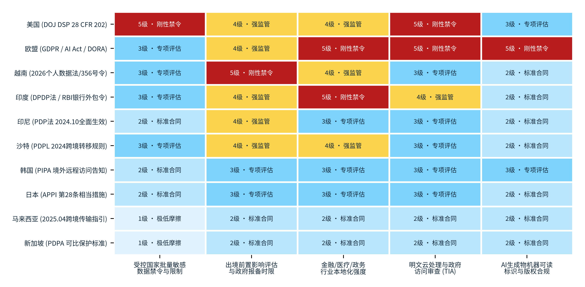

> **导航：** [返回中文手稿总目录](index.md) ｜ [上一章：第7章](chapter-07.md) ｜ [下一章：第9章](chapter-09.md) ｜ [尾注](notes.md) ｜ [参考文献](references.md)

# 境外市场准入、数据安全与权利关系

> **本章导读：** 当中国境内的绿色电力转化为高密度比特流并跨越海陆光缆向全球交付时，决定一笔跨境推理交易能否从“工程连通”走向“商业落地”的第二道制度门槛，是目标市场所在法域的准入规则、跨境数据流动限制、供应链跨法域管制以及模型与成果的知识产权安排。与第 7 章聚焦的中国境内监管（出入口局、来数加工过境豁免、自贸区负面清单与增值税零税率）相对应，本章站在境外客户、目标市场监管机构与跨国法务合规的视角，对欧盟、美国、日本、新加坡、马来西亚、东盟（ASEAN）、沙特阿拉伯、阿联酋、印度尼西亚、越南、印度及中国香港/澳门相关的 12 个核心法域与多边规则体系进行逐条穿透比对。研究发现：全球针对跨境人工智能调用的监管并未采取“一刀切”的全面本地化封锁，整体呈现出<strong>“按数据敏感度分级、按受托处理角色定责、按股权与控制权穿透、按行业外包关键性备案”</strong>的精细化规则结构。唯有准确拆解各法域的法定触发阈值、时间窗口与技术加密边界，并在模型许可与 API 服务协议中完成清晰的权利切割，中国推理服务商才能为海外企业客户构建经得起监管审计的合规契约底座[91](references.md#ref-91), [94](references.md#ref-94), [97](references.md#ref-97)。

## 8.1 目标市场的准入与数据规则

### 8.1.1 欧美监管双极：欧盟“GDPR + AI 法修法 + DORA 金融韧性”三重叠加与美国 DOJ 数据安全计划（DSP）的精准阈值

在发达经济体市场中，欧盟与美国代表了两种截然不同但同样严密的跨境数据与算力调用规制逻辑：欧盟以“基本权利保护与实质等同标准”为核心，构建了横跨通用数据保护、人工智能产品安全与金融行业外包韧性的三维规则网；美国则放弃了联邦层面的大一统隐私立法，转而通过国家安全行政令与司法部专项规章，对涉及特定国家主体的数据经纪、供应商协议及云计算交易实施基于精确数量阈值的靶向限制[91](references.md#ref-91), [92](references.md#ref-92), [94](references.md#ref-94)。

1. <strong>欧盟第一重防线：GDPR 第五章（第 44 至 49 条）第三国传输机制与 2021 版标准合同条款（SCC）四模块映射。</strong>
      凡欧盟或欧洲经济区（EEA）境内的企业客户在调用境外大模型 API 时，若提示词（Prompt）、上下文文档或微调样本中包含受《通用数据保护条例》（GDPR）保护的个人数据，且物理推理节点或运维工程师位于未获欧盟委员会“充分性决定（Adequacy Decision）”的第三国（包括中国境内算力集群，或由第三国团队提供远程明文运维支持的离岸节点），即触发 GDPR 第五章第 44 至 49 条的第三国转移及再转移规则[91](references.md#ref-91)。在缺乏充分性决定的情形下，商业实践中主要依赖 GDPR 第 46 条规定的“适当保障措施（Appropriate Safeguards）”，核心工具为欧盟委员会 2021 年第 2021/914 号决定颁布的新版<strong>标准合同条款（SCC）</strong>。
        
2021 版 SCC 突破了单一静态文本结构，按照数据输出方与输入方的法律角色划分为四个严密模块：<strong>模块一（控制者至控制者，C2C）</strong>、<strong>模块二（控制者至处理者，C2P，适用于欧盟客户直接调用境外模型 API 厂商）</strong>、<strong>模块三（处理者至处理者，P2P，适用于欧盟 SaaS 应用商作为受托处理者，进一步将推理负载分发至境外算力底座或聚合路由网关）</strong>以及<strong>模块四（处理者至控制者，P2C）</strong>[91](references.md#ref-91)。值得高度重视的是，签署 SCC 附件并不意味着中国境内算力处理自动获得合法性豁免：根据 SCC <strong>第 14 条（Clause 14）</strong>与<strong>第 15 条（Clause 15）</strong>，双方在传输前必须完成书面的<strong>转移影响评估（Transfer Impact Assessment, TIA）</strong>，逐项核查目的地法律与司法行政实践对处理者履行合同保障义务的实际影响，并明确约定当第三国公共机关要求访问个人数据时的合法性审查、通知义务及救济程序[91](references.md#ref-91), [93](references.md#ref-93)。
2. <strong>欧盟第二重防线：《欧盟人工智能法》（EU AI Act）第 2(1) 条的“输出物境内使用”域外管辖与 2026 年 7 月修法（Regulation 2026/1744）最新生效时间表。</strong>
      对于纯工业传感器参数、代码片段或已完全脱敏的非个人数据（Non-PII），虽然不触发 GDPR 个人数据跨境限制，但只要属于人工智能系统或通用目的 AI 模型（GPAI）的范畴，仍直接受《欧盟人工智能法》（Regulation (EU) 2024/1689）约束。特别是该法**第 2(1)(a) 与 2(1)(c) 条**确立了穿透性的“结果地管辖原则”：不仅向欧盟市场投放 AI 系统或通用目的模型的提供者受其管辖，而且**即使 AI 系统的提供者（Provider）或部署者（Deployer）设立于第三国（如算力与模型均运行在中国境内），只要该 AI 系统所产生的输出成果（Output）在欧盟境内被使用，同样落入 EU AI Act 的法定适用范围**[92](references.md#ref-92)。因此，算力物理部署在中国境内并不能单独排除欧盟 AI 法的适用，企业需按其在价值链中的角色（提供者、部署者、分销商）、系统风险等级与分阶段生效节点履行合规义务。
        
本报告结合《欧盟人工智能法》（Regulation (EU) 2024/1689）原定分阶段适用框架与欧洲议会及欧盟理事会于 <strong>2026 年 7 月 8 日制定、7 月 24 日刊登官方公报并于 2026 年 7 月 27 日正式生效的《欧盟人工智能法修订条例》（Regulation (EU) 2026/1744）</strong>进行了完整时间轴校准[92](references.md#ref-92)：在基础分阶段时间表上，**2025 年 2 月 2 日**起第 5 条禁止性 AI 实践（Prohibited AI Practices）与第 4 条 AI 素养义务已率先适用；**2025 年 8 月 2 日**起第五章通用目的 AI 模型（GPAI，第 51 至 56 条，含技术文档、版权合规政策与训练数据摘要披露，以及具有系统性风险的 GPAI 模型附加义务）与治理处罚框架已正式适用；**2026 年 8 月 2 日**起包括第 50 条透明度义务在内的一般规定进入适用期[92](references.md#ref-92)。在此基础上，2026 年 7 月生效的修订条例（Regulation 2026/1744）作出了两项关键调整：第一，该修订案第 1(40) 条正式修改了原 AI 法第 113(c) 条，将第三章第 1 至 3 节高风险 AI 系统（第 6(5) 条除外）的适用时间调整为双轨制，其中**依据第 6(2) 条及附件三（Annex III，涵盖生物识别、关键基础设施、教育就业、信贷评估、执法等独立高风险场景）的高风险系统适用日设定为 2027 年 12 月 2 日**，而**依据第 6(1) 条及附件一（Annex I，作为受欧盟协调立法监管产品的安全组件）的高风险系统适用日设定为 2028 年 8 月 2 日**[92](references.md#ref-92)；第二，针对生成式 AI 与跨境 Token 服务最常触及的合成内容透明度义务，修订案第 1(39)(b) 条新增了第 111(4) 条过渡条款，明确规定**凡在 2026 年 8 月 2 日以前已投放市场的生成合成音频、图像、视频或文本的既有 AI 系统，必须最迟于 2026 年 12 月 2 日前全面落实第 50(2) 条关于输出内容机器可读标记（Machine-readable Marking）与可检测性的法定要求**（而 2026 年 8 月 2 日及之后新投放市场的系统则自投放之日起即须遵守第 50 条）[92](references.md#ref-92)。这一截至 2026 年底仅剩一个半月的过渡期窗口，要求所有向欧洲输出文本、代码与多模态内容的中国模型服务商立即在 API 响应元数据与水印协议中完成技术对齐。
3. <strong>欧盟第三重防线：《数字运营韧性法》（DORA）对金融实体第三方 ICT 服务的合同刚性约束。</strong>
      当目标客户为欧盟境内的银行、保险、投资机构或加密资产服务商时，自 <strong>2025 年 1 月 17 日起全面适用的《数字运营韧性法》（Regulation (EU) 2022/2554, DORA）</strong>构成了额外的行业准入屏障[93](references.md#ref-93)。根据 DORA 第 28(1)(a) 条与第 64 条，金融实体即便将推理或 IT 处理外包给第三方信息通信技术（ICT）服务商，自身仍对全部法规义务承担完整责任；其**第 30(1) 至 (3) 条**强制规定所有第三方 ICT 服务合同必须明确写入**服务与分包范围、数据处理及存储的具体国家或地区及变更预先通知、数据可用性/真实性/完整性/保密性保障、金融实体破产或服务终止时的数据访问恢复与返还机制、量化的服务等级协议（SLA）、安全事件协助及具体计费标准、向主管机关提供合作的义务以及明确的终止权与通知期**；若该 AI 服务被认定为支持金融实体的“关键或重要功能（Critical or Important Functions）”，合同还必须包含全套量化绩效目标、客户及监管机构的无障碍审计访问权、渗透测试配合以及经过验证的业务连续性与迁移退出方案[93](references.md#ref-93)。此外，根据 DORA **第 31(12) 条**，唯有当某一第三国服务商被欧洲监管当局（ESAs）正式指定为<strong>“关键第三方 ICT 服务供应商（Critical ICT Third-Party Service Provider）”</strong>时，金融实体继续使用其服务的法定条件才包含“该供应商须在被指定后 **12 个月内**在欧盟境内设立子公司”[93](references.md#ref-93)。据此，未被列入关键指定名单的一般境外模型 API 服务商无需强制在欧盟设子公司，但必须满足第 30 条严苛的合同字段与处理地点披露要求。
4. <strong>美国司法部《数据安全计划》（DSP，28 CFR Part 202）：针对关注国与受控主体的四类交易与六档批量阈值。</strong>
      在美国市场，真正对中国算力与模型出海形成刚性法律红线的，是美国司法部国家安全司（DOJ NSD）依据第 14117 号行政令制定并编入<strong>《联邦法规汇编》第 28 编第 202 部分（28 CFR Part 202）的《数据安全计划》（Data Security Program, DSP）</strong>[94](references.md#ref-94)。根据该规章第 202.1001、202.1002、202.1103、202.1104 条及司法部 2025 年 9 月 24 日更新的官方常见问题解答（FAQ），DSP 的基本禁止与限制条款已于 **2025 年 4 月 8 日**正式生效执行，而针对受限交易的数据合规尽职调查、独立审计、记录留存及特定报告义务亦已于 **2025 年 10 月 6 日**全面落地执行；截至本报告基准日（2026年10月），上述两个执行阶段均已进入实质监管期[94](references.md#ref-94)。
        
穿透 28 CFR Part 202 原文，其对跨境 Token 交付的规制具有高度精确的制度边界：
      
<strong>受控主体（Covered Person）的股权与地域穿透：</strong>根据 §202.208 与 §202.211（及 FAQ 13、14），法规所列的关注国（Countries of Concern）中，“中国（China）”在定义上**明确包含香港特别行政区与澳门特别行政区**；自动被认定为“受控人员/主体”的范围不仅包括在关注国设立或以关注国为总部所在地的外国法律实体、主要居住于关注国的外国个人，还直接涵盖<strong>由一个或多个关注国政府或受控人员直接或间接合计持有 50% 及以上股权（50% or more ownership）的任何外国实体（无论该实体注册在新加坡、开曼群岛还是美国特拉华州）</strong>[94](references.md#ref-94)。因此，中资云或模型厂商仅在境外注册全资子公司或将服务器放置在第三国，并不能脱离“受控主体”身份。
<strong>受控交易（Covered Data Transactions）的四类法定形态与禁止/受限两分法：</strong>根据 §202.210、§202.301 至 303、§202.401 及 FAQ 15 至 17，DSP 未一概禁止美国企业调用中国模型或使用非敏感算力服务，其规制范围明确锁定在让关注国或受控主体访问<strong>美国政府相关数据（Government-related Data，不设数量门槛）</strong>或达到法定批量阈值的<strong>美国敏感个人数据（Bulk U.S. Sensitive Personal Data）</strong>的四类交易：<strong>① 数据经纪（Data Brokerage）</strong>、<strong>② 供应商协议（Vendor Agreements，含云计算与 IT 服务采购）</strong>、<strong>③ 雇佣协议（Employment Agreements）</strong>以及<strong>④ 投资协议（Investment Agreements）</strong>[94](references.md#ref-94)。在规制强度上，针对关注国或受控主体的<strong>数据经纪交易（§202.301）</strong>以及涉及<strong>批量人类组学数据或可产生该数据的生物样本交易（§202.303）</strong>属于<strong>绝对禁止交易（Prohibited Transactions）</strong>（且向其他非关注国外国主体进行数据经纪时，亦须依 §202.302 合同禁止其向关注国再转售并履行报告义务）；而除人类组学外的<strong>供应商协议（含云与算力服务）、雇佣协议与投资协议（§202.401）</strong>则属于<strong>受限交易（Restricted Transactions）</strong>，必须在全面满足美国网络安全和基础设施安全局（CISA）制定的组织、系统与数据层安全要求（以及适用豁免、一般许可或特定许可）的前提下，方可开展[94](references.md#ref-94)。
<strong>批量敏感个人数据（Bulk Thresholds）的六档严格比较符：</strong>根据 §202.205(a) 至 (f)，在过去 12 个月内同一美国主体与同一外国或受控主体之间单次或累计达到以下严格大于（`>`）阈值的，即构成受控批量数据：**人类基因组数据（Human Genomic Data）`> 100` 名美国人**；**其他人类组学数据（Human Epigenomic, Proteomic, or Transcriptomic Data）或生物识别数据（Biometric Identifiers）`> 1,000` 名美国人**；**精确地理定位数据（Precise Geolocation Data）`> 1,000` 台美国设备**；**个人健康数据（Personal Health Data）或个人金融数据（Personal Financial Data）`> 10,000` 名美国人**；**受控个人标识符（Covered Personal Identifiers）`> 100,000` 名美国人**；若交易包含多类数据混合（Combined Data），则按其中最低单项阈值触发（§202.205(g)）[94](references.md#ref-94)。反之，完全不涉及上述美国人敏感数据或政府相关数据的纯企业级代码重构、公开文献分析、多语种商品文案生成、工业物理仿真及合成训练数据生成等 B2B Token 调用，在法律定性上并不触发 DSP 的批量敏感数据红线。

基于对欧美、亚太与中东主要目标市场现行数据保护法、人工智能专门立法与国家安全审查规章的逐条比对，**图表 8.1**围绕“美国 (DOJ DSP 28 CFR 202)”“欧盟 (GDPR / AI Act / DORA)”“越南 (2026个人数据法/356号令)”“印度 (DPDP法 / RBI银行外包令)”“印尼 (PDP法 2024.10全面生效)”“沙特 (PDPL 2024跨境转移规则)”“韩国 (PIPA 境外远程访问告知)”“日本 (APPI 第28条相当措施)”“马来西亚 (2025.04跨境传输指引)”与“新加坡 (PDPA 可比保护标准)”十大代表性海外目标法域，在“受控国家批量敏感数据禁令与限制”“出境前置影响评估与政府报备时限”“金融/医疗/政务行业本地化强度”“明文云处理与政府访问审查 (TIA)”与“AI生成物机器可读标识与版权合规”五个核心维度上，采用 1 级（极低摩擦）至 5 级（刚性禁令）五级标尺绘制了合规摩擦等级分布矩阵：

#### 图表 8.1：十大海外目标法域跨境推理准入与数据安全治理摩擦等级分布（1级至5级）

> **图像文件：** [`figures/chart_8_1.png`](../../figures/chart_8_1.png)（高清位图）｜ [`figures/chart_8_1.svg`](../../figures/chart_8_1.svg)（矢量图）
> **图注与来源：** 来源：欧盟 GDPR 与 AI Act 修正案（2026.07）、美国司法部 28 CFR Part 202（DSP）、越南个人数据保护法（2026.01生效）、印度 DPDP 实施细则（2025.11）；介子九维（JIEZIJIUWEI）评估绘制[91](references.md#ref-91)–[99](references.md#ref-99)。

对照**图表 8.1**的 10×5 监管摩擦矩阵可以清晰识别三大合规梯度：第一，在高摩擦与刚性禁令端，“美国 (DOJ DSP 28 CFR 202)”在“受控国家批量敏感数据禁令与限制”和“明文云处理与政府访问审查 (TIA)”两项维度上达到最高的 **5级 · 刚性禁令**（其余三项为 4级、4级、3级），而“欧盟 (GDPR / AI Act / DORA)”则在“金融/医疗/政务行业本地化强度”“明文云处理与政府访问审查 (TIA)”和“AI生成物机器可读标识与版权合规”三项维度上达到 **5级 · 刚性禁令**（其余两项为 3级、4级）；第二，在强备案与行业外包规制端，“越南 (2026个人数据法/356号令)”在“出境前置影响评估与政府报备时限”（60日内向公安部A05提交评估卷宗）上达到 **5级**，“印度 (DPDP法 / RBI银行外包令)”在“金融/医疗/政务行业本地化强度”上达到 **5级**，“印尼”与“沙特”在出境前置风险评估上均为 **4级 · 强监管**；第三，在成熟合同与认证互通端，“日本”与“韩国”主要处于 **2级 · 标准合同**至 **3级 · 专项评估**区间，而“马来西亚 (2025.04跨境传输指引)”与“新加坡 (PDPA 可比保护标准)”在首维为 **1级 · 极低摩擦**、其余四维均为 **2级 · 标准合同**。这一矩阵直观表明，开拓东南亚（新、马）与日韩市场可通过标准合同与认证快速落地，而进入欧美、越南、印度及中东金融政务市场则必须通过边缘脱敏（剥离受控敏感个人数据）与前店后厂混合架构规避 4 至 5 级监管红线。

### 8.1.2 亚太与中东新兴市场：从日新马“可比保护/合同工具”到沙特、印尼、越南、印度的梯度演进

如**图表 8.1** 所示，除欧美两大法域外，亚太（日本、新加坡、马来西亚、印尼、越南、印度及东盟区域机制）与中东（沙特阿拉伯、阿联酋）作为中国算力与模型出海增长最快的目标市场，在 2024 至 2026 年间密集完成了个人数据保护立法与跨境传输实施细则的迭代更新[95](references.md#ref-95), [96](references.md#ref-96), [97](references.md#ref-97), [98](references.md#ref-98)。本报告基于各法域官方公报原件，将其准入与跨境规则归纳为三大制度梯队：

1. <strong>第一梯队（成熟可比保护与认证互通型：新加坡、日本、马来西亚及东盟 MCC 机制）：</strong>

<strong>新加坡（PDPA 第 26 条可比保护与 2026 年两次修法校准）：</strong>根据新加坡个人数据保护委员会（PDPC）《关键概念咨询指南》（2021 年 10 月修订版第 19 章第 19.3 至 19.5 段），机构向新加坡境外转移个人数据时，必须采取适当步骤确保接收方受有法律约束力的义务约束，为转移数据提供与新加坡《个人数据保护法》（PDPA）<strong>可比的保护水平（Comparable Protection）</strong>，具体可通过接收地法律、包含规定要素的跨境合同、具有约束力的公司规则（BCR）或指定认证体系落实[95](references.md#ref-95)。在 2026 年最新立法动态上，必须精准区分两份官方附属法例修订：其一是 <strong>2026 年 2 月 27 日公布、3 月 2 日起施行的《2026年个人数据保护（修订）条例》（S 86/2026）</strong>，其第 2 条正式修改了主条例第 12(2) 条，将**全球隐私认可体系（Global CBPR 与 Global PRP）正式纳入法定跨境认证清单**（数据中介可适用 APEC 或 Global 的 PRP/CBPR 体系，其他接收方可适用 APEC 或 Global CBPR）[95](references.md#ref-95)；其二是 <strong>2026 年 8 月 31 日公布、9 月 1 日起施行的《2026年个人数据保护（第2号修订）条例》（S 580/2026）</strong>，该次修订仅涉及第 1A 条关于机构业务联系信息公开方式及“官方网站（official website）”的定义，并未改动跨境转移条款[95](references.md#ref-95)。
<strong>日本（APPI 第 28 条外国第三者提供与 2026 年 7 月公布修正法的施行层级）：</strong>根据日本《个人信息保护法》（APPI）第 28 条及个人信息保护委员会（PPC）《外国第三者提供指南》（第 2 至 6 节），向日本境外的第三方（包括境外云与模型服务商）提供个人数据，原则上须预先向数据主体提供目的地国家数据保护制度等法定信息并取得本人同意；或者接收方位于 PPC 认定的同等保护水平国家（如欧盟/英国），或接收方已建立符合 PPC 标准的<strong>“持续采取相当措施的体制”（如通过合同或集团内部规则加上持续年审确认）</strong>[96](references.md#ref-96)。特别需要注意的是，针对日本**令和 8 年（2026 年）APPI 修正法**，本报告核对了 PPC 官网最新进展：该修正案于 **2026 年 4 月 7 日提交国会、7 月 10 日正式成立、7 月 17 日公布为法律**，且官网截至 2026 年 10 月 14 日正在密集发布政令与规则讨论资料[96](references.md#ref-96)。根据公布法律正文附则第 1 条，主干条款自公布日起**不超过 2 年内由政令指定之日施行**（部分特定条款在公布日或 6 个月内施行）；PPC 于 2026 年 7 月 31 日发布的推进路线图中所示的“2028 年 7 月”属于规划示意节点而非已确定的法定施行日[96](references.md#ref-96)。因此，在 2026 年四季度当期，对日 Token 交付仍应严格遵循现行 APPI 第 28 条及 2025 年 12 月版指南，同时前瞻跟踪配套政令。
<strong>马来西亚（2025 年 4 月跨境转移指南）与东盟模型合同条款（ASEAN MCCs）：</strong>马来西亚个人数据保护专员（JPDP）于 <strong>2025 年 4 月 29 日正式发布《2025年第3号个人数据保护指南：个人数据跨境转移》（Guidelines No. 3/2025, Version 1.0）</strong>（并在 2026 年合规目录中同步更新了数据控制者注册通函及银行金融、通信、航空等行业守则入口）[95](references.md#ref-95)。该指南第 4 至 7 节及第 15 节围绕马来西亚 PDPA 第 129(2) 条（目的地具备实质相似法律或至少同等保护水平）与第 129(3) 条（数据主体同意、履行与主体间合同所必需、保障主体重大利益或采取合理步骤确保不违反本法等条件），确立了**转移影响评估（TIA）与书面记录留存路径**[95](references.md#ref-95)。与此同时，<strong>东盟模型合同条款（ASEAN MCCs）</strong>提供了“控制者至控制者”与“控制者至处理者”两大自愿采用的跨境合同模块，便于中国与东盟跨区域云节点快速搭建标准协议；但 ASEAN MCCs 明确定位为自愿合同工具，不能替代各东盟成员国的强制性本地法、行业监管与登记备案要求[95](references.md#ref-95)。
2. <strong>第二梯队（场景化保障与层级化条件型：沙特阿拉伯、阿联酋、印度尼西亚）：</strong>

<strong>沙特阿拉伯（SDAIA 2024 年 8 月第 2.0 版跨境转移条例）：</strong>沙特数据与人工智能管理局（SDAIA）于 2024 年修订了《王国境外个人数据转移条例》（Version 2.0, August 2024，共九条正文，沙特官方通讯社 SPA 于 2024 年 9 月 1 日发布修订公告；条例第 9 条规定自官方公报公布日起生效，需注意 SDAIA 旧门户入口仍残留十条旧版文本，合规适用须以现行九条版为准）[96](references.md#ref-96)。现行条例<strong>第 4 条（Article 4）</strong>摒弃了单一无条件通行证模式，将标准合同条款（SCC）、共同约束规则（BCR）与认可合格证书（Accredited Certification）三类适当保障措施，同第 4(2) 款列明的具体业务场景（如履行政府间协定、偶发或有限转移、跨国集团集中处理业务、直接向个人提供服务或利益、开展科学研究等）及敏感个人数据限制条件进行严格绑定；<strong>第 7 条（Article 7）</strong>则要求凡依据第 4 条进行跨境转移或披露，或者**持续、大规模向境外转移或披露敏感个人数据**的，控制者必须在转移前完成涵盖目的合法性、地理范围、保障工具、最小化原则与缓解措施的<strong>事前风险评估（Risk Assessment）</strong>[96](references.md#ref-96)。
<strong>阿联酋（联邦第 45/2021 号个人数据保护法令）：</strong>阿联酋联邦个人数据保护法（2021 年 9 月 20 日颁布，2022 年 1 月 2 日生效，官方法规库状态为 Active）在<strong>第 22 条（Article 22）</strong>中规定了具备适当保护水平的跨境转移路径，即目的地国家或地区具备经阿联酋数据局（UAE Data Office）批准的个人数据保护专门立法、数据主体权利救济及司法监管机制，或阿联酋与目的地国家签有双边或多边数据保护协定[96](references.md#ref-96)（涉及阿布扎比全球市场 ADGM 与迪拜国际金融中心 DIFC 两大金融自由区的客户，则分别适用各自的独立数据保护条例）。
<strong>印度尼西亚（2022 年第 27 号《个人数据保护法》UU PDP 过渡期届满与第 56 条严格三层递进）：</strong>印尼于 2022 年 10 月 17 日颁布《个人数据保护法》（UU No. 27 Tahun 2022），根据该法第 74 条规定的最长两年调整过渡期，该法已于 **2024 年 10 月全面届满生效**，且其<strong>第 2 条（Pasal 2）</strong>明确规定凡在印尼境外实施但对印尼境内或境外的印尼公民产生法律后果的数据处理行为均受域外管辖[97](references.md#ref-97)。在跨境转移规则上，该法<strong>第 56 条（Pasal 56）</strong>设定了严格的<strong>“三层顺序递进（Hierarchical Sequence）”</strong>：控制者向印尼境外转移个人数据，**第一层**必须首先核实并确保接收方所在国家或国际组织具备与本法**同等或更高的个人数据保护水平**；若第一层不满足，**第二层**必须确保存在**充分且具有法律约束力的个人数据保护措施**（如经认可的合同或公司规则）；**唯有在第一层与第二层均无法满足时，第三层才允许以取得数据主体的明确同意（Explicit Consent）作为合法转移依据**[97](references.md#ref-97)。由此可见，在印尼市场，企业不能跳过国家保护水平与约束性保障措施的前置核查，直接把一纸用户勾选同意当作常规跨境 API 调用的通用路径。
3. <strong>第三梯队（事前/事中强备案、本地化经营资质或分阶段落地型：越南与印度）：</strong>

<strong>越南（2026 年 1 月 1 日同步施行的《个人数据保护法》Law 91/2025/QH15 与第 356/2025/ND-CP 号政府法令）：</strong>越南国会于 2025 年 6 月通过第 91/2025/QH15 号《个人数据保护法》，越南政府随后于 2025 年 12 月 31 日签发配套实施细则**第 356/2025/ND-CP 号法令**（正式废止并替代原第 13/2023/ND-CP 号政令），两部核心法规均已于 **2026 年 1 月 1 日起全面施行**[97](references.md#ref-97)。该体系对跨境 AI 与算力服务提出了三项极具代表性的硬性规制：
            
第一，<strong>宽泛的跨境传输定义与“60 日”影响评估强制报送（法第 20 条 & 令第 18、20 条）：</strong>凡将存储在越南的数据转移至境外存储系统、越南主体向境外组织或个人转移个人数据、或者**境内外机构使用越南境外的平台（如直接调用境外大模型 API 或云端推理平台）处理在越南收集的个人数据**，均构成跨境传输；除符合法第 20(6) 条列举的有限豁免（国家机关依法传输、机构将自身员工个人数据存储于云服务、数据主体自行跨境转移本人数据等）外，转移方必须在**首次发生跨境传输之日起 60 日（自然日，原文为 ngày）内**，向越南公安部网络安全与高新犯罪防范局（A05）提交包含附表 09 标准报告、跨境数据转移合同或约束性文件副本、内部保护政策及数据流图的**跨境传输影响评估卷宗**（监管部门在 15 日内反馈审查意见，如需补正须在 30 日内完成；此后若新增处理目的或接收方等事项须**每 6 个月定期更新**，若发生企业重组解散或保护服务方变更则须在 **10 日内即时更新**）[97](references.md#ref-97)。
            
第二，<strong>个人数据处理服务经营的本地实体与人员许可证门槛（令第 21 至 25 条）：</strong>第 356 号法令第 21 条将“代控制方运行自动处理系统、个人信用评分、在线/医疗/教育个人数据处理、个人数据分析与挖掘服务”列为受管制的“个人数据处理服务经营活动”；若服务被归入该目录，第 22 至 24 条要求经营者必须为**依越南法律设立的组织或企业，其技术负责人必须为常住越南的越南公民，配备至少 3 名具备规定资质的专业人员**，并通过公安部体系审查取得经营条件证明书[97](references.md#ref-97)。因此，中国模型与云厂商在服务越南客户时，必须严格区分“向越南企业提供纯底层技术 API 接口”与“直接在越南开展第 21 条所列的受管制个人数据处理经营服务”。
            
第三，<strong>医疗保险、金融信用与劳动招聘的行业专节限制（法第 25 至 27 条）：</strong>第 91 号法专门设立行业条款，要求医疗健康与保险应用向第三方医疗或保险机构提供数据须有主体书面要求或法定例外，且再保险跨境传输须在客户合同中明示（第 26 条）；禁止未经主体同意使用信用信息进行人工智能评分评级，且发生金融户头或信用数据泄露须立即履行专门通知义务（第 27 条）；招聘中对未录用人员的数据原则上必须删除（第 25 条）[97](references.md#ref-97)。
<strong>印度（2023 年 DPDP 法、2025 年 11 月最终规则的三阶段时间表与 RBI 2025 年 11 月商业银行 IT 外包新规）：</strong>印度的监管呈现出“一般个保法实体义务处于过渡期、但金融行业外包规则已率先收紧”的双层特征。
            
在一般个人数据法层面，印度电子和信息技术部（MeitY）于 **2025 年 11 月 13 日**在印度官方公报同步发布了《2023年数字个人数据保护法生效通知》（G.S.R. 843(E)）与《2025年数字个人数据保护规则》（G.S.R. 846(E)）（此后于 2025 年 12 月 11 日发布 G.S.R. 892(E) 勘误，并于 **2026 年 10 月 6 日**发布 S.O. 5458(E) 号《消除困难令》对第 9(1) 条监护人措辞与第 10(2)(c)(ii) 条数据审计字样作文字澄清，未改变整体生效分组）[98](references.md#ref-98)。根据 G.S.R. 843(E) 的法定三阶段安排：① **自公布日（2025-11-13）起立即施行**的仅为印度数据保护委员会（Data Protection Board）设立、定义及规则第 1、2、17 至 21 条等组织程序条款；② **满 12 个月（即 2026 年 11 月 13 日）起施行**的为同意管理人（Consent Manager）注册相关的法第 6(9)、27(1)(d) 条及规则第 4 条；③ **满 18 个月（即 2027 年 5 月 13 日）起全面施行**的才是涵盖数据处理合法性、数据受托人核心义务以及<strong>跨境转移限制框架（法第 16 条授权中央政府公告限制转移国家清单、规则第 15 条关于向外国政府或受控实体提供数据的命令要求、以及规则第 13(4) 条授权政府指定重要数据受托人将特定类别个人数据及关联流量数据留存印度境内）</strong>的主干实体条款[98](references.md#ref-98)。因此，截至 2026年10月，DPDP 法下的跨境黑名单与统一本地化条款尚未到达法定生效日。
            
然而，在金融行业层面，印度储备银行（RBI）于 <strong>2025 年 11 月 28 日发布并立即生效的《2025年印度储备银行（商业银行外包风险管理）指引》</strong>（适用于全部列明商业银行 Scheduled Commercial Banks，既有 IT 外包合同最迟须于 **2026 年 4 月 10 日或续约时**完成整改），已对跨境 IT 与云外包设置了极高门槛：其第 68 至 69 段、第 82 至 89 段强制要求商业银行开展跨境 IT 外包时，必须持续监测服务商所在国国家风险，确保外包所在法域承认保密条款且在清算时不妨碍获取记录，合同必须赋予**商业银行及印度央行（RBI）对境外服务商设施、记录与日志的直接审计检查权**，并严格按照现行适用监管要求（as applicable）将支付与核心金融数据存储在印度境内[98](references.md#ref-98)。

为便于跨国算力与模型服务商按目标市场快速检索合规要件，**图表 8.2** 按“目标法域与核心规章体系”“跨境传输触发条件与域外管辖边界”“法定传输工具、批量阈值或顺序层级”“前置评估、报备时限与更新周期”及“金融/医疗等重点行业外包与本地化附加约束”五个维度，将上述十大重点法域的法定条文、量化时限与合规实施路径进行了结构化汇总：

#### 图表 8.2：主要海外目标市场人工智能推理准入、个人数据跨境与主权合规规则对比表（10大重点法域）

| 目标法域与核心规章体系 | 跨境传输触发条件与域外管辖边界 | 法定传输工具、批量阈值或顺序层级 | 前置评估、报备时限与更新周期 | 金融/医疗等重点行业外包与本地化附加约束 |
| --- | --- | --- | --- | --- |
| <strong>欧盟 (EU/EEA)</strong> GDPR / AI Act (2024/1689 & 2026/1744) / DORA | ① 含个人数据且向第三国传输或远程明文访问（GDPR 第44条）；② <strong>第三国 AI 系统输出物在欧盟境内使用（AI Act 第2(1)(c)条）</strong>[91](references.md#ref-91), [92](references.md#ref-92)。 | **2021版 SCC 四模块**（C2C / C2P / P2P / P2C）；**EDPB 01/2020 建议**明确第三国云端明文推理且服务商持钥不能仅凭 TLS+静态加密豁免[91](references.md#ref-91), [93](references.md#ref-93)。 | 传输前须完成书面 <strong>TIA（SCC 第14至15条）</strong>；AI Act：GPAI 已于 **2025-08-02** 适用，既有生成式系统机器可读标记须于 **2026-12-02** 前落实，高风险系统双轨延至 **2027-12-02 / 2028-08-02**[92](references.md#ref-92)。 | <strong>DORA（2025-01-17 适用）：</strong>第30条强制规定合同须列明数据处理/存储地点、SLA 与审计权；若被指定为“关键第三方 ICT 供应商”，须在 **12个月内**设欧盟子公司（第31(12)条）[93](references.md#ref-93)。 |
| <strong>美国 (US)</strong> DOJ DSP (28 CFR Part 202) / CISA 安全要求 | 向关注国（中国含港澳）或<strong>受控主体（含中资直接/间接持股 ≥50% 的全球实体，§202.211）</strong>开放政府相关数据或达标批量敏感个人数据[94](references.md#ref-94)。 | <strong>禁止交易：</strong>数据经纪（§202.301）及人类组学数据（§202.303）；<strong>受限交易：</strong>供应商/云服务协议（§202.401，须满足 CISA 组织与数据层安全要求）。<strong>六档批量阈值（>）：</strong>基因组 **100人**、生物识别/定位 **1,000**、健康/金融 **10,000**、个人标识符 **100,000人**（§202.205）[94](references.md#ref-94)。 | 基本禁令 **2025-04-08** 生效；合规尽调、年审与报告 **2025-10-06** 生效。受限交易须每年独立审计（报告完成后 **60日内**提交，记录留存 <strong>≥10年</strong>）；关注国持股 <strong>≥25%</strong> 的受限云服务须于次年3月1日前交年度报告[94](references.md#ref-94)。 | 美国政府相关数据（含联邦雇员/军事人员数据及政府地理围栏定位）**零阈值触发**；§202.206 规定单纯匿名化或加密不排除敏感数据定性，须落实 CISA 密钥隔离[94](references.md#ref-94)。 |
| <strong>越南 (Vietnam)</strong> 个人数据保护法 (91/2025/QH15) & 356/2025/ND-CP | 向境外转移或**使用越南境外平台（如调用境外模型 API）处理在越收集的个人数据**（法第20条，**2026-01-01** 全面施行）[97](references.md#ref-97)。 | 除国家机关、本机构员工云存储等法定豁免外，必须建立跨境传输合同/约束性文件并提交公安部影响评估卷宗[97](references.md#ref-97)。 | 首次传输起 **60日（自然日）内**向公安部 A05 提交 09 号表评估卷宗（15日反馈，补正限30日）；变更须**每 6个月定期更新**或重组后 **10日内**即时更新[97](references.md#ref-97)。 | 令第21至25条：开展受管制“个人数据处理服务经营”须为越南设立实体、技术负责人为常住越南公民并配 ≥3 名资质人员；法第25至27条严管医疗、保险、金融信用 AI 评分与招聘数据[97](references.md#ref-97)。 |
| <strong>印度 (India)</strong> DPDP Act 2023 / 2025 Rules / RBI 银行外包指引 | 数字化个人数据处理及境外提供面向印度境内个人的商品或服务（G.S.R. 843(E) & 846(E)，**2025-11-13** 刊宪）[98](references.md#ref-98)。 | DPDP 跨境黑名单框架（法第16条、规则第15条）与重要受托人特定数据留印条款（规则第13(4)条）定于<strong>满 18个月（2027-05-13）</strong>起正式施行[98](references.md#ref-98)。 | 分三阶段落地：委员会条款 **2025-11-13** 生效；同意管理人注册满 12个月（**2026-11-13**）生效；主干实体与跨境条款满 18个月（**2027-05-13**）生效（2026-10-06 S.O. 5458(E) 作文字澄清）[98](references.md#ref-98)。 | <strong>RBI 商业银行外包指引（2025-11-28 立即生效，存量合同限 2026-04-10 整改）：</strong>跨境 IT 外包须赋予银行及印度央行直接审计检查权，按适用规定将支付与核心金融数据留存印度境内[98](references.md#ref-98)。 |
| <strong>印度尼西亚 (Indonesia)</strong> UU No. 27 Tahun 2022 (PDP Law) | 对印尼境内或境外印尼公民产生法律后果的境外处理行为（第2条）；两年过渡期已于 **2024年10月**届满生效[97](references.md#ref-97)。 | <strong>第56条严格三层递进：</strong>① 首层核实接收国具备同等或更高保护水平；② 不满足则须具备充分约束性保护措施；③ 前两层均不满足时方可凭主体**明确同意**转移[97](references.md#ref-97)。 | 大规模或高风险处理须开展数据保护影响评估（DPIA）；发生保护失败须在 <strong>≤ 3×24小时（72小时）</strong>内书面通知数据主体与监管机构（第46条）[97](references.md#ref-97)。 | 公共部门与核心金融支付系统受印尼政府条例（GR 71/2019）及央行本地化备份与监管访问要求约束[97](references.md#ref-97)。 |
| <strong>沙特阿拉伯 (Saudi Arabia)</strong> PDPL & SDAIA 2024-08 跨境转移条例 v2.0 | 向沙特王国境外转移或披露个人数据（SDAIA 2024年8月第2.0版**现行九条正文**，自公报公布日起生效）[96](references.md#ref-96)。 | 在适足性名单外，**第4条**允许采用 SCC、BCR 或认可认证，但须严格对应第4(2)款列明业务场景及敏感数据条件；**第5条**规定再转移须继续合规[96](references.md#ref-96)。 | 依**第7条**，凡适用第4条保障工具或**持续、大规模转移敏感个人数据**，须开展事前风险评估；保障失效时须依**第6条立即停止转移**[96](references.md#ref-96)。 | 涉及国家安全、公共利益、政府实体及关键能源金融基础设施的数据，受 NCA/CST 云主权分级与本地驻留要求约束[96](references.md#ref-96)。 |
| <strong>韩国 (South Korea)</strong> 个人信息保护法 (PIPA) 跨境转移条款 | 向境外第三方提供、委托处理或允许境外远程访问韩国公民个人数据[95](references.md#ref-95)。 | 数据主体事前知情同意，或接收方获 PIPC 认证/位于同等保护国，并在隐私政策中公开披露境外受托方名称、所在国、转移时间与方法[95](references.md#ref-95)。 | 若违反保护义务或存在重大侵害风险，韩国个人信息保护委员会（PIPC）有权依法责令<strong>中止跨境转移（Suspension Order）</strong>[95](references.md#ref-95)。 | 金融与公共部门受信用信息法及云安全认证（CSAP）分级管理约束。 |
| <strong>日本 (Japan)</strong> APPI 第28条 & 2026年7月公布修正法 | 向日本境外的第三方（含境外云与推理服务商）提供个人数据（APPI 第28条及 PPC 外国第三者提供指南）[96](references.md#ref-96)。 | 预先提供接收国制度信息并获本人同意；或接收方建立<strong>“持续采取相当措施的体制”</strong>（合同/集团规则 + 定期确认对方实施状况及制度环境）[96](references.md#ref-96)。 | 2026年修正法于 **2026-07-17 公布**，附则规定主干条款自公布日起**不超过2年内由政令指定日施行**（路线图所示 2028年7月为规划示意节点）[96](references.md#ref-96)。 | 医疗、金融与电信领域适用各省厅专门安全管理指南；委托处理若涉及外国服务器须向用户透明披露所在国名称[96](references.md#ref-96)。 |
| <strong>马来西亚 (Malaysia)</strong> PDPA s.129 & 2025年第3号跨境转移指南 | 将个人数据转移至马来西亚境外任何地方（PDPA 第129条；JPDP 于 **2025-04-29** 发布 Guidelines No. 3/2025 v1.0）[95](references.md#ref-95)。 | 满足第129(2)条（实质相似法律或同等保护水平）或第129(3)条例外（主体同意、履行合同必需、采取合理步骤确保不违法等），可结合**东盟 MCCs** 合同工具[95](references.md#ref-95)。 | 2025年指南要求开展<strong>转移影响评估（TIA）</strong>并留存完整书面合规记录以备专员核查；2026年同步强化数据控制者注册与行业守则衔接[95](references.md#ref-95)。 | 银行金融、通信、医疗、航空等指定行业须同时遵守马央行（BNM）及行业守则的外包报备规定[95](references.md#ref-95)。 |
| <strong>新加坡 (Singapore)</strong> PDPA s.26 & 2026年修订条例 (S 86/2026) | 向新加坡境外转移个人数据（PDPA 第26条及 PDPC 咨询指南第19章）[95](references.md#ref-95)。 | 确保接收方受有法律约束力的义务约束以提供<strong>可比保护水平（Comparable Protection）</strong>；**2026-03-02 生效的 S 86/2026** 正式将 **Global CBPR 与 Global PRP** 纳入法定认证清单（S 580/2026 仅改联系信息定义）[95](references.md#ref-95)。 | 无一般商业数据前置审批，以机构自我问责、跨境合同条款（如 ASEAN MCCs）或 CBPR/PRP 认证实现常态化高效流通[95](references.md#ref-95)。 | 受新加坡金管局（MAS）监管的金融机构须遵守《MAS 技术风险管理与外包指南》的重大外包尽调与审计要求[95](references.md#ref-95)。 |

> **表格结构化数据文件：** [`data/exhibits/exhibit-8-2.csv`](../../data/exhibits/exhibit-8-2.csv)
> **表注与来源：** 来源：欧盟 GDPR、Regulation (EU) 2024/1689 & 2026/1744、DORA；美国 28 CFR Part 202；新加坡 S 86/2026；日本 PPC；马来西亚 JPDP Guidelines No. 3/2025；沙特 SDAIA 2024 v2.0；印尼 UU 27/2022；越南 Law 91/2025/QH15 & Decree 356/2025/ND-CP；印度 G.S.R. 843(E)/846(E) & RBI 2025 Directions；介子九维（JIEZIJIUWEI）整理[91](references.md#ref-91)–[98](references.md#ref-98)。

综合对比**图表 8.2**所列的十大海外目标法域可见，跨国人工智能推理服务面临的合规约束呈现显著的分层结构：对于新加坡、马来西亚、日本等亚太成熟市场，只要通过标准合同条款（如东盟 MCCs）、可比保护协议或 Global CBPR/PRP 认证即可实现常态化合规交付；而对于欧盟、美国、越南与印度金融行业，则必须在工程架构上预先剥离敏感个人数据，避免触碰欧盟第三国明文处理审查、美国司法部 DSP 六档批量敏感数据红线及越南 60 日跨境评估强制报备门槛。

## 8.2 技术供应与跨法域约束

### 8.2.1 美国 EAR 先进计算最终用户管制（15 CFR §744.23(a)(3)）的域外延伸与“物理部署 vs 远程 API 调用”的法律切割

除了目标市场保护本国公民数据与金融稳定的“买方合规”外，中国算力与模型出海还面临来自技术供应源头的“卖方跨法域长臂管辖”，其核心代表是美国商务部工业与安全局（BIS）在《出口管理条例》（EAR，15 CFR Part 744）下持续扩充的先进计算与超级计算机最终用户管制[99](references.md#ref-99)。

在产业界关于“中资企业出海建设海外算力节点或组建混合路由集群”的讨论中，一个常见的误区是认为“只要将服务器机房部署在东南亚、中东或欧洲等非受限地理区域，即可无条件采购并部署受 EAR 管制的最新一代旗舰 GPU”。事实上，穿透 <strong>15 CFR §744.23(a)(3)(i)(A) 至 (B)</strong> 的现行法规文本可以发现，BIS 对先进计算物项（涵盖特定 ECCN 编码如 3A090、4A090 等高性能加速芯片及整机）设立了<strong>穿透地理边界的“母公司/总部属性管辖（Worldwide Headquarters / Ultimate Parent Rule）”</strong>：即使受控物项的物理运送目的地并非中国澳门或 D:5 国家组，只要交易方知悉（Knowledge）该受控先进计算物项的最终用户（End-user）是<strong>总部位于（Headquartered in）或最终母公司总部位于（Ultimate parent company is headquartered in）中国澳门或 D:5 国家组（含中国大陆）的实体（无论该实体本身位于全球何处，如其在海外设立的分支机构或子公司）</strong>，相关采购、再出口或境内转让安排即触发 §744.23(a)(3) 下的许可审查要求[99](references.md#ref-99)。

### 8.2.2 三类跨境算力与模型活动的合规风险分级及企业合规隔离机制

为避免将不同性质的技术与商业行为混为一谈，**图表 8.3** 按“跨境活动与商业场景”“核心交易标的物与物理流向”“美国 EAR（15 CFR §744.23 等）适用性与触发条件”“美国 DOJ DSP（28 CFR Part 202）适用性与触发条件”与“中国出海企业的工程与合规应对策略”五个维度，对比了四类典型跨境场景的法律适用边界：

#### 图表 8.3：跨法域技术供应管制（美国 EAR §744.23）与三类“算力/模型/Token”跨境活动的法律适用边界对照表

| 跨境活动与商业场景 | 核心交易标的物与物理流向 | 美国 EAR（15 CFR §744.23 等）适用性与触发条件 | 美国 DOJ DSP（28 CFR Part 202）适用性与触发条件 | 中国出海企业的工程与合规应对策略 |
| --- | --- | --- | --- | --- |
| **场景一： 中资海外子公司在第三国采购受控旗舰 GPU 建站** | ECCN 3A090 / 4A090 等受控硬件物项流向东南亚/中东机房 | <strong>高度受控（总部穿透）：</strong>依 <strong>15 CFR §744.23(a)(3)</strong>，对列明 ECCN 与目的地组合，若最终用户之总部或最终母公司总部位于中国（含港澳）或 D:5 目的地，即便机房在第三国亦触发 BIS 许可要求[99](references.md#ref-99)。 | 若该离岸实体由中国主体持股 ≥50%，仍属 DSP <strong>§202.211 受控主体</strong>；向美方承接敏感数据交易受 §202.301/401 约束[94](references.md#ref-94)。 | 海外接入层采取“轻资产租用当地合规云 IaaS/PoP 边缘网关”模式，避免由中资控股主体直接在海外重资产囤积受控硬件。 |
| <strong>场景二： 狭义 Token 出海（境内绿电集群 + 国产/存量算力 API 出口）</strong> | 无硬件跨境转移；仅通过海陆光缆向境外回传 JSON/SSE 推理结果比特流 | <strong>不构成受控硬件出口：</strong>境内集群使用本土合规存量芯片与<strong>国产推理加速卡（如 Ascend 910B/950 + FlashMLA 算子）</strong>向海外客户输出推理结果，不涉及受 EAR 管制的美国硬件物项再出口。 | <strong>按客户数据属性精准分流：</strong>凡不涉及美国政府相关数据或未达 §202.205 六档批量敏感个人数据阈值的 B2B 推理调用，不触发 DSP 禁止或受限交易[94](references.md#ref-94)。 | <strong>核心突围路径：</strong>以“国产算力底座 + 西部绿电 + 边缘 PII 脱敏”承接全球非敏感企业级负载（代码、文案、公开资料分析、多语种任务）。 |
| **场景三： 开放权重模型（Open-Weight）与推理算子库全球开源发布** | 模型权重参数与开源代码（如 DeepSeek-R1、Qwen3、FlashMLA）上传至 GitHub / Hugging Face | 公开可得（Publicly Available）的开源软件与研究权重通常适用 EAR 公开软件例外，但企业须对底座模型的上游许可证链条进行独立审查[100](references.md#ref-100)。 | 开源模型权重的单向公开发布不涉及收集或访问美国敏感个人数据，不触发 DSP 受控数据交易[94](references.md#ref-94)。 | 建立模型物料清单（AI BOM），严格区分主模型 MIT/Apache 2.0 许可与蒸馏变体所继承的上游底座许可条件（详见 8.4 节）。 |
| <strong>场景四： 美国企业采购特定外资参股云计算服务（年度报告条款）</strong> | 美国境内主体采购受限云计算服务，且服务商含特定比例关注国股权 | 视底层硬件供应链而定；若在美本土合规运营则按美国国内法管理。 | 依 <strong>28 CFR §202.1103(a) 至 (c)</strong>，当美国主体从事受限云计算交易，且服务商由关注国或受控主体持有 **25% 及以上权益**时，须于次年 3 月 1 日前向司法部提交年度报告[94](references.md#ref-94)。 | 在跨境合资与离岸融资架构设计中，关注 <strong>25%（特定受限云交易年度报告门槛）</strong>与 <strong>50%（受控主体认定门槛）</strong>两条法定股权界限。 |

> **表格结构化数据文件：** [`data/exhibits/exhibit-8-3.csv`](../../data/exhibits/exhibit-8-3.csv)
> **表注与来源：** 来源：美国商务部 BIS 15 CFR §744.23、美国司法部 DOJ 28 CFR Part 202（§§202.205, 202.208, 202.211, 202.1103）；介子九维（JIEZIJIUWEI）跨法域合规模型整理[94](references.md#ref-94), [99](references.md#ref-99)。

对照**图表 8.3**所列的四类跨境场景可知，“场景一：中资海外子公司在第三国采购受控旗舰 GPU 建站”直接触发15 CFR §744.23(a)(3)的总部穿透许可审查与DSP §202.211的50%股权受控主体认定；而“场景二：狭义 Token 出海（境内绿电集群 + 国产/存量算力 API 出口）”及“场景三：开放权重模型与推理算子库全球开源发布”由于不涉及受控美国硬件跨境转移，也不触碰DSP §202.205的六档批量敏感个人数据，在法律定性上属于标准数字服务贸易与公开软件发布。这一对照表明，依托境内国产算力与存量集群输出标准API，反而比中资主体直接赴海外重资产采购受控硬件建站更具跨法域合规稳定性。

## 8.3 数据全生命周期与安全治理

### 8.3.1 跨境推理的数据五阶段生命周期与 EDPB“明文云处理加密边界”及美国 CISA 安全框架的硬核检验

在传统文件存储或内容分发网络（CDN）出海业务中，服务商可以通过“客户端加密（Client-side Encryption）+ 密钥留存客户本地（BYOK）”的方式，使云端服务器全程只接触密文比特流，从而轻松规避第三国数据访问争议。然而，**大模型推理（LLM Inference）在物理计算原理上具有一个无法回避的根本特性：除非采用算力损耗高达数千倍的全同态加密（FHE），否则在 GPU/NPU 的算术逻辑单元（ALU）与张量核心（Tensor Cores）执行矩阵乘加与注意力计算的瞬间，输入提示词转化而来的词嵌入向量（Embeddings）与键值缓存（KV Cache）必须在高带宽显存（HBM）与寄存器中以明文浮点数（FP16/BF16/FP8）形态存在**。

这一物理事实，使得跨境 Token 交付的数据安全治理必须贯穿以下**五个完整生命周期阶段**，并直面欧盟 EDPB 与美国 DOJ/CISA 对“明文推理与加密豁免”的严格界定[91](references.md#ref-91), [93](references.md#ref-93), [94](references.md#ref-94)：

1. <strong>阶段一（接入与传输阶段 In-Transit）至阶段二（显存明文计算阶段 In-Use）：为什么“传输层 TLS 加密 + 磁盘静态加密”不能自动豁免欧盟第三国明文推理审查？</strong>
      许多算力服务商在合规推介中声称，只要跨境光缆采用 TLS 1.3 加密传输、机房硬盘采用 AES-256 静态加密（Encryption at Rest），即可满足欧盟 GDPR 第 46 条的补充安全措施要求。然而，欧洲数据保护委员会（EDPB）在<strong>《关于补充转移工具措施的第 01/2020 号建议》（Version 2.0，附件二“场景六：需要明文数据的云服务处理器及其他处理器”，第 94 至 95 段）</strong>中给出了极具约束力的监管判断：**当第三国云服务商为了执行受托任务（如云端计算与推理）而必须在内存或处理器中访问明文数据（Data in the clear），或者数据进口方自身持有、能够接触到解密密钥时，仅凭传输过程加密（In-transit encryption）与静态存储加密（At-rest encryption）的组合，并不足以阻止第三国公共机关在数据处于明文处理状态或通过向服务商强制调取密钥来访问数据，因此不能单独构成 GDPR 下确保“实质等同保护水平”的有效补充技术措施**[93](references.md#ref-93)。
        
EDPB 的这一判准直接决定了：对于包含欧盟受保护个人数据的推理请求，中国服务商若要在境内集群处理，要么必须在<strong>进入跨境专线前的欧盟本地边缘网关完成不可逆的假名化/匿名化脱敏（使进入境内显存的张量不再可识别至特定自然人）</strong>，要么探索基于硬件可信执行环境（Confidential Computing，如 NVIDIA H100/B200 机密计算飞地配合远程证明 Attestation，且解密密钥仅由欧盟客户硬件安全模块 HSM 向 GPU 安全处理器直接注入、云厂商宿主机操作系统与运维人员零接触）的新型技术架构[93](references.md#ref-93)。
2. <strong>美国 DSP §202.206“加密/匿名化不排除受控属性”原则与 CISA 双层安全框架：</strong>
      在美国法域下，监管逻辑同样严密但路径明确。根据 **28 CFR §202.206 与 §202.201**，达到批量阈值的美国敏感个人数据**并不因其经过匿名化（Anonymized）、假名化（Pseudonymized）、去标识化（De-identified）或加密（Encrypted）处理，而自动从“敏感个人数据”的法定定义中排除**[94](references.md#ref-94)。换言之，数据是否加密不影响“该交易是否属于受控交易”的第一步定性；但对于属于<strong>受限交易（Restricted Transactions，如供应商云计算协议）</strong>的情形，美国网络安全和基础设施安全局（CISA）发布的《受限交易安全要求（E.O. 14117 实施框架）》第 I.C 节、第 II 节及第 II.A.1 节明确规定了<strong>“组织及系统级要求（Organizational and System-Level Requirements）”与“数据层要求（Data-Level Requirements）”双层控制体系</strong>：只要采取了经风险评估验证的数据层措施（如严格受控的数据最小化与脱敏、端到端加密且密钥管理体系确保受控人员或关注国无法访问解密密钥、或适用隐私增强技术），从而**在工程上有效阻止受控人员或关注国访问可关联、可识别、未加密或可用常见技术解密的受控敏感数据**，同时维护书面数据留存删除政策并按 §202.1002 每历年开展一次独立第三方审计（审计报告在完成后 **60 日内**提交美国主体，且审计报告与交易记录**至少留存 10 年**），该受限供应商协议即可合规存续[94](references.md#ref-94)。
3. <strong>阶段三（推理上下文缓存 KV Cache 与会话暂存）、阶段四（调用日志、计费记录与安全审计留存）与阶段五（服务终止删除、泄露通知与再转移控制）：</strong>
      在现代大模型架构中，为了降低多轮对话与智能体（Agent）工作流的首字延迟（TTFT）并节省高达 80% 至 90% 的输入计费成本，平台普遍启用<strong>上下文前缀缓存（Context Caching / Prompt Caching）</strong>。在这一机制下，用户的输入 Token 转化而成的 KV 张量会在显存（HBM）、主机内存（DRAM）乃至高速固态硬盘（SSD，如 DeepSeek-V4.1-Flash 的分层缓存架构或 Anthropic 的 5 分钟/1 小时缓存分档）中驻留数分钟至数小时[101](references.md#ref-101), [104](references.md#ref-104)。此外，API 网关还会生成包含请求时间戳、Token 消耗量、客户端 IP、错误码乃至风控拦截片段的**运行日志与客服工单**。
        
针对这后三个阶段，各法域均设置了刚性的时间与程序红线：① **GDPR 第 28(3)(a) 至 (h) 条及第 28(4) 条**要求受托处理合同必须涵盖日志、备份与支持工单，确保服务结束后按控制者选择彻底删除或返还数据，且招募任何下游再受托处理者（Sub-processor，如租用第三方算力机房或接入 CDN）均须取得控制者书面授权并传递同等安全义务[91](references.md#ref-91)；② <strong>印度尼西亚 UU PDP 第 46 条（Pasal 46）</strong>规定，一旦发生个人数据保护失败（泄露或非法访问），控制者必须在**不超过 3×24 小时（即 72 小时）内**向数据主体与法定监管机构发出书面通知，列明泄露数据内容、发生时间与方式以及已采取的恢复缓解措施[97](references.md#ref-97)；③ **沙特 2024 年修订版跨境条例第 5 条与第 6 条**规定，已转移至境外的数据在进行任何后续<strong>再转移（Onward Transfer）</strong>时仍须全面遵守本法，且一旦控制者未能落实适当保障措施或主管机关认定特定情形下保障不足，必须<strong>立即停止跨境转移或披露（Stop Transfer）</strong>并通知已接收数据的境外实体[96](references.md#ref-96)。

### 8.3.2 头部模型与云厂商 API 数据治理条款实证对标：DeepSeek、Anthropic 与阿里云国际（Model Studio）

为了检验当前国内外主流大模型服务商在商业条款（Terms of Service）、隐私政策（Privacy Policy）与数据处理附录（DPA）中对上述全生命周期义务的落实程度，**图表 8.4** 按“签约主体、适用范围与角色定位”“物理存储位置与跨境传输机制”“模型训练与服务改进使用边界”及“数据留存期限、删除机制与安全泄露通知”四个合规维度，逐条比对了 <strong>DeepSeek（深度求索）</strong>、<strong>Anthropic（Claude 商业平台）</strong>与<strong>阿里云国际（Alibaba Cloud Model Studio）</strong>截至 2026年10月的现行官方合同条款[100](references.md#ref-100)：

#### 图表 8.4：国内外代表性大模型 API 平台的数据处理角色、存储位置、模型改进开关与安全审计条款对照表

| 合规与治理维度 | DeepSeek（深度求索） Terms (2026-03-27) / Privacy Policy (2026-02-10) | Anthropic（Claude 商业平台） Commercial Terms (2025-06-17) / DPA (2025-02-24) | 阿里云国际（Alibaba Cloud Model Studio） Product Terms §4.48.1 (2026-09-23) / Privacy Notice |
| --- | --- | --- | --- |
| **签约主体、适用范围与角色定位** | 签约主体为**杭州深度求索人工智能有限公司**；一般服务条款第 1.1 条明确涵盖 API 服务；但公开隐私政策明确说明**不覆盖开发者下游应用对其自身终端用户的个人数据处理关系**（目前公开网页未单独挂出面向欧美企业级客户的标准化 GDPR DPA 附件）[100](references.md#ref-100)。 | 严格区分消费者条款与<strong>商业服务条款（Commercial Terms，覆盖商业 API）</strong>；在 2025-02-24 版 DPA 中明确界定<strong>客户为数据控制者（Controller），Anthropic 为受托处理者（Processor）</strong>，仅按客户书面指示处理 Customer Data[100](references.md#ref-100)。 | 国际站产品服务条款第 4.48.1 节专设 Model Studio 条款，将 API 输入与输出统一纳入 **Member Content** 管理；明确将托管 API 服务与 Qwen 开源权重许可隔离适用[100](references.md#ref-100)。 |
| **物理存储位置与跨境传输机制** | 2026-02-10 隐私政策“Where We Store”章节明确披露：**直接在中华人民共和国境内收集、处理并存储个人数据**[100](references.md#ref-100)。这一坦诚披露对纯境内合规清晰，但欧美受监管企业若直接传入未脱敏 PII 则面临第三国传输审查。 | DPA 第 I 节自动并入欧盟 <strong>2021 版 SCC 模块二（C2P）与模块三（P2P）</strong>以及英国（UK Addendum）与瑞士跨境转移附加条款；支持地区受 Supported Countries 政策刚性约束[100](references.md#ref-100)。 | 条款第 4.48.1(d)(v) 条规定内容在**平台、关联方或分包商设施所在国家/地区处理，可能涉及跨境传输**；工程上提供新加坡、法兰克福、弗吉尼亚、东京、香港、北京等分区域物理隔离站点[100](references.md#ref-100), [102](references.md#ref-102)。 |
| **模型训练与服务改进使用边界** | 服务条款第 4.3 条规定，在**加密、去标识化、不可逆识别**的前提下，平台可在最小必要范围内使用数据改进服务，同时条款中**明确给出了关闭改进使用（Opt-out）的设置选项**[100](references.md#ref-100)。 | 商业服务条款第 D.2 条做出刚性承诺：**Anthropic 不会使用商业服务下的客户内容（Customer Content）来训练其人工智能模型**（除非客户另行主动加入专门反馈计划）[100](references.md#ref-100)。 | 国际站条款第 4.48.1(e) 条规定：**未经客户另行单独同意，平台不会使用 Member Content 开发或改进其基础模型**；产品隐私文档亦声明不将客户调用数据用于模型训练[100](references.md#ref-100)。 |
| **数据留存期限、删除机制与安全泄露通知** | 隐私政策说明按处理目的、服务户头状态及法律法规或合同要求确定留存期，公开通用文本中**未列出统一的固定日志删除天数**[100](references.md#ref-100)。 | DPA 规定：知悉安全泄露事件后 **48 小时内**通知客户；新增分处理者须提前合理预告，客户享有 **15 日异议期**；合同终止或到期后 **30 日内**按客户要求返还并删除数据（法定留存或防范有害滥用例外除外）[100](references.md#ref-100)。 | 产品隐私说明指出会按服务运行需要存储调用记录，并依托阿里云国际站整体的 **ISO/IEC 27001、27701、SOC 2 等国际安全认证体系**提供安全防护；具体零留存（ZDR）天数需通过企业级定制协议另行锁定[100](references.md#ref-100)。 |

> **表格结构化数据文件：** [`data/exhibits/exhibit-8-4.csv`](../../data/exhibits/exhibit-8-4.csv)
> **表注与来源：** 来源：DeepSeek Terms of Use (2026-03-27) & Privacy Policy (2026-02-10)、Anthropic Commercial Terms (2025-06-17) & DPA (2025-02-24)、Alibaba Cloud International Product Terms v3.8.0 (2026-09-23)；介子九维（JIEZIJIUWEI）法务条款对标整理[100](references.md#ref-100)。

对照**图表 8.4**中三家平台在四个合规维度上的条款设计可见：在“模型训练与服务改进使用边界”上，Anthropic商业条款第D.2条与阿里云国际站第4.48.1(e)条均采取默认不将客户内容用于基础模型训练的策略，DeepSeek第4.3条亦提供了关闭改进使用（Opt-out）选项；但在“签约主体、适用范围与角色定位”及“数据留存期限、删除机制与安全泄露通知”维度上，Anthropic已将欧盟2021版SCC模块二/三、48小时泄露通知、15日分处理者异议期及合同终止后30日内删除数据写入标准DPA，而国内模型平台在面向海外企业客户的标准化DPA附件与明确日志销毁天数上仍有待补齐。这直接引出了下文专栏 8.1 的合规工程改进方案。

> ### 【专栏 8.1 · 跨境 Token 交付的合规工程范式】如何破解“境内绿色算力物理执行”与“海外数据主权及隐私审查”的结构性张力？
>
> 对比**图表 8.4** 中三家代表性平台的法律文本可以发现一个极具启发性的产业事实：<strong>当前中国头部模型在算法性能与单价上已具备极强的全球竞争力，但在面向欧美日新主流企业级客户（Enterprise）的标准化法律契约组件（如开箱即用的 GDPR SCC Module 2/3 自动并入型 DPA、明确到小时/天数的日志零留存承诺、分处理者 15 日异议清单等）上，仍存在明显的工程与法务代差。</strong>为系统化解这一张力，本报告提出<strong>“三层分层隔离与边缘前置”合规工程架构</strong>：
>
> 1. <strong>第一层（商业与法律契约层隔离）：增设面向海外企业级 B2B API 的独立商业条款与标准化 DPA 套件。</strong>改变将 C 端网页对话助手与 B 端企业 API 混用同一份通用隐私政策的做法。由设在新加坡、香港或爱尔兰的离岸商业主体作为签约方，提供默认关闭模型训练（Default Zero-Training）、嵌入 2021 版欧盟 SCC（Module 2/3）与东盟 MCCs、并承诺安全事件 48 至 72 小时通知及明确日志销毁周期（如 0 至 30 天可配置）的商业级 DPA。
> 2. <strong>第二层（数据敏感度与边缘网关脱敏分流）：在海外边缘 PoP 节点完成 PII 剥离与负载分类路由。</strong>结合第 2 章揭示的“超过 83% 的企业 AI 使用并不涉及个人数据”这一特征，在新加坡、法兰克福、东京等海外边缘接入点部署轻量级隐私网关（PII Scrubber & Policy Router）：凡检测出受欧盟 GDPR、美国 DSP 或越南/印度行业规则保护的个人身份、健康、金融及生物识别字段，直接在海外边缘执行本地掩码脱敏或路由至海外本地合规节点处理；凡属脱敏后的纯逻辑推理、代码生成、公开文本总结与合成数据任务，则通过加密海陆专线高速发往中国西部与沿海绿电算力集群执行。
> 3. <strong>第三层（可验证的零数据留存 ZDR 与机密计算远程证明）：从“合同承诺”迈向“技术可验证”。</strong>在境内承担跨境推理的专用集群中，采用无盘化/内存态推理容器架构（Stateless In-Memory Inference），关闭本地磁盘对 Prompt 与 Output 明文日志的落盘写入，仅向计费网关回传脱敏的 Token 计数凭证（Token Usage Telemetry），并引入国际独立审计机构按年度出具 SOC 2 Type II 与 CISA 数据层安全合规鉴证报告[94](references.md#ref-94), [100](references.md#ref-100)。

## 8.4 模型、数据与成果的权利安排

### 8.4.1 开放权重模型（Open-Weight）许可证的深层契约差异：DeepSeek-R1 分层许可、Qwen3 Apache 2.0 与 Llama 4 的地域及规模限制

无论是中国算力服务商在境内集群托管开源模型对外输出 API，还是海外云厂商与推理平台（如 Together AI、Fireworks、AWS）下载中国模型权重开展商业化运营，首先必须厘清<strong>底层模型的许可证权利链条（License Chain of Title）</strong>。产业界常将所有可公开下载权重的模型笼统称为“开源模型”，但在法律与商业授权上，**MIT 许可证、Apache License 2.0 以及附带月活门槛与地域限制的社区许可证（Community License）之间存在着重大的权利义务差异**[100](references.md#ref-100)。

本报告对截至 2026年10月全球最核心的三大家族开放权重模型（DeepSeek-R1 系列、阿里云 Qwen3 系列、Meta Llama 4 系列）的官方仓库许可证与可接受使用政策（AUP）原件进行了逐字核对[100](references.md#ref-100)：

1. <strong>DeepSeek-R1 系列的“主模型 MIT 宽松授权 + 蒸馏变体继承上游底座许可”双层结构：</strong>
      根据 DeepSeek-R1 官方代码仓库 README 第 7 节（License）及随附的 MIT 许可证正文，**DeepSeek-R1 主模型（DeepSeek-R1-Zero 与 DeepSeek-R1 671B）及其代码库采用极为宽松的 MIT License**：只要在软件或实质部分的复制件中保留原始版权声明与许可声明，即无条件允许全球任何主体免费用于商业用途、修改、再分发，且**官方明确声明允许利用该模型输出进行模型蒸馏（Distillation）与训练其他模型**（同时附带标准的按现状提供“AS IS”免责条款）[100](references.md#ref-100)。
        
但必须高度警惕的是，DeepSeek-R1 家族同步发布的**六个开源蒸馏小模型（Distilled Models）并不统一适用 MIT 许可，其严格继承各自所采用的底座模型许可证**：其中，基于通义千问底座蒸馏的 **DeepSeek-R1-Distill-Qwen（1.5B / 7B / 14B / 32B）继承 Qwen2.5 原本的 Apache License 2.0 条件**；而基于 Meta Llama 底座蒸馏的 **DeepSeek-R1-Distill-Llama（8B / 70B）则分别继续受 Llama 3.1 与 Llama 3.3 社区许可协议的约束**[100](references.md#ref-100)。因此，算力平台在通过 API 对外提供“DeepSeek-R1”服务时，必须在服务目录与合规记录中精确标注具体模型 ID 及其对应的底座许可证，不能将整个家族笼统简写为单一无条件许可。
2. <strong>阿里云 Qwen3 开放权重的 Apache License 2.0 商业友好性与专利保护条款：</strong>
      根据 Qwen3 官方代码仓库声明及 Apache License Version 2.0 标准正文（第 2 至 4 节及第 6 节），**Qwen3 开放权重模型采用国际开源界公认的商业友好型 Apache 2.0 许可证**[100](references.md#ref-100)。该许可证不仅允许全球企业免费用于商业部署、微调衍生与专有闭源分发（无任何月活用户数门槛或地域排他限制），而且在<strong>第 3 节（Grant of Patent License）</strong>中提供了明确的**专利授权与防御性终止机制**（若被许可方针对该作品提起专利侵权诉讼，则其根据本许可证获得的专利授权自诉讼提起之日起自动终止），同时要求再分发时提供许可证副本、在修改过的文件中标注显著变更说明，并依第 4 节保留原始版权、专利、商标归属及 NOTICE 文件中的可读归属信息（第 6 节明确不授予商标的一般商业使用权）[100](references.md#ref-100)。正是凭借 MIT 与 Apache 2.0 这两类真正无门槛、无地域歧视的标准开源协议，DeepSeek 与 Qwen 系列得以在海外企业私有化部署与第三方推理平台中迅速取代受限闭源模型，确立全球开源生态主导权。
3. <strong>Meta Llama 4（2025-04-05 版许可证与 2026-10 AUP）的三大商业与地域枷锁：</strong>
      与上述中国开源模型的宽松授权形成鲜明对照，Meta 于 <strong>2025 年 4 月 5 日生效的《Llama 4 社区许可协议》（Llama 4 Community License Agreement）及配套《可接受使用政策》（Acceptable Use Policy, AUP）</strong>设置了三项严苛的法律限制[100](references.md#ref-100)：
      
<strong>第一，7 亿月活用户（700M MAU）的商业授权门槛（第 2 节）：</strong>如果在 Llama 4 特定版本发布日期的前一自然月，被许可方或其关联方所提供产品或服务的合计月活跃用户数<strong>严格大于 7 亿（greater than 700 million monthly active users）</strong>，则该主体不得依据本社区许可证行使任何权利，必须单独向 Meta 申请并取得特别商业授权[100](references.md#ref-100)；
<strong>第二，衍生模型强制冠名与归属展示义务（第 1.b.i 与 1.b.iii 节）：</strong>任何分发或提供 Llama 4 材料的行为均须随附协议副本、保留 Notice 归属文本，并在相关网站、用户界面或产品文档显著位置展示<strong>“Built with Llama”</strong>字样；且凡使用 Llama 4 材料或其输出成果来训练、微调或改进其他 AI 模型并对外分发提供的，**任何此类衍生模型的名称开头必须强制包含“Llama”前缀**[100](references.md#ref-100)；
<strong>第三，针对欧盟住所主体的多模态模型地域封锁（AUP 欧盟特别限制段）：</strong>根据截至 2026年10月的 Llama 4 AUP 原件，在“禁止用途（Prohibited Uses）”之后的地域限制条款中明确规定：**任何住所位于欧盟（European Union）的自然人，或主要营业地（Principal place of business）位于欧盟的公司，均不获得《Llama 4 社区许可协议》第 1(a) 条下针对 Llama 4 所含多模态模型（Multimodal Models）的任何许可权利**（唯一的例外是：集成了此类多模态模型的下游产品或服务的终端用户 End users of a product or service 不受该条限制）[100](references.md#ref-100)。受此条款限制，一家总部设在德国、法国或荷兰的欧洲云厂商或 AI 企业，在法律上甚至无权直接下载并部署 Llama 4 多模态开放权重来构建自身服务；而中国采用 MIT 或 Apache 2.0 协议的多模态开源模型（如 Qwen3-VL 与 DeepSeek-V4.1-Flash 视觉架构）则对欧洲本土企业完全开放授权，这为中国模型与算力服务切入欧洲市场提供了极具战略价值的制度窗口。

### 8.4.2 API 输入输出知识产权归属、“反蒸馏/反竞争模型”条款与美国版权局（2025.01）人类贡献标准

当商业形态从“下载开放权重自行部署”转向“调用云端托管 API 获取输出 Token”时，权利关系的焦点便转向了三个核心问题：<strong>客户对输入（Input）与输出（Output）享有哪些权利？客户能否利用 API 输出的 Token 去蒸馏或训练竞争性模型？以及 AI 生成的输出成果在目标市场法律下能否获得法定著作权（Copyright）保护？</strong>

1. <strong>API 输入输出权利与“允许蒸馏 vs 禁止训练竞争模型”的条款分野：</strong>
      如**图表 8.5** 所示，三大代表性平台在输入权属上高度一致，均规定客户保留对输入内容（Prompts/Context）的既有知识产权，同时要求客户保证其输入已取得合法授权且不侵犯第三方权益（这也与中国国家网信办等七部门《生成式人工智能服务管理暂行办法》第 7 条、第 11 条关于使用合法来源数据、尊重知识产权及保护用户输入信息的要求相呼应）[100](references.md#ref-100)。
        
然而，在**输出成果（Output）的下游用途限制**上，各平台呈现出显著的商业策略分化：**DeepSeek 在 2026 年 3 月 27 日版服务条款第 4.1 至 4.2 条**中，不仅将平台对输出成果可能享有的全部权益转让给用户，而且**明确允许用户将输出成果用于包括商业用途及模型蒸馏（Distillation）在内的合法用途**[100](references.md#ref-100)；**Anthropic 在商业服务条款第 B、C 条**中规定在法律允许及客户遵守条款的前提下，输出权利归属客户，但通过可接受使用政策限制利用其服务开发竞争性基础模型[100](references.md#ref-100)；而**阿里云国际站在 2026 年 9 月 23 日版产品条款第 4.48.1(g)(viii) 条**中则明确规定：**未经阿里云事先明确书面授权，客户不得转售（Resell）Model Studio 平台或其中提供的任何模型，亦不得利用该平台、平台模型或其输出成果来训练、开发任何竞争性的产品或服务**[100](references.md#ref-100)。因此，企业客户必须严格区分“下载 Qwen3 Apache 2.0 开放权重自行推理”与“调用阿里云国际站 Model Studio 托管 API”两套完全独立的法律契约，不能将开源权重的自由衍生权直接套用于受反竞争条款约束的商业 API 服务。
2. <strong>合同赋权不等于法定版权：美国版权局 2025 年 1 月《版权与人工智能（第二部分：可版权性）》的权威界定：</strong>
      在跨国商业交付中，即便模型 API 服务商在合同中写明“将输出成果的全部所有权与知识产权转让给客户”，这仅代表<strong>服务商在债权合同层面放弃主张权利（Contractual Assignment / Waiver）</strong>，并不自动使该 AI 输出在目标国法律下产生排他性的法定著作权。
        
美国版权局（U.S. Copyright Office）于 **2025 年 1 月 29 日正式发布的《版权与人工智能，第二部分：可版权性》（Copyright and Artificial Intelligence, Part 2: Copyrightability）官方报告**（执行摘要第 iii 页及正文第二部分）确立了清晰的审查标准：**美国版权法保护的核心始终是“可识别的人类表达贡献（Identifiable Human Expressive Contribution）”；在当前技术状态下，用户单纯向 AI 系统输入文本提示词（Prompts alone），即便提示词经过反复修改与详尽描述，由于人类无法完全预测和控制模型从概率分布中生成具体表达的过程，单纯由提示词驱动生成的 AI 输出成果并不具备充分的人类作者身份，因而不能作为人类作品获得美国联邦版权保护**[99](references.md#ref-99)。唯有当人类创作者将自身原创作品输入系统且该原创表达在输出中清晰可辨，或者人类对 AI 生成的材料进行了具有独创性的<strong>选择、协调、编排（Selection, Coordination, and Arrangement）或实质性人工修改（Substantial Human Modification）</strong>时，人类所贡献的那部分表达方可独立获得版权保护[99](references.md#ref-99)。这一界定提醒出海模型服务商与下游内容应用客户：在跨境交付代码库、影视视效、工业设计图或长篇报告时，应保留人类工程师编辑、编排与修改的版本控制记录（Git Commits / Edit Logs），以巩固最终交付物在海外市场的知识产权护城河。

针对开放权重模型与托管API在跨国商业化部署中的许可合规边界，**图表 8.5**按“模型或服务类别”“适用法律文件与版本”“商用授权、规模门槛与地域限制”“署名、再分发与衍生模型命名要求”“模型蒸馏（Distillation）与训练竞争模型限制”及“输出物权属约定与法定版权边界”六个维度，对比了DeepSeek-R1主模型、DeepSeek-R1蒸馏变体、Qwen3开放权重、Meta Llama 4与托管商业API的条款差异：

#### 图表 8.5：主流开放权重模型许可证（MIT / Apache 2.0 / Llama 4）与托管 API 权利条款及输出版权属性对照表

| 模型或服务类别 | 适用法律文件与版本 | 商用授权、规模门槛与地域限制 | 署名、再分发与衍生模型命名要求 | 模型蒸馏（Distillation）与训练竞争模型限制 | 输出物权属约定与法定版权边界 |
| --- | --- | --- | --- | --- | --- |
| **DeepSeek-R1 主模型与代码** | 官方仓库 README §7 + **MIT License** | <strong>全球无条件免费商用：</strong>无月活用户数（MAU）门槛，无特定国家或地区排他限制[100](references.md#ref-100)。 | 复制或分发实质部分时保留原始版权声明与 MIT 许可声明；无强制前缀命名要求[100](references.md#ref-100)。 | <strong>明确允许蒸馏：</strong>仓库说明明确允许利用 R1 输出开展模型蒸馏与下游训练[100](references.md#ref-100)。 | MIT 仅授权代码与权重使用，按现状（AS IS）提供，不含输出版权保证[100](references.md#ref-100)。 |
| **DeepSeek-R1 蒸馏变体系列** | <strong>Distill-Qwen：</strong>Apache 2.0 <strong>Distill-Llama：</strong>Llama 3.1/3.3 许可 | Distill-Qwen 无门槛；**Distill-Llama 必须逐项合读所继承的 Llama 3.1/3.3 原底座许可证**（含 7 亿 MAU 等条件）[100](references.md#ref-100)。 | 随具体底座版本变化，必须完整保留上游底座模型的归属通知与命名规则[100](references.md#ref-100)。 | 受各自上游底座许可证对衍生训练及输出的约束，不能由 R1 主模型 MIT 推定无限制[100](references.md#ref-100)。 | 部署与商业化前须按具体模型 ID 建立上游底座许可证合规记录[100](references.md#ref-100)。 |
| **Qwen3 开放权重系列** | 官方仓库声明 + **Apache License 2.0** | <strong>全球免费商用与衍生：</strong>无 MAU 门槛，附带明确专利授权与专利诉讼防御性终止条款（§3）[100](references.md#ref-100)。 | 提供许可证副本、修改文件显著标注变更、保留版权/专利/商标声明及 NOTICE 归属（§4）[100](references.md#ref-100)。 | Apache 2.0 未禁止基于开源权重输出进行下游微调与研究，但不授予商标一般使用权（§6）[100](references.md#ref-100)。 | 仅覆盖仓库所列开放权重材料，与阿里云国际站托管 API 合同严格分离[100](references.md#ref-100)。 |
| <strong>Meta Llama 4 （含多模态材料）</strong> | **Llama 4 Community License** (2025-04-05) + **AUP** (2026-10) | <strong>双重刚性限制：</strong>① 发布前月产品服务 **MAU > 7 亿**须另获 Meta 许可；② **欧盟住所个人或主要营业地位于欧盟的公司不获多模态模型第 1(a) 条授权**（集成产品终端用户除外）[100](references.md#ref-100)。 | 随附协议、显著展示 <strong>“Built with Llama”</strong>、保留 Notice；凡用材料或输出改进并对外提供的衍生模型**名称必须以“Llama”开头**[100](references.md#ref-100)。 | 仅允许在遵守冠名（Llama 前缀）与社区许可范围内衍生，禁止违反 AUP 限制[100](references.md#ref-100)。 | 非 OSI 标准开源许可；欧洲本土云厂商直接部署其多模态权重面临明确授权障碍[100](references.md#ref-100)。 |
| <strong>托管商业 API （DeepSeek / Anthropic / 阿里云国际）</strong> | 各平台现行 Terms of Service / Commercial Terms (2025至2026) | 按 API 调用计费并受各平台支持地区（Supported Regions）与出口管制条款约束[100](references.md#ref-100)。 | 客户在自身应用中调用 API 无需开源自身代码，但不得冒用平台品牌或规避速率限制[100](references.md#ref-100)。 | <strong>显著分化：</strong>DeepSeek 条款允许合法用途含蒸馏；**阿里云国际站 §4.48.1(g)(viii) 明确禁止未经授权转售或用其训练开发竞争产品**[100](references.md#ref-100)。 | 平台合同均放弃或向客户转让输出权益；但依**美国版权局 2025-01 报告**，单纯提示词生成物不自动享有法定著作权，需结合人类独创编排或修改[99](references.md#ref-99), [100](references.md#ref-100)。 |

> **表格结构化数据文件：** [`data/exhibits/exhibit-8-5.csv`](../../data/exhibits/exhibit-8-5.csv)
> **表注与来源：** 来源：DeepSeek-R1 License、Qwen3 License、Apache License 2.0、Meta Llama 4 Community License (2025-04-05) & AUP (2026-10)、Alibaba Cloud International Product Terms §4.48.1 (2026-09-23)、U.S. Copyright Office (2025-01-29)；介子九维（JIEZIJIUWEI）知识产权与许可研究[99](references.md#ref-99), [100](references.md#ref-100)。

对照**图表 8.5**所列的五类模型与服务可见，“DeepSeek-R1 主模型与代码”（MIT License）与“Qwen3 开放权重系列”（Apache License 2.0）均支持全球无条件免费商用且无月活用户门槛，而“DeepSeek-R1 蒸馏变体系列”中的Distill-Llama仍须遵守上游Llama 3.1/3.3许可条件；相比之下，“Meta Llama 4（含多模态材料）”同时设置了7亿月活用户门槛、强制“Llama”前缀命名以及欧盟境内企业不获多模态模型授权的限制；在“托管商业 API”一行中，DeepSeek允许合法蒸馏，而阿里云国际站§4.48.1(g)(viii)则明确禁止未经授权转售或用于训练竞争产品。这一对比表明，中国主流开源模型在许可自由度上显著优于Llama 4，但企业在商业调用与二次分发时仍须严格核对具体模型变体的上游协议与API合同条款。

---

> **章节导航：** [上一章：第7章](chapter-07.md) ｜ [返回中文手稿总目录](index.md) ｜ [下一章：第9章](chapter-09.md)
