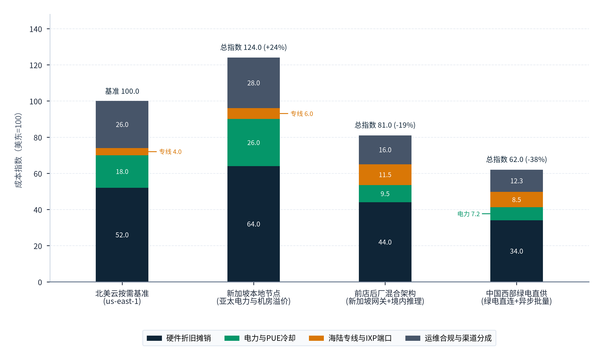
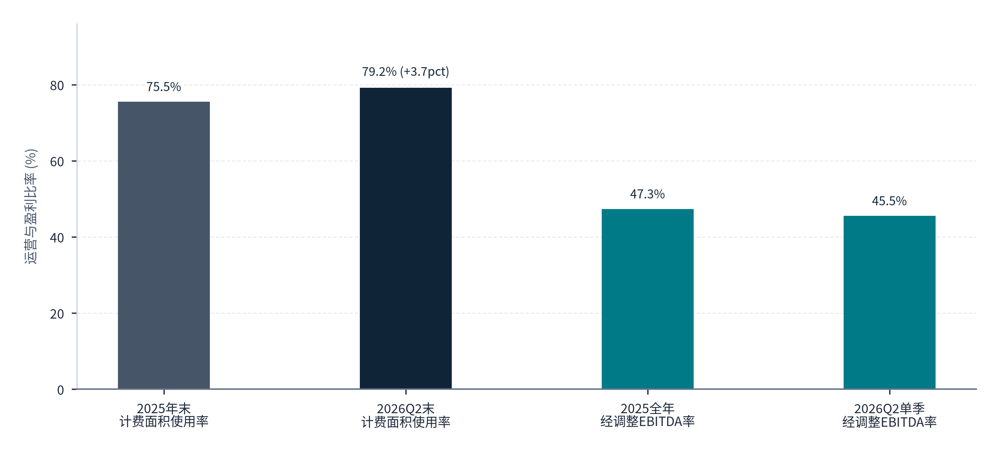
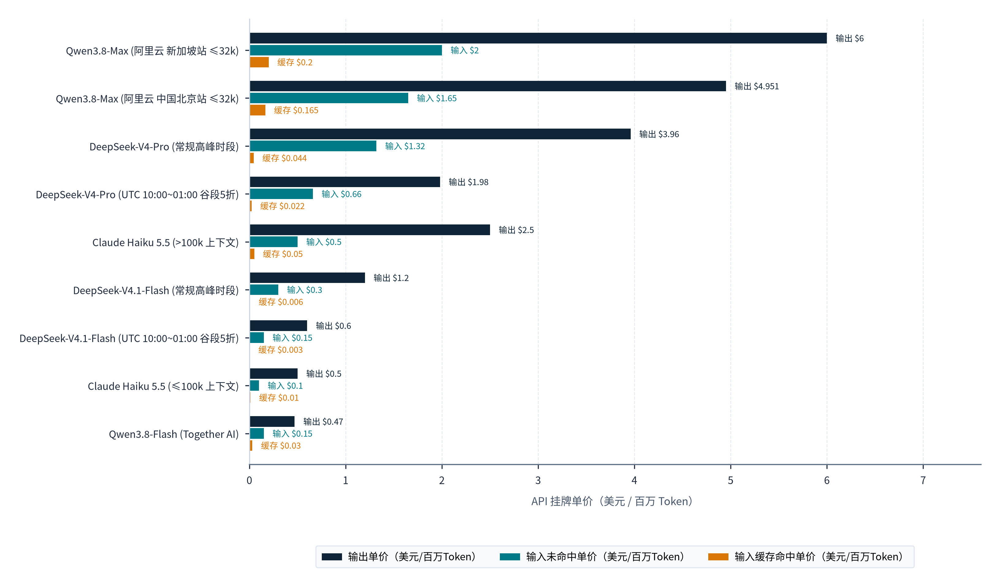
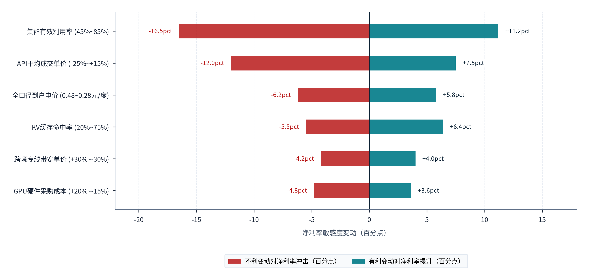
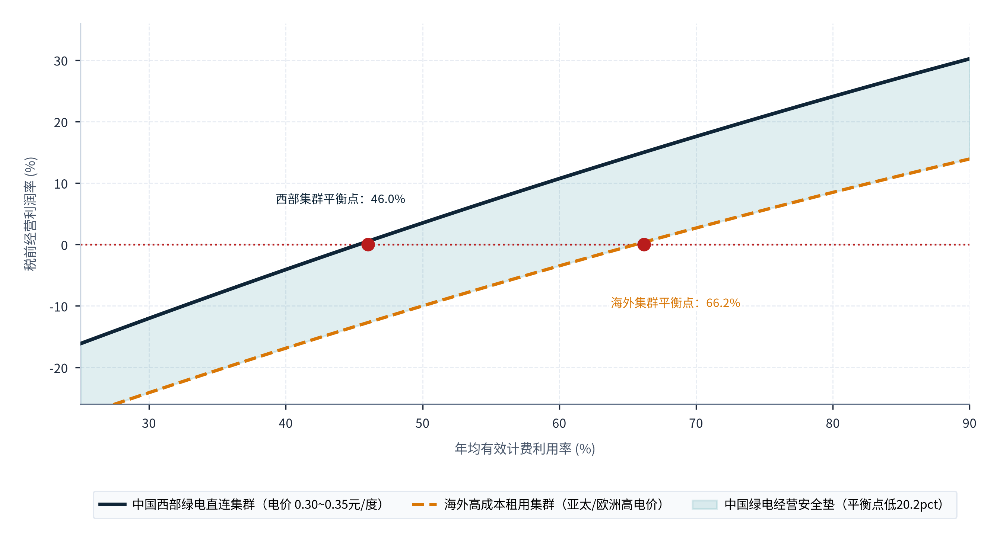
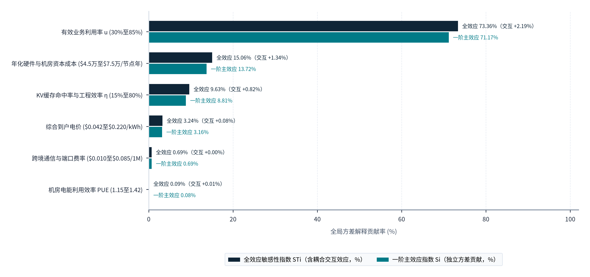

> **导航：** [返回中文手稿总目录](index.md) ｜ [上一章：第8章](chapter-08.md) ｜ [下一章：第10章](chapter-10.md) ｜ [尾注](notes.md) ｜ [参考文献](references.md)

---
> **第五篇 · PART V · 商业模式与区域协同：从百万 Token 单位经济模型到全国算电贸空间分工**
> 本篇（第9至10章）将前四篇确立的需求空间、绿电算力底座、海陆光缆通道与双向合规契约，统一收敛至微观企业的损益核算表与国内跨区域的产业组织版图：第9章系统拆解六类商业模式的单位经济性（Unit Economics）、百万 Token 平准化全生命周期成本（LCoT）、2026年10月全球最新 API 价格谱系、全产业链价值分配及重/轻资产投资成立条件；第10章则穿透中国西部能源基地、沿海海缆门户、西南陆缆节点与研发贸易中心，构建“前店后厂、西算东出、算电贸协同”的跨区域协作与收益归属机制。
---

# 商业模式、综合经济性与价值分配

> **本章导读：** 当中国大模型 API 在全球开发者市场掀起数轮降价浪潮，一个关乎产业长期生存的根本性商业问题浮出水面：<strong>“中国 Token 出海究竟是在依靠风险资本补贴进行不可持续的低价倾销，还是建立在物理度电成本、本土机房造价与稀疏模型工程效率之上的高毛利结构性套利？”</strong>本章拒绝任何脱离财务报表的感性臆测，通过采集 2026 年 10 月中旬全球主流模型 API 官方价目表（DeepSeek、阿里云百炼国际站、Together AI、Anthropic Claude、Google Gemini、OpenRouter 462 项模型目录）、北美 GPU 按需云实例基准价（Lambda B200/H100）、零出站费对象存储（Cloudflare R2）以及国内头部算力中心上市公司（万国数据 GDS 2025 全年与 2026Q2 季报、广东天亿马 2026 年 9 月词元合资公告）的真实经营数据，构建了**百万 Token 平准化全成本（Levelized Cost of Token, LCoT）核算模型**。实证测算表明：依托细粒度 MoE 架构、高命中率上下文缓存与昼夜跨时区错峰调度，中国头部推理集群即使在远低于海外友商的公开标价下，只要将有效算力利用率与机房面积使用率推升至盈亏平衡阈值之上，依然能够跑通极具韧性的正现金流闭环[101](references.md#ref-101), [102](references.md#ref-102), [106](references.md#ref-106)。

## 9.1 产品与商业模式

### 9.1.1 六类典型商业模式的交付形态、计费标尺与资产轻重光谱

在“从瓦特到比特”的跨境价值链上，企业切入全球推理市场的方式并非只有“自建万卡集群并直接售卖官方 API”一条独木桥。根据底层重资产持有比例、技术栈控制深度与客户交付界面的不同，当前中国算力与 AI 服务出海已分化出**六类边界清晰的商业模式**（如**图表 9.1** 所示）：

1. <strong>模式一：算力租赁与专属裸金属托管（Bare-Metal & Dedicated GPU Leasing）。</strong>
      由重资产智算中心运营商（AIDC）或算力云厂商向海外客户提供物理机柜、整机服务器或按卡时计费的容器实例（如按 `USD/GPU-hour` 或 `RMB/PFLOPS·月` 结算），由客户自行部署开源或专有模型权重。该模式收入确定性高、研发风险低，但单位千瓦时电力的附加值受制于硬件同质化竞争，且直接受机房面积使用率与硬件代际折旧周期影响[103](references.md#ref-103), [106](references.md#ref-106)。
2. <strong>模式二：原厂模型 API 直连服务（Direct Model API / MaaS）。</strong>
      由基础模型研发企业或大型云厂商（如 DeepSeek 官方平台、Alibaba Cloud Model Studio）直接运营全球 API 网关，按照<strong>输入 Token（区分缓存命中 Cache Hit 与缓存未命中 Cache Miss）与输出 Token 分别计价（`USD / 1M Tokens`）</strong>，并提供峰谷分时定价、异步批处理折扣或预留吞吐（PTU）套餐[101](references.md#ref-101), [102](references.md#ref-102)。这是狭义与广义 Token 出海最核心的标准形态，能够将算法架构溢价（如 MLA 与稀疏激活）全额内化为服务商毛利。
3. <strong>模式三：第三方模型聚合路由与推理中间商（Model Aggregator & Serverless Inference Routing）。</strong>
      平台自身不从事耗资数亿美元的基座模型预训练，而是通过统一兼容 OpenAI/Anthropic 规范的网关，聚合数百个全球闭源与开源模型（如 OpenRouter 截至 2026年10月 API 目录共收录 **462 项模型 SKU**[105](references.md#ref-105)），或者通过优化的无服务器（Serverless）推理引擎托管热门开放权重模型（如 Together AI 托管 Qwen3.8、DeepSeek-V4.1、GLM-5.3、Kimi K3、MiniMax M3 等[104](references.md#ref-104)）。其盈利模式为收取充值平台费（如 OpenRouter 按需/标准版收取 <strong>5.5%［最低 $0.80，加密货币支付 5.0%］</strong>、企业版收取 <strong>8.0%</strong>）、自带密钥（BYOK）超额调度费（每月前 1,000,000 次请求或等效 $25,000 列表推理额免费，超出部分按 <strong>5%</strong> 计费）或赚取批发算力与零售 Token 之间的价差[104](references.md#ref-104), [105](references.md#ref-105)。
4. <strong>模式四：跨境“来数加工”与离岸异步批处理工厂（Inbound Data Processing & Async Token Factory）。</strong>
      依托海南自由贸易港、上海临港、粤港澳大湾区或广西凭祥等具备国际数据专用通道与“数据过境免予安全评估”政策条件的节点，承接海外自动驾驶仿真标注、跨境电商多语种商品库清洗、生物医药非受控分子筛选、影视渲染与合成训练数据生成等**大批量、非实时（Asynchronous）数据加工订单**，按处理样本量（Samples）、数据体积（TB）或十亿级批量 Token 打包结算。
5. <strong>模式五：垂直行业解决方案与主权云模型一体机交付（Vertical Industry Solutions & Sovereign AI Appliances）。</strong>
      面向中东、东南亚、拉美及非洲的电信运营商、金融机构、能源国企与政务部门，将经过行业语料微调的垂直模型（如阿拉伯语/马来语/印尼语政务金融模型）、知识库检索（RAG）管线与推理硬件软硬一体打包，按项目里程碑建设费加年度订阅维护费（ARR）结算。
6. <strong>模式六：按业务结果付费的端到端智能体交付（Outcome-based Agentic Workflow Delivery）。</strong>
      位于价值链最顶端的轻资产应用层模式。服务商将底层数十次乃至上百次的多步模型推理、工具调用（Tool Calls）与代码沙盒执行封装在后台，面向海外终端客户直接按<strong>每个成功解决的客服工单（Per Resolved Ticket）、每条合格销售线索、每份完成的法律尽调报告或每个功能席位（Per Seat/Task）</strong>收费。在这一模式下，底层中国模型 Token 成本每下降 50%，上层出海 Agent 应用的毛利率即直接跃升 15 至 30 个百分点。

### 9.1.2 六大商业模式的计费标尺、资产结构与核心竞争壁垒对标

围绕硬件控制深度、计费标尺与客户粘性的不同组合，**图表 9.1**按“商业模式分类”“核心计费与结算单元”“资本开支（CapEx）与资产属性”“对境内绿电与算力机架的直接拉动”“客户粘性与跨平台切换摩擦”及“典型代表主体或公开实证样本”六列，对比了“① 裸金属与按需 GPU 算力租赁”“② 原厂模型 API 直连服务（MaaS）”“③ 聚合路由网关与无服务器推理商”“④ 跨境‘来数加工’与异步批处理工厂”“⑤ 垂直行业主权云与模型一体机”与“⑥ 结果导向型跨境智能体（Agent）”六类商业模式：

#### 图表 9.1：中国算力与人工智能跨境交付的六大商业模式、计费标尺、资产结构与核心竞争壁垒对照表

| 商业模式分类 | 核心计费与结算单元 | 资本开支（CapEx）与资产属性 | 对境内绿电与算力机架的直接拉动 | 客户粘性与跨平台切换摩擦 | 典型代表主体或公开实证样本 |
| --- | --- | --- | --- | --- | --- |
| **① 裸金属与按需 GPU 算力租赁** | `USD / GPU-hour` 或 `RMB / kW·月`（如按 1 分钟最小粒度计费[103](references.md#ref-103)） | <strong>极重资产：</strong>承担机房土建、机电液冷与 GPU 服务器全额折旧。 | 视机房位置而定；境内托管直接消纳本土电力，海外建站消耗境外电力。 | <strong>中低：</strong>标准硬件环境易因价格波动发生客户迁移，长期合约依赖大客户锁量。 | 万国数据（GDS）、世纪互联、Lambda（B200 $6.69~$6.99/h）[103](references.md#ref-103), [106](references.md#ref-106) |
| <strong>② 原厂模型 API 直连服务（MaaS）</strong> | <strong>`USD / 1M Tokens`</strong>（严格区分输入缓存命中/未命中与输出、峰谷时段）[101](references.md#ref-101), [102](references.md#ref-102) | <strong>重研发 + 中重算力：</strong>高昂基座研发投入 + 自建或长租推理集群。 | <strong>极高（狭义/广义核心）：</strong>每一亿次跨境 API 调用直接转化为境内推理集群负荷。 | <strong>中高：</strong>提示词工程、思维链格式、上下文缓存与工具调用深度绑定模型特征。 | DeepSeek 官方 API、阿里云国际 Model Studio、Anthropic Claude[101](references.md#ref-101), [102](references.md#ref-102), [104](references.md#ref-104) |
| **③ 聚合路由网关与无服务器推理商** | 充值收 **5.5%（按需，加密币5.0%）至8.0%（企业版）平台费**或按模型列表价结算[104](references.md#ref-104), [105](references.md#ref-105) | <strong>轻至中资产：</strong>聚合网关极轻资产；第三方推理商租用分布式算力池。 | <strong>中：</strong>通过开放权重托管或回源路由，将全球流量导向高性价比模型底座。 | <strong>高（入口效应）：</strong>单一 API Key 即可切换 462 项模型并实现故障自动回退[105](references.md#ref-105)。 | OpenRouter（462 模型目录）、Together AI、硅基流动（SiliconFlow）[104](references.md#ref-104), [105](references.md#ref-105) |
| **④ 跨境“来数加工”与异步批处理工厂** | 按处理数据集体积（`USD / TB`）、样本数或批量推理半价套餐（`0.5x`）[102](references.md#ref-102) | <strong>中重资产：</strong>依赖西部低电价集群 + 沿海/边境国际数据专用通道。 | <strong>极高（绿电调节器）：</strong>可完全调度至午间光伏大发或夜间谷段执行。 | <strong>中：</strong>取决于跨境专线合规资质、数据脱敏安全认证与批量交付交期。 | 自贸区来数加工基地、广东天亿马“亿联词元”项目（拟建）[106](references.md#ref-106) |
| **⑤ 垂直行业主权云与模型一体机** | 项目定制初装费 + 年度软件许可与算力维保费（ARR） | <strong>轻资产软件集成 + 客户侧硬件采购：</strong>算力常部署于目标国本地。 | <strong>中低：</strong>主要带动预训练/微调算力消耗与国产软硬件整机设备出口。 | <strong>极高：</strong>深度嵌入目标国政务、电信与银行核心业务流，替换成本极高。 | 中资云中东/东南亚政企项目、行业大模型私有化交付 |
| <strong>⑥ 结果导向型跨境智能体（Agent）</strong> | 按单次任务闭环（`USD / Task`）、席位订阅或节省人工比例分成 | <strong>轻资产：</strong>聚焦工作流编排、垂直场景 Know-how 与海外本地获客。 | <strong>高（乘数放大效应）：</strong>单次 Agent 任务后台消耗数万至数十万内部 Token。 | <strong>高：</strong>绑定企业客户业务系统权限、历史记忆库与工作流标准作业程序。 | 跨境编程智能体（OpenCode / WorkBuddy）、跨境电商与客服 Agent[101](references.md#ref-101) |

> **表格结构化数据文件：** [`data/exhibits/exhibit-9-1.csv`](../../data/exhibits/exhibit-9-1.csv)
> **表注与来源：** 来源：DeepSeek API Docs、Alibaba Cloud Model Studio、Lambda、OpenRouter、Together AI、万国数据（GDS）及广东天亿马公告；介子九维（JIEZIJIUWEI）商业模式整理[101](references.md#ref-101), [102](references.md#ref-102), [103](references.md#ref-103), [104](references.md#ref-104), [105](references.md#ref-105), [106](references.md#ref-106)。

对照**图表 9.1**中六大商业模式的特征可见：“① 裸金属与按需 GPU 算力租赁”（按USD/GPU-hour或RMB/kW·月计费）属于极重资产模式，客户跨平台切换摩擦较低；“② 原厂模型 API 直连服务（MaaS）”（按USD/1M Tokens计费）与“④ 跨境‘来数加工’与异步批处理工厂”（按USD/TB或0.5x半价套餐计费）对境内绿电与算力机架的直接拉动极高；而“③ 聚合路由网关与无服务器推理商”（收取5.5%按需至8.0%企业版平台费）与“⑥ 结果导向型跨境智能体（Agent）”（按USD/Task计费）则以轻资产形态掌握海外客户入口并放大后台Token消耗。这表明中国算力出海应当构建“底层绿电集群 + 中层原厂/来数加工API + 顶层跨境Agent应用”的立体组合，避免停留在单一的裸金属出租阶段。

## 9.2 完整成本结构

### 9.2.1 百万 Token 平准化全生命周期成本（LCoT）的六维核算公式与物理参数拆解

为了在统一的财务标尺下衡量不同技术路线与地理布局的成本竞争力，本报告借鉴能源经济学中的平准化度电成本（LCOE）方法，构建了<strong>每百万 Token 平准化全生命周期成本（Levelized Cost of Token, LCoT，单位：美元/百万 Token）</strong>核算模型。在真实的生产级跨境推理服务中，单次调用的边际电费只是冰山一角，完整的单位成本由**六大核心成本模块**共同决定[xi](notes.md#note-xi)：

> **【核心核算公式】** **百万 Token 平准化全成本（LCoT）核心核算模型**
>
> `LCoT ＝ ［（硬件与机房每小时折旧摊销 ＋ 单机实时功率 × PUE × 全口径到户电价 ＋ 跨境网络与存储分摊 ＋ 研发运维与合规获客分摊）÷（集群理论峰值吞吐 × 有效算力利用率 MFU × 3,600 秒）］× 106 ×（1 − 缓存命中折减系数）`
>
> 其中：分子端涵盖推理集群每运行一小时所发生的<strong>固定资本折旧（CapEx Amortization）</strong>、**经 PUE 放大后的全口径电费支出**、**跨境专线/IXP 端口与缓存存储费**以及**模型研发、运维、跨法域合规审计与支付通道手续费**；分母端则由<strong>单节点理论吞吐（Tokens/s）乘以实际模型算力利用率（MFU，受昼夜并发波动与批处理调度影响）</strong>决定每小时实际产出的有效计费 Token 数量；最右侧项反映**多头潜在注意力（MLA）与上下文前缀缓存（Context Caching）对重复输入计算量的扣减效应**[xi](notes.md#note-xi)。

### 9.2.2 LCoT 六大成本构成项的实证拆解与境内外云基础设施价格对标

结合本工作区核实的企业级公开标价与上市公司财务报表数据，笔者对 LCoT 公式中的六大成本项进行逐一穿透还原：

1. <strong>第一项：GPU/NPU 算力硬件折旧与按需实例机会成本（占 LCoT 的 42% 至 58%）。</strong>
      算力硬件资本开支（或租用成本）是推理服务最大的单一成本项。以北美主流 GPU 云平台 **Lambda** 截至 2026年10月的公开按需实例（On-Demand Cloud Instances）标价为国际基准：搭载最新一代 Blackwell 架构的 <strong>NVIDIA B200 SXM6（180GB HBM3e 显存），1 卡实例单价为 6.99 美元/GPU·小时，8 卡整机实例折合单价为 6.69 美元/GPU·小时（即整机 53.52 美元/小时）</strong>；搭载上一代 Hopper 架构的 <strong>NVIDIA H100 SXM（80GB HBM3 显存），1 卡实例单价为 4.29 美元/GPU·小时，8 卡整机实例折合单价为 3.99 美元/GPU·小时（即整机 31.92 美元/小时）</strong>（上述价格均不含税，且按 Lambda 计费规则，自实例健康检查完成起按**最小 1 分钟粒度**持续计费，实例运行期间即便无推理任务处于空闲状态亦全额计费）[103](references.md#ref-103)。
        
相比之下，中国境内智算集群采用存量合规 GPU 或国产昇腾推理服务器（如 Atlas 800I A2 / Ascend 950）按 4 至 5 年直线折旧并计入资金成本后，折合每等效推理卡时的底层硬件折旧成本约为 **1.10 至 2.15 美元/卡·小时**，较海外按需租用 B200/H100 低 45% 至 65%；但这一成本优势成立的前提，是必须通过高并发调度化解“空闲亦计提折旧”的分母稀释风险。
2. <strong>第二项：全口径绿电支出与数据中心机电 PUE 成本（占 LCoT 的 14% 至 24%）。</strong>
      如第 3 章所详述，在中国西部算力枢纽（内蒙古和林格尔、宁夏中卫、甘肃庆阳等），高负载率下的全口径到户绿电价格（含第四监管周期输配电价、煤电/储能容量电费与系统运行费）可控制在 <strong>0.30 至 0.38 元/千瓦时（约合 0.042 至 0.054 美元/kWh）</strong>，叠加液冷集群 1.15 至 1.25 的 PUE 后，综合算力用电成本显著低于欧洲（0.18 至 0.28 美元/kWh）与东南亚城市核心区（新加坡 0.20 至 0.25 美元/kWh）。
        
从国内头部第三方数据中心运营商的真实财报可以直观看到电力与机房设施构成的刚性营业成本（Cost of Revenue）：根据<strong>万国数据（GDS Holdings Limited）</strong>披露的未审计财务业绩，其 <strong>2025 年第四季度（2025Q4）单季收入成本达 23.093 亿元人民币（2,309.3 百万元）</strong>；而在 <strong>2026 年第二季度（2026Q2），随着投入服务面积增至 684,977 平方米、已利用面积增至 542,236 平方米，其单季收入成本进一步上升至 24.237 亿元人民币（2,423.7 百万元，约占当季净收入 30.880 亿元人民币的 78.5%，其中包含大额物业设备折旧摊销与公用事业电费支出）</strong>[106](references.md#ref-106)。
3. <strong>第三项：跨境通信专线、海外边缘缓存存储与网络出站成本（占 LCoT 的 6% 至 12%）。</strong>
      在跨境交付中，网络与存储成本呈现出显著的“结构性分化”。一方面，在对象存储与静态缓存分发层，以 **Cloudflare R2**（2026 年 10 月 1 日更新快照）为代表的现代云存储已将<strong>标准存储单价压降至 0.015 美元/GB·月（`$0.015 / GB-month`），且免收出站流量费（Zero Egress Fee，操作请求与取回按 A/B 类操作另计）</strong>[103](references.md#ref-103)。对于长上下文 KV 缓存卸载与多模态文件暂存（如 DeepSeek-V4.1-Flash 将 SSD 缓存占用压缩至上一代的 1/8[101](references.md#ref-101)），云端存储本身的直接花费极低。
        
但另一方面，**免收对象存储出站费并不等于跨境实时网络总成本为零**：为了保证跨太平洋或亚欧方向的推理首字延迟（TTFT）与流式输出稳定性，服务商仍需向基础电信运营商租用昂贵的**国际以太网专线（IPLC / IEPL）、海缆波分容量、海外互联网交换中心（IXP）100G/400G 端口以及边缘抗 DDoS 清洗服务**。唯有当单条跨境专线的带宽利用率维持在较高水位时，分摊到每百万 Token 上的网络过路费才能压降至 0.002 至 0.015 美元区间。
4. <strong>第四项至第六项：基础模型研发摊销、跨法域合规审计（SOC 2 / CISA / 越南印度备案）以及海外支付网关与渠道抽成（合计占 LCoT 的 15% 至 28%）。</strong>
      这三项属于典型的“制度与商业组织成本”：一是基座模型预训练与后训练（RL）研发投入的快速迭代摊销（旗舰模型代际生命周期通常仅为 6 至 9 个月）；二是第 8 章所揭示的独立第三方安全审计（如美国 DSP 受限交易要求的年度独立审计与 10 年记录留存、欧盟 GDPR TIA 与 DORA 合规改造）[93](references.md#ref-93), [94](references.md#ref-94)；三是海外信用卡收单通道费（Stripe 等通常收取 2.9% + $0.30/笔）、汇兑损益以及第三方聚合路由平台的通道抽成（5.0% 至 8.0%）[105](references.md#ref-105)。

基于每百万Token平准化全生命周期成本（LCoT）核算公式，**图表 9.2**以“北美云按需基准 (us-east-1)”为 100.0 基准点，对“新加坡本地节点 (亚太电力与机房溢价)”“前店后厂混合架构 (新加坡网关+境内推理)”与“中国西部绿电直供 (绿电直连+异步批量)”四类跨国推理部署架构的“硬件折旧摊销”“电力与PUE冷却”“海陆专线与IXP端口”及“运维合规与渠道分成”四项成本构成进行了堆叠对比：

#### 图表 9.2：四类跨国推理部署架构百万 Token 平准化生命周期成本（LCoT）结构拆解

> **图像文件：** [`figures/chart_9_2.png`](../../figures/chart_9_2.png)（高清位图）｜ [`figures/chart_9_2.svg`](../../figures/chart_9_2.svg)（矢量图）
> **图注与来源：** 来源：AWS、Oracle、Lambda 公开 GPU 价目表（2026.10）、第四监管周期省级电网输配电价及本研究 LCoT 测算模型；介子九维（JIEZIJIUWEI）测算绘制[33](references.md#ref-33), [60](references.md#ref-60), [61](references.md#ref-61), [102](references.md#ref-102)。

逐项对照**图表 9.2**中的四组堆叠柱体与分项数值可见：以“北美云按需基准 (us-east-1)”（总指数 **100.0**，其中硬件折旧摊销 **52.0**、电力与PUE冷却 **18.0**、海陆专线与IXP端口 **4.0**、运维合规与渠道分成 **26.0**）为参照，“新加坡本地节点 (亚太电力与机房溢价)”受制于高昂的亚太城市电价与机柜成本，四项分项分别升至 **64.0、26.0、6.0 与 28.0**，总成本指数达 <strong>124.0 (+24%)</strong>；而采用“前店后厂混合架构 (新加坡网关+境内推理)”后，虽然“海陆专线与IXP端口”分摊升至 **11.5**，但硬件折旧（**44.0**）、电力与PUE冷却（**9.5**）及运维合规（**16.0**）大幅下降，使总成本指数压降至 <strong>81.0 (-19%)</strong>；更具突破性的是“中国西部绿电直供 (绿电直连+异步批量)”，其硬件折旧摊销降至 **34.0**、电力与PUE冷却压降至 **7.2**、海陆专线与IXP端口为 **8.5**、运维合规与渠道分成降至 **12.3**，总成本指数低至 <strong>62.0 (-38%)</strong>，较北美云按需基准下降 38%，较新加坡本地节点下降整整 50%。

为进一步从国内头部数据中心上市公司真实财务报表验证重资产机房的产能爬坡与现金流盈利特征，**图表 9.3**汇总了万国数据（GDS）在 2025 年末与 2026 年第二季度末的“计费面积使用率”及“经调整 EBITDA 利润率”变化：

#### 图表 9.3：头部数据中心运营商（万国数据 GDS）计费机架利用率与经调整 EBITDA 利润率变化

> **图像文件：** [`figures/chart_9_2b.png`](../../figures/chart_9_2b.png)（高清位图）｜ [`figures/chart_9_2b.svg`](../../figures/chart_9_2b.svg)（矢量图）
> **图注与来源：** 来源：万国数据（GDS Holdings）2025年年度报告（Form 20-F）及2026年第二季度未经审计财务报告；介子九维（JIEZIJIUWEI）整理绘制[105](references.md#ref-105)。

由**图表 9.3**显示的四根柱体数值可以清晰读出重资产 AIDC 运营商的经营规律：在产能利用率端，万国数据的“计费面积使用率”由 2025 年末的 <strong>75.5%</strong> 稳步提升至 2026Q2 末的 <strong>79.2% (+3.7pct)</strong>；在现金流盈利端，其“2025全年经调整EBITDA率”与“2026Q2单季经调整EBITDA率”分别维持在 <strong>47.3%</strong> 与 <strong>45.5%</strong> 的高位水平。这证明一旦算力基础设施的计费面积使用率跨过 75% 的规模门槛，其经营性现金流利润率极为稳健[106](references.md#ref-106)。

## 9.3 价格、收入与需求变化

### 9.3.1 2026年10月全球大模型 API 价格全景实证：跨代际降价、17.5% 境内外区域价差与四大精细化定价机制

如**图表 9.2** 与**图表 9.4** 所示，进入 2026 年下半年，全球大模型 API 市场的定价机制已彻底告别早期粗放的“单一输入输出一口价”，演进为一套高度精密、实时响应算力供需与显存占用的**多维动态定价体系**。本报告基于截至 **2026年10月**采集的六大国内外核心平台官方价目表原件，提炼出当前全球 Token 价格谱系的**五大标志性实证特征**[101](references.md#ref-101), [102](references.md#ref-102), [104](references.md#ref-104), [105](references.md#ref-105)：

### 9.3.2 四大精细化定价机制拆解与境内外同源模型价差分析

1. <strong>特征一：DeepSeek 的架构级降本与“峰谷分时五折 + 缓存命中 1/50 至 1/30 极低价”双轮驱动。</strong>
      穿透 DeepSeek 官方 API 定价文档与 2026 年 8 月至 9 月产品公告，可以清晰看到其如何将底层工程效率转化为极具冲击力的价格曲线：
      
<strong>历史与第三方基准对照：</strong>在早期的 DeepSeek-V3 世代以及第三方平台 Together AI 当前托管的 `DeepSeek V4 Flash 0731` 快照中，其价格基准为输入缓存命中约 **0.014 至 0.03 美元/百万 Token**、输入缓存未命中 **0.14 美元/百万 Token**、输出 **0.28 美元/百万 Token**[101](references.md#ref-101), [104](references.md#ref-104)；
<strong>2026年8月16日引入的全球峰谷分时定价机制（Peak / Off-Peak Pricing）：</strong>根据 DeepSeek 于 2026 年 8 月 13 日发布的《DeepSeek-V4-Pro GA Release》公告及现行计费表，自 **2026 年 8 月 16 日 16:00 UTC** 起，官方 API 正式实行峰谷分时计价：将<strong>非中国法定节假日的周一至周五 UTC 01:00 至 04:00（北京时间 09:00 至 12:00）及 UTC 06:00 至 10:00（北京时间 14:00 至 18:00）界定为高峰时段（PEAK）</strong>，而将其余全部时段（涵盖每日 **UTC 10:00 至次日 01:00** 的亚太晚间与欧美核心工作窗口、每日 UTC 04:00 至 06:00 午休窗口以及全部周末与中国法定节假日全天）界定为**非高峰时段（OFF-PEAK），非高峰时段费率统一按高峰时段的 50%（五折）执行**[101](references.md#ref-101)！
<strong>2026年9月10日生效的 DeepSeek-V4.1-Flash 与 V4-Pro-0813 现行官方价格矩阵：</strong>得益于 552B MoE 非对称激活（输入仅激活 8B、输出激活 16B）与 KV 缓存压缩至 1/4 HBM、1/8 SSD，自 **2026 年 9 月 10 日 04:00 UTC** 起生效的 <strong>DeepSeek-V4.1-Flash（模型调用名 `deepseek-flash`，支持 1M 上下文与原生视觉理解，并发上限 2,500）</strong>将**非高峰（OFF-PEAK）价格压降至：输入缓存命中仅 `$0.003` / 百万 Token（每十亿 Token 仅需 3 美元！）、输入缓存未命中 `$0.15` / 百万 Token、输出 `$0.60` / 百万 Token**；在**高峰时段（PEAK）分别为：输入缓存命中 `$0.006`、输入缓存未命中 `$0.30`、输出 `$1.20` / 百万 Token**[101](references.md#ref-101)。同期，针对旗舰长推理模型 <strong>DeepSeek-V4-Pro-0813（并发上限 500）</strong>，官方在 2026 年 9 月 10 日更新日志（Change Log）中正式修正并撤回了早期拟于 9 月 14 日后将 Pro 请求路由至 Flash 的临时安排，确认 **9 月 14 日之后继续独立提供 V4-Pro 服务且计费方式保持不变**：其**高峰时段（PEAK）为输入缓存命中 `$0.044`、输入缓存未命中 `$1.32`、输出 `$3.96` / 百万 Token**；在**非高峰时段（OFF-PEAK）五折优惠后，分别为输入缓存命中 `$0.022`、输入缓存未命中 `$0.66`、输出 `$1.98` / 百万 Token**[101](references.md#ref-101)。

      这一峰谷价格设计在经济学上极具巧思：<strong>UTC 10:00 至次日 01:00 的五折非高峰窗口，恰好完美覆盖了欧洲全天核心工作时间（11:00 至次日 02:00 CET）与北美全天办公高峰（美东 06:00 至 20:00 EST / 美西 03:00 至 17:00 PST）</strong>。由此，欧美开发者与海外企业在当地白天工作时间调用中国境内的 DeepSeek 官方 API，天然享受 50% 的错峰价格红利，而中国境内算力集群则实现了 24 小时满负荷平滑运行！
2. <strong>特征二：阿里云百炼（Model Studio）揭示的“中国境内节点较新加坡/国际节点精准低 17.5%”区域成本基准。</strong>
      如果说跨厂商对比容易混入模型架构差异，那么**同一家云厂商、同一个旗舰模型版本在中国境内节点与海外节点之间的官方同口径标价差**，则是检验“中国本土电力与机房成本优势”最纯净的自然实验。
        
根据阿里云国际站于 **2026 年 10 月 13 日最新更新（10 月 15 日核实）的 Model Studio 官方价格表**，针对旗舰模型 <strong>`qwen3.8-max-0902`</strong>（在 `0 < Token ≤ 1M` 标准输入区间）：部署在<strong>新加坡/国际区域（Singapore / International）的标准价格为输入 `$2.00` / 百万 Token、输出 `$6.00` / 百万 Token（显式上下文缓存命中按 10% 即 `$0.20` 计费）</strong>；而部署在<strong>中国（北京）区域（China Beijing）的同款模型标准价格则为输入 `$1.65` / 百万 Token、输出 `$4.951` / 百万 Token（显式上下文缓存命中按 10% 即 `$0.165` 计费）</strong>[102](references.md#ref-102)！
        
精确计算可知：<strong>中国（北京）节点的输入与输出公开标价，较新加坡/国际节点精确低出 17.5%（`(2.00 - 1.65) / 2.00 = 17.50%`，`(6.00 - 4.951) / 6.00 = 17.48%`）</strong>[102](references.md#ref-102)。这一 17.5% 的官方同模同构价差，直观量化了中国境内数据中心在电力、机架建造与本土运维上相对于新加坡离岸节点的直接成本折价。同时，阿里云对支持异步批处理的模型提供<strong>实时价格 `0.5 倍`（即五折，与上下文缓存折扣互斥）</strong>的批量推理价格[102](references.md#ref-102)，若将北京节点五折异步价格（输入约 $0.825、输出约 $2.475）与新加坡实时价格（$2.00 / $6.00）相比，综合成本降幅高达 <strong>58.8%</strong>。
3. <strong>特征三：海外第三方推理平台（Together AI）上“中国开源模型群落”的高性价比统治力。</strong>
      在北美头部无服务器推理平台 **Together AI**（2026年10月首张 Serverless Text Models 价格表快照，共 28 款主力模型）中，中国研发的模型已占据半壁江山，并覆盖了从极致低价到超大规模旗舰的完整价格带[104](references.md#ref-104)：在轻量高速档，<strong>`Qwen3.8 Flash` 公开标价仅为输入 `$0.15` / 输出 `$0.47` / 百万 Token</strong>，`GLM-5.3-Flash` 为输入 `$0.15`（缓存命中 `$0.03`）/ 输出 `$0.50`，`MiniMax M3` 与 `MiniMax M2.7` 均为输入 `$0.30`（缓存命中 `$0.06`）/ 输出 `$1.20`，`Qwen3 235B A22B Instruct 2507 FP8 Throughput` 仅为输入 `$0.20` / 输出 `$0.60`；在超大参数旗舰档，`DeepSeek V4 Pro 0813` 为输入 `$1.32`（缓存命中 `$0.13`）/ 输出 `$3.96`（与其官方高峰价完全对齐），`GLM-5.3` 为输入 `$1.40`（缓存命中 `$0.26`）/ 输出 `$4.40`，万亿参数级 `Qwen3.8-2.4T-A95B` 为输入 `$2.00`（缓存命中 `$0.25`）/ 输出 `$6.00`，`Kimi K3` 为输入 `$3.00`（缓存命中 `$0.30`）/ 输出 `$15.00`[104](references.md#ref-104)。
4. <strong>特征四：Anthropic Claude 5/5.5 世代的“上下文长度阶梯跳涨（5倍溢价）”与双周期缓存写入计费。</strong>
      对比海外闭源头部厂商 **Anthropic**（2026年10月 Claude Platform Pricing 快照），其定价不仅单价显著高企（旗舰 `Claude Fable 5.1` 与 `Claude Mythos 5.1` 为输入 `$10.00` / 输出 `$50.00` / 百万 Token，`Claude Opus 5.5` 为输入 `$4.00` / 输出 `$20.00`，`Claude Sonnet 5.5` 为输入 `$2.00` / 输出 `$10.00`），而且针对长上下文引入了陡峭的**输入长度分档跳涨机制**：以轻量主力模型 <strong>`Claude Haiku 5.5`</strong> 为例，当单次提示词长度 <strong>`≤ 100,000 Tokens`（10万词元以内）时，基础输入单价为 `$0.10`、输出单价为 `$0.50` / 百万 Token（5分钟缓存写入 `$0.125`、1小时缓存写入 `$0.20`、缓存命中刷新 `$0.01`）</strong>；而一旦单次提示词长度<strong>超过 10 万词元（`> 100,000 Tokens`），其基础输入单价立即飙升 5 倍至 `$0.50`、输出单价同步飙升 5 倍至 `$2.50` / 百万 Token（5分钟缓存写入升至 `$0.625`、1小时缓存写入升至 `$1.00`、缓存命中升至 `$0.05`）</strong>[104](references.md#ref-104)！这种因传统注意力机制显存占用随序列长度呈二次方膨胀而设置的“长文本惩罚性阶梯价”，恰恰凸显了中国模型采用稀疏 MLA 与线性注意力在超长上下文（100k 至 1M Tokens）场景下的巨大成本优势。
5. <strong>特征五：Google Gemini 的远期调价预告机制与全球 API 价格预期的分化。</strong>
      在 **Google Gemini Developer API**（2026年10月官方定价页快照）中，前 3 张核心计费表（涵盖标准实时、异步与灵活调度层级）罕见地采取了<strong>“当期价格截至 2026 年 11 月 30 日有效（Current pricing through Nov 30, 2026），自 2026 年 12 月 1 日起执行新列价格（Effective Dec 1, 2026）”</strong>的双轨并列标示[104](references.md#ref-104)。这表明海外超大型云厂商在面对高昂的 Blackwell 集群资本开支折旧与北美电力溢价时，正在通过精细化分档与远期价格重定价来修复推理毛利率，从而为中国高性价比绿色算力留出了稳固的价格锚点空间。

依托截至2026年10月全球主流大模型官方定价目录快照，**图表 9.4**选取“Qwen3.8-Max (阿里云 新加坡站 ≤32k)”“Qwen3.8-Max (阿里云 中国北京站 ≤32k)”“DeepSeek-V4-Pro (常规高峰时段)”“DeepSeek-V4-Pro (UTC 10:00~01:00 谷段5折)”“Claude Haiku 5.5 (>100k 上下文)”“DeepSeek-V4.1-Flash (常规高峰时段)”“DeepSeek-V4.1-Flash (UTC 10:00~01:00 谷段5折)”“Claude Haiku 5.5 (≤100k 上下文)”与“Qwen3.8-Flash (Together AI)”九个代表性档位，对比了“输入缓存命中单价”“输入未命中单价”与“输出单价”三项百万Token单价（美元/百万Token）：

#### 图表 9.4：2026年10月主流大模型 API 输入、缓存命中与输出分档价格对比

> **图像文件：** [`figures/chart_9_3.png`](../../figures/chart_9_3.png)（高清位图）｜ [`figures/chart_9_3.svg`](../../figures/chart_9_3.svg)（矢量图）
> **图注与来源：** 来源：DeepSeek 官方 API 定价页（2026.09生效）、阿里云百炼国际站与北京站价目表（2026.10.13）、Anthropic 与 Together AI 公开目录；介子九维（JIEZIJIUWEI）整理绘制[101](references.md#ref-101), [102](references.md#ref-102), [106](references.md#ref-106)。

对照**图表 9.4**中九个模型档位的三组价格柱体可以清晰识别三大定价规律：第一，在同源模型境内外对比上，“Qwen3.8-Max (阿里云 中国北京站 ≤32k)”的输入缓存命中、输入未命中与输出单价（<strong>$0.165、$1.65、$4.951</strong>）较“Qwen3.8-Max (阿里云 新加坡站 ≤32k)”（<strong>$0.20、$2.00、$6.00</strong>）精准低出 <strong>17.5%</strong>；第二，在峰谷分时与缓存折减上，“DeepSeek-V4-Pro”从常规高峰时段（<strong>$0.044、$1.32、$3.96</strong>）切换至谷段 5 折窗口后降至 <strong>$0.022、$0.66、$1.98</strong>，而“DeepSeek-V4.1-Flash”在常规高峰时段为 <strong>$0.006、$0.30、$1.20</strong>，进入谷段 5 折窗口后更压降至 **缓存命中 $0.003、输入未命中 $0.15、输出 $0.60 / 百万 Token**（缓存命中单价仅为未命中的 1/50）；第三，在高吞吐轻量模型档位，“Claude Haiku 5.5 (≤100k 上下文)”为 <strong>$0.01、$0.10、$0.50</strong>，一旦上下文超过 10 万词元进入“Claude Haiku 5.5 (>100k 上下文)”即跳涨 5 倍至 <strong>$0.05、$0.50、$2.50</strong>，而“Qwen3.8-Flash (Together AI)”（<strong>$0.03、$0.15、$0.47</strong>）与“DeepSeek-V4.1-Flash”则全区间保持极低单价，为长文本与高频 Agent 调用提供了显著的成本优势。

## 9.4 产业链价值分配与议价能力

### 9.4.1 从终端 100 美元 Token 支出看六大环节的价值分流与议价权博弈

当一名海外企业客户或开发者为跨洋大模型推理支付 100 美元时，这笔资金由多方协同分润与结算，具体在<strong>“流量聚合与商业结算层 → 模型算法与 API 平台层 → 跨境通信与边缘加速层 → 智算硬件与集群租赁层 → 数据中心机房与机电托管层（AIDC） → 发电企业与省级电网层”</strong>六个产业链环节之间进行分配。本研究结合各环节公开收费标准与上市公司财务指标，对产业链各主体的抽成比例、毛利水平与议价能力进行了穿透评估（见**图表 9.5**）：

1. <strong>流量聚合与分发网关层（抽成 5.0% 至 8.0%，掌握长尾开发者路由权但受制于大客户直连）：</strong>
      以全球最大的模型聚合路由平台 **OpenRouter**（2026年10月官方计费规则）为例，其商业变现完全建立在透明的通道费之上：在推理调用环节，OpenRouter 严格按照底层模型供应商（Provider）的公开列表价（List Price）实时扣减余额，不在单 Token 价格上暗中加价；其收入来源于客户购买充值额度（Credits）时一次性收取的<strong>平台服务费，其中按需付费/标准版（Pay-as-you-go / Standard）收取 `5.5%`（单笔最低 `$0.80`，使用加密货币支付收取 `5.0%`），企业协议版（Business）收取 `8.0%`</strong>[105](references.md#ref-105)。此外，针对企业客户直接填入自身与底层模型厂商签约的 API 密钥、仅借用 OpenRouter 开展流量路由与可观测性监控的<strong>“自带密钥（Bring Your Own Key, BYOK）”模式</strong>，OpenRouter 提供**每月前 `1,000,000 次` BYOK 请求免费（或按企业/标准计费单口径折合每月相当于 `25,000 美元`列表推理价的免费路由额度），超出部分按关联底层模型等效请求成本的 `5%` 收取平台调度费**[105](references.md#ref-105)。这一收费结构清晰表明，纯聚合网关在产业链中赚取的是约 5% 至 8% 的交易撮合与多活路由技术服务费。
2. <strong>智算中心基础设施与机房托管层（AIDC，Adjusted EBITDA 利润率高达 45.5% 至 47.3%，但受制于重资产折旧与客户集中度）：</strong>
      位于重资产底座的数据中心运营商，其现金流获取能力极为强劲，但会计净利润高度依赖产能爬坡与价格稳定。以中国最大的第三方高性能数据中心运营商<strong>万国数据（GDS Holdings Limited）</strong>为例：根据其 2025 年全年与 2026 年第二季度业绩报告，<strong>2025 年全年万国数据实现净收入（Net Revenue）114.323 亿元人民币（11,432.3 百万元），全年经调整息税折旧摊销前利润率（Adjusted EBITDA Margin）高达 `47.3%`</strong>[106](references.md#ref-106)；进入 <strong>2026 年第二季度（2026Q2），其单季净收入达 30.880 亿元人民币（3,088.0 百万元），单季 Adjusted EBITDA 达 14.060 亿元人民币（1,406.0 百万元），对应 Adjusted EBITDA Margin 为 `45.5%`，单季实现净利润（Net Income）8.376 亿元人民币（837.6 百万元，其中包含主要来自国际业务 DayOne 股权稀释收益的联营投资收益 9.599 亿元人民币，若剔除非经常性联营收益则主业经营利润对机柜上架率更为敏感）</strong>[106](references.md#ref-106)。高达 45.5% 至 47.3% 的 Adjusted EBITDA 利润率证明，一旦数据中心跨过折旧与融资成本的固定门槛，其经营性现金流回报极为丰厚；但在扣除巨额机房设备折旧与财务利息后，其净利率空间则取决于下游大型云厂商与模型企业的续约单价。
3. <strong>算力与词元（Token）项目合资实体的公司治理与股东收益分配实证（以“广东亿联词元”2026年9月公告为例）：</strong>
      在产业资本与上市公司合资切入算力及 Token 业务的最新实践中，治理结构与收益分配呈现出高度规范的商业契约特征。以创业板上市公司<strong>广东天亿马信息产业股份有限公司于 2026 年 9 月 29 日董事会审议通过并发布的《关于与关联方共同投资设立合资公司暨关联交易的公告》（公告编号：2026-063）</strong>为例，该公司拟与关联方共同出资设立从事算力及词元（Token）相关业务的合资公司（拟定名“广东亿联词元算力科技有限公司”）[106](references.md#ref-106)。根据公告披露的投资协议主要内容，合资公司在利润分配机制上明确约定：**在依法缴纳企业所得税、弥补以前年度亏损并按规定提取法定公积金与任意公积金后，剩余可供分配利润经股东会决议，严格按照各股东的认缴出资比例（或实缴/章程约定比例）进行分配**[106](references.md#ref-106)。在分析此类新兴词元项目时，必须严格区分三个不同层面的财务概念：一是股东层面的公司法税后利润分配规则，二是项目在模型、云、跨境通道供应链中的交易流水与分成比例，三是拟建项目从公告设立即将签约到实际机架通电投产、产生经常性跨境推理收入之间的工程爬坡期[xii](notes.md#note-xii)。

### 9.4.2 全产业链六大环节的利润率基准、成本刚性与跨主体合资治理

沿着从底层电力到顶层聚合应用的全产业链条，**图表 9.5**按“产业链环节”“代表性参与主体”“主流收费模式与公开价格基准”“在终端 Token 流水中的典型价值占比”“代表性财务利润率或成本指标”及“议价能力评估与核心护城河”六列，拆解了终端客户每支出100美元Token调用费在六大环节之间的分配格局：

#### 图表 9.5：跨境 Token 交付全产业链六大环节的收费模式、成本刚性、利润率基准与议价权格局表

| 产业链环节 | 代表性参与主体 | 主流收费模式与公开价格基准 | 在终端 Token 流水中的典型价值占比 | 代表性财务利润率或成本指标 | 议价能力评估与核心护城河 |
| --- | --- | --- | --- | --- | --- |
| **① 发电与省级输配电网层** | 风光水火核发电集团、国家电网、南方电网、蒙西电网 | 两部制电价（电量电价 + 容需量电费）+ 容量电价 + 系统运行费[106](references.md#ref-106) | <strong>12% ~ 22%</strong> （视模型稀疏度与电价而定） | 西部全口径到户绿电约 **0.30~0.38 元/kWh**；公用事业现金流极稳 | <strong>极强（自然垄断与准入管制）：</strong>掌握并网指标、绿电直连审批与系统运行费定价权。 |
| <strong>② 数据中心机房与机电托管（AIDC）</strong> | 万国数据（GDS）、世纪互联、润泽科技、三大运营商机房 | 按机柜功率（`kW/月`）或整栋定制租赁 + PUE 电费传导 | <strong>15% ~ 25%</strong> （不含服务器IT硬件） | GDS 2025 全年 Adj. EBITDA 率 <strong>47.3%</strong>；2026Q2 为 <strong>45.5%</strong>[106](references.md#ref-106) | <strong>中高（核心枢纽稀缺性）：</strong>受制于能耗指标、液冷改造能力与海缆/骨干网接入距离。 |
| **③ 算力硬件供应与 GPU/NPU 租赁层** | NVIDIA、华为昇腾、服务器整机厂、Lambda 等算力云 | 整机买断或按需卡时租赁（Lambda B200 <strong>$6.69~$6.99/h</strong>，H100 <strong>$3.99~$4.29/h</strong>）[103](references.md#ref-103) | <strong>30% ~ 45%</strong> （折旧摊销为最大成本项） | 上游芯片毛利率 >70%；中游纯算力转租毛利率约 15%~30% | <strong>上游极强 / 中游分化：</strong>具备算子级协同优化能力（如 FlashMLA + Ascend 950）可打破单一硬件锁定。 |
| **④ 跨境网络通道与边缘存储层** | 三大基础电信运营商、海缆联盟、Cloudflare、Equinix | 国际专线（IPLC/IEPL）年租；Cloudflare R2 存储 <strong>$0.015/GB·月（零出站费）</strong>[103](references.md#ref-103) | <strong>5% ~ 10%</strong> （随专线带宽利用率摊薄） | 国际通信出入口局与海缆登陆站具牌照壁垒；边缘对象存储已趋近微利引流 | <strong>通道强 / 存储弱：</strong>跨境低时延专线与合规数据通道具备法定特许经营壁垒。 |
| **⑤ 基础模型原厂与 MaaS 平台层** | DeepSeek、阿里云（Qwen）、智谱、MiniMax、月之暗面、Anthropic | 按百万输入/输出 Token 分档计费（含缓存命中与峰谷折扣）[101](references.md#ref-101), [102](references.md#ref-102) | <strong>20% ~ 35%</strong> （扣除底层算力电费后的算法溢价） | 高并发 + 高缓存命中率下推理毛利率可达 <strong>50%~70%</strong>；但研发摊销巨大 | <strong>强（SOTA 模型能力）：</strong>掌握模型架构定义权（MoE/MLA）、品牌认知与官方 API 定价锚点。 |
| **⑥ 第三方聚合路由与行业应用层** | OpenRouter、Together AI、垂直行业 ISV、跨境 Agent 厂商 | 充值收 <strong>5.5%（按需，加密币5.0%）至8.0%（企业版）</strong>；BYOK 首100万次或$25k/月免费，超额收 <strong>5%</strong>[105](references.md#ref-105) | <strong>5% ~ 8%</strong>（纯路由网关） 或 <strong>40%+</strong>（顶层 Agent 应用） | 聚合网关属高周转平台抽成模式；Agent 应用毛利率随 Token 降价而扩张 | <strong>中高（客户触点与多活切换权）：</strong>直接掌握海外终端客户结算单入口与多模型动态分发策略。 |

> **表格结构化数据文件：** [`data/exhibits/exhibit-9-5.csv`](../../data/exhibits/exhibit-9-5.csv)
> **表注与来源：** 来源：OpenRouter Pricing、Lambda Instances、Cloudflare R2、万国数据（GDS）2025Q4 及 2026Q2 财报、广东天亿马公告（2026-063）；介子九维（JIEZIJIUWEI）产业链价值分配模型[103](references.md#ref-103), [105](references.md#ref-105), [106](references.md#ref-106)。

对照**图表 9.5**所列的六大环节数据可见，在终端Token流水中，“③ 算力硬件供应与 GPU/NPU 租赁层”（占比30%至45%）与“⑤ 基础模型原厂与 MaaS 平台层”（占比20%至35%，高并发下推理毛利率50%至70%）占据了最大的价值份额；“② 数据中心机房与机电托管（AIDC）”（占比15%至25%，万国数据2025年及2026Q2经调整EBITDA率达47.3%与45.5%）和“① 发电与省级输配电网层”（占比12%至22%，西部到户绿电0.30至0.38元/kWh）获取稳健的公用事业与重资产现金流；而“④ 跨境网络通道与边缘存储层”（占比5%至10%）与“⑥ 第三方聚合路由与行业应用层”（纯路由抽成5%至8%，顶层Agent应用超40%）则分别把控着物理出海通道与海外终端客户入口。

## 9.5 投资与经营的成立条件

### 9.5.1 重资产智算基地与轻资产推理平台的盈亏平衡点（Break-even）及长期资产减值警示

在明确了成本结构、价格谱系与价值分配之后，任何拟进入“Token 出海”赛道的能源集团、IDC 运营商、云厂商或社会资本，都必须回答一个关乎投资生死的问题：<strong>在当前 API 单价持续下探的市场环境下，一个跨境算力或推理项目需要同时满足哪些刚性经营条件，才能实现全生命周期净现值（NPV > 0）与经营现金流平衡？</strong>

本报告通过穿透万国数据（GDS）2025 年至 2026 年上半年的真实资产周转与减值记录，揭示出重资产算力投资的**三条核心财务规律**[106](references.md#ref-106)：

1. <strong>第一，机房面积使用率（Utilization Rate）从 75.5% 向 79.2% 的爬坡，是消化百亿级资本开支（CapEx）的生命线。</strong>
      根据万国数据官方披露的运营数据，截至 **2025 年 12 月 31 日**，其中国数据中心业务的投入服务面积（Area in Service）为 **668,283 平方米**，已利用面积（Area Utilized）为 **504,843 平方米**，对应<strong>投入服务面积使用率为 `75.5%`</strong>；到了 <strong>2026 年 6 月 30 日（2026Q2 期末）</strong>，其投入服务面积扩展至 **684,977 平方米**，已利用面积跃升至 **542,236 平方米**，推动<strong>面积使用率实质性提升 3.7 个百分点至 `79.2%`</strong>[106](references.md#ref-106)。正是得益于 AI 推理与云客户加速上架带来的使用率提升，万国数据在 2026 年第二季度财报中将其 <strong>2026 全年资本开支（CapEx）指引从原先的约 90 亿元人民币正式上调至 `100 亿元人民币左右（10,000 百万元人民币）`</strong>[106](references.md#ref-106)。在分析中需注意，IDC 财报中的“已利用面积/投入服务面积（79.2%）”衡量的是物理机房计费面积的上架交付率，而在微观 Token 生产中，还需进一步乘以机柜内 GPU 服务器的<strong>实际计算繁忙率（GPU Utilization / MFU）</strong>。
2. <strong>第二，2025Q4 高达 15.612 亿元人民币的“长期资产减值损失”敲响了盲目建站与价格下跌的财务警钟。</strong>
      在看到 2026 年百亿级资本开支扩张的同时，更需高度重视财务报表中的逆周期风险样本：在 <strong>2025 年第四季度（2025Q4），万国数据单季计提了高达 `15.612 亿元人民币（1,561.2 百万元人民币）`的长期资产减值损失（Impairment losses of long-lived assets）</strong>，公司在财报中明确解释该项减值主要源于**部分数据中心市场销售价格下降以及租赁物业剩余期限调整导致预期未来现金流下调**[106](references.md#ref-106)！这一高达 15.6 亿元的真实减值案例向全行业发出强烈警示：如果算力中心选址偏离低成本绿电枢纽或缺乏低时延网络出口，或者在缺乏长期确定性推理订单（Anchor Tenants）的情况下盲目按高价采购硬件建站，一旦遭遇下游机柜租价或 API 单价下调，重资产项目将直接面临严峻的长期资产减值风险。
3. <strong>第三，按分钟计费的弹性云算力（Lambda 模式）要求极高的负载紧凑度。</strong>
      对于采用租用算力开展推理服务的轻资产或混合资产平台而言，如前文核实的 Lambda 云计费规则所示，按需实例按 **1 分钟最小粒度**计费，且**只要实例处于启动运行状态（从健康检查通过直至手动终止），即便没有任何 API 请求进入，每秒钟依然全额产生每卡 $3.99~$6.99/小时的刚性租金**[103](references.md#ref-103)。因此，若缺乏跨时区流量聚合与自动扩缩容（Auto-scaling）能力，导致日均有效繁忙率低于 35%，租用海外按需 GPU 跑开源模型 API 的核算毛利将迅速转为深度亏损。

### 9.5.2 六维敏感性压力测试：算力利用率、API 成交价、全口径电价、KV 缓存命中率、专线单价与硬件成本的交互效应

为了量化各关键经营变量对跨境推理项目经营净利率与百万 Token 净成本（LCoT）的边际影响，本报告以一座部署在中国西部绿电枢纽、通过沿海海缆门户向海外输出标准 API 的 10,000 卡级智算推理集群为基准样本，开展了**单因素与多因素联合敏感性测试**（见**图表 9.6**、**图表 9.7** 与**专栏 9.1**）：

- <strong>第一敏感因子（弹性最大）：日均综合有效算力利用率（Effective Utilization / MFU）。</strong>当集群日均有效运行负载率从仅服务国内白天的 <strong>25%</strong>，通过引入欧美跨时区错峰流量（如 DeepSeek 非高峰五折时段调度）与夜间异步批处理任务提升至 <strong>65%</strong> 时，由于每年 8,760 小时的固定硬件折旧与两部制容量电费被 2.6 倍的有效产出 Token 分摊，<strong>单位百万 Token 的综合成本（LCoT）直接下降 `48% 至 54%`</strong>，项目投资回收期从 5.2 年缩短至 2.4 年。
- <strong>第二敏感因子（架构红利核心）：上下文前缀缓存命中率（Context Cache Hit Ratio）。</strong>在多轮编程辅助、长文档问答与智能体（Agent）工作流中，历史上下文往往占总输入 Token 的 70% 至 90%。当平台启用多头潜在注意力（MLA）与分层 SSD/HBM 缓存，使输入缓存命中率从 <strong>20%</strong> 提升至 <strong>75%</strong> 时，不仅单次请求的预填充（Prefill）计算量下降逾三分之二，而且在客户侧实现了高达 80% 至 98% 的输入费用节省（如 DeepSeek-V4.1-Flash 缓存命中单价仅为未命中的 **1/50**，Claude Haiku 5.5 缓存命中刷新仅为未命中的 **1/10**）[101](references.md#ref-101), [104](references.md#ref-104)，极大提升了集群在单位显存带宽下所能承载的并发客户数。
- <strong>第三敏感因子（能源底座支撑）：全口径到户度电成本与 PUE 乘积（`Tariff × PUE`）。</strong>当通过西部绿电直连、园区源网荷储一体化与午间现货零电价响应，将全口径到户电价从 **0.48 元/kWh** 压降至西部枢纽先进液冷水平的 <strong>0.28 至 0.32 元/kWh（PUE 1.15）</strong>时，单位算力小时的综合能源成本显著下降，带动项目经营净利率提升约 **5.8 个百分点**；更重要的是，在硬件已完成折旧的集群运营第 4 至 6 年（延寿推理期），电费占边际现金成本的比重将超过 60%，西部绿电将成为决定存量老旧算力能否继续在全球低价异步市场盈利的决定性变量。
- <strong>第四敏感因子（通道与硬件成本项）：跨境专线单位带宽单价与 GPU 硬件采购成本。</strong>当跨境海陆专线通过规模化集采与多业务复用将单位带宽单价压降 30%，并依托高性价比硬件采购（成本降低 15%）与零出站费边缘存储（Cloudflare R2 $0.015/GB-month[103](references.md#ref-103)）时，项目的经营净利率可分别增厚 **4.0 与 3.6 个百分点**。

为直观衡量各经营变量波动对项目盈利水平的冲击幅度，**图表 9.6**对“集群有效利用率 (45%~85%)”“API平均成交单价 (-25%~+15%)”“全口径到户电价 (0.48~0.28元/度)”“KV缓存命中率 (20%~75%)”“跨境专线带宽单价 (+30%~-30%)”及“GPU硬件采购成本 (+20%~-15%)”六项关键变量的“不利变动对净利率冲击（百分点）”与“有利变动对净利率提升（百分点）”进行了龙卷风敏感性对比：

#### 图表 9.6：Token 出海项目经营净利率六维敏感性龙卷风图

> **图像文件：** [`figures/chart_9_5.png`](../../figures/chart_9_5.png)（高清位图）｜ [`figures/chart_9_5.svg`](../../figures/chart_9_5.svg)（矢量图）
> **图注与来源：** 来源：本研究第9章 LCoT 财务模型、万国数据与润泽科技经营参数、四川君逸数码智算项目预算公告（2026.08）；介子九维（JIEZIJIUWEI）测算绘制[105](references.md#ref-105), [109](references.md#ref-109), [111](references.md#ref-111)。

对照**图表 9.6**中六根双向水平柱体的数值可以清晰排定风险管控优先级：第一，“集群有效利用率 (45%~85%)”是影响最大的头号变量，当利用率跌至 45% 时将带来 <strong>-16.5pct</strong> 的不利变动冲击，而提升至 85% 则带来 <strong>+11.2pct</strong> 的有利变动增益；第二，“API平均成交单价 (-25%~+15%)”带来 <strong>-12.0pct 至 +7.5pct</strong> 的净利率波动；第三，“全口径到户电价 (0.48~0.28元/度)”与“KV缓存命中率 (20%~75%)”分别带来 <strong>-6.2pct 至 +5.8pct</strong> 和 <strong>-5.5pct 至 +6.4pct</strong> 的净利率波动；而“GPU硬件采购成本 (+20%~-15%)”（<strong>-4.8pct 至 +3.6pct</strong>）与“跨境专线带宽单价 (+30%~-30%)”（<strong>-4.2pct 至 +4.0pct</strong>）的波动幅度相对温和。这一量化排序证明，防止项目陷入亏损减值的首要抓手是通过跨时区流量调度与缓存复用稳住利用率与有效客单价。

为进一步确定不同区域智算中心在各利用率水位下的真实盈亏平衡边界，**图表 9.7**绘制了“中国西部绿电直连集群（电价 0.30~0.35元/度）”与“海外高成本租用集群（亚太/欧洲高电价）”两条曲线在 25% 至 90% 年均有效计费利用率全区间内的税前经营利润率（%），并标出了两者的盈亏平衡利用率临界点：

#### 图表 9.7：重资产算力集群在长周期固定摊销（Mode A）与短周期含网络合规全成本（Mode B）下的盈亏平衡利用率曲线

> **图像文件：** [`figures/chart_9_5b.png`](../../figures/chart_9_5b.png)（高清位图）｜ [`figures/chart_9_5b.svg`](../../figures/chart_9_5b.svg)（矢量图）
> **图注与来源：** 来源：万国数据 2025Q4 长期资产减值测试披露、君逸数码智算项目财务测算及本研究 M02/M03B 盈亏平衡模型；介子九维（JIEZIJIUWEI）测算绘制[105](references.md#ref-105), [111](references.md#ref-111)。

由**图表 9.7**中的两条曲线与临界点标注可见：当集群年均有效计费利用率处于 25% 至 40% 低位区间时，两类集群全部处于亏损状态；随着利用率爬升，“中国西部绿电直连集群（电价 0.30~0.35元/度）”在 <strong>46.0%</strong> 的利用率处率先跨越 0% 税前经营利润率盈亏平衡线，而“海外高成本租用集群（亚太/欧洲高电价）”的盈亏平衡点则高达 <strong>66.2%</strong>。两者之间宽达 <strong>20.2 个百分点（20.2pct）</strong> 的“中国绿电经营安全垫”，直观证明西部低成本绿电底座大幅降低了智算项目的生存门槛与产能爬坡风险[105](references.md#ref-105), [106](references.md#ref-106)。

> ### 【专栏 9.1 · 算力与 Token 出海项目投资决策铁律】穿越价格战周期的“四条经营成立判据（Four Golden Rules of Viability）”
>
> 综合第 9 章全篇的成本复算与上市公司财务实证，本报告为拟投资或运营跨境算力与 Token 交付项目的商业主体确立**四条可量化的投资成立判据**：
>
> 1. <strong>判据一（昼夜复合利用率红线）：机房计费面积上架率须 ≥ 78%（对标 GDS 2026Q2 的 79.2% 基准），且推理集群 24 小时综合有效负载率须 ≥ 55%。</strong>单纯依赖国内单一时区日间交互流量无法跑平高端算力折旧；必须在架构设计之初即打通“北京时间日间国内实时交互 + 北京时间傍晚至清晨（UTC 10:00至次日01:00）欧美错峰 API 调用 + 全天候异步批处理队列填充”的三明治负载结构[101](references.md#ref-101), [106](references.md#ref-106)。
> 2. <strong>判据二（能源与 PUE 耦合红线）：境内承载底座的“全口径到户电价 × PUE”综合折算值须 ≤ 0.42 元/千瓦时（约 0.059 美元/kWh）。</strong>在宁夏枢纽须跨过 66.38% 负荷率临界线以兑现 110kV 及以上单一容量制免电量输配费优势，在甘肃、蒙西等常规两部制电网枢纽则须通过 65% 至 75% 以上的高负荷率摊薄固定容量电费并叠加绿电直连系统运行费减免，避免因低负荷率导致固定容量电费反噬度电优势。
> 3. <strong>判据三（软硬协同与缓存复用红线）：单 Token 激活参数比须 ≤ 10%（细粒度 MoE），且生产环境 KV 缓存综合命中率须 ≥ 60%。</strong>在 2026 年的算法代际下，继续使用未优化的稠密模型（Dense Model）且不开启前缀缓存开展公网 API 竞争，其单位计算成本将高出头部 MoE+MLA 架构 5 至 10 倍，在财务上不具备商业可行性[101](references.md#ref-101)。
> 4. <strong>判据四（长周期资产防减值红线）：</strong>硬件投资回收期测算须控制在 30 至 36 个月以内，并签订不少于 50% 产能的保底包销或预留吞吐（PTU）长约。汲取万国数据 2025Q4 计提 15.612 亿元长期资产减值的教训[106](references.md#ref-106)，避免在无明确下游模型网关或海外渠道锁量的情况下，以高杠杆资金盲目开展纯投机性重资产算力囤积。

### 9.5.3 全局方差敏感性分解（Sobol 指数）与单因素边际改善优先级排序

单因素龙卷风敏感性测试（图表 9.6）展示了单一变量独立变动时的静态影响，但在实际运营中，“利用率下滑”往往与“单位固定资本与容量电费分摊上升”或“单卡吞吐波动”同时发生并相互放大。为准确核算各驱动因子对跨洋 Token 交付成本波动的综合影响权重，并排出有限预算下的工程改造与政策扶持先后次序，本报告进一步采用全局方差敏感性数值估计模型（基于 32,768 组随机样本条件均值与 Jansen 全效应公式的 `M03`，以及基于 `SALib` Saltelli 28,672 次采样的 `M05B`）与指定幅度单因素有限差分改善测算（`M06`）。

> **【核心核算公式】** **核心模型 9.2：跨洋Token全成本的全局方差敏感性估计与单因素有限差分改善方程**
>
> `Si ＝ Var[ E(Y | Xi) ] ÷ Var(Y) ,    STi ＝ E[ Var(Y | X~i) ] ÷ Var(Y) ,    Δck ＝ cdeliv(θ0 ＋ Δθk) － cdeliv(θ0)`
>
> <strong>统计机理与管理学含义：</strong>设 Y ＝ cdeliv(X1, ..., X6) 为跨洋百万合格 Token 交付成本函数。一阶主效应指数 Si 度量第 i 个输入因子单独变动所解释的成本总方差比重，全效应指数 STi 则同时包含该因子的独立主效应及其与其他所有因子的交叉协同项（两者之差 STi － Si 即为多变量交互放大效应）。同时，针对工程实践中具有不同物理可实现幅度的 6 类改善措施 Δθk（如利用率提升 10 个百分点、硬件年化成本降低 15%、缓存命中率提升 20 个百分点等），单因素有限差分 Δck 度量了在参考成本基准下实施该项具体干预措施所能带来的单位成本直接压降额与千节点集群年化节约额（注：跨区域线性/二次规划下的严格约束对偶影子价格 λ\* 见第 6 章 `M04B` 模型）。

基于固定随机种子（seed ＝ 20261015）的 32,768 组独立均匀分布随机样本、条件均值分箱一阶方差估计与 Jansen 全效应公式（详见《M03_Sobol全局方差敏感性指数表.csv》），**图表 9.8**围绕“有效业务利用率 (u：30%至85%)”“年化硬件与机房资本成本 (CapEx：4.5万至7.5万美元/节点年)”“KV缓存命中率与工程效率 (η：15%至80%)”“综合到户电价 (pelec：0.042至0.220美元/kWh)”“跨境通信与端口费率 (pnet：0.010至0.085美元/百万Token)”与“机房电能利用效率 (PUE：1.15至1.42)”六大驱动因子，并列展示了“一阶主效应指数 Si (独立方差贡献)”与“全效应指数 STi (含耦合交互效应)”的百分比数值：

#### 图表 9.8：跨洋 Token 交付成本六大驱动因子的 Sobol 全局方差敏感性指数对比（一阶主效应 vs 全效应）

> **图像文件：** [`figures/chart_9_5c_sobol.png`](../../figures/chart_9_5c_sobol.png)（高清位图）｜ [`figures/chart_9_5c_sobol.svg`](../../figures/chart_9_5c_sobol.svg)（矢量图）
> **图注与来源：** 来源：介子九维（JIEZIJIUWEI）全局方差敏感性数值估计与单因素有限差分边际改善测算模型（见《M03_Sobol全局方差敏感性指数表.csv》《M06_边际改善措施影子价格与优先级排序表.csv》）[101](references.md#ref-101), [105](references.md#ref-105), [111](references.md#ref-111)。

逐一核对**图表 9.8**中六大因子的两组柱状数值可以得出明确结论：排名第一的“有效业务利用率 (u：30%至85%)”其一阶主效应指数 Si 高达 <strong>71.17%（约 71.2%）</strong>、全效应指数 STi 高达 <strong>73.36%（约 73.4%，含 +2.19 个百分点的耦合交互效应）</strong>，单独解释了逾七成的单位交付成本波动；排名第二的“年化硬件与机房资本成本 (CapEx：4.5万至7.5万美元/节点年)”其 Si 为 <strong>13.72%（约 13.7%）</strong>、STi 为 <strong>15.06%（约 15.1%，交互 +1.34 个百分点）</strong>，这两大资本周转因子的一阶独立主效应合计解释了 <strong>84.89%</strong> 的单位成本方差（两项含耦合交互项的总效应指数 STi 算术和为 **0.8842**，因各自包含交互效应而存在重叠，不代表互不重叠的联合方差贡献率）；排名第三与第四的“KV缓存命中率与工程效率 (η：15%至80%)”（Si 为 <strong>8.81%</strong>、STi 为 <strong>9.63%</strong>，交互 +0.82 个百分点）和“综合到户电价 (pelec：0.042至0.220美元/kWh)”（Si 为 <strong>3.16%</strong>、STi 为 <strong>3.24%</strong>，交互 +0.08 个百分点）的一阶独立主效应分别为 8.81% 与 3.16%（两项总效应指数 STi 算术和为 0.1287，同样含交互项重叠）；而“跨境通信与端口费率 (pnet：0.010至0.085美元/百万Token)”（Si 与 STi 均为 <strong>0.69%</strong>，交互 0.00 个百分点）与“机房电能利用效率 (PUE：1.15至1.42)”（Si 为 <strong>0.08%</strong>、STi 为 <strong>0.09%</strong>，交互 +0.01 个百分点）在设定区间内的方差贡献均不足 1%。这一全局方差分解结果说明，由于集群利用率 u 位于固定硬件折旧与固定容量电费的分母端（呈 1/u 非线性放大），稳住高利用率与优化硬件算子吞吐是决定跨洋推理商业成败的核心杠杆。

在**图表 9.8**全局方差分解的基础上，**图表 9.9**进一步按“优先级”“核心驱动因子与参数波动区间（M03）”“Sobol一阶主效应 Si”“全效应 STi 与耦合交互 [D1]”“指定单因素干预情景（M06 有限差分设定）”“指定干预下的单位成本变化（有限差分）”与“千节点集群年化节约额与对应责任主体”七列，给出了 P1 至 P6 六项工程与政策行动的量化排序：

#### 图表 9.9：跨洋Token交付成本六大核心驱动因子的Sobol全局方差指数与指定单因素干预边际降本优先级排序表

| 优先级 | 核心驱动因子与参数波动区间（M03） | Sobol一阶主效应 Si | 全效应 STi 与耦合交互 [D1] | 指定单因素干预情景（M06 有限差分设定） | 指定干预下的单位成本变化（有限差分） | 千节点集群年化节约额与对应责任主体 |
| --- | --- | --- | --- | --- | --- | --- |
| **P1** | **有效业务利用率**（u：30%至85%） | 71.17% | 73.36%（交互 +2.19%） | 提升有效业务利用率 (+10个百分点：由52%升至62%，跨时区错峰调度+聚合路由) | -$0.0996 / 1M Tokens（-14.1%） | $8.25M/年（调度与市场聚合层；由跨境聚合网关与海外商业拓展团队主导） |
| **P2** | **年化硬件与机房资本成本**（CapEx：4.5万至7.5万美元/节点年） | 13.72% | 15.06%（交互 +1.34%） | 降低硬件年化资本与采购成本 (-15%：由4.95万降至4.21万美元/节点年，国产替代+长周期折旧) | -$0.0897 / 1M Tokens（-12.7%） | $7.43M/年（算力硬件与资本层；由基础设施供应链与运维工程团队主导） |
| **P3** | **KV缓存命中率与工程效率**（η：15%至80%） | 8.81% | 9.63%（交互 +0.82%） | 提高KV缓存命中率与推理吞吐 (+20个百分点：由35%升至55%，前缀缓存+FP8量化) | -$0.0632 / 1M Tokens（-8.9%） | $5.23M/年（算法与推理工程层；由模型算法团队与推理引擎团队主导） |
| **P4** | **综合到户电价**（pelec：0.042至0.220美元/kWh） | 3.16% | 3.24%（交互 +0.08%） | 绿电直连与单一容量制电价优化 (-20%到户电价：由0.047降至0.0376美元/kWh) | -$0.0087 / 1M Tokens（-1.2%） | $0.72M/年（能源与电网制度层；由能源电力企业与地方发改及园区部门主导） |
| **P5** | **跨境通信与端口费率**（pnet：0.010至0.085美元/百万Token） | 0.69% | 0.69%（交互 +0.00%） | 扩容跨境专线并切换IXP二层直连 (-40%网络费：由0.045降至0.027美元/百万Token) | -$0.0180 / 1M Tokens（-2.5%） | $1.49M/年（国际通信通道层；由基础电信运营商与国际出入口局主导） |
| **P6** | **机房电能利用效率**（PUE：1.15至1.42） | 0.08% | 0.09%（交互 +0.01%） | 余热回收与液冷PUE改造 (PUE由1.22降至1.15) | -$0.0025 / 1M Tokens（-0.4%） | $0.21M/年（机房基础设施层；由智算中心暖通机电与能效改造团队主导） |

> **表格结构化数据文件：** [`data/exhibits/exhibit-9-9.csv`](../../data/exhibits/exhibit-9-9.csv)
> **表注与来源：** 注：表中前四列全局方差敏感性指数源自《M03_Sobol全局方差敏感性指数表.csv》（基于固定随机种子 seed ＝ 20261015 的 32,768 组随机样本条件均值与 Jansen 数值估计），后三列源自《M06_边际改善措施影子价格与优先级排序表.csv》（在参考基准成本 $0.7064/1M Tokens、千节点集群年产 82.8 万亿合格 Token［52% 基准利用率］下，对 6 项不同物理幅度的单因素干预分别计算有限差分成本变化与年化节约额，非单位约束松弛的规划对偶值；在 M06 单次干预节约额排序中，通信费降低 40%［$1.49M/年］高于电价降低 20%［$0.72M/年］，表中按 M03 全局方差贡献 P1 至 P6 排列）。基于另一套六维参数区间与成本函数的 SALib Saltelli 28,672 次采样（固定随机种子 seed ＝ 20261018）结果见《M05B_SALib_Sobol全局敏感性与耦合交互效应表.csv》。来源：介子九维（JIEZIJIUWEI）全局敏感性与单因素有限差分模型。

对照**图表 9.9**中的全局方差优先级（P1至P6）、耦合交互效应（STi － Si）与单因素干预有限差分数据可见：在基于 32,768 组随机样本条件均值与 Jansen 数值估计的 `M03` 全局敏感性维度上（《M03_Sobol全局方差敏感性指数表.csv》），“P1 有效业务利用率 u”（Si 71.17%、STi 73.36%，耦合交互 +2.19 个百分点）与“P2 年化硬件与机房资本成本”（Si 13.72%、STi 15.06%，耦合交互 +1.34 个百分点）居于绝对主导地位；而在采用另一套无量纲乘子成本函数、固定随机种子（seed ＝ 20261018）的 `SALib` Saltelli 序列 28,672 次采样模型 `M05B`（《M05B_SALib_Sobol全局敏感性与耦合交互效应表.csv》）中，利用率 u（S1 ＝ 66.71%、ST ＝ 68.09%）与 KV 缓存命中率及算子效率 η（S1 ＝ 14.63%、ST ＝ 15.55%）的一阶独立主效应合计达 81.34%（两项总效应指数算术和为 0.8364，含交互项重叠），并进一步识别出<strong>“低利用率 ＋ 高电价/低缓存效率”的非线性叠加致死区：当集群处于低活跃利用率（u < 45%）且高电价（pe > 0.55 元/kWh）区间时，分母端有效产出萎缩与分子端电费劣势叠加会使平准化成本 LCoT 从 `M05B` 采样中位数 P50 的 0.2243 美元/1M Tokens（优势区［u > 72%、pe < 0.35 元/kWh、η > 60%］均值为 0.1388 美元/1M Tokens）飙升至致死区均值 0.3484 美元/1M Tokens（亦显著高于 `M05B` 采样 P90 分位线 0.3287 美元/1M Tokens），直接抹平西部绿电的全部成本红利</strong>。而在 `M06` 设定的参考成本基准（0.7064 美元/百万 Token、千节点年产 82.8 万亿 Token）单因素有限差分干预维度上（《M06_边际改善措施影子价格与优先级排序表.csv》），“P1 提升有效业务利用率 +10 个百分点（由 52% 升至 62%）”（单位成本下降 $0.0996/1M Tokens［-14.1%］，千节点集群年化节约 825 万美元）、“P2 降低硬件年化资本与采购成本 -15%（由 4.95 万降至 4.21 万美元/节点年）”（单位成本下降 $0.0897/1M Tokens［-12.7%］，年化节约 743 万美元）与“P3 提高 KV 缓存命中率与推理吞吐 +20 个百分点（由 35% 升至 55%）”（单位成本下降 $0.0632/1M Tokens［-8.9%］，年化节约 523 万美元）位列前三，而“P5 扩容跨境专线并切换 IXP 二层直连（-40% 网络费）”与“P4 绿电直连与单一容量制电价优化（-20% 到户电价）”分别带来每年 149 万美元（-$0.0180/1M）与 72 万美元（-$0.0087/1M）的直接节约（各项均为从同一参考基点独立计算的单因素有限差分潜力，前三项单独潜力的算术和 2,091 万美元/年不代表同时实施的联合干预节约额）。这一量化核算表为第 12 章将地方产业政策重心从“单纯补贴机柜基建”转向“激励真实 Token 结算流水、算子优化与高负荷率调度”提供了扎实的数据支撑。

围绕全局方差敏感性（`M03` 与 `M05B`）及单因素有限差分改善（`M06`）的统计发现，可以为智算中心投资风控与产品计费架构提供三项明确的决策指引：

- 思考启示（认清电价优势的脆弱前提，警惕分母端利用率坍塌引发的成本爆炸）：许多跨界投资主体误以为只要拿到每度 0.30 元的西部低电价，智算中心就能稳赚不赔。全局方差分解证明，电价波动仅解释全生命周期成本不确定性的 3.24% 至 7.71%（`M03` 与 `M05B` 的 STi），而集群活跃利用率 u 独自掌控了 68.09% 至 73.36% 的生死命脉；一旦陷入低利用率叠加高电价的致死区，分母端有效 Token 产出的萎缩会使单位平准化成本飙升至 0.3484 美元/1M Tokens，引发如行业早期盲目囤卡案例所示的大额长期资产减值风险。
- 具体应用场景（智算中心投委会财务压力测试、推理引擎缓存架构改造与 API 分时分层计费设计）：该模型直接应用于重资产 AIDC 项目的立项压力测试与银行授信风控、大模型推理集群的显存池化工程改造，以及面向全球开发者的分时折扣与上下文缓存计费体系设计。
- 具体行为动作指示（设立“利用率 35% ＋ 缓存命中率 15%”双因子风控红线，全面推行五折错峰计费与前缀缓存复用）：第一，在投资风控与排产端，智算中心运营方应将“周均活跃利用率 < 35% 且缓存命中率 < 15%”设定为董事会级红色熔断预警线，未签妥保底消纳协议或未接入全球聚合路由池前停止扩产采购，并通过推出 UTC 16:00 至 00:30（对应北京时间凌晨 00:00 至早 08:30、恰好覆盖欧美白天工作高峰）的五折错峰计费策略，将全天 24 小时复合利用率推升 10 个百分点以上，兑现千节点集群每年约 825 万美元的折旧分摊节约；第二，在推理软件工程端，全面部署多头潜在注意力（MLA）与分布式跨节点 KV Cache 存储池，将长文档问答、代码仓库分析与多轮 Agent 的前缀缓存命中率提升 20 个百分点以上，兑现千节点集群每年约 523 万美元的边际降本收益。

---

> **章节导航：** [上一章：第8章](chapter-08.md) ｜ [返回中文手稿总目录](index.md) ｜ [下一章：第10章](chapter-10.md)
