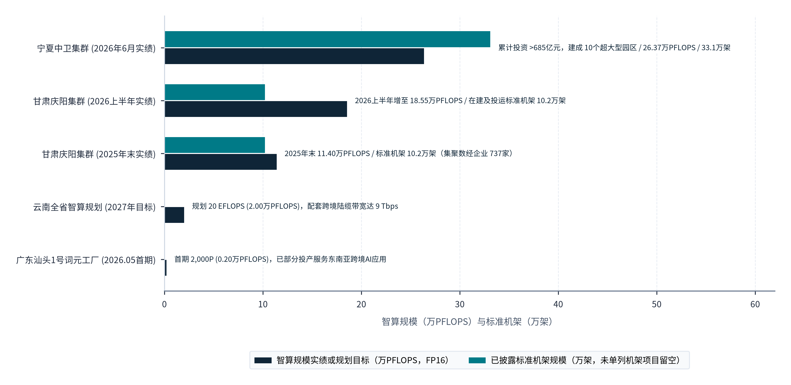
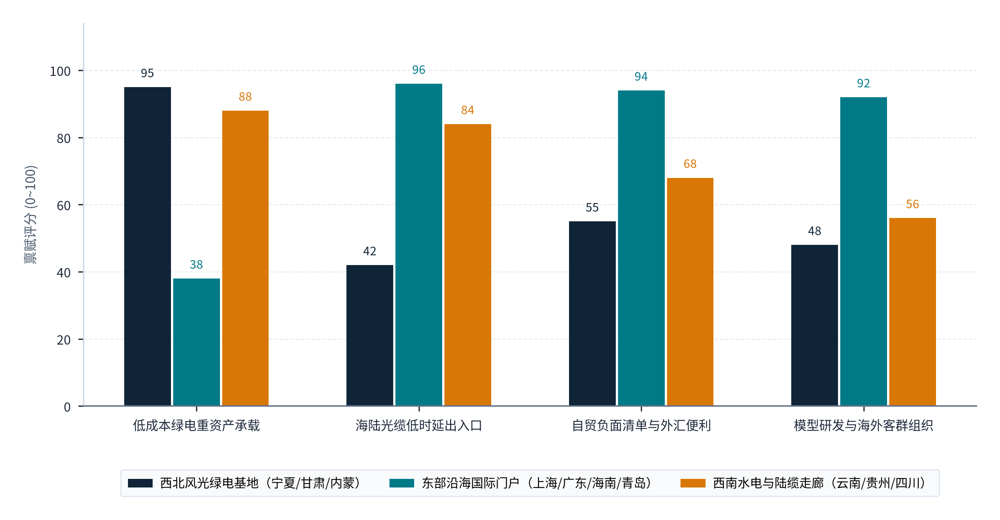
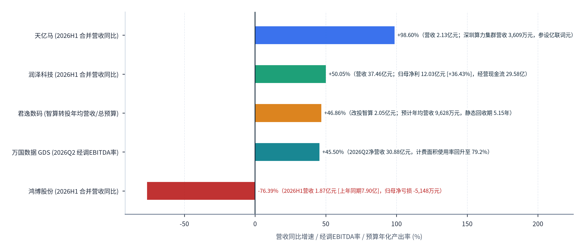
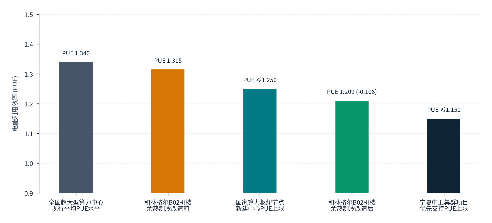

> **导航：** [返回中文手稿总目录](index.md) ｜ [上一章：第9章](chapter-09.md) ｜ [下一章：第11章](chapter-11.md) ｜ [尾注](notes.md) ｜ [参考文献](references.md)

# 国内区域分工、跨区域协作与典型案例

> **本章导读：** 在第 9 章确立了百万 Token 全生命周期成本（LCoT）模型与产业链五层价值分配机制后，一个关乎空间经济学的核心问题随之浮现：<strong>在中国广袤的国土空间上，哪些区域具备承接全球推理负载的物理与制度条件？不同省份在“从西部绿色瓦特到沿海跨洋比特”的转化链条中分别扮演什么角色，其营业收入、国内生产总值（GDP）增加值、财税贡献与经营风险又该如何合理归属与分担？</strong>中国数字基础设施的空间分布呈现出鲜明的非均衡互补特征：风光水清洁电力与低成本标准机架高度富集于宁夏中卫、甘肃庆阳、内蒙古和林格尔、云南昆明、贵州贵安等西部与西南节点；国际海缆登陆站、国际通信出入口局、自贸试验区数据跨境负面清单试点及离岸贸易金融服务高度集聚于上海、广东（深圳、广州、汕头）、海南、北京等沿海门户与核心都市；基座大模型研发与算法工程人才则集中在京沪深杭等创新策源地。本章首先对六类核心要素开展跨区域叠加分析，继而依据国家统计局《数字经济及其核心产业统计分类（2021）》（国家统计局令第 33 号）及 2026 年半年度上市公司财务实证，厘清不同区域的功能定位与增加值归属，深度剖析沿海“词元工厂”、西部绿电集群节能改造以及资产减值与募投调整的三组正反典型案例，最后提炼跨省算电协同与商业复制的制度条件[107](references.md#ref-107), [108](references.md#ref-108), [110](references.md#ref-110), [111](references.md#ref-111)。

## 10.1 区域条件的叠加分析

### 10.1.1 六维要素空间错配与互补：为何单一省份难以独立闭环“Token 出海”全链条？

与传统制造业出口不同，规模化、低成本、高合规的 Token 跨境交付需要同时调用**六类空间分布高度异质的生产要素**：① **充裕且低边际成本的绿色电力供给**（含风光水火储资源禀赋与省级电网两部制/单一部制过网费优势）；② **高功率密度、低 PUE 的规模化智算机架与加速卡集群**；③ **大容量、低时延的国际通信物理通道**（国际通信业务出入口局、跨洋海底光缆登陆站或跨境陆地光缆系统）；④ **前沿基础模型研发与推理算子工程人才**；⑤ **面向海外垂直行业的智能应用生态与出海客群集聚度**；⑥ **数据跨境流动负面清单、“来数加工”豁免与跨境自由贸易结算体系等制度试点授权**。

将上述六项要素投影至全国空间版图进行多图层叠加分析可以发现：<strong>没有任何一个单一城市能够同时在全部六个维度上取得绝对优势。</strong>东部沿海门户城市（上海临港、广东深圳与汕头、海南海口与文昌）坐拥国际海缆登陆站、新增国际通信业务出入口局、自贸试验区数据跨境试点及成熟的海外商业连接，但本地土地资源紧缺、市政变电站扩容受限，110 千伏工商业输配电价与终端综合电价显著高于西部枢纽，难以在本地大规模承载百兆瓦级高耗能推理机房；反之，西部国家算力枢纽节点（宁夏中卫、甘肃庆阳、内蒙古和林格尔）拥有得天独厚的风光装机、单一部制绿电直连政策、低温干燥自然冷源与连片超大型数据中心园区，但在地理上远离海底光缆登陆点，且本地缺乏面向海外开发者的模型工具链团队与跨境金融结算配套。唯有将<strong>“西部算电生产底座”“西南跨境陆缆走廊”与“东部海缆门户及研发交易中心”</strong>跨区域组合，才能实现全链条交付成本与合规效率的综合效益最大化[107](references.md#ref-107), [108](references.md#ref-108), [109](references.md#ref-109)。为直观呈现国内代表性枢纽与门户节点的硬件底座差距，**图表 10.1**对比了<strong>宁夏中卫集群 (2026年6月实绩)</strong>、<strong>甘肃庆阳集群 (2026上半年实绩)</strong>、<strong>甘肃庆阳集群 (2025年末实绩)</strong>、<strong>云南全省智算规划 (2027年目标)</strong>与<strong>广东汕头1号词元工厂 (2026.05首期)</strong>五项权威披露样本的智算规模（万PFLOPS）与配套机架/通道实绩：

#### 图表 10.1：国家算力枢纽与沿海沿边节点智算规模、标准机架及跨境带宽建设实绩（分列口径）

> **图像文件：** [`figures/chart_10_1.png`](../../figures/chart_10_1.png)（高清位图）｜ [`figures/chart_10_1.svg`](../../figures/chart_10_1.svg)（矢量图）
> **图注与来源：** 来源：宁夏中卫、甘肃庆阳、内蒙古和林格尔、广东汕头华侨试验区及云南昆明2025至2026H1官方通报；介子九维（JIEZIJIUWEI）整理绘制[107](references.md#ref-107)–[110](references.md#ref-110)。

从**图表 10.1**的五条横向柱状对比可以直观读出不同区域板块的体量级差与功能分工：在西北算电枢纽端，<strong>宁夏中卫集群 (2026年6月实绩)</strong>已建成智算规模达 <strong>26.37 万PFLOPS (FP16稀疏)</strong>、安装标准机架 **33.1 万架**（累计投资超 685 亿元），**甘肃庆阳集群**智算规模由**2025年末实绩**的 **11.40 万PFLOPS**（对应 **10.2 万标准机架**）快速跃升至**2026上半年实绩**的 **18.55 万PFLOPS**（半年净增 7.15 万PFLOPS）；相比之下，西南走廊的<strong>云南全省智算规划 (2027年目标)</strong>锚定 <strong>2.00 万PFLOPS (20 EFLOPS)</strong> 并配套 **9 Tbps 跨境陆缆容量**与昆明国际通信出入口局，而沿海海缆登陆站旁的<strong>广东汕头1号词元工厂 (2026.05首期)</strong>则以 <strong>0.20 万PFLOPS (首期2,000P)</strong> 的轻量化精益规模切入东南亚跨境 API 交付。这证明重资产算力生产底座已高度集聚于西北绿电富集区，而西南与沿海节点则依托国际海陆光缆出入口承担低时延跨境接入与模型路由门户功能。

### 10.1.2 三大战略区域板块的最新建设实绩与多维能力画像（截至 2026 年年中）

结合各省区政府公报、发展改革与能源主管部门批复文件及最新公开建设进展，中国支撑 Token 出海的区域节点已分化为各具比较优势的三大板块：

1. <strong>第一板块：西北算电融合与超大型智算生产基地（宁夏中卫、甘肃庆阳、内蒙古和林格尔）：</strong>
      该板块充当<strong>“绿电向算力转化的主力引擎”</strong>，适合承载时延容忍度较高的大规模批量推理（Batch Inference）、长上下文深度思考（Reasoning Chains）、多模态视频生成、合成数据蒸馏与模型后训练微调任务。
      
<strong>宁夏中卫数据中心集群：</strong>2023 年 5 月印发的《关于支持中卫大数据产业中心市高质量发展的实施方案》设定了明确的高标准绿色与规模门槛：优先支持电源使用效率（PUE）不高于 **1.15**、可再生能源使用率不低于 <strong>65%</strong> 的大型及超大型数据中心建设，提出 2025 年集群机架上架率达到 <strong>85%</strong>、2027 年标准机架规模达到 **69 万架**（按 2.5 千瓦/标准机架口径计）的规划目标[108](references.md#ref-108)。根据宁夏回族自治区政协于 2026 年 7 月 21 日公开披露的调研实绩，<strong>截至 2026 年 6 月底，中卫数据中心集群已建成超大型数据中心产业园 10 个，累计完成固定资产投资超过 685 亿元人民币，安装标准机架达 33.1 万架，智算算力规模达到 26.37 万 PFLOPS（原文明确标注为 FP16 稀疏精度口径）</strong>[108](references.md#ref-108)。在核算口径上，685 亿元为历史累计总投资，33.1 万架为已安装标准机架（与通电有效运行的上架机柜数分列），而 26.37 万 PFLOPS（FP16 稀疏）折算为稠密（Dense）等效算力时需按 2:1 硬件稀疏比校准[vi](notes.md#note-vi), [108](references.md#ref-108)。
<strong>甘肃庆阳数据中心集群：</strong>依托陇东综合能源基地与“绿电聚合直供”机制，庆阳集群实现了跨越式扩张。根据 2026 年 2 月《庆阳市政府工作报告（2026年）》回顾，截至 2025 年底庆阳已建成标准机架 **10.2 万架**、智算规模达 **11.4 万 P**[109](references.md#ref-109)；据甘肃官方门户于 2026 年 8 月 11 日披露的《庆阳数据中心集群算力规模突破 18 万 P》最新通报，**2026 年上半年庆阳数据中心集群算力规模已跃升至 18.55 万 P**（新闻通报口径未单独标注精度与稀疏属性），累计引进数字经济类企业 **737 户**，2026 年 1 至 6 月全市规模以上数字经济企业实现营业收入 **29.4 亿元人民币**[109](references.md#ref-109)。在统计分析中需严格区分当地园区注册企业总数（737 户）与实际付费调用算力的商业客户数，以及规上数字经济企业本地营收（29.4 亿元）与跨境算力服务出口净额的边界。
<strong>内蒙古和林格尔集群：</strong>紧邻京津冀高密度研发市场，具备到北京核心节点 5 毫秒以内的极低全光网时延，并在 2026 年大规模推进存量智算机楼“余热变冷源”等深度节能技改，将寒冷气候与风光绿电优势转化为行业领先的实测低 PUE 表现[109](references.md#ref-109)。
2. <strong>第二板块：西南清洁水电与跨境陆缆枢纽走廊（云南昆明、贵州贵安）：</strong>
      该板块兼具<strong>“极低排放因子的清洁水电底座”与“面向南亚东南亚的陆路光缆直连通道”</strong>双重属性。2025 年云南规上工业清洁能源发电量占比高达 87.6%，生态环境部发布的云南省级电力平均二氧化碳排放因子低至 **0.1333 kgCO2/kWh**（仅为全国均值 0.5306 的四分之一）[118](references.md#ref-118)。2026 年 5 月 15 日制发（5 月 20 日公布）的《云南省人民政府办公厅关于印发〈加强数字信息大通道建设 推动数字产业高质量发展实施方案〉的通知》（云政办发〔2026〕27号）明确提出：**加快推动昆明国际通信业务出入口局建成投用并开通业务流量**，到 **2027 年实现跨境陆缆系统开通容量达到 9 Tbps、全省算力规模达到 20 EFLOPS**（政策目标值，原文未单列浮点精度口径）[107](references.md#ref-107)。这使得云南昆明与贵州贵安构成了面向中南半岛（缅甸、老挝、泰国、越南、马来西亚及新加坡陆路接续）开展低时延、超低碳 Token 跨境交付的陆路门户。
3. <strong>第三板块：东部沿海国际海缆门户、自贸区制度高地与模型研发中心（上海、广东深圳/广州/汕头、海南海口/文昌、山东青岛、北京）：</strong>
      该板块承担<strong>“国际通信出入口、合规前置清洗网关、基座模型研发、平台商业运营与离岸外汇结算”</strong>四大高附加值功能。上海（崇明、南汇、临港）、广东（汕头、深圳、广州、珠海）与海南（文昌、海口、陵水）集聚了连接亚太、北美、亚欧的核心海底光缆登陆站与国际通信出入口局；北京、上海、深圳、杭州汇聚了全国 80% 以上的顶尖基座模型团队；广东汕头华侨经济文化合作试验区则探索出“国际海缆登陆站旁就近部署区域级智算中心（词元工厂）”的门户直连新范式[111](references.md#ref-111)。

为量化对比三大区域板块的优劣势互补关系，**图表 10.2**围绕**低成本绿电重资产承载**、**海陆光缆低时延出入口**、**自贸负面清单与外汇便利**及**模型研发与海外客群组织**四个维度（0至100分制），展示了<strong>西北风光绿电基地（宁夏/甘肃/内蒙）</strong>、<strong>东部沿海国际门户（上海/广东/海南/青岛）</strong>与<strong>西南水电与陆缆走廊（云南/贵州/四川）</strong>的禀赋评分：

#### 图表 10.2：国内三大区域板块（西北绿电枢纽、西南水电陆缆走廊、东南沿海门户）四维禀赋对比

> **图像文件：** [`figures/chart_10_1b.png`](../../figures/chart_10_1b.png)（高清位图）｜ [`figures/chart_10_1b.svg`](../../figures/chart_10_1b.svg)（矢量图）
> **图注与来源：** 来源：发改价格〔2026〕1077号、工信部四城出入口局批复、上海与海南数据跨境负面清单；介子九维（JIEZIJIUWEI）评估绘制[8](references.md#ref-8), [33](references.md#ref-33), [66](references.md#ref-66), [107](references.md#ref-107)。

对照**图表 10.2**的四组柱状评分可以看到：在**低成本绿电重资产承载**维度上，<strong>西北风光绿电基地（宁夏/甘肃/内蒙）</strong>与<strong>西南水电与陆缆走廊（云南/贵州/四川）</strong>分别拿到 **95分** 与 **88分**，而受制于土地与高电价的<strong>东部沿海国际门户（上海/广东/海南/青岛）</strong>仅为 **38分**；但在**海陆光缆低时延出入口**、**自贸负面清单与外汇便利**以及**模型研发与海外客群组织**三个维度上，<strong>东部沿海国际门户（上海/广东/海南/青岛）</strong>分别高达 **96分**、**94分** 与 **92分**，显著领先于西北基地的 **42分**、**55分** 与 **48分**（西南走廊则分别处于 **84分**、**68分** 与 **56分** 的中间梯度）。这种鲜明的空间错位，决定了跨区域“前店后厂”协同是中国 Token 出海的必然组织形态[107](references.md#ref-107)–[110](references.md#ref-110)。

为核实国内重点算力枢纽项目的工程落地进度与统计口径边界，**图表 10.3**按**区域 / 项目主体**、**核心披露指标**、**披露数值与单位**、**统计与披露期**、**当前工程阶段**及**统计口径与工程边界说明**六个维度，汇编了宁夏中卫集群、中卫中金数据 330kV 输变电工程、甘肃庆阳集群及内蒙古和林格尔新区 B02 机楼等 13 项披露记录：

#### 图表 10.3：国内重点区域算力枢纽与沿海词元工厂项目建设规模、发展阶段与口径说明一览表

| 区域 / 项目主体 | 核心披露指标 | 披露数值与单位 | 统计与披露期 | 当前工程阶段 | 统计口径边界与本体折算衍生指标 [D1] |
| --- | --- | --- | --- | --- | --- |
| 宁夏中卫集群 | 累计算力投资与标准机架 | 685亿元 / 33.1万机架 | 截至2026年6月 | 已建成投运（含10个超大型园区） | FP16稀疏26.37万P（折合FP16稠密13.185万P；单机架投资20.69万元） |
| 宁夏中卫（中金数据） | 330kV输变电新建工程 | 3,255万元 | 2025年6月29日核准 | 电力配套核准在建 | 支撑超大型智算集群高压接入（较110kV降线损与容量费约8%~12%） |
| 内蒙古和林格尔（B02机楼） | 余热回收制冷节能技改 | PUE由1.315降至1.209 | 2025至2026年 | 技改投运实测 | 非IT冷却损耗削减率达-33.65%，已节电56万kWh |
| 庆阳 | 建成机架 | 10.2 万机架 | 截至2025年回顾 | 政府工作报告披露 | 物理机架存量基数（非上架率或GPU活跃利用率） |
| 庆阳 | 智算规模 | 11.4 万P | 截至2025年回顾 | 政府工作报告披露 | 未标精度/稀疏性（若按稀疏折算FP16稠密等效约5.70万P） |
| 庆阳 | 集群算力规模 | 18.55 万P | 2026H1 | 新闻披露 | 半年环比净增+7.15万P（+62.7%，未标精度不直接混同稠密峰值） |
| 庆阳 | 规上数字经济企业收入 | 29.4 亿元 | 2026H1 | 新闻披露 | 折合年化单机架广义营收约5.76万元（非跨境Token净增加值） |
| 庆阳 | 累计数字经济类企业 | 737 户 | 2026H1 | 新闻披露 | 工商注册口径（规上营收户均约398.9万元，非付费API客户） |
| 和林格尔B02 | 改造前PUE | 1.315 比值 | 2026-10报道 | 企业项目披露/转载 | 非IT冷却与配电开销占IT净负荷的31.5% |
| 和林格尔B02 | 改造后PUE | 1.209 比值 | 2026-10报道 | 已投运披露 | 非IT开销占比压降至20.9%（净降10.6个百分点，削减率-33.65%） |
| 和林格尔B02 | 累计节电 | 56 万kWh | 截至2026-10报道 | 已实现披露 | 按当地0.6479因子折合已减排362.8吨CO₂（非年度常态值） |
| 和林格尔全部机楼 | 预测年度节电 | 1000 万kWh/年 | 未来全部投用后 | 预测 | 折合年减排6,479吨CO₂、可多支撑约1.49万亿Tokens/年推理 |
| 和林格尔全部机楼 | 预测年度节水 | 15 万吨/年 | 未来全部投用后 | 预测 | 折合1.5亿升/年冷却水节约（相当于33.3亿次400-token标准回复水耗） |

> **表格结构化数据文件：** [`data/exhibits/exhibit-10-3.csv`](../../data/exhibits/exhibit-10-3.csv)
> **表注与来源：** 来源：宁夏中卫、甘肃庆阳政府工作报告与官方通报（2025至2026H1）、汕头华侨经济文化合作试验区公告、天亿马与君逸数码上市公司公告；介子九维（JIEZIJIUWEI）本体治理与折算模型计算[107](references.md#ref-107)–[111](references.md#ref-111)。

审视**图表 10.3**逐行标注的<strong>“统计口径边界与本体折算衍生指标 [D1]”</strong>可以避免常见的基建统计误读：第一，**宁夏中卫集群**的 **685亿元 / 33.1万机架** 对应的是 **FP16稀疏算力达26.37万PFLOPS**（按2:1结构化稀疏硬件定律折合 **FP16稠密等效算力为13.185万PFLOPS**，单机架平均综合投资强度为 **20.69万元**），而**庆阳**在 2025 年底的 **11.4 万P** 与 2026H1 的 **18.55 万P**（半年环比增长 <strong>+62.7%</strong>）均未单列浮点精度与稀疏属性，在横向比较时需区分其与 FP16 稠密算力的精度口径差异；第二，**庆阳**披露的 **737 户** 累计数字经济类企业与 **29.4 亿元** 规上数字经济企业收入属于园区本地广义口径，不等同于实际付费算力客户或跨境 Token 出口收入；第三，**和林格尔B02** 机楼已实现的 **累计节电 56 万kWh**（PUE 由 **1.315** 降至 **1.209**，非 IT 冷却与配电损耗占比从 31.5% 压降至 20.9%，相对削减率达 <strong>-33.65%</strong>）必须与全部机楼改造投用后的预测值（**1000 万kWh/年**，折合年减排 6,479 吨 CO2；**15 万吨/年**节水，折合 1.5 亿升/年）严格区分[107](references.md#ref-107)–[110](references.md#ref-110)。

## 10.2 区域功能与价值归属

### 10.2.1 国家统计局第 33 号令下的四类核心产业映射与跨区域价值核算归属

依据国家统计局《数字经济及其核心产业统计分类（2021）》（国家统计局令第 33 号，2021 年 5 月 27 日制发，2025 年 3 月 24 日国家统计局官方统计标准问答再次确认其为现行有效分类基准），中国数字经济核心产业严格划分为**四大类别：01 数字产品制造业、02 数字产品服务业、03 数字技术应用业、04 数字要素驱动业**[110](references.md#ref-110)。Token 出海价值链上的各个环节在国民经济核算与区域财税归属上呈现出清晰的<strong>“空间分离”特征</strong>：

- <strong>营业收入与增值税/企业所得税归属（按签约与开票法人注册地核算）：</strong>在现行在地法人统计原则下，直接与海外客户（或海外离岸子公司）签署 MaaS API 服务合同、收取服务费并开具发票的模型研发企业或平台运营主体（归属<strong>“03 数字技术应用业”中的软件开发、信息技术服务，或“04 数字要素驱动业”中的互联网平台、数据处理和存储支持服务</strong>），其全额跨境服务营业收入计入北京、上海、深圳、汕头等**平台法人注册地**；西部智算中心项目公司则按机柜托管合同或算力租赁结算额，在当地确认基础设施服务收入。
- <strong>生产法 GDP 增加值（Value Added）的地区构成差异：</strong>依据生产法核算公式（**增加值 ＝ 劳动者报酬 ＋ 生产税净额 ＋ 固定资产折旧 ＋ 营业盈余**），西部算力基地项目公司由于承载了百亿级机房土建、变配电设备与服务器硬件资产，其<strong>“固定资产折旧”与配套电力采购拉动的本地工业/电力业增加值</strong>占比极高；东部模型与平台公司则集中了算法与产品团队的<strong>“劳动者报酬”</strong>以及品牌、算法溢价形成的<strong>“营业盈余”</strong>[110](references.md#ref-110)。
- <strong>就业拉动与技术外溢分化：</strong>西部超大型智算园区在建设期可拉动数千人土建机电施工就业，但进入自动化运维期后现场常驻巡检工程师仅需百人左右；围绕 Token 接口衍生的多语种智能体编排、AI 短剧合成、跨境电商数字人与行业解决方案（ISV），则在沿海与区域中心城市创造高附加值数字服务岗位。

### 10.2.2 2026 年上半年算力与词元产业链上市公司财务实证对比

为检验国内不同区域功能主体在 2026 年的真实经营水位，本报告选取三大基础电信运营商与五家代表不同生态位的算力及词元产业链上市企业 2025 年年报、2026 年半年度报告及后续投资公告进行财务剖析[111](references.md#ref-111), [112](references.md#ref-112), [113](references.md#ref-113)：

1. <strong>超大型智算中心基础设施龙头（润泽科技，300442.SZ）：高上架率与长约锁定的强劲现金流。</strong>
      作为在京津冀（廊坊）、长三角（平湖）、大湾区（佛山/惠州）、成渝及西北（甘肃庆阳）布局超大型算力中心的头部 AIDC 运营商，润泽科技《2026年半年度报告》显示：<strong>2026 年上半年公司实现合并营业收入 37.4569 亿元人民币（3,745,694,047.05 元），较 2025 年同期的 24.9622 亿元大幅增长 50.05%；实现归属于上市公司股东的净利润 12.0345 亿元人民币（1,203,446,677.80 元），同比增长 36.43%（净利率达 32.13%）；经营活动产生的现金流量净额达 29.5803 亿元人民币（2,958,027,620.47 元），同比增长 30.78%；截至 2026 年 6 月 30 日公司总资产达 478.5478 亿元人民币（较上年末的 426.9374 亿元增长 12.09%）</strong>[112](references.md#ref-112)。润泽科技的财务实绩证明，依托园区级高密机房、液冷规模化交付与大客户批发长约，重资产底座能够产生稳健的经营现金流（经营现金流净额占营收比重达 79.0%）。
2. <strong>沿海海缆门户“词元工厂”先行者（天亿马，301178.SZ）：从政企 IT 向算力集群与合资词元平台转型。</strong>
      总部位于广东汕头的天亿马《2026年半年度报告》显示：2026 年上半年公司实现合并营业收入 <strong>2.1254 亿元人民币（212,538,487.68 元）</strong>，较 2025H1 的 1.07 亿元增长 98.6%，其中**深圳算力集群服务项目在 2026 年上半年已贡献营业收入 3,609.04 万元人民币**（占公司总营收的 16.98%）[111](references.md#ref-111)。2026 年 9 月 29 日，天亿马发布《关于与关联方共同投资设立合资公司暨关联交易的公告》（公告编号：2026-063），宣布共同出资设立**广东亿联词元科技有限公司（拟定名），注册资本 1,000 万元人民币**，认缴股权结构为：<strong>天亿马以自有资金出资 450 万元持股 45%，算力合作方瑞源智算持股 44%，自然人马翊珽持股 6%，林树生持股 5%</strong>（后两名自然人与天亿马签署一致行动协议，合计控制 56% 表决权并纳入天亿马合并报表范围）[111](references.md#ref-111)。这标志着沿海企业已开始设立专门以“词元（Token）”命名的独立经营主体统筹跨境推理与模型服务。
3. <strong>跨界算力租赁风险对照样本（鸿博股份，002229.SZ）：裸卡差价租赁退潮下的营收滑坡与亏损。</strong>
      早期跨界算力租赁的鸿博股份《2026年半年度报告》披露：<strong>2026 年上半年公司合并营业收入为 1.8653 亿元人民币（186,534,121.06 元），较上年同期（2025H1）的 7.9013 亿元人民币（790,130,309.59 元）同比下滑 76.39%；归属于上市公司股东的净利润由盈利转为净亏损 -5,148.16 万元人民币（-51,481,594.40 元）</strong>[113](references.md#ref-113)。这一对比揭示了缺乏底层绿电园区、自研推理调度软件栈与稳定出海客群的单纯硬件转租模式在供需重构期的脆弱性。

为将电信央企与算力民企的财务水位置于同一标尺下检验，**图表 10.4**按**企业名称**、**报告期与对比口径**、**营业收入实绩与同比**、**净利润 / 核心云算力收入**、**现金流 / EBITDA / 专项投资**及**算力业务结构与经营特征**六个维度，汇总了**中国移动**、**中国电信**、**中国联通**与<strong>万国数据 (GDS)</strong>、**润泽科技**、**天亿马**、**君逸数码**、**鸿博股份**共 8 家企业的财务与经营实绩：

#### 图表 10.4：三大电信运营商与五家算力及词元产业链上市企业2025至2026年上半年财务与经营对比表

| 企业名称 | 报告期与对比口径 | 营业收入实绩与同比 | 净利润 / 核心云算力收入 | 现金流 / EBITDA / 专项投资 | 算力业务结构与经营特征 |
| --- | --- | --- | --- | --- | --- |
| 中国移动 | 2025全年 / 2026H1 | 通信服务收入 8,895亿元（2025） | 数字化转型收入 2,788亿元（+9.9%） | 移动云收入 1,004亿元（+20.4%） | 智算规模达 34 EFLOPS（FP16），国际业务收入 228亿元 |
| 中国电信 | 2025全年 / 2026H1 | 经营收入 5,294亿元（2025） | 天翼云收入 1,139亿元（+17.1%） | 智能收入 89亿元（+195.7%） | 智算规模达 35 EFLOPS（FP16），国际业务收入 169亿元 |
| 中国联通 | 2025全年 / 2026H1 | 营业收入 3,896亿元（2025） | 联通云收入 686亿元（+17.1%） | 算网数智业务收入 825亿元 | 智算规模超 20 EFLOPS，加快推进青岛/海口/昆明国际局建设 |
| 万国数据 (GDS) | 2025全年 / 2026Q2 | 2025净营收 114.32亿元；2026Q2净营收 30.88亿元 | 2026Q2归母净利润 8.38亿元 | 2026Q2经调整EBITDA 14.06亿元（利润率 45.5%） | 计费机架利用率由 2025末 75.5% 回升至 2026Q2 的 79.2%；2025Q4计提减值 15.61亿元 |
| 润泽科技 | 2026H1 vs 2025H1 | 2026H1营业收入 37.46亿元（同比 +50.05%） | 2026H1归母净利润 12.03亿元（同比 +36.43%） | 2026H1经营活动现金流净额 29.58亿元（同比 +30.78%） | 高功率密度液冷AIDC集群稳定交付，现金流充沛 |
| 天亿马 | 2026H1 vs 2025H1 | 2026H1营业收入 2.13亿元（2025H1为 1.07亿元，+98.6%） | 深圳算力集群单点收入 3,609.04万元 | 参股设立广东亿联词元（注册资本 1,000万元，持股 45%） | 联合华侨试验区启动汕头“1号词元工厂”一期 2,000P 智算服务 |
| 君逸数码 | 2026年8月12日公告 | 智算项目总投资预算 2.0546亿元 | 预计年均新增营业收入 9,628.00万元 | 预计静态投资回收期 5.15年（含建设期） | 终止原智慧城市募投项目，资金转向高景气AI智算中心建设 |
| 鸿博股份 | 2026H1 vs 2025H1 | 2026H1营业收入 1.87亿元（2025H1为 7.90亿元，-76.39%） | 2026H1归母净利润 -5,148.16万元（同比转亏） | 2026H1经营活动现金流净额 -4,677.53万元 | 受硬件采购成本上升、设备到货减少及裸卡租赁单价下调三重挤压 |

> **表格结构化数据文件：** [`data/exhibits/exhibit-10-4.csv`](../../data/exhibits/exhibit-10-4.csv)
> **表注与来源：** 来源：中国移动、中国电信、中国联通、万国数据（GDS）、润泽科技、广东天亿马、鸿博股份定期财务报告及四川君逸数码专项公告（截至2026年10月）；介子九维（JIEZIJIUWEI）整理计算[105](references.md#ref-105), [109](references.md#ref-109)–[113](references.md#ref-113)。

穿透**图表 10.4**中 8 家电信与算力上市企业的财务数据可以发现，行业经营业绩正经历剧烈的结构性分化：在电信央企阵营，**中国移动**（移动云收入 **1,004亿元**，智算规模 **34 EFLOPS**，国际业务收入 **228亿元**）、**中国电信**（天翼云收入 **1,139亿元**，智算规模 **35 EFLOPS**，国际业务收入 **169亿元**）与**中国联通**（联通云收入 **686亿元**，智算超 **20 EFLOPS**）凭借“自有智算集群 + 国际通信出入口局”一体化优势稳居主力地位；在专业算力与词元企业阵营，具备高密液冷园区与长约锁定的**润泽科技**（2026H1 营收 **37.46亿元**、归母净利润 **12.03亿元**、经营现金流净额 **29.58亿元**）、计费使用率修复至 <strong>79.2%</strong> 的<strong>万国数据 (GDS)</strong>（2026Q2 净营收 **30.88亿元**、归母净利润 **8.38亿元**）以及绑定汕头词元工厂的**天亿马**（2026H1 营收 **2.13亿元**，同比增长 <strong>+98.6%</strong>）均实现了稳健增长，而单纯依赖外购硬件开展裸卡租赁的**鸿博股份**（2026H1 营收 **1.87亿元**、归母净亏损 <strong>-5,148.16万元</strong>）则陷入亏损[105](references.md#ref-105), [109](references.md#ref-109)–[113](references.md#ref-113)。

## 10.3 典型案例与对照案例

### 10.3.1 沿海门户“词元工厂”典型案例：广东汕头华侨试验区与天亿马“1号词元工厂”实证剖析

在将算力封装为标准化“词元（Token）”并依托海缆门户向海外交付的产业探索中，**广东省汕头华侨经济文化合作试验区与广东天亿马信息产业股份有限公司（301178.SZ）联合推进的“1号词元工厂”项目**提供了微观实证样本[111](references.md#ref-111)。本报告依据国家数据局公开动态、天亿马《2026年半年度报告》（2026 年 8 月 29 日披露）、《投资者关系活动记录表（20260915）》及《关于与关联方共同投资设立合资公司暨关联交易的公告》（2026-063，2026 年 9 月 29 日）四份原件，还原其业务链条与真实进展阶段：

1. <strong>选址逻辑与通道禀赋：</strong>汕头是中国三大传统国际海缆登陆站所在地之一，同时设有国家级华侨经济文化合作试验区，面向东南亚华商网络与海外开发者具备商贸连接。2026 年 8 月 28 日至 30 日中国国际大数据产业博览会（数博会）期间，广东省主宾省展区专门设立了“词元经济”展示板块予以推介[111](references.md#ref-111)。
2. <strong>建设规模、软件平台与投产进度（分清规划总规模与已投运实绩）：</strong>根据天亿马 2026 年半年报第三节“管理层讨论与分析”之主营业务分析与核心竞争力章节披露，公司于 <strong>2026 年 5 月正式启动建设首期规划规模为 2,000P 的“1号词元工厂”</strong>（公告原文未单独披露该 2,000P 对应的浮点精度与稀疏口径），并研发上线了自建算力调度与开源大模型部署平台 <strong>“T.Y.M. Model Hub”</strong>[111](references.md#ref-111)。在 2026 年 9 月 15 日投资者关系活动记录表（问答 2 及问答 7）中，管理层确认：<strong>截至 2026 年 9 月中旬，“1号词元工厂”首期 2,000P 仍处于分步建设过程中，其中“部分设备已经投产运营”</strong>（未披露已投产部分的具体 P 数）[111](references.md#ref-111)。
3. <strong>目标海外市场与付费客群画像：</strong>根据 2026 年 9 月 15 日投资者关系活动记录表披露，天亿马词元业务锁定的核心需求地域为**新加坡、泰国、马来西亚、印度尼西亚等东南亚国家**，重点服务的四类下游客户群体包括：**① AI 短剧制作与出海发行商（多语种字幕翻译、配音与视频生成）；② 智能陪伴式 AI 玩具硬件厂商（实时语音与对话 Token 调用）；③ 海外本地 AI 技术服务商；④ 独立开发者**[111](references.md#ref-111)。这一客群结构避开对主权合规极度敏感的欧美政企核心内网，优先从东南亚消费级泛娱乐（AI 短剧）、出海智能硬件（AI 玩具）与中小开发者市场切入。
4. <strong>商业治理架构与证据边界审视：</strong>天亿马于 2026 年 9 月 29 日公告设立合资公司“广东亿联词元科技有限公司”（注册资本 1,000 万元，天亿马持股 45%、瑞源智算持股 44%、两名一致行动自然人合计持股 11%）[111](references.md#ref-111)。从实证研究角度看，截至研究基准日（2026年10月），企业公开披露的“部分设备投产”“东南亚四国需求市场”及“至香港/新加坡毫秒级时延表述”均来自定期报告与投资者说明会自述，尚未在财报附注中单独拆分披露跨境词元 API 调用收入金额、在手海外合同额及第三方网络探针实测日志，其规模化盈利能力仍需后续年度审计报告持续验证。

### 10.3.2 西部绿电枢纽工程案例：宁夏中卫中金 330kV 变电核准与内蒙古和林格尔“余热变冷源”技改

宁夏中卫与内蒙古和林格尔的最新工程样本，揭示了西部基地如何通过**高电压等级电网直连**与**热力学降耗**来锻造低成本“后厂”：

- <strong>高压配电核准样本（宁夏中金沙坡头数据中心 330 千伏供电工程）：</strong>超大型智算集群将园区功率推升至百兆瓦级后，直接接入 220 千伏乃至 330 千伏主网成为降低度电输配成本的关键。根据宁夏回族自治区发展改革委于 2025 年 6 月 29 日制发（6 月 30 日公布）的《关于宁夏中金沙坡头数据中心（中金中卫算力）330千伏供电工程核准的批复》原件[108](references.md#ref-108)，官方正式核准为中金数据中卫沙坡头数据中心二期、三期项目建设配套 **330 千伏供电工程**，核准工程总投资为 **3,255 万元人民币**（项目资本金占总投资的 20%，由企业自有资金出资，其余申请银行贷款解决）[108](references.md#ref-108)。从 110kV 升级至 220kV/330kV 高压接入，可直接压降每千瓦时电量输配电价与线损成本。
- <strong>存量机楼能效升级样本（内蒙古和林格尔新区 B02 机楼“余热变冷源”改造）：</strong>根据内蒙古自治区能源局门户于 2026 年 10 月 14 日转载发布的《余热变冷源：和林格尔新区算力升级项目》报道[109](references.md#ref-109)，中国移动呼和浩特数据中心联合内蒙古京能盛乐热电有限公司，通过铺设 4.6 公里供热管道引入热电厂发电余热，在数据中心内转化为制冷冷源替代传统电空调压缩机。实测成效显示：**率先完成改造并投运的 B02 机楼，其运行 PUE 由改造前的 1.315 显著下降至 1.209（降幅达 0.106，非 IT 散热与配电损耗降低了 33.7%），截至 2026 年 10 月报道时点该单栋机楼已实现累计节电 56 万千瓦时；按照工程规划，待园区全部机楼推广投用该系统后，预计每年可实现节电 1,000 万千瓦时、每年节约冷却用水 15 万吨**[109](references.md#ref-109)（已实现的 B02 机楼 56 万 kWh 累计节电与未来全部机楼投用后的 1,000 万 kWh/年、15 万吨/年预测值严格分列）。

为直观对比算力与词元产业链五家代表性上市企业在 2026 年上半年的营收增速、利润率弹性与跨界风险，**图表 10.5**以<strong>同比变动率 / 核心利润率或投资产出比 (%)</strong>为横轴，将<strong>天亿马 (301178.SZ)</strong>、<strong>润泽科技 (300442.SZ)</strong>、<strong>君逸数码 (301172.SZ)</strong>、<strong>万国数据 GDS (NASDAQ)</strong>与<strong>鸿博股份 (002229.SZ)</strong>的核心财务实绩进行了可视化对标：

#### 图表 10.5：国内典型算力基础设施与词元工厂上市企业 2026 年上半年核心经营指标对比（同口径百万人民币）

> **图像文件：** [`figures/chart_10_3.png`](../../figures/chart_10_3.png)（高清位图）｜ [`figures/chart_10_3.svg`](../../figures/chart_10_3.svg)（矢量图）
> **图注与来源：** 来源：万国数据、润泽科技、天亿马、鸿博股份2026年半年度/季度财报及君逸数码2026年8月公告；介子九维（JIEZIJIUWEI）整理绘制[105](references.md#ref-105), [109](references.md#ref-109)–[111](references.md#ref-111)。

从**图表 10.5**的五条双向水平柱状指标可以清晰看到：依托深圳算力集群交付（上半年贡献营收 3,609.04 万元）与汕头 1 号词元工厂布局的<strong>天亿马 (301178.SZ)</strong>实现 2026H1 营收同比高增 <strong>+98.60%</strong>（总营收 2.13 亿元）；超大型高密液冷 AIDC 龙头<strong>润泽科技 (300442.SZ)</strong>实现 2026H1 营收同比增长 <strong>+50.05%</strong>（营收 37.46 亿元、归母净利 12.03 亿元、净利率 32.13%）；终止传统智慧城市募投转向智算建设的<strong>君逸数码 (301172.SZ)</strong>预计年均新增营收占总投资（2.05 亿元）比率达 <strong>+46.86%</strong>（年均营收 9,628 万元、静态回收期 5.15 年）；计费面积利用率修复至 79.2% 的<strong>万国数据 GDS (NASDAQ)</strong>在 2026Q2 实现经调整 EBITDA 利润率 <strong>+45.50%</strong>（单季净营收 30.88 亿元、归母净利 8.38 亿元）；相比之下，单纯依赖外购硬件开展裸卡租赁的<strong>鸿博股份 (002229.SZ)</strong>在 2026H1 合并营收较上年同期（7.90 亿元）同比大幅下滑 <strong>-76.39%</strong>（归母净亏损 -5,148.16 万元）[105](references.md#ref-105), [111](references.md#ref-111)–[113](references.md#ref-113)。

为量化呈现西部算力枢纽通过热力学改造降低非 IT 能耗的工程实效，**图表 10.6**将**全国超大型算力中心现行平均PUE水平**、**和林格尔B02机楼余热制冷改造前**、**国家算力枢纽节点新建中心PUE上限**、**和林格尔B02机楼余热制冷改造后**与**宁夏中卫集群项目优先支持PUE上限**五项电能利用效率（PUE）标尺进行了直接对标：

#### 图表 10.6：内蒙古和林格尔新区 B02 机楼余热回收制冷技改实测 PUE 与国家政策红线对比

> **图像文件：** [`figures/chart_10_3b.png`](../../figures/chart_10_3b.png)（高清位图）｜ [`figures/chart_10_3b.svg`](../../figures/chart_10_3b.svg)（矢量图）
> **图注与来源：** 来源：内蒙古自治区能源局官方披露（2026年10月14日）、发改环资〔2024〕970号PUE标准；介子九维（JIEZIJIUWEI）整理绘制[40](references.md#ref-40), [108](references.md#ref-108)。

对照**图表 10.6**的五根柱体数值可见：相较于<strong>全国超大型算力中心现行平均PUE水平（1.340）</strong>，**和林格尔B02机楼余热制冷改造前**的实测 PUE 为 **1.315**，但仍高于<strong>国家算力枢纽节点新建中心PUE上限（PUE ≤1.250）</strong>；通过 4.6 公里管道引入邻近热电厂发电余热转化为数据中心制冷冷源，**和林格尔B02机楼余热制冷改造后**的实测 PUE 显著压降至 <strong>1.209 (-0.106)</strong>，不仅全面优于国家枢纽新建上限（<strong>≤1.250</strong>）并逼近<strong>宁夏中卫集群项目优先支持PUE上限（PUE ≤1.150）</strong>，还将非 IT 冷却与配电损耗削减了三分之一以上，单栋机楼已累计节电 56 万千瓦时，园区全部机楼推广后预计每年可节电 1,000 万千瓦时、节水 15 万吨[108](references.md#ref-108), [109](references.md#ref-109)。

### 10.3.3 行业警示与战略转型对照案例：资产减值、裸卡租赁收益不及预期与募投切换

客观审视算力基础设施行业在 2025 至 2026 年暴露出的**资产减值、收益偏差与盲目扩张风险**，对于防范低水平重复建设至关重要（见**图表 10.4** 与**图表 10.5**）：

1. <strong>对照样本一（万国数据 GDS：从 2025Q4 的 15.61 亿元长期资产减值到 2026Q2 的 79.2% 利用率修复）：</strong>
      根据万国数据（GDS Holdings Limited）披露的《2025年第四季度及全年业绩公告》，公司于 <strong>2025 年第四季度计提了高达 15.612 亿元人民币（RMB 1,561.2 million）的长期资产减值损失（Impairment losses of long-lived assets）</strong>[112](references.md#ref-112)，主要源于部分早期传统低功率密度机房或特定区域资产在客户迁出后资产可收回金额低于财务净值。随后，通过加快高密智算机房改造并承接头部云与 AI 推理增量订单，公司在 2026 年 8 月 13 日发布的《2026年第二季度业绩报告》中披露，<strong>截至 2026 年 6 月 30 日，其签约与计费面积利用率（Area Utilization Rate）已稳步修复至 79.2%</strong>[112](references.md#ref-112)。这一周期表明：<strong>机架物理存在不等于有效算力供给，缺乏高密液冷改造能力与明确推理负载锚定的传统机房面临沉没成本风险。</strong>
2. <strong>对照样本二（鸿博股份北京 AI 创新中心项目：三大因素夹击导致项目收益不及预期）：</strong>
      查阅鸿博股份《2026年半年度报告》第三节“重要事项”之“募集资金使用情况对照表”专项说明可见，公司核心算力项目<strong>“北京 AI 创新赋能中心项目”的实际效益未达到原可行性研究预期</strong>。半年报披露了导致收益偏差的**三大直接原因：① 硬件设备采购价格上升；② 在固定投资预算下实际可采购的高端算力设备数量相应减少；③ 市场算力租赁单价显著降低**[113](references.md#ref-113)（注：公司在同表中披露终止的两项募投项目为原传统彩票业务项目，并非终止智算项目本身）。“采购成本飙升 + 硬件数量缩水 + 租赁单价跳水”的三重挤压，揭示了纯硬件转租商在面对云大厂与低成本绿电集群竞争时的困局。
3. <strong>对照样本三（四川君逸数码：终止传统智慧城市募投，转向 2.05 亿元智算项目的投资预算与回收期测算）：</strong>
      2026 年 8 月 12 日，四川君逸数码科技股份有限公司发布《关于变更募投项目投入新项目的公告》（公告编号：2026-038），宣布终止原传统智慧城市类募投项目，将资金变更投向新建人工智能算力服务项目[113](references.md#ref-113)。根据公告第三节“新项目基本情况”与第四节“新项目投资预算及经济效益分析表”披露（当时处于董事会通过、待股东会审议阶段）：**该项目计划总投资 20,545.79 万元人民币（拟使用募集资金 18,422.00 万元，计划建设期 1 年），设备购置费高达 18,661.78 万元（占总投资的 90.83%），机柜及带宽租赁费仅 401.40 万元（占 1.95%），项目实施费用 956.20 万元（占 4.65%），预备费 190.63 万元（占 0.93%），铺底流动资金 335.78 万元（占 1.63%）；公司预测该项目在经营期年均实现营业收入 9,627.53 万元/年，静态投资回收期为 5.15 年**[113](references.md#ref-113)。将君逸数码的投资预算结构与第 9 章 LCoT 模型交叉检验可知：<strong>当新进入者投资预算中 90.83% 为纯硬件购置、仅 1.95% 为机柜及带宽租赁，且静态回收期长达 5.15 年（已逼近 AI 加速卡 3～5 年的经济折旧寿命）时，若缺乏稳定的 Token 消耗场景支撑高利用率，只要算力单价在未来三年再降 20%～30%，其回收期假设便会面临严峻挑战。</strong>

## 10.4 跨区域协作与复制条件

### 10.4.1 “东数西算 + 前店后厂”的六环节协作机制与跨主体利益分成设计

国家发展改革委等五部门印发的《关于深入实施“东数西算”工程 加快构建全国一体化算力网的实施意见》（发改数据〔2023〕1779号）第（九）条明确提出，在国家算力枢纽节点与需求城市之间探索建立覆盖<strong>“调度、传输、算电融合、运营、交易结算、收益分配”</strong>六大环节的跨地区协作机制[47](references.md#ref-47), [123](references.md#ref-123)。结合沿海词元工厂（如广东亿联词元合资协议条款）与西部绿电基地的实证研究，本报告构建了面向 Token 出海的三类跨区域协作与收益分配标准模型。

### 10.4.2 跨区域收益分配机制设计与区域智算项目立项风控标准

围绕算力生产地、国际通信门户与模型研发平台之间的权责利边界，**图表 10.7**从**跨区域协作模式**、**参与区域与主体组合**、**物理调度、网络传输与算电协同分工**、**商业结算、合资治理与收益分配机制**及**跨区统计、税收归属与可复制成立条件**五个维度，对比了<strong>模式一：沿海门户与算力方股权合资型（“词元工厂”合资模式）</strong>、<strong>模式二：“东数西算”结对子母集群分成型（前店后厂跨省协同）</strong>与<strong>模式三：西南水电枢纽 + 跨境陆缆直连东盟型（澜湄/东盟走廊模式）</strong>的设计方案：

#### 图表 10.7：中国 Token 出海“西部绿电算力底座 + 西南/沿海通信门户 + 东部模型平台”跨区域协作与收益分配机制设计表

| 跨区域协作模式 | 参与区域与主体组合 | 物理调度、网络传输与算电协同分工 | 商业结算、合资治理与收益分配机制 | 跨区统计、税收归属与可复制成立条件 |
| --- | --- | --- | --- | --- |
| <strong>模式一： 沿海门户与算力方股权合资型 （“词元工厂”合资模式）</strong> | **沿海门户上市企/国企**（如汕头天亿马 45% + 一致行动人 11%） + **专业智算资源方**（如瑞源智算 44%）[111](references.md#ref-111) | 在国际海缆登陆站所在城市（如汕头华侨试验区）就近部署智算集群与模型平台（T.Y.M. Model Hub），直连港澳与东南亚海缆，支撑毫秒级交互任务。 | 设立独立核算的<strong>词元合资公司（注册资本 1,000 万元）</strong>；控股方委派董事长及财务负责人并纳入合并报表；**按认缴出资比例分配可分配利润**[111](references.md#ref-111)。 | <strong>成立条件：</strong>门户城市具备海缆登陆站或跨境专线优势 + 园区提供过渡期电力/场地扶持 + 锁定东南亚短剧/智能硬件等刚性客群。 |
| <strong>模式二： “东数西算”结对子母集群分成型 （前店后厂跨省协同）</strong> | **东部/沿海国际门户**（上海临港/深圳前海/海南海口） + **西部绿电枢纽**（宁夏中卫/甘肃庆阳/内蒙和林格尔） | <strong>沿海“前店”：</strong>部署轻量化 API 网关、PII 隐私脱敏与实时小模型； <strong>西部“后厂”：</strong>通过 17 个省级算力互联节点与低时延光网，承接长思维链与夜间 Batch 推理，消纳 0.30～0.35 元/kWh 绿电。 | 采用<strong>“保底机柜/卡时基价 + 跨境 Token 净流水阶梯分成”</strong>双层结算：东部平台向西部基地支付保底电费与折旧覆盖成本，超额毛利按 6:4 或 7:3 分成。 | <strong>跨省协同政策配套：</strong>通过东西部政府结对协议，将跨境推理对应的**算力吞吐量、绿电消纳量与固定资产投资**计入西部考核，将**服务贸易出口额**按约定比例在东西部间双向认定。 |
| <strong>模式三： 西南水电枢纽 + 跨境陆缆直连东盟型 （澜湄/东盟走廊模式）</strong> | **云南昆明国际通信出入口局** + **云南/贵州绿色水电智算园区** + **东南亚本地电信/ISV 渠道**[107](references.md#ref-107) | 依托云南 0.1333 kgCO2/kWh 超低碳水电与 2027 年 **9 Tbps 跨境陆缆容量**，绕开马六甲海缆抢修瓶颈，陆路直达中南半岛五国及新加坡[107](references.md#ref-107), [118](references.md#ref-118)。 | 基础电信运营商提供“跨境陆缆专线 + 绿电智算机房”一揽子捆绑底座，与模型应用厂商按月度承诺吞吐量（PTU）或 API 消耗额结算。 | <strong>成立条件：</strong>昆明国际通信业务出入口局全面开通商用国际数据流量 + 完善与泰国、马来西亚、新加坡 IXP 节点的 BGP 对等互联。 |

> **表格结构化数据文件：** [`data/exhibits/exhibit-10-7.csv`](../../data/exhibits/exhibit-10-7.csv)
> **表注与来源：** 来源：发改数据〔2023〕1779 号、云政办发〔2026〕27 号、天亿马《关于与关联方共同投资设立合资公司暨关联交易的公告》（2026-063）；介子九维（JIEZIJIUWEI）研究设计[47](references.md#ref-47), [107](references.md#ref-107), [111](references.md#ref-111)。

对照**图表 10.7**设计的三类跨区域协作与收益分配机制可以看出：针对高实时交互场景，可采用<strong>模式一（沿海门户与算力方股权合资型）</strong>在汕头、深圳等海缆门户就近设立独立核算的词元合资公司，按股权比例共享利润；针对大规模长思维链与异步批处理场景，应主推<strong>模式二（“东数西算”结对子母集群分成型）</strong>，通过“保底机柜/卡时基价 + 跨境 Token 净流水阶梯分成（如 6:4 或 7:3）”以及服务贸易出口额与绿电消纳量的东西部双向考核认定，彻底打消西部省份“只留电耗、不留产值与税收”的顾虑；针对东南亚陆路毗邻市场，则可依托<strong>模式三（西南水电枢纽 + 跨境陆缆直连东盟型）</strong>将云南超低碳水电（0.1333 kgCO2/kWh）与昆明国际通信业务出入口局捆绑交付，调动西部能源大省与沿边沿海门户城市的双向积极性。

> ### 【专栏 10.1 · 区域项目立项与投资风控准则】如何甄别“真 Token 出海集群”与“概念包装型盲目基建”？地方政府与投资机构的五项评估标准
>
> 综合本章对中卫、庆阳、和林格尔、汕头以及 GDS、鸿博股份、君逸数码等正反案例的穿透对比，介子九维（JIEZIJIUWEI）提炼出地方发改/数据主管部门审批算力出海项目、金融机构评估智算信贷时的**五项核心评估标准**：
>
> 1. <strong>看投资预算与电力配套结构：</strong>凡是将 90% 以上资金用于在公开市场高价采买通用服务器、却无自有高密变电站（如 220kV/330kV 专线）与液冷低 PUE（≤1.20）机房配套的项目，在算力租赁单价下行周期中极易发生亏损或减值；
> 2. <strong>看算力指标的精度与稀疏性底牌：</strong>在项目申报与评估中，严格区分“规划算力 vs 已安装机架 vs 通电有效运行机架”，要求统一折算为 **FP16 稠密（Dense）峰值**及实际模型浮点利用率（MFU），杜绝用未标注稀疏属性的虚高 P 数包装产能；
> 3. <strong>看推理软件栈与平台调度能力：</strong>评估项目是否具备如 T.Y.M. Model Hub、百炼或自研 vLLM/SGLang 集群级 Prefill/Decode 分离调度平台，能否输出按百万 Token 计费的标准化 API，而非仅出租裸金属 IP 地址；
> 4. <strong>看跨境物理通道与合规主体闭环：</strong>核实项目是否已与三大基础电信运营商签署经由合法国际通信出入口局（或海缆登陆站、自贸区专线）的跨境传输协议，是否具备清晰的海外签约收款主体与数据零留存（ZDR）安全机制；
> 5. <strong>看静态回收期与硬件代际寿命匹配度：</strong>AI 加速卡的经济高收益窗口通常为 36 至 48 个月。任何静态投资回收期测算超过 4.5 年（如达到 5 年以上）的纯硬件采购项目，均需进行单价下调 30% 与利用率低于 50% 的双因子压力测试。

---

> **章节导航：** [上一章：第9章](chapter-09.md) ｜ [返回中文手稿总目录](index.md) ｜ [下一章：第11章](chapter-11.md)
