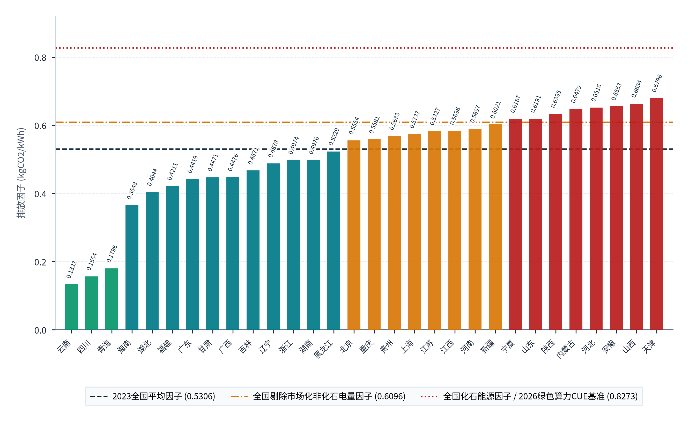
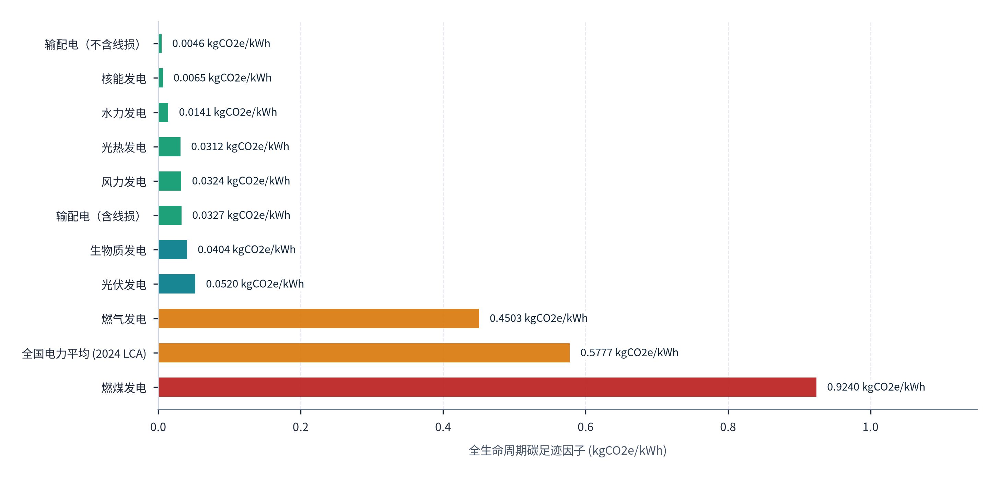
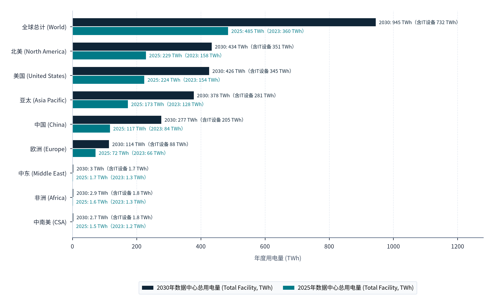
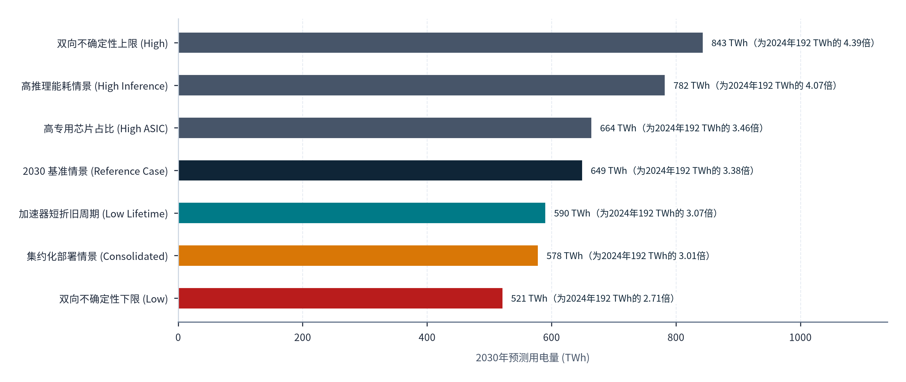
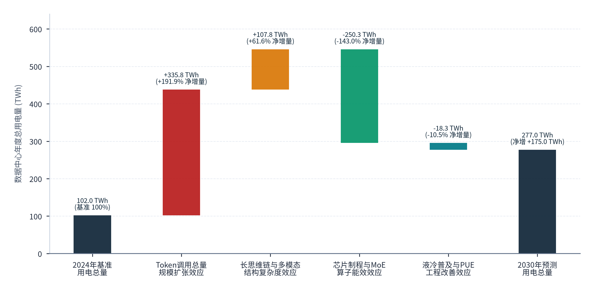

> **导航：** [返回中文手稿总目录](index.md) ｜ [上一章：第10章](chapter-10.md) ｜ [下一章：第12章](chapter-12.md) ｜ [尾注](notes.md) ｜ [参考文献](references.md)

---
> **第六篇 · PART VI · 综合影响与行动方案：经济结构重塑、能源环境协同与分级实施蓝图**
> 本篇（第11至12章）对全报告进行宏观收束与战略落子。第11章在 OECD 增加值贸易（TiVA）、IEA 2026 与 LBNL 2026 能源情景以及生态环境部最新电力碳因子框架下，评估 Token 出海对中国贸易增加值留存、电力调节及碳水足迹的综合影响，识别七大先行变量并推演 2026至2030 年三类发展情景；第12章面向国家部委、地方政府与六类产业主体，制定权责清晰、分阶段可核实的制度建设与商业行动路线图。
---

# 综合经济影响、关键变量与发展情景

> **本章导读：** 当中国境内的风光电能与异构智算集群通过海底及陆地光缆向全球持续输出数以百万亿计的 Token 时，其宏观意涵已演变为一场触及国际分工地位、国内要素价值重估与能源环境治理的深层变革。在宏观经济层面，Token 出海究竟能在多大程度上创造真实的<strong>本国增加值（Domestic Value Added, DVA）</strong>，又存在多大比例的进口高端芯片与高带宽显存（HBM）资本外漏？在微观生产率层面，生成式 AI 对知识工作者的真实时间节省效应如何向全要素生产率传导？在能源与生态环境层面，面对国际能源署（IEA）与美国劳伦斯伯克利国家实验室（LBNL）在 2026 年最新上调的全球及区域数据中心用电预测，以及生态环境部相继发布的《2023年电力二氧化碳排放因子》与《2024年全国电力碳足迹因子》，中国算力出海如何将西部绿电消纳转化为经得起国际温室气体核算体系（GHG Protocol）与 ISO 联合标准审视的“零碳算力竞争力”？本章结合最新国际数据库与实证文献展开穿透评估[114](references.md#ref-114)–[121](references.md#ref-121)。

## 11.1 对经济结构与国际分工的影响

### 11.1.1 基于 OECD TiVA（增加值贸易）框架的出口解构：本国绿电工程留存 vs 进口硬件折旧外漏

在传统总量贸易统计（Gross Trade Statistics）中，中国服务商向海外客户每收取 1 美元的 Token API 调用费，即全额计入中国国际收支平衡表（BOP）下的计算机服务（SI2）出口。要准确衡量这 1 美元出口对中国国民经济（GDP）的真实净贡献，需引入经济合作与发展组织（OECD）的**增加值贸易（Trade in Value Added, TiVA）核算框架**，将总出口拆解为<strong>本国增加值（DVA，留存在中国境内的要素报酬、折旧、税收与利润）</strong>与<strong>国外增加值（FVA，生产过程中所消耗的进口中间品与境外技术服务成本）</strong>[114](references.md#ref-114)。

根据 OECD 于 2025 年 10 月修订发布的《增加值贸易（TiVA）指标指南（2025年版）》（覆盖全球 **80 个经济体及世界其他地区、基于 ISIC Rev.4 划分的 50 个独立行业、历史序列跨度为 1995至2022 年**），以及 OECD 于 <strong>2026 年 4 月 8 日最新发布的实验性快报研究《全球价值链重塑：来自 2023至2024 年 TiVA 现时预测（Nowcasting）的洞察》</strong>（覆盖 **41 个经济体、24 个部门，将估计期延伸至 2023至2024 年**）[114](references.md#ref-114)，全球价值链呈现出清晰的结构基准（2025 主版 80 经济体/50 行业完整投入产出表与 2026 快报 41 经济体/24 部门实验估计严格分列）：<strong>在快报覆盖的 41 个主要经济体中，出口加权的本国增加值占总出口比重（DVA Share of Gross Exports）在 2022 年基期为 77.0%，2023 年上升至 77.7%，2024 年保持在 77.6%</strong>[114](references.md#ref-114)。

> **【核心核算公式】** **跨境 Token 服务出口的本国增加值率（DVA Ratio）核算关系式**
>
> `Token 出口本国增加值率 (DVA%) = 1 − [ (进口 GPU/HBM 芯片折旧摊销 + 境外软件/框架授权费 + 海外边缘节点与国际海缆外方段租费) ÷ 跨境 Token 服务出口总收入 ]`
>
> 其中：留在境内的<strong>本国增加值（DVA）</strong>由五部分组成：① **本土绿色电力与电网输配增加值**（100% 境内留存）；② **本土数据中心土建、变配电、液冷温控及国产服务器制造折旧**；③ **国产推理加速卡（NPU/GPU）硬件折旧**；④ **境内算法研发、算子优化与运维工程师的劳动者报酬**；⑤ **境内平台与基础设施主体的营业盈余与生产税净额**。

由于现行 OECD TiVA 的 50 个 ISIC Rev.4 行业分类（及 2026 快报的 24 个部门）尚未将“人工智能 Token 推理服务”单列为独立代码，本报告参照 OECD TiVA 增加值核算概念，结合第 9 章百万 Token 全成本（LCoT）模型的分环节成本结构设定，对中国四类典型出海商业模式开展每 100 美元出口收入的国内增加值留存率（DVA Ratio）与境外增加值回流率（FVA Ratio）条件分配情景测算（属参照 TiVA 概念设定的分环节成本分配模型，非 OECD 官方跨国投入产出矩阵反演结果，见**图表 11.1**）：

- <strong>模式 A（进口高端算力硬件纯 IaaS 裸金属出租，国内增加值留存率 31.5%）：</strong>当算力中心采用进口旗舰 GPU（芯片核心裸晶、HBM3e 显存及先进封装均源自境外供应链）且仅以低毛利裸金属容器形式向海外出租时，每 100 美元出口收入中高达 68.5 美元以进口硬件折旧（52.0 美元）、海外海缆落地与端口转接（8.5 美元）及境外软件许可与渠道分润（8.0 美元）形式回流海外，中国境内留存的净增加值仅 31.5 美元（含本土电力 14.0 美元、机房机电 7.5 美元、运维与微薄盈余 10.0 美元），不仅远低于 OECD 41 经济体总出口平均水平（77.6%），还使国内电网沦为替海外硬件厂商打工的低附加值底座。
- <strong>模式 B（进口/混合算力集群 ＋ 跨境标准 Token API 直连，国内增加值留存率 58.0%）：</strong>当国内服务商将底层算力封装为高效率大模型 API（依托细粒度 MoE 与 MLA 架构将单卡 Token 吞吐率提升 2.5 至 3 倍），每 100 美元出口收入中的进口硬件折旧摊销降至 28.0 美元、海外网络与合规网关支出约 14.0 美元（境外回流合计 42.0%），而留在境内的绿色电力与输配（16.5 美元）、机电液冷制造（8.5 美元）、本土算法研发报酬（15.0 美元）及平台营业盈余与税收（18.0 美元）合计跃升至 58.0 美元。
- <strong>模式 C（海外边缘合规前店 ＋ 西部绿电算力后厂 ＋ 垂直行业 Agent 交付，国内增加值留存率 69.0%）：</strong>通过延长合规存量加速卡高负荷服役周期、将重度批量与长上下文推理锚定在宁夏/甘肃/内蒙古 0.30 至 0.35 元/kWh 绿电园区，并在应用层叠加领域知识库与多步工作流溢价，境外增加值回流率进一步压缩至 31.0%，境内增加值留存率提升至 69.0%（其中境内研发报酬与营业盈余合计达 41.5 美元）。
- <strong>模式 D（全国产自主推理 NPU 集群 ＋ 西部/西南清洁电力 ＋ 本土开源基座模型，国内增加值留存率 88.5%）：</strong>当解码（Decode）与批量推理负载切换至国产推理加速卡（叠加本土 220kV/330kV 变压器、液冷机柜、800G 光模块与风光水绿电），每 100 美元出口收入中仅有约 11.5 美元用于不可避免的境外晶圆材料/EDA 间接投入及海外边缘 PoP 落地费，中国本土留存的国内增加值率（DVA Ratio）高达 88.5%（含本土芯片与服务器制造 24.0 美元、绿色电力 18.0 美元、机电工程 9.5 美元、算法研发与平台盈余 37.0 美元），显著超越传统机电产品加工贸易（50%至65%）及 OECD 全球服务出口均值（77.6%）。

### 11.1.2 支撑全球数字经济与微观劳动生产率的随机对照实验（RCT）实证证据

从国际分工的需求端看，美国国家经济研究局（NBER）于 2025 年 5 月 6 日发布的工作论文修订版《生成式人工智能改变工作模式》（*Shifting Work Patterns with Generative AI*，NBER Working Paper No. 33795 Rev. 1，由 Dillon、Jaffe、Immorlica 与 Stanton 撰写）提供了大样本跨企业随机对照实验（RCT）证据[115](references.md#ref-115)：研究团队在 2023 年 9 月至 2024 年 10 月期间，横跨 66 家企业、对 6,441 名有效样本员工开展了为期 6 个月的随机对照实验。论文第 3 节实证结果分部（Table 2 主回归估计表）的核心计量结果显示：按全部获配生成式 AI 工具的员工样本统计（ITT 口径），员工每周花在 Outlook 电子邮件处理上的总会话时间平均减少了 **1.29 小时/周**（标准误 SE = 0.19）；而按实际规律使用 AI 工具的活跃员工样本统计（LATE 口径），每周邮件处理时间大幅减少了 **3.56 小时/周**（标准误 SE = 0.44）[115](references.md#ref-115)。

该研究同时揭示了“工作重心升级而非简单缩减总工时”的机制：每周节省下来的 1.29 至 3.56 小时沟通文书时间，并未直接转化为员工总工作时长的同比例缩短，而是使员工减少了碎片化协调损耗，将工作重心转向核心专业分析与独立任务执行[115](references.md#ref-115)（在引用时严格区分邮件会话时间节省与宏观 GDP 增速或价格弹性的统计边界）。当中国高性价比跨洋 Token 服务将海外中小企业的 AI 接入成本降低 60%至80% 时，正是通过这一微观降本增效机制帮助全球新兴市场企业跨越“AI 使用鸿沟”。为系统量化上述四维度宏观经济影响，**图表 11.1**从<strong>① 四类出海模式本国增加值留存率（参照 TiVA 概念的作者分配情景）</strong>、<strong>② 西部绿色能源价值跃迁（单位千瓦时增加值）</strong>、**③ 硬件制造与机电配套产业链乘数效应**与**④ 全球下游生产力提升与生态粘性**四个维度，汇总了核心核算指标、国内增加值留存构成、境外价值外漏项及政策抓手：

#### 图表 11.1：中国 Token 出海四类商业模式的国内增加值（DVA，参照TiVA概念）留存情景核算与宏观经济影响评估表

| 经济影响与商业模式维度 | 核心核算指标与国际实证基准 | 国内增加值留存构成（每100美元出口DVA拆解） | 境外价值回流与结构性代价（FVA外漏项） | 提升净经济贡献的政策与工程抓手 |
| --- | --- | --- | --- | --- |
| <strong>① 四类出海模式本国增加值留存率（参照 TiVA 概念）</strong> | OECD TiVA 2025 版及 2026 快报（41 经济体 2022至2024 出口 DVA 占比 77.0% / 77.7% / 77.6%）[114](references.md#ref-114) | 模式 A（进口卡裸金属出租）DVA 仅 31.5%；模式 B（混合算力标准 API）DVA 升至 58.0%；模式 C（前店后厂垂直 Agent）DVA 达 69.0%；模式 D（国产算力＋绿电）DVA 高达 88.5%。 | 模式 A 每百美元出口有 68.5 美元回流海外（其中进口 GPU/HBM 折旧外流 52.0 美元）；模式 B 外流 42.0 美元；模式 D 外流仅 11.5 美元。 | 严格限制低附加值纯进口硬件裸租出海补贴，推广“Prefill/Decode 异构分离”与国产 NPU 解码集群，压降进口硬件折旧外漏。 |
| <strong>② 西部绿色能源价值跃迁（单位千瓦时增加值）</strong> | 对比传统高载能工业（电解铝/铁合金度电增加值约 0.8至1.8 元/kWh）与智算推理度电产出 | 将难以远距离外送的西部风光弃电/谷电就地转化为高单价比特流，单度电创造的数字服务总产出可达 4.5至12.0 元/kWh，且电力与电网输配环节 100% 为境内留存增加值。 | 若园区仅收低廉机柜租赁费与过网电费，高额模型与 API 商业溢价将全部归集于东部或离岸主体，西部面临“留电不留利”。 | 建立东西部“保底成本 ＋ 跨境 Token 毛利分成”及服务贸易出口额双向统计认定机制（见第 10.4 节）。 |
| **③ 硬件制造与机电配套产业链乘数效应** | 数据中心非 IT 机电投资占比（变压器、HVDC、液冷 CDU、光模块、储能系统占园区 CapEx 约 25%至35%） | 中国在 220kV/330kV 电力变压器、冷板式/浸没式液冷、800G/1.6T 光模块及磷酸铁锂储能领域具备全球制造优势，每百美元 Token 出口拉动 8.5至9.5 美元本土高端机电装备折旧留存。 | 若盲目上马缺乏负载锚定的通用机房（如早期低密机房减值样本），易造成土地、变电容量与财政信贷资金沉淀。 | 坚持“以单定建、算电同审”，将 1 年以上连续稳定运行与 60% 以上有效上架率作为国家级绿色设施推荐硬门槛[124](references.md#ref-124)。 |
| **④ 全球下游生产力提升与生态粘性** | NBER WP33795（66 企 6,441 人 RCT）：每周邮件时间减少 -1.29 小时（ITT）/ -3.56 小时（LATE）[115](references.md#ref-115) | 以海外闭源模型 1/3 至 1/8 的 Token 价格服务全球中小开发者与垂直应用（短剧、电商、伴侣硬件），培育全球对华技术栈与开源生态依赖。 | 若陷入无底线同质化价格战，可能将算法效率红利过度让渡为海外消费者剩余，侵蚀国内模型研发再投入能力。 | 从纯低价裸 Token 出口升级为“模型 API ＋ 领域知识库 ＋ 多语种 Agent 工作流”的高粘性套餐交付（模式 C/D）。 |

> **表格结构化数据文件：** [`data/exhibits/exhibit-11-1.csv`](../../data/exhibits/exhibit-11-1.csv)
> **表注与来源：** 注：四类商业模式（模式 A 至模式 D，及兼容旧版辅助模式 A0）每百美元出口的分环节成本分配情景与增加值条件测算见《M05_四种出海模式国内增加值留存投入产出表.csv》（参数定义见 engineering_inputs.json）。来源：OECD TiVA 2025 Edition & 2026 Nowcasting Report、NBER Working Paper 33795 (Rev. 1)；介子九维（JIEZIJIUWEI）研究构建[114](references.md#ref-114), [115](references.md#ref-115)。

综合**图表 11.1**参照 OECD 增加值贸易（TiVA）概念与微观随机对照实验（RCT）的条件测算可见，不同出海商业模式的国家经济净贡献存在本质分野：若停留在<strong>模式 A（进口卡裸金属出租）</strong>，国内增加值留存率（DVA）仅为 <strong>31.5%</strong>，每百美元出口中有 **68.5 美元**（含进口 GPU/HBM 折旧 52.0 美元）外流；而升级至<strong>模式 B（混合算力标准 API，DVA 58.0%）</strong>、<strong>模式 C（前店后厂垂直 Agent，DVA 69.0%）</strong>乃至<strong>模式 D（国产算力＋绿电，DVA 88.5%）</strong>后，不仅能将度电产出从传统电解铝/铁合金的 **0.8至1.8 元/kWh** 跃升至智算推理的 **4.5至12.0 元/kWh**，还能每百美元出口拉动 **8.5至9.5 美元**本土高端机电装备折旧留存，把能源、机电制造与算法研发红利真正留在中国境内。

基于上述参照 TiVA 概念的跨境算力增加值条件分配测算结论，可以提炼出面向产业升级与财政奖补导向的三项政策与商业指示：

- 思考启示（辨析出口创汇表象与本土真实价值留存的鸿沟）：同样是实现 100 亿美元的跨境算力服务出口，采用进口高端卡做纯裸金属出租（模式 A）仅能在国内留下 31.5 亿美元增加值，高达 68.5% 的收入通过硬件折旧与海外通道费流回境外芯片与电信巨头；唯有将商业形态升级为“自主开源模型 API ＋ 垂直行业智能体 ＋ 国产推理芯片与本土液冷供电集成”（模式 C 与模式 D），才能将国内增加值留存率推升至 69.0% 至 88.5%，真正兑现从“替海外芯片原厂打工”向“输出中国高附加值数字服务”的价值重构。
- 具体应用场景（国家与地方数字贸易高质量发展评估、算力券/模型券分类分档补贴系数设定与企业海外商业模式演进）：该模型直接应用于商务、发改与工信部门评估算力出海项目的真实国民经济拉动效应，以及地方政府设计差异化财政奖补比例。
- 具体行为动作指示（按国内增加值留存率 DVA 实施阶梯式财税支持，加速向模式 C/D 演进）：第一，在地方产业政策端，各地工信与数据主管部门在发放算力券、Token 券与跨境通信补贴时，应废除“一刀切”的平铺补贴，依据本模型核算的 DVA 留存率设立三级阶梯奖补系数，对 DVA 低于 35% 的纯进口硬件转租业务不予补贴，对 DVA 达 55% 至 70% 的标准化模型 API 与垂直 Agent 业务给予基准补贴，对采用国产推理加速卡且 DVA 超过 80% 的绿色 Token 出口业务给予最高档位（如 30% 至 50%）顶格奖补；第二，在企业产品升级端，算力服务商应将低毛利裸金属租赁逐步封装为“预置行业知识库 ＋ 多语种工作流 ＋ 结果交付”的垂直 Agent 解决方案，将单客户客单价与本土软件研发留存占比同步提升 2 倍以上。

## 11.2 对能源、电力与环境的影响

### 11.2.1 全球与中美数据中心用电量权威演进序列：IEA 2026 四大情景与 LBNL 2026 七大情景交叉对标

本报告严格依据<strong>国际能源署（IEA）于 2026 年 4 月 16 日更新发布的《能源与人工智能关键问题》（*Key Questions on Energy and AI*，2026 年度更新版）</strong>[116](references.md#ref-116)，以及<strong>美国劳伦斯伯克利国家实验室（LBNL）与美国能源部于 2024 年 12 月 19 日和 2026 年 6 月 18 日先后发布的两版《美国数据中心能源使用报告》</strong>[117](references.md#ref-117)，建立全球及中美数据中心用电与水耗的精确参照系：

1. <strong>IEA 2026 版全球与中国数据中心用电量序列（2023至2035年）：</strong>
      根据 IEA 2026 版报告附录 A 统计附表（Annex A Table A.1，覆盖服务器、存储、网络及冷却配电全部设施用电）：
      
<strong>全球基准情景（Base Case）演进轨迹：</strong>全球数据中心总用电量从 2023 年的 **360 TWh**（装机容量 83 GW，平均 PUE 1.43），上升至 2024 年的 **416 TWh**（97 GW，PUE 1.41）和 2025 年的 **485 TWh**（114 GW，PUE 1.38）；预计到 **2030 年翻倍增长至 945 TWh**（对应容量 **226 GW**，平均 PUE 压降至 **1.29**；报告执行摘要将 945 TWh 表述为约数 **950 TWh**，分别为同版附录精数与摘要概数），并在 <strong>2035 年探索情景下达到 1,193 TWh（277 GW，PUE 1.21）</strong>[116](references.md#ref-116)。
<strong>全球三大敏感性情景（2030 / 2035 年对比）：</strong>IEA 表 A.1 同时测算了三类变体情景：① <strong>加速腾飞情景（Lift-Off Case）：</strong>2030 年全球数据中心用电达 <strong>1,008 TWh（241 GW，PUE 1.29）</strong>，2035 年达 <strong>1,637 TWh（383 GW，PUE 1.21）</strong>；② <strong>高能效情景（High Efficiency Case）：</strong>2030 年用电控制在 <strong>868 TWh（205 GW，PUE 1.24）</strong>，2035 年为 <strong>1,013 TWh（231 GW，PUE 1.13）</strong>；③ <strong>逆风受阻情景（Headwinds Case）：</strong>2030 年用电为 <strong>833 TWh（200 GW，PUE 1.33）</strong>，2035 年为 <strong>942 TWh（218 GW，PUE 1.25）</strong>[116](references.md#ref-116)。
<strong>中国数据中心总设施用电与 IT 设备用电拆分（IEA 附录 A 区域明细表 Annex A Table A.4）：</strong>在基准情景下，<strong>中国全部数据中心总设施用电量（Total Facility Electricity）</strong>依次从 2023 年的 **84 TWh**、2024 年的 **102 TWh**、2025 年的 **117 TWh**，攀升至 **2030 年的 277 TWh**（五年净增 160 TWh，增幅 136.8%）；其中<strong>中国数据中心纯 IT 设备用电量（IT Equipment Electricity）</strong>依次为 2023 年 **54 TWh**、2024 年 **68 TWh**、2025 年 **80 TWh**，并于 **2030 年达到 205 TWh**[116](references.md#ref-116)。由此可推算 IEA 模型隐含的中国数据中心整体等效 PUE 从 2023 年的 1.56（84/54）优化至 2025 年的 1.4625（117/80，IEA 表 A.3 官方报告值为 1.47）及 2030 年的 <strong>1.35（277/205）</strong>。
2. <strong>LBNL 2024 版与 2026 发布版（2025 Update）美国数据中心电耗、水耗及 2030 七大情景对比：</strong>
      LBNL 在 2026 年 6 月 18 日发布的最新版报告（*United States Data Center Energy Usage Report: 2025 Update*）对 2024 年旧版作了模型修正与延展[117](references.md#ref-117)：
      
<strong>历史基期与水耗边界：</strong>在 2024 年 12 月旧版报告中，LBNL 估计 2023 年美国数据中心用电量为 **176 TWh**（现场冷却直接用水量达 <strong>660 亿升 [66 billion liters]</strong>，发电端间接水耗另计），并给出 2028 年用电量 **325 至 580 TWh** 的早期区间[117](references.md#ref-117)；而在 **2026 年 6 月 18 日发布的最新报告**中（以 2024 年为最后完整历史估计年，统计口径不含加密货币挖矿），<strong>2024 年美国数据中心实际用电量核定为 192 TWh，占美国全社会总用电量的 4.7%</strong>，并将 **2028 年参考情景（Reference Case）确定为 464 TWh**[117](references.md#ref-117)。
<strong>2030 年美国数据中心七大情景（跨度 521 至 843 TWh，占全美总用电 9.5% 至 15.3%）：</strong>如 LBNL 2026 发布版第 3 章情景分析汇总表（Table 2）所示（以 NERC 2025 评估的 2030 年全美总用电预测值为分母），2030 年美国数据中心用电在七种参数组合下分化为：① <strong>参考基准情景（Reference Case）：649 TWh（占全美总用电的 11.8%）</strong>；② **集约化部署情景（Consolidated Deployment）：578 TWh**（较基准低 -10.8%，占全美用电 <strong>10.5%</strong>）；③ **高专用芯片占比情景（High ASIC）：664 TWh**（较基准高 +2.4%，占全美用电 <strong>12.1%</strong>）；④ **加速卡短寿命更替情景（Low Accelerator Lifetime）：590 TWh**（较基准低 -9.1%，占全美用电 <strong>10.7%</strong>）；⑤ <strong>高推理能耗情景（High Inference Energy）：高达 782 TWh（较基准高出 +20.6%，占全美用电 14.2%）</strong>；⑥ **复合不确定性下限（Compounded Uncertainty - Low）：521 TWh**（较基准低 -19.6%，占 <strong>9.5%</strong>）；⑦ <strong>复合不确定性上限（Compounded Uncertainty - High）：高达 843 TWh（较基准高出 +29.9%，占全美总用电量的 15.3%）</strong>[117](references.md#ref-117)。

      LBNL“高推理能耗情景（782 TWh）”与“复合上限（843 TWh，占全美电力 15.3%）”表明：<strong>随着全球 AI 负载重心转向大规模推理，美国本土电网正逼近 11.8%～15.3% 的单一部门用电承载极限，而中国依托 10.58 万亿千瓦时的庞大发电底座（2030 年 277 TWh 仅占中国总用电量的约 2.1%～2.3%）与西部富余绿电，拥有宽裕得多的电力接纳弹性。</strong>

为将上述中国电力碳因子置于全球与区域用电增长背景中审视，**图表 11.2**首先依据生态环境部与国家统计局公告，展示了中国全部 **30 个省份**（从**云南 0.1333**、**四川 0.1564**、**青海 0.1796** 直至**河北 0.6516**、**安徽 0.6553**、**山西 0.6634**、**天津 0.6796 kgCO2/kWh**）的电力二氧化碳排放因子柱状排序，并叠加了<strong>2023全国平均因子 (0.5306)</strong>、<strong>全国剔除市场化非化石电量因子 (0.6096)</strong>以及<strong>全国化石能源因子 / 2026绿色算力CUE基准 (0.8273)</strong>三条国家基准线：

#### 图表 11.2：2023年中国30个省份电力二氧化碳排放因子排序与国家及区域电网基准对比

> **图像文件：** [`figures/chart_11_2.png`](../../figures/chart_11_2.png)（高清位图）｜ [`figures/chart_11_2.svg`](../../figures/chart_11_2.svg)（矢量图）
> **图注与来源：** 来源：生态环境部、国家统计局《关于发布2023年电力二氧化碳排放因子的公告》（2025年12月31日发布）；介子九维（JIEZIJIUWEI）整理绘制[116](references.md#ref-116)。

从**图表 11.2**的 30 个省份柱状梯度与三条基准线对比可以清晰读出：以<strong>2023全国平均因子 (0.5306)</strong>为分界线，全国共有 14 个省份低于全国均值（其中绿柱标识的**云南 0.1333**、**四川 0.1564**、**青海 0.1796 kgCO2/kWh** 不到全国均值的三分之一，青色柱标识的**海南 0.3648**、**湖北 0.4044**、**福建 0.4211**、**广东 0.4419**、**甘肃 0.4471** 等 11 省处于低碳区间），而<strong>贵州 (0.5683)</strong>、<strong>宁夏 (0.6187)</strong>、<strong>内蒙古 (0.6479 kgCO2/kWh)</strong> 等煤电基荷较大的算力枢纽省份则高于全国均值（宁夏与内蒙古亦高于**全国剔除市场化非化石电量因子 0.6096**，但仍明显低于**全国化石能源因子 / 2026绿色算力CUE基准 0.8273**）。由此可见，部署在云南、四川、青海、甘肃的算力集群在位置法（Location-based）下即具备显著低碳优势，而部署在宁夏、内蒙古的算力集群则必须通过绿电直连或绿证核销（将可再生电量 CUE 排放计为 0）来兑现零碳潜力[116](references.md#ref-116), [118](references.md#ref-118)。

为全面对齐国际权威能源机构对全球及各区域数据中心用电需求的定量预测，**图表 11.3**完整列示了国际能源署（IEA）《Key Questions on Energy and AI》（2026年版 Annex A Tables A.1, A.3 & A.4）涵盖的<strong>全球合计 (World)</strong>及<strong>北美 (North America)</strong>、<strong>其中：美国 (United States)</strong>、<strong>中南美洲 (Central & South America)</strong>、<strong>欧洲 (Europe)</strong>、<strong>非洲 (Africa)</strong>、<strong>中东 (Middle East)</strong>、<strong>亚太地区 (Asia Pacific)</strong>、<strong>其中：中国 (China)</strong>在 2023、2024、2025、2030 与 2035 年的数据中心总用电量、IT设备用电量及官方设施 PUE 与非 IT 损耗占比序列：

#### 图表 11.3：IEA（2026）全球与分地区数据中心总用电量、IT设备用电量及官方设施PUE演进表（2023至2035年，单位：TWh）

| 统计地区（IEA 口径） | 2023年 (总计 / IT) | 2024年 (总计 / IT) | 2025年 (总计 / IT) | 2030年预测 (总计 / IT) | 2024至2030增幅 (及2035年全球预测) | IEA官方PUE（2024至2030）与非IT占比 [D1] |
| --- | --- | --- | --- | --- | --- | --- |
| 全球合计 (World) | 360 / 252 | 416 / 295 | 485 / 352 | 945 / 732 | +127.2%（2035年：1,193 / 985） | 1.41 → 1.29（非IT 22.5%） |
| 北美 (North America) | 158 / 120 | 187 / 142 | 229 / 176 | 434 / 351 | +132.1%（净增 +247 TWh） | 1.32 → 1.24（非IT 19.1%） |
| 其中：美国 (United States) | 154 / 117 | 183 / 139 | 224 / 173 | 426 / 345 | +132.8%（净增 +243 TWh） | 1.32 → 1.23（非IT 19.0%） |
| 中南美洲 (Central & South America) | 1.2 / 0.7 | 1.4 / 0.8 | 1.5 / 0.9 | 2.7 / 1.8 | +92.9%（净增 +1.3 TWh） | 1.70 → 1.50（非IT 33.3%） |
| 欧洲 (Europe) | 66 / 45 | 68 / 47 | 72 / 51 | 114 / 88 | +67.6%（净增 +46 TWh） | 1.45 → 1.29（非IT 22.8%） |
| 非洲 (Africa) | 1.3 / 0.7 | 1.4 / 0.8 | 1.6 / 0.9 | 2.9 / 1.8 | +107.1%（净增 +1.5 TWh） | 1.81 → 1.59（非IT 37.9%） |
| 中东 (Middle East) | 1.3 / 0.7 | 1.5 / 0.8 | 1.7 / 0.9 | 3 / 1.7 | +100.0%（净增 +1.5 TWh） | 1.92 → 1.70（非IT 43.3%） |
| 亚太地区 (Asia Pacific) | 128 / 82 | 150 / 100 | 173 / 118 | 378 / 281 | +152.0%（净增 +228 TWh） | 1.50 → 1.35（非IT 25.7%） |
| 其中：中国 (China) | 84 / 54 | 102 / 68 | 117 / 80 | 277 / 205 | +171.6%（净增 +175 TWh） | 1.50 → 1.35（非IT 26.0%） |

> **表格结构化数据文件：** [`data/exhibits/exhibit-11-3.csv`](../../data/exhibits/exhibit-11-3.csv)
> **表注与来源：** 注：表中斜杠前为数据中心设施总耗电量（Total Facility Electricity），斜杠后为 IT 设备净耗电量（IT Equipment Electricity），2023至2030年全部 72 项区域分年数值严格引自 IEA 2026 Annex A Table A.4（PDF 第 110 页）官方序列，2035 年全球探索性预测（1,193 / 985 TWh）引自 IEA 2026 Annex A Table A.1（PDF 第 108 页）；末列 2024 至 2030 年 PUE 演进直接引自 IEA 2026 Annex A Table A.3（PDF 第 109 页）官方报告值（按未四舍五入底层电量核算，若直接用表 A.4 发布值相除，中南美洲、非洲、中东及欧洲 2030 年因小基数舍入对应的隐含比值分别为 1.75→1.50、1.75→1.61、1.88→1.76 与 1.45→1.30），括号内为 2030 年非 IT 冷却配电电量占设施总耗电量之比（即 [Total － IT] ÷ Total）；跨政策联立反解与 Kaya-LMDI 五因子分解见《M01B_跨政策隐含物理恒等式反解表.csv》与《M02B_Kaya_LMDI电量与碳排五因子完全分解表.csv》。来源：国际能源署（IEA）《Key Questions on Energy and AI》（2026年版，Annex A Tables A.1, A.3 & A.4）；介子九维（JIEZIJIUWEI）整理计算[116](references.md#ref-116), [117](references.md#ref-117)。

由**图表 11.3**所列的全球九大区域用电序列及末列指标<strong>“IEA官方PUE（2024至2030）与非IT占比 [D1]”</strong>，结合跨政策物理恒等式联立反解模型可以得出三项深层定量结论：第一，在 IEA 基准序列下，2024 至 2030 年间<strong>全球合计 (World)</strong>数据中心总用电量将从 **416 TWh**（IT 用电 **295 TWh**）跃升至 **945 TWh**（IT 用电 **732 TWh**，增幅 <strong>+127.2%</strong>，2035 年探索性预测进一步达 **1,193 TWh / IT 985 TWh**），其中<strong>中国 (China)</strong>从 **102 TWh**（IT 用电 **68 TWh**）增长至 **277 TWh**（IT 用电 **205 TWh**，增幅 <strong>+171.6%</strong>），IEA 官方与电量隐含整体设施 PUE 均从 2024 年的 1.50（2025 年电量相除隐含比值为 1.4625，官方表 A.3 报告值为 1.47）优化至 2030 年的 1.35（非 IT 冷却配电占比 26.0%）；第二，**立足“十五五”规划起点（2025 年基期：存量 IT 负荷 80 TWh、总用电 117 TWh、隐含 PUE 1.4625），联立 IEA 2030 年中国电量方程与发改环资〔2024〕970 号文能效红线（新建中心 PUE ≤ 1.25、国家枢纽 ≤ 1.20）进行物理恒等式反解发现：若 2025 年存量 80 TWh IT 负荷不实施节能技改而维持 PUE 1.4625（非 IT 冷却耗电 37.0 TWh），则 2025 至 2030 年全国净增的 125 TWh IT 负荷平均实测 PUE 只需控制在 1.2800 以下即可达成 IEA 277 TWh 基准预测；而若全国新增集群严格执行国家规定达到平均 PUE 1.22（新建节电 7.50 TWh），同时将 2025 年存量老旧机房通过“余热变冷源/液冷背板”技改压降至 PUE 1.35（存量技改节电 9.00 TWh），则 2030 年中国数据中心总用电将从 277.0 TWh 压降至 260.50 TWh，每年累计释放出高达 16.50 TWh 的非 IT 冷却废热电量（折合新建集群 PUE ＝ 1.22 下的净有效 IT 电量 13.52 TWh；若以 2024 年 68 TWh 为基期按存量 PUE 下降 0.08 或改造至 1.35 测算，则年节电量分别为 13.30 TWh 或 18.06 TWh）。在不增加电网 1 度电总负荷的前提下，这 16.50 TWh 节电量计入新建集群 PUE ＝ 1.22 后，可额外支撑 20.18 万台 8 卡高密智算服务器在 75% 有效负荷率下稳定运行（若按 100% 满载连续运行折算为 15.14 万台），按第 6 章工程能耗中枢 1.85 百万Token/kWh_IT 折算，每年可额外生产 25.02 千万亿个（25.02 PetaTokens，按 1.45 至 2.25 百万Token/kWh_IT 区间折算为 19.61 至 30.43 千万亿个）高价值推理 Tokens**；第三，对照 LBNL 2026 发布版对美国 2030 年的七大情景（详见后文**图表 11.8**），<strong>高推理能耗扩张情景 (High Inference Energy)</strong>将使美国 2030 年数据中心用电从 <strong>649 TWh（占全美用电 11.8%）</strong>激增至 <strong>782 TWh（占 14.2%）</strong>，**复合不确定性上限**更达 <strong>843 TWh（占 15.3%）</strong>，印证了推理阶段的绿色电力供给与热力学降耗能力已成为决定全球算力格局的头号物理变量[116](references.md#ref-116), [117](references.md#ref-117)。

围绕跨政策隐含物理恒等式反解得出的“16.50 TWh 冷却电耗释放潜能（净有效 IT 电量 13.52 TWh）”，可以提炼出面向能效技改与算力配额置换的三项指示：

- 思考启示（发掘冷却废热背后的隐形发电厂，将节能降碳转化为净增算力产能）：传统观念往往把数据中心 PUE 技改视为单纯应付环保考核的合规负担。跨政策物理恒等式反解揭示，将“十五五”期间增量机房 PUE 控制在 1.22 并把 2025 年存量机房 PUE 从 1.4625 压降至 1.35，每年省下的 16.50 TWh 冷却耗电相当于新建了一座近 200 万千瓦级大型主力电厂，可在零新增电网负荷的前提下直接转化为 20.18 万台 8 卡高密服务器（75% 有效负荷率口径，100% 满载口径为 15.14 万台）与 25.02 千万亿枚（25.02 PetaTokens）出口 Token 的纯增量产能。
- 具体应用场景（国家枢纽存量机房液冷技改立项、地方能耗指标等量/减量置换审批与算力中心余热综合利用）：该模型直接应用于工信部与国家发改委的“国家绿色算力设施”推荐评审、东部与中部老旧机房“腾笼换鸟”液冷改造，以及北方高寒枢纽的余热制冷与市政供暖联产工程。
- 具体行为动作指示（推行存量机房 PUE 技改释放电量 1:1 置换智算扩容指标）：第一，在能耗监管端，各级节能主管部门应建立“冷却节电量直接置换高密智算机柜指标”激励机制，对通过余热回收供冷、冷板式或浸没式液冷改造将存量机房实测 PUE 压降 0.10 以上的运营主体（如和林格尔新区 B02 机楼 PUE 从 1.315 降至 1.209 实绩），允许其将每年省下的非 IT 冷却电量按 1:1 比例直接转为同园区新增高密推理服务器的用电配额；第二，在新建工程端，凡单柜功率超 20 kW 的新建推理集群一律采用液冷方案并将年均 PUE 硬性锁死在 1.20 至 1.22 以内，把每一度宝贵的绿电最大限度导入芯片算术逻辑单元（ALU）与高带宽显存（HBM）。

### 11.2.2 中国三大官方电力碳因子体系（2023 CO2因子 / 2024 生命周期碳足迹因子 / 2026 CUE 评价系数）与国际 Scope 2 新规对齐

2025 年 10 月至 2026 年 9 月期间，中国生态环境部、国家统计局、国家能源局及工信部发布了三套不同统计边界的官方电力碳因子文件，同时 GHG Protocol 与 ISO 也于 2026 年 7 至 8 月更新了 Scope 2 准则修订路线图[118](references.md#ref-118), [119](references.md#ref-119), [124](references.md#ref-124)。<strong>严格区分这三套国内因子与两套国际核算方法（位置法 vs 市场法），是构建中国“绿色零碳 Token”国际公信力的核心基石[xiii](notes.md#note-xiii)：</strong>

1. <strong>第一套国内官方基准：《2023年电力二氧化碳排放因子》（生态环境部等 2025 年 12 月 31 日发布，2026 年 1 月 5 日答记者问解读，单位：kgCO2/kWh）：</strong>
      该因子仅核算<strong>发电环节直接产生的二氧化碳排放（非全生命周期碳足迹）</strong>，公布了全国、区域、省级、全国剔除市场化交易非化石电量、全国化石能源五类细分口径[118](references.md#ref-118)：
      
<strong>全国层面的三类基准值：</strong>2023 年**全国平均电力二氧化碳排放因子为 0.5306 kgCO2/kWh**（较 2022 年全国平均历史口径 0.5366 kgCO2/kWh 进一步下降 0.0060）；**全国剔除市场化交易非化石能源电量后的排放因子为 0.6096 kgCO2/kWh**；**全国化石能源电力二氧化碳排放因子为 0.8273 kgCO2/kWh**[118](references.md#ref-118)。
**七大区域电网排放因子梯度：西南区域电网最低，仅为 0.2472 kgCO2/kWh**；其次为南方区域电网 **0.4042**、东北区域 **0.5122**、华中区域 **0.5271**、华东区域 **0.5500**、西北区域 **0.5543**、华北区域 **0.6361 kgCO2/kWh**[118](references.md#ref-118)。
<strong>重点算力枢纽省份的高达 5.10 倍排放因子极差（见图表 11.2 与图表 11.5）：</strong>在位置法（Location-based）下，**云南省电力平均 CO2 因子全国最低，仅为 0.1333 kgCO2/kWh；四川省为 0.1564 kgCO2/kWh；青海省为 0.1796 kgCO2/kWh**；海南为 0.3648、湖北为 0.4044、福建为 0.4211、**广东为 0.4419**、**甘肃（庆阳枢纽）为 0.4471**、浙江为 0.4974、湖南为 0.4976、黑龙江为 0.5229、**北京为 0.5554**、**贵州（贵安枢纽）为 0.5683**、**上海为 0.5737**、江苏为 0.5827、新疆为 0.6021、**宁夏（中卫枢纽）为 0.6187**、山东为 0.6191、**内蒙古（和林格尔枢纽）为 0.6479**、河北为 0.6516、安徽为 0.6553、山西为 0.6634、天津为 0.6796 kgCO2/kWh[118](references.md#ref-118)。<strong>若海外客户采用 GHG Protocol 位置法审计供应商碳足迹，部署在云南（0.1333）与四川（0.1564）的智算中心天然拥有全球顶级的低碳电网底色；而部署在宁夏（0.6187）与内蒙古（0.6479）的智算集群，因省内火电基荷大，必须通过签署“绿电直连 / 电证合一 PPA（市场法 Market-based）”才能将其可再生能源优势转化为国际认可的零碳排放凭证。</strong>
2. <strong>第二套国内官方基准：《2024年全国电力碳足迹因子》（生态环境部、国家统计局、国家能源局 2025 年 10 月 23 日联合印发，单位：kgCO2e/kWh）：</strong>
      该因子采用<strong>全生命周期评估（LCA）方法，覆盖上游燃料开采运输、设备制造建设、运行发电及电网输配全过程的所有温室气体当量（CO2e）</strong>[118](references.md#ref-118)。公告核定：**2024 年全国电力平均生命周期碳足迹因子为 0.5777 kgCO2e/kWh**（已含输配电环节，不可将分列的输配电不含线损因子 0.0046 或含线损因子 0.0327 重复叠加）。分电源品种看：**核能发电仅 0.0065 kgCO2e/kWh、水力发电仅 0.0141 kgCO2e/kWh、光热发电 0.0312 kgCO2e/kWh、风力发电 0.0324 kgCO2e/kWh、生物质发电 0.0404 kgCO2e/kWh、光伏发电 0.0520 kgCO2e/kWh**，燃气发电与燃煤发电分别为 **0.4503** 与 **0.9240 kgCO2e/kWh**[118](references.md#ref-118)。
3. <strong>第三套国内政策评分基准：2026 年度国家绿色算力设施评价 CUE 专用系数（0.8273 kgCO2e/kWh）：</strong>
      工信部等五部门于 2026 年 9 月 21 日发布的《关于组织开展 2026 年度国家绿色算力设施推荐工作的通知》（工信厅联节函〔2026〕433号）附件评价指标体系中，计算算力中心碳利用效率（CUE）时，规定**将经过核实的可再生能源电力消费量排放计为 0，对非可再生能源电力消费量统一乘以固定评分因子 0.8273 kgCO2e/kWh**[118](references.md#ref-118), [124](references.md#ref-124)[xiii](notes.md#note-xiii)。
4. <strong>国际碳核算准则演进与单次推理任务环境足迹基准（GHG Protocol / ISO 2026 动态、Google 0.24 Wh 与 Mistral 45 mL）：</strong>
      现行有效的企业碳核算准则仍为 <strong>GHG Protocol《Scope 2 指南（2015年版）》</strong>，要求企业同时报告<strong>位置法（Location-based）</strong>与<strong>市场法（Market-based）</strong>排放，且市场法工具须满足<strong>表 7.1 规定的 8 项合同工具质量标准（Quality Criteria）</strong>[119](references.md#ref-119)。2026 年 7 月 29 日，GHG Protocol 与 ISO 启动联合企业标准制定计划，最新时间表确定为 **2027 年第二季度（2027Q2）开展合并公开咨询、2028 年第四季度（2028Q4）正式发布联合标准**；2026 年 8 月 25 日发布的《Scope 2 公开咨询反馈汇总报告》全文分部统计显示，争议焦点集中在“是否强制要求同电网区域内的小时级时空匹配（24/7 Hourly Matching）”[119](references.md#ref-119)。在微观单次任务层面，两项企业级实证确立了标尺：其一，**Google 研究团队于 2025 年 8 月发布的生产系统实测论文（arXiv:2508.15734）披露，2025 年 5 月 Google Gemini Apps 生产系统中位文本提示词（Median Text Prompt）的综合边界能耗已压降至 0.24 Wh/prompt**（表 1、表 2 口径，含服务器主机、待机空闲分摊及 PUE 损耗，原文未披露该中位提示对应的具体输入输出 Token 数量）[120](references.md#ref-120)；其二，<strong>欧洲大模型厂商 Mistral AI 于 2025 年 7 月 22 日发布的生命周期评估（LCA）报告披露，其 Le Chat 系统生成一次标准 400-token 回复的边际水耗（含上游发电水耗、排除用户终端设备）为 45 毫升（45 mL/400-token reply）</strong>[120](references.md#ref-120)。由于两者的功能单位与系统边界不同，在研究中应分列作方法参照，不直接横比工程效率。

在 30 个省份电网位置基准 CO2 排放因子之外，生态环境部等三部门发布的《2024年全国电力碳足迹因子》首次给出了涵盖上下游设备制造与燃料供应链的 11 项全生命周期碳足迹参数。**图表 11.4**按碳足迹因子由低到高直观对比了<strong>输配电（不含线损）</strong>、**核能发电**、**水力发电**、**光热发电**、**风力发电**、<strong>输配电（含线损）</strong>、**生物质发电**、**光伏发电**、**燃气发电**、<strong>全国电力平均 (2024 LCA)</strong> 与**燃煤发电**共 11 项全生命周期参数：

#### 图表 11.4：2024年中国不同电源品种与输配电环节全生命周期碳足迹因子对比

> **图像文件：** [`figures/chart_11_2b.png`](../../figures/chart_11_2b.png)（高清位图）｜ [`figures/chart_11_2b.svg`](../../figures/chart_11_2b.svg)（矢量图）
> **图注与来源：** 来源：生态环境部等《关于发布2024年电力碳足迹因子数据的公告》（2025年10月发布）；介子九维（JIEZIJIUWEI）整理绘制[117](references.md#ref-117)。

对照**图表 11.4**的 11 条横向柱体数值可见：在全生命周期（LCA）口径下，**燃煤发电**的碳足迹因子高达 **0.9240 kgCO2e/kWh**，**燃气发电**为 **0.4503 kgCO2e/kWh**，<strong>全国电力平均 (2024 LCA)</strong> 为 **0.5777 kgCO2e/kWh**；而清洁电源品种中，<strong>核能发电 (0.0065)</strong>、<strong>水力发电 (0.0141)</strong>、<strong>光热发电 (0.0312)</strong>、<strong>风力发电 (0.0324)</strong>、<strong>生物质发电 (0.0404)</strong> 与<strong>光伏发电 (0.0520 kgCO2e/kWh)</strong> 的全生命周期碳足迹仅为燃煤发电的 <strong>0.7% 至 5.6%</strong>（另单列**输配电（不含线损） 0.0046** 与**输配电（含线损） 0.0327 kgCO2e/kWh**）。这一悬殊差距从核算底层证明：通过物理绿电直连或自然年匹配绿证将算力集群的碳核算基准从“省级电网位置平均”切换至“特定清洁电源生命周期因子”，是中国智算中心跨越跨国企业供应链碳审计门槛的关键路径[118](references.md#ref-118)–[120](references.md#ref-120)。

为便于政府部门与出口企业在碳核查中直接查表调用，**图表 11.5**完整汇编了生态环境部与国家统计局联合发布的《2023年电力二氧化碳排放因子》，上半部（前15行）按由低到高双栏并列展示了<strong>第 1 位：云南（0.1333）</strong>至<strong>第 30 位：天津（0.6796）</strong>全部 30 个省级电网位置基准因子，下半部（后5行）双栏并列展示了 3 项全国基准与 7 大区域电网平均因子（全部 40 项官方 CO2 因子单位统一为 kgCO2/kWh）：

#### 图表 11.5：生态环境部《2023年电力二氧化碳排放因子》全国30个省级电网、7大区域电网及全国基准完整排序表（单位：kgCO₂/kWh）

| 省级 / 全国基准名称 | 排放因子 | 所属区域电网与算力定位 [D1] | 省级 / 区域电网名称 | 排放因子 | 所属区域电网与算力定位 [D1] |
| --- | --- | --- | --- | --- | --- |
| 第 1 位：云南 | 0.1333 | 南方电网（西南水电门户；影子碳成本$0.0080/1M） | 第 16 位：重庆 | 0.5581 | 西南电网（成渝国家算力枢纽） |
| 第 2 位：四川 | 0.1564 | 西南电网（成渝水电区；影子碳成本$0.0094/1M） | 第 17 位：贵州 | 0.5683 | 南方电网（贵安国家算力枢纽） |
| 第 3 位：青海 | 0.1796 | 西北电网（高比例水光基地；碳成本$0.0107/1M） | 第 18 位：上海 | 0.5737 | 华东电网（长三角枢纽与海缆门户） |
| 第 4 位：海南 | 0.3648 | 南方电网（海口国际局与自贸港门户） | 第 19 位：江苏 | 0.5827 | 华东电网（长三角工业与算力负荷区） |
| 第 5 位：湖北 | 0.4044 | 华中电网（三峡水电与中部国家节点） | 第 20 位：江西 | 0.5836 | 华中电网（中部算力接续省区） |
| 第 6 位：福建 | 0.4211 | 华东电网（核水风光多元低碳门户） | 第 21 位：河南 | 0.5897 | 华中电网（中原算力负荷中心） |
| 第 7 位：广东 | 0.4419 | 南方电网（粤港澳枢纽与跨境海缆门户） | 第 22 位：新疆 | 0.6021 | 西北电网（风光火储大型外送基地） |
| 第 8 位：甘肃 | 0.4471 | 西北电网（庆阳枢纽；位置碳成本$0.0267/1M） | 第 23 位：宁夏 | 0.6187 | 西北电网（中卫枢纽；位置$0.0370 vs 绿电$0.0019） |
| 第 9 位：广西 | 0.4476 | 南方电网（南宁面向东盟国际局门户） | 第 24 位：山东 | 0.6191 | 华北电网（青岛国际局与海洋算力区） |
| 第 10 位：吉林 | 0.4671 | 东北电网（松辽风光绿电消纳区） | 第 25 位：陕西 | 0.6335 | 西北电网（西安科研与国家区域节点） |
| 第 11 位：辽宁 | 0.4878 | 东北电网（东北国家区域互联节点） | 第 26 位：内蒙古 | 0.6479 | 华北/东北电网（和林格尔；位置$0.0387 vs 绿电$0.0019） |
| 第 12 位：浙江 | 0.4974 | 华东电网（长三角枢纽与新型交换中心） | 第 27 位：河北 | 0.6516 | 华北电网（京津冀张家口算力集群） |
| 第 13 位：湖南 | 0.4976 | 华中电网（长沙算力券与模型创新区） | 第 28 位：安徽 | 0.6553 | 华东电网（芜湖国家算力集群） |
| 第 14 位：黑龙江 | 0.5229 | 东北电网（高寒低PUE自然冷却集群） | 第 29 位：山西 | 0.6634 | 华北电网（晋陕蒙能源算力走廊） |
| 第 15 位：北京 | 0.5554 | 华北电网（京津冀枢纽与模型研发核心） | 第 30 位：天津 | 0.6796 | 华北电网（京津冀沿海节点；位置$0.0406/1M） |
| 全国：全国平均因子 | 0.5306 | 位置法基准（30省基尼系数0.1488、泰尔熵0.0485） | 区域：西南区域电网 | 0.2472 | 七大区域最低（覆盖川渝藏等水电富集区） |
| 全国：剔除市场化非化石 | 0.6096 | 剔除绿电市场化交易后的剩余电网基准 | 区域：南方区域电网 | 0.4042 | 七大区域第二低（覆盖粤桂琼云贵五省区） |
| 全国：全国化石能源因子 | 0.8273 | 同步作为2026国家绿色算力CUE非绿电系数 | 区域：东北区域电网 | 0.5122 | 覆盖辽吉黑蒙东，低于全国平均因子 |
| 区域：华中区域电网 | 0.5271 | 覆盖鄂湘赣豫四省，低于全国平均因子 | 区域：华东区域电网 | 0.5500 | 覆盖沪苏浙皖闽五省市负荷中心 |
| 区域：西北区域电网 | 0.5543 | 覆盖陕甘青宁新五省区风光基地 | 区域：华北区域电网 | 0.6361 | 覆盖京津冀晋鲁蒙西煤电与风光电网 |

> **表格结构化数据文件：** [`data/exhibits/exhibit-11-5.csv`](../../data/exhibits/exhibit-11-5.csv)
> **表注与来源：** 注：表中全部 40 项指标（30个省级电网、7个区域电网及3项全国基准）均为 2023 年发电直接二氧化碳排放因子（单位：kgCO₂/kWh）；括号内百万 Token 影子碳成本由本报告按单耗系数 Etoken ＝ 0.650 kWh/1M Tokens（含 PUE 折算）及欧盟 CBAM 碳价基准 85 欧元/tCO₂（按 1.0824 汇率折合 92.0 美元/tCO₂；若按 85.0 美元/tCO₂ 口径计，则云南、四川、青海、甘肃、宁夏、内蒙古、天津位置法分别为 $0.0074、$0.0086、$0.0099、$0.0247、$0.0342、$0.0358、$0.0375/1M，切换风电全生命周期因子后为 $0.0018/1M）实算得出（见《M06B_30省电力碳因子泰尔熵与影子碳成本衍生表.csv》）。来源：生态环境部、国家统计局《关于发布2023年电力二氧化碳排放因子的公告》（2025年12月31日发布）；介子九维（JIEZIJIUWEI）整理计算[116](references.md#ref-116)–[119](references.md#ref-119)。

对比**图表 11.5**完整列示的 30 个省级电网与 7 大区域电网二氧化碳排放因子，结合本报告构建的空间泰尔熵（Theil Index）与影子碳成本模型，可以清晰揭示一项关乎中国算力出海国际合规的深层结构规律：第一，全国 30 个省级电网位置法碳因子的<strong>空间基尼系数达 0.1488、泰尔熵指数 T ＝ 0.0485（极差高达 5.10 倍）</strong>，在传统的“电网位置基准法（Location-based）”下，全国仅<strong>第 1 位：云南（0.1333）</strong>、<strong>第 2 位：四川（0.1564）</strong>、<strong>第 3 位：青海（0.1796）</strong>至<strong>第 14 位：黑龙江（0.5229）</strong>共 14 个省份低于<strong>全国平均因子（0.5306 kgCO2/kWh）</strong>；而<strong>第 23 位：宁夏（0.6187）</strong>、<strong>第 26 位：内蒙古（0.6479）</strong>与<strong>第 22 位：新疆（0.6021）</strong>等风光装机大省，由于网内仍保有大量支撑外送与调峰的燃煤火电机组，其省级电网位置平均因子反而高于长三角与珠三角负荷中心。第二，按含 PUE 折算的推理单耗系数 Etoken ＝ 0.650 kWh/1M Tokens 及欧盟 CBAM 碳价基准 85 欧元/tCO2（折合 92.0 美元/tCO2；若按 85.0 美元/tCO2 口径则对应为 0.0342 与 0.0358 美元）折算，在位置法下**宁夏与内蒙古每生产百万 Token 的隐含影子碳成本分别高达 0.0370 美元与 0.0387 美元（占 LCoT 总成本的 20% 以上），而云南水电集群仅为 0.0080 美元/1M Tokens**；但一旦西北算力枢纽依托物理绿电直连（发改能源〔2025〕650号、〔2026〕688号）或对应自然年绿证唯一核销（国能发资质规〔2025〕107号）切换至“市场基准法（Market-based）”，采信**图表 11.4**所示的风力发电（**0.0324 kgCO2e/kWh**）全生命周期因子，**其百万 Token 隐含影子碳成本将从 0.0370 美元压降至 0.0019 美元（85 美元/tCO2 口径下从 0.0342 美元降至 0.0018 美元，降幅达 -94.8%；注：此处对比系从省级电网运行期直接排放因子 0.6187 kgCO2/kWh 切换至市场法下风电全生命周期温室气体当量因子 0.0324 kgCO2e/kWh，若同在 2024 年全生命周期口径下对比燃煤发电 0.9240 kgCO2e/kWh，风电减排降幅更达 -96.5%），单集群每生产 100 万亿 Tokens 即可规避 351 万美元（85 美元口径为 324 万美元，约合 2,330 万至 2,530 万元人民币）的潜在国际供应链碳成本**[116](references.md#ref-116)–[120](references.md#ref-120)。

将 30 省电力碳因子空间泰尔熵分解与影子碳成本测算转化为跨境 ESG 合规方案，可以提炼出三项针对性极强的执行指示：

- 思考启示（破解西北风光富集区在位置法碳审计下的高碳悖论）：产业界常误以为宁夏、内蒙古、新疆拥有庞大的风光装机，建在当地的智算中心在国际碳核查中天然属于低碳算力。泰尔熵空间分解揭示，由于西北省间外送通道配套了高比例燃煤调峰基荷，在 GHG Protocol 位置基准法（Location-based）下，宁夏（0.6187）与内蒙古（0.6479 kgCO2/kWh）的省级电网平均因子甚至高于广东（0.4419）与福建（0.4211），若直接按位置法向欧洲或跨国企业客户提交核查，每百万 Token 将背负 0.0370 至 0.0387 美元（85 美元/tCO2 口径为 0.0342 至 0.0358 美元）的隐含碳惩罚，彻底丧失零碳溢价。
- 具体应用场景（跨国企业客户 Scope 3 供应链碳审计、智算园区绿电直连与绿证核销方案设计及碳足迹声明披露）：该模型直接应用于出海算力服务商应对欧盟及跨国科技客户 ESG 尽职调查、区分位置法与市场法（Market-based）双轨碳核算，以及园区绿电采购与绿证注销记录构建。
- 具体行为动作指示（西南水电枢纽主打位置法天然低碳认证，西北风光枢纽强制绑定物理绿电直连与自然年绿证唯一核销）：第一，在区域分工与碳认证策略上，面向对位置法碳排放有严苛要求的欧洲客户，优先调度云南（0.1333）、四川（0.1564）与青海（0.1796 kgCO2/kWh）三大水电富集枢纽算力，直接凭生态环境部官方省级位置因子即可通过低碳审计；第二，针对部署在宁夏、内蒙古、新疆及甘肃的智算集群，运营方必须依据发改能源〔2025〕650号、〔2026〕688号及国能发资质规〔2025〕107号文，签署源网荷储物理绿电直连协议或执行同自然年可再生能源绿证唯一注销，将核算口径切换至市场基准法下的风电（0.0324 kgCO2e/kWh）与光伏（0.0520 kgCO2e/kWh）全生命周期因子，随每份月度 Token 结算单据同步出具机器可读的国际 Scope 2 双轨碳核销凭证。

## 11.3 影响未来的关键变量

### 11.3.1 决定 2026至2030 年跨洋推理格局的七大关键变量与前沿实验证据

展望未来五年，中国 Token 出海的演进取决于技术、硬件、通道与规则领域**七大关键变量**的交互作用：

1. <strong>变量一：开放权重模型的推理能效跃迁与“思考模式（Reasoning Mode）”能耗倍增效应（牛津大学 2026 年 10 月 86 模型实测证据）：</strong>
      牛津大学 Zeyu Yang 与 Wes Armour 于 <strong>2026 年 10 月 9 日发布的实证论文《跨基准、推理模式与硬件测量开放权重大语言模型的推理能效》（arXiv:2610.14389）</strong>，在持续饱和批处理负载下，对 <strong>86 个模型检查点（86 Checkpoints）、7 个评测基准（7 Benchmarks）和 6 类硬件平台（6 Hardware Platforms）</strong>进行了系统性板卡级能耗实测[121](references.md#ref-121)；斯坦福大学《2026年人工智能指数报告》（AI Index Report 2026，引用 Jegham 等人 arXiv:2505.09598v6 模型）亦梳理了“API 性能 + 硬件估计 + 地区排放乘数”的评估方法[120](references.md#ref-120)。牛津大学的实验表明：MoE 稀疏激活持续降低单 Token 能耗，但**当模型开启长思维链“推理思考模式（Reasoning Mode）”时，单次复杂任务生成的内部思考 Token 数激增 5 至 20 倍，使单任务总能耗出现数量级跃升**，大幅推高对中国西部低电价集群的弹性需求。
2. <strong>变量二：端侧/边缘连续体（Edge Continuum）与云端跨洋推理的边界消长（2026 年 9 月边缘推理实证研究）：</strong>
      塞浦路斯大学与尼科西亚大学团队于 <strong>2026 年 9 月 8 日发布的《跨边缘连续体硬件的大语言模型推理权衡测量研究》（arXiv:2609.08307）</strong>，在固定问答（QA）负载下，对<strong>嵌入式边缘端（NVIDIA Jetson AGX Orin）、近边缘 CPU（Near-edge CPU）与近边缘 GPU（Near-edge GPU）</strong>进行了受控能效与时延实验，并以云端 **GPT-4o** 作为回答质量与端到端时延的参照基准（论文未测量云端 GPT-4o 的物理机房电耗）[121](references.md#ref-121)。研究证实：8B 以下轻量级日常指令可在端侧与近边缘硬件上完成，但在处理复杂逻辑、长文档综合与多步智能体任务时，边缘硬件面临严重的质量衰减与显存瓶颈，**100B 级以上旗舰 MoE 模型与高并发批处理仍高度锁定在超大型云端智算中心**。
3. <strong>变量三至变量七：硬件代际供给、海陆光缆扩容、主权数据规则、Scope 2 小时级绿电匹配与全球计费模式演进。</strong>
      本报告在**图表 11.6** 中系统梳理了全部七大关键变量的作用机制、双向弹性区间及<strong>高频可观测先行指标（Leading Indicators）</strong>。

### 11.3.2 七大关键变量的传导机制与先行指标动态监测体系

立足 2026 至 2030 年中期战略窗口，**图表 11.6**按**关键变量类别**、**核心驱动机理与最新研究基准**、<strong>对中国 Token 出海的利好演化方向（顺风）</strong>、<strong>对中国 Token 出海的制约演化方向（逆风）</strong>及<strong>高频可观测先行指标（Leading Indicators）</strong>五个维度，将上述七大关键变量整理为结构化监测一览表：

#### 图表 11.6：影响中国 Token 出海中期演进（2026至2030年）的七大关键变量、传导机制与可观测先行指标监测表

| 关键变量类别 | 核心驱动机理与最新研究基准 | 对中国 Token 出海的利好演化方向（顺风） | 对中国 Token 出海的制约演化方向（逆风） | 高频可观测先行指标（Leading Indicators） |
| --- | --- | --- | --- | --- |
| **① 模型架构与长思维链（Reasoning）能耗强度** | 牛津大学 Yang & Armour (2026.10) 跨 **86 个模型、7 基准、6 硬件平台**实测[121](references.md#ref-121)；MoE 降本与 Test-time Compute 增耗并存 | 复杂 Agent 与深度思考模式普及，单次任务消耗数万输出 Token，海外客户对度电成本与百万 Token 单价极度敏感。 | 若算法蒸馏使 3B～7B 极小模型即可达到旗舰推理水平，部分云端需求将被海外本地终端分流。 | 1. OpenRouter 等平台 Reasoning 模型调用占比 2. 平均单次 API 请求的输出/输入 Token 倍率变化 |
| **② 端侧/边缘硬件与云端算力的分工边界** | 塞浦路斯大学等 (2026.09) 对比 **Jetson AGX Orin / 近边缘 CPU / 近边缘 GPU** 与 GPT-4o 质量时延参照[121](references.md#ref-121) | 企业级多模态、长上下文 RAG 与代码库重构远超边缘端显存上限，持续向超大型低成本智算中心集中。 | 苹果、高通、英伟达端侧 NPU 显存带宽突破，分流轻量级翻译、摘要与语音唤醒负载。 | 1. 全球 PC/手机端侧本地推理占比统计 2. 128K 以上长上下文 API 调用量增速 |
| **③ 境内外推理硬件供给与国产卡生态成熟度** | LBNL (2026.06) 模拟 High ASIC 与加速卡寿命情景[117](references.md#ref-117)；国产 NPU + FlashMLA 算子适配进度[45](references.md#ref-45) | 国产推理卡在 FP8/INT8 下的吞吐性价比逼近国际旗舰，软件栈实现 vLLM/SGLang 零代码平滑迁移，DVA 升至 90%。 | 海外 Blackwell Ultra / Rubin 集群大幅压降北美本土推理硬件成本，缩小中美之间由电价形成的总成本差。 | 1. 国产推理集群在商业 MaaS 生产流量中的承载占比 2. 中美主流 API 每百万输出 Token 净价差比值 |
| **④ 国际海缆/跨境陆缆投产与出入口局流量** | ALC、SEA-H2X 海缆商用进程；云南 2027 年 **9 Tbps 跨境陆缆**与昆明、海南、上海等国际局投用[107](references.md#ref-107) | 新增海缆与中南半岛/中亚陆缆如期投运，广州、深圳、汕头、海口、昆明至新加坡/东京/中东时延与带宽成本双降。 | 地缘摩擦导致跨洋海缆审批延宕或深海维修船排期拉长（MTTR 上升），推高双路由备份成本。 | 1. 新增国际通信业务出入口局正式开通国际流量的公告 2. 亚太主流方向 100G 波道年租价格走势 |
| **⑤ 目标市场数据主权与“来数加工”互认度** | 中国自贸区负面清单与第 16 号令豁免[122](references.md#ref-122) vs 欧盟 GDPR、美国司法部数据规则与东盟跨境框架 | 与东盟、海湾国家、拉美签署数字经济伙伴关系协定，建立“边缘脱敏 + 境内零留存（ZDR）计算”白名单互认。 | 主要目标国扩大数据本地化强制范围，或对跨境 API 调用施加额外的合规审计壁垒。 | 1. 上海临港/海南自贸港/深圳河套“来数加工”备案企业数 2. 海外企业采购合同中 ZDR 第三方审计采信率 |
| **⑥ GHG Protocol / ISO Scope 2 碳核算新规** | 2026-08-25 公开咨询反馈；**2027Q2 合并咨询、2028Q4 联合标准计划发布**[119](references.md#ref-119)；中国绿电直连与绿证核销 | 中国绿证（GEC）及中卫/庆阳/云南绿电直连的小时级分时计量获得国际 Scope 2 新规完全互认，形成“零碳溢价”。 | 若新规对跨国绿证设置严苛的区域电网物理边界限制，未实现专线直连的火电大省园区将面临碳合规折价。 | 1. GHG Protocol / ISO 2027Q2 咨询草案对绿证互认的表述 2. 西部枢纽园区绿电专线直连电表分时核证覆盖率 |
| **⑦ 商业计费模式与跨网算力池化率** | 工信部 **2026-08-20 公布 17 个区域互联节点**[123](references.md#ref-123)；全国算力统一标准化互联（2028 目标） | 17 个省级区域节点打通跨运营商、跨异构芯片的 Token 级自动路由与统一清算，闲置算力夜间出海利用率大幅提升。 | 各省算力券仅限省内封闭兑付，形成新的区域分割，阻碍东西部“前店后厂”规模化协同。 | 1. 全国一体化算力网监测平台“可跨网调度算力占比”变化 2. 跨省算力券/Token 券异地结算金额占比 |

> **表格结构化数据文件：** [`data/exhibits/exhibit-11-6.csv`](../../data/exhibits/exhibit-11-6.csv)
> **表注与来源：** 来源：牛津大学 Yang & Armour (2026)、塞浦路斯大学等 (2026)、LBNL (2026)、GHG Protocol (2026)、工信部文件；介子九维（JIEZIJIUWEI）综合研究[117](references.md#ref-117), [119](references.md#ref-119), [121](references.md#ref-121), [123](references.md#ref-123)。

审视**图表 11.6**所列的七大中期关键变量与先行观测指标可知，2026至2030年间决定中国绿色算力全球市场份额的核心胜负手，在于**① 模型架构与长思维链（Reasoning）能耗强度**（复杂推理带来的 5 至 20 倍输出 Token 增长）与**③ 境内外推理硬件供给与国产卡生态成熟度**、**④ 国际海陆光缆投产与出入口局流量**之间的赛跑。通过建立对表中右侧七组“高频可观测先行指标”的季度动态追踪机制，政府与企业能够在技术与地缘环境变化前提前完成产能与路由布局切换。

## 11.4 中期情景与发展路径

### 11.4.1 2026至2030年中国 Token 出海三类中期情景（基准演进 / 加速突破 / 主权割裂）的定量推演

在推演 2026 至 2030 年中国 Token 出海的中期发展情景前，首先需要确立全球各主要区域算力电力供需的基准坐标。根据国际能源署（IEA）2026 年 4 月更新版数据，**图表 11.7**对比了<strong>全球总计 (World)</strong>、<strong>北美 (North America)</strong>、<strong>美国 (United States)</strong>、<strong>亚太 (Asia Pacific)</strong>、<strong>中国 (China)</strong>、<strong>欧洲 (Europe)</strong>、<strong>中东 (Middle East)</strong>、<strong>非洲 (Africa)</strong>与<strong>中南美 (CSA)</strong>九大区域在<strong>2025年数据中心总用电量 (Total Facility, TWh)</strong>与<strong>2030年数据中心总用电量 (Total Facility, TWh)</strong>（含括号内标注的 IT 设备净用电量）两个时间节点上的规模跃迁[116](references.md#ref-116)：

#### 图表 11.7：全球各区域数据中心总用电量与 IT 设备用电量演进（2023、2025与2030年；2035年全球预测见图表 11.3）

> **图像文件：** [`figures/chart_11_4.png`](../../figures/chart_11_4.png)（高清位图）｜ [`figures/chart_11_4.svg`](../../figures/chart_11_4.svg)（矢量图）
> **图注与来源：** 来源：国际能源署（IEA）《Key Questions on Energy and AI》（2026年版，Annex A Table A.4）；介子九维（JIEZIJIUWEI）整理绘制[114](references.md#ref-114)。

从**图表 11.7**的九大区域电量对比可以直观读出全球算力需求扩张的区域集中度：<strong>全球总计 (World)</strong>的数据中心总用电量将从 2025 年的 <strong>485 TWh（含IT 352 TWh，2023年为 360 / 252 TWh）</strong> 跃升至 2030 年的 <strong>945 TWh (含IT 732 TWh)</strong>，五年接近翻倍；其中<strong>北美 (North America)</strong>从 <strong>229 TWh（含IT 176 TWh）</strong> 增至 <strong>434 TWh (含IT 351 TWh)</strong>（仅<strong>美国 (United States)</strong>即从 <strong>224 TWh [含IT 173 TWh]</strong> 增至 <strong>426 TWh [含IT 345 TWh]</strong>），<strong>亚太 (Asia Pacific)</strong>从 <strong>173 TWh（含IT 118 TWh）</strong> 增至 <strong>378 TWh (含IT 281 TWh)</strong>，<strong>中国 (China)</strong>从 <strong>117 TWh（含IT 80 TWh）</strong> 增至 <strong>277 TWh (含IT 205 TWh)</strong>，<strong>欧洲 (Europe)</strong>从 <strong>72 TWh（含IT 51 TWh）</strong> 增至 <strong>114 TWh (含IT 88 TWh)</strong>，而<strong>中东 (Middle East)</strong>（<strong>1.7 TWh [含IT 0.9 TWh]</strong> 增至 <strong>3.0 TWh [含IT 1.7 TWh]</strong>）、<strong>非洲 (Africa)</strong>（<strong>1.6 TWh [含IT 0.9 TWh]</strong> 增至 <strong>2.9 TWh [含IT 1.8 TWh]</strong>）与<strong>中南美 (CSA)</strong>（<strong>1.5 TWh [含IT 0.9 TWh]</strong> 增至 <strong>2.7 TWh [含IT 1.8 TWh]</strong>）本土数据中心电力基数极小（图表 11.7 与前文图表 11.3 均完全对齐 IEA 2026 Annex A Table A.4 官方区域统计序列）。这一悬殊的电力承载格局意味着，北美与欧洲面临严峻的存量电网并网瓶颈，而中东、非洲、中南美及东南亚则存在巨大的本地智能算力缺口，二者共同构成了中国绿色算力跨境出口的外部需求底座。

为进一步量化全球最大算力买方市场的电力供给约束，**图表 11.8**汇总了美国劳伦斯伯克利国家实验室（LBNL，2026年6月发布版）以 2024 年历史实绩（**192 TWh**，占全美总发电量 <strong>4.7%</strong>）为基点，对 2030 年美国数据中心用电量构建的<strong>双向不确定性上限 (High)</strong>、<strong>高推理能耗情景 (High Inference)</strong>、<strong>高专用芯片占比 (High ASIC)</strong>、<strong>2030 基准情景 (Reference Case)</strong>、<strong>加速器短折旧周期 (Low Lifetime)</strong>、<strong>集约化部署情景 (Consolidated)</strong>及<strong>双向不确定性下限 (Low)</strong>七种情景预测值[117](references.md#ref-117)：

#### 图表 11.8：美国 2030 年数据中心在七种技术与部署情景下的电力需求预测

> **图像文件：** [`figures/chart_11_4b.png`](../../figures/chart_11_4b.png)（高清位图）｜ [`figures/chart_11_4b.svg`](../../figures/chart_11_4b.svg)（矢量图）
> **图注与来源：** 来源：美国劳伦斯伯克利国家实验室（LBNL）《2026 United States Data Center Energy Usage Report》（2026年6月18日发布，Table 2）；介子九维（JIEZIJIUWEI）整理绘制[115](references.md#ref-115)。

对照**图表 11.8**的七条情景柱状图可见，以 2024 年美国数据中心历史耗电量 **192 TWh** 为基准，到 2030 年即便是<strong>双向不确定性下限 (Low)</strong>（**521 TWh**）、<strong>集约化部署情景 (Consolidated)</strong>（**578 TWh**）与<strong>加速器短折旧周期 (Low Lifetime)</strong>（**590 TWh**），全美算力耗电量也将扩张 2.7 至 3.1 倍；在<strong>2030 基准情景 (Reference Case)</strong>（**649 TWh**）与<strong>高专用芯片占比 (High ASIC)</strong>（**664 TWh**）下，六年净增用电需求高达 457 至 472 TWh；而一旦大模型长思维链与多步代理推理全面普及，进入<strong>高推理能耗情景 (High Inference)</strong>（**782 TWh**，较基准情景再增 20.5%）乃至<strong>双向不确定性上限 (High)</strong>（**843 TWh**），北美核心都市圈的变压器交付与输电网扩容周期将难以同步满足本土推理算力扩张。这一结构性电力缺口，客观上拉长了中国西部绿电算力承接全球非实时与准实时推理外溢订单的战略机遇期[115](references.md#ref-115), [117](references.md#ref-117)。

### 11.4.2 三大中期情景的核心指标演进区间与行业韧性策略

锚定上述 IEA 与 LBNL 的电力供需坐标系，并耦合本报告构建的 10,000 次蒙特卡洛（Monte Carlo）情景随机仿真模型（固定随机种子 20261015；模型将新建集群设施 PUE ＝ 1.22 与有效负荷率 ＝ 0.75 设为固定工程常数，对核心机房直供 IT 电量 it_twh_tri、单位 IT 电耗词元产出率 eff_m_kwh_tri、百万 Token 综合结算单价 price_usd_1m_tri 与广义混合回源乘数 broad_mult_tri 共 4 项随机变量开展独立三角分布抽样；上述三角分布下限、众数与上限均属作者设定的情景假设，外置参数见 monte_carlo_2030_scenarios.json 与 monte_carlo_2030_scenarios.csv，完整仿真分位数见《M06_2030三种情景蒙特卡洛仿真结果表.csv》），本报告分别从核心触发假设、狭义境内直供蒙特卡洛分布（均值及给定三角分布与独立性假设下的 P10 至 P90 模拟分位区间，即覆盖中间 80% 模拟结果）与广义混合回源合计口径对 **2026 至 2030 年中国 Token 出海**的三类中期情景展开推演：

1. <strong>情景一：基准演进情景（Baseline Scenario S1：有序扩容与结构深耕）：</strong>

<strong>核心触发假设：</strong>全球数据中心用电按 IEA Base Case（2030 年 945 TWh）演进；中国国产推理芯片在解码与批处理环节稳步替代，综合硬件加绿电的百万 Token 全生命周期度电词元成本（LCoT）对海外保持 35%～45% 的净优势；新增国际通信出入口局（上海、广东、海南、云南）按计划投运；东南亚、中东、拉美及全球独立开发者市场稳步渗透，欧美市场以开源模型授权与非敏感批量任务为主（作者设定的 4 项三角分布参数分别为：直供 IT 电量 [18.0, 24.5, 29.0] TWh、词元产出率 [1.55, 1.85, 2.10] 百万Token/kWh_IT、结算单价 [0.24, 0.33, 0.42] 美元/百万Token、广义乘数 [1.28, 1.38, 1.55]）。
<strong>2030 年量化模拟结果：</strong>在蒙特卡洛 10,000 次随机仿真下，2030 年<strong>狭义境内直供 Token 出海净结算出口额均值为 144.0 亿美元（给定三角分布与独立性假设下的 P10 至 P90 模拟分位区间为 114.1 亿至 176.2 亿美元，覆盖中间 80% 模拟结果，中位数 142.4 亿美元）</strong>，对应年出境 Token 规模均值 <strong>43.59 千万亿 Tokens（43.59 PetaTokens，P10 至 P90 模拟分位区间为 36.70 至 50.71 千万亿 Tokens）</strong>、核心机房直供 IT 电量均值 **23.80 TWh/年**、按固定工程常数 PUE ＝ 1.22 折算的核心机房直供总耗电量均值 <strong>29.03 TWh/年（P10 至 P90 模拟分位区间为 25.10 至 32.91 TWh/年，占 2030 年 IEA 预测中国数据中心总用电 277 TWh 的 9.1%～11.9%）</strong>，需支撑 8 卡高密服务器（固定 75% 有效负荷率口径）**35.51 万台**（对应等效 H100/B200 加速卡 **284.11 万张**）；若叠加“海外边缘网关 + 境内集群回源”广义协同部分，年度总服务出口额均值为 <strong>201.5 亿美元（P10 至 P90 模拟分位区间为 158.7 亿至 247.9 亿美元）</strong>；参照贸易增加值（TiVA）概念设定的<strong>本国增加值留存率（DVA Ratio，作者分配情景）从 2026 年的约 68% 提升至 80%</strong>，带动东西部跨区算力结算超过 450 亿元人民币。
2. <strong>情景二：加速突破情景（Accelerated Breakthrough Scenario S2：零碳算力互认与全球推理枢纽）：</strong>

<strong>核心触发假设：</strong>全球进入类似 IEA Lift-Off（2030 年 1,008 TWh）与 LBNL 高推理能耗情景（美国数据中心耗电达 782 TWh）的推理需求爆发期[116](references.md#ref-116), [117](references.md#ref-117)，北美与欧洲电网扩容滞后导致海外推理单价居高不下；同时，中国国产推理集群软硬件生态成熟，17 个国家算力互联互通区域节点实现跨网池化调度，且中国绿电直连与全生命周期碳足迹核算在 2028 年 GHG Protocol / ISO 联合新规下获得国际互认，形成<strong>“低成本 + 高模型能力 + 100% 零碳凭证”三重竞争优势</strong>（作者设定的 4 项三角分布参数分别为：直供 IT 电量 [38.0, 51.0, 60.5] TWh、词元产出率 [1.95, 2.35, 2.65] 百万Token/kWh_IT、结算单价 [0.28, 0.36, 0.45] 美元/百万Token、广义乘数 [1.22, 1.32, 1.45]）。
<strong>2030 年量化模拟结果：</strong>在蒙特卡洛 10,000 次仿真下，2030 年<strong>狭义境内直供出口额均值跃升至 411.6 亿美元（给定三角分布与独立性假设下的 P10 至 P90 模拟分位区间为 335.9 亿至 492.3 亿美元，中位数 408.0 亿美元）</strong>，对应年出境 Token 规模均值 <strong>115.45 千万亿 Tokens（P10 至 P90 模拟分位区间为 98.11 至 133.20 千万亿 Tokens）</strong>、核心机房直供 IT 电量均值 **49.85 TWh/年**、按固定 PUE ＝ 1.22 折算的核心机房直供总耗电量均值 <strong>60.81 TWh/年（P10 至 P90 模拟分位区间为 52.89 至 68.76 TWh/年，占 277 TWh 的 19.1%～24.8%）</strong>，需支撑 8 卡高密服务器（固定 75% 有效负荷率口径）**74.38 万台**（对应等效加速卡 **595.00 万张**）；叠加广义混合回源后，中国 Token 出海年度总出口额均值达 <strong>544.7 亿美元（P10 至 P90 模拟分位区间为 442.3 亿至 654.4 亿美元）</strong>，参照 TiVA 概念设定的本国增加值留存率（DVA Ratio）高达 <strong>86%～92%</strong>，沿海词元门户（上海、深圳、广州、汕头、海口）与西部五大枢纽形成成熟的“前店后厂”跨时区 24 小时满载运行闭环。
3. <strong>情景三：主权割裂与壁垒加深情景（Sovereign Fragmentation Scenario S3：合规受阻与离岸分流）：</strong>

<strong>核心触发假设：</strong>全球对应 IEA Headwinds（833 TWh）情景；主要发达经济体及部分新兴市场收紧跨境实时 API 数据传输限制，强制要求推理计算在本地主权云执行；国际海缆建设与跨国绿证互认遭遇地缘政治阻滞；海外加速卡代际跃升叠加价格下调侵蚀境内硬件成本优势（作者设定的 4 项三角分布参数分别为：直供 IT 电量 [7.2, 10.8, 13.6] TWh、词元产出率 [1.25, 1.48, 1.68] 百万Token/kWh_IT、结算单价 [0.19, 0.27, 0.34] 美元/百万Token、广义乘数 [1.38, 1.55, 1.75]）。
<strong>2030 年量化模拟结果：</strong>狭义 Token 出海（境内物理计算）空间受挤压，蒙特卡洛 10,000 次仿真下 2030 年<strong>狭义境内直供出口额均值收敛于 41.2 亿美元（给定三角分布与独立性假设下的 P10 至 P90 模拟分位区间为 32.4 亿至 50.6 亿美元，中位数 40.7 亿美元）</strong>，年出境 Token 规模均值 <strong>15.47 千万亿 Tokens（P10 至 P90 模拟分位区间为 12.53 至 18.50 千万亿 Tokens）</strong>、核心机房直供 IT 电量均值 **10.55 TWh/年**、按固定 PUE ＝ 1.22 折算的核心机房直供总耗电量均值 <strong>12.87 TWh/年（P10 至 P90 模拟分位区间为 10.61 至 15.16 TWh/年，占 277 TWh 的 3.8%～5.5%）</strong>，需支撑 8 卡高密服务器（固定 75% 有效负荷率口径）**15.74 万台**（对应等效加速卡 **125.91 万张**）；叠加广义回源后总出口额均值为 <strong>63.8 亿美元（P10 至 P90 模拟分位区间为 49.8 亿至 78.9 亿美元）</strong>；更多中国模型厂商转向“权重授权 + 中资海外租用/自建机房（模式三商业存在）”的离岸路径，西部算力中心需更多依赖内需消化产能。

> ### 【专栏 11.1 · 战略底线与韧性设计】如何推动行业向“加速突破情景”演进，同时对“主权割裂情景”保持高度发展韧性？
>
> 三种情景的分岔表明，决定中国 Token 出海上限的核心是<strong>“跨境信任成本能否压降”与“算电软硬件能否自主闭环”</strong>。为争取最佳情景并防范风险，须确立两条发展韧性原则：
>
> 1. <strong>技术与架构上的“前店后厂分工（Edge-Core Decoupling）”：</strong>在海外目标市场（新加坡、中东、欧洲、拉美）部署轻量级合规前置节点（负责客户身份鉴权、隐私字段剥离、本地法规审计与短上下文即时响应），将不含个人敏感信息（Non-PII）的重度张量计算、代码重构、多模态渲染与批量推理异步路由回中国西部绿电集群。这种“合规在边缘、算力在境内”的分工架构，可在遵守数据主权红线的前提下，最大化保留境内绿电算力的可承接空间。
> 2. <strong>负载与市场上的“内外双循环跨时区复用”：</strong>西部智算集群在物理规划与软件调度上，同时兼容国内政企/互联网白昼负载与海外跨时区夜间负载。即便特定海外市场出现政策波动，具备 PUE ≤ 1.20、绿电直连成本 ≤ 0.35 元/kWh 与标准化 Token 接口的高效集群，依然是国内统一算力大市场最具竞争力的优质资产，从根本上防范单一市场波动引发的资产减值。

### 11.4.3 2024至2030年中国数据中心用电增长的LMDI四因子无残差分解与杰文斯能效反弹效应测算

在评估中国数据中心总用电量从 2024 年的 102.0 TWh 增长至 2030 年基准情景 277.0 TWh（净增 +175.0 TWh，涨幅 171.6%）的演进机制时，一个常被忽视的能源经济学核心命题是：为什么芯片制程跃迁、FP8/INT4 低比特量化与稀疏激活架构使单 Token 硬件计算能耗下降了 60% 以上，全行业的总电力消耗却依然呈现近两倍的扩张？为严谨拆解这一现象背后的结构驱动力，本报告引入能源经济学通用的对数平均迪氏指数法（Logarithmic Mean Divisia Index, LMDI）开展四因子无残差结构分解，并建立算力能效反弹效应（Jevons Rebound Effect）弹性方程。

> **【核心核算公式】** **核心模型 11.2：数据中心用电增长的LMDI四因子无残差分解恒等式与杰文斯能效反弹方程**
>
> `ΔE2024→2030 ＝ E2030 － E2024 ＝ ΔEscale ＋ ΔEstruct ＋ ΔEeff ＋ ΔEpue ,    wi ＝ L(Ei,T, Ei,0) ＝ (Ei,T － Ei,0) ÷ (ln Ei,T － ln Ei,0) ;    ηE,e ＝ 1 － εd`
>
> <strong>分解恒等式与杰文斯反弹机理：</strong>设总用电量 E ＝ ∑i Qtotal × si × ei × PUEi，其中 Qtotal 为全社会广义计算与 Token 调用总规模（规模因子），si 为第 i 类任务（常规云、通用短对话、长思考链推理与多模态生成）的流量占比（结构因子），ei 为单位计算任务的 IT 设备电耗强度（软硬件能效因子），PUEi 为机房空调与供配电能耗系数（设施效率因子）。利用对数平均权重函数 L(Ei,T, Ei,0) 可将总电量增量 100% 无残差地分解为四项独立贡献。同时，设下游需求对单位计算能耗成本的价格弹性为 εd（Q ∝ e－εd），则总能耗对单位能耗强度的弹性为 ηE,e ＝ 1 － εd：当需求价格弹性 εd > 1 时，软硬件能效每提升 1%（即 e 下降 1%），反而激发下游调用量扩张超过 1%，触发显著的杰文斯能效回弹（Backfire Effect）。

基于 IEA 2026 年中国数据中心电量序列与本工作区算力负载结构参数，**图表 11.9**以阶梯瀑布图形式展示了从**2024年基准用电总量**出发，经由**Token调用总量规模扩张效应**、**长思维链与多模态结构复杂度效应**两项增量驱动因子，以及**芯片制程与MoE算子能效效应**、**液冷普及与PUE工程改善效应**两项减量抵消因子，最终收敛至**2030年预测用电总量**的无残差核算过程：

#### 图表 11.9：2024至2030年中国数据中心用电增长的 LMDI 四因子无残差阶梯瀑布分解

> **图像文件：** [`figures/chart_11_1b_lmdi.png`](../../figures/chart_11_1b_lmdi.png)（高清位图）｜ [`figures/chart_11_1b_lmdi.svg`](../../figures/chart_11_1b_lmdi.svg)（矢量图）
> **图注与来源：** 来源：国际能源署（IEA）2026 中国电量序列、介子九维（JIEZIJIUWEI）LMDI 分解与杰文斯反弹模型（见《M04_LMDI算力电力增长结构分解表.csv》《M02B_Kaya_LMDI电量与碳排五因子完全分解表.csv》）[114](references.md#ref-114), [116](references.md#ref-116)。

对照**图表 11.9**的六根瀑布柱状图可以清晰读出每一项因子的电量与百分比贡献：起点**2024年基准用电总量**为 <strong>102.0 TWh (基准 100%)</strong>；在正向拉动端，**Token调用总量规模扩张效应**带来 <strong>+335.8 TWh (+191.9% 净增量)</strong>，**长思维链与多模态结构复杂度效应**进一步拉动 <strong>+107.8 TWh (+61.6% 净增量)</strong>，两项需求扩张因子合计推高潜在电耗 443.6 TWh；在负向抵消端，**芯片制程与MoE算子能效效应**强力削减了 <strong>-250.3 TWh (-143.0% 净增量)</strong> 的潜在电耗，**液冷普及与PUE工程改善效应**额外节约 <strong>-18.3 TWh (-10.5% 净增量)</strong>；四因子加总后无残差收敛至终点**2030年预测用电总量** <strong>277.0 TWh (净增 +175.0 TWh)</strong>。若缺乏芯片与算法能效及液冷 PUE 的协同改进，2030 年中国数据中心理论耗电量将高达 545.6 TWh。**图表 11.10**汇总了上述 LMDI 四因子分解的基期参数、2030 年基准期参数、电量贡献及物理机理：

#### 图表 11.10：2024至2030年中国数据中心用电增长LMDI对数平均迪氏四因子无残差分解核算表

| LMDI 分解维度 | 2024年基期参数 | 2030年基准期参数 | 电量贡献（TWh） | 占净增量比重 | 物理机理与产业政策含义 |
| --- | --- | --- | --- | --- | --- |
| <strong>因子一：全社会调用规模效应（ΔEscale）</strong> | 基期总用电 102.0 TWh（等效计算指数 1.00） | 基准期用电 277.0 TWh（等效计算量扩张 6.8倍） | +335.8 TWh | +191.9%（第一正向驱动） | 境内外 API 普及、企业数字化渗透与 Token 出海规模放量是电量增长的底层基本盘 |
| <strong>因子二：推理任务结构效应（ΔEstruct）</strong> | 常规短对话与传统云占主导（强度指数 1.00） | 长思考链（CoT）、多步 Agent 与视频生成占比跃升（强度指数 1.85） | +107.8 TWh | +61.6%（第二正向驱动） | 单次请求生成的隐式思维 Token 与多模态计算量倍增，显著推高单次交互平均能耗 |
| <strong>因子三：软硬件能效提升效应（ΔEeff）</strong> | Hopper/早期推理卡与稠密架构（能效指数 1.00） | Rubin/新一代国产 NPU ＋ 稀疏 MoE/FP8（单位计算电耗降至 0.24） | -250.3 TWh | -143.0%（核心减量抵消） | 软硬协同优化累计削减了 250.3 TWh 潜在电耗，使算力增长 6.8 倍而电量仅增 1.72 倍 |
| <strong>因子四：机房PUE设施效率效应（ΔEpue）</strong> | 全国存量机房平均 PUE 约 1.50（IEA 102/68 口径） | 西部绿电枢纽与液冷普及使平均 PUE 降至 1.35（IEA 277/205 口径） | -18.3 TWh | -10.5%（设施节电抵消） | 对应 2030 年 IT 设备用电 205 TWh、设施总用电 277 TWh，余热回收与液冷持续压降非 IT 损耗 |
| <strong>五、2024至2030年总电量净增量（ΣΔE）</strong> | **2024年基期：102.0 TWh** | **2030年基准期：277.0 TWh** | <strong>+175.0 TWh</strong> | <strong>100.0%（残差 0.0）</strong> | <strong>需求扩张（+443.6 TWh）被软硬件与液冷能效提升（-268.6 TWh）抵消 60.5%</strong> |

> **表格结构化数据文件：** [`data/exhibits/exhibit-11-10.csv`](../../data/exhibits/exhibit-11-10.csv)
> **表注与来源：** 注：LMDI 四因子之和（+335.8 ＋ 107.8 － 250.3 － 18.3 ＝ +175.0 TWh；191.9% ＋ 61.6% － 143.0% － 10.5% ＝ 100.0%）严格等于 2024 至 2030 年总电量净增量（277.0 － 102.0 ＝ 175.0 TWh），残差为 0；完整计算见《M04_LMDI算力电力增长结构分解表.csv》（并可对照五因子扩展表《M02B_Kaya_LMDI电量与碳排五因子完全分解表.csv》）。来源：IEA 2026、介子九维（JIEZIJIUWEI）能源经济模型。

在**图表 11.10**宏观四因子分解的基础上，为进一步揭示微观应用场景下“能效提升能否转化为节电”的物理机制，本工作区对“单位 Token 能耗成本下降 50%”统一情景下三类典型 AI 负载的杰文斯能效反弹系数进行了分组测算：① <strong>情景 A（基础办公与信息检索对话，单次能耗约 0.24 Wh，对应 Google 生产实测中位数）：</strong>受人类每日阅读与办公时长物理上限约束，其需求价格弹性较低（**εd ＝ 0.55**，属低敏感度刚需），能效提升 50% 后仅产生 <strong>54.2%</strong> 的部分反弹，仍可实现 <strong>22.9%</strong> 的实际净节电；② <strong>情景 B（企业软件工程与自动化代码重构，单次复杂 PR 审查耗电 15 至 40 Wh）：</strong>当百万 Token 成本跌破 0.20 美元时，企业由人工抽检转为全代码库 24 小时自动化测试与重构，需求价格弹性升至 **εd ＝ 1.15**（跨过 1.0 反弹阈值），能效回弹率达 <strong>121.9%</strong>，推动总耗电反而净增 <strong>+10.9%</strong>；③ <strong>情景 C（自主多步 Agent、科学计算与合成数据，单任务消耗数十万至数百万 Token）：</strong>能效每提升 1 倍即解锁原本因成本过高而不可行的全天候自主搜索与合成训练任务，需求价格弹性高达 **εd ＝ 1.65**（强杰文斯回弹），回弹率达 <strong>213.8%</strong>，总耗电净增 <strong>+56.9%</strong>。这一结果纠正了市场上两种片面认识：既不能忽视软硬件能效提升削减 **250.3 TWh** 潜在电耗的技术贡献，也不能误以为单卡能效提升会让算力总电力需求自然见顶；恰恰因为自动化编程与自主智能体具有显著的能效回弹效应，中国西部充裕的低成本风光水绿电才成为承接全球新增智能计算需求的重要战略底座。

围绕电量增长 Kaya-LMDI 四因子无残差分解与杰文斯能效反弹系数的实算结果，可以提炼出面向新型电力系统规划与算电协同调度的三项行动指示：

- 思考启示（预判算法能效进步触发的智能体用电倍增效应）：资本市场曾因稀疏 MoE 架构降低单次推理功耗而产生“AI 算力不再缺电”的误判。Kaya-LMDI 分解与杰文斯反弹模型证实，虽然软硬件能效提升在 2024 至 2030 年间削减了 250.3 TWh 潜在电耗，但由于长思维链推理（结构深化效应 +107.8 TWh）及多步自主 Agent 高达 213.8% 的能效回弹率（εd ＝ 1.65），单 Token 成本下降反而打开了全天候自动化编程与科学计算的巨量长尾需求，推动全国数据中心用电净增 175.0 TWh。
- 具体应用场景（国家十五五电力规划算力负荷预测、枢纽变电站超前布点与源网荷储毫秒级需求响应）：该模型直接应用于国家能源局与省级电网公司预测 2026 至 2030 年智算中心用电增量、规划 330kV/500kV 枢纽变电站容量，以及设计算力负荷参与电网调峰填谷的辅助服务交易规则。
- 具体行为动作指示（按 277 TWh 基准与强杰文斯反弹情景超前建设西部绿电直连变电站，实施午间光伏谷段批处理弹性调度）：第一，在电网基础设施规划端，国家能源局与电网企业应摒弃静态线性外推法，按本模型识别出的“Agent 强反弹情景”在宁夏中卫、甘肃庆阳、内蒙古和林格尔、贵州贵安及云南昆明超前核准 220kV/330kV 算力专用变电站与源网荷储一体化配额，预留充足的绿电并网裕度；第二，在算电联合运行端，智算中心调度系统应将需求价格弹性最高（εd ＝ 1.65）的合成数据生成、代码库全量重构及科学模拟等非实时任务，自动集中排程至西北午间 10:00 至 15:00 光伏大发零电价窗口与西南丰水期富余时段满功率运行，在平抑电网新能源弃电的同时最大化算力产出。

---

> **章节导航：** [上一章：第10章](chapter-10.md) ｜ [返回中文手稿总目录](index.md) ｜ [下一章：第12章](chapter-12.md)
