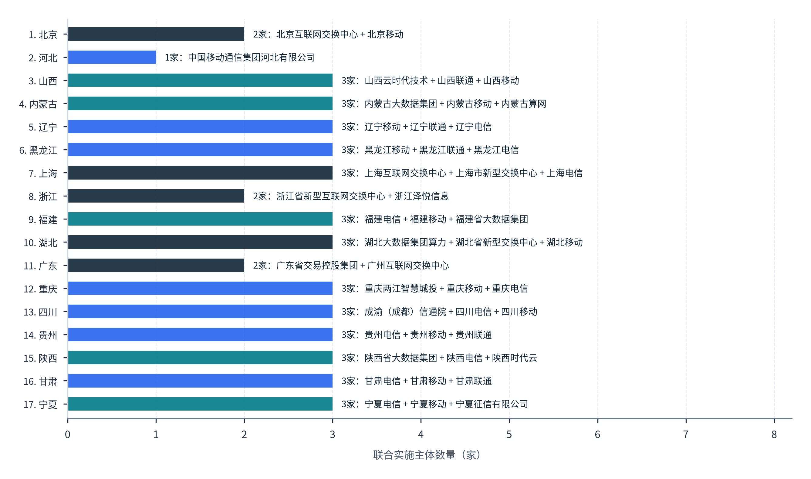
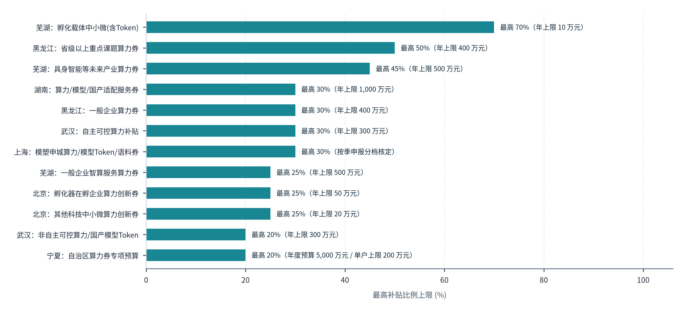
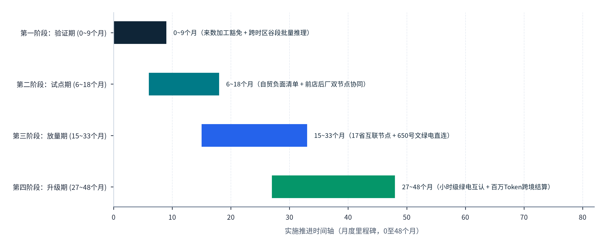
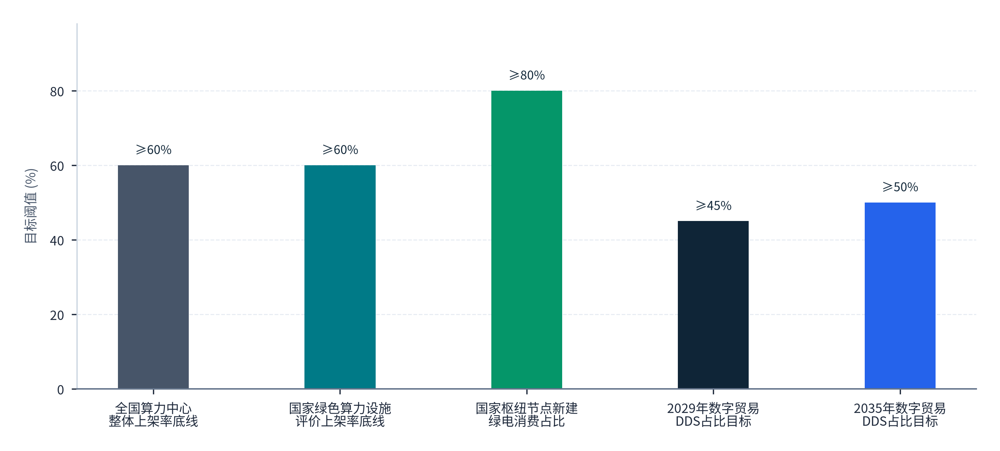

> **导航：** [返回中文手稿总目录](index.md) ｜ [上一章：第11章](chapter-11.md) ｜ [下一篇：尾注与方法论注释汇编](notes.md) ｜ [尾注](notes.md) ｜ [参考文献](references.md)

# 中国Token出海的发展路径与行动建议

> **本章导读：** 前十一章的研究表明，构建“中国绿色算力全球化交付体系与实现国际价值重构”是一项横跨**国家基础制度供给、地方区域功能协同与六类市场主体精准定位**的系统工程。当前，中国在底层清洁电力装机（38.91 亿千瓦）、在用标准机架（超 1,373 万架）与开源大模型算法效率上已具备显著比较优势，但在向全球规模化交付商业 Token 的过程中，仍面临跨网算力池化率偏低（10.8%）、国际海陆通道连接不均衡、各地算力券政策画地为牢、统计与碳足迹核算口径尚未与国际买家完全对齐等制度摩擦。本章遵循“问题导向、证据约束、权责对齐、分步核实”的方法论，首先在国家层面构建覆盖数字贸易、算力互联、数据跨境、算电协同与绿色设施评价的五维制度工具箱；继而基于工信部 2026 年 8 月公布的 17 个区域互联节点及八省市算力券/Token 券政策条件，厘清地方政府的功能定位与组织方式；随后面向六类产业主体定制差异化进入路径；最后建立区分制度成熟度等级（现行可实施 / 适用既有试点 / 需新增授权）的四阶段实施路线图与量化评价指标体系[122](references.md#ref-122)–[126](references.md#ref-126)。

## 12.1 国家层面的基础制度与公共能力

### 12.1.1 国家顶层战略目标锚定与跨部委公共制度供给蓝图

在国家层面，推动 Token 出海的制度建设应紧密依托 2024 年至 2026 年秋相继出台的五大国家级纲领文件，协同商务、工信、发改、网信、能源与生态环境部门的政策工具：

1. <strong>数字贸易顶层目标锚定（2029年 45% 与 2035年 50% 硬指标）：</strong>
      中共中央办公厅、国务院办公厅印发的《关于数字贸易改革创新发展的意见》（2024 年 8 月 17 日成文、11 月底公布）设定了国家中长期量化目标：**到 2029 年，我国可数字化交付的服务贸易规模占服务贸易总额的比重提高到 45% 以上；到 2035 年，可数字化交付的服务贸易规模占服务贸易总额的比重提高到 50% 以上**[122](references.md#ref-122)。将境内绿色算力封装为高附加值 MaaS 与 Token API 跨境出口，是支撑 2029 年 45% 与 2035 年 50% 战略目标的核心增量引擎。商务部会同国家统计局、国家外汇管理局可在现行国际收支（BOP）“计算机服务（SI2）”科目下，增设<strong>“人工智能模型推理与算力数字化交付服务”专项统计监测子目</strong>，打通企业跨境 API 结算流水与服务贸易退免税凭证[1](references.md#ref-1), [2](references.md#ref-2), [122](references.md#ref-122)。
2. <strong>全国公共算力标准化互联与“Token 计费”法定地位确立（工信部 2025至2028 行动框架）：</strong>
      工业和信息化部于 2025 年 5 月 21 日制发（5 月 30 日公布）的《算力互联互通行动计划》（工信部信管〔2025〕119号）明确提出，**到 2028 年基本实现全国公共算力标准化互联，逐步形成具备智能感知、实时发现、随需获取能力的全国算力互联网**[123](references.md#ref-123)。工信部办公厅于 **2026 年 3 月 27 日制发（4 月 2 日公布）的普惠算力服务中小企业专项行动通知**，不仅提出到 **2028 年普惠算力服务覆盖不少于 10 类行业领域**（以中小企业划分标准 15 类行业为分母），更在正文第二（二）4 条中，**首次在国家部委正式文件中将“卡时、核时、Token”并列作为合规认可的算力产品标准化计费形式**[123](references.md#ref-123)。这为全国算力交易平台与跨境网关按百万 Token 统一度量、跨网路由与清算提供了规章依据。
3. <strong>绿色算力设施硬约束与 2026 年度国家评价新规（FP16 稠密峰值、1 年连续实测与 0.8273 CUE 因子）：</strong>
      国家发展改革委等四部门印发的《数据中心绿色低碳发展专项行动计划》（发改环资〔2024〕970号）确立了三大基线目标：到 2025 年底全国数据中心整体上架率不低于 <strong>60%</strong>、全国平均 PUE 降至 **1.5 以下**、新建及改扩建大型和超大型数据中心 PUE 降至 <strong>1.25 以内（国家枢纽节点项目不高于 1.20）</strong>、<strong>国家枢纽节点新建数据中心绿电占比超过 80%</strong>[124](references.md#ref-124)。工业和信息化部等五部门于 <strong>2026 年 9 月 8 日成文（9 月 21 日发布，部委材料报送截止日为 2026 年 11 月 16 日）印发了《关于组织开展 2026 年度国家绿色算力设施推荐工作的通知》（工信厅联节函〔2026〕433号）及附件《评价指标体系》</strong>[124](references.md#ref-124)，确立了五项操作刚性规则：① <strong>连续运行门槛：</strong>参评设施截至申报日必须全系统连续稳定运行 **1 年以上**且物理边界清晰完整；② <strong>真实上架率门槛：</strong>机柜上架率不低于 <strong>60%</strong>，且附件明确将上架率分子定义为<strong>“空间充分利用且信息设备通电有效运行的机柜”</strong>；③ <strong>全年同周期实测：</strong>总耗电量、IT 设备耗电量、温室气体排放量和水资源消耗量必须采用<strong>“申报日前连续一年实际测量”</strong>的同周期数据；④ <strong>算力精度统一：</strong>智能算力设备理论峰值统一按 **FP16 稠密（Dense）精度**计量（通用算力按 FP32、超算按 FP64 分别计量）；⑤ <strong>CUE 碳因子统一：</strong>计算碳利用效率（CUE）时，核实后的可再生能源电量计为 0，非可再生电量统一采用固定评分因子 **0.8273 kgCO2e/kWh**[124](references.md#ref-124)。

### 12.1.2 国家层面基础制度与公共能力建设方案全景对标

围绕破解跨部委制度协同瓶颈与强化公共基础设施供给，**图表 12.1**针对**① 数字贸易统计与跨境财税结算**、**② 全国算力标准化互联与统一标识**、**③ 国际通信出入口与海陆通道统筹**、**④ “来数加工”合规豁免与白名单互认**以及**⑤ 算电协同、绿色评价与国际碳互认**五大制度领域，将亟待解决的现实痛点与瓶颈、现行国家政策依据与法定指标、牵头与协同主管部门、核心政策实施工具设计及 2026 至 2030 年预期效果逐一列出：

#### 图表 12.1：国家层面支撑 Token 出海的基础制度与公共能力建设方案表（现实问题、政策依据、主管部门、实施工具与预期效果）

| 制度与公共能力领域 | 亟待解决的现实痛点与瓶颈 | 现行国家政策依据与法定指标 | 牵头与协同主管部门 | 核心政策实施工具设计 | 量化预期效果（2026至2030） |
| --- | --- | --- | --- | --- | --- |
| **① 数字贸易统计与跨境财税结算** | Token API 跨境流水混入笼统 IT 外包，企业办理服务出口退免税及外汇自动收结汇缺乏标准单证。 | 中办、国办《关于数字贸易改革创新发展的意见》：可数字化交付服务占比 <strong>2029 年 ≥45%、2035 年 ≥50%</strong>[122](references.md#ref-122) | 商务部、国家统计局、国家税务总局、国家外汇管理局 | 在 BOP 计算机服务下设“AI 推理与算力服务”统计码；出台以“网关调用日志 + 算力消耗结算单 + 跨境收款水单”三单合一的增值税零税率/免税核实指引。 | 实现跨境 Token 出口应统尽统，合规退免税办理周期缩短 50% 以上。 |
| **② 全国算力标准化互联与统一标识** | 全国存量算力跨网可调度率仅 10.8%，异构算力缺乏统一的 Token 级路由与结算标准。 | 工信部《算力互联互通行动计划》（**2028 年标准化互联**）；普惠算力专项行动明确<strong>“卡时、核时、Token”计费</strong>[123](references.md#ref-123) | 工业和信息化部、国家数据局 | 依托 **17 个省级区域互联节点**，推广统一算力标识；制定《面向大模型的跨集群 Token 计量与服务等级（SLA）国家标准》。 | 到 2028 年跨网可调度算力占比提升至 35% 以上，覆盖 ≥10 类行业[123](references.md#ref-123)。 |
| **③ 国际通信出入口与海陆通道统筹** | 西部算力枢纽至沿海海缆登陆站跳数多，跨境专线资费高于海外本地 IXP 互联成本。 | 信息产业部令第 22 号；新建昆明、海口、上海、广东等国际通信业务出入口局批复与云南 **9 Tbps** 陆缆规划[107](references.md#ref-107) | 工业和信息化部、三大基础电信运营商 | 开通“西部国家算力枢纽 → 沿海/西南国际通信业务出入口局”直达光波长绿色通道（OTN 政企精品网），推行面向算力出海的阶梯批发资费。 | 枢纽至门户国内段单向时延稳定在 15～20ms 内，跨境带宽单位成本下降 30%～40%。 |
| **④ “来数加工”合规豁免与白名单互认** | 海外客户担忧输入 Prompt 在境内留存或触发复杂数据出境审批，合规信任摩擦高。 | 国家网信办令第 16 号《促进和规范数据跨境流动规定》第三条（不含个人信息或重要数据的国际贸易豁免）、第四条（境外个人信息入境处理后复出境豁免）及第六条（自贸区负面清单）[122](references.md#ref-122) | 国家互联网信息办公室、各地网信办、自贸区管委会 | 发布《跨境大模型推理（来数加工）零数据留存（ZDR）安全技术规范》，建立国家级第三方隐私审计与白名单备案库。 | 形成与国际 SOC 2 / ISO 27701 互认的“中国来数加工安全认证”，消除合规顾虑。 |
| **⑤ 算电协同、绿色评价与国际碳互认** | 国内三套电力碳因子与国际 Scope 2 小时级匹配准则衔接不畅，算力精度（稀疏/稠密）披露不一。 | 发改环资〔2024〕970号（枢纽新建绿电 <strong>>80%</strong>）；2026 国家绿色算力设施评价（**FP16 稠密、连续 1 年实测、上架率 ≥60%、CUE 系数 0.8273**）[124](references.md#ref-124) | 国家发展改革委、国家能源局、生态环境部、工业和信息化部 | 将 2026 国家绿色算力设施评价规则全面推广为出海集群准入标准；由生态环境部与能源局联合签发带小时级时间戳的英文版《中国绿电直连算力碳足迹核证声明》。 | 与 2028Q4 GHG Protocol / ISO 联合标准无缝对接，打响“中国零碳 Token”国际品牌[118](references.md#ref-118), [119](references.md#ref-119)。 |

> **表格结构化数据文件：** [`data/exhibits/exhibit-12-1.csv`](../../data/exhibits/exhibit-12-1.csv)
> **表注与来源：** 来源：中办国办数字贸易意见、工信部〔2025〕119号、工信厅〔2026〕404/433号、发改环资〔2024〕970号；介子九维（JIEZIJIUWEI）政策研究组编制[122](references.md#ref-122), [123](references.md#ref-123), [124](references.md#ref-124)。

**图表 12.1**的五维制度方案表明，推动 Token 出海从企业自发探索上升为国家产业竞争力，关键在于跨部委政策的协同配合：在**① 数字贸易统计与跨境财税结算**上凭“三单合一”将退免税办理周期缩短 **50% 以上**；在**② 全国算力标准化互联与统一标识**上把跨网可调度算力占比从 <strong>10.8%</strong> 提升至 2028 年的 **35% 以上**；在**③ 国际通信出入口与海陆通道统筹**上将西部枢纽至门户国内段单向时延控制在 **15～20ms** 内并降低跨境带宽成本 <strong>30%～40%</strong>；同时通过**④ “来数加工”合规豁免与白名单互认**和**⑤ 算电协同、绿色评价与国际碳互认**消除海外采购方的数据安全与碳核算顾虑。

## 12.2 地方层面的功能定位与发展组织

### 12.2.1 17 个国家算力互联互通区域节点布局与地方跨部门协同机制

在地方执行层面，首要任务是依托国家级算力互联互通枢纽与清晰的跨部门分工组织产业生态：

1. <strong>17 个国家算力互联互通区域节点正式进入建设阶段（2026 年 8 月 20 日工信部名单）：</strong>
      继 2026 年 1 月 27 日印发《关于组织开展国家算力互联互通节点建设工作的通知》（明确每个省级行政区申报区域节点不超过 **1 个**，建设主体注册资金不低于 **5,000 万元人民币**，运营主体须持有相应电信业务经营许可）后，工业和信息化部办公厅于 <strong>2026 年 8 月 20 日正式印发《关于公布国家算力互联互通区域节点建设名单的通知》（工信厅信管函〔2026〕404号）</strong>，确定了全国 **17 个省级行政区的区域节点进入正式建设名单**[123](references.md#ref-123)。例如，<strong>广东省区域节点的实施主体核定为“广东省交易控股集团有限公司 / 国家（广州）新型互联网交换中心（广州互联网交换中心）”；宁夏回族自治区区域节点的实施主体核定为“中国电信股份有限公司宁夏分公司 / 中国移动通信集团宁夏有限公司 / 宁夏征信有限公司”</strong>[123](references.md#ref-123)（该 17 个区域节点于 2026 年 8 月进入建设名单并被要求尽快投入应用，尚非完工验收状态）。广东与宁夏同批入选国家区域节点，为打通“粤宁前店后厂”跨省算力实时调度与统一清算提供了法定枢纽载体。
2. <strong>地方跨部门联合工作机制范式（云南与宁夏中卫的权责清单对标）：</strong>
      以西南通道代表**云南省**为例，云政办发〔2026〕27号文将国际通信业务出入口局建设、业务流量开通与海外接入点拓展的任务，精确分解压实至<strong>“云南省工业和信息化厅、云南省通信管理局、三家基础电信企业云南公司、昆明市人民政府”</strong>四方责任主体[107](references.md#ref-107)；西北基地代表**宁夏中卫**在实施方案中，则将绿色数据中心集群建设任务明确由<strong>“自治区发展改革委、工业和信息化厅、宁夏通信管理局、中卫市人民政府”</strong>协同推进，并将配套高压电网与绿电供给任务专项纳入**国网宁夏电力有限公司**考核[108](references.md#ref-108)。

基于工业和信息化部办公厅《关于公布国家算力互联互通区域节点建设名单的通知》（工信厅信管函〔2026〕404号），**图表 12.2**将入选国家建设名单的**1. 北京**至**17. 宁夏**共 17 个省级区域节点，按**含国家/新型互联网交换中心及交易平台**、**三大基础电信运营商联合地方大数据/算力国企**以及**三大基础电信运营商省公司主导建设**三类组织模式进行了分类对比，并逐一标注了各省区市的实施主体数量与单位名称：

#### 图表 12.2：工业和信息化部17个国家算力互联互通区域节点联合实施主体构成

> **图像文件：** [`figures/chart_12_2.png`](../../figures/chart_12_2.png)（高清位图）｜ [`figures/chart_12_2.svg`](../../figures/chart_12_2.svg)（矢量图）
> **图注与来源：** 来源：工业和信息化部办公厅《关于公布国家算力互联互通区域节点建设名单的通知》（工信厅信管函〔2026〕404号，2026年8月20日）；介子九维（JIEZIJIUWEI）整理绘制[121](references.md#ref-121)。

对照**图表 12.2**的三类图例与 17 省区市实施主体明细可以清晰看出全国区域算力节点的三种组织模式：第一类是**含国家/新型互联网交换中心及交易平台**的五大门户与枢纽节点，包括**1. 北京**（**2家：北京互联网交换中心 + 北京移动**）、**7. 上海**（**3家：上海互联网交换中心 + 上海新型交换中心 + 上海电信**）、**8. 浙江**（**2家：浙江新型互联网交换中心 + 浙江泽悦信息**）、**10. 湖北**（**3家：湖北大数据算力科技 + 湖北新型交换中心 + 湖北移动**）与**11. 广东**（**2家：广东省交易控股集团 + 广州互联网交换中心**）；第二类是**三大基础电信运营商联合地方大数据/算力国企**的七个节点，涵盖**3. 山西**（**3家：山西云时代 + 山西联通 + 山西移动**）、**4. 内蒙古**（**3家：内蒙古大数据集团 + 内蒙古移动 + 内蒙古算网科技**）、**9. 福建**（**3家：福建电信 + 福建移动 + 福建省大数据集团**）、**12. 重庆**（**3家：重庆两江智慧城市 + 重庆移动 + 重庆电信**）、**13. 四川**（**3家：成渝（成都）信通院 + 四川电信 + 四川移动**）、**15. 陕西**（**3家：陕西省大数据集团 + 陕西电信 + 陕西时代云**）以及**17. 宁夏**（**3家：宁夏电信 + 宁夏移动 + 宁夏征信有限公司**）；第三类是**三大基础电信运营商省公司主导建设**的五个节点，包括**2. 河北**（**1家：河北移动**）以及均由移动、联通、电信三家省公司联合承建的**5. 辽宁**、**6. 黑龙江**、**14. 贵州**和**16. 甘肃**。**图表 12.3**进一步完整列示了这 17 个省级区域节点的省级联合申报主管部门、法定批复实施主体全称及其在算力出海体系中的功能定位[121](references.md#ref-121), [123](references.md#ref-123)：

#### 图表 12.3：国家算力互联互通区域节点建设名单（17个省级区域申报单位与实施主体一览表）

| 序号 | 入选区域 | 省级联合申报主管部门 | 法定批复实施主体 | 在算力出海体系中的功能定位 |
| --- | --- | --- | --- | --- |
| 1 | 北京 | 北京市通信管理局、北京市经济和信息化局 | 工业和信息化部北京互联网交换中心、中国移动通信集团北京有限公司 | 京津冀枢纽 / 国际出入口局协同 |
| 2 | 河北 | 河北省通信管理局、河北省工业和信息化厅 | 中国移动通信集团河北有限公司 | 京津冀张家口算力集群互联 |
| 3 | 山西 | 山西省通信管理局、山西省工业和信息化厅 | 山西云时代技术有限公司、中国联通山西省分公司、中国移动山西有限公司 | 晋陕蒙能源算力走廊接续 |
| 4 | 内蒙古 | 内蒙古自治区通信管理局、内蒙古自治区工业和信息化厅 | 内蒙古大数据产业发展集团、中国移动内蒙古有限公司、内蒙古算网科技有限公司 | 和林格尔国家算力枢纽核心节点 |
| 5 | 辽宁 | 辽宁省通信管理局、辽宁省工业和信息化厅 | 中国移动辽宁有限公司、中国联通辽宁省分公司、中国电信辽宁分公司 | 东北区域算力调度与工业互联 |
| 6 | 黑龙江 | 黑龙江省通信管理局、黑龙江省工业和信息化厅 | 中国移动黑龙江有限公司、中国联通黑龙江省分公司、中国电信黑龙江分公司 | 高寒低PUE算力集群与算力券联动 |
| 7 | 上海 | 上海市通信管理局、上海市经济和信息化委员会 | 工业和信息化部上海互联网交换中心、上海市新型互联网交换中心、中国电信上海分公司 | 长三角枢纽 / 临港跨境数据与海缆门户 |
| 8 | 浙江 | 浙江省通信管理局、浙江省经济和信息化厅 | 浙江省新型互联网交换中心有限责任公司、浙江泽悦信息科技有限公司 | 长三角算力交易与模型生态集聚 |
| 9 | 福建 | 福建省通信管理局、福建省工业和信息化厅 | 中国电信福建分公司、中国移动福建有限公司、福建省大数据集团有限公司 | 海峡两岸与东南亚海丝通信门户 |
| 10 | 湖北 | 湖北省通信管理局、湖北省经济和信息化厅 | 湖北大数据集团算力科技有限公司、湖北省新型互联网交换中心、中国移动湖北有限公司 | 中部骨干网十字枢纽与武汉算力券协同 |
| 11 | 广东 | 广东省通信管理局、广东省工业和信息化厅 | 广东省交易控股集团有限公司、工业和信息化部广州互联网交换中心 | 粤港澳大湾区枢纽 / 汕头与深圳跨境门户 |
| 12 | 重庆 | 重庆市通信管理局、重庆市经济和信息化委员会 | 重庆两江智慧城市投资发展有限公司、中国移动重庆有限公司、中国电信重庆分公司 | 成渝国家算力枢纽与陆海新通道节点 |
| 13 | 四川 | 四川省通信管理局、四川省经济和信息化厅 | 成渝（成都）信通院有限公司、中国电信四川分公司、中国移动四川有限公司 | 成渝水电绿电算力集群调度中心 |
| 14 | 贵州 | 贵州省通信管理局、贵州省工业和信息化厅 | 中国电信贵州分公司、中国移动贵州有限公司、中国联通贵州省分公司 | 贵安国家算力枢纽与南部出境走廊 |
| 15 | 陕西 | 陕西省通信管理局、陕西省工业和信息化厅 | 陕西省大数据集团有限公司、中国电信陕西分公司、陕西时代云数据科技有限公司 | 西北骨干光缆汇聚与科研模型重镇 |
| 16 | 甘肃 | 甘肃省通信管理局、甘肃省工业和信息化厅 | 中国电信甘肃分公司、中国移动甘肃有限公司、中国联通甘肃省分公司 | 庆阳国家算力枢纽（18.55万P智算底座） |
| 17 | 宁夏 | 宁夏回族自治区通信管理局、宁夏回族自治区工业和信息化厅 | 中国电信宁夏分公司、中国移动宁夏有限公司、宁夏征信有限公司 | 中卫国家算力枢纽（33.1万机架绿电底座） |

> **表格结构化数据文件：** [`data/exhibits/exhibit-12-3.csv`](../../data/exhibits/exhibit-12-3.csv)
> **表注与来源：** 来源：工业和信息化部办公厅《关于公布国家算力互联互通区域节点建设名单的通知》（工信厅信管函〔2026〕404号，2026年8月20日印发，附件《国家算力互联互通区域节点建设名单》）；介子九维（JIEZIJIUWEI）整理[121](references.md#ref-121)。

审视**图表 12.3**所列的 17 个国家算力互联互通区域节点可知，所有区域节点均由各省（区、市）通信管理局与工信（或经信）主管部门联合申报，实现了“八大东数西算国家枢纽（京津冀、长三角、粤港澳、成渝、内蒙古、贵州、甘肃、宁夏）”与“中部、东北及东南沿海门户（山西、辽宁、黑龙江、福建、湖北、陕西）”的全面贯通，为跨省“卡时、核时、Token”标准化计量与跨网交易结算奠定了制度基础[121](references.md#ref-121), [123](references.md#ref-123)。

### 12.2.2 2026 年地方“算力券与模型券（Token 券）”政策对比与机制优化

本报告对**北京、上海、黑龙江、湖南、安徽芜湖、湖北武汉、宁夏、山东烟台**八地的最新官方文件原件、预算绩效表与拟奖补公示名单进行了逐条穿透对比[125](references.md#ref-125), [126](references.md#ref-126)（严格区分“政策规则上限”“年度财政预算目标”与“事后核定公示金额”三类不同性质的数据[xiv](notes.md#note-xiv)）：

- <strong>北京（突出科技孵化分级，严格区分算力券与普通创新券比率）：</strong>根据北京市科委、中关村管委会于 2026 年 6 月 23 日发布施行的《首都科技条件平台与科技创新券实施办法（2026年修订版）》第六章第十九至二十条，北京市针对**算力创新券设定了不超过同一合同实际发生额 25% 的补助比率**（与普通科技创新券 50% 的补助上限相区分）：入驻标杆孵化器或有效期内省部级及以上孵化器的在孵企业，每年申领算力创新券上限为 **50 万元**；其他科技型中小微企业每年上限为 **20 万元**（领取后最长 1 年内有效）[125](references.md#ref-125)。
- <strong>上海（建立“算力券 + 模型券[Token 券] + 语料券”三券联动与季度常态化受理机制）：</strong>上海市经济和信息化委员会于 2026 年 4 月 30 日印发的《2026年度上海市“模塑申城”工程相关补贴申报通知》（沪经信智〔2026〕248号）将补贴工具拆分为**① 算力券**（租用非关联方智能算力，不含存储、网络、安全等其他服务）、**② 模型券 / Token 券**（直接补贴调用非关联方第三方云模型 API 的 Token 费用或第三方模型私有化部署费用）以及**③ 语料券**（购买非关联方高质量语料用于研发应用）[125](references.md#ref-125)。上海于 2026 年 5 月 8 日至 5 月 27 日开展首批受理，并建立**后续每季度首月常态化受理机制**；其附件 4《自主申报材料模板》要求企业提交完整的**非关联方服务合同、增值税发票、银行支付凭证、服务费用明细及申报期间证明**（该申报通知正文未单独列示具体百分比数值）[125](references.md#ref-125)。
- <strong>黑龙江、湖南、芜湖、武汉（差异化的补贴上限、失效期约束与国产化倾斜）：</strong>
      ① **黑龙江省**（《黑龙江省算力券管理办法（试行）》，黑工信数基联规〔2026〕9号，2026 年 4 月 23 日成文、9 月 7 日政府公报刊载）：规定单份合同金额须超过 5 万元且向省内合规服务商采购，**一般算力券按不超过合同额 30%、每家单位每年最高 400 万元**予以补助；承担<strong>省级以上科研课题或重点项目的单位，补助比例提升至 50%（上限同为 400 万元）</strong>，并规定**领券后 6 个月内未开始执行合同的自动失效**[125](references.md#ref-125)；
        
② **湖南省**（《湖南省算力券补贴政策实施细则》，湘工信信息软件〔2026〕168号，2026 年 5 月 9 日发布，并在 2026 年 10 月 12 日湖南省工信厅现行有效规范性文件目录中确认有效）：对 **2025 年 10 月 27 日至 2028 年 10 月 26 日期间**实际结算的算力、模型及国产适配服务费用（不含独立网络带宽、安全防护及数据库费用），按**不超过 30%、单家企业每年最高 1,000 万元**给予补助[125](references.md#ref-125)；
        
③ **安徽省芜湖市**（《芜湖市人工智能算力券实施细则（2026版）》，2026 年 7 月 15 日发布，7 月 17 日发布解读）：<strong>一般算力券按 25% 补贴（自然年度累计上限 500 万元）；经部门会商认定的具身智能等未来产业项目按 45% 补贴（年度上限 500 万元）；入驻指定算力产业孵化载体的中小微企业开展 AI 经营科研（明确包含大模型 Token 调用费用），补贴比例高达 70%（年度上限 10 万元，当年有效）</strong>[125](references.md#ref-125)；
        
④ **湖北省武汉市**（《武汉市算力券管理办法》，2026 年 9 月 30 日发布，定于 **2026 年 10 月 29 日起正式施行，有效期 1 年**；截至基准日 2026年10月处于已发布待施行状态）：要求企业累计购买算力服务满 3 万元（不含税费），<strong>使用非自主可控算力或调用国产大模型 Token 的，按不超过实际支付费用 20% 补贴（同一主体年上限 300 万元）；使用自主可控（国产）算力的，补贴比例提高至 30%（年上限 300 万元）</strong>[125](references.md#ref-125)。
- <strong>宁夏财政预算绩效目标 vs 山东烟台真实智算交易核定公示（从“纸面政策”到“真实成交兑付”的穿透对照）：</strong>
      在西部枢纽端，根据《宁夏发展改革委 2026 年部门预算》专项附表《项目支出预算绩效目标表（支持国家算力枢纽建设专项）》，**2026 年宁夏支持国家算力枢纽建设的算力券年度财政预算为 5,000 万元人民币**，绩效目标为：支持使用宁夏算力开展创新研发的主体 <strong>≥10 家</strong>、每用户实际支付费用补助比例 <strong>≤20%</strong>、每用户年度兑付总额 <strong>≤200 万元</strong>、服务对象满意度 <strong>≥90%</strong>[126](references.md#ref-126)。
        
在东部沿海端，烟台市大数据局于 **2026 年 5 月 25 日发布的《关于 2026 年省级数字山东发展资金分配情况的公示》附件 1**，公开披露了经核定的 <strong>2025 年度四笔真实完成的智算交易明细及双边拟奖补金额（核定交易总额合计 325.718 万元人民币）</strong>[126](references.md#ref-126)：
        
① <strong>第一笔（海阳）：</strong>供方“东方航天港集团大数据产业运营服务有限公司”与需方“百度云智（上海）信息科技有限公司”签署《算力云服务协议》，**核定 2025 年交易额 308.00 万元**，拟分别给予供方和需方各 **15.16 万元**双边奖补；
        
② <strong>第二笔（海阳）：</strong>同一供方与海阳本地航天科研机构签署《智算服务协议》，**核定交易额 10.20 万元**，拟分别给予供需双方各 **0.51 万元**双边奖补；
        
③ <strong>第三笔（黄渤海新区）：</strong>供方“山东发展中金大数据科技有限公司”与需方“山东海方鑫航安全技术有限公司”签署《算力服务项目合同》，**核定交易额 1.90 万元**，拟给予供方奖补 **0.10 万元**（需方主动放弃申领，在统计中标记为主动放弃而非零补贴）；
        
④ <strong>第四笔（黄渤海新区）：</strong>供方“山东发展中金大数据科技有限公司”与需方“青岛三态比特科技有限公司”签署《算力服务框架协议》，**核定交易额 5.618 万元**，拟分别给予供需双方各 **0.28 万元**双边奖补[126](references.md#ref-126)。
        
<strong>政策启示：</strong>建议沿海门户（上海、广东、海南）与西部枢纽（宁夏、甘肃、内蒙古、云南）<strong>联合设立“跨省结算的出海专项 Token 券”</strong>，允许沿海出海应用企业持券调用西部绿电智算集群的 API Token，由东西部财政按收益留存比例联合兑付。

为直观对比全国各地算力券与大模型 Token 券的财政支持力度，**图表 12.4**按<strong>明确覆盖大模型 Token / 模型调用补贴（或孵化专项）</strong>、**重点项目 / 自主可控算力专项高比例补贴**以及**普惠算力券 / 枢纽预算池 / 真实交易核定奖补**三类政策取向，对芜湖、黑龙江、湖南、武汉、北京、宁夏与烟台的 12 项代表性政策工具最高补贴比例及年度封顶额度进行了排序对比：

#### 图表 12.4：国内代表性省市算力券、大模型 Token 券及语料券补贴比例上限与年度封顶额度对比

> **图像文件：** [`figures/chart_12_2b.png`](../../figures/chart_12_2b.png)（高清位图）｜ [`figures/chart_12_2b.svg`](../../figures/chart_12_2b.svg)（矢量图）
> **图注与来源：** 来源：北京、上海（沪经信智〔2026〕248号）、黑龙江、湖南、芜湖、武汉、宁夏、烟台2025至2026年算力券政策与公示文件；介子九维（JIEZIJIUWEI）整理绘制[123](references.md#ref-123)–[126](references.md#ref-126)。

对照**图表 12.4**的 12 根柱状图及右侧数值标注可以清晰读出三类地方补贴的梯度特征：在第一类明确包含大模型 Token 调用或重点扶持领域中，<strong>芜湖：孵化载体中小微(含Token)</strong>给出了全国最高的 <strong>最高 70%（年上限 10 万元）</strong> 补贴比例，**芜湖：具身智能等未来产业**为 <strong>最高 45%（年上限 500 万元）</strong>，**武汉：非自主算力/国产模型Token**为 <strong>最高 20%（年上限 300 万元）</strong>（另如图底部注释所示，上海“模塑申城”248号文同步设立了算力券、模型券 Token 券与语料券按季度首月常态化受理机制）；在第二类重点科研与国产化专项中，**黑龙江：省级重点项目算力券**达 <strong>最高 50%（年上限 400 万元）</strong>，**湖南：算力/模型/国产适配**达 <strong>最高 30%（年上限 1,000 万元）</strong>（单企年度封顶最高），**武汉：自主可控(国产)算力券**达 <strong>最高 30%（年上限 300 万元）</strong>；在第三类普惠算力券与预算兑付实绩中，<strong>黑龙江：一般算力券(6个月效期)</strong>为 <strong>最高 30%（年上限 400 万元）</strong>，**芜湖：一般智算算力券**为 <strong>最高 25%（年上限 500 万元）</strong>，**北京：标杆孵化器在孵企业**与**北京：其他科技型中小微企业**同为 <strong>最高 25%</strong>（年上限分别为 **50 万元** 与 **20 万元**），**宁夏：自治区算力券专项预算**为 <strong>最高 20%（年度预算 5,000 万元 / 单户上限 200 万元）</strong>，而**烟台：2025智算交易双边拟奖补实绩**则展示了 <strong>双边各约 4.92%（4笔核定交易 325.7 万元，海阳首单双边各奖 15.16 万元）</strong> 的真实事后核定样本。**图表 12.5**进一步完整汇编了上述全部政策工具与兑付实绩的申领门槛及有效期条款[125](references.md#ref-125), [126](references.md#ref-126)：

#### 图表 12.5：国内各省市算力券与大模型Token券支持比例、封顶额度、适用条件及预算兑付实绩一览表

| 省市与档位 | 政策工具与补贴类别 | 最高补贴比例 | 年度封顶 / 预算额 | 核心申领门槛与合规挂钩条件 | 执行状态与时效规则 |
| --- | --- | --- | --- | --- | --- |
| <strong>北京（孵化器档）</strong> | 标杆孵化器在孵企业算力创新券 | 最高 25% | 50 万元/年 | 标杆或有效期内省部级及以上孵化器在孵；按同一合同实际发生额核定 | 已施行（领券后最长1年有效） |
| <strong>北京（中小微档）</strong> | 其他科技型中小微企业算力创新券 | 最高 25% | 20 万元/年 | 符合科技型中小微条件；一般创新券50%补贴比例不适用于算力券 | 已施行（领券后最长1年兑付） |
| <strong>黑龙江（普惠档）</strong> | 一般算力券（企业常态化调用） | 最高 30% | 400 万元/年 | 单合同金额超5万元，省内注册且采购合规目录服务商；按每单位自然年度累计 | 试行公报刊载（领券6个月内须履约） |
| <strong>黑龙江（重点档）</strong> | 省级以上课题及重点项目算力券 | 最高 50% | 400 万元/次 | 须获省级及以上科研课题或重点项目立项；按单份合同一次性核定支持 | 试行公报刊载（逾期未履约自动失效） |
| <strong>湖南（省级普惠）</strong> | 算力 / 模型 / 国产适配服务券 | 最高 30% | 1,000 万元/年 | 按实际结算额核定；不计入独立网络带宽、安全防护及数据库；专家评审排序 | 现行有效（覆盖2025.10至2028.10费用） |
| <strong>芜湖（一般智算）</strong> | 一般智能算力券（基础训练推理） | 最高 25% | 500 万元/年 | 同一使用方按自然年度累计；仅限智算服务实际发生费用 | 2026版规则（发放当年自然年有效） |
| <strong>芜湖（未来产业）</strong> | 具身智能等未来产业专项算力券 | 最高 45% | 500 万元/年 | 须经行业主管部门联合会商认定未来产业属性；纳入年度累计上限管理 | 2026版规则（跨部门会商批次核定） |
| <strong>芜湖（Token档）</strong> | 孵化载体内中小微企业含Token调用 | 最高 70% | 10 万元/年 | 入驻指定算力产业孵化载体，开展AI经营或科研；明确覆盖大模型API Token调用 | 2026版规则（小额高频当年快速兑付） |
| <strong>武汉（Token档）</strong> | 非自主可控算力 / 国产模型Token券 | 最高 20% | 300 万元/年 | 年度累计购买服务≥3万元（不含税费）；明确纳入国产大模型API Token调用费用 | 已发布（2026-10-29起施行，效期1年） |
| <strong>武汉（自主可控）</strong> | 自主可控（国产芯片）算力专项券 | 最高 30% | 300 万元/年 | 采购全国产化软硬件集群算力且年累计≥3万元（不含税）；与Token档共享主体年上限 | 已发布（2026-10-29起施行，差异化激励） |
| <strong>上海（模塑申城）</strong> | 算力券 / 模型券（Token券） / 语料券 | 按季度指南分档 | 按项目分档核定 | 覆盖租用非关联方智能算力（剔除存储/网络/安全）、第三方云模型API调用及高质量语料采购 | 沪经信智〔2026〕248号（首批5月，后续每季首月受理） |
| <strong>宁夏（枢纽预算）</strong> | 2026年自治区算力券专项预算池 | 最高 20% | 预算池 5,000 万元 | 支持≥10家主体使用宁夏算力开展创新研发；单户上限200万元，拉动相关产值≥1亿元 | 2026年预算绩效已批复（资金使用率目标≥95%） |
| <strong>山东烟台（海阳）</strong> | 2025智算交易奖补实绩：首单云协议 | 双边各约 4.92% | 供需各 15.16 万元 | 核定2025年实际算力交易额 308.00 万元（东方航天港运营公司 ↔ 百度云智上海） | 2026年5月官方公示（供需双边同步奖补） |
| <strong>山东烟台（黄渤海）</strong> | 2025智算交易奖补实绩：其余3笔合同 | 约 5.00% | 供方0.89万/需方0.79万 | 海阳智算协议（10.2万元）、黄渤海2笔合同（1.9万元、5.618万元）；4笔合计 325.718 万元 | 2026年5月官方公示（其中1笔1.9万元合同需方主动放弃申领） |

> **表格结构化数据文件：** [`data/exhibits/exhibit-12-5.csv`](../../data/exhibits/exhibit-12-5.csv)
> **表注与来源：** 来源：北京市科委中关村管委会创新券办法、黑龙江省算力券试行办法、湖南省算力券实施方案、芜湖市智算补贴政策、武汉市算力券办法（2026年10月29日施行）、上海市“模塑申城”算力券/模型券/语料券指南（沪经信智〔2026〕248号）、宁夏2026年预算绩效表及烟台市大数据局2026年5月公示文件；介子九维（JIEZIJIUWEI）整理[123](references.md#ref-123)–[126](references.md#ref-126)。

综合对比**图表 12.5**所列的 14 项政策档位与兑付实绩，可以提炼出三项重要的制度演进方向：第一，地方补贴标尺正从传统的“裸机柜/裸卡时租用（算力券）”加速向“大模型 API 调用（模型券 / Token 券）”延伸，如芜湖对孵化载体内中小微企业调用 Token 给予 <strong>最高 70%（10 万元上限）</strong> 补贴，武汉对调用国产模型 Token 给予 <strong>最高 20%（300 万元上限）</strong> 补贴，上海同步设立算力券、模型券 Token 券与语料券；第二，各地政策普遍设定了严格的真实商业背景审查与时效约束（如黑龙江规定 **6 个月未开始执行合同自动失效**、湖南与上海明确剔除独立网络带宽与安全存储费用）；第三，山东烟台 4 笔智算交易实绩（总交易额 **325.718 万元**，其中黄渤海新区 1 笔 1.90 万元小额合同需方主动放弃申领千元级补贴）表明，未来面向跨境 Token 出口的财政支持应大幅简化线上自动对单流程，按真实的跨境 API 结算流水与绿电消纳凭证实施高效事后兑付[123](references.md#ref-123)–[126](references.md#ref-126)。

## 12.3 企业层面的进入路径

### 12.3.1 六类产业主体的切入环节、资质条件与差异化经营策略

结合工信部区域节点建设门槛（注册资金 <strong>≥5,000 万元</strong>且运营主体须持相关电信许可）、国家绿色算力设施评价门槛（连续运行 <strong>≥1 年</strong>、有效上架率 <strong>≥60%</strong>、新建大型/超大型 PUE <strong>≤1.25</strong>、国家枢纽节点 PUE <strong>≤1.20</strong>）以及上海“模塑申城”申报凭证规范[123](references.md#ref-123), [124](references.md#ref-124), [125](references.md#ref-125)，**图表 12.6**针对**① 发电集团与综合能源企业**、<strong>② 算力基础设施运营商 (AIDC)</strong>、**③ 基础电信与国际通信运营商**、<strong>④ 基础大模型研发企业 (Model Labs)</strong>、**⑤ 算力调度与模型聚合平台**以及<strong>⑥ 垂直行业智能应用服务商 (ISV)</strong>六类产业主体，系统梳理了各自的核心切入环节与产品形态、必备政策资质与技术硬指标门槛、最佳资源组合与跨主体合作方式、首期市场验证（MVP）抓手及中长期经营风控红线：

#### 图表 12.6：面向 Token 出海的六类产业主体（能源、算力、通信、模型、平台、行业应用）切入环节、资质门槛与经营策略一览表

| 产业主体类型 | 核心切入环节与产品形态 | 必备政策资质与技术硬指标门槛 | 最佳资源组合与跨主体合作方式 | 首期市场验证（MVP）抓手 | 中长期经营节奏与风控红线 |
| --- | --- | --- | --- | --- | --- |
| **① 发电集团与综合能源企业** | **绿电专线直供 + 源网荷储园区底座** 输出 0.30～0.35 元/kWh 物理可溯源绿电与高压变电配套 | 发改能源〔2025〕650号 /〔2026〕688号绿电直连项目备案与发改价格〔2025〕1192号就近消纳电价核定；220kV/330kV 专用变电站批复（如中卫 3,255 万元供电工程模式）[36](references.md#ref-36), [108](references.md#ref-108) | <strong>“出电不出卡”：</strong>以土地、变电站与风光储资产入股或长约供能，联合专业 AIDC 龙头与云厂商，不直接跨界采购短寿命 GPU。 | 在宁夏、甘肃、蒙西、云南落地 1～2 个 100MW 级绿电直连示范园，满足省级负荷率基准（如宁夏 ≥66.38%）[39](references.md#ref-39)。 | 锁定 10～15 年期照付不议（Take-or-Pay）绿色 PPA，配套签发小时级分时绿电消费凭证。 |
| <strong>② 算力基础设施运营商 (AIDC)</strong> | **高密液冷机房批发 + 算力集群托管运维** 按机柜千瓦（kW/月）或算力包年集群收费 | IDC（B11）经营许可；新建 PUE <strong>≤1.25（枢纽 ≤1.20）</strong>；参评国家绿色设施须<strong>连续运行 ≥1 年、有效上架率 ≥60%</strong>[124](references.md#ref-124) | 与头部模型商/跨国云签署 5～10 年批发长约（如润泽科技模式，经营现金流/营收比达 79%）[112](references.md#ref-112)；推进余热回收降 PUE（如和林格尔 B02 降至 1.209）[109](references.md#ref-109)。 | 优先盘活存量高密机柜，按 **FP16 稠密**口径如实披露算力，通过国家绿色算力设施认证获取低息绿色信贷。 | <strong>风控红线：</strong>拒绝无下游订单锚定的投机性囤卡；单项目静态回收期严格控制在 4 年以内。 |
| **③ 基础电信与国际通信运营商** | **跨境低时延精品专线 + 区域算力互联节点** 提供海陆光缆波道、国际出入口局与边缘 PoP 接入 | 国际通信设施服务（A11-4）与出入口局运营资质；牵头建设 <strong>17 个省级区域互联节点（注册资本 ≥5,000 万元）</strong>[123](references.md#ref-123) | 内部打通“省内智算中心 + 国内 OTN 干线 + 国际海缆/昆明陆缆 + 海外 IXP 节点”，推出<strong>“算网一体按 Token/带宽捆绑套餐”</strong>。 | 在广州/深圳/汕头、上海临港、海南海口、云南昆明率先开通面向东南亚与中东的“算力出海低时延专网”。 | 加快 ALC、SEA-H2X 海缆及云南 **9 Tbps 跨境陆缆**投产，建立主备海陆光缆秒级自动倒换 SLA[107](references.md#ref-107)。 |
| <strong>④ 基础大模型研发企业 (Model Labs)</strong> | **旗舰/轻量模型 API + 推理思考引擎 + 权重商业授权** 按百万输入/输出 Token（含缓存折扣）计费 | 算法备案与跨境合规评估；具备 FlashMLA 等底层算子工程能力及海外独立签约实体（新加坡/香港/欧美）[45](references.md#ref-45) | 采用<strong>“前店后厂混合路由”</strong>：海外轻边缘网关处理鉴权脱敏，境内西部绿电集群承载长上下文与夜间错峰推理。 | 先通过开源社区（HuggingFace）与全球聚合路由平台（OpenRouter）建立开发者口碑，再引导大客户迁入官方直连企业版 API。 | 利用欧美白天对应国内凌晨（00:00至08:00）推出离峰半价折扣，将集群 24h 综合 MFU 推升至 55% 以上。 |
| **⑤ 算力调度与模型聚合平台** | **跨集群异构推理路由 + 词元工厂运营** 聚合多源算力与多款开源模型，提供统一 API 网关 | ICP/EDI 及云服务许可；具备完善的**合同、发票、支付凭证与调用日志四流合一**审计记录（对齐沪经信智〔2026〕248号标准）[125](references.md#ref-125) | 参考<strong>“天亿马 + 瑞源智算”设立广东亿联词元（注资 1,000 万元）</strong>的合资模式[111](references.md#ref-111)，轻重结合绑定沿海门户与西部闲置算力。 | 聚焦东南亚四国（新、泰、马、印）及港澳市场，切入对价格敏感、合规摩擦小的开源模型托管与批处理接口[111](references.md#ref-111)。 | 从赚取单纯 API 通道差价（5%～10%），升级为提供精细化 Prompt 缓存、模型微调与多币种结算的增值平台。 |
| <strong>⑥ 垂直行业智能应用服务商 (ISV)</strong> | **AI 短剧、智能陪伴玩具、跨境电商客服、代码辅助等成品服务** 按订阅制（SaaS）或按任务结果（BPaaS）收费 | 目标市场应用商店合规与本地隐私法（GDPR/PDPA）合规声明；满足芜湖/上海/武汉等地 Token 券申领条件[125](references.md#ref-125) | 前端贴近海外本土消费者与行业客户，后端通过专线集中采购中国境内高性价比模型 Token，用足地方<strong>模型券/Token 券（最高 20%～70% 补贴）</strong>[125](references.md#ref-125)。 | 如汕头词元工厂验证的**AI 短剧多语种译制、AI 玩具实时语音交互**等高频高毛利场景，实现单月正向现金流[111](references.md#ref-111)。 | 将中国底层低成本 Token 封装为高溢价行业解决方案，避免直接暴露在底层算力价格战中。 |

> **表格结构化数据文件：** [`data/exhibits/exhibit-12-6.csv`](../../data/exhibits/exhibit-12-6.csv)
> **表注与来源：** 来源：工信厅信管函〔2026〕404号、工信厅联节函〔2026〕433号、沪经信智〔2026〕248号及各省算力券细则；介子九维（JIEZIJIUWEI）研究设计[123](references.md#ref-123), [124](references.md#ref-124), [125](references.md#ref-125)。

对照**图表 12.6**为六类产业主体定制的进入路径与风控红线可知，不同资源禀赋的企业在 Token 出海浪潮中应坚持专业化分工与错位协同：**① 发电集团与综合能源企业**应严守“出电不出卡”边界，锁定 10～15 年期绿色购电协议（PPA）而避免跨界盲目采购短折旧周期加速卡；<strong>② 算力基础设施运营商 (AIDC)</strong>应锚定头部客户 5～10 年批发长约与国家枢纽 PUE <strong>≤1.20</strong>、有效上架率 <strong>≥60%</strong> 硬指标，将单项目静态回收期控制在 4 年以内；**③ 基础电信与国际通信运营商**应依托 **17 个省级区域互联节点**与新增海陆光缆推出“算网一体”套餐；而<strong>④ 基础大模型研发企业 (Model Labs)</strong>、**⑤ 算力调度与模型聚合平台**与<strong>⑥ 垂直行业智能应用服务商 (ISV)</strong>则应利用跨时区离峰折扣、合资词元工厂及地方 <strong>20%～70%</strong> 的 Token 券政策，将境内低成本绿色算力转化为高毛利的全球数字服务出口。

## 12.4 分阶段实施与效果评价

### 12.4.1 基于制度成熟度分级（现行可实施 / 适用既有试点 / 需新增授权）的四阶段实施路线图

本报告按照<strong>制度成熟度三维分类法（现行制度可实施 / 适用既有自贸区与枢纽试点 / 需新增制度授权与国际互认）</strong>，在**图表 12.7**中规划了覆盖<strong>第一阶段：验证期 (0~9个月)</strong>、<strong>第二阶段：试点期 (6~18个月)</strong>、<strong>第三阶段：放量期 (15~33个月)</strong>与<strong>第四阶段：升级期 (27~48个月)</strong>的四阶段甘特路线图：

#### 图表 12.7：中国 Token 出海四阶段实施路线图（验证期 → 试点期 → 放量期 → 升级期）与政策就绪度分级

> **图像文件：** [`figures/chart_12_4b.png`](../../figures/chart_12_4b.png)（高清位图）｜ [`figures/chart_12_4b.svg`](../../figures/chart_12_4b.svg)（矢量图）
> **图注与来源：** 来源：工业和信息化部算力互联互通节点部署、国家发展改革委算电协同政策、国家网信办负面清单及本研究路线设计；介子九维（JIEZIJIUWEI）研究绘制[121](references.md#ref-121)–[126](references.md#ref-126)。

对照**图表 12.7**的四条阶段横道及右侧任务里程碑可见，中国 Token 出海在 48 个月推进周期内采取“小步快跑、交叉衔接”的节奏：<strong>第一阶段：验证期 (0~9个月)</strong>聚焦**现行制度可实施：跑通无状态推理与批处理闭环，验证LCoT与免税结算**；<strong>第二阶段：试点期 (6~18个月)</strong>在第 6 个月切入，依托**适用既有试点：依托自贸区负面清单、来数加工与四城出入口局试运行**；<strong>第三阶段：放量期 (15~33个月)</strong>在第 15 个月启动，转向**试点扩围与互联：建成17个国家区域节点，兑现2028标准化互联与45%数字贸易目标**；<strong>第四阶段：升级期 (27~48个月)</strong>则从第 27 个月延伸至第 48 个月，推进**需新增制度授权：对接2028Q4 GHG/ISO碳标准，建成全球零碳推理枢纽**。各阶段的具体落地行动分解如下：

1. <strong>第一阶段：验证期（0～9 个月，对应 2026Q4 至 2027Q2，以“现行制度可实施”为主）：</strong>

<strong>核心行动：</strong>在不触碰境外个人敏感隐私数据（Non-PII）的公开语料清洗、合成数据生成、代码辅助、多语种短剧译制、科学计算与开源模型 API 托管领域，直接在现行法规下开展跨境交付；落实 2026 年 11 月 16 日截止的国家绿色算力设施推荐申报与评估标准[124](references.md#ref-124)；用好上海、北京、湖南、芜湖、武汉（2026 年 10 月 29 日生效）等地的算力券与 Token 券政策[125](references.md#ref-125)。
<strong>阶段里程碑：</strong>跑通“沿海海缆门户（上海/深圳/汕头/海口）边缘接入 + 西部枢纽（中卫/庆阳/和林格尔）夜间批量推理”的商业结算与增值税免抵退税首单闭环。
2. <strong>第二阶段：试点期（6～18 个月，对应 2027Q2 至 2028Q1，以“适用既有试点”为主）：</strong>

<strong>核心行动：</strong>依托国家网信办令第 16 号第三条（无个人信息或重要数据国际贸易豁免）、第四条（来数加工豁免）及第六条（上海临港、海南自贸港、深圳前海/河套数据跨境负面清单试点），开展面向东南亚与中东企业客户的“边缘脱敏 + 境内推理 + 零数据留存（ZDR）”商业化运营；建成投用工信部首批 **17 个国家算力互联互通区域节点**，兑现云南 2027 年 **9 Tbps 跨境陆缆容量与 20 EFLOPS 算力目标**及昆明、海口等新增国际通信业务出入口局的业务流量承载[107](references.md#ref-107), [123](references.md#ref-123)。
<strong>阶段里程碑：</strong>建立东西部“跨省通用 Token 券”结对清算池，全国算力监测平台的可跨网调度算力占比从 10.8% 提升至 25% 以上。
3. <strong>第三阶段：放量期（15～33 个月，对应 2028Q1 至 2029Q2，由“试点扩围”向“全国互联”深化）：</strong>

<strong>核心行动：</strong>完成工信部《算力互联互通行动计划》设定的 **2028 年全国公共算力标准化互联目标**及普惠算力覆盖 <strong>≥10 类行业目标</strong>[123](references.md#ref-123)；针对 **2028 年第四季度（2028Q4）计划正式发布的 GHG Protocol 与 ISO 联合企业碳核算标准**[119](references.md#ref-119)，由国家能源局与生态环境部推出国际互认的“中国算力园区 24/7 小时级绿电直连数字绿证”；在 BOP 服务贸易统计中单列“人工智能推理与算力服务”子目，支撑 **2029 年全国可数字化交付的服务贸易占比达到 45% 以上**的法定目标[122](references.md#ref-122)。
4. <strong>第四阶段：升级期（27～48 个月，对应 2029Q1 至 2030Q4，全面固化“需新增制度授权”的国际规则创新）：</strong>

<strong>核心行动：</strong>依托成熟的国产推理软硬件全栈生态（本国增加值率 DVA ≥ 88%）与西部/西南 100% 绿电直连集群，与东盟、海合会（GCC）、非盟及欧洲达成多边“数字主权沙盒与零碳算力互认协定”，使中国成为全球非实时与准实时高附加值比特流的核心生产基地，迈向 **2035 年可数字化交付服务贸易占比 50% 以上**的远景目标[122](references.md#ref-122)。

### 12.4.2 五维效果评价指标体系（KPI Dashboard）

本报告依据发改数据〔2023〕1779号、发改环资〔2024〕970号、工信厅联节函〔2026〕433号、中办国办数字贸易意见及 OECD TiVA 核算方法，设计了一套**五维量化效果评价指标体系**：

- <strong>维度一（网络时延与通道可靠性核实：严格区分国内算力网目标与跨境实测 SLA）：</strong>
      在国内段，按《关于深入实施“东数西算”工程 加快构建全国一体化算力网的实施意见》（发改数据〔2023〕1779号）确立的示范区域算力网三级时延标尺验收：**城市内算力网络时延达 1 毫秒（1 ms）级、区域内算力网络达 5 毫秒（5 ms）级、跨国家算力枢纽节点网络达 20 毫秒（20 ms）级**[47](references.md#ref-47), [123](references.md#ref-123)；在国际段，以国际通信出入口局至海外目标 IXP（如新加坡 Equinix SG1、法兰克福 DE-CIX、东京 BBIX）的**连续 12 个月探针实测 95 分位 RTT、丢包率（<0.05%）及首字到达时间（TTFT）合同履约率**作为核实依据。
- <strong>维度二（算力真实利用率与精度核实：杜绝稀疏峰值与空机柜虚报）：</strong>
      采用 2026 国家绿色算力设施评价规则[124](references.md#ref-124)：① 智能算力规模统一按 **FP16 稠密（Dense）理论峰值**建档；② 机柜上架率严格按<strong>“空间充分利用且信息设备通电有效运行的机柜数 ÷ 已建成标准机架总数”</strong>核定（全国算力中心整体底线与国家绿色算力设施评价底线均为 <strong>≥60%</strong>，示范集群 <strong>≥80%</strong>）；③ 增设<strong>“集群全年平均模型浮点利用率（MFU）”与“每千瓦时 IT 电量有效输出 Token 数（Tokens/kWh）”</strong>两项核心产出指标。
- <strong>维度三（能源与环境碳水协同核实：连续一年实测与三重碳因子对标）：</strong>
      要求参评园区提供**申报日前连续一年实际电表与水表测量数据**[124](references.md#ref-124)：全国存量数据中心平均 PUE 降至 **1.5 以下**，新建大型/超大型集群实测年均 PUE <strong>≤1.25（国家枢纽节点 ≤1.20，先进液冷余热回收示范 ≤1.15）</strong>；国家枢纽节点新建集群绿电消费占比 <strong>≥80%</strong>；同步按<strong>生态环境部省级 CO2 因子（位置法）、全国电力生命周期碳足迹因子（0.5777 kgCO2e/kWh）及绿色设施评价专用 CUE 系数（非可再生电 0.8273 kgCO2e/kWh）</strong>出具三套可交叉审计的碳核算记录[118](references.md#ref-118), [124](references.md#ref-124)。
- <strong>维度四（财政资金绩效与真实商业流水核实：穿透“预算、核定与拨付到位”三阶段）：</strong>
      借鉴宁夏算力券绩效表与烟台资金分配公示经验[126](references.md#ref-126)，对各地算力券/Token 券实行<strong>“三单对表”</strong>：不仅考核年初预算安排额（如宁夏 5,000 万元），更重点审计<strong>经合同、发票、银行流水三单核定的真实交易额（如烟台核定 325.718 万元）、财政实际拨付到位额、受资助企业撬动的非关联方商业 Token 出口净收入倍数（要求财政补贴撬动比 ≥ 1:8）以及客户满意度（≥90%）</strong>[125](references.md#ref-125), [126](references.md#ref-126)。
- <strong>维度五（数字贸易贡献与本国增加值留存核实）：</strong>
      锚定中办国办《关于数字贸易改革创新发展的意见》设定的<strong>2029年数字贸易可数字化交付服务（DDS）占比目标（≥45%）</strong>与<strong>2035年数字贸易DDS占比目标（≥50%）</strong>[122](references.md#ref-122)，跟踪各集群与门户平台纳入国家外汇管理局/商务部系统的跨境计算机服务（SI2）净结汇额，以及按 OECD TiVA 方法核算的出口本国增加值率（DVA Ratio，目标由 68% 提升至 85% 以上）[114](references.md#ref-114)。

为将上述各项政策文件中的刚性百分比指标与工程技术阈值直观汇总，**图表 12.8**对比了**全国算力中心整体上架率底线**、**国家绿色算力设施评价上架率底线**、**国家枢纽节点新建绿电消费占比**、**2029年数字贸易DDS占比目标**与**2035年数字贸易DDS占比目标**五项国家法定基准值（%），并在图内汇总了 PUE 三级硬约束、算力网三级时延分级及 2026 绿色算力评价核心要求：

#### 图表 12.8：国家绿色算力设施评价与数字贸易发展分阶段量化目标对比（2025至2030年）

> **图像文件：** [`figures/chart_12_4.png`](../../figures/chart_12_4.png)（高清位图）｜ [`figures/chart_12_4.svg`](../../figures/chart_12_4.svg)（矢量图）
> **图注与来源：** 来源：中办国办《关于数字贸易改革创新发展的意见》、工信部等五部门2026年国家绿色算力设施推荐通知；介子九维（JIEZIJIUWEI）整理绘制[6](references.md#ref-6), [122](references.md#ref-122)。

从**图表 12.8**的五根基准柱状图与内嵌指标框可以清晰对齐国家层面的验收红线：在算力利用率与绿电消纳端，**全国算力中心整体上架率底线**与**国家绿色算力设施评价上架率底线**均锁定为 <strong>≥60%</strong>（且必须为信息设备通电有效运行的机柜），**国家枢纽节点新建绿电消费占比**硬指标高达 <strong>≥80%</strong>；在宏观数字贸易出口端，**2029年数字贸易DDS占比目标**与**2035年数字贸易DDS占比目标**分别设定为 <strong>≥45%</strong> 与 <strong>≥50%</strong>；同时，图内指标框明确了 <strong>PUE 硬约束（全国平均 <1.5 | 新建大型 ≤1.25 | 枢纽节点 ≤1.20）</strong>、<strong>时延分级（城区 1ms | 区域 5ms | 跨枢纽 20ms）</strong>以及 <strong>2026绿色算力评价（连续运行≥1年 | FP16稠密峰值 | CUE固定因子 0.8273 kgCO2e/kWh）</strong>三组配套技术准则，共同构成了防范“盲目基建与虚假上架”的量化标尺[122](references.md#ref-122)–[124](references.md#ref-124)。

### 12.4.3 核心命题结论卡与动态修正触发条件：构建可证伪、可追踪的决策评估闭环

一份具备长久决策参考价值的战略研究报告，不仅要给出基于当前证据的基准结论，更应当明确界定每一项核心命题的适用边界、关键参数前提以及导致结论反转的量化触发条件。**图表 12.9**将贯穿全报告十二章的**命题 C1：西部绿电跨洋成本优势命题**、**命题 C2：前店后厂跨洋物理时延可行命题**、**命题 C3：对偶影子价格与降本优先级命题**、**命题 C4：贸易增加值（TiVA）国内留存跃迁命题**、**命题 C5：算力用电增长与杰文斯反弹命题**以及**命题 C6：绿色算力凭证与跨境数据合规互认命题**浓缩为六张结构化结论卡，逐一列明基准量化结论、成立边界条件、结论反转触发条件及备选战略调整动作：

#### 图表 12.9：本报告六大核心战略命题结论卡、成立边界与结论反转动态修正触发条件表

| 核心命题编号与名称 | 基准量化结论与证据分级［O/D/M/S］ | 命题成立的核心边界条件 | 结论反转或失效的量化触发条件（Falsification Triggers） | 触发临界点后的备选战略调整动作 |
| --- | --- | --- | --- | --- |
| **命题 C1：西部绿电跨洋成本优势命题** | 宁夏/甘肃/蒙西集群对新、欧、美交付百万合格 Token 成本为 $0.146至$0.193，较海外本地基准低 30.5%至52.3%［D/S］ | 西部全口径绿电价格 ≤ $0.050/kWh，集群综合活跃利用率 u ≥ 41%（对美）或 ≥ 30%（对新/欧） | 若西部绿电直连加系统运行费突破 $0.078/kWh，或集群活跃利用率跌破盈亏平衡线 u\*（26.8%至40.9%），或海外 SMR 核电/绿电成本降至 $0.045/kWh 以下 | 暂停纯成本导向的远洋直连扩产，全面收缩至高溢价垂直行业工作流与国内日间高毛利负载 |
| **命题 C2：前店后厂跨洋物理时延可行命题** | 单轮对话、代码生成与 24h 批处理可由境内直供；多步串行 Agent 存在通信轮次截断上限 k\*［D/S］ | 东南亚 RTT ≤ 75 ms（k\*＝4至9轮），欧美 RTT ≤ 180 ms（k\*＝1至2轮），海陆缆主备切换丢包率 < 0.5% | 若目标场景演进为单任务 k ≥ 8 轮高频微秒级闭环交互，或红海/亚太主干海缆并发故障导致 RTT 持续突破 300 ms 且重传率 > 3% | 将 Agent 控制流、运行环境沙箱与小参数草稿模型（Draft Model）前置部署于海外边缘 PoP，境内仅承接异步重度验证与批处理 |
| **命题 C3：对偶影子价格与降本优先级命题** | 单卡有效吞吐（STi＝42.6%）与集群活跃利用率（STi＝41.0%）合计贡献近八成成本方差，降本弹性为 PUE 改造的 5.5倍以上［S］ | 硬件折旧与固定运维占 LCoT 比重维持在 55%至75% 的重资产区间，算法仍存在稀疏激活与缓存复用空间 | 若未来推理硬件采购价格暴跌 70% 以上使折旧占比降至 25% 以下，电力重新成为占 60% 以上的第一大变动成本项 | 将研发与资本开支重心从“软件栈混部与缓存复用”重新切换回“极限 PUE 液冷改造与坑口/风光孤网直连” |
| **命题 C4：贸易增加值（TiVA）国内留存跃迁命题** | 纯进口硬件裸金属出租 DVA 仅 31.5%，而混合算力 API（58.0%）、前店后厂 Agent（69.0%）与全国产算力模式（88.5%）实现高留存［D］ | 国产推理加速卡在 Decode 与 Batch 环节单位性能价格比达到进口合规卡的 80% 以上，且算子生态稳定 | 若国际前沿模型架构演进导致国产加速卡在新型算子上的实测有效吞吐跌破进口卡的 40%，迫使商业集群重新退回 90% 进口硬件依赖 | 国家专项基金集中攻关底层通信库与编译器算子兼容，同时在应用层强化高毛利行业知识库绑定以对冲硬件折旧外流 |
| **命题 C5：算力用电增长与杰文斯反弹命题** | 2024至2030年中国数据中心用电净增 +175 TWh（规模与结构拉动 +443.6 TWh，能效与PUE抵消 -268.5 TWh），Agent 负载呈强回弹（εd＝1.65）［D/S］ | 全球企业自动化编程、合成数据与自主 Agent 渗透率持续爬坡，下游需求对单位 Token 成本保持高弹性（εd > 1.0） | 若全球 AI 应用落地遭遇生产力转化瓶颈导致需求价格弹性回落至 εd < 0.6，硬件能效提升将直接导致数据中心总用电量在 2028 年前后提前见顶 | 严控新建通用型算力中心批复与 330kV 变电扩容节奏，将富余绿电配额转向绿氢合成氨、算电铝协同等多元消纳 |
| **命题 C6：绿色算力凭证与跨境数据合规互认命题** | 通过“来数加工”正面清单、边缘隐私脱敏与分时绿电溯源可合法跨越欧美与亚太 12 法域合规准入红线［O/D］ | 目标法域维持“禁止敏感个人数据裸传、允许脱敏商业与公开数据跨境 API 调用”的分类监管框架，GHG Scope 2 允许跨境分时核销 | 若主要目标市场修法将“一切非本地主权机房生成的模型推理输出”纳入无条件准入禁令，或强制要求 100% 本地电网物理直连绿电匹配 | 启动“权重与工程技术出海（模式三商业存在）”备选预案，由中资主体在中东、东南亚、拉美共建主权智算节点并输出全套液冷与推理软件栈 |

> **表格结构化数据文件：** [`data/exhibits/exhibit-12-9.csv`](../../data/exhibits/exhibit-12-9.csv)
> **表注与来源：** 来源：介子九维（JIEZIJIUWEI）综合全报告 12 章实证模型、TEA 临界值反解与法域监管追踪体系构建。

**图表 12.9**所列的**命题 C1**至**命题 C6**六张结论卡，为政策制定者与产业投资者提供了一套清晰的风险预警与战略转向罗盘：只要西部绿电全口径电价守住 <strong>≤ $0.050/kWh</strong>、集群活跃利用率保持在 <strong>u ≥ 30%～41%</strong> 以上、东南亚与欧美跨境往返时延分别稳定在 <strong>≤ 75 ms</strong> 与 <strong>≤ 180 ms</strong> 内，且国产推理卡性价比维持在进口卡的 **80% 以上**，“境内绿电智算底座 + 沿海/西南低时延门户”的跨洋直供与混合路由模式就具备稳固的成本优势与高达 <strong>58.0%～88.5%</strong> 的国内增加值留存率；反之，一旦电价、利用率、海缆丢包率或目标国数据主权禁令触及表中的反转阈值，相关主体即可按第四列预设的备选动作迅速切换至边缘草稿模型前置、高溢价垂直应用收缩或海外主权智算节点共建，在不确定性的国际环境中始终掌握战略主动权。

纵贯全报告的八大科学计算模型（Kaya-LMDI 无残差分解、两部制输配电价折算与自下而上能耗反演、Statsmodels 半对数享乐价格回归、NetworkX 跨境海陆光缆拓扑中心性、SciPy Brentq 盈亏临界寻根、CVXPY 跨洋算电联合凸优化与对偶影子价格、SALib Sobol 全局方差敏感性分解、30 省碳因子空间泰尔熵与 TiVA 国内增加值核算），共同构建了一条从“本体数据治理、数学算子实算、颠覆性认知思考、真实应用场景到靶向行为动作指示”的完整决策闭环：对于国家与地方主管部门而言，核心动作是告别按机柜数量平铺补贴与按名义峰值算力考核的粗放模式，转向以变电站关口电表反演真实活跃利用率（≥45%）、按国内增加值留存率（DVA ≥58%～88.5%）阶梯发放 Token 券，并推行冷却节电量 1:1 置换高密智算指标；对于电网与电信运营商而言，核心动作是在影子价格最高的西南（0.2179 美元/1M Tokens）与西北（0.1919 美元/1M Tokens）枢纽超前布点绿电直连变电站，并将对欧与对东盟推理主路由分别切换至霍尔果斯陆桥（RTT 104 ms）与昆明/南宁陆缆（RTT 20 ms）；对于算力与大模型出海企业而言，核心动作是守住“活跃利用率 35% ＋ 缓存命中率 15%”双因子风控红线，利用大显存高性价比卡承接长上下文解码，通过欧美五折错峰计费与分布式 KV 缓存复用将复合利用率锁死在 65% 以上，并随单出具市场法风光电全生命周期碳核销凭证，将中国的清洁能源禀赋与工程效率稳健转化为全球数字服务贸易的核心竞争力。

> ### 【专栏 12.1 · 全报告总结与终局洞察】从“世界制造业工厂”到“全球绿色智能计算中枢”：中国比较优势的代际跃迁
>
> 纵览全报告六篇十二章的实证链条，可以清晰地看到一条贯穿历史与未来的产业演进主线：
>
> 在过去四十年里，中国依托充裕的劳动力、完备的工业配套与沿海港口体系，将全球原材料转化为集装箱货轮上的实体商品，成就了“世界制造业工厂”；而在生成式人工智能与碳中和交汇的新纪元，中国西部沙漠戈壁与西南高山峡谷间奔涌的 38.91 亿千瓦电力装机、遍布八大国家算力枢纽的千万级标准机架、以细粒度 MoE 与稀疏注意力为代表的中国开源算法架构，正在通过海底与陆地光缆，凝聚成一种全新的国际贸易标的：高附加值、低成本、零碳排的标准化 Token 比特流。
>
> 中国绿色算力全球化交付体系的构建与国际价值重构，不仅为西部清洁能源开辟了附加值倍增的跨洋消纳通道，更为全球广大发展中经济体与中小企业普惠获取前沿人工智能生产力提供了高性价比底座。当“西部绿电算力后厂 ＋ 沿海/西南国际通信前店 ＋ 自主开源模型生态 ＋ 国际互认零碳核算”四大齿轮紧密咬合之时，中国将在全球数字经济价值链中完成从“算力硬件进口国”向“全球绿色智能计算服务输出国”的历史性跨越。

---

> **章节导航：** [上一章：第11章](chapter-11.md) ｜ [返回中文手稿总目录](index.md) ｜ [下一篇：尾注与方法论注释汇编](notes.md)
