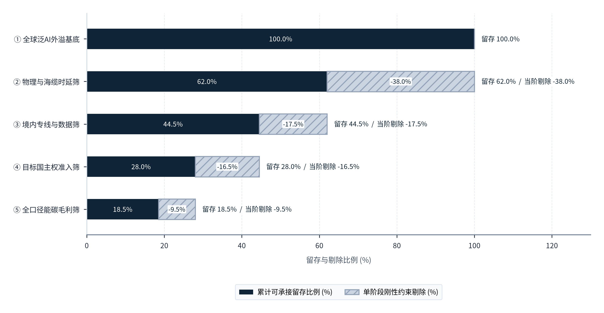
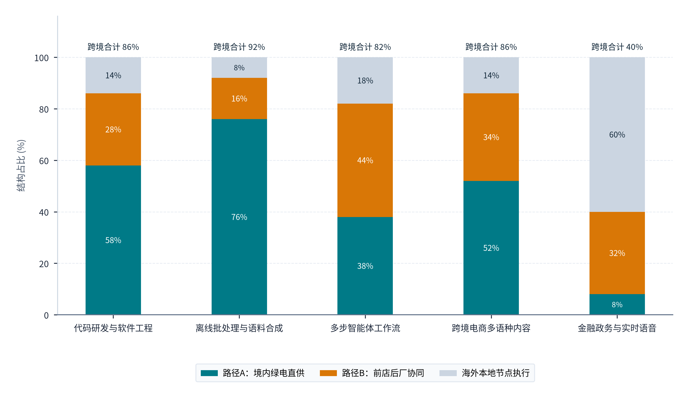

> **导航：** [返回中文手稿总目录](index.md) ｜ [上一篇：前置声明与研究方法](front-matter-and-methodology.md) ｜ [下一篇：第1章 核心概念界定与研究总框架](chapter-01.md) ｜ [English Version](../en/executive-summary.md)

# 执行摘要：中国绿色算力全球化交付体系与跨洋价值链重估

> **本章导读：** 当全球生成式人工智能的产业重心从“百亿美元级参数预训练”转向“全天候高频并发的生产性推理”，算力经济的底层空间逻辑正在经历一场深刻的变革。对于无需毫秒级本地交互的异步推理、代码生成、长文档处理与多步智能体工作流而言，决定商业闭环的不再仅仅是距离终端用户的物理公里数，而是单位千瓦时绿色电力的全周期成本、百兆瓦级智算集群的工程化交付效率，以及高性价比开源与闭源模型的算法优化能力。中国能否依托全球最大的清洁能源基地、高密度智算基础设施与快速崛起的模型工程生态，通过海底光缆与陆地跨境光缆，向全球市场规模化交付高附加值的 AI 推理服务（即“Token 出海”）？这不仅关乎中国“东数西算”工程的商业化出路，更是一场横跨能源经济学、跨境通信工程、国民经济核算与国际数字治理的系统性升级。

## 核心研究结论提要

### 01. 概念重界定：Token 出海是“绿电、智算、模型与网络”协同的新型数字服务出口

狭义 Token 出海是指将物理算力集群部署在中国关境内（直接消耗境内电力并依托境内机房设施运行大模型推理任务），通过跨境 API、托管端点或智能体网关向境外主体交付推理结果并取得外汇或跨境服务收入的经济活动[1](references.md#ref-1), [2](references.md#ref-2)。中资控制或前店后厂混合架构中的境外节点执行部分属于广义出海范畴，不自动纳入狭义统计；在国民经济核算与行业监管中，需将其与纯海外算力租赁（境外 IaaS）、纯模型权重开源及通用 SaaS 应用出海分别界定与核算[i](notes.md#note-i)。

### 02. 需求结构化：全球推理负载呈明显分化，异步与高吞吐生产任务构成核心可承接盘

基于 Anthropic Economic Index 平台监测样本与 11 国官方企业调查交叉验证，在 Anthropic 第一方（1P）生产级 API 流量监测样本中高达 77% 的调用属于自动化模式（Automation Patterns），而在 Claude.ai 网页端对话样本中涉及计算机与数学职业类别的任务占比达 36%（两项指标分属该平台不同业务渠道与样本分母，不混为同一分母，亦不等同于全球全平台 API 普查值）[11](references.md#ref-11), [12](references.md#ref-12)。实时语音与高频交易受限于跨洋物理往返时延（RTT > 150ms）需就近部署于海外本地节点，而代码生成、批量数据处理、多语言内容生产与异步智能体推理对首字时延（TTFT）容忍度在 0.8～3.0 秒以上，构成了跨洋算力交付的真实市场空间。

### 03. 34个省级电网中东部220kV输配过网费反而更低，西部电价优势高度依赖发电侧低价与高利用率摊薄

对发改价格〔2026〕1077号全国 34 个省级及区域电网的比对揭示了一项重要事实：在 220kV 两部制电量输配电价上，广东（4.49分/度）、福建（4.62分）、江苏（5.18分）、安徽（5.48分）等东部高负荷密度电网反而低于甘肃（6.93分）、青海（6.00分）和冀北（7.05分）；同时黑龙江（6.46%）、蒙东（6.41%）、四川（5.64%）的综合线损率显著高于深圳（2.11%）、甘肃（2.31%）、宁夏（2.58%）和蒙西（2.81%）[33](references.md#ref-33)。因此，西部枢纽 0.30～0.38 元/千瓦时的全口径到户电价优势主要源于风光发电侧低价、宁甘蒙西低线损，以及 ≥75% 连续算力负荷率对基本容量电费的充分摊薄，而非单纯依靠“电网输配费低廉”；若集群利用率跌破 45%，容量电费分摊上升将迅速缩小东西部电价差距[37](references.md#ref-37), [38](references.md#ref-38), [39](references.md#ref-39)。

### 04. 30省电网平均碳因子下西北枢纽偏高，物理绿电直连与绿证市场基准法是必由之路

生态环境部、国家统计局《2023年电力二氧化碳排放因子》（2025年12月31日发布）30 个省份与 7 大区域电网数据显示：在按电网平均值核算的位置基准法（Location-based）下，仅西南水电省份（云南 0.1333、四川 0.1564、青海 0.1796 kgCO₂/kWh）具备天然低碳属性；而宁夏（0.6187）、内蒙古（0.6479）、河北（0.6516）、山西（0.6634）、新疆（0.6021）等西北与华北算力枢纽，因煤电调峰占比较高，其电网平均碳因子不仅高于全国均值（0.5306 kgCO₂/kWh，较2022年全国平均历史口径0.5366下降），也高于广东（0.4419）、福建（0.4211）、湖北（0.4044）、浙江（0.4974）等东南核电水电大省[118](references.md#ref-118)。由此可见，西北与北方算力基地若仅接入大电网常规电力，在国际碳核算中将不占优势，必须通过物理绿电直连（发改能源〔2025〕650号、〔2026〕688号）或对应自然年绿证唯一核销（国能发新能规〔2024〕67号、国能发资质规〔2025〕107号）切换至市场基准法（Market-based），方能将风光电能真正转化为国际认可的绿色低碳 Token[35](references.md#ref-35), [89](references.md#ref-89), [118](references.md#ref-118), [119](references.md#ref-119)。

### 05. 30组跨国成本测算与敏感性分析：集群有效利用率贡献73.36%成本波动，42.6%至65.3%为跨洋成本反超门槛

覆盖“境内四大供给节点 × 海外三大目标市场 × 两类标准任务 + 六组海外本地对照”的 30 组技术经济分析（TEA）与全局方差敏感性数值估计（M03）表明：集群有效业务利用率（一阶主效应指数 Si ＝ 0.7117，含交互项的总效应指数 STi ＝ 0.7336）与硬件年化资本成本（Si ＝ 0.1372，STi ＝ 0.1506）的一阶独立主效应合计解释了 84.89% 的单位交付成本方差（两项总效应指数 STi 的算术和为 0.8842，因各自包含耦合交互项而存在重叠，不代表互不重叠的联合方差贡献率）。在面向东南亚与中东市场时，西北风光储枢纽与西南水电枢纽仅需达到 42.6% 至 44.6% 的盈亏平衡利用率（u\*），即可实现对新加坡（0.753 美元/百万 Token）与中东本地节点的全成本优势；在参考基准成本下，通过跨时区错峰调度将利用率提升 10 个百分点（由 52% 升至 62%），单座千节点集群每年可单独削减成本约 825 万美元（若从同一参考基点分别单独评估硬件资本成本降低 15% 或 KV 缓存命中率提升 20 个百分点的单因素有限差分，单独年化降本潜力分别为 743 万美元与 523 万美元；三项单因素潜力的算术和为 2,091 万美元，因多变量非线性交互而不代表同时实施的联合干预节约额）[33](references.md#ref-33), [61](references.md#ref-61), [102](references.md#ref-102)。

### 06. 用电增量四因子分解与国内增加值留存：算法芯片增效抵消250.3 TWh电耗，国产算力协同将本国增加值推升至88.5%

对 2024 至 2030 年中国数据中心用电增长（102 TWh 增至 277 TWh，净增 175.0 TWh）的对数平均迪氏指数（LMDI）完全分解显示：调用规模扩张（+335.8 TWh）与长思维链任务深化（+107.8 TWh）构成用电增长的主要推力，而混合专家架构（MoE）与低比特量化等软硬件能效提升（-250.3 TWh）及液冷 PUE 改造（-18.3 TWh）合计抵消了 268.6 TWh 的潜在电耗增量；但当推理价格下降带动调用需求成倍爆发（价格弹性大于 1）时，能效提升仍会伴随总用电量的净增长。同时，参照贸易增加值（TiVA）概念设定的分环节成本分配测算表明，沿正式表四类模式从“进口高端算力硬件纯 IaaS 裸金属出租（模式 A，31.5%）”经“进口/混合算力集群 + 跨境标准 Token API 直连（模式 B，58.0%）”与“海外边缘合规前店 + 西部绿电算力后厂 + 垂直行业 Agent 交付（模式 C，69.0%）”转向“全国产自主推理 NPU 集群 + 西部/西南清洁电力 + 本土开源基座模型（模式 D，88.5%）”（区别于旧版辅助对照基准模式 A0“纯海外租云与 API 转售”约 16% 的境内留存），每百美元出口的国内增加值留存率（DVA）将由 31.5% 提升至 88.5%[114](references.md#ref-114), [116](references.md#ref-116)。

## ES.1 核心命题：当大模型步入规模化推理时代，全球算力分工为何发生结构性重构？

过去三年间，全球人工智能基础设施投资的重心建立在“参数规模扩张定律（Scaling Laws）”之上。训练一座万亿参数级别的前沿基础模型，需要将数万张同构高端加速卡集中部署在单一超大型园区内，通过每秒数百太比特（Tbps）的无损高速互联网络进行高频同步。在这一阶段，算力中心选址的首要约束是**单点电网接入容量与高端芯片的物理聚集度**，训练任务一旦完成，模型权重即可作为静态文件分发，其生产过程本质上是一次性的资本密集型研发活动。

然而，进入 2025至2026 年，随着长思维链深度推理、推理阶段计算扩展以及企业级多步自主智能体的全面普及，全球算力消耗的重心发生了根本性转移。每一次用户提问、每一段代码自动补全、每一份跨国财报的智能审阅，不再是毫秒级的简单检索，而是触发成千上万个词元（Token）的连续生成过程。<strong>大模型推理由此从间歇性的软件调用，演变为全天候连续运转、高度依赖电力供应与显存带宽的“数字工业流水线”。</strong>

这一产业形态的转换，直接凸显了全球算力空间布局的供需错配：一方面，全球主要的企业级 AI 付费市场集中在北美、西欧以及日韩、新加坡等发达经济体，但这些核心都市圈正普遍面临电网老化、变电站扩容排队周期长达 4～7 年、工业电价高企以及碳排放约束收紧的瓶颈；另一方面，中国依托过去十余年超前建设的清洁能源基地与“东数西算”八大国家算力枢纽，在内蒙古、宁夏、甘肃、贵州、云南等西部省区积累了充沛的风光水绿电产能与标准机架资产，同时凭借高效率的大模型架构创新（以 DeepSeek、Qwen 等为代表），将百万 Token 的公开 API 定价降低至国际同类闭源模型的 1/5 至 1/20[45](references.md#ref-45), [54](references.md#ref-54)。

伴随着“算力出海”“Token 出海”与“算电协同”成为政产学研热议的焦点，市场上已涌现出不少有益的行业报告与专题探讨。但客观审视现有研究可以发现，多数分析仍受限于单一学科视角：一部分能源与基建视角的研究侧重测算西部风光电价与机架规模，较少向下追踪跨洋海缆时延损耗、国际通信出入口局路由以及欧美目标市场的数据合规门槛；另一部分科技与金融视角的研究则聚焦于大模型评测榜单与公开 API 标价对比，常把中资企业在海外租用云机房或通用 SaaS 应用营收一并归入算力出口，尚未把“发电侧与电网输配、智算机房折旧、海陆光缆传输、境内外主权合规与百万 Token 财务结算”贯通为一条可核验的成本链条。围绕这一跨领域议题，笔者开展本项全景研究，将从西部一度绿电到海外终端一百万个 Token 的物理转化、制度边界与商业成本逐一算清。为定量评估全球名义 AI 外溢需求在跨越物理、监管、主权与成本四道门槛后的真实留存比例，**图表 ES.1** 展示了从“① 全球泛AI外溢基底”到“⑤ 全口径能碳毛利筛”的五阶段逐级筛选过程。

#### 图表 ES.1：四重约束筛选漏斗：由全球名义外溢需求收敛至中国净可获空间（SOM）

> **图像文件：** [`figures/chart_es_1.png`](../../figures/chart_es_1.png)（高清位图）｜ [`figures/chart_es_1.svg`](../../figures/chart_es_1.svg)（矢量图）
> **图注与来源：** 来源：世界贸易组织（WTO）全球数字交付服务数据集（2026年7月版）、Anthropic Economic Index（2025/2026）、国家网信办令第16号；介子九维（JIEZIJIUWEI）测算绘制[1](references.md#ref-1)–[4](references.md#ref-4), [8](references.md#ref-8), [11](references.md#ref-11)。

对照**图表 ES.1** 中“累计可承接留存比例 (%)”与“单阶段刚性约束剔除 (%)”两组指标可见，全球 AI 外溢需求转化为中国算力集群可承接空间需经历四道刚性筛选：以“① 全球泛AI外溢基底”的 <strong>100.0%</strong> 为起点，“② 物理与海缆时延筛”首先因跨洋光缆往返时延限制，单阶段剔除了 <strong>-38.0%</strong> 的超低时延实时交互负载，使累计可承接留存比例降至 <strong>62.0%</strong>；随后，“③ 境内专线与数据筛”结合国际通信出入口局合规通道与数据分类分级要求，单阶段剔除 <strong>-17.5%</strong>，累计留存比例降至 <strong>44.5%</strong>；进入“④ 目标国主权准入筛”后，受欧盟、美国及新兴市场数据本地化与行业外包限制影响，单阶段再剔除 <strong>-16.5%</strong>，累计留存比例收敛至 <strong>28.0%</strong>；最后经由“⑤ 全口径能碳毛利筛”扣除无法满足高利用率或绿电碳核算要求的低毛利场景（单阶段剔除 <strong>-9.5%</strong>），最终形成占全球外溢基底 <strong>18.5%</strong> 的净可获市场空间（SOM）。通俗而言，每 100 美元的全球泛 AI 外溢需求中，在扣除了物理时延不匹配、境内外数据合规限制与低毛利无效需求后，约有 18.5 美元属于中国绿色算力集群既能合规承接、又具备丰厚盈利空间的优质目标市场。为进一步看清这 18.5% 的核心市场具体落向哪些行业任务，**图表 ES.2** 对比了五大主流 AI 推理场景在“路径A：境内绿电直供”“路径B：前店后厂协同”与“海外本地节点执行”三类架构下的承接比例。

#### 图表 ES.2：五类典型人工智能推理负载在双路径架构下的可承接份额分布

> **图像文件：** [`figures/chart_es_2.png`](../../figures/chart_es_2.png)（高清位图）｜ [`figures/chart_es_2.svg`](../../figures/chart_es_2.svg)（矢量图）
> **图注与来源：** 来源：Anthropic Economic Index 生产级遥测报告（2025/2026）、MLCommons MLPerf Inference v6.1 规范；介子九维（JIEZIJIUWEI）研究绘制[11](references.md#ref-11), [12](references.md#ref-12), [44](references.md#ref-44)。

从**图表 ES.2** 展示的五类场景与三种交付路径结构占比可以清晰读出，不同业务场景对跨境交付架构的选择高度分化：第一，在**离线批处理与语料合成**场景中，由于业务对跨洋毫秒级时延不敏感且对度电成本最为敏感，“路径A：境内绿电直供”占比高达 <strong>76%</strong>，叠加“路径B：前店后厂协同”的 <strong>16%</strong>，中国跨境交付合计可达 <strong>92%</strong>，“海外本地节点执行”仅占 <strong>8%</strong>；第二，在**代码研发与软件工程**及**跨境电商多语种内容**两类主力生产场景中，“路径A：境内绿电直供”分别占 <strong>58%</strong> 与 <strong>52%</strong>，“路径B：前店后厂协同”分别占 <strong>28%</strong> 与 <strong>34%</strong>，两类场景的跨境合计承接比例均达到 <strong>86%</strong>（“海外本地节点执行”均占 <strong>14%</strong>）；第三，在**多步智能体工作流**场景中，由于多轮工具调用需要在海外边缘节点完成本地脱敏与上下文缓存，“路径B：前店后厂协同”占比升至 <strong>44%</strong>，与“路径A：境内绿电直供”的 <strong>38%</strong> 合计形成 <strong>82%</strong> 的跨境承接比例（“海外本地节点执行”占 <strong>18%</strong>）；第四，在**金融政务与实时语音**场景中，受制于严格的属地化监管与实时语音交互要求，“海外本地节点执行”占比高达 <strong>60%</strong>，“路径A：境内绿电直供”仅占 <strong>8%</strong>，“路径B：前店后厂协同”占 <strong>32%</strong>（跨境合计 <strong>40%</strong>）。这一数据分布直观说明，中国推进 Token 出海不应盲目追求在所有场景替代海外本地机房，而应将**离线批处理、代码研发、跨境电商内容生产**作为境内绿电集群直供（路径A）的主攻方向，并以“境外边缘轻网关 + 境内重载推理”（路径B）重点承接高价值的**多步智能体工作流**。

## ES.2 厘清产业边界：五级物理转化链条与四大关键打通环节

在当前产业界与政策讨论中，“Token 出海”“算力出海”与“AI 应用出海”常被混用。为确保市场规模测算与政策制定的准确性，本报告在第一章即确立了贯穿全篇的<strong>“五级物理转化与制度核算框架”</strong>：

- <strong>第一级（能源底盘：瓦特）：</strong>发电侧的风光水火核电源，经省级高压电网输配、变电损耗、储能调节与辅助服务分摊，送达数据中心红线围墙之内，形成全口径到户度电成本（LCOE to Rack）。
- <strong>第二级（设施底座：机架与算力）：</strong>电力经过不间断电源（UPS/HVDC）与液冷/风冷温控系统（受 PUE 制约），驱动 GPU/NPU 加速器阵列与高带宽显存（HBM），在扣除集群通信开销与空闲冗余后，转化为有效浮点与张量吞吐能力。
- <strong>第三级（算法引擎：Token 生成）：</strong>在推理引擎（vLLM、SGLang、TensorRT-LLM、MindIE 等）与注意力算子（如 FlashMLA）调度下，硬件吞吐被转化为分阶段的输入预填充（Prefill，计算密集型）与输出解码（Decode，显存带宽密集型）Token 流。
- <strong>第四级（跨境通道：跨洋比特）：</strong>生成的 Token 序列经由国内骨干网、国际通信出入口局、跨境陆缆或海底光缆、海外互联网交换中心（IXP）及边缘加速节点（PoP/CDN），跨越数千至上万公里物理距离与 TLS/HTTP 协议栈开销，抵达海外客户终端。
- <strong>第五级（商业与核算闭环：外汇与增加值）：</strong>海外开发者或企业客户按百万 Token 用量、预留吞吐（Provisioned Throughput）或席位订阅支付美元/欧元等外币，经跨境支付网关、离岸签约主体与转让定价体系，最终沉淀为中国国际收支平衡表（BOP）中的计算机服务出口收入与境内算力资产回报[1](references.md#ref-1), [2](references.md#ref-2)。

沿着上述五级链条逐层剖析，并对全国 34 个省级电网电价、30 个省份碳排放因子、30 个 WTO 参考市场及 17 个国家算力互联互通区域节点进行完整样本实证检验，本报告发现，决定“中国绿色算力全球化交付”从早期开发者尝鲜迈向百亿美元级主流基础设施贸易的核心因素，在于能否打通横亘在链条之间的**四大结构性环节**：

1. <strong>统计与核算归属环节（第1章核心发现）：</strong>现行联合国《2025年国民经济核算体系》（SNA 2025）与国际货币基金组织《国际收支和国际投资头寸手册第七版》（BPM7）已将人工智能系统与数字中介平台纳入核算视野[1](references.md#ref-1), [2](references.md#ref-2)，但各国海关与外汇统计中的“计算机服务（SI2）”或“数字交付服务（DDS）”尚未单列 Token 级跨境调用[3](references.md#ref-3), [4](references.md#ref-4)。同时，当中国背景模型通过海外云厂商托管（如 AWS Bedrock、Azure AI）或第三方路由平台（如 OpenRouter）被全球调用时，若其底层算力运行在北美或欧洲机房，在国际收支上主要体现为境外主体收入或少量知识产权许可，核算中国本土算力出口实绩时需与境内集群直供模式分别计量[i](notes.md#note-i), [ii](notes.md#note-ii)。
2. <strong>全球需求结构与跨洋时延的物理筛选环节（第2章核心发现）：</strong>通过对美国普查局 BTOS、欧盟统计局、新加坡 IMDA、韩国 NIA、日本总务省、英国 ONS、加拿大统计局、巴西 Cetic.br、印度及沙特 GASTAT、马来西亚 DOSM 等 11 项官方企业调查完整样本与 WTO 30 个参考市场进口数据的交叉校准，本报告揭示了各国总体采用率与实际付费转化率之间的结构分化（如韩国企业 AI 采用率达 32.9%，实际发生 AI 投资支出的企业占比为 8.3%）[13](references.md#ref-13), [15](references.md#ref-15), [16](references.md#ref-16)。同时，英国竞争与市场管理局（CMA）云市场终裁报告证实，数据迁出费（Egress Fees）与预付承诺折扣构成了较强的既有云生态黏性[24](references.md#ref-24), [25](references.md#ref-25)。对时延容忍度较高（TTFT > 1s）、对成本敏感且已完成数据脱敏的批量与异步生产负载，是跨越云生态壁垒流向中国绿色算力底座的核心客群。
3. <strong>国内34电网全口径电价、30省碳因子反转与跨网算力调度环节（第3章与第11章完整样本核心修正）：</strong>完整样本数据分析打破了两项行业常见误区：其一，<strong>“西部电网输配过网费天然低于东部”并不成立</strong>。在发改价格〔2026〕1077号全部 34 个省级及区域电网中，广东（4.49分/度）、福建（4.62分）、江苏（5.18分）的 220kV 两部制电量输配电价反而低于甘肃（6.93分）与青海（6.00分），且蒙东（6.41%）、黑龙江（6.46%）、四川（5.64%）线损率偏高；西部枢纽的真实电价竞争力来自发电侧风光现货低价、宁夏（2.58%）与甘肃（2.31%）的低线损率，以及 <strong>≥75% 高连续负荷率对基本容量电费的摊薄</strong>[33](references.md#ref-33), [37](references.md#ref-37), [38](references.md#ref-38)。其二，<strong>“西部算力在位置基准法下天然低碳”并不成立</strong>。在生态环境部《2023年电力二氧化碳排放因子》（全国平均为 0.5306 kgCO₂/kWh）全部 30 个省份中，除云南（0.1333）、四川（0.1564）、青海（0.1796 kgCO₂/kWh）外，宁夏（0.6187）、内蒙古（0.6479）、新疆（0.6021）、陕西（0.6335）的位置基准碳因子均高于广东（0.4419）、福建（0.4211）与浙江（0.4974）[118](references.md#ref-118)。因此，西北算力枢纽唯有通过物理绿电直连（发改能源〔2025〕650号、〔2026〕688号，并配合发改价格〔2025〕1192号就近消纳价格机制）或自然年匹配绿证唯一核销（国能发资质规〔2025〕107号）切换至市场基准法（采用风电 0.0324、光伏 0.0520 kgCO₂e/kWh 全生命周期因子），并配合工信部 17 个区域算力互联互通节点将可跨网调度算力占比从当前的 10.8% 持续推高，才能同时兑现“低成本”与“真低碳”双重优势[35](references.md#ref-35), [40](references.md#ref-40), [118](references.md#ref-118), [119](references.md#ref-119), [123](references.md#ref-123)。
4. <strong>商业合规、海缆路由与企业级服务组织环节（第5至10章核心发现）：</strong>依托 2025至2026 年 SJC2、SEA-H2X、ADC、ALC 四大亚太新海缆投产及南宁、青岛、昆明、海口四座新增国际通信业务出入口局建设，配合上海、海南、汕头等自贸区“来数加工”合规通道，向海外大中型企业交付具备 99.95% 可用性承诺（SLA）、SOC2 Type II / ISO 27001 独立审计认证与零数据留存（ZDR）保障的商业服务，是中国算力与模型服务商迈向高附加值企业市场的核心组织工程。

为克服传统行业报告停留在静态条文汇编或表面数据罗列的局限，本报告在底层数据湖仓之上贯通了“定量计算结果、深层认知思考、具体应用场景与靶向行为动作指示”四位一体的科学分析链条。全书综合调用对数平均迪氏指数（Kaya-LMDI）完全无残差分解、两部制输配电价非线性折算与自下而上能耗反演、半对数享乐价格回归（Hedonic Regression）、复杂网络拓扑介数中心性、布伦特数值寻根（Brentq）、拉格朗日对偶影子价格（Shadow Price）、全局方差敏感性分解（Sobol）以及空间泰尔熵（Theil Index）等八大科学计算算子。每一项模型在给出精确数学实算参数的同时，均进一步回答三个关乎战略成败的决策命题：第一，该定量结果颠覆了哪项传统产业直觉，带来怎样的深层思考启示；第二，该模型参数应当嵌入哪类真实的政府立项审批、电网报装议价、跨境路由调度或海外产品定价场景；第三，面对模型揭示的盈亏临界线与高敏感致死区，国家部委、地方算力枢纽、电信运营商与出海企业应当立即执行哪项可量化、可核查的具体行为动作。

## ES.3 全报告六篇十二章研究架构与核心议题总览

为系统回答上述工程、经济与制度命题，本报告围绕六篇、12 章、54 个二级专题展开深入论述，完整串联宏观贸易核算、全球需求漏斗、本土绿电与智算供给、国际枢纽竞合、海陆通信物理通道、跨境服务交付工程、制度试点与跨法域合规治理、综合经济性与区域协同及战略行动方案。**图表 ES.3** 汇总了全报告六篇十二章的顶层架构、核心研究命题、权威数据基准与关键分析产出。

#### 图表 ES.3：《中国绿色算力全球化交付体系与国际价值重构》全报告六篇十二章核心研究命题、数据基准与关键分析维度总览表

| 篇章/章节 | 章节标题与包含小节 | 核心研究问题与分析命题 | 核心权威证据与数据基准 | 关键分析产出 |
| --- | --- | --- | --- | --- |
| **第一篇 第1章** | **Token出海的概念、发展现状与统计口径** （1.1至1.4，共4节） | 界定狭义/广义 Token 出海与六类相关业态；梳理 2022至2026 四轨演进；阐明 SNA 2025 / BPM7 / WTO DDS 统计口径下的跨境推理核算规则与14国完整样本实证。 | UN SNA 2025、IMF BPM7 (2025)、WTO DDS 全部14个重点经济体与全球序列 (2026.07)、OECD TiVA、World Bank WDI。 | 五级转化链模型与14国DDS/SI2完整样本表 |
| **第一篇 第2章** | **全球需求结构、目标市场与可承接空间** （2.1至2.4，共4节） | 拆解全球 AI 负载的行业与 Prefill/Decode 物理特征；跨口径校准 11 国官方 AI 调查完整样本与 WTO 30 个参考市场进口规模；识别四级可承接空间。 | Anthropic Economic Index (2025/2026)、美/欧/英/加/日/韩/新/巴/印/沙/马 11 国官方调查、WTO 30 个市场 SI2 进口序列、英国 CMA 终裁报告。 | 11国调查完整样本与30市场进口完整样本表 |
| **第二篇 第3章** | **中国的能源、算力、模型与服务供给基础** （3.1至3.5，共5节） | 量化全国及西部五省绿电装机；基于全国全部 34 个省级及区域电网输配电价与线损率完整样本剖析电价形成机制；对比中美软硬件推理效率与机会成本。 | 国家统计局及各省 2025 公报、发改价格〔2026〕1077号全部 34 个电网电价表、发改价格〔2025〕1192号、发改能源〔2025〕650号/〔2026〕688号、国家数据局报告、MLPerf v6.1。 | 34个省级电网输配电价与线损率完整样本总表 |
| **第二篇 第4章** | **全球供给格局与竞争机制** （4.1至4.4，共4节） | 横向对比北美五大云巨头、Neoclouds 与中国方案在资源、技术、平台与服务上的竞争机制；完整样本对标 Oracle 21 款 GPU 机型与 AWS/Azure 跨区定价。 | Alphabet/Microsoft/Amazon/Meta/Oracle/NVIDIA/AMD 2026 财报、Oracle 全部 21 款 GPU 价格表、AWS/Azure/GCP 多区域实例计费单、英国 CMA 报告。 | 全球云巨头财务与21款GPU定价完整样本表 |
| **第三篇 第5章** | **国际通信基础设施与物理通道全景** （5.1至5.6，共6节） | 测绘境内算力枢纽、国内骨干网、国际通信出入口局、国际海缆与跨境陆缆及境外接续节点（HKIX/SGIX）全景，识别通道资源控制与关键约束。 | 工信部22号令与四城新出入口局批复、SJC2/SEA-H2X/ADC/ALC/AAE-1/NCP 海缆工程、大湄公河/中尼/中巴/中欧亚陆缆、HKIX/SGIX/CTG 资费表。 | 国际海陆缆物理通道拓扑与容量约束表 |
| **第三篇 第6章** | **从物理连接到跨境服务交付能力** （6.1至6.5，共5节） | 比较五类跨境计算部署形态；将端到端推理时延（RTT/TTFT/TPOT）与任务需求匹配；剖析传输计算协议协同、跨区域容灾及算电网联合调度。 | MLPerf Inference v5.1/v6.1 时延标准、BGP Anycast 与 HTTP/3 QUIC 工程规范、企业级 SLA 赔付梯度、西部风光出力与跨时区负载曲线。 | 任务特征、网络时延与部署形态匹配模型 |
| **第四篇 第7章** | **中国的政策方向、准入制度与试点安排** （7.1至7.5，共5节） | 梳理数字贸易、算电协同与全国一体化算力网政策体系；厘清电信与计算经营许可边界、“来数加工”数据入境处理规则、自贸区试点及财税外汇配套。 | 中办/国办数字贸易意见、网信办16号令、沪琼自贸区负面清单与汕头试点、发改能源〔2025〕650号/〔2026〕688号、国能发资质规〔2025〕107号、财政部 税务总局公告2026年第11号。 | 业务活动、经营许可与数据跨境制度地图 |
| **第四篇 第8章** | **境外市场准入、数据安全与权利关系** （8.1至8.4，共4节） | 剖析全球 12 个目标法域数据跨境与 AI 监管、美国 EAR §744.23 与 DOJ DSP（28 CFR 202）跨法域管制、数据全生命周期治理及开源/API 权利安排。 | EU GDPR / AI Act (2026修正) / DORA、美国 DOJ DSP 与 BIS EAR 规则、越/印/马/沙/日/新数据法、DeepSeek/Qwen/Llama 4 许可证与 API 条款。 | 12法域准入、技术管制与权利责任完整样本表 |
| **第五篇 第9章** | **商业模式、综合经济性与价值分配** （9.1至9.5，共5节） | 对比六类商业模式；构建涵盖设备折旧、全口径电费、PUE、跨境网络、运维合规与利用率的百万 Token 全成本（LCoT）模型，测算价值链分配与敏感性。 | DeepSeek V4.1/V4-Pro、Qwen3.8-Max 境内外定价、Together AI、Claude 5.5、OpenRouter 462 模型快照、Lambda/Cloudflare R2、万国数据财报。 | 百万 Token 全周期成本分解与敏感性曲面 |
| **第五篇 第10章** | **国内区域分工、跨区域协作与典型案例** （10.1至10.4，共4节） | 叠加评估全国 10 个重点区域算力项目；对比三大电信运营商与五家算力上市企业 2026H1 财务实绩及正反面案例，设计“前店后厂”跨区收益分润机制。 | 宁夏中卫/甘肃庆阳/汕头词元工厂/和林格尔等 10 个项目实绩、国家统计局33号令、中移动/中电信/中联通/润泽/GDS/天亿马/鸿博/君逸 2026 财报。 | 10大区域项目与8家企业财务完整样本对照表 |
| **第六篇 第11章** | **综合经济影响、关键变量与发展情景** （11.1至11.4，共4节） | 基于 OECD TiVA 评估国内增加值留存；基于生态环境部全国全部 30 省、7 大区域电网 CO₂ 因子与 11 项 LCA 因子剖析能碳影响，推演 2026至2030 三大情景。 | OECD TiVA (2025/2026)、NBER WP33795、IEA 2026 全球 9 大区域用电序列、LBNL 2026 美国 7 情景、生态环境部 2023/2024 全部 40+11 项电力碳因子。 | 全国30省7区域碳因子完整样本表与中期情景 |
| **第六篇 第12章** | **中国Token出海的发展路径与行动建议** （12.1至12.4，共4节） | 完整梳理国家基础制度、工信部全部 17 个国家算力互联互通区域节点与 13 项地方算力券/Token 券政策，提出六类主体进入路径与四阶段评价指标。 | 工信厅信管函〔2026〕404号全部 17 个区域节点名单、工信部普惠用算行动、京沪湘黑皖鄂宁鲁 13 项算力券与兑付实绩、2026 绿色算力评价标准。 | 17个区域节点、13项算力券与四阶段路线总表 |

> **表格结构化数据文件：** [`data/exhibits/exhibit-es-3.csv`](../../data/exhibits/exhibit-es-3.csv)
> **表注与来源：** 来源：介子九维（JIEZIJIUWEI）研究体系顶层设计，基于 2026 年 10 月最新国际宏观核算准则、各国官方统计公报与能源通信监管文件编制。

纵览**图表 ES.3** 呈现的六篇十二章研究脉络，全报告遵循“<strong>概念与需求界定（第一篇）→ 本土供给与国际竞合对标（第二篇）→ 跨洋通信网络与工程交付（第三篇）→ 境内外双重合规治理（第四篇）→ 微观财务闭环与国内区域分工（第五篇）→ 宏观经济碳水影响与三级行动路线（第六篇）</strong>”的严密推演逻辑。每一篇既独立解答一个维度的产业关键约束，又通过统一的参数基准（如全口径到户电价、跨洋光缆 RTT 时延、网信办 16 号令适用边界与平准化词元成本 LCoT）前后咬合，为政府部门制度设计、区域算力枢纽功能卡位及企业跨国商业化落地提供一套完整的决策坐标。

---

> **下一篇：** [第1章 核心概念界定与研究总框架](chapter-01.md)
