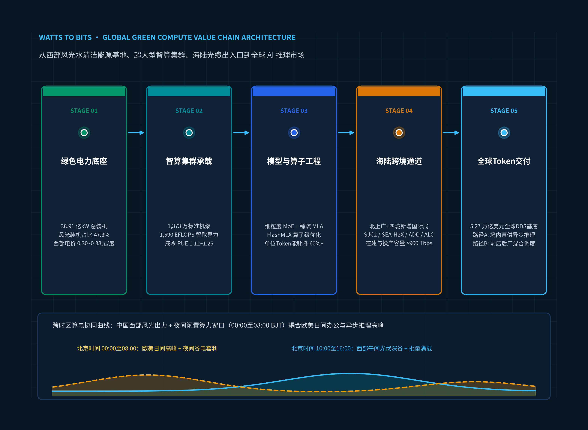

# 《中国绿色算力全球化交付体系与国际价值重构：全球 AI 推理分工演进下，能源禀赋、物理通道、主权治理与商业闭环的全景研究（2026）》完整中文手稿总目录

**英文标题：** *China's Green Compute Global Delivery System and International Value Restructuring*  
**研究与发布机构：** 介子九维（JIEZIJIUWEI）  
**版本与范围：** 2026 Flagship Edition · Complete 12-Chapter Volume（全卷完整版（六篇 · 12章 · 54节）） ｜ **数据与政策基准日：** 2026年10月15日 ｜ **公开包整理日期：** 2026年10月19日

> **封面主视觉文件：** [`figures/cover_hero.png`](../../figures/cover_hero.png) ｜ [`figures/cover_hero.svg`](../../figures/cover_hero.svg)（四阶价值跃迁：清洁电力底座 → 智算集群矩阵 → 跨洋海陆光缆 → 全球高价值词元交付）

---

## 一、手稿文件阅读顺序（Reading Order）

| 序号 | 组成部分 | 手稿文件 | 内容范围与核心要素 |
| --- | --- | --- | --- |
| 00 | 前置声明与研究方法 | [`front-matter-and-methodology.md`](front-matter-and-methodology.md) | 报告元数据、六项核心研究方法、数据口径红线与四级证据分级制度 |
| 01 | 执行摘要（Executive Summary） | [`executive-summary.md`](executive-summary.md) | 六大核心结论卡、ES.1–ES.3 战略总览、图表 ES.1–ES.3（含英文版 [`../en/executive-summary.md`](../en/executive-summary.md)） |
| 02 | 第1章（第一篇） | [`chapter-01.md`](chapter-01.md) | 核心概念界定与研究总框架（1.1–1.4 节，图表 1.1–1.7，专栏 1.1） |
| 03 | 第2章（第一篇） | [`chapter-02.md`](chapter-02.md) | 全球Token需求与目标市场分析（2.1–2.4 节，图表 2.1–2.6，专栏 2.1） |
| 04 | 第3章（第二篇） | [`chapter-03.md`](chapter-03.md) | 中国供给能力：能源、电力与算力基础设施（3.1–3.5 节，图表 3.1–3.12，专栏 3.1） |
| 05 | 第4章（第二篇） | [`chapter-04.md`](chapter-04.md) | 全球供给格局与竞争机制（4.1–4.4 节，图表 4.1–4.7，专栏 4.1） |
| 06 | 第5章（第三篇） | [`chapter-05.md`](chapter-05.md) | 国际通信基础设施与物理通道全景（5.1–5.6 节，图表 5.1–5.8，专栏 5.1） |
| 07 | 第6章（第三篇） | [`chapter-06.md`](chapter-06.md) | 跨境技术交付架构、网络性能与服务质量（6.1–6.5 节，图表 6.1–6.8，专栏 6.1） |
| 08 | 第7章（第四篇） | [`chapter-07.md`](chapter-07.md) | 中国监管体系、合规要求与政策工具（7.1–7.6 节，图表 7.1–7.7，专栏 7.1） |
| 09 | 第8章（第四篇） | [`chapter-08.md`](chapter-08.md) | 境外市场准入、数据安全与权利关系（8.1–8.4 节，图表 8.1–8.5，专栏 8.1） |
| 10 | 第9章（第五篇） | [`chapter-09.md`](chapter-09.md) | 商业模式、综合经济性与价值分配（9.1–9.5 节，图表 9.1–9.9，专栏 9.1） |
| 11 | 第10章（第五篇） | [`chapter-10.md`](chapter-10.md) | 国内区域分工、跨区域协作与典型案例（10.1–10.4 节，图表 10.1–10.7，专栏 10.1） |
| 12 | 第11章（第六篇） | [`chapter-11.md`](chapter-11.md) | 综合经济影响、关键变量与发展情景（11.1–11.4 节，图表 11.1–11.10，专栏 11.1） |
| 13 | 第12章（第六篇） | [`chapter-12.md`](chapter-12.md) | 中国Token出海的发展路径与行动建议（12.1–12.4 节，图表 12.1–12.9，专栏 12.1） |
| 14 | 尾注与方法论注释 | [`notes.md`](notes.md) | 尾注 `[i]` 至 `[xiv]` 全文汇编与核算口径说明 |
| 15 | 正式参考文献列表 | [`references.md`](references.md) | 正式参考文献 `[1]` 至 `[126]` 全文及与 347 条调研来源库跨库映射 |

---

## 二、六篇十二章 54 节详细目录（Full Table of Contents）

### 导读与执行摘要（执行摘要）
- **[ES：执行摘要：中国绿色算力全球化交付体系与跨洋价值链重估](executive-summary.md)**
  - [ES.1 核心命题：当大模型步入规模化推理时代，全球算力分工为何发生结构性重构？](executive-summary.md#sec-es-1)
  - [ES.2 厘清产业边界：五级物理转化链条与四大关键打通环节](executive-summary.md#sec-es-2)
  - [ES.3 全报告六篇十二章研究架构与核心议题总览](executive-summary.md#sec-es-3)

### 第一篇：研究对象与全球需求（第1至2章）
- **[第1章：Token出海的概念、发展现状与统计口径](chapter-01.md)**
  - [1.1 业务形态与研究对象分类](chapter-01.md#sec-1-1)
  - [1.2 发展过程与实际进展](chapter-01.md#sec-1-2)
  - [1.3 市场统计与经济核算口径](chapter-01.md#sec-1-3)
  - [1.4 全报告的分析框架](chapter-01.md#sec-1-4)
- **[第2章：全球需求结构、目标市场与可承接空间](chapter-02.md)**
  - [2.1 全球需求的行业与任务结构](chapter-02.md#sec-2-1)
  - [2.2 目标国家和地区的需求差异](chapter-02.md#sec-2-2)
  - [2.3 海外客户的采购决策与替代方案](chapter-02.md#sec-2-3)
  - [2.4 市场空间及其形成条件](chapter-02.md#sec-2-4)

### 第二篇：中国供给与全球竞争（第3至4章）
- **[第3章：中国的能源、算力、模型与服务供给基础](chapter-03.md)**
  - [3.1 能源供给条件与电力优势](chapter-03.md#sec-3-1)
  - [3.2 算力设施与硬件供给](chapter-03.md#sec-3-2)
  - [3.3 模型与工程效率](chapter-03.md#sec-3-3)
  - [3.4 面向海外的服务组织能力](chapter-03.md#sec-3-4)
  - [3.5 综合供给能力与机会成本](chapter-03.md#sec-3-5)
- **[第4章：全球供给格局与竞争机制](chapter-04.md)**
  - [4.1 全球算力与人工智能服务供给布局](chapter-04.md#sec-4-1)
  - [4.2 产业主体与市场组织](chapter-04.md#sec-4-2)
  - [4.3 竞争优势的来源与持续条件](chapter-04.md#sec-4-3)
  - [4.4 全球扩产与技术变化对中国的影响](chapter-04.md#sec-4-4)

### 第三篇：国际通信与跨境交付（第5至6章）
- **[第5章：国际通信基础设施与物理通道全景](chapter-05.md)**
  - [5.1 跨境通道的完整结构](chapter-05.md#sec-5-1)
  - [5.2 国际海缆系统](chapter-05.md#sec-5-2)
  - [5.3 跨境陆缆与陆路通信走廊](chapter-05.md#sec-5-3)
  - [5.4 国际通信业务出入口与国内连接](chapter-05.md#sec-5-4)
  - [5.5 境外接续节点与客户网络](chapter-05.md#sec-5-5)
  - [5.6 通道资源控制与关键约束](chapter-05.md#sec-5-6)
- **[第6章：从物理连接到跨境服务交付能力](chapter-06.md)**
  - [6.1 跨境计算的部署形态](chapter-06.md#sec-6-1)
  - [6.2 任务需求与网络条件的匹配](chapter-06.md#sec-6-2)
  - [6.3 传输、计算与业务协议的协同](chapter-06.md#sec-6-3)
  - [6.4 服务可靠性、安全性与持续运行](chapter-06.md#sec-6-4)
  - [6.5 电力、算力与网络的联合组织](chapter-06.md#sec-6-5)

### 第四篇：制度环境与合规治理（第7至8章）
- **[第7章：中国的政策方向、准入制度与试点安排](chapter-07.md)**
  - [7.1 国家战略与政策体系](chapter-07.md#sec-7-1)
  - [7.2 通信与计算服务的经营安排](chapter-07.md#sec-7-2)
  - [7.3 数据进入、境内处理与结果交付](chapter-07.md#sec-7-3)
  - [7.4 自贸试验区、自由贸易港及地方试点](chapter-07.md#sec-7-4)
  - [7.5 能源、建设、贸易与结算配套](chapter-07.md#sec-7-5)
- **[第8章：境外市场准入、数据安全与权利关系](chapter-08.md)**
  - [8.1 目标市场的准入与数据规则](chapter-08.md#sec-8-1)
  - [8.2 技术供应与跨法域约束](chapter-08.md#sec-8-2)
  - [8.3 数据全生命周期与安全治理](chapter-08.md#sec-8-3)
  - [8.4 模型、数据与成果的权利安排](chapter-08.md#sec-8-4)

### 第五篇：商业模式与区域协同（第9至10章）
- **[第9章：商业模式、综合经济性与价值分配](chapter-09.md)**
  - [9.1 产品与商业模式](chapter-09.md#sec-9-1)
  - [9.2 完整成本结构](chapter-09.md#sec-9-2)
  - [9.3 价格、收入与需求变化](chapter-09.md#sec-9-3)
  - [9.4 产业链价值分配与议价能力](chapter-09.md#sec-9-4)
  - [9.5 投资与经营的成立条件](chapter-09.md#sec-9-5)
- **[第10章：国内区域分工、跨区域协作与典型案例](chapter-10.md)**
  - [10.1 区域条件的叠加分析](chapter-10.md#sec-10-1)
  - [10.2 区域功能与价值归属](chapter-10.md#sec-10-2)
  - [10.3 典型案例与对照案例](chapter-10.md#sec-10-3)
  - [10.4 跨区域协作与复制条件](chapter-10.md#sec-10-4)

### 第六篇：综合影响与行动方案（第11至12章）
- **[第11章：综合经济影响、关键变量与发展情景](chapter-11.md)**
  - [11.1 对经济结构与国际分工的影响](chapter-11.md#sec-11-1)
  - [11.2 对能源、电力与环境的影响](chapter-11.md#sec-11-2)
  - [11.3 影响未来的关键变量](chapter-11.md#sec-11-3)
  - [11.4 中期情景与发展路径](chapter-11.md#sec-11-4)
- **[第12章：中国Token出海的发展路径与行动建议](chapter-12.md)**
  - [12.1 国家层面的基础制度与公共能力](chapter-12.md#sec-12-1)
  - [12.2 地方层面的功能定位与发展组织](chapter-12.md#sec-12-2)
  - [12.3 企业层面的进入路径](chapter-12.md#sec-12-3)
  - [12.4 分阶段实施与效果评价](chapter-12.md#sec-12-4)

---

## 三、图表与数据表总目录（List of 98 Exhibits：55 张统计图 + 43 张数据表）

> 机器可读完整映射见 [`data/metadata/exhibit_code_map.csv`](../../data/metadata/exhibit_code_map.csv)。

| 图表编号 | 标题 | 类型 | 所在章节与小节 | 正文跳转与数据/图像文件 |
| --- | --- | --- | --- | --- |
| **图表 ES.1** | 四重约束筛选漏斗：由全球名义外溢需求收敛至中国净可获空间（SOM） | 可视化图表 | 执行摘要 | [正文位置](executive-summary.md#exhibit-es-1) ｜ [PNG](../../figures/chart_es_1.png) ｜ [SVG](../../figures/chart_es_1.svg) |
| **图表 ES.2** | 五类典型人工智能推理负载在双路径架构下的可承接份额分布 | 可视化图表 | 执行摘要 | [正文位置](executive-summary.md#exhibit-es-2) ｜ [PNG](../../figures/chart_es_2.png) ｜ [SVG](../../figures/chart_es_2.svg) |
| **图表 ES.3** | 《中国绿色算力全球化交付体系与国际价值重构》全报告六篇十二章核心研究命题、数据基准与关键分析维度总览表 | 数据对比表 | 执行摘要 | [正文位置](executive-summary.md#exhibit-es-3) ｜ [CSV](../../data/exhibits/exhibit-es-3.csv) |
| **图表 1.1** | 三类跨境交付模式（境内集群直供、前店后厂协同、海外本地托管）六维能力对比 | 可视化图表 | 第1章 1.1节 | [正文位置](chapter-01.md#exhibit-1-1) ｜ [PNG](../../figures/chart_1_1.png) ｜ [SVG](../../figures/chart_1_1.svg) |
| **图表 1.2** | 从瓦特到比特五层架构的资本密集度与经营毛利率分布 | 可视化图表 | 第1章 1.1节 | [正文位置](chapter-01.md#exhibit-1-2) ｜ [PNG](../../figures/chart_1_2_v.png) ｜ [SVG](../../figures/chart_1_2_v.svg) |
| **图表 1.3** | 数字服务五层架构（IaaS至BPaaS）与六类“泛算力/泛AI出海”业态的物理执行地及国际收支（BOP）归属边界表 | 数据对比表 | 第1章 | [正文位置](chapter-01.md#exhibit-1-3) ｜ [CSV](../../data/exhibits/exhibit-1-3.csv) |
| **图表 1.4** | 2022至2026年中国绿色算力出海“能源、通道、制度与模型”四轨演进时间轴 | 可视化图表 | 第1章 1.2节 | [正文位置](chapter-01.md#exhibit-1-4) ｜ [PNG](../../figures/chart_1_3.png) ｜ [SVG](../../figures/chart_1_3.svg) |
| **图表 1.5** | 主要经济体可数字交付服务（DDS）出口规模演进（2019至2025年） | 可视化图表 | 第1章 1.3节 | [正文位置](chapter-01.md#exhibit-1-5) ｜ [PNG](../../figures/chart_1_4.png) ｜ [SVG](../../figures/chart_1_4.svg) |
| **图表 1.6** | 2025年主要经济体计算机服务（SI2）进出口规模与占可数字交付服务（DDS）出口比重 | 可视化图表 | 第1章 1.3节 | [正文位置](chapter-01.md#exhibit-1-6) ｜ [PNG](../../figures/chart_1_5.png) ｜ [SVG](../../figures/chart_1_5.svg) |
| **图表 1.7** | 全球与14个重点经济体可数字化交付服务（DDS）及计算机服务（SI2）进出口完整样本数据表（2019至2025年） | 数据对比表 | 第1章 | [正文位置](chapter-01.md#exhibit-1-7) ｜ [CSV](../../data/exhibits/exhibit-1-7.csv) |
| **图表 2.1** | 六类人工智能生产任务的首字时延容忍度与生产级交互观测权重对比 | 可视化图表 | 第2章 2.1节 | [正文位置](chapter-02.md#exhibit-2-1) ｜ [PNG](../../figures/chart_2_3_v.png) ｜ [SVG](../../figures/chart_2_3_v.svg) |
| **图表 2.2** | 全球生成式 AI 五大核心生产负载的物理特征（Prefill/Decode）、时延容忍度与中国跨境算力适配度评估表 | 数据对比表 | 第2章 | [正文位置](chapter-02.md#exhibit-2-2) ｜ [CSV](../../data/exhibits/exhibit-2-2.csv) |
| **图表 2.3** | 代表性国家与地区官方统计调查中企业 AI 采用率、付费转化率与云普及率对比 | 可视化图表 | 第2章 2.2节 | [正文位置](chapter-02.md#exhibit-2-3) ｜ [PNG](../../figures/chart_2_2.png) ｜ [SVG](../../figures/chart_2_2.svg) |
| **图表 2.4** | 2025年全球主要参考市场计算机服务（SI2）与可数字交付服务（DDS）进口规模对比 | 可视化图表 | 第2章 2.2节 | [正文位置](chapter-02.md#exhibit-2-4) ｜ [PNG](../../figures/chart_2_1_v.png) ｜ [SVG](../../figures/chart_2_1_v.svg) |
| **图表 2.5** | 全球七大目标区域与 WTO 30个参考经济体的计算机服务（SI2）进口规模、时延半径与中国算力适配度完整样本评估表 | 数据对比表 | 第2章 | [正文位置](chapter-02.md#exhibit-2-5) ｜ [CSV](../../data/exhibits/exhibit-2-5.csv) |
| **图表 2.6** | 全球计算机服务基底（TAM）至中国跨境推理净可获空间（SOM）四级收敛桥接 | 可视化图表 | 第2章 2.4节 | [正文位置](chapter-02.md#exhibit-2-6) ｜ [PNG](../../figures/chart_2_4.png) ｜ [SVG](../../figures/chart_2_4.svg) |
| **图表 3.1** | 2025年全国及核心算力枢纽省份发电装机容量与发电量电源结构对比 | 可视化图表 | 第3章 3.1节 | [正文位置](chapter-03.md#exhibit-3-1) ｜ [PNG](../../figures/chart_3_1.png) ｜ [SVG](../../figures/chart_3_1.svg) |
| **图表 3.2** | 2025年西部五大算力枢纽省份年度发电总量与全社会用电量盈余对比 | 可视化图表 | 第3章 3.1节 | [正文位置](chapter-03.md#exhibit-3-2) ｜ [PNG](../../figures/chart_3_1b.png) ｜ [SVG](../../figures/chart_3_1b.svg) |
| **图表 3.3** | 中国省级及区域电网工商业两部制（10kV / 110kV / 220kV）电量输配电价分布 | 可视化图表 | 第3章 3.1节 | [正文位置](chapter-03.md#exhibit-3-3) ｜ [PNG](../../figures/chart_3_2.png) ｜ [SVG](../../figures/chart_3_2.svg) |
| **图表 3.4** | 中国省级及区域电网 110kV 工商业两部制容量电价与需量电价分布 | 可视化图表 | 第3章 3.1节 | [正文位置](chapter-03.md#exhibit-3-4) ｜ [PNG](../../figures/chart_3_2b.png) ｜ [SVG](../../figures/chart_3_2b.svg) |
| **图表 3.5** | 中国省级及区域电网省内上网环节综合线损率分布 | 可视化图表 | 第3章 3.1节 | [正文位置](chapter-03.md#exhibit-3-5) ｜ [PNG](../../figures/chart_3_3.png) ｜ [SVG](../../figures/chart_3_3.svg) |
| **图表 3.6** | 典型省级电网两部制电价下智算集群运行负荷率与到户度电成本关系曲线 | 可视化图表 | 第3章 3.1节 | [正文位置](chapter-03.md#exhibit-3-6) ｜ [PNG](../../figures/chart_3_3b.png) ｜ [SVG](../../figures/chart_3_3b.svg) |
| **图表 3.7** | 第四监管周期（2026年8月起）省级及区域电网工商业两部制输配电价、基本电费与综合线损率一览表 | 数据对比表 | 第3章 | [正文位置](chapter-03.md#exhibit-3-7) ｜ [CSV](../../data/exhibits/exhibit-3-7.csv) |
| **图表 3.8** | 2026年中国智算中心四类绿电获取路径的全口径成本、系统运行费敞口与国际碳合规可追溯性对比表 | 数据对比表 | 第3章 | [正文位置](chapter-03.md#exhibit-3-8) ｜ [CSV](../../data/exhibits/exhibit-3-8.csv) |
| **图表 3.9** | 2021至2025年中国在用标准机架规模与智能算力总量跃升轨迹 | 可视化图表 | 第3章 3.2节 | [正文位置](chapter-03.md#exhibit-3-9) ｜ [PNG](../../figures/chart_3_5.png) ｜ [SVG](../../figures/chart_3_5.svg) |
| **图表 3.10** | 主流推理硬件平台在 Prefill 与 Decode 阶段的单卡相对吞吐指数对比（以 H800=100） | 可视化图表 | 第3章 3.2节 | [正文位置](chapter-03.md#exhibit-3-10) ｜ [PNG](../../figures/chart_3_5b.png) ｜ [SVG](../../figures/chart_3_5b.svg) |
| **图表 3.11** | 国际主流 GPU 集群节点（NVIDIA HGX H100/H200/B200）与国产主力推理服务器（Huawei Atlas 800I A2 / Ascend 950）底层工程参数对比表 | 数据对比表 | 第3章 | [正文位置](chapter-03.md#exhibit-3-11) ｜ [CSV](../../data/exhibits/exhibit-3-11.csv) |
| **图表 3.12** | 中国五大典型算力集群自下而上工程核算与部分识别区间估计表（2026年基准） | 数据对比表 | 第3章 | [正文位置](chapter-03.md#exhibit-3-12) ｜ [CSV](../../data/exhibits/exhibit-3-12.csv) |
| **图表 4.1** | 国际主流云厂商（Oracle / AWS / Azure / Lambda）GPU 算力实例按需单价对比 | 可视化图表 | 第4章 4.1节 | [正文位置](chapter-04.md#exhibit-4-1) ｜ [PNG](../../figures/chart_4_1.png) ｜ [SVG](../../figures/chart_4_1.svg) |
| **图表 4.2** | 北美五大超大规模云与人工智能巨头资本开支（CapEx）跃升对比（2024至2026年） | 可视化图表 | 第4章 4.1节 | [正文位置](chapter-04.md#exhibit-4-2) ｜ [PNG](../../figures/chart_4_1b.png) ｜ [SVG](../../figures/chart_4_1b.svg) |
| **图表 4.3** | Oracle Cloud 21款云端GPU实例与AWS、Microsoft Azure、Google Cloud跨区域按需标价对照表 | 数据对比表 | 第4章 | [正文位置](chapter-04.md#exhibit-4-3) ｜ [CSV](../../data/exhibits/exhibit-4-3.csv) |
| **图表 4.4** | 全球人工智能算力与跨境推理服务生态的七大类核心主体、资源控制权与竞合关系对比表 | 数据对比表 | 第4章 | [正文位置](chapter-04.md#exhibit-4-4) ｜ [CSV](../../data/exhibits/exhibit-4-4.csv) |
| **图表 4.5** | 全球三类算力供给主体（北美云巨头、专业算力云、中国绿电智算集群）五维竞争能力对比 | 可视化图表 | 第4章 4.3节 | [正文位置](chapter-04.md#exhibit-4-5) ｜ [PNG](../../figures/chart_4_3.png) ｜ [SVG](../../figures/chart_4_3.svg) |
| **图表 4.6** | 国际公有云跨区域算力价格指数与中国西部绿电算力成本指数对比（以美东=100） | 可视化图表 | 第4章 4.3节 | [正文位置](chapter-04.md#exhibit-4-6) ｜ [PNG](../../figures/chart_4_3b.png) ｜ [SVG](../../figures/chart_4_3b.svg) |
| **图表 4.7** | 2026年全球五大超大规模云与算力巨头（Alphabet / Microsoft / Amazon / Meta / Oracle）资本开支、租赁承诺与算力交付对比表 | 数据对比表 | 第4章 | [正文位置](chapter-04.md#exhibit-4-7) ｜ [CSV](../../data/exhibits/exhibit-4-7.csv) |
| **图表 5.1** | 中国Token出海跨境物理通道的六层完整拓扑结构、资源属性与法定管理主体一览表 | 数据对比表 | 第5章 | [正文位置](chapter-05.md#exhibit-5-1) ｜ [CSV](../../data/exhibits/exhibit-5-1.csv) |
| **图表 5.2** | 2024至2026年连接中国及亚太枢纽的主要国际海底光缆系统设计容量与中方参建权益 | 可视化图表 | 第5章 5.2节 | [正文位置](chapter-05.md#exhibit-5-2) ｜ [PNG](../../figures/chart_5_2.png) ｜ [SVG](../../figures/chart_5_2.svg) |
| **图表 5.3** | 100Mbps 国际专线（IPLC / IEPL）不同跨境路由方向公开目录月租对比 | 可视化图表 | 第5章 5.2节 | [正文位置](chapter-05.md#exhibit-5-3) ｜ [PNG](../../figures/chart_5_2b.png) ｜ [SVG](../../figures/chart_5_2b.svg) |
| **图表 5.4** | 中国面向东南亚、南亚、中亚及欧洲的七大跨境陆缆与海陆联运走廊技术参数与演进阶段一览表 | 数据对比表 | 第5章 | [正文位置](chapter-05.md#exhibit-5-4) ｜ [CSV](../../data/exhibits/exhibit-5-4.csv) |
| **图表 5.5** | 2024年7月获批新增四座国际通信业务出入口局（南宁 / 青岛 / 昆明 / 海口）的承建主体、工程进度与算力接续一览表 | 数据对比表 | 第5章 | [正文位置](chapter-05.md#exhibit-5-5) ｜ [CSV](../../data/exhibits/exhibit-5-5.csv) |
| **图表 5.6** | 香港（HKIX）与新加坡（SGIX）互联网交换中心 1G 至 400G 端口单位带宽月费递减曲线 | 可视化图表 | 第5章 5.5节 | [正文位置](chapter-05.md#exhibit-5-6) ｜ [PNG](../../figures/chart_5_5.png) ｜ [SVG](../../figures/chart_5_5.svg) |
| **图表 5.7** | 跨境陆缆直连降时延实效与红海/亚太海缆断面故障时延冲击对比 | 可视化图表 | 第5章 5.5节 | [正文位置](chapter-05.md#exhibit-5-7) ｜ [PNG](../../figures/chart_5_5b.png) ｜ [SVG](../../figures/chart_5_5b.svg) |
| **图表 5.8** | 中国Token出海国际通信通道的“环节 × 资源 × 市场方向 × 业务触发条件”约束定位与高可靠冗余方案表 | 数据对比表 | 第5章 | [正文位置](chapter-05.md#exhibit-5-8) ｜ [CSV](../../data/exhibits/exhibit-5-8.csv) |
| **图表 6.1** | 跨境计算五类典型部署形态的架构边界、审计字段与适用场景对比表 | 数据对比表 | 第6章 | [正文位置](chapter-06.md#exhibit-6-1) ｜ [CSV](../../data/exhibits/exhibit-6-1.csv) |
| **图表 6.2** | 典型生成式 AI 推理任务的首字时延（TTFT）与生成间隔（TPOT）服务等级边界 | 可视化图表 | 第6章 6.2节 | [正文位置](chapter-06.md#exhibit-6-2) ｜ [PNG](../../figures/chart_6_2.png) ｜ [SVG](../../figures/chart_6_2.svg) |
| **图表 6.3** | 多模态流式并发上限、异步批处理吞吐规模与国际生产级 SLA 违约赔付标准 | 可视化图表 | 第6章 6.2节 | [正文位置](chapter-06.md#exhibit-6-3) ｜ [PNG](../../figures/chart_6_2b.png) ｜ [SVG](../../figures/chart_6_2b.svg) |
| **图表 6.4** | 跨境Token交付五层协议栈的职责边界、核心控制字段与故障计费耦合分析表 | 数据对比表 | 第6章 | [正文位置](chapter-06.md#exhibit-6-4) ｜ [CSV](../../data/exhibits/exhibit-6-4.csv) |
| **图表 6.5** | 生产级大模型服务SLA合同精算条款、审计日志字段与端到端可靠性治理框架表 | 数据对比表 | 第6章 | [正文位置](chapter-06.md#exhibit-6-5) ｜ [CSV](../../data/exhibits/exhibit-6-5.csv) |
| **图表 6.6** | 基于电价信号、小时级边际碳强度与跨时区半价窗口的 24 小时算电网联合调度曲线 | 可视化图表 | 第6章 6.5节 | [正文位置](chapter-06.md#exhibit-6-6) ｜ [PNG](../../figures/chart_6_5.png) ｜ [SVG](../../figures/chart_6_5.svg) |
| **图表 6.7** | 中国四大算力节点对标海外三大市场的单位百万合格 Token 交付成本拆解与串行轮次时延边界 | 可视化图表 | 第6章 6.5节 | [正文位置](chapter-06.md#exhibit-6-7) ｜ [PNG](../../figures/chart_6_3_tea.png) ｜ [SVG](../../figures/chart_6_3_tea.svg) |
| **图表 6.8** | 中国四大供给节点对标海外三大市场的跨洋Token交付技术经济分析（TEA）与临界值反解表 | 数据对比表 | 第6章 | [正文位置](chapter-06.md#exhibit-6-8) ｜ [CSV](../../data/exhibits/exhibit-6-8.csv) |
| **图表 7.1** | 中国支撑Token出海的四大国家政策支柱、主管机关、核心量化目标与适用边界一览表 | 数据对比表 | 第7章 | [正文位置](chapter-07.md#exhibit-7-1) ｜ [CSV](../../data/exhibits/exhibit-7-1.csv) |
| **图表 7.2** | Token出海全业务链条的电信与AI监管许可证映射、审批机关及外资试点条件表 | 数据对比表 | 第7章 | [正文位置](chapter-07.md#exhibit-7-2) ｜ [CSV](../../data/exhibits/exhibit-7-2.csv) |
| **图表 7.3** | 中国数据跨境流动五类制度通道与合规程序复杂度指数对比 | 可视化图表 | 第7章 7.3节 | [正文位置](chapter-07.md#exhibit-7-3) ｜ [PNG](../../figures/chart_7_3.png) ｜ [SVG](../../figures/chart_7_3.svg) |
| **图表 7.4** | 电信业务准入与数据出境核心审查环节法定时限对比 | 可视化图表 | 第7章 7.3节 | [正文位置](chapter-07.md#exhibit-7-4) ｜ [PNG](../../figures/chart_7_3b.png) ｜ [SVG](../../figures/chart_7_3b.svg) |
| **图表 7.5** | 上海自贸区、海南自贸港与广东汕头华侨试验区跨境数据及来数加工试点制度对照表 | 数据对比表 | 第7章 | [正文位置](chapter-07.md#exhibit-7-5) ｜ [CSV](../../data/exhibits/exhibit-7-5.csv) |
| **图表 7.6** | 2025至2030年绿电直连、绿电消费与国家枢纽算力集聚政策量化指标 | 可视化图表 | 第7章 7.5节 | [正文位置](chapter-07.md#exhibit-7-6) ｜ [PNG](../../figures/chart_7_5.png) ｜ [SVG](../../figures/chart_7_5.svg) |
| **图表 7.7** | 中国绿证核销有效期与跨境数据合规资质存续期参数对比 | 可视化图表 | 第7章 7.5节 | [正文位置](chapter-07.md#exhibit-7-7) ｜ [PNG](../../figures/chart_7_5b.png) ｜ [SVG](../../figures/chart_7_5b.svg) |
| **图表 8.1** | 十大海外目标法域跨境推理准入与数据安全治理摩擦等级分布（1级至5级） | 可视化图表 | 第8章 8.1节 | [正文位置](chapter-08.md#exhibit-8-1) ｜ [PNG](../../figures/chart_8_1.png) ｜ [SVG](../../figures/chart_8_1.svg) |
| **图表 8.2** | 主要海外目标市场人工智能推理准入、个人数据跨境与主权合规规则对比表（10大重点法域） | 数据对比表 | 第8章 | [正文位置](chapter-08.md#exhibit-8-2) ｜ [CSV](../../data/exhibits/exhibit-8-2.csv) |
| **图表 8.3** | 跨法域技术供应管制（美国 EAR §744.23）与三类“算力/模型/Token”跨境活动的法律适用边界对照表 | 数据对比表 | 第8章 | [正文位置](chapter-08.md#exhibit-8-3) ｜ [CSV](../../data/exhibits/exhibit-8-3.csv) |
| **图表 8.4** | 国内外代表性大模型 API 平台的数据处理角色、存储位置、模型改进开关与安全审计条款对照表 | 数据对比表 | 第8章 | [正文位置](chapter-08.md#exhibit-8-4) ｜ [CSV](../../data/exhibits/exhibit-8-4.csv) |
| **图表 8.5** | 主流开放权重模型许可证（MIT / Apache 2.0 / Llama 4）与托管 API 权利条款及输出版权属性对照表 | 数据对比表 | 第8章 | [正文位置](chapter-08.md#exhibit-8-5) ｜ [CSV](../../data/exhibits/exhibit-8-5.csv) |
| **图表 9.1** | 中国算力与人工智能跨境交付的六大商业模式、计费标尺、资产结构与核心竞争壁垒对照表 | 数据对比表 | 第9章 | [正文位置](chapter-09.md#exhibit-9-1) ｜ [CSV](../../data/exhibits/exhibit-9-1.csv) |
| **图表 9.2** | 四类跨国推理部署架构百万 Token 平准化生命周期成本（LCoT）结构拆解 | 可视化图表 | 第9章 9.2节 | [正文位置](chapter-09.md#exhibit-9-2) ｜ [PNG](../../figures/chart_9_2.png) ｜ [SVG](../../figures/chart_9_2.svg) |
| **图表 9.3** | 头部数据中心运营商（万国数据 GDS）计费机架利用率与经调整 EBITDA 利润率变化 | 可视化图表 | 第9章 9.2节 | [正文位置](chapter-09.md#exhibit-9-3) ｜ [PNG](../../figures/chart_9_2b.png) ｜ [SVG](../../figures/chart_9_2b.svg) |
| **图表 9.4** | 2026年10月主流大模型 API 输入、缓存命中与输出分档价格对比 | 可视化图表 | 第9章 9.3节 | [正文位置](chapter-09.md#exhibit-9-4) ｜ [PNG](../../figures/chart_9_3.png) ｜ [SVG](../../figures/chart_9_3.svg) |
| **图表 9.5** | 跨境 Token 交付全产业链六大环节的收费模式、成本刚性、利润率基准与议价权格局表 | 数据对比表 | 第9章 | [正文位置](chapter-09.md#exhibit-9-5) ｜ [CSV](../../data/exhibits/exhibit-9-5.csv) |
| **图表 9.6** | Token 出海项目经营净利率六维敏感性龙卷风图 | 可视化图表 | 第9章 9.5节 | [正文位置](chapter-09.md#exhibit-9-6) ｜ [PNG](../../figures/chart_9_5.png) ｜ [SVG](../../figures/chart_9_5.svg) |
| **图表 9.7** | 重资产算力集群在长周期固定摊销（Mode A）与短周期含网络合规全成本（Mode B）下的盈亏平衡利用率曲线 | 可视化图表 | 第9章 9.5节 | [正文位置](chapter-09.md#exhibit-9-7) ｜ [PNG](../../figures/chart_9_5b.png) ｜ [SVG](../../figures/chart_9_5b.svg) |
| **图表 9.8** | 跨洋 Token 交付成本六大驱动因子的 Sobol 全局方差敏感性指数对比（一阶主效应 vs 全效应） | 可视化图表 | 第9章 9.5节 | [正文位置](chapter-09.md#exhibit-9-8) ｜ [PNG](../../figures/chart_9_5c_sobol.png) ｜ [SVG](../../figures/chart_9_5c_sobol.svg) |
| **图表 9.9** | 跨洋Token交付成本六大核心驱动因子的Sobol全局方差指数与指定单因素干预边际降本优先级排序表 | 数据对比表 | 第9章 | [正文位置](chapter-09.md#exhibit-9-9) ｜ [CSV](../../data/exhibits/exhibit-9-9.csv) |
| **图表 10.1** | 国家算力枢纽与沿海沿边节点智算规模、标准机架及跨境带宽建设实绩（分列口径） | 可视化图表 | 第10章 10.1节 | [正文位置](chapter-10.md#exhibit-10-1) ｜ [PNG](../../figures/chart_10_1.png) ｜ [SVG](../../figures/chart_10_1.svg) |
| **图表 10.2** | 国内三大区域板块（西北绿电枢纽、西南水电陆缆走廊、东南沿海门户）四维禀赋对比 | 可视化图表 | 第10章 10.1节 | [正文位置](chapter-10.md#exhibit-10-2) ｜ [PNG](../../figures/chart_10_1b.png) ｜ [SVG](../../figures/chart_10_1b.svg) |
| **图表 10.3** | 国内重点区域算力枢纽与沿海词元工厂项目建设规模、发展阶段与口径说明一览表 | 数据对比表 | 第10章 | [正文位置](chapter-10.md#exhibit-10-3) ｜ [CSV](../../data/exhibits/exhibit-10-3.csv) |
| **图表 10.4** | 三大电信运营商与五家算力及词元产业链上市企业2025至2026年上半年财务与经营对比表 | 数据对比表 | 第10章 | [正文位置](chapter-10.md#exhibit-10-4) ｜ [CSV](../../data/exhibits/exhibit-10-4.csv) |
| **图表 10.5** | 国内典型算力基础设施与词元工厂上市企业 2026 年上半年核心经营指标对比（同口径百万人民币） | 可视化图表 | 第10章 10.3节 | [正文位置](chapter-10.md#exhibit-10-5) ｜ [PNG](../../figures/chart_10_3.png) ｜ [SVG](../../figures/chart_10_3.svg) |
| **图表 10.6** | 内蒙古和林格尔新区 B02 机楼余热回收制冷技改实测 PUE 与国家政策红线对比 | 可视化图表 | 第10章 10.3节 | [正文位置](chapter-10.md#exhibit-10-6) ｜ [PNG](../../figures/chart_10_3b.png) ｜ [SVG](../../figures/chart_10_3b.svg) |
| **图表 10.7** | 中国 Token 出海“西部绿电算力底座 + 西南/沿海通信门户 + 东部模型平台”跨区域协作与收益分配机制设计表 | 数据对比表 | 第10章 | [正文位置](chapter-10.md#exhibit-10-7) ｜ [CSV](../../data/exhibits/exhibit-10-7.csv) |
| **图表 11.1** | 中国 Token 出海四类商业模式的国内增加值（DVA，参照TiVA概念）留存情景核算与宏观经济影响评估表 | 数据对比表 | 第11章 | [正文位置](chapter-11.md#exhibit-11-1) ｜ [CSV](../../data/exhibits/exhibit-11-1.csv) |
| **图表 11.2** | 2023年中国30个省份电力二氧化碳排放因子排序与国家及区域电网基准对比 | 可视化图表 | 第11章 11.2节 | [正文位置](chapter-11.md#exhibit-11-2) ｜ [PNG](../../figures/chart_11_2.png) ｜ [SVG](../../figures/chart_11_2.svg) |
| **图表 11.3** | IEA（2026）全球与分地区数据中心总用电量、IT设备用电量及官方设施PUE演进表（2023至2035年，单位：TWh） | 数据对比表 | 第11章 | [正文位置](chapter-11.md#exhibit-11-3) ｜ [CSV](../../data/exhibits/exhibit-11-3.csv) |
| **图表 11.4** | 2024年中国不同电源品种与输配电环节全生命周期碳足迹因子对比 | 可视化图表 | 第11章 11.2节 | [正文位置](chapter-11.md#exhibit-11-4) ｜ [PNG](../../figures/chart_11_2b.png) ｜ [SVG](../../figures/chart_11_2b.svg) |
| **图表 11.5** | 中国30个省份、7大区域电网及全国电力二氧化碳排放因子（2023年官方基准）双栏完整对照表 | 数据对比表 | 第11章 | [正文位置](chapter-11.md#exhibit-11-5) ｜ [CSV](../../data/exhibits/exhibit-11-5.csv) |
| **图表 11.6** | 影响中国 Token 出海中期演进（2026至2030年）的七大关键变量、传导机制与可观测先行指标监测表 | 数据对比表 | 第11章 | [正文位置](chapter-11.md#exhibit-11-6) ｜ [CSV](../../data/exhibits/exhibit-11-6.csv) |
| **图表 11.7** | 全球各区域数据中心总用电量与 IT 设备用电量演进（2023、2025与2030年；2035年全球预测见图表 11.3） | 可视化图表 | 第11章 11.4节 | [正文位置](chapter-11.md#exhibit-11-7) ｜ [PNG](../../figures/chart_11_4.png) ｜ [SVG](../../figures/chart_11_4.svg) |
| **图表 11.8** | 美国 2030 年数据中心在七种技术与部署情景下的电力需求预测 | 可视化图表 | 第11章 11.4节 | [正文位置](chapter-11.md#exhibit-11-8) ｜ [PNG](../../figures/chart_11_4b.png) ｜ [SVG](../../figures/chart_11_4b.svg) |
| **图表 11.9** | 2024至2030年中国数据中心用电增长的 LMDI 四因子无残差阶梯瀑布分解 | 可视化图表 | 第11章 11.4节 | [正文位置](chapter-11.md#exhibit-11-9) ｜ [PNG](../../figures/chart_11_1b_lmdi.png) ｜ [SVG](../../figures/chart_11_1b_lmdi.svg) |
| **图表 11.10** | 2024至2030年中国数据中心用电增长LMDI对数平均迪氏四因子无残差分解核算表 | 数据对比表 | 第11章 | [正文位置](chapter-11.md#exhibit-11-10) ｜ [CSV](../../data/exhibits/exhibit-11-10.csv) |
| **图表 12.1** | 国家层面支撑 Token 出海的基础制度与公共能力建设方案表（现实问题、政策依据、主管部门、实施工具与预期效果） | 数据对比表 | 第12章 | [正文位置](chapter-12.md#exhibit-12-1) ｜ [CSV](../../data/exhibits/exhibit-12-1.csv) |
| **图表 12.2** | 工业和信息化部17个国家算力互联互通区域节点联合实施主体构成 | 可视化图表 | 第12章 12.2节 | [正文位置](chapter-12.md#exhibit-12-2) ｜ [PNG](../../figures/chart_12_2.png) ｜ [SVG](../../figures/chart_12_2.svg) |
| **图表 12.3** | 国家算力互联互通区域节点建设名单（17个省级区域申报单位与实施主体一览表） | 数据对比表 | 第12章 | [正文位置](chapter-12.md#exhibit-12-3) ｜ [CSV](../../data/exhibits/exhibit-12-3.csv) |
| **图表 12.4** | 国内代表性省市算力券、大模型 Token 券及语料券补贴比例上限与年度封顶额度对比 | 可视化图表 | 第12章 12.2节 | [正文位置](chapter-12.md#exhibit-12-4) ｜ [PNG](../../figures/chart_12_2b.png) ｜ [SVG](../../figures/chart_12_2b.svg) |
| **图表 12.5** | 国内各省市算力券与大模型Token券支持比例、封顶额度、适用条件及预算兑付实绩一览表 | 数据对比表 | 第12章 | [正文位置](chapter-12.md#exhibit-12-5) ｜ [CSV](../../data/exhibits/exhibit-12-5.csv) |
| **图表 12.6** | 面向 Token 出海的六类产业主体（能源、算力、通信、模型、平台、行业应用）切入环节、资质门槛与经营策略一览表 | 数据对比表 | 第12章 | [正文位置](chapter-12.md#exhibit-12-6) ｜ [CSV](../../data/exhibits/exhibit-12-6.csv) |
| **图表 12.7** | 中国 Token 出海四阶段实施路线图（验证期 → 试点期 → 放量期 → 升级期）与政策就绪度分级 | 可视化图表 | 第12章 12.4节 | [正文位置](chapter-12.md#exhibit-12-7) ｜ [PNG](../../figures/chart_12_4b.png) ｜ [SVG](../../figures/chart_12_4b.svg) |
| **图表 12.8** | 国家绿色算力设施评价与数字贸易发展分阶段量化目标对比（2025至2030年） | 可视化图表 | 第12章 12.4节 | [正文位置](chapter-12.md#exhibit-12-8) ｜ [PNG](../../figures/chart_12_4.png) ｜ [SVG](../../figures/chart_12_4.svg) |
| **图表 12.9** | 本报告六大核心战略命题结论卡、成立边界与结论反转动态修正触发条件表 | 数据对比表 | 第12章 | [正文位置](chapter-12.md#exhibit-12-9) ｜ [CSV](../../data/exhibits/exhibit-12-9.csv) |

---

## 四、专题专栏目录（List of 12 Callout Boxes）

| 专栏编号 | 专栏标题 | 所属章节 | 跳转链接 |
| --- | --- | --- | --- |
| **专栏 1.1** | 统计与商业口径解析：海外聚合平台（如 OpenRouter）上的中国模型调用量与本土算力服务出口额的核算关系 | 第1章 | [查看专栏](chapter-01.md#callout-1-1) |
| **专栏 2.1** | 统计口径与商业洞察：为什么韩国 32.9% 的企业表示“使用 AI”，而实际发生 AI 投资或支出的企业为 8.3%？ | 第2章 | [查看专栏](chapter-02.md#callout-2-1) |
| **专栏 3.1** | 2025至2026年电力市场化改革深水区透视：当煤电容量电价提至 50%、系统运行费显性化后，“西部绿电成本优势”如何精准锁定？ | 第3章 | [查看专栏](chapter-03.md#callout-3-1) |
| **专栏 4.1** | 全球万亿美元算力投资的辩证研判：海外巨头天量CapEx与下一代芯片（Vera Rubin）演进，会消解还是放大中国绿色算力的出海窗口？ | 第4章 | [查看专栏](chapter-04.md#callout-4-1) |
| **专栏 5.1** | 基础设施工程核心结论：为什么说“2025至2026年亚太新海缆投产潮 + 新增四城出入口局 + 亚欧陆桥”正在重构中国算力的全球可达半径？ | 第5章 | [查看专栏](chapter-05.md#callout-5-1) |
| **专栏 6.1** | 工程实操指南：如何构建可抗单点故障、符合合规审计要求的跨境推理网关？ | 第6章 | [查看专栏](chapter-06.md#callout-6-1) |
| **专栏 7.1** | 试点实证剖析：汕头华侨试验区“来数加工”的政策边界与业务分层 | 第7章 | [查看专栏](chapter-07.md#callout-7-1) |
| **专栏 8.1** | 跨境 Token 交付的合规工程范式：如何破解“境内绿色算力物理执行”与“海外数据主权及隐私审查”的结构性张力？ | 第8章 | [查看专栏](chapter-08.md#callout-8-1) |
| **专栏 9.1** | 算力与 Token 出海项目投资决策铁律：穿越价格战周期的“四条经营成立判据（Four Golden Rules of Viability）” | 第9章 | [查看专栏](chapter-09.md#callout-9-1) |
| **专栏 10.1** | 区域项目立项与投资风控准则：如何甄别“真 Token 出海集群”与“概念包装型盲目基建”？地方政府与投资机构的五项评估标准 | 第10章 | [查看专栏](chapter-10.md#callout-10-1) |
| **专栏 11.1** | 战略底线与韧性设计：如何推动行业向“加速突破情景”演进，同时对“主权割裂情景”保持高度发展韧性？ | 第11章 | [查看专栏](chapter-11.md#callout-11-1) |
| **专栏 12.1** | 全报告总结与终局洞察：从“世界制造业工厂”到“全球绿色智能计算中枢”：中国比较优势的代际跃迁 | 第12章 | [查看专栏](chapter-12.md#callout-12-1) |
